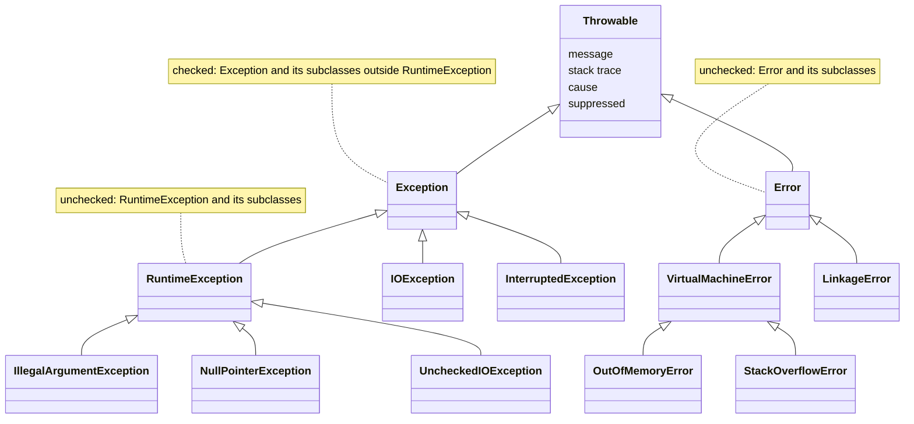
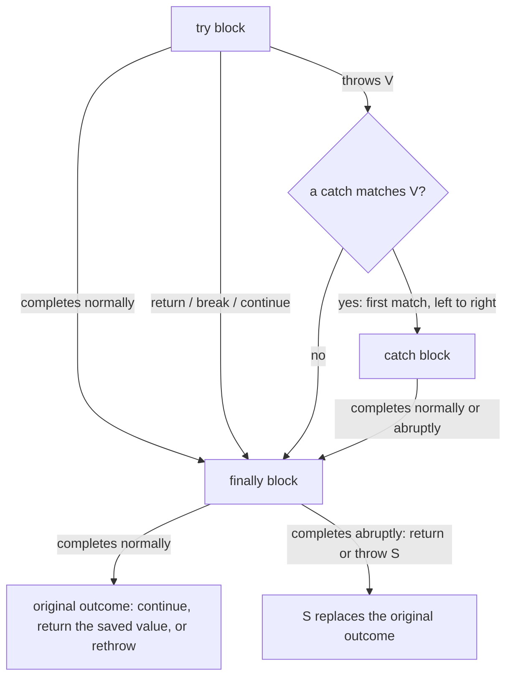
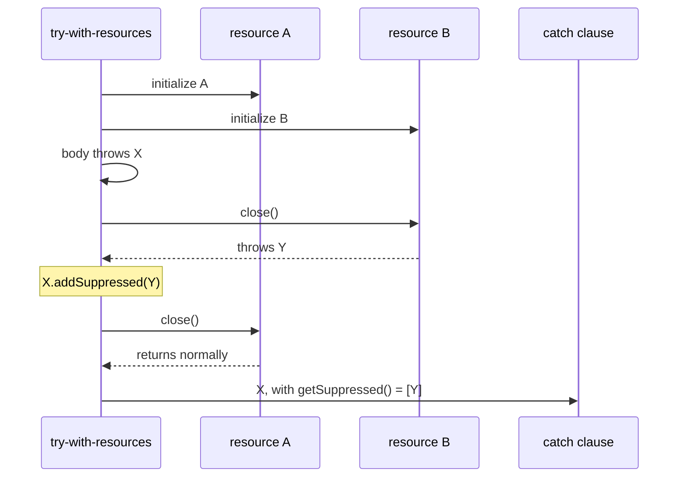
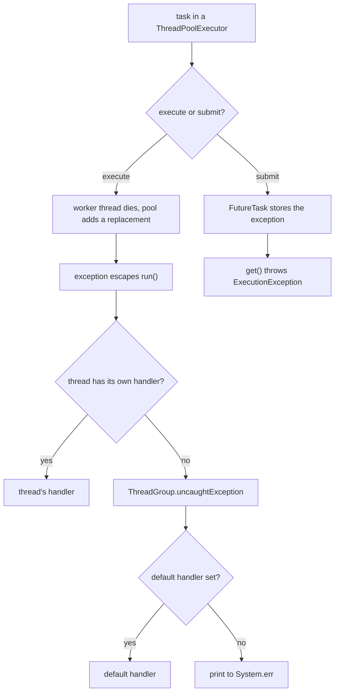
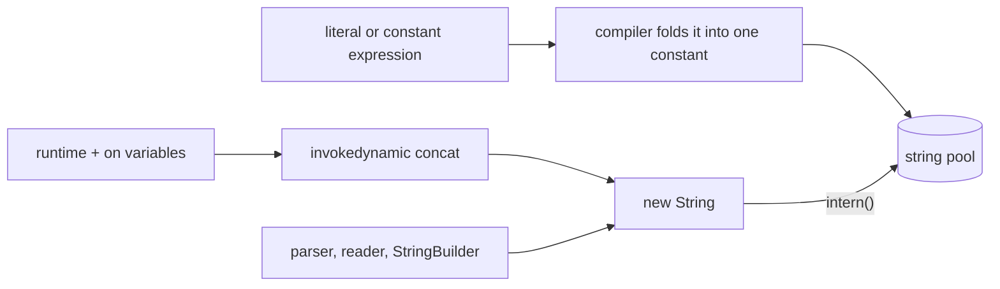
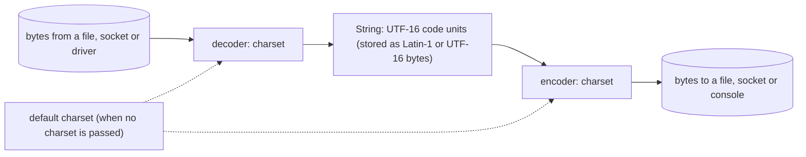
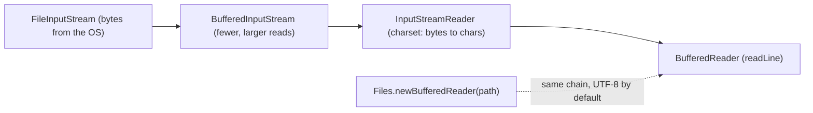
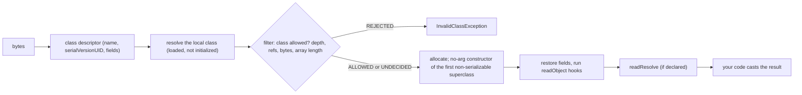
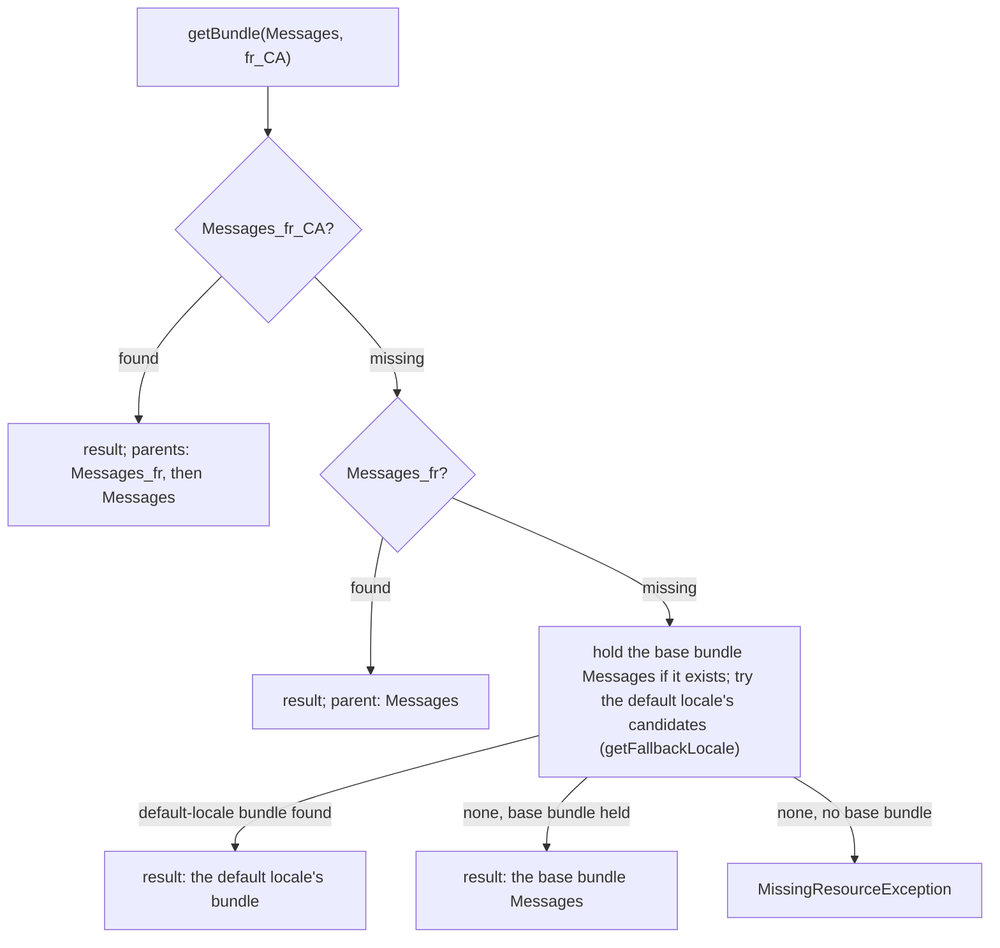

# 06. Exceptions, strings and I/O

> **What this covers:** how Java reports and handles failure, from the `Throwable` hierarchy and the exact control flow of `try`, `catch`, `finally` and try-with-resources to chaining, custom exceptions, the cost of stack traces, and what happens to an exception nobody catches, in a thread or in a thread pool. Then text and bytes: the string pool, compact strings and how `+` compiles, Unicode code points and charsets (UTF-8 by default since Java 18), byte and character streams and NIO.2, Java serialization and why deserializing untrusted data is dangerous, and locale-sensitive formatting.
> **Prerequisites:** [01. OOP fundamentals § 7. Inheritance, composition and `Object`](01-java-oop-fundamentals.md#7-inheritance-composition-and-object), [§ 8. Polymorphism: overloading, overriding and dispatch](01-java-oop-fundamentals.md#8-polymorphism-overloading-overriding-and-dispatch), [02. Equality, immutability and records § 5. Immutability](02-java-equality-immutability-records.md#5-immutability)
> **Leads to:** [22. JDBC and connection pooling](22-jdbc-and-connection-pooling.md)
> **Applies to:** Java 25
> **Study time:** ~6 hours reading + ~3 hours exercises
> **Short on time:** [1. The exception hierarchy: `Throwable`, `Error`, checked and unchecked](#1-the-exception-hierarchy-throwable-error-checked-and-unchecked), [3. try-with-resources, suppressed exceptions and chaining](#3-try-with-resources-suppressed-exceptions-and-chaining), [7. Unicode and charsets: `char`, code points and encodings](#7-unicode-and-charsets-char-code-points-and-encodings); questions [Q06.02](#q06-02), [Q06.03](#q06-03), [Q06.07](#q06-07), [Q06.13](#q06-13), [Q06.15](#q06-15), [Q06.22](#q06-22); then [Summary](#summary).
> **Labs:** [`labs/java-language/`](../labs/java-language/), package `dev.interview.javalanguage.m06`. Run: `JAVA_HOME=$(/usr/libexec/java_home -v 25) mvn -q -f java-backend-guide/labs/pom.xml -pl java-language -am verify`. Needs Docker: no.

## Contents

1. [The exception hierarchy: `Throwable`, `Error`, checked and unchecked](#1-the-exception-hierarchy-throwable-error-checked-and-unchecked)
2. [`try`, `catch` and `finally`: control flow and compile-time rules](#2-try-catch-and-finally-control-flow-and-compile-time-rules)
3. [try-with-resources, suppressed exceptions and chaining](#3-try-with-resources-suppressed-exceptions-and-chaining)
4. [Custom exceptions, the cost of stack traces, and the JVM's errors](#4-custom-exceptions-the-cost-of-stack-traces-and-the-jvms-errors)
5. [Exceptions at boundaries and uncaught exceptions](#5-exceptions-at-boundaries-and-uncaught-exceptions)
6. [Strings: the pool, compact strings, concatenation and the `String` API](#6-strings-the-pool-compact-strings-concatenation-and-the-string-api)
7. [Unicode and charsets: `char`, code points and encodings](#7-unicode-and-charsets-char-code-points-and-encodings)
8. [I/O: byte and character streams, buffering and NIO.2](#8-io-byte-and-character-streams-buffering-and-nio2)
9. [Java serialization and its risks](#9-java-serialization-and-its-risks)
10. [Internationalization: `Locale`, `ResourceBundle` and locale-sensitive formatting](#10-internationalization-locale-resourcebundle-and-locale-sensitive-formatting)
- [Summary](#summary)
- [Question bank](#question-bank)
- [Hands-on exercises](#hands-on-exercises)
- [Check your understanding](#check-your-understanding)
- [Connections](#connections)

## 1. The exception hierarchy: `Throwable`, `Error`, checked and unchecked
### The problem it solves

A stock service reserves items with `int reserve(String sku, int quantity)`, which returns a reservation number, or `-1` when the item is out of stock, or `-2` when the warehouse system did not answer. A new checkout flow calls it, never compares the result with `-1`, stores the number on the order and ships. Weeks later the warehouse finds orders that point at reservation `-1`. Nothing failed loudly, because a return code is a value like any other: the caller can ignore it, and the compiler cannot tell that it should not. The JLS describes this style as "returning funny values, such as the integer value -1", and notes that "too often such funny values are ignored or not checked for by callers" [Doc: JLS 25 §11](https://docs.oracle.com/javase/specs/jls/se25/html/jls-11.html). What the flow needed was a failure that cannot be mistaken for a result, that travels up the call stack until code able to handle it is found, and, for the failures a caller can plan for (an unavailable warehouse), a compiler that makes every caller decide what to do.

### Mental model

Think of an exception as an alarm raised on one floor of a building. It does not wait for the floor to check a status light: it goes up the stairwell (the call stack, the chain of method calls currently running) floor by floor, and every floor that has no responder for that kind of alarm is evacuated on the way (each method stops where it is). The first floor with a matching responder (a `catch` clause naming the exception's class or a superclass) takes over. If no floor has one, building management (the thread's uncaught-exception handler, [§5](#5-exceptions-at-boundaries-and-uncaught-exceptions)) gets it and the thread stops.

The building code adds a rule for some alarms. For **checked** exceptions, every floor must either have a responder or post a sign saying "this alarm passes through here" (a `throws` clause), and the inspector (the compiler) refuses the building otherwise. For **unchecked** exceptions there is no such rule: they are the alarms that can go off anywhere (a bug, the machine running out of memory), and a sign on every door would say nothing. Which rule applies depends only on the alarm's class, that is, on where it sits in this hierarchy:



What to notice: "checked" is a property of a class's position in the hierarchy, decided at compile time, not something that happens at run time; `IOException` and `UncheckedIOException` describe the same kind of failure and differ only in their superclass.

### How it actually works

**The root: `Throwable`.** "Only objects that are instances of this class (or one of its subclasses) are thrown by the Java Virtual Machine or can be thrown by the Java `throw` statement. Similarly, only this class or one of its subclasses can be the argument type in a `catch` clause" [Src: JDK 25, java.lang.Throwable](https://github.com/openjdk/jdk/blob/jdk-25-ga/src/java.base/share/classes/java/lang/Throwable.java). A throwable carries a message, a snapshot of its thread's stack taken when it was created (the *stack trace*: the list of method frames that were running), a *cause* (the throwable that caused this one) and the throwables it *suppressed* [Src: JDK 25, java.lang.Throwable](https://github.com/openjdk/jdk/blob/jdk-25-ga/src/java.base/share/classes/java/lang/Throwable.java); [§3](#3-try-with-resources-suppressed-exceptions-and-chaining) covers causes and suppression, [§4](#4-custom-exceptions-the-cost-of-stack-traces-and-the-jvms-errors) what the stack trace costs. `Throwable` is a direct subclass of `Object`, `Exception` and `Error` are its direct subclasses, and `RuntimeException` is a direct subclass of `Exception` [Doc: JLS 25 §11.1.1](https://docs.oracle.com/javase/specs/jls/se25/html/jls-11.html#jls-11.1.1). One restriction comes from the JVM: "a subclass of `Throwable` cannot be generic" [Doc: JLS 25 §11.1.1](https://docs.oracle.com/javase/specs/jls/se25/html/jls-11.html#jls-11.1.1), and "this restriction is needed since the catch mechanism of the Java Virtual Machine works only with non-generic classes" [Doc: JLS 25 §8.1.2](https://docs.oracle.com/javase/specs/jls/se25/html/jls-8.html#jls-8.1.2): a handler matches the thrown object's runtime class, which carries no type arguments ([03 §5](03-java-generics.md#5-type-erasure-and-bridge-methods) covers erasure). In the lab, `class Rules<T> extends Exception` fails with `compiler.err.generic.throwable` [Lab: ExceptionCompileRulesTest](../labs/java-language/src/test/java/dev/interview/javalanguage/m06/s01/ExceptionCompileRulesTest.java).

**`Exception`, `Error` and the checked/unchecked split.** The JLS defines the two groups by subclassing alone: "The unchecked exception classes are the run-time exception classes and the error classes", and "the checked exception classes are `Throwable` and all its subclasses other than `RuntimeException` and its subclasses and `Error` and its subclasses" [Doc: JLS 25 §11.1.1](https://docs.oracle.com/javase/specs/jls/se25/html/jls-11.html#jls-11.1.1). The Javadoc gives each branch its intent. `Exception` "indicates conditions that a reasonable application might want to catch" [Src: JDK 25, java.lang.Exception](https://github.com/openjdk/jdk/blob/jdk-25-ga/src/java.base/share/classes/java/lang/Exception.java); `Error` "indicates serious problems that a reasonable application should not try to catch" [Src: JDK 25, java.lang.Error](https://github.com/openjdk/jdk/blob/jdk-25-ga/src/java.base/share/classes/java/lang/Error.java); `RuntimeException` is "the superclass of those exceptions that can be thrown during the normal operation of the Java Virtual Machine" [Src: JDK 25, java.lang.RuntimeException](https://github.com/openjdk/jdk/blob/jdk-25-ga/src/java.base/share/classes/java/lang/RuntimeException.java). `Error` sits beside `Exception`, not under it, so that `catch (Exception e)` catches everything a program may recover from "without catching errors from which recovery is typically not possible" [Doc: JLS 25 §11.1.1](https://docs.oracle.com/javase/specs/jls/se25/html/jls-11.html#jls-11.1.1). The lab's `ExceptionKind.of` classifies a class by those two superclass checks and nothing else: `Throwable`, `Exception`, `IOException` and a class that extends `Throwable` directly come out checked; `RuntimeException`, `UncheckedIOException`, `NullPointerException`, `Error` and `OutOfMemoryError` come out unchecked [Lab: ExceptionHierarchyTest](../labs/java-language/src/test/java/dev/interview/javalanguage/m06/s01/ExceptionHierarchyTest.java).

**Where exceptions come from.** An exception is thrown for one of four reasons: a `throw` statement ran; an enabled `assert` failed; the JVM detected an abnormal condition synchronously; or an *asynchronous* exception occurred, one that is not tied to a particular statement and is always a `VirtualMachineError` [Doc: JLS 25 §11.1.2](https://docs.oracle.com/javase/specs/jls/se25/html/jls-11.html#jls-11.1.2) [Doc: JLS 25 §11.1.3](https://docs.oracle.com/javase/specs/jls/se25/html/jls-11.html#jls-11.1.3). The synchronous JVM conditions fall into three kinds: an expression violates the language's semantics, an error occurs while loading, linking or initializing a class (a `LinkageError`, [08](08-jvm-memory-and-class-loading.md)'s subject), or a resource limit stops the JVM (a `VirtualMachineError`) [Doc: JLS 25 §11.1.2](https://docs.oracle.com/javase/specs/jls/se25/html/jls-11.html#jls-11.1.2). JLS §15.6 lists the first kind operator by operator: integer division or remainder by zero throws `ArithmeticException`, an index outside an array throws `ArrayIndexOutOfBoundsException`, a negative array size `NegativeArraySizeException`, an impermissible cast `ClassCastException`, storing the wrong type into an array `ArrayStoreException`, dereferencing `null` through an array access, a field access or an instance method call `NullPointerException`, a `switch` expression or enhanced `switch` statement with no matching label `MatchException`, and creating an object or array `OutOfMemoryError` when memory runs out [Doc: JLS 25 §15.6](https://docs.oracle.com/javase/specs/jls/se25/html/jls-15.html#jls-15.6). In the lab the JVM raises each of the first six itself, and every one is unchecked [Lab: ExceptionHierarchyTest](../labs/java-language/src/test/java/dev/interview/javalanguage/m06/s01/ExceptionHierarchyTest.java). The `throw` statement accepts any expression assignable to `Throwable`, or `null`, and a `null` value makes it throw a new `NullPointerException` instead [Doc: JLS 25 §14.18](https://docs.oracle.com/javase/specs/jls/se25/html/jls-14.html#jls-14.18); the lab's `throw nothing` with a `null` variable throws exactly that [Lab: ExceptionHierarchyTest](../labs/java-language/src/test/java/dev/interview/javalanguage/m06/s01/ExceptionHierarchyTest.java).

**Propagation.** While an exception is being thrown, the JVM "abruptly completes, one by one, any expressions, statements, method and constructor invocations, initializers, and field initialization expressions that have begun but not completed execution in the current thread", until it finds a handler "that indicates that it handles that particular exception by naming the class of the exception or a superclass of the class of the exception" [Doc: JLS 25 §11](https://docs.oracle.com/javase/specs/jls/se25/html/jls-11.html). (*Abrupt completion* is the JLS term for a statement or expression that ends without producing its normal result.) The code that threw "is never resumed", and exceptions are *precise*: every effect before the throw point appears to have happened and nothing after it does [Doc: JLS 25 §11.3](https://docs.oracle.com/javase/specs/jls/se25/html/jls-11.html#jls-11.3). Monitors held by `synchronized` blocks and methods are released on the way out [Doc: JLS 25 §11](https://docs.oracle.com/javase/specs/jls/se25/html/jls-11.html). If no handler exists, the thread runs its `finally` clauses and terminates, and its uncaught-exception handler runs ([§5](#5-exceptions-at-boundaries-and-uncaught-exceptions)) [Doc: JLS 25 §11.3](https://docs.oracle.com/javase/specs/jls/se25/html/jls-11.html#jls-11.3). This is what exceptions buy over return codes: the normal path stays free of error checks, handlers are chosen by type, and a method that cannot handle a failure does nothing at all to pass it on. The five keywords involved are `try`, `catch` and `finally`, which form the handling statement ([§2](#2-try-catch-and-finally-control-flow-and-compile-time-rules)), and `throw` and `throws`, below.

**Catch or declare: what the compiler checks.** "For each checked exception which is a possible result, the `throws` clause for the method or constructor must mention the class of that exception or one of the superclasses of the class of that exception" [Doc: JLS 25 §11.2](https://docs.oracle.com/javase/specs/jls/se25/html/jls-11.html#jls-11.2). Formally, it is a compile-time error if a method or constructor body *can throw* a checked class that is not a subclass of a class in its `throws` clause [Doc: JLS 25 §11.2.3](https://docs.oracle.com/javase/specs/jls/se25/html/jls-11.html#jls-11.2.3). "Can throw" is computed from declarations, not from what the code really does: a method call can throw the exception types of the chosen method's `throws` clause, and a `throw` statement can throw the static type of its expression [Doc: JLS 25 §11.2.1](https://docs.oracle.com/javase/specs/jls/se25/html/jls-11.html#jls-11.2.1) [Doc: JLS 25 §11.2.2](https://docs.oracle.com/javase/specs/jls/se25/html/jls-11.html#jls-11.2.2). The two ways out are a `catch` around the call or the exception (or a superclass) in the caller's own `throws` clause. In the lab, a call to a method declaring `throws IOException` from a method that does neither fails with `compiler.err.unreported.exception.need.to.catch.or.throw`, and declaring or catching it compiles [Lab: ExceptionCompileRulesTest](../labs/java-language/src/test/java/dev/interview/javalanguage/m06/s01/ExceptionCompileRulesTest.java). Static initializers may not throw checked exceptions at all, since there is no `throws` clause to declare them in [Doc: JLS 25 §11.2.3](https://docs.oracle.com/javase/specs/jls/se25/html/jls-11.html#jls-11.2.3) ([01 §5](01-java-oop-fundamentals.md#5-constructors-and-initialization-order) shows what an unchecked one does).

**Why unchecked classes are exempt.** The JLS gives one reason for each group. Errors "can occur at many points in the program and recovery from them is difficult or impossible. A program declaring such exceptions would be cluttered, pointlessly." Run-time exceptions are exempt because "having to declare such exceptions would not aid significantly in establishing the correctness of programs": the compiler cannot prove that a `NullPointerException` is impossible even when the programmer knows it is, and requiring the declaration "would simply be an irritation to programmers" [Doc: JLS 25 §11.2](https://docs.oracle.com/javase/specs/jls/se25/html/jls-11.html#jls-11.2). A `throws` clause may still name unchecked classes; that is "permitted but not required" [Doc: JLS 25 §8.4.6](https://docs.oracle.com/javase/specs/jls/se25/html/jls-8.html#jls-8.4.6). In the lab, a method throwing `IllegalArgumentException` and `StackOverflowError`, its caller, and a method that lists `throws IllegalStateException` all compile without a `catch` [Lab: ExceptionCompileRulesTest](../labs/java-language/src/test/java/dev/interview/javalanguage/m06/s01/ExceptionCompileRulesTest.java). Unchecked exceptions propagate through methods that never mention them: the lab's `RateCards.current` declares nothing, and the loader's `IllegalArgumentException` reaches its caller unchanged [Lab: RateCardsTest](../labs/java-language/src/test/java/dev/interview/javalanguage/m06/s01/RateCardsTest.java).

**`throw` and `throws`.** `throw` is a statement that throws one object now. `throws` is part of a method or constructor declaration that lists exception *types*, class types or type variables, each a subtype of `Throwable` [Doc: JLS 25 §8.4.6](https://docs.oracle.com/javase/specs/jls/se25/html/jls-8.html#jls-8.4.6). The checked types in it "are part of the contract between the implementor and user of the method or constructor" [Doc: JLS 25 §11.2](https://docs.oracle.com/javase/specs/jls/se25/html/jls-11.html#jls-11.2), which is why overriding restricts them.

**The override rule.** "A method that overrides or hides another method, including methods that implement abstract methods defined in interfaces, may not be declared to throw more checked exceptions than the overridden or hidden method": every checked type in the override's `throws` clause must be the same class as, or a subclass of, one in the overridden method's clause [Doc: JLS 25 §8.4.8.3](https://docs.oracle.com/javase/specs/jls/se25/html/jls-8.html#jls-8.4.8.3). The reason is substitution: code that calls `move` through a `Point` reference was compiled against `Point.move`'s contract, so it has no handler for an exception only the subclass declares (JLS Example 8.4.8.3-3 makes this argument), and a subclass must work wherever its parent is expected ([01 §8](01-java-oop-fundamentals.md#8-polymorphism-overloading-overriding-and-dispatch) covers overriding in general). When one method overrides several interface methods at once, its `throws` clause must be compatible with all of them [Doc: JLS 25 §11.2](https://docs.oracle.com/javase/specs/jls/se25/html/jls-11.html#jls-11.2). In the lab, an override that adds `throws Exception` fails with `compiler.err.override.meth.doesnt.throw`; overrides of `save() throws IOException` that declare `FileNotFoundException`, nothing, or the unchecked `IllegalStateException` all compile [Lab: ExceptionCompileRulesTest](../labs/java-language/src/test/java/dev/interview/javalanguage/m06/s01/ExceptionCompileRulesTest.java).

**Only the compiler checks.** The `throws` clause is stored in the class file's `Exceptions` attribute, and the JVM specification says of the rule that a method throws only unchecked or declared exceptions: "These requirements are not enforced in the Java Virtual Machine; they are enforced only at compile time" [Doc: JVMS 25 §4.7.5](https://docs.oracle.com/javase/specs/jvms/se25/html/jvms-4.html#jvms-4.7.5). Code compiled against an older version of a library, code generated at run time, other JVM languages (Kotlin "treats all exceptions as unchecked" [Doc: Kotlin documentation, Exceptions](https://kotlinlang.org/docs/exceptions.html)), and Java code that tricks the compiler can all throw a checked exception from a method that does not declare it. The lab's `UncheckedThrow.sneakyThrow` uses a generic method whose `throws E` the compiler reads as `RuntimeException`; at run time the cast to `E` is erased, and the original `IOException` leaves a method with no `throws` clause [Lab: ExceptionHierarchyTest](../labs/java-language/src/test/java/dev/interview/javalanguage/m06/s01/ExceptionHierarchyTest.java). A lambda body is checked against the `throws` clause of its functional interface's method, which is why `Function` cannot wrap code that throws `IOException` ([05 §9](05-java-lambdas-streams-optional.md#9-checked-exceptions-and-resources-in-lambdas-and-streams)) [Doc: JLS 25 §11.2.3](https://docs.oracle.com/javase/specs/jls/se25/html/jls-11.html#jls-11.2.3).

**Choosing checked or unchecked.** The JLS suggests making most new exception classes checked, "to take advantage of compile-time checking for exception handlers" [Doc: JLS 25 §11.1.1](https://docs.oracle.com/javase/specs/jls/se25/html/jls-11.html#jls-11.1.1), and the JDK follows its own split: I/O, interruption and reflection failures are checked (`IOException`, `InterruptedException`, `ClassNotFoundException`), while precondition violations are unchecked (`IllegalArgumentException`, `IllegalStateException`, and the `NullPointerException` of `Objects.requireNonNull`), as the lab's classification of those classes confirms [Lab: ExceptionHierarchyTest](../labs/java-language/src/test/java/dev/interview/javalanguage/m06/s01/ExceptionHierarchyTest.java). The working rule that follows is about the caller, not the failure. A condition outside the program's control that the *immediate* caller can do something about (retry, fall back, ask the user) earns a checked exception, because the compiler then makes every caller decide. A bug in the caller, or a failure nobody near the call can handle, is unchecked, because a `catch` cannot fix a bug and a declaration on every method would only add noise. Many frameworks lean unchecked for the second reason: Spring's `DataAccessException` extends `RuntimeException` through `NestedRuntimeException`, and its Javadoc says "there is no need for user code to catch it or subclasses if any error is to be considered fatal (the usual case)" [Src: spring-tx 7.0.10, DataAccessException](https://github.com/spring-projects/spring-framework/blob/v7.0.10/spring-tx/src/main/java/org/springframework/dao/DataAccessException.java). The choice has consequences outside Java too: Spring rolls a transaction back by default only for unchecked exceptions and errors ([17 §5](17-spring-transactions.md#5-rollback-rules-and-rollback-only)), and [22](22-jdbc-and-connection-pooling.md) shows how JDBC's checked `SQLException` gets translated. [Q06.01](#q06-01) and [Q06.02](#q06-02) drill this section.

**Helpful `NullPointerException` messages.** Since Java 14 the JVM can compute a message that says which part of an expression was `null`, such as `Cannot read field "c" because "a.b" is null`: the first part names the action that failed, the second the null expression [Doc: JEP 358](https://openjdk.org/jeps/358). Local variable names appear only when the class was compiled with debug information (`javac -g`); otherwise the message uses a placeholder of the form `<local4>` [Doc: JEP 358](https://openjdk.org/jeps/358). In the lab, `order.customer().name()` with a null customer throws a message that starts with `Cannot invoke "` and ends with `Order.customer()" is null`, naming the method whose return value was null [Lab: ExceptionHierarchyTest](../labs/java-language/src/test/java/dev/interview/javalanguage/m06/s01/ExceptionHierarchyTest.java).

### Code

The approach: a rate-card loader whose two kinds of failure get the two kinds of exception, and a caller that handles only the one it can recover from.

1. Hide the storage behind a `RateSource` port whose `read` declares `IOException`, because a file share or a bucket can fail for reasons outside the program.
2. In `RateCardLoader.load`, reject a null or blank name with unchecked exceptions, because that is the caller's bug and no `catch` can repair it.
3. Declare `throws IOException` on `load` instead of catching it, because the loader cannot decide what a missing card means; its caller can.
4. In `RateCards.current`, catch only `IOException`, log it, and fall back to the last card that loaded, letting every unchecked exception propagate.

```java
// Excerpt of labs/java-language/src/main/java/dev/interview/javalanguage/m06/s01/RateCardLoader.java
    // IOException is declared: the storage can fail and the caller can do something about it.
    // A null or blank name is the caller's bug, reported with unchecked exceptions.
    public RateCard load(String name) throws IOException {
        Objects.requireNonNull(name, "name");
        if (name.isBlank()) {
            throw new IllegalArgumentException("rate card name is blank");
        }
        String text = source.read(name);
        return RateCard.parse(name, text);
    }
```

```java
// Excerpt of labs/java-language/src/main/java/dev/interview/javalanguage/m06/s01/RateCards.java
    public RateCard current(String name) {
        try {
            return loader.load(name);
        } catch (IOException e) {
            LOG.log(Level.WARNING, "rate card " + name + " unreadable, using last known good", e);
            return lastKnownGood;
        }
    }
```

`RateCardsTest` checks four outcomes: a readable source is parsed; a source that throws `IOException("share unreachable")` makes `load` throw it and `current` return the last known good card; a blank name throws `IllegalArgumentException` straight through `current`, which declares nothing; and a malformed line (`USD 1.10`) also propagates, because `RateCard.parse` reports it as `IllegalArgumentException` and a broken file is a defect to fix, not an outage to ride out [Lab: RateCardsTest](../labs/java-language/src/test/java/dev/interview/javalanguage/m06/s01/RateCardsTest.java). If `current` caught `Exception` instead, both bugs would silently turn into stale rates. Logging and rethrowing at boundaries is [§5](#5-exceptions-at-boundaries-and-uncaught-exceptions)'s subject.

The second snippet exists only to show that the check lives in the compiler. The approach: make the compiler believe a generic method throws `RuntimeException`, and let erasure throw the real object.

```java
// Excerpt of labs/java-language/src/main/java/dev/interview/javalanguage/m06/s01/UncheckedThrow.java
    public static void sneakyThrow(Throwable failure) {
        UncheckedThrow.<RuntimeException>rethrow(failure);
    }

    // E is RuntimeException at the call site, so javac sees no checked exception;
    // the cast is erased, so at run time the original Throwable is thrown unchanged.
    @SuppressWarnings("unchecked")
    private static <E extends Throwable> void rethrow(Throwable failure) throws E {
        throw (E) failure;
    }
```

`sneakyThrow(new IOException("disk"))` throws that same `IOException` object, from a method with no `throws` clause [Lab: ExceptionHierarchyTest](../labs/java-language/src/test/java/dev/interview/javalanguage/m06/s01/ExceptionHierarchyTest.java). The best practices below say why application code should not do this.

### Failure modes and operations

The runtime behavior of exceptions is the subject of the next sections: control flow through `finally` ([§2](#2-try-catch-and-finally-control-flow-and-compile-time-rules)), lost causes and suppressed failures ([§3](#3-try-with-resources-suppressed-exceptions-and-chaining)), the cost of stack traces and the JVM's errors ([§4](#4-custom-exceptions-the-cost-of-stack-traces-and-the-jvms-errors)), and exceptions nobody catches ([§5](#5-exceptions-at-boundaries-and-uncaught-exceptions)). One setting belongs here: the helpful `NullPointerException` message is controlled by the HotSpot flag `ShowCodeDetailsInExceptionMessages`, `true` by default in JDK 25 and declared manageable, with the description "Disable this to improve privacy" [Src: JDK 25, HotSpot globals.hpp](https://github.com/openjdk/jdk/blob/jdk-25-ga/src/hotspot/share/runtime/globals.hpp); `-XX:-ShowCodeDetailsInExceptionMessages` turns it off.

> [!NOTE]
> **Framework vs language.** Checked exceptions are a rule of the Java language, enforced by `javac` from `throws` clauses (JLS §11.2). The JVM stores the clause in the `Exceptions` attribute but does not enforce it [Doc: JVMS 25 §4.7.5](https://docs.oracle.com/javase/specs/jvms/se25/html/jvms-4.html#jvms-4.7.5), so Kotlin, which "treats all exceptions as unchecked" [Doc: Kotlin documentation, Exceptions](https://kotlinlang.org/docs/exceptions.html), and the lab's `sneakyThrow` can both throw a checked exception from a method that does not declare it [Lab: ExceptionHierarchyTest](../labs/java-language/src/test/java/dev/interview/javalanguage/m06/s01/ExceptionHierarchyTest.java). Frameworks add their own policies on top: Spring's data-access exceptions are unchecked by design [Src: spring-tx 7.0.10, DataAccessException](https://github.com/spring-projects/spring-framework/blob/v7.0.10/spring-tx/src/main/java/org/springframework/dao/DataAccessException.java), and its transaction rollback rules treat checked and unchecked exceptions differently ([17 §5](17-spring-transactions.md#5-rollback-rules-and-rollback-only)). Neither is a language rule.

> [!NOTE]
> **Version notes.** Java 1.0: `Throwable`, `Exception`, `RuntimeException` and `Error` are `@since 1.0` [Src: JDK 25, java.lang.Error](https://github.com/openjdk/jdk/blob/jdk-25-ga/src/java.base/share/classes/java/lang/Error.java) [Src: JDK 25, java.lang.RuntimeException](https://github.com/openjdk/jdk/blob/jdk-25-ga/src/java.base/share/classes/java/lang/RuntimeException.java). Java 14: helpful `NullPointerException` messages, off by default behind `-XX:+ShowCodeDetailsInExceptionMessages` [Final since Java 14, JEP 358] [Doc: JEP 358](https://openjdk.org/jeps/358). Java 15: [Changed in Java 15: `ShowCodeDetailsInExceptionMessages` defaults to `true`], so the messages print by default (JDK-8233014) [Doc: JDK 15 release notes, "Enable ShowCodeDetailsInExceptionMessages by default"](https://www.oracle.com/java/technologies/javase/15-relnote-issues.html). Java 21: `MatchException` (`@since 21`), thrown by a `switch` expression or enhanced `switch` statement that no label matches [Src: JDK 25, java.lang.MatchException](https://github.com/openjdk/jdk/blob/jdk-25-ga/src/java.base/share/classes/java/lang/MatchException.java) [Doc: JLS 25 §15.6](https://docs.oracle.com/javase/specs/jls/se25/html/jls-15.html#jls-15.6). Multi-catch and precise rethrow (Java 7) are [§2](#2-try-catch-and-finally-control-flow-and-compile-time-rules)'s; try-with-resources (Java 7, extended in 9) is [§3](#3-try-with-resources-suppressed-exceptions-and-chaining)'s.

### Best practices and anti-patterns

- Report a caller's bug with an unchecked exception (`IllegalArgumentException`, `IllegalStateException`, `Objects.requireNonNull`), because no caller can repair its own bug by catching it, and the JLS exempts these classes for exactly that reason [Doc: JLS 25 §11.2](https://docs.oracle.com/javase/specs/jls/se25/html/jls-11.html#jls-11.2).
- Declare a checked exception for a failure outside the program's control that the immediate caller can act on, because the compiler then forces each caller to choose between handling and declaring it; if no caller will ever handle it, prefer unchecked, because a `throws` clause repeated up twenty frames only moves the noise.
- Do not declare `throws Exception` or `throws Throwable`, because every caller must then catch or declare that broad type, and a `catch (Exception e)` is always legal [Doc: JLS 25 §11.2.3](https://docs.oracle.com/javase/specs/jls/se25/html/jls-11.html#jls-11.2.3), so the compiler can no longer tell anyone which failures are real.
- Catch `Exception`, not `Throwable`, at a last-resort boundary, because `Error` was placed outside `Exception` so that such a handler leaves errors alone [Doc: JLS 25 §11.1.1](https://docs.oracle.com/javase/specs/jls/se25/html/jls-11.html#jls-11.1.1); what a boundary handler must do is [§5](#5-exceptions-at-boundaries-and-uncaught-exceptions).
- Document the unchecked exceptions a caller should expect with Javadoc `@throws`, and list them in `throws` only when that helps readers, because the compiler ignores them there [Doc: JLS 25 §8.4.6](https://docs.oracle.com/javase/specs/jls/se25/html/jls-8.html#jls-8.4.6).
- Do not use "sneaky throw" helpers in application code, because callers cannot catch the hidden checked type by name: a `catch (IOException e)` around a call that declares nothing is a compile-time error [Doc: JLS 25 §11.2.3](https://docs.oracle.com/javase/specs/jls/se25/html/jls-11.html#jls-11.2.3). Wrap it in an unchecked exception with the original as cause instead ([§3](#3-try-with-resources-suppressed-exceptions-and-chaining)).
- **Security:** never return exception messages, helpful `NullPointerException` messages included, to a remote client, because they name internal fields and variables; the JDK 15 release note warns that such a message "could give remote attackers valuable hints about a potential vulnerable state of the software" [Doc: JDK 15 release notes, "Enable ShowCodeDetailsInExceptionMessages by default"](https://www.oracle.com/java/technologies/javase/15-relnote-issues.html). Send a generic error body ([18](18-spring-mvc-and-rest-controllers.md)) and keep the details in the logs ([44](44-observability-logging-metrics-slos.md)).

### Misconceptions and traps

- *"`Error`s cannot be caught."* `catch (StackOverflowError e)` works like any other handler, as the lab shows [Lab: ExceptionHierarchyTest](../labs/java-language/src/test/java/dev/interview/javalanguage/m06/s01/ExceptionHierarchyTest.java); the JLS even notes that "sophisticated programs may yet wish to catch and attempt to recover from some of these conditions" [Doc: JLS 25 §11.2](https://docs.oracle.com/javase/specs/jls/se25/html/jls-11.html#jls-11.2). The myth comes from the `Error` Javadoc's "should not try to catch", read as "cannot", and from `catch (Exception e)`, which indeed does not catch them.
- *"Checked exceptions are checked at run time."* Only `javac` checks them; the JVM does not [Doc: JVMS 25 §4.7.5](https://docs.oracle.com/javase/specs/jvms/se25/html/jvms-4.html#jvms-4.7.5) [Lab: ExceptionHierarchyTest](../labs/java-language/src/test/java/dev/interview/javalanguage/m06/s01/ExceptionHierarchyTest.java). The name suggests a runtime check, and the `throws` clause is visible in the class file, which makes it look enforced.
- *"`throws` must list every exception a method can throw."* It must list the checked ones; unchecked ones are "permitted but not required" [Doc: JLS 25 §8.4.6](https://docs.oracle.com/javase/specs/jls/se25/html/jls-8.html#jls-8.4.6) [Lab: ExceptionCompileRulesTest](../labs/java-language/src/test/java/dev/interview/javalanguage/m06/s01/ExceptionCompileRulesTest.java). The belief comes from reading `throws` as documentation of every failure, which it would be only if all exceptions were checked.
- *"A `RuntimeException` is an exception that happens at run time."* Every exception is thrown at run time. The name refers to exceptions that arise during expression evaluation and the normal operation of the JVM ([Doc: JLS 25 §11.1.1](https://docs.oracle.com/javase/specs/jls/se25/html/jls-11.html#jls-11.1.1) [Src: JDK 25, java.lang.RuntimeException](https://github.com/openjdk/jdk/blob/jdk-25-ga/src/java.base/share/classes/java/lang/RuntimeException.java)); what makes it special is only that it is exempt from compile-time checking. The confusion comes from contrasting "runtime" with "compile time", the two words used for the check.
- *"An overriding method must declare the same exceptions as the method it overrides."* It may declare fewer, narrower ones, none, or any unchecked ones; it may not add a checked exception the parent does not cover [Doc: JLS 25 §8.4.8.3](https://docs.oracle.com/javase/specs/jls/se25/html/jls-8.html#jls-8.4.8.3) [Lab: ExceptionCompileRulesTest](../labs/java-language/src/test/java/dev/interview/javalanguage/m06/s01/ExceptionCompileRulesTest.java). The myth comes from treating `throws` as part of the method's signature, which must match; the signature is only the name, type parameters and parameter types [Doc: JLS 25 §8.4.2](https://docs.oracle.com/javase/specs/jls/se25/html/jls-8.html#jls-8.4.2).
- *"Every exception class extends `Exception` or `Error`."* A class may extend `Throwable` directly, and it is then checked [Doc: JLS 25 §11.1.1](https://docs.oracle.com/javase/specs/jls/se25/html/jls-11.html#jls-11.1.1) [Lab: ExceptionHierarchyTest](../labs/java-language/src/test/java/dev/interview/javalanguage/m06/s01/ExceptionHierarchyTest.java). Nobody should write one, which is why the two-branch picture is the one everybody draws.

Questions that drill this section: [Q06.01](#q06-01), [Q06.02](#q06-02).

## 2. `try`, `catch` and `finally`: control flow and compile-time rules
### The problem it solves

A pricing service protects a slow downstream with a limiter: it counts calls in flight and rejects new ones above 20. The first version decrements the counter on the line after the downstream call returns. Every time the downstream resets a connection, the call throws, the decrement is skipped, and one slot is gone for good. After a few hundred resets over a week the counter sits at 20 with nothing running, and every request is rejected with "limit reached" while the downstream is idle. The code had one success path and the author wrote the cleanup for that path; the exception took a different exit. The problem is to run cleanup on *every* way out of a block (return, exception, `break`, `continue`) without writing it once per exit, and to know exactly what the caller sees when cleanup and failure meet.

### Mental model

A `try` statement is a room with one guarded exit. Code inside the room can leave in several ways: walk out normally, run out with an exception, or jump out with `return`, `break` or `continue`. The `catch` clauses are staff at the door who take the exceptions they were hired for, in the order they stand. The `finally` block is the exit corridor every path goes through, whatever happened inside. The corridor has one dangerous property: whoever walks through it carrying a new reason to leave (a `return` or a `throw` of its own) replaces whatever the room was about to hand to the caller.



What to notice: every arrow passes through `finally`, and the only way the caller does not get the original outcome is the last arrow, where `finally` itself returns or throws.

### How it actually works

**The forms and the grammar.** A `try` statement is `try Block Catches`, `try Block [Catches] Finally`, or a try-with-resources statement; only the last may omit both `catch` and `finally` [Doc: JLS 25 §14.20](https://docs.oracle.com/javase/specs/jls/se25/html/jls-14.html#jls-14.20). In the lab, a bare `try { … }` fails with `compiler.err.try.without.catch.finally.or.resource.decls` [Lab: TryCompileRulesTest](../labs/java-language/src/test/java/dev/interview/javalanguage/m06/s02/TryCompileRulesTest.java). The grammar puts the `catch` clauses and the `finally` clause directly after the block, so no statement may stand between them. Resources are [§3](#3-try-with-resources-suppressed-exceptions-and-chaining)'s subject.

**Choosing a handler.** "Exception handlers are considered in left-to-right order: the earliest possible catch clause accepts the exception" [Doc: JLS 25 §14.20](https://docs.oracle.com/javase/specs/jls/se25/html/jls-14.html#jls-14.20): the first clause whose type the thrown object's *runtime* class is assignment compatible with wins, and later clauses are not considered [Doc: JLS 25 §14.20.1](https://docs.oracle.com/javase/specs/jls/se25/html/jls-14.html#jls-14.20.1). In the lab, `CatchSelection.handle` returns "missing file" for a `FileNotFoundException`, "other I/O failure" for a plain `IOException`, "bug" for an `IllegalStateException` and "other checked" for an `InterruptedException` [Lab: FinallyFlowTest](../labs/java-language/src/test/java/dev/interview/javalanguage/m06/s02/FinallyFlowTest.java). If no clause matches, the `try` statement completes abruptly with the same exception, which continues to the next enclosing `try` in this method or up the call stack ([§1](#1-the-exception-hierarchy-throwable-error-checked-and-unchecked)); a nested `try` is simply the innermost enclosing one [Doc: JLS 25 §11.3](https://docs.oracle.com/javase/specs/jls/se25/html/jls-11.html#jls-11.3).

**Compile-time rules on handlers.** Four rules make most "does this compile?" questions mechanical:
- A clause that can catch only what an earlier clause already catches is an error: `catch (IOException e)` followed by `catch (FileNotFoundException e)` fails, because "a preceding catch clause of the immediately enclosing try statement can catch E1 or a superclass of E1" [Doc: JLS 25 §11.2.3](https://docs.oracle.com/javase/specs/jls/se25/html/jls-11.html#jls-11.2.3). The lab's key is `compiler.err.except.already.caught`. The reverse order (subclass first) is the correct one.
- Catching a checked exception the `try` block cannot throw is an error, "unless E1 is `Exception` or a superclass of `Exception`" [Doc: JLS 25 §11.2.3](https://docs.oracle.com/javase/specs/jls/se25/html/jls-11.html#jls-11.2.3). In the lab, `catch (IOException e)` around a `println` fails with `compiler.err.except.never.thrown.in.try`, while `catch (RuntimeException e)`, `catch (Exception e)` and `catch (Throwable t)` around the same code compile: unchecked classes can always occur, and `Exception` and `Throwable` include them.
- A statement after `throw` is unreachable, and "it is a compile-time error if a statement cannot be executed because it is unreachable" [Doc: JLS 25 §14.22](https://docs.oracle.com/javase/specs/jls/se25/html/jls-14.html#jls-14.22); a `throw` "always completes abruptly" [Doc: JLS 25 §14.18](https://docs.oracle.com/javase/specs/jls/se25/html/jls-14.html#jls-14.18). The lab's key is `compiler.err.unreachable.stmt`.
- A bare `try`, as above.

All four are asserted by diagnostic key in [Lab: TryCompileRulesTest](../labs/java-language/src/test/java/dev/interview/javalanguage/m06/s02/TryCompileRulesTest.java), and [Q06.05](#q06-05) drills them.

**What `finally` does with each outcome.** JLS §14.20.2 defines a `try` with `finally` case by case, and the cases reduce to one rule: `finally` runs after the `try` block and any `catch` block, "no matter how control leaves the try block or catch block" [Doc: JLS 25 §14.20](https://docs.oracle.com/javase/specs/jls/se25/html/jls-14.html#jls-14.20); if it completes normally, the statement ends the way it would have ended without it, and if it completes abruptly for a reason S, "the try statement completes abruptly for reason S (and reason R is discarded)" [Doc: JLS 25 §14.20.2](https://docs.oracle.com/javase/specs/jls/se25/html/jls-14.html#jls-14.20.2). *Completing abruptly* covers more than exceptions: `break`, `continue` and `return` are abrupt completions too, so `finally` runs for them. In the lab, a loop whose body `continue`s at 1 and `break`s at 3 records `finally` for iterations 0 to 3, and an `UnsupportedOperationException` that the only `catch` (for `IllegalArgumentException`) does not match leaves the events `try`, `finally` and then propagates [Lab: FinallyFlowTest](../labs/java-language/src/test/java/dev/interview/javalanguage/m06/s02/FinallyFlowTest.java).

**`return` and `finally`.** A `return` with a value "first evaluates the Expression"; then, if the `return` is inside a `try` with `finally`, "any finally clauses of those try statements will be executed, in order, innermost to outermost, before control is transferred to the invoker", and "abrupt completion of a finally clause can disrupt the transfer of control initiated by a return statement" [Doc: JLS 25 §14.17](https://docs.oracle.com/javase/specs/jls/se25/html/jls-14.html#jls-14.17). Three consequences, each in the lab [Lab: FinallyFlowTest](../labs/java-language/src/test/java/dev/interview/javalanguage/m06/s02/FinallyFlowTest.java):
- the order is: return expression evaluated, `finally` runs, caller resumes (events `try`, `return expression`, `finally`, `caller got result`);
- assigning the returned variable in `finally` does not change the result, because the value was already computed: `int count = 1; try { return count; } finally { count = 2; }` returns 1. For a reference, the *reference* was computed, so `finally` cannot swap the object but can mutate it: a returned list gains the element `finally` adds;
- a `return` in `finally` replaces the pending outcome, exception included: a `try` that throws `IllegalStateException` with `finally { return 42; }` returns 42 and the exception vanishes. A `throw` in `finally` does the same: the `IllegalArgumentException` from `try` is gone, and the `IllegalStateException` from `finally` has no cause and no suppressed exceptions. [Q06.03](#q06-03) drills all three.

**How javac compiles `finally`.** Class files of version 50.0 or below could compile `finally` as a subroutine called with the `jsr` and `ret` instructions; for a `return` inside `try`, the compiled code "saves the return value (if any) in a local variable", runs the `finally` code, and then returns the saved value, which is the mechanism behind the second consequence above [Doc: JVMS 25 §4.10.2.5](https://docs.oracle.com/javase/specs/jvms/se25/html/jvms-4.html#jvms-4.10.2.5). From class file version 51.0 on, `jsr`, `jsr_w` and `ret` "must not appear in the code array" [Doc: JVMS 25 §4.9.1](https://docs.oracle.com/javase/specs/jvms/se25/html/jvms-4.html#jvms-4.9.1), so javac copies the `finally` block into each exit path instead and adds a catch-all exception handler that runs the copy and rethrows. In the lab, reading the compiled `FinallyFlow.returnThenFinally` with the Class-File API [Final since Java 24, JEP 484] finds the `finally` block's string constant twice (normal path and handler), a handler with no catch type, and no `jsr` or `ret` [Lab: FinallyBytecodeTest](../labs/java-language/src/test/java/dev/interview/javalanguage/m06/s02/FinallyBytecodeTest.java) [Doc: JEP 484](https://openjdk.org/jeps/484). A large `finally` block therefore costs code size per exit path, one more reason to keep it short.

**When `finally` does not run.** `finally` runs whenever control leaves the `try` block. It does not run when control never leaves it, or when the JVM stops running Java code:
- **`System.exit` and `Runtime.exit`.** `exit` starts the shutdown sequence and "neither returns nor throws an exception; that is, it does not complete either normally or abruptly"; the shutdown hooks run, and when the JVM terminates, "`finally` clauses are not executed" [Src: JDK 25, java.lang.Runtime](https://github.com/openjdk/jdk/blob/jdk-25-ga/src/java.base/share/classes/java/lang/Runtime.java). In the lab, a child JVM that prints `try` and calls `System.exit(3)` inside `try` exits with status 3 and prints the shutdown hook's line but never `finally` [Lab: JvmExitTest](../labs/java-language/src/test/java/dev/interview/javalanguage/m06/s02/JvmExitTest.java).
- **`Runtime.halt`.** "Termination of the Java Virtual Machine is unconditional and immediate"; it does not even start the shutdown sequence, so hooks do not run either [Src: JDK 25, java.lang.Runtime](https://github.com/openjdk/jdk/blob/jdk-25-ga/src/java.base/share/classes/java/lang/Runtime.java).
- **Daemon threads at JVM exit.** The shutdown sequence starts "when the number of live non-daemon threads drops to zero", and at termination "threads' current methods do not complete normally or abruptly" [Src: JDK 25, java.lang.Runtime](https://github.com/openjdk/jdk/blob/jdk-25-ga/src/java.base/share/classes/java/lang/Runtime.java). In the lab, a daemon thread blocked inside `try` when `main` returns never prints its `finally` line [Lab: JvmExitTest](../labs/java-language/src/test/java/dev/interview/javalanguage/m06/s02/JvmExitTest.java). ([11](11-concurrency-threads-and-jmm.md) covers daemon threads.)
- **A `try` block that never finishes**, because of an infinite loop, a deadlock or a thread blocked forever: `finally` runs only after the block completes.
- **The process dies**: `kill -9`, an out-of-memory kill by the container runtime, a JVM crash. No Java code runs after that, by definition of the process being gone.

[Q06.04](#q06-04) drills these cases.

**Multi-catch.** A `catch` clause may name a union, `catch (IOException | InterruptedException e)`; it behaves like one clause per alternative sharing one body, and the parameter's type is the least upper bound of the alternatives [Doc: JLS 25 §14.20](https://docs.oracle.com/javase/specs/jls/se25/html/jls-14.html#jls-14.20). Two rules come with it. The parameter "is implicitly declared final", so assigning it is an error (lab key `compiler.err.multicatch.parameter.may.not.be.assigned`); and "it is a compile-time error if a union of types contains two alternatives Di and Dj (i ≠ j) where Di is a subtype of Dj" (lab key `compiler.err.multicatch.types.must.be.disjoint`), because the subclass alternative would add nothing [Doc: JLS 25 §14.20](https://docs.oracle.com/javase/specs/jls/se25/html/jls-14.html#jls-14.20) [Lab: TryCompileRulesTest](../labs/java-language/src/test/java/dev/interview/javalanguage/m06/s02/TryCompileRulesTest.java). The JLS notes that a compiler is "neither required nor recommended" to duplicate the body per alternative, since a class file can represent the clause without duplication [Doc: JLS 25 §14.20](https://docs.oracle.com/javase/specs/jls/se25/html/jls-14.html#jls-14.20).

**Precise rethrow.** A `throw` of a `final` or effectively final `catch` parameter can throw only the exception classes that the `try` block can throw, that the clause catches, and that no earlier clause catches [Doc: JLS 25 §11.2.2](https://docs.oracle.com/javase/specs/jls/se25/html/jls-11.html#jls-11.2.2). So a method whose `try` calls only `read() throws IOException` may `catch (Exception e) { log(e); throw e; }` and still declare just `throws IOException`. In the lab that compiles, and assigning `e = new Exception("wrapped", e)` before the `throw` turns the rule off: the parameter is no longer effectively final, the `throw` can throw `Exception`, and the method fails with `compiler.err.unreported.exception.need.to.catch.or.throw` [Lab: TryCompileRulesTest](../labs/java-language/src/test/java/dev/interview/javalanguage/m06/s02/TryCompileRulesTest.java). [Q06.06](#q06-06) drills multi-catch and precise rethrow.

### Code

The approach: release the limiter's slot in `finally`, so the release runs on every exit, and let a type variable carry the work's checked exception through unchanged.

1. Declare `Work<T, E extends Exception>` with `T run() throws E`, so the limiter can say "I throw whatever the work throws" (a type variable in a `throws` clause, [Doc: JLS 25 §8.4.6](https://docs.oracle.com/javase/specs/jls/se25/html/jls-8.html#jls-8.4.6)).
2. Take the slot with `incrementAndGet`; if that went over the limit, give it back and reject, before entering the `try`.
3. Enter `try` only after the slot is held, and release it in `finally`: the release must not run for a slot that was never taken.
4. Return the work's result from inside `try`; `finally` runs before the caller sees it.

```java
// Excerpt of labs/java-language/src/main/java/dev/interview/javalanguage/m06/s02/InFlightLimiter.java
    public <T, E extends Exception> T run(Work<T, E> work) throws E {
        if (inFlight.incrementAndGet() > limit) {
            inFlight.decrementAndGet();
            throw new RejectedExecutionException("limit " + limit + " reached");
        }
        try {
            return work.run();
        } finally {
            inFlight.decrementAndGet();
        }
    }
```

In the lab the slot is back to 0 after a normal return and after the work throws `IOException("downstream reset")`, and the next call is admitted [Lab: InFlightLimiterTest](../labs/java-language/src/test/java/dev/interview/javalanguage/m06/s02/InFlightLimiterTest.java). The caller catches exactly `IOException`; for a lambda that throws nothing checked, `E` is inferred as `RuntimeException` (a `throws` inference variable resolves to it [Doc: JLS 25 §18.4](https://docs.oracle.com/javase/specs/jls/se25/html/jls-18.html#jls-18.4)), so `limiter.run(() -> "priced")` needs no `try` at all.

#### Legacy

The version from the problem statement releases the slot after the call returns:

```java
// Excerpt of labs/java-language/src/main/java/dev/interview/javalanguage/m06/s02/LeakyLimiter.java
        T result = work.run();
        inFlight.decrementAndGet();
        return result;
```

In the lab, with a limit of 1, one failing call leaves the counter at 1, and the next call is rejected with `limit 1 reached` although nothing is running [Lab: InFlightLimiterTest](../labs/java-language/src/test/java/dev/interview/javalanguage/m06/s02/InFlightLimiterTest.java). Locks follow the same shape: `lock.lock(); try { … } finally { lock.unlock(); }` ([12](12-concurrency-locks-atomics-collections.md)). Anything that is an `AutoCloseable` resource is better closed with try-with-resources ([§3](#3-try-with-resources-suppressed-exceptions-and-chaining)).

### Failure modes and operations

- **The exception that disappears.** A `return` or `throw` in `finally`, or cleanup in `finally` that throws (a `close()` that fails while flushing), replaces the original exception with no trace of it: no cause, no suppressed entry [Doc: JLS 25 §14.20.2](https://docs.oracle.com/javase/specs/jls/se25/html/jls-14.html#jls-14.20.2) [Lab: FinallyFlowTest](../labs/java-language/src/test/java/dev/interview/javalanguage/m06/s02/FinallyFlowTest.java). The log shows the cleanup failure, whose top frame is the `finally` line, and the real failure is gone. javac has a lint category for this, `-Xlint:finally`, which "warns about finally clauses that do not terminate normally" [Doc: javac, -Xlint](https://docs.oracle.com/en/java/javase/25/docs/specs/man/javac.html); the lab's methods suppress that warning on purpose. [§3](#3-try-with-resources-suppressed-exceptions-and-chaining) has the incident and the fix (try-with-resources keeps the first exception and suppresses the second), and [Q06.08](#q06-08) the related case of a cause dropped while wrapping.
- **Leaked counters, permits and locks.** Cleanup written on the success path only, as in the problem statement, leaks one unit per failure. Under load the leak is proportional to the error rate, so it surfaces during a downstream incident, exactly when capacity is needed. A gauge of in-flight work that never returns to zero when traffic stops is the signal; the fix is the `try`/`finally` shape above, entered only after the resource is acquired.
- **`System.exit` in library or request code.** It ends the whole JVM: other requests in flight lose their `finally` blocks and try-with-resources closes, and in a container the main process exiting stops the container [Src: JDK 25, java.lang.Runtime](https://github.com/openjdk/jdk/blob/jdk-25-ga/src/java.base/share/classes/java/lang/Runtime.java). Throw an exception and let the application's entry point decide the exit status. When shutting down on purpose, put cleanup that must run at exit in a shutdown hook, not in a `finally` block, because hooks run on `exit` and on signals that start the shutdown sequence [Src: JDK 25, java.lang.Runtime](https://github.com/openjdk/jdk/blob/jdk-25-ga/src/java.base/share/classes/java/lang/Runtime.java).
- **Slow cleanup.** `finally` runs on the calling thread, before the caller sees the result or the exception, so a `finally` that does network I/O adds its latency, and its failures, to every exit path.

> [!NOTE]
> **Version notes.** Java 7: multi-catch and precise rethrow, together with try-with-resources, came from Project Coin, JSR 334, whose feature list includes "Multi-catch and more precise rethrow" and the "try-with-resources statement" [Doc: JSR 334](https://jcp.org/en/jsr/detail?id=334). Class files of version 51.0 and later may not contain `jsr` or `ret`, so current javac always inlines `finally` [Doc: JVMS 25 §4.9.1](https://docs.oracle.com/javase/specs/jvms/se25/html/jvms-4.html#jvms-4.9.1). Before Java 7, code that wanted one handler for two exception types either duplicated the body or caught a common superclass such as `Exception`, and a rethrow of `catch (Exception e)` forced the method to declare `throws Exception`. Java 9: try-with-resources accepts effectively final variables ([§3](#3-try-with-resources-suppressed-exceptions-and-chaining)). Java 24: the Class-File API used by the lab [Final since Java 24, JEP 484] [Doc: JEP 484](https://openjdk.org/jeps/484).

### Best practices and anti-patterns

- Acquire the resource immediately before `try` and release it in `finally` (or use try-with-resources), because entering `try` before the acquisition succeeds makes `finally` release something it never took.
- Never `return`, `throw`, `break` or `continue` out of a `finally` block, because each one replaces the pending outcome and silently discards an exception [Doc: JLS 25 §14.20.2](https://docs.oracle.com/javase/specs/jls/se25/html/jls-14.html#jls-14.20.2); enable `-Xlint:finally` so the compiler reports it [Doc: javac, -Xlint](https://docs.oracle.com/en/java/javase/25/docs/specs/man/javac.html).
- Keep `finally` blocks short and unable to fail where possible, because a failure there replaces the real one and the block is copied into every exit path of the compiled method [Lab: FinallyBytecodeTest](../labs/java-language/src/test/java/dev/interview/javalanguage/m06/s02/FinallyBytecodeTest.java).
- Order `catch` clauses from the most specific to the most general, because the first compatible clause wins and the compiler rejects a specific clause placed after a general one [Doc: JLS 25 §14.20.1](https://docs.oracle.com/javase/specs/jls/se25/html/jls-14.html#jls-14.20.1).
- Use multi-catch when two exceptions get the same handling, because duplicated handler bodies drift apart; do not widen to `catch (Exception e)` just to share a body, because that also catches every unchecked bug.
- When you catch broadly to log and rethrow, keep the parameter effectively final, because precise rethrow then keeps the method's `throws` clause narrow [Doc: JLS 25 §11.2.2](https://docs.oracle.com/javase/specs/jls/se25/html/jls-11.html#jls-11.2.2); logging and rethrowing at the same layer has its own cost ([§5](#5-exceptions-at-boundaries-and-uncaught-exceptions)).
- Do not call `System.exit` outside the application's entry point, because it skips every `finally` block in every thread [Src: JDK 25, java.lang.Runtime](https://github.com/openjdk/jdk/blob/jdk-25-ga/src/java.base/share/classes/java/lang/Runtime.java).

### Misconceptions and traps

- *"`finally` always runs."* It runs whenever control leaves the `try` block, which excludes `System.exit` and `halt`, daemon threads at JVM exit, a block that never finishes, and a dead process [Src: JDK 25, java.lang.Runtime](https://github.com/openjdk/jdk/blob/jdk-25-ga/src/java.base/share/classes/java/lang/Runtime.java) [Lab: JvmExitTest](../labs/java-language/src/test/java/dev/interview/javalanguage/m06/s02/JvmExitTest.java). The phrase is the usual one-line summary of JLS §14.20.2, which is about control leaving the block, not about the JVM stopping.
- *"A `return` in `finally` is harmless, it just returns."* It discards any exception in flight and any value `try` was returning [Lab: FinallyFlowTest](../labs/java-language/src/test/java/dev/interview/javalanguage/m06/s02/FinallyFlowTest.java). The myth survives because the method seems to work: it returns a value, and nothing logs the lost exception.
- *"`finally` can change the value being returned."* Not for the returned variable, whose value was computed before `finally` ran; only by mutating a returned object or by returning a new value, which is the trap above [Doc: JLS 25 §14.17](https://docs.oracle.com/javase/specs/jls/se25/html/jls-14.html#jls-14.17) [Lab: FinallyFlowTest](../labs/java-language/src/test/java/dev/interview/javalanguage/m06/s02/FinallyFlowTest.java). The confusion comes from the mutable-object case, which looks like the return value changed.
- *"Catch order does not matter as long as each type appears once."* The first compatible clause wins, and a subclass after its superclass does not compile [Doc: JLS 25 §11.2.3](https://docs.oracle.com/javase/specs/jls/se25/html/jls-11.html#jls-11.2.3) [Lab: TryCompileRulesTest](../labs/java-language/src/test/java/dev/interview/javalanguage/m06/s02/TryCompileRulesTest.java). The belief comes from `switch`, whose constant labels are disjoint and can be listed in any order.
- *"`catch (Exception e)` around code that throws nothing checked does not compile, like `catch (IOException e)`."* `Exception`, `Throwable` and every unchecked class are always allowed [Doc: JLS 25 §11.2.3](https://docs.oracle.com/javase/specs/jls/se25/html/jls-11.html#jls-11.2.3) [Lab: TryCompileRulesTest](../labs/java-language/src/test/java/dev/interview/javalanguage/m06/s02/TryCompileRulesTest.java). The rule is remembered as "you cannot catch what cannot be thrown", and `Exception` includes the unchecked exceptions, which can always be thrown.
- *"`throw e` from `catch (Exception e)` forces `throws Exception`."* Once true: until Java 6, the rethrown parameter had its declared type, so the method had to declare `throws Exception`. Now: [Changed in Java 7: precise rethrow] a rethrown effectively final parameter can throw only what the `try` block can throw [Doc: JSR 334](https://jcp.org/en/jsr/detail?id=334) [Doc: JLS 25 §11.2.2](https://docs.oracle.com/javase/specs/jls/se25/html/jls-11.html#jls-11.2.2) [Lab: TryCompileRulesTest](../labs/java-language/src/test/java/dev/interview/javalanguage/m06/s02/TryCompileRulesTest.java). The myth is the pre-Java 7 rule, still repeated in older books.

Questions that drill this section: [Q06.03](#q06-03), [Q06.04](#q06-04), [Q06.05](#q06-05), [Q06.06](#q06-06).

## 3. try-with-resources, suppressed exceptions and chaining
### The problem it solves

A nightly reconciliation job opens the bank's statement file, then borrows a connection from the ledger database's pool, and closes both in one `finally`: `finally { reader.close(); connection.close(); }`. It works for months. Then the database has a bad night. `getConnection` times out, `connection` is still `null`, and `finally` throws a `NullPointerException` that replaces the timeout, so the on-call engineer reads a stack trace about a null in cleanup code instead of "pool exhausted". On another night the statement file sits on a network mount that drops: `reader.close()` throws, `connection.close()` never runs, and the pool loses a connection for good. Writing cleanup correctly by hand means one nested `try`/`finally` per resource, each with its own null check, and even then a failing `close()` hides the exception that made the job fail. The problem is to close every resource that was opened, exactly once, in the right order, on every path, while keeping the first failure as the one the caller sees.

### Mental model

Think of checking out of a hotel at the end of a trip. You leave in the reverse order you arrived: the room you entered last is the first you hand back, and each handover happens even if the previous one went wrong. If the trip itself went wrong (a missed flight), that is the headline of your report; a broken key card at checkout is a footnote attached to it, not a replacement for it. try-with-resources is that checkout desk. Each `close()` failure is a footnote (a *suppressed* exception) on the headline exception, and the headline is whatever went wrong first.



What to notice: both resources are closed before the `catch` sees anything, and the exception that reaches it is the body's `X`; the close failure `Y` rides along inside it.

### How it actually works

**What can be a resource.** The header `try ( … )` holds one or more resources separated by `;`. Each is either a local variable declaration with an initializer, or a reference to an existing variable by name or field access [Doc: JLS 25 §14.20.3](https://docs.oracle.com/javase/specs/jls/se25/html/jls-14.html#jls-14.20.3). The rules, each asserted by diagnostic key in [Lab: TwrCompileRulesTest](../labs/java-language/src/test/java/dev/interview/javalanguage/m06/s03/TwrCompileRulesTest.java):
- the type "must be a subtype of `AutoCloseable`, or a compile-time error occurs": `try (String text = …)` fails with `compiler.err.prob.found.req`;
- a declared resource "is implicitly declared final", so assigning it in the body fails with `compiler.err.try.resource.may.not.be.assigned`;
- an existing variable "must be a final or effectively final variable that is definitely assigned before the try-with-resources statement": a reassigned local fails with `compiler.err.try.with.resources.expr.effectively.final.var`, and so does a non-final field, while a `final` field compiles;
- the `close()` call is part of the statement, so a try-with-resources statement "can throw" whatever "the automatic invocation of the `close()` method of a resource" can throw [Doc: JLS 25 §11.2.2](https://docs.oracle.com/javase/specs/jls/se25/html/jls-11.html#jls-11.2.2). `AutoCloseable.close()` declares `throws Exception`, so a resource whose static type is `AutoCloseable` forces the method to catch or declare `Exception`; the lab's key is `compiler.err.unreported.exception.implicit.close`. This is why `close()` overrides should declare the narrowest exception they can, which the `AutoCloseable` Javadoc "strongly" encourages [Src: JDK 25, java.lang.AutoCloseable](https://github.com/openjdk/jdk/blob/jdk-25-ga/src/java.base/share/classes/java/lang/AutoCloseable.java).

**What the compiler turns it into.** The JLS defines the statement by a translation into plain `try`/`catch`/`finally` [Doc: JLS 25 §14.20.3.1](https://docs.oracle.com/javase/specs/jls/se25/html/jls-14.html#jls-14.20.3.1). For one resource `R r = init`, the translation:
1. declares `final R r = init` *outside* the inner `try`, so if `init` throws, there is nothing to close and the statement throws that exception;
2. declares a hidden `Throwable primaryExc = null`;
3. runs the body in a `try` whose `catch (Throwable t)` records `primaryExc = t` and rethrows `t`;
4. in `finally`, if `r != null`: when `primaryExc` is set, calls `r.close()` inside its own `try` and passes any failure to `primaryExc.addSuppressed(…)`; otherwise calls `r.close()` directly, so a close failure after a normal body is thrown as is.

Several resources are handled by applying the same translation once per resource, which nests the `try` statements: "after n such translations, there are n nested try-catch-finally statements" [Doc: JLS 25 §14.20.3](https://docs.oracle.com/javase/specs/jls/se25/html/jls-14.html#jls-14.20.3). The nesting is what produces every ordering rule below; it is the hand-written code from the problem statement, written correctly once by the compiler.

**Order, `null` and failures during opening.** "Resources are initialized in left-to-right order"; if one "fails to initialize", "all resources initialized so far … are closed"; resources close "in the reverse order from that in which they were initialized"; "a resource is closed only if it initialized to a non-null value"; and "an exception from the closing of one resource does not prevent the closing of other resources" [Doc: JLS 25 §14.20.3](https://docs.oracle.com/javase/specs/jls/se25/html/jls-14.html#jls-14.20.3). In the lab, two resources record `open A`, `open B`, `body`, `close B`, `close A`; when `B`'s initializer throws, the events are `open A`, `open B failed`, `close A`, and the body never runs; a resource initialized to `null` is skipped without a `NullPointerException`; and `try (shared)` on an effectively final local closes it like a declared one [Lab: TryWithResourcesTest](../labs/java-language/src/test/java/dev/interview/javalanguage/m06/s03/TryWithResourcesTest.java).

**Which exception wins.** A close failure "is suppressed if an exception was thrown previously by an initializer, the try block, or the closing of a resource" [Doc: JLS 25 §14.20.3](https://docs.oracle.com/javase/specs/jls/se25/html/jls-14.html#jls-14.20.3). Three cases follow, each in [Lab: TryWithResourcesTest](../labs/java-language/src/test/java/dev/interview/javalanguage/m06/s03/TryWithResourcesTest.java):
- the body throws `IllegalArgumentException("body failed")` and `B.close()` throws: the caller gets the body's exception, and `getSuppressed()` holds exactly `close B failed`. `A` is still closed;
- the body completes and only `A.close()` throws: that exception is thrown, with nothing suppressed;
- the body completes and both closes throw: the exception "from the rightmost resource failing to close" is thrown and the others are added to its suppressed list [Doc: JLS 25 §14.20.3.1](https://docs.oracle.com/javase/specs/jls/se25/html/jls-14.html#jls-14.20.3.1). In the lab, `close B failed` is thrown with `close A failed` suppressed, because `B` closed first.

[Q06.07](#q06-07) drills these cases.

**`catch` and `finally` on the same statement.** A try-with-resources with a `catch` or `finally` is *extended*: the JLS translates it into the basic statement nested *inside* an ordinary `try` that carries the `catch` and `finally` clauses. "The effect of the translation is to put the resource specification 'inside' the try statement", so a `catch` can catch exceptions from opening and closing too, and "all resources will have been closed (or attempted to be closed) by the time the finally block is executed" [Doc: JLS 25 §14.20.3.2](https://docs.oracle.com/javase/specs/jls/se25/html/jls-14.html#jls-14.20.3.2). In the lab, the events are `close B`, `close A`, then `catch body failed`, then `finally` [Lab: TryWithResourcesTest](../labs/java-language/src/test/java/dev/interview/javalanguage/m06/s03/TryWithResourcesTest.java). A `catch` block therefore cannot use the resource: it is already closed, and the variable's scope is only "the remainder of the resource specification and the entire try block" [Doc: JLS 25 §6.3](https://docs.oracle.com/javase/specs/jls/se25/html/jls-6.html#jls-6.3).

**`AutoCloseable` and `Closeable`.** `java.io.Closeable` (since Java 5) extends `AutoCloseable` (since Java 7), so every `java.io` stream, reader and writer can be a resource [Src: JDK 25, java.io.Closeable](https://github.com/openjdk/jdk/blob/jdk-25-ga/src/java.base/share/classes/java/io/Closeable.java). The contracts differ on one point interviewers ask about: `Closeable.close()` on an already closed stream "has no effect", while `AutoCloseable.close()` "is *not* required to be idempotent" (calling it twice may have a visible effect), although implementers "are strongly encouraged" to make it so [Src: JDK 25, java.lang.AutoCloseable](https://github.com/openjdk/jdk/blob/jdk-25-ga/src/java.base/share/classes/java/lang/AutoCloseable.java). The same Javadoc gives two rules for writing a `close()` that can fail: release the underlying resource and mark the object closed *before* throwing, because "the `close` method is unlikely to be invoked more than once"; and do not throw `InterruptedException` from `close()`, because it "interacts with a thread's interrupted status, and runtime misbehavior is likely to occur" if it is suppressed ([11](11-concurrency-threads-and-jmm.md) covers interruption) [Src: JDK 25, java.lang.AutoCloseable](https://github.com/openjdk/jdk/blob/jdk-25-ga/src/java.base/share/classes/java/lang/AutoCloseable.java).

**Only declared variables are resources.** In `try (InputStream in = new GZIPInputStream(opener.open()))` the resource is `in`; the stream returned by `opener.open()` is just an argument. The `GZIPInputStream` constructor reads the GZIP header and throws `ZipException` "if a GZIP format error has occurred" [Src: JDK 25, java.util.zip.GZIPInputStream](https://github.com/openjdk/jdk/blob/jdk-25-ga/src/java.base/share/classes/java/util/zip/GZIPInputStream.java). When it does, `in` was never initialized, so nothing is closed, and the inner stream leaks. In the lab, reading plain text through that one-resource form throws `ZipException` and leaves the inner stream open; declaring `raw` and `in` as two resources closes `raw` [Lab: GzipReadingTest](../labs/java-language/src/test/java/dev/interview/javalanguage/m06/s03/GzipReadingTest.java). The rule follows from the translation: only declared variables are closed, and a resource that fails to initialize is not.

**The chaining API on `Throwable`.** Two exceptions can be linked in two ways, and they mean different things. A *cause* says "this exception was thrown because of that one" and is "semantically known at the time of its creation"; a *suppressed* exception is an independent failure from a sibling block that could not be propagated at the same time [Src: JDK 25, java.lang.Throwable](https://github.com/openjdk/jdk/blob/jdk-25-ga/src/java.base/share/classes/java/lang/Throwable.java). The methods, each in [Lab: ThrowableApiTest](../labs/java-language/src/test/java/dev/interview/javalanguage/m06/s03/ThrowableApiTest.java) unless noted:
- **The cause** is set by a constructor that takes a `Throwable`, or once by `initCause`. `initCause` "can be called at most once", and not at all after a cause constructor: a second call throws `IllegalStateException` ("Can't overwrite cause …"), and `initCause(this)` throws `IllegalArgumentException("Self-causation not permitted")` [Src: JDK 25, java.lang.Throwable](https://github.com/openjdk/jdk/blob/jdk-25-ga/src/java.base/share/classes/java/lang/Throwable.java). `initCause` exists for older exception classes that have no cause constructor. `getCause()` returns the cause or `null`.
- **The message.** `getMessage()` returns the detail message, possibly `null`. `getLocalizedMessage()` returns the same unless a subclass overrides it. `toString()` is the class name, then `": "` and the localized message when it is not `null`. The `Throwable(Throwable cause)` constructor uses `cause.toString()` as the message, so `new RuntimeException(new IOException("disk full"))` has the message `java.io.IOException: disk full` [Src: JDK 25, java.lang.Throwable](https://github.com/openjdk/jdk/blob/jdk-25-ga/src/java.base/share/classes/java/lang/Throwable.java).
- **Suppressed exceptions.** `addSuppressed` appends to the list; it rejects `this` (`IllegalArgumentException`) and `null` (`NullPointerException`). `getSuppressed()` returns a copy, so writing into the array changes nothing. Suppression can be turned off with the four-argument constructor `Throwable(message, cause, enableSuppression, writableStackTrace)`, after which `addSuppressed` does nothing and `getSuppressed()` is empty [Src: JDK 25, java.lang.Throwable](https://github.com/openjdk/jdk/blob/jdk-25-ga/src/java.base/share/classes/java/lang/Throwable.java). The other flag, `writableStackTrace`, is about the cost of exceptions ([§4](#4-custom-exceptions-the-cost-of-stack-traces-and-the-jvms-errors)).
- **`printStackTrace`.** It prints `toString()`, then one `\tat` line per frame, then each suppressed exception indented by a tab under the caption `Suppressed: `, then the cause under `Caused by: `, recursively. Frames an enclosed exception shares with its enclosing trace are collapsed to `... n more`, and a cause cycle is printed as `[CIRCULAR REFERENCE: …]` instead of looping, because the printer keeps an identity set of the exceptions already printed [Src: JDK 25, java.lang.Throwable](https://github.com/openjdk/jdk/blob/jdk-25-ga/src/java.base/share/classes/java/lang/Throwable.java). In the lab, an `ExportFailedException` with an `IOException` cause and one suppressed exception prints the `Suppressed:` line before the `Caused by:` line, and a two-exception cause cycle prints the circular-reference marker. The chain exists only on the exception object, which is why the object must be passed to the logger as the exception argument, not flattened into text.

**Chaining and translation between layers.** The `Throwable` Javadoc gives two reasons for a cause. A layer built on a lower one should not let the lower layer's exception escape, because "it is generally unrelated to the abstraction provided by the upper layer" and would "tie the API of the upper layer to the details of its implementation"; throwing a wrapped exception keeps the details without that coupling. And a method that implements a general interface (its example is a `Collection` whose `add` does I/O) may have to wrap a checked exception in an unchecked one because the interface does not declare it [Src: JDK 25, java.lang.Throwable](https://github.com/openjdk/jdk/blob/jdk-25-ga/src/java.base/share/classes/java/lang/Throwable.java). This is *exception translation*: a repository catches `SQLException` and throws its own `DataUnavailableException` with the `SQLException` as the cause, so callers depend on the domain type and the log still shows the driver's message. Spring does this for you with its unchecked `DataAccessException` hierarchy, which lets code "find and handle the kind of error encountered without knowing the details of the particular data access API in use" [Src: spring-tx 7.0.10, DataAccessException](https://github.com/spring-projects/spring-framework/blob/v7.0.10/spring-tx/src/main/java/org/springframework/dao/DataAccessException.java); how it maps vendor error codes belongs to [22](22-jdbc-and-connection-pooling.md), and which of those exceptions roll a transaction back to [17 §5](17-spring-transactions.md#5-rollback-rules-and-rollback-only). JDBC also has its own second chain, `SQLException.getNextException()`, for drivers that report several errors at once [Src: JDK 25, java.sql.SQLException](https://github.com/openjdk/jdk/blob/jdk-25-ga/src/java.sql/share/classes/java/sql/SQLException.java), covered in [22](22-jdbc-and-connection-pooling.md). The classic mistake is translating with `new RuntimeException(e.getMessage())`: the message survives, the cause, its class and its stack trace do not. In the lab, that wrapper has `getCause() == null` and its printed trace never mentions `IOException`, while `new RuntimeException("Failed to export batch b-7", e)` prints `Caused by: java.io.IOException: Connection reset` [Lab: ThrowableApiTest](../labs/java-language/src/test/java/dev/interview/javalanguage/m06/s03/ThrowableApiTest.java). Checked exceptions inside lambdas and streams, where `UncheckedIOException` is the standard wrapper, are [05 §9](05-java-lambdas-streams-optional.md#9-checked-exceptions-and-resources-in-lambdas-and-streams)'s subject. [Q06.08](#q06-08) and [Q06.09](#q06-09) drill chaining and translation.

### Code

The approach: let try-with-resources own the channel to the payment processor, so it is closed on every path and a close failure cannot hide a validation error, and translate only the transport's `IOException` into the exporter's own exception, keeping it as the cause.

1. Open the channel in the resource header, so a failure to open is a plain exception with nothing to close.
2. Validate and write each record in the body; an invalid record throws `IllegalArgumentException`, which is not an I/O failure and is not translated.
3. Catch `IOException` on the same statement: it covers `open`, `write` and the implicit `close()`, and by the time it runs the channel is already closed.
4. Throw `ExportFailedException` with a message that names the batch and the `IOException` as the cause.

```java
// Excerpt of labs/java-language/src/main/java/dev/interview/javalanguage/m06/s03/PaymentExporter.java
    public void export(String batchId, List<String> records) {
        try (ExportChannel channel = channels.open(batchId)) {
            for (String record : records) {
                channel.write(RecordValidator.validated(record));
            }
        } catch (IOException e) {
            throw new ExportFailedException("Failed to export batch " + batchId, e);
        }
    }
```

In the lab, a good batch is written and the channel closed; a batch with a blank record whose channel also fails to close throws `IllegalArgumentException("blank payment record")` with the `IOException("Connection reset")` in `getSuppressed()`; and a channel that cannot open produces `ExportFailedException("Failed to export batch b-7")` whose cause is the same `IOException` object [Lab: PaymentExporterTest](../labs/java-language/src/test/java/dev/interview/javalanguage/m06/s03/PaymentExporterTest.java). The `catch (IOException e)` does not catch the validation error, even though an `IOException` is suppressed inside it: a `catch` matches the primary exception only.

#### Legacy

Before Java 7 the same exporter closed the channel in `finally`:

```java
// Excerpt of labs/java-language/src/main/java/dev/interview/javalanguage/m06/s03/LegacyPaymentExporter.java
    public void export(String batchId, List<String> records) {
        try {
            ExportChannel channel = channels.open(batchId);
            try {
                for (String record : records) {
                    channel.write(RecordValidator.validated(record));
                }
            } finally {
                channel.close();
            }
        } catch (IOException e) {
            throw new ExportFailedException("Failed to export batch " + batchId, e);
        }
    }
```

With the same bad batch and failing `close()`, the caller gets `ExportFailedException` caused by `IOException("Connection reset")`, and the validation error is gone: no cause, no suppressed entry anywhere in the chain [Lab: PaymentExporterTest](../labs/java-language/src/test/java/dev/interview/javalanguage/m06/s03/PaymentExporterTest.java). The inner `try`/`finally` is already the careful version (opening is outside it, so there is no `null` check); with two resources it needs a second level of nesting, which is what the compiler writes for you.

### Failure modes and operations

- **The root cause replaced by a cleanup failure.** Hand-written `close()` in `finally` throws away the body's exception whenever `close()` also fails, and a `close()` that flushes buffered data fails most often exactly when the body failed (the connection is already broken) [Lab: PaymentExporterTest](../labs/java-language/src/test/java/dev/interview/javalanguage/m06/s03/PaymentExporterTest.java). The callout below is that incident, and [Q06.08](#q06-08) the related one where wrapping drops the cause.
- **Leaks on the error path, under load.** A resource that is opened but not declared in the header (an inner stream passed to a wrapper constructor, a connection obtained before the `try`) leaks when the next step throws [Lab: GzipReadingTest](../labs/java-language/src/test/java/dev/interview/javalanguage/m06/s03/GzipReadingTest.java). The leak is proportional to the error rate, so it appears during an incident: file descriptors run out ("Too many open files"), or a connection pool is drained until every borrower waits for its timeout ([22](22-jdbc-and-connection-pooling.md)). The JVM reports its own descriptor use through `com.sun.management.UnixOperatingSystemMXBean.getOpenFileDescriptorCount()` and `getMaxFileDescriptorCount()` on Unix-like systems [Src: JDK 25, com.sun.management.UnixOperatingSystemMXBean](https://github.com/openjdk/jdk/blob/jdk-25-ga/src/jdk.management/share/classes/com/sun/management/UnixOperatingSystemMXBean.java); a count that climbs with the error rate and never falls is the signal, and pool metrics show the same for connections.
- **A `close()` that is not idempotent.** A decorator closes the stream it wraps, so code that also closes the inner stream calls `close()` twice. That is harmless for a `Closeable`, whose contract says the second call "has no effect", but an `AutoCloseable` is "not required to be idempotent" [Src: JDK 25, java.lang.AutoCloseable](https://github.com/openjdk/jdk/blob/jdk-25-ga/src/java.base/share/classes/java/lang/AutoCloseable.java). A custom resource that returns a pooled object to its pool on `close()` returns it twice, and two borrowers then share one object. Make `close()` check a closed flag.
- **Slow or blocking `close()`.** Closing runs on the calling thread before the caller sees the result or the exception, so a `close()` that flushes over the network adds its latency and timeouts to every call. Bound it with the transport's own timeouts; a `close()` with no timeout can hold the request thread indefinitely.
- **Very long chains in logs.** Each translation layer adds a `Caused by:` block, and each suppressed failure its own indented trace. The `... n more` folding keeps repeated frames out, but a chain through five layers is still long, and a log pipeline that splits events by line or caps their size separates or cuts it; when the end is cut, the part lost is the bottom `Caused by:`, the root cause. Translate once per boundary, not in every method, and configure the log pipeline for multi-line events ([44](44-observability-logging-metrics-slos.md)).

> [!IMPORTANT]
> **Production scenario: a payment export logs only "Connection reset" and the real error is gone.** *As the interviewer frames it:* "Every few days the nightly payment export to the processor fails. The log shows `ExportFailedException: Failed to export batch` caused by `java.io.IOException: Connection reset`, so the team has been raising it with the processor, who says their endpoint was up. Retries fail the same way for the same batch, and other batches succeed."
> **Reasoning.** A network fault would not follow one batch through every retry, so the reset is probably a consequence, not the cause. The top frame of the `IOException` is the channel's `close()`, called from the exporter's `finally` line, and the chain has no other `Caused by:` and no `Suppressed:` entry. That is the signature of the Legacy shape above: the body failed first (here, a record the exporter rejects), control went to `finally`, `close()` tried to flush a half-written batch, the processor reset the connection, and that `IOException` replaced the body's exception [Doc: JLS 25 §14.20.2](https://docs.oracle.com/javase/specs/jls/se25/html/jls-14.html#jls-14.20.2) [Lab: PaymentExporterTest](../labs/java-language/src/test/java/dev/interview/javalanguage/m06/s03/PaymentExporterTest.java). Confirm by rerunning the failing batch with the channel replaced by an in-memory one, or by logging each record before writing it: the failure moves to a specific record. The fix is try-with-resources, which keeps the validation error as the primary exception with the `Connection reset` suppressed inside it [Doc: JLS 25 §14.20.3.1](https://docs.oracle.com/javase/specs/jls/se25/html/jls-14.html#jls-14.20.3.1); where a `finally` must stay, catch the cleanup failure and call `primary.addSuppressed(cleanupFailure)`. Prevention: forbid `close()` in `finally` in code review and static analysis, log exceptions through the logger's exception argument so `Suppressed:` blocks appear, and alert on exports that fail repeatedly for the same batch, which points at data rather than the network.

> [!NOTE]
> **Version notes.** Java 7: the try-with-resources statement came from Project Coin [Doc: JSR 334](https://jcp.org/en/jsr/detail?id=334), and `AutoCloseable`, `Throwable.addSuppressed`, `getSuppressed` and the four-argument constructor arrived in the same release (each `@since 1.7`) [Src: JDK 25, java.lang.Throwable](https://github.com/openjdk/jdk/blob/jdk-25-ga/src/java.base/share/classes/java/lang/Throwable.java); cause chaining (`getCause`, `initCause`, the cause constructors) is older, `@since 1.4`. Before Java 7, `close()` in `finally`, often wrapped in a helper that swallowed its exception, was the only way. Java 9: an effectively final variable can be named as the resource, `try (existing) { … }`, instead of declaring a new one [Doc: JEP 213](https://openjdk.org/jeps/213).

### Best practices and anti-patterns

- Use try-with-resources for every `AutoCloseable` you open, because it closes on every path, in reverse order, skips `null`, and keeps the first exception as the primary one [Doc: JLS 25 §14.20.3](https://docs.oracle.com/javase/specs/jls/se25/html/jls-14.html#jls-14.20.3).
- Declare each layer of a decorator chain as its own resource when a wrapper's constructor can throw (`GZIPInputStream`; `ObjectInputStream`, whose constructor reads and verifies a "serialization stream header" [Src: JDK 25, java.io.ObjectInputStream](https://github.com/openjdk/jdk/blob/jdk-25-ga/src/java.base/share/classes/java/io/ObjectInputStream.java)), because only declared variables are closed [Lab: GzipReadingTest](../labs/java-language/src/test/java/dev/interview/javalanguage/m06/s03/GzipReadingTest.java).
- Declare `close()` with the narrowest exception, or none, because the implicit `close()` call counts in the catch-or-declare analysis and `throws Exception` leaks into every caller [Doc: JLS 25 §11.2.2](https://docs.oracle.com/javase/specs/jls/se25/html/jls-11.html#jls-11.2.2) [Lab: TwrCompileRulesTest](../labs/java-language/src/test/java/dev/interview/javalanguage/m06/s03/TwrCompileRulesTest.java).
- In your own `close()`, release the resource and mark it closed before throwing, make a second call a no-op, and never throw `InterruptedException`, because that is what the `AutoCloseable` contract asks for and what callers that close twice rely on [Src: JDK 25, java.lang.AutoCloseable](https://github.com/openjdk/jdk/blob/jdk-25-ga/src/java.base/share/classes/java/lang/AutoCloseable.java).
- Translate exceptions at a layer boundary with the original as the cause (`new ExportFailedException("…batch " + id, e)`), because the cause keeps the class, message and stack trace of the real failure, and the message can add context the low-level exception lacks.
- Log an exception by passing it to the logger as the exception argument, not `e.getMessage()` or string concatenation, because only the full rendering shows `Caused by:` and `Suppressed:` [Src: JDK 25, java.lang.Throwable](https://github.com/openjdk/jdk/blob/jdk-25-ga/src/java.base/share/classes/java/lang/Throwable.java).
- When you must keep a hand-written `finally` (a lock, a counter), and the cleanup can fail, add its failure to the primary exception with `addSuppressed` instead of letting it escape, because that is the only way both survive [Src: JDK 25, java.lang.Throwable](https://github.com/openjdk/jdk/blob/jdk-25-ga/src/java.base/share/classes/java/lang/Throwable.java).
- **Security:** close resources on error paths with the same care as on the success path, because a request that a client can make fail on purpose, and that leaks a descriptor or a pooled connection each time, is a cheap way to exhaust the service; and never send a cause chain or `printStackTrace` output to the client, because translation exists to keep lower-layer details (SQL, hostnames, file paths) inside the service ([§5](#5-exceptions-at-boundaries-and-uncaught-exceptions) covers what the boundary returns).

### Misconceptions and traps

- *"try-with-resources swallows close exceptions."* A close failure after a normal body is thrown; one that happens while another exception is propagating is kept in that exception's `getSuppressed()` [Lab: TryWithResourcesTest](../labs/java-language/src/test/java/dev/interview/javalanguage/m06/s03/TryWithResourcesTest.java). The myth comes from logs that print only the top exception's `toString()`, where suppressed entries never appear, and from the pre-Java 7 "close quietly" helpers that really did swallow them.
- *"Resources are closed after the `catch` block, so the `catch` can still use them."* They are closed before any `catch` or `finally` of the same statement runs [Doc: JLS 25 §14.20.3.2](https://docs.oracle.com/javase/specs/jls/se25/html/jls-14.html#jls-14.20.3.2) [Lab: TryWithResourcesTest](../labs/java-language/src/test/java/dev/interview/javalanguage/m06/s03/TryWithResourcesTest.java). The belief comes from the layout: the header sits outside the braces, so the resources look like they belong to the whole statement.
- *"`catch (IOException e)` on a try-with-resources catches the close failure."* Only if the close failure is the primary exception. When the body threw something else, the `IOException` is suppressed inside it, and the `catch` never sees it [Lab: PaymentExporterTest](../labs/java-language/src/test/java/dev/interview/javalanguage/m06/s03/PaymentExporterTest.java). The confusion comes from thinking of the close failure as "thrown"; it was recorded, not thrown.
- *"Logging `e.getMessage()` is enough."* The message omits the exception's class, its stack trace, its cause chain and its suppressed exceptions, and is sometimes `null` [Src: JDK 25, java.lang.Throwable](https://github.com/openjdk/jdk/blob/jdk-25-ga/src/java.base/share/classes/java/lang/Throwable.java). It survives because the message is what users see on screen, so it feels like the important part.
- *"Wrapping in `RuntimeException` loses nothing."* `new RuntimeException(e)` and `new RuntimeException("context", e)` keep the cause; `new RuntimeException(e.getMessage())` keeps only the text [Lab: ThrowableApiTest](../labs/java-language/src/test/java/dev/interview/javalanguage/m06/s03/ThrowableApiTest.java). The two look the same in a one-line log, which is where the habit forms.
- *"Calling `close()` twice is always safe."* Only `Closeable` requires it; `AutoCloseable.close()` is explicitly not required to be idempotent [Src: JDK 25, java.lang.AutoCloseable](https://github.com/openjdk/jdk/blob/jdk-25-ga/src/java.base/share/classes/java/lang/AutoCloseable.java). The belief comes from `java.io`, where nearly every resource is a `Closeable`.
- *"The resource must be declared in the `try` header."* Once true: until Java 8, each resource had to be a new variable declared in the header. Now: [Changed in Java 9: an effectively final variable may be the resource] `try (existing) { … }` closes it [Doc: JEP 213](https://openjdk.org/jeps/213) [Lab: TryWithResourcesTest](../labs/java-language/src/test/java/dev/interview/javalanguage/m06/s03/TryWithResourcesTest.java). Older books and style guides still show only the Java 7 form.

Questions that drill this section: [Q06.07](#q06-07), [Q06.08](#q06-08), [Q06.09](#q06-09).

## 4. Custom exceptions, the cost of stack traces, and the JVM's errors
### The problem it solves

A checkout service calls a payment provider and has to react three ways: ask the customer for another card when the card is expired or the funds are short, stop and flag the order when the provider suspects fraud, and retry later when the provider is down. The first version throws `RuntimeException("declined: card expired")` for every case, so the controller parses the message with `contains("expired")` to decide what to do. A provider changes its wording, the parsing falls through to the generic branch, and customers with expired cards see "try again later" for a week. Separately, the same service's rate limiter throws a new exception for each rejected request; during a traffic spike it rejects tens of thousands a second, and allocation profiles show the time going into building stack traces nobody reads. And when the service fails to start in a new environment, the log is full of `NoClassDefFoundError: Could not initialize class PaymentConfig`, which the team reads as "a JAR is missing" for an hour. The problem is to design exceptions the caller can act on without parsing text, to know what an exception costs and where that cost comes from, and to read the JVM's own errors for what they actually say.

### Mental model

An exception type is a label on a parcel that the sorting office reads: the label decides which desk the parcel goes to, so each label should mean "a different desk", and everything that desk needs (the order id, the decline reason) goes inside the parcel as fields, not scribbled on the outside as a sentence to interpret. A stack trace is a photograph of the call stack taken when the parcel is *packed* (the exception is constructed), not when it is posted (thrown): packing is the expensive step, and a parcel that is sent ten thousand times a second with the same contents does not need a new photograph each time. The JVM's errors are a different kind of parcel: they come from the building itself (the stack ran out, memory ran out, a class could not be loaded or initialized), and most of them say "stop and look at the building", not "handle this and carry on".

### How it actually works

**A type per decision.** A caller can branch on a type with `catch`, and on a field with ordinary code, but on a message only by parsing text. So a new exception class earns its place when some caller handles it differently from its superclass; when every caller handles it the same way, an existing type with a good message is enough. Whether it is checked follows [§1](#1-the-exception-hierarchy-throwable-error-checked-and-unchecked)'s rule: checked when the caller can reasonably recover and the compiler should force the decision, unchecked for bugs and for failures the immediate caller cannot handle. The `Throwable` Javadoc sets the conventions for the constructors: a no-argument one and one taking a message, and, for an exception "that might likely have a cause", one taking the cause and one taking both [Src: JDK 25, java.lang.Throwable](https://github.com/openjdk/jdk/blob/jdk-25-ga/src/java.base/share/classes/java/lang/Throwable.java). Context goes in `final` fields with accessors, set in the constructor, and the message is built from them, so the log line and the code read the same values. In the lab, `PaymentDeclinedException` carries `orderId` and a `DeclineReason` enum whose `customerCanRetry()` drives the controller's branch, and its message is `payment for order ord-42 declined: CARD_EXPIRED` [Lab: CustomExceptionTest](../labs/java-language/src/test/java/dev/interview/javalanguage/m06/s04/CustomExceptionTest.java).

**Exceptions are serializable.** `Throwable` implements `java.io.Serializable`, so every exception class is serializable whether its author meant it or not, and its fields are written with it [Src: JDK 25, java.lang.Throwable](https://github.com/openjdk/jdk/blob/jdk-25-ga/src/java.base/share/classes/java/lang/Throwable.java). In the lab, a `PaymentDeclinedException` written with `ObjectOutputStream` and read back keeps its message and its `reason` field [Lab: CustomExceptionTest](../labs/java-language/src/test/java/dev/interview/javalanguage/m06/s04/CustomExceptionTest.java). A serializable class without an explicit `serialVersionUID` gets a default one computed "based on various aspects of the class", a computation the `Serializable` Javadoc calls "highly sensitive to class details that may vary depending on compiler implementations", which can cause "unexpected `InvalidClassException`s during deserialization" [Src: JDK 25, java.io.Serializable](https://github.com/openjdk/jdk/blob/jdk-25-ga/src/java.base/share/classes/java/io/Serializable.java) ([§9](#9-java-serialization-and-its-risks) explains serialization); `javac -Xlint:serial` warns about it, and the lab's key for an exception without one is `compiler.warn.missing.SVUID` [Lab: CustomExceptionTest](../labs/java-language/src/test/java/dev/interview/javalanguage/m06/s04/CustomExceptionTest.java). Declare `private static final long serialVersionUID` (with `@Serial`), and keep fields of an exception serializable or `transient`, because an exception is written along with any serialized object graph that holds it.

**Error codes vs exceptions.** Inside one process, an exception is the better channel for a failure: it cannot be ignored silently the way a returned code can, it carries a stack trace, and it unwinds to the layer that can handle it. At a boundary between processes the exception object does not travel: an HTTP API returns a status and a machine-readable error body with a stable code (Spring's `ProblemDetail`, [18](18-spring-mvc-and-rest-controllers.md)), and the client turns that code back into its own exception. Expected business outcomes that are not failures ("no such customer" on a search) are often better modelled as return values (`Optional`, a result type, a sealed interface) than as exceptions ([05](05-java-lambdas-streams-optional.md) covers `Optional`).

**Where the cost of an exception comes from.** Every public `Throwable` constructor calls `fillInStackTrace()`, which "records within this `Throwable` object information about the current state of the stack frames for the current thread" by calling a native method; the `StackTraceElement[]` array is built later, only when `getStackTrace()` or `printStackTrace()` first asks for it [Src: JDK 25, java.lang.Throwable](https://github.com/openjdk/jdk/blob/jdk-25-ga/src/java.base/share/classes/java/lang/Throwable.java). So the walk of the stack happens at construction, its cost grows with the depth of the stack (deep in a framework call chain, hundreds of frames), and `throw` itself only transfers control. In the lab, an exception created in `createHere()` and thrown later from `throwElsewhere()` has `createHere` as its top frame and no `throwElsewhere` frame at all [Lab: StackTraceCostTest](../labs/java-language/src/test/java/dev/interview/javalanguage/m06/s04/StackTraceCostTest.java). HotSpot also caps the recorded depth with `MaxJavaStackTraceDepth`, default 1024 ("0 means all") [Src: HotSpot jdk-25-ga, globals.hpp](https://github.com/openjdk/jdk/blob/jdk-25-ga/src/hotspot/share/runtime/globals.hpp).

**Turning the stack trace off.** The protected four-argument constructor `Throwable(message, cause, enableSuppression, writableStackTrace)` with `writableStackTrace = false` does not call `fillInStackTrace()`; later calls to `fillInStackTrace` and `setStackTrace` "will not set the stack trace", and `getStackTrace` returns "a zero length array". The Javadoc names the cases it is meant for: "a virtual machine reusing exception objects under low-memory situations", and an exception "repeatedly caught and rethrown, such as to implement control flow between two sub-systems" [Src: JDK 25, java.lang.Throwable](https://github.com/openjdk/jdk/blob/jdk-25-ga/src/java.base/share/classes/java/lang/Throwable.java). In the lab, `RateLimitedException` passes `false, false`: after `fillInStackTrace()`, `setStackTrace(…)` and `addSuppressed(…)` its stack trace and suppressed list are still empty. The older way, overriding `fillInStackTrace()` to `return this`, gives the same empty trace [Lab: StackTraceCostTest](../labs/java-language/src/test/java/dev/interview/javalanguage/m06/s04/StackTraceCostTest.java). What you lose is the location: when such an exception escapes to a log, it says what happened and nothing about where. That is acceptable only for a high-rate, expected outcome whose origin is always the same place, such as a rate limiter's rejection.

**The JVM does the same for some of its own exceptions.** HotSpot has a product flag `OmitStackTraceInFastThrow`, default `true`, described as "Omit backtraces for some 'hot' exceptions in optimized code" [Src: HotSpot jdk-25-ga, globals.hpp](https://github.com/openjdk/jdk/blob/jdk-25-ga/src/hotspot/share/runtime/globals.hpp). In the C2 compiler, a throw site of an implicit `NullPointerException`, `ArithmeticException`, `ArrayIndexOutOfBoundsException`, `ClassCastException` or `ArrayStoreException` that has become hot may throw a *preallocated* instance instead, and the compiled code clears that instance's detail message [Src: HotSpot jdk-25-ga, graphKit.cpp](https://github.com/openjdk/jdk/blob/jdk-25-ga/src/hotspot/share/opto/graphKit.cpp). In logs this shows up as a bare `java.lang.NullPointerException` with no message and no frames, after the same exception was logged with full traces earlier. The cure is to find the first occurrences in older logs, or to run with `-XX:-OmitStackTraceInFastThrow` while investigating. The lab does not assert this: it depends on JIT compilation and thresholds, and a test of it would be flaky (STYLE-GUIDE §7.5).

**The JVM's errors, from the caller's side.** These are `Error` subclasses, outside the checked hierarchy ([§1](#1-the-exception-hierarchy-throwable-error-checked-and-unchecked)), except `ClassNotFoundException`, which is a checked exception and is often confused with them.

| Throwable | What failed | Typical cause | First thing to check | Owning module |
|---|---|---|---|---|
| `ClassNotFoundException` (checked) | a lookup *by name*: `Class.forName`, `ClassLoader.loadClass` or `findSystemClass` found no definition [Src: JDK 25, ClassNotFoundException](https://github.com/openjdk/jdk/blob/jdk-25-ga/src/java.base/share/classes/java/lang/ClassNotFoundException.java) | a driver, plugin or configured class name absent from the classpath, or a typo in the name | the exact name in the message, and the classpath or module path of that loader | [08](08-jvm-memory-and-class-loading.md) |
| `NoClassDefFoundError` | linking a class that "existed when the currently executing class was compiled, but the definition can no longer be found" [Src: JDK 25, NoClassDefFoundError](https://github.com/openjdk/jdk/blob/jdk-25-ga/src/java.base/share/classes/java/lang/NoClassDefFoundError.java), or using a class whose initialization already failed | a dependency missing at run time (a `provided` scope, a shaded JAR); or a failed static initializer | the message: a class name means "not found", `Could not initialize class X` means "its initializer failed earlier"; then the cause | [08](08-jvm-memory-and-class-loading.md), [01 §5](01-java-oop-fundamentals.md#5-constructors-and-initialization-order) |
| `ExceptionInInitializerError` | "an exception occurred during evaluation of a static initializer or the initializer for a static variable" [Src: JDK 25, ExceptionInInitializerError](https://github.com/openjdk/jdk/blob/jdk-25-ga/src/java.base/share/classes/java/lang/ExceptionInInitializerError.java) | configuration parsed in a `static` field, a missing environment variable, a static connection | `getCause()`: the real exception | [01 §5](01-java-oop-fundamentals.md#5-constructors-and-initialization-order) |
| `StackOverflowError` | the thread's stack, when "an application recurses too deeply" [Src: JDK 25, StackOverflowError](https://github.com/openjdk/jdk/blob/jdk-25-ga/src/java.base/share/classes/java/lang/StackOverflowError.java) | unbounded recursion, often `toString`/`equals`/`hashCode` cycles between two objects; a deep recursive parser | the repeating frames at the top of the trace | [02](02-java-equality-immutability-records.md), [10](10-jvm-performance-and-troubleshooting.md) |
| `OutOfMemoryError` | an allocation the JVM "cannot allocate … and no more memory could be made available by the garbage collector" [Src: JDK 25, OutOfMemoryError](https://github.com/openjdk/jdk/blob/jdk-25-ga/src/java.base/share/classes/java/lang/OutOfMemoryError.java), or a native resource | a leak, a heap too small for the load, too many threads | the message (below), then a heap dump | [10](10-jvm-performance-and-troubleshooting.md), [09](09-jvm-garbage-collection.md) |

What to notice: the first column's name says *when* it was detected, and only the message and the cause say *what* is wrong.

**`ClassNotFoundException` vs `NoClassDefFoundError`.** In the lab, `Class.forName` of a name that does not exist throws `ClassNotFoundException` with the name as the message. Compiling `Caller` together with `Dependency` and then loading `Caller` from a class loader that lacks `Dependency` makes the call fail with `NoClassDefFoundError: Dependency`, whose cause is the loader's `ClassNotFoundException`: the JVM needed the class to link `Caller`'s call, the loader's by-name lookup failed, and the JVM reported it as an error [Lab: JvmErrorsTest](../labs/java-language/src/test/java/dev/interview/javalanguage/m06/s04/JvmErrorsTest.java). How loaders delegate is [08](08-jvm-memory-and-class-loading.md)'s subject.

**A failed static initializer.** JLS §12.4.2 defines class initialization step by step. If the initializers complete abruptly with an exception E that is not an `Error`, the JVM wraps it in a new `ExceptionInInitializerError`; in either case it labels the class "erroneous", and every later attempt finds the class "in an erroneous state" and throws `NoClassDefFoundError` [Doc: JLS 25 §12.4.2](https://docs.oracle.com/javase/specs/jls/se25/html/jls-12.html#jls-12.4.2). A class that failed to initialize stays unusable for the life of its class loader. In the lab, a class whose `static final int PORT` parses `"eighty"` throws `ExceptionInInitializerError` caused by `NumberFormatException` on the first call and `NoClassDefFoundError: Could not initialize class PortConfig` on the second, and an initializer that throws `AssertionError` (an `Error`) propagates it unwrapped the first time [Lab: JvmErrorsTest](../labs/java-language/src/test/java/dev/interview/javalanguage/m06/s04/JvmErrorsTest.java). In JDK 25 the second error's cause is an `ExceptionInInitializerError` that records the first failure: HotSpot keeps the initialization error and attaches it as the cause [Src: HotSpot jdk-25-ga, instanceKlass.cpp](https://github.com/openjdk/jdk/blob/jdk-25-ga/src/hotspot/share/oops/instanceKlass.cpp), and in the lab its message is `Exception java.lang.NumberFormatException: For input string: "eighty" [in thread "…"]`. [Q06.12](#q06-12) drills this sequence. Static initialization order itself is [01 §5](01-java-oop-fundamentals.md#5-constructors-and-initialization-order)'s subject.

**`StackOverflowError`.** Each thread has its own stack, sized by `-Xss` (the `java` man page gives defaults per platform, for example 1024 KB on Linux/x64) [Doc: java command, -Xss](https://docs.oracle.com/en/java/javase/25/docs/specs/man/java.html), or per thread by the `stackSize` argument of a `Thread` constructor, which the JVM "is free to treat … as a suggestion" and "on some platforms" may ignore [Src: JDK 25, java.lang.Thread](https://github.com/openjdk/jdk/blob/jdk-25-ga/src/java.base/share/classes/java/lang/Thread.java). In the lab, unbounded recursion in a thread created with a 256 KB stack request ends with `StackOverflowError`, a `VirtualMachineError`; the test asserts only the type, never a depth [Lab: JvmErrorsTest](../labs/java-language/src/test/java/dev/interview/javalanguage/m06/s04/JvmErrorsTest.java). Catching it is legal but rarely useful: the error can surface in any frame, including inside library code that was halfway through updating its state, so code that catches it cannot know what is consistent.

**`OutOfMemoryError` and its messages.** `OutOfMemoryError` is a `VirtualMachineError`, "thrown to indicate that the Java Virtual Machine is broken or has run out of resources necessary for it to continue operating" [Src: JDK 25, VirtualMachineError](https://github.com/openjdk/jdk/blob/jdk-25-ga/src/java.base/share/classes/java/lang/VirtualMachineError.java), and the JVM may construct it "as if suppression were disabled and/or the stack trace was not writable" [Src: JDK 25, OutOfMemoryError](https://github.com/openjdk/jdk/blob/jdk-25-ga/src/java.base/share/classes/java/lang/OutOfMemoryError.java), because there may be no memory to record either. The message names the resource. HotSpot's preallocated errors carry `Java heap space`, `Metaspace`, `Compressed class space`, `Requested array size exceeds VM limit` and `GC overhead limit exceeded` [Src: HotSpot jdk-25-ga, universe.cpp](https://github.com/openjdk/jdk/blob/jdk-25-ga/src/hotspot/share/memory/universe.cpp), and a failed thread start reports `unable to create native thread: possibly out of memory or process/resource limits reached` [Src: HotSpot jdk-25-ga, os.hpp](https://github.com/openjdk/jdk/blob/jdk-25-ga/src/hotspot/share/runtime/os.hpp). Heap space points at the heap and the objects in it; Metaspace at class metadata and class-loader leaks ([08](08-jvm-memory-and-class-loading.md)); native threads at thread counts and operating-system limits, not the heap. Diagnosis, heap dumps and sizing are [10](10-jvm-performance-and-troubleshooting.md)'s. The lab has no `OutOfMemoryError` test: provoking one would destabilize the shared test JVM.

### Code

The approach: one checked exception for "the provider declined", with the decision-relevant context as fields, and one unchecked, trace-free exception for the rate limiter's high-rate rejection.

1. Make `PaymentDeclinedException` checked, because the caller must decide (another card, or stop) and the compiler should force that decision; declare `serialVersionUID`.
2. Reduce the provider's many codes to a `DeclineReason` enum with the property the caller branches on, `customerCanRetry()`.
3. Provide the conventional constructors, with and without a cause, store the context in `final` fields, reject `null`, and build the message from the fields.
4. Make `RateLimitedException` unchecked and pass `writableStackTrace = false` (and `enableSuppression = false`) to the four-argument constructor, because it is thrown at the request rate and its origin is always the limiter.

```java
// Excerpt of labs/java-language/src/main/java/dev/interview/javalanguage/m06/s04/PaymentDeclinedException.java
public class PaymentDeclinedException extends Exception {

    @Serial
    private static final long serialVersionUID = 1L;

    private final String orderId;
    private final DeclineReason reason;

    public PaymentDeclinedException(String orderId, DeclineReason reason) {
        this(orderId, reason, null);
    }

    public PaymentDeclinedException(String orderId, DeclineReason reason, Throwable cause) {
        super("payment for order " + orderId + " declined: " + reason, cause);
        this.orderId = Objects.requireNonNull(orderId);
        this.reason = Objects.requireNonNull(reason);
    }
```

```java
// Excerpt of labs/java-language/src/main/java/dev/interview/javalanguage/m06/s04/RateLimitedException.java
    public RateLimitedException(String clientId) {
        super("rate limit exceeded for client " + clientId, null, false, false);
    }
```

In the lab, the declined exception exposes `orderId` and `reason` and keeps a `SocketTimeoutException` cause when given one, and the rate-limit exception has an empty stack trace and ignores `addSuppressed` [Lab: CustomExceptionTest](../labs/java-language/src/test/java/dev/interview/javalanguage/m06/s04/CustomExceptionTest.java) [Lab: StackTraceCostTest](../labs/java-language/src/test/java/dev/interview/javalanguage/m06/s04/StackTraceCostTest.java). The controller then branches with `catch (PaymentDeclinedException e)` and `e.reason().customerCanRetry()`, never on the message.

### Failure modes and operations

- **Exceptions as control flow at high rates.** Using an exception for an expected, frequent outcome (a cache miss, "not found" on a lookup, a validation result) costs an allocation plus a stack walk per occurrence, and the walk is deeper the deeper the framework stack [Src: JDK 25, java.lang.Throwable](https://github.com/openjdk/jdk/blob/jdk-25-ga/src/java.base/share/classes/java/lang/Throwable.java). Under load this shows as allocation pressure and CPU in `fillInStackTrace` in a profiler; an allocation profile shows which exception type is built how often ([10](10-jvm-performance-and-troubleshooting.md)). The fix is a return value for expected outcomes, or a trace-free exception where an exception must stay; never a number taken from someone else's benchmark.
- **The first error hidden by the repeats.** A failed static initializer produces one `ExceptionInInitializerError` and then a `NoClassDefFoundError` on every later use [Doc: JLS 25 §12.4.2](https://docs.oracle.com/javase/specs/jls/se25/html/jls-12.html#jls-12.4.2), so a busy service logs thousands of the second and one of the first, often at startup and long before the window someone is looking at. On JDK 18 and later the repeats carry the first failure as their cause [Src: HotSpot jdk-18-ga, instanceKlass.cpp](https://github.com/openjdk/jdk/blob/jdk-18-ga/src/hotspot/share/oops/instanceKlass.cpp); on older JDKs, search the log for the first `ExceptionInInitializerError`. The class stays broken until its loader is discarded, which in practice means a restart; avoid work that can fail in static initializers, and do it in an explicit startup step that fails the deployment's readiness check instead.
- **`StackOverflowError` from accidental recursion.** Two objects whose `toString`, `equals` or `hashCode` include each other (a bidirectional JPA association, a parent and child that print each other) recurse until the stack runs out, typically the first time something logs one of them ([02](02-java-equality-immutability-records.md)). The trace is a long run of the same two or three frames. Raising `-Xss` hides real bugs and raises memory use for every thread [Doc: java command, -Xss](https://docs.oracle.com/en/java/javase/25/docs/specs/man/java.html); fix the cycle.
- **Carrying on after an `OutOfMemoryError`.** A request handler that catches `Throwable` and returns an error response keeps the JVM serving after an `OutOfMemoryError`, when any allocation in any thread may fail next, including inside a lock, a connection pool or a cache halfway through an update. Let it propagate, and let the process die and be replaced: HotSpot has `ExitOnOutOfMemoryError` ("JVM exits on the first occurrence of an out-of-memory error thrown from JVM") and `CrashOnOutOfMemoryError` (which also writes an error log and a core dump), both default `false` [Src: HotSpot jdk-25-ga, globals.hpp](https://github.com/openjdk/jdk/blob/jdk-25-ga/src/hotspot/share/runtime/globals.hpp), and `-XX:+HeapDumpOnOutOfMemoryError` writes a heap dump first, "disabled" by default [Doc: java command, -XX:+HeapDumpOnOutOfMemoryError](https://docs.oracle.com/en/java/javase/25/docs/specs/man/java.html). A container orchestrator then restarts the instance; the dump is what [10](10-jvm-performance-and-troubleshooting.md) analyzes.
- **Messages and traces that vanish in hot code.** After a hot implicit exception switches to the preallocated instance, the log shows it without message or frames [Src: HotSpot jdk-25-ga, graphKit.cpp](https://github.com/openjdk/jdk/blob/jdk-25-ga/src/hotspot/share/opto/graphKit.cpp). Count such lines as a signal in themselves: a rising rate of bare `NullPointerException` lines is a hot bug, not a quiet one.

> [!NOTE]
> **Version notes.** Java 7: the four-argument `Throwable` constructor that can disable suppression and the writable stack trace (`@since 1.7`) [Src: JDK 25, java.lang.Throwable](https://github.com/openjdk/jdk/blob/jdk-25-ga/src/java.base/share/classes/java/lang/Throwable.java). JDK 18: a `NoClassDefFoundError` for a class whose initialization failed carries the original failure, as an `ExceptionInInitializerError`, as its cause [Changed in Java 18: `Could not initialize class` errors carry the initialization failure as their cause]; in JDK 17 HotSpot threw it with the message only [Src: HotSpot jdk-17-ga, instanceKlass.cpp](https://github.com/openjdk/jdk/blob/jdk-17-ga/src/hotspot/share/oops/instanceKlass.cpp) [Src: HotSpot jdk-18-ga, instanceKlass.cpp](https://github.com/openjdk/jdk/blob/jdk-18-ga/src/hotspot/share/oops/instanceKlass.cpp).

### Best practices and anti-patterns

- Create an exception type only when a caller handles it differently, and put the facts it branches on in fields, because a caller that has to parse the message breaks when the wording changes.
- Provide the four conventional constructors where they make sense (none, message, cause, message and cause), and always pass the cause through, because the `Throwable` conventions and every framework that wraps your exception assume a cause constructor [Src: JDK 25, java.lang.Throwable](https://github.com/openjdk/jdk/blob/jdk-25-ga/src/java.base/share/classes/java/lang/Throwable.java).
- Keep exception fields small, immutable and serializable (an id and an enum, not the whole request or an open connection), because exceptions are logged, serialized and kept in memory longer than the operation that threw them [Lab: CustomExceptionTest](../labs/java-language/src/test/java/dev/interview/javalanguage/m06/s04/CustomExceptionTest.java).
- Declare `serialVersionUID` on exception classes, because every exception is `Serializable` through `Throwable` and `-Xlint:serial` reports the missing field [Lab: CustomExceptionTest](../labs/java-language/src/test/java/dev/interview/javalanguage/m06/s04/CustomExceptionTest.java).
- Use return values (`Optional`, a result type) for expected, frequent outcomes, and exceptions for failures, because each exception pays for a stack walk at construction [Src: JDK 25, java.lang.Throwable](https://github.com/openjdk/jdk/blob/jdk-25-ga/src/java.base/share/classes/java/lang/Throwable.java).
- Disable the stack trace only for high-rate exceptions whose origin is always known, because a trace-free exception that escapes to a log cannot be located [Lab: StackTraceCostTest](../labs/java-language/src/test/java/dev/interview/javalanguage/m06/s04/StackTraceCostTest.java).
- Never catch `Error` or `Throwable` to keep serving requests, and run with `-XX:+HeapDumpOnOutOfMemoryError` and `-XX:+ExitOnOutOfMemoryError` where an orchestrator restarts the process, because after an `OutOfMemoryError` no state is known to be consistent [Src: HotSpot jdk-25-ga, globals.hpp](https://github.com/openjdk/jdk/blob/jdk-25-ga/src/hotspot/share/runtime/globals.hpp).
- Keep fallible work out of static initializers, because one failure there makes the class unusable until the class loader is discarded, and the repeated `NoClassDefFoundError`s hide the first failure [Doc: JLS 25 §12.4.2](https://docs.oracle.com/javase/specs/jls/se25/html/jls-12.html#jls-12.4.2).
- **Security:** do not put secrets or personal data (card numbers, tokens, full requests) in exception messages or fields, because messages go to logs and error trackers, and fields are serialized with the exception [Lab: CustomExceptionTest](../labs/java-language/src/test/java/dev/interview/javalanguage/m06/s04/CustomExceptionTest.java); and do not let deep recursion on client input reach `StackOverflowError` (a deeply nested JSON or XML document, a recursive pattern), because a client that controls the depth can then make every request fail; bound the depth instead.

### Misconceptions and traps

- *"Throwing an exception is slow."* Constructing it is the expensive part, because the constructor walks the stack through `fillInStackTrace()`; `throw` transfers control [Src: JDK 25, java.lang.Throwable](https://github.com/openjdk/jdk/blob/jdk-25-ga/src/java.base/share/classes/java/lang/Throwable.java) [Lab: StackTraceCostTest](../labs/java-language/src/test/java/dev/interview/javalanguage/m06/s04/StackTraceCostTest.java). The myth is a compression of "exceptions are slow", which comes from benchmarks that construct a new exception for every throw.
- *"`NoClassDefFoundError` means the JAR is missing."* Often it means the class was found and its static initializer failed earlier: the message is then `Could not initialize class X`, and the cause or an earlier `ExceptionInInitializerError` has the real error [Doc: JLS 25 §12.4.2](https://docs.oracle.com/javase/specs/jls/se25/html/jls-12.html#jls-12.4.2) [Lab: JvmErrorsTest](../labs/java-language/src/test/java/dev/interview/javalanguage/m06/s04/JvmErrorsTest.java). The belief comes from the name, and from the other case, a class missing at run time, which is common with misconfigured dependencies.
- *"`ClassNotFoundException` and `NoClassDefFoundError` are the same thing."* The first is a checked exception from a lookup by name that your code asked for; the second is an `Error` the JVM throws while linking or initializing a class your code already refers to, often with a `ClassNotFoundException` as its cause [Lab: JvmErrorsTest](../labs/java-language/src/test/java/dev/interview/javalanguage/m06/s04/JvmErrorsTest.java). Both mean "the class is not available", which is why they blur.
- *"You can recover from `OutOfMemoryError` by catching it."* You can catch it, but the failed allocation could have been in any thread and any library, so the program's state afterwards is unknown, and the JVM may not even have recorded a stack trace [Src: JDK 25, OutOfMemoryError](https://github.com/openjdk/jdk/blob/jdk-25-ga/src/java.base/share/classes/java/lang/OutOfMemoryError.java). The myth comes from cases where one huge allocation failed and the rest of the program was fine, such as `Requested array size exceeds VM limit` [Src: HotSpot jdk-25-ga, universe.cpp](https://github.com/openjdk/jdk/blob/jdk-25-ga/src/hotspot/share/memory/universe.cpp); those are the exception, not the rule.
- *"A missing stack trace means the logger is misconfigured."* It can also be HotSpot's fast-throw optimization, which throws preallocated instances of five implicit exceptions in hot compiled code [Src: HotSpot jdk-25-ga, graphKit.cpp](https://github.com/openjdk/jdk/blob/jdk-25-ga/src/hotspot/share/opto/graphKit.cpp), or an exception built with `writableStackTrace = false` [Lab: StackTraceCostTest](../labs/java-language/src/test/java/dev/interview/javalanguage/m06/s04/StackTraceCostTest.java). Logger configuration is the usual suspect because that is where stack traces are usually lost.
- *"Every exception from a static initializer is wrapped in `ExceptionInInitializerError`."* Only exceptions that are not `Error`s; an `Error` such as `AssertionError` propagates as itself [Doc: JLS 25 §12.4.2](https://docs.oracle.com/javase/specs/jls/se25/html/jls-12.html#jls-12.4.2) [Lab: JvmErrorsTest](../labs/java-language/src/test/java/dev/interview/javalanguage/m06/s04/JvmErrorsTest.java). The shortcut comes from the Javadoc's one-line summary, "an unexpected exception has occurred in a static initializer".

Questions that drill this section: [Q06.10](#q06-10), [Q06.11](#q06-11), [Q06.12](#q06-12).

## 5. Exceptions at boundaries and uncaught exceptions
### The problem it solves

An order service consumes messages from a queue. When the inventory service times out, the repository catches the `IOException`, logs it and rethrows it wrapped; the service layer catches that, logs it and rethrows it wrapped again; the listener logs it a third time. One failure becomes three stack traces in three formats, the error-rate alert counts it three times, and on-call engineers cannot tell one incident from three. Another class in the same service catches the exception, logs it at debug level and returns `null`, so a caller later fails with a `NullPointerException` far from the cause. A cache-refresh job runs in a thread pool through `submit`, starts failing after a schema change, and nothing anywhere says so, because nobody calls `get()` on the `Future`. And on deployment, the old instance never stops: a worker caught `InterruptedException`, ignored it and went back to waiting. The problem is to decide where an exception is caught and logged, what code that cannot handle an exception must do with it, and what the JVM and the thread pools do with an exception nobody catches.

### Mental model

Think of a failure as a complaint passed up a company. The clerk who receives it either solves it or passes it up unchanged, with notes attached (a cause), and does not photocopy it into the archive on the way (log it). Only the desk that can decide what happens next, a request handler, a message listener or a batch step, files it once, with the whole chain of notes, and answers the customer. A complaint nobody handles does not vanish: in a thread it ends that thread's work, and the JVM hands it to a chain of handlers that ends with "print it to standard error". A thread pool has two doors for work. Through `execute`, a failure travels that same chain. Through `submit`, the failure is sealed in an envelope, the `Future`, and stays there until someone opens it.



What to notice: the `submit` branch never reaches a handler, so it is the one place where a failure can print nothing at all.

### How it actually works

**Catch where you can decide.** A `catch` block is useful only if it does something the caller could not: retry, use a fallback, translate the failure into the vocabulary of the layer above ([§3](#3-try-with-resources-suppressed-exceptions-and-chaining)), or decide the fate of the whole unit of work. That last decision lives at a boundary: the HTTP handler that picks a status code, the message listener that acknowledges, retries or dead-letters the message, the batch step that skips a record or fails the job. Layers in between let exceptions pass, wrapping them only to translate. In the lab, `OrderListener.handle` is the only `catch` in the path: a `TransientFailureException` is logged once and the message is retried, any other `RuntimeException` is logged once and dead-lettered, and the object logged is the original exception with its cause chain intact [Lab: OrderListenerTest](../labs/java-language/src/test/java/dev/interview/javalanguage/m06/s05/OrderListenerTest.java). Logging once with the whole chain is enough, because a stack trace prints every `Caused by:` link ([§3](#3-try-with-resources-suppressed-exceptions-and-chaining)); log format, levels and correlation ids are [44](44-observability-logging-metrics-slos.md)'s subject, and what to do around a slow or failing downstream call (timeouts, circuit breakers, bulkheads) is [42](42-resilience-patterns.md)'s.

**`InterruptedException`: restore the flag or propagate.** Interruption is how one thread asks another to stop, and it is a request carried by a flag on the thread. When a thread blocked in `sleep`, `join` or `wait` is interrupted, "its interrupt status will be cleared and it will receive an `InterruptedException`" [Src: JDK 25, java.lang.Thread](https://github.com/openjdk/jdk/blob/jdk-25-ga/src/java.base/share/classes/java/lang/Thread.java). So catching the exception removes the only trace of the request. Code that can declare `throws InterruptedException` should, and code that cannot (a `Runnable`, an interface method) must call `Thread.currentThread().interrupt()` before returning, so that the code above it sees the request. In the lab, a latch wait in an already interrupted thread throws at once; `Interrupts.awaitRestoringInterrupt` catches it, restores the flag and returns `false`, and `isInterrupted()` is `true` afterwards, while a version that swallows the exception leaves `isInterrupted()` `false` [Lab: InterruptHandlingTest](../labs/java-language/src/test/java/dev/interview/javalanguage/m06/s05/InterruptHandlingTest.java). The listener does the same: it restores the flag and asks for a retry, without logging an error, because a shutdown is not a failure [Lab: OrderListenerTest](../labs/java-language/src/test/java/dev/interview/javalanguage/m06/s05/OrderListenerTest.java). How interruption works, and which blocking calls respond to it, is [11](11-concurrency-threads-and-jmm.md)'s subject.

**What happens to an uncaught exception.** When an exception leaves a thread's `run` method, the thread terminates, and "the Java Virtual Machine will query the thread for its `UncaughtExceptionHandler` using `getUncaughtExceptionHandler` and will invoke the handler's `uncaughtException` method" [Src: JDK 25, java.lang.Thread](https://github.com/openjdk/jdk/blob/jdk-25-ga/src/java.base/share/classes/java/lang/Thread.java). `getUncaughtExceptionHandler` returns the handler set on the thread, or else the thread's `ThreadGroup`, which implements the same interface. `ThreadGroup.uncaughtException` passes the call to its parent group, and the root group calls the default handler set by `Thread.setDefaultUncaughtExceptionHandler`, or, if there is none, prints `Exception in thread "<name>"` and the stack trace to `System.err` [Src: JDK 25, java.lang.ThreadGroup](https://github.com/openjdk/jdk/blob/jdk-25-ga/src/java.base/share/classes/java/lang/ThreadGroup.java). Any exception thrown by a handler "will be ignored by the Java Virtual Machine" [Src: JDK 25, java.lang.Thread](https://github.com/openjdk/jdk/blob/jdk-25-ga/src/java.base/share/classes/java/lang/Thread.java). In the lab, a thread's own handler receives the thread and the very exception object; with no handler on the thread, the default handler receives it; when both exist, the thread's own wins; and an unstarted thread with no handler reports its `ThreadGroup` as its handler [Lab: UncaughtHandlerTest](../labs/java-language/src/test/java/dev/interview/javalanguage/m06/s05/UncaughtHandlerTest.java). Virtual threads take part in the same chain; all of them share one `ThreadGroup` named `VirtualThreads` [Src: JDK 25, java.lang.Thread](https://github.com/openjdk/jdk/blob/jdk-25-ga/src/java.base/share/classes/java/lang/Thread.java), and [14](14-concurrency-virtual-threads.md) covers them.

**The main thread and the exit status.** An exception that escapes `main` goes through the same chain, and then the `java` launcher sets its exit code: it "will be non-zero if main threw an exception", and "an uncaught exception handler cannot change the launcher's return code except by calling `System.exit`". Before destroying the JVM, the launcher waits "for all non-daemon threads to end" [Src: JDK 25, libjli java.c](https://github.com/openjdk/jdk/blob/jdk-25-ga/src/java.base/share/native/libjli/java.c). In the lab, run in child JVMs: a `main` that throws prints `Exception in thread "main" java.lang.IllegalStateException: config missing` and exits with status 1; with a default handler installed, the handler's line is printed instead of the stack trace and the status is still 1; and a program whose `worker` thread dies with an exception prints that thread's trace, carries on, and exits with 0 [Lab: MainThreadExitTest](../labs/java-language/src/test/java/dev/interview/javalanguage/m06/s05/MainThreadExitTest.java). So an uncaught exception kills one thread, never the JVM by itself, and only an exception from `main` reaches the exit status.

**Thread pools: `execute` and `submit`.** `ThreadPoolExecutor.runWorker` runs each task inside `try { task.run(); afterExecute(task, null); } catch (Throwable ex) { afterExecute(task, ex); throw ex; }`, and the rethrown exception ends the worker thread, so it reaches that thread's uncaught-exception handler. In a `finally` block around the loop, `processWorkerExit` removes the dead worker and, while the pool is running, calls `addWorker` to start a replacement [Src: JDK 25, java.util.concurrent.ThreadPoolExecutor](https://github.com/openjdk/jdk/blob/jdk-25-ga/src/java.base/share/classes/java/util/concurrent/ThreadPoolExecutor.java). `submit` does not hand the pool your task: `AbstractExecutorService.submit` wraps it with `newTaskFor` in a `FutureTask` and executes that [Src: JDK 25, java.util.concurrent.AbstractExecutorService](https://github.com/openjdk/jdk/blob/jdk-25-ga/src/java.base/share/classes/java/util/concurrent/AbstractExecutorService.java), and `FutureTask.run` catches every `Throwable` from your code and stores it with `setException`, so that `get()` later reports "an `ExecutionException` with the given throwable as its cause" [Src: JDK 25, java.util.concurrent.FutureTask](https://github.com/openjdk/jdk/blob/jdk-25-ga/src/java.base/share/classes/java/util/concurrent/FutureTask.java). The worker survives, and no handler runs. In the lab, a task run with `execute` reaches the handler installed by the pool's `ThreadFactory`, on a thread named by that factory, and the next task runs on a different thread of the same factory; the same task run with `submit` gives an `ExecutionException` whose cause is the original exception from `get()`, a `Future.state()` of `FAILED`, and no handler call at all [Lab: ThreadPoolFailureTest](../labs/java-language/src/test/java/dev/interview/javalanguage/m06/s05/ThreadPoolFailureTest.java). The same applies to periodic tasks: if an execution of a `scheduleAtFixedRate` task throws, "subsequent executions are suppressed" and only the returned future's `get()` shows why [Src: JDK 25, java.util.concurrent.ScheduledExecutorService](https://github.com/openjdk/jdk/blob/jdk-25-ga/src/java.base/share/classes/java/util/concurrent/ScheduledExecutorService.java). `CompletableFuture.runAsync` likewise catches the exception and completes its future exceptionally [Src: JDK 25, java.util.concurrent.CompletableFuture](https://github.com/openjdk/jdk/blob/jdk-25-ga/src/java.base/share/classes/java/util/concurrent/CompletableFuture.java); its `exceptionally` and `handle` stages, and executor design in general, are [13](13-concurrency-executors-and-completablefuture.md)'s subject.

**`afterExecute`, the pool-level hook.** `afterExecute(Runnable, Throwable)` runs on the worker thread after every task; its `Throwable` is "the uncaught `RuntimeException` or `Error` that caused execution to terminate abruptly", and the Javadoc warns that tasks such as `FutureTask` "catch and maintain computational exceptions … and the internal exceptions are *not* passed to this method" [Src: JDK 25, java.util.concurrent.ThreadPoolExecutor](https://github.com/openjdk/jdk/blob/jdk-25-ga/src/java.base/share/classes/java/util/concurrent/ThreadPoolExecutor.java). In the lab, a pool that records what `afterExecute` receives gets the exception once, for the `execute` task, and `null` once, for the failed `submit` task [Lab: ThreadPoolFailureTest](../labs/java-language/src/test/java/dev/interview/javalanguage/m06/s05/ThreadPoolFailureTest.java). To see both kinds, the hook has to look inside the task when it receives `null`, which the Code below does.

### Code

The approach: a pool that reports every task failure, whichever door the task came through, plus a `ThreadFactory` that names threads and installs a handler as a last line of defence.

1. Build the pool's threads with `Thread.ofPlatform().name(prefix, 0).uncaughtExceptionHandler(handler).factory()`: the factory names threads `prefix0`, `prefix1`, … and is "safe for use by multiple concurrent threads" [Src: JDK 25, java.lang.Thread](https://github.com/openjdk/jdk/blob/jdk-25-ga/src/java.base/share/classes/java/lang/Thread.java).
2. Subclass `ThreadPoolExecutor` and override `afterExecute`, calling `super` first, as the Javadoc advises for nesting.
3. When the `Throwable` argument is `null`, check whether the task is a `Future` in state `FAILED` and take its exception with `exceptionNow()`; both methods exist since Java 19 [Src: JDK 25, java.util.concurrent.Future](https://github.com/openjdk/jdk/blob/jdk-25-ga/src/java.base/share/classes/java/util/concurrent/Future.java).
4. Hand every failure to a `TaskFailureListener` port, so the pool decides nothing about logging or alerting.

```java
// Excerpt of labs/java-language/src/main/java/dev/interview/javalanguage/m06/s05/PoolThreads.java
    public static ThreadFactory withHandler(String namePrefix, Thread.UncaughtExceptionHandler handler) {
        return Thread.ofPlatform()
                .name(namePrefix, 0)
                .uncaughtExceptionHandler(handler)
                .factory();
    }
```

```java
// Excerpt of labs/java-language/src/main/java/dev/interview/javalanguage/m06/s05/FailureReportingExecutor.java
    @Override
    protected void afterExecute(Runnable task, Throwable thrown) {
        super.afterExecute(task, thrown);
        Throwable failure = thrown != null ? thrown : failureStoredIn(task);
        if (failure != null) {
            listener.taskFailed(task, failure);
        }
    }

    // A submitted task is a FutureTask that caught the exception, so afterExecute receives null.
    private static Throwable failureStoredIn(Runnable task) {
        if (task instanceof Future<?> future && future.state() == Future.State.FAILED) {
            return future.exceptionNow();
        }
        return null;
    }
```

In the lab, this executor reports two failures for one failing `execute` task, one failing `submit` task and one successful `submit` task [Lab: ThreadPoolFailureTest](../labs/java-language/src/test/java/dev/interview/javalanguage/m06/s05/ThreadPoolFailureTest.java). The boundary itself, the listener that decides and logs once, is short:

```java
// Excerpt of labs/java-language/src/main/java/dev/interview/javalanguage/m06/s05/OrderListener.java
    public Outcome handle(String message) {
        try {
            processor.process(message);
            return Outcome.ACK;
        } catch (TransientFailureException e) {
            failureLog.failed(message, e);
            return Outcome.RETRY;
        } catch (InterruptedException e) {
            Thread.currentThread().interrupt();
            return Outcome.RETRY;
        } catch (RuntimeException e) {
            failureLog.failed(message, e);
            return Outcome.DEAD_LETTER;
        }
    }
```

The order of the `catch` clauses matters: `TransientFailureException` is a `RuntimeException`, so it must come first ([§2](#2-try-catch-and-finally-control-flow-and-compile-time-rules)). Catching `RuntimeException` is right here and wrong in the layers below, because this is the one place that decides the message's fate; `Error`s still pass through ([§4](#4-custom-exceptions-the-cost-of-stack-traces-and-the-jvms-errors)).

### Failure modes and operations

- **Silent failures in pools.** A task run with `submit`, or a periodic task, whose `Future` nobody reads, fails without a log line, and a periodic task also stops running [Src: JDK 25, java.util.concurrent.FutureTask](https://github.com/openjdk/jdk/blob/jdk-25-ga/src/java.base/share/classes/java/util/concurrent/FutureTask.java) [Src: JDK 25, java.util.concurrent.ScheduledExecutorService](https://github.com/openjdk/jdk/blob/jdk-25-ga/src/java.base/share/classes/java/util/concurrent/ScheduledExecutorService.java). The evidence is negative: the job's own success metric or "last run" timestamp stops moving while the error rate stays flat. Read every `Future`, catch inside the task body, or report from `afterExecute` as in the Code; [Q06.13](#q06-13) works through an incident.
- **Thread churn from `execute` failures.** Each failing `execute` task kills its worker and the pool creates another [Src: JDK 25, java.util.concurrent.ThreadPoolExecutor](https://github.com/openjdk/jdk/blob/jdk-25-ga/src/java.base/share/classes/java/util/concurrent/ThreadPoolExecutor.java). Under a steady stream of failing tasks the pool keeps creating platform threads, and with a naming factory the sign is thread names with ever larger numbers in thread dumps and logs, because the factory's counter grows with every thread it creates [Src: JDK 25, java.lang.Thread](https://github.com/openjdk/jdk/blob/jdk-25-ga/src/java.base/share/classes/java/lang/Thread.java) [Lab: ThreadPoolFailureTest](../labs/java-language/src/test/java/dev/interview/javalanguage/m06/s05/ThreadPoolFailureTest.java). Catch expected failures inside the task.
- **Duplicated traces from catch-log-rethrow.** Every layer that logs and rethrows adds one more copy of the same failure, so log volume, error counts and alerts all scale with the depth of the call stack rather than with the number of failures. Under an outage of a downstream service this multiplies log ingestion at the worst moment. Log at the boundary only, once, passing the exception itself rather than `e.getMessage()`, so the stack trace and its `Caused by:` links ([§3](#3-try-with-resources-suppressed-exceptions-and-chaining)) are printed [Lab: OrderListenerTest](../labs/java-language/src/test/java/dev/interview/javalanguage/m06/s05/OrderListenerTest.java); [44](44-observability-logging-metrics-slos.md) covers log pipelines.
- **Shutdown that hangs.** `ExecutorService.shutdownNow` makes only "best-effort attempts" to stop running tasks: "typical implementations will cancel via `Thread#interrupt`, so any task that fails to respond to interrupts may never terminate" [Src: JDK 25, java.util.concurrent.ExecutorService](https://github.com/openjdk/jdk/blob/jdk-25-ga/src/java.base/share/classes/java/util/concurrent/ExecutorService.java). A worker that swallows `InterruptedException` loses the request and goes back to waiting [Src: JDK 25, java.lang.Thread](https://github.com/openjdk/jdk/blob/jdk-25-ga/src/java.base/share/classes/java/lang/Thread.java) [Lab: InterruptHandlingTest](../labs/java-language/src/test/java/dev/interview/javalanguage/m06/s05/InterruptHandlingTest.java). At deployment this shows as an old instance that runs until the orchestrator's grace period ends and it is killed, possibly in the middle of a unit of work. A thread dump of the stuck process shows the worker back in its blocking call ([10](10-jvm-performance-and-troubleshooting.md)); [11](11-concurrency-threads-and-jmm.md) covers interruption.
- **Uncaught traces that never reach the log system.** Without a default handler, the root `ThreadGroup` prints uncaught exceptions with `System.err.print` and `printStackTrace(System.err)` [Src: JDK 25, java.lang.ThreadGroup](https://github.com/openjdk/jdk/blob/jdk-25-ga/src/java.base/share/classes/java/lang/ThreadGroup.java), bypassing the logging framework, its format and its correlation ids. In a container, those lines appear in the container's stderr stream but not in the application's structured log index, or as one log event per line. Install a default handler at startup that logs through the application's logger, and keep it simple, because an exception it throws is ignored [Src: JDK 25, java.lang.Thread](https://github.com/openjdk/jdk/blob/jdk-25-ga/src/java.base/share/classes/java/lang/Thread.java).
- **An exit status that hides failure.** A batch program whose work happens in other threads exits with status 0 even if every one of them died with an exception, because only `main`'s exception sets the launcher's status [Src: JDK 25, libjli java.c](https://github.com/openjdk/jdk/blob/jdk-25-ga/src/java.base/share/native/libjli/java.c) [Lab: MainThreadExitTest](../labs/java-language/src/test/java/dev/interview/javalanguage/m06/s05/MainThreadExitTest.java). A scheduler that judges the run by its exit status then records success. Collect the workers' results in `main` (`Future.get`, or an explicit failure count) and call `System.exit` with a non-zero status when any failed.

> [!NOTE]
> **Version notes.** Java 19: `Future.state()` and `Future.exceptionNow()` (`@since 19`) [Src: JDK 25, java.util.concurrent.Future](https://github.com/openjdk/jdk/blob/jdk-25-ga/src/java.base/share/classes/java/util/concurrent/Future.java); before them, `afterExecute` had to call `get()` on a done `Future`, unwrap `ExecutionException` and restore the interrupt flag, as the `afterExecute` Javadoc sample still does [Src: JDK 25, java.util.concurrent.ThreadPoolExecutor](https://github.com/openjdk/jdk/blob/jdk-25-ga/src/java.base/share/classes/java/util/concurrent/ThreadPoolExecutor.java). Java 21: `Thread.ofPlatform()` and `Thread.Builder` with `uncaughtExceptionHandler(…)` and `factory()` (`@since 21`) [Src: JDK 25, java.lang.Thread](https://github.com/openjdk/jdk/blob/jdk-25-ga/src/java.base/share/classes/java/lang/Thread.java); on Java 8 to 17, a `ThreadFactory` is a class that calls `new Thread(r, name)` and `setUncaughtExceptionHandler` itself.

> [!NOTE]
> **Framework vs language.** The JVM and `java.lang.Thread` define what happens to an exception that leaves a thread (the handler chain above), and `java.util.concurrent` defines what a pool does with it (`execute` kills the worker, `submit` stores it in the `Future`). Spring adds its own boundaries on top. For `@Async` methods that return `void`, Spring's `AsyncUncaughtExceptionHandler` is "a strategy for handling uncaught exceptions thrown from asynchronous methods" that do not return a `Future` [Src: Spring Framework 7.0.10, AsyncUncaughtExceptionHandler](https://github.com/spring-projects/spring-framework/blob/v7.0.10/spring-aop/src/main/java/org/springframework/aop/interceptor/AsyncUncaughtExceptionHandler.java), and its default, `SimpleAsyncUncaughtExceptionHandler`, logs the exception at error level [Src: Spring Framework 7.0.10, SimpleAsyncUncaughtExceptionHandler](https://github.com/spring-projects/spring-framework/blob/v7.0.10/spring-aop/src/main/java/org/springframework/aop/interceptor/SimpleAsyncUncaughtExceptionHandler.java). For web requests, `@ControllerAdvice` and `ProblemDetail` are the boundary that turns an exception into a response ([18](18-spring-mvc-and-rest-controllers.md)). Neither changes what a plain `ExecutorService` does with a task you submit yourself.

### Best practices and anti-patterns

- Catch an exception only where the code can retry, fall back, translate or decide the outcome of the unit of work, because a `catch` that does none of these only hides the failure or duplicates its log line [Lab: OrderListenerTest](../labs/java-language/src/test/java/dev/interview/javalanguage/m06/s05/OrderListenerTest.java).
- Log a failure once, at the boundary, passing the exception itself so the whole cause chain is printed, because every extra log-and-rethrow multiplies log volume and alert counts by the depth of the stack.
- Never swallow an exception with an empty `catch`, a debug-level log or a `return null`, because the caller then fails later, somewhere else, without the original cause.
- Restore the interrupt flag with `Thread.currentThread().interrupt()` whenever you catch `InterruptedException` and cannot rethrow it, because catching it clears the flag and the code above can no longer see the stop request [Lab: InterruptHandlingTest](../labs/java-language/src/test/java/dev/interview/javalanguage/m06/s05/InterruptHandlingTest.java).
- Read every `Future` you get from `submit`, or report failures from `afterExecute`, because a failure stored in an unread `Future` is invisible [Lab: ThreadPoolFailureTest](../labs/java-language/src/test/java/dev/interview/javalanguage/m06/s05/ThreadPoolFailureTest.java).
- Give every pool a `ThreadFactory` that names its threads and installs an uncaught-exception handler, because thread dumps and log lines are then attributable to a pool, and `execute` failures reach the application's logger [Lab: ThreadPoolFailureTest](../labs/java-language/src/test/java/dev/interview/javalanguage/m06/s05/ThreadPoolFailureTest.java).
- Install a default uncaught-exception handler at startup that logs through the application's logger, because the built-in fallback writes to `System.err`, outside the log pipeline [Src: JDK 25, java.lang.ThreadGroup](https://github.com/openjdk/jdk/blob/jdk-25-ga/src/java.base/share/classes/java/lang/ThreadGroup.java).
- Make a batch program's exit status reflect its workers' results, because only an exception from `main` makes the launcher exit non-zero [Lab: MainThreadExitTest](../labs/java-language/src/test/java/dev/interview/javalanguage/m06/s05/MainThreadExitTest.java).
- **Security:** never return an exception's message or stack trace to a client; log the detail at the boundary and return a generic error with a correlation id, because messages and traces expose class names, library versions, SQL and file paths that help an attacker ([18](18-spring-mvc-and-rest-controllers.md) for `ProblemDetail`, [39](39-api-security-and-secrets.md) for API hardening).

### Misconceptions and traps

- *"An exception in a pool task will show up in the logs."* Only for `execute`, where it reaches the worker's handler; with `submit` it is stored in the `Future` and nothing prints until `get()` is called [Lab: ThreadPoolFailureTest](../labs/java-language/src/test/java/dev/interview/javalanguage/m06/s05/ThreadPoolFailureTest.java). The belief comes from plain threads and `execute`, where the default fallback does print the trace to standard error.
- *"Catch and log at every layer, to be safe."* It does not add safety, only copies: the boundary's single log line already holds the whole cause chain ([§3](#3-try-with-resources-suppressed-exceptions-and-chaining)) [Lab: OrderListenerTest](../labs/java-language/src/test/java/dev/interview/javalanguage/m06/s05/OrderListenerTest.java). The habit comes from code where exceptions were swallowed somewhere above, so logging early was the only way to see them; the fix for that is to stop the swallowing.
- *"`InterruptedException` is noise: catch it and carry on."* It is a request to stop, and catching it clears the flag that carried the request [Src: JDK 25, java.lang.Thread](https://github.com/openjdk/jdk/blob/jdk-25-ga/src/java.base/share/classes/java/lang/Thread.java) [Lab: InterruptHandlingTest](../labs/java-language/src/test/java/dev/interview/javalanguage/m06/s05/InterruptHandlingTest.java). The myth exists because it is a checked exception on `Thread.sleep`, so the first time most people meet it is as a compile error to silence.
- *"An uncaught exception crashes the JVM."* It ends the thread it was thrown in; other threads, and the JVM, carry on, and the exit status changes only for an exception from `main` [Lab: MainThreadExitTest](../labs/java-language/src/test/java/dev/interview/javalanguage/m06/s05/MainThreadExitTest.java). Single-threaded programs are where the belief comes from: there, the main thread is the whole program.
- *"A default handler that logs the exception makes the program exit normally."* The launcher's status is 1 whenever `main` threw, handler or not; only `System.exit` changes it [Src: JDK 25, libjli java.c](https://github.com/openjdk/jdk/blob/jdk-25-ga/src/java.base/share/native/libjli/java.c) [Lab: MainThreadExitTest](../labs/java-language/src/test/java/dev/interview/javalanguage/m06/s05/MainThreadExitTest.java). The confusion comes from the word "handler", which suggests the exception was dealt with.

Questions that drill this section: [Q06.13](#q06-13), [Q06.14](#q06-14).

## 6. Strings: the pool, compact strings, concatenation and the `String` API
### The problem it solves

A payment service compares a status read from a message with `if (status == "SETTLED")`. Every unit test passes, because the tests pass the literal `"SETTLED"`, and in production the branch never runs, because the status now comes from a JSON parser that builds a new `String`. Months later, a heap dump of the same service shows 40% of the heap in `String` objects, most of them the same few hundred currency codes and country names, copied once per parsed record. Someone fixes that by calling `intern()` on every field read from input, and the next heap dump shows the JVM's string table growing with every distinct customer name. Meanwhile an export splits CSV lines with `line.split(",")`, and records whose last two columns are empty silently arrive with two fields missing. The problem is to know when two strings are the same object and when they are only equal, what the pool is and what is in it, how a `String` stores its text and how `+` turns into code, and where the `String` API's sharp edges are.

### Mental model

A `String` is an immutable value, so the JVM is free to hand out the same object to everyone who asks for the same text ([02 §5](02-java-equality-immutability-records.md#5-immutability) explains why it is immutable). The string pool is a shared shelf of such objects. The compiler stocks it: every literal and every constant expression in your code is put on the shelf, so two places that write `"SETTLED"` get the same object. Text built while the program runs, by a parser, a `+` on variables or a `StringBuilder`, is a new object made to order, and it goes on the shelf only if you ask with `intern()`. `==` asks "is this the same object?" and `equals` asks "is this the same text?" ([02 §1](02-java-equality-immutability-records.md#1-identity-vs-equality-and-the-equals-contract)); literals make the first question look like the second, until the text comes from outside.



What to notice: only the compiler's constants and an explicit `intern()` reach the pool; everything built at run time is a new object.

### How it actually works

**What is pooled.** JLS §3.10.5 says a string literal "always refers to the same instance of class `String`", because "string literals - or, more generally, strings that are the values of constant expressions (§15.29) - are 'interned' so as to share unique instances, as if by execution of the method `String.intern`". It adds that "strings computed by concatenation at run time are newly created and therefore distinct", and that "the result of explicitly interning a computed string is the same `String` object as any pre-existing string literal with the same contents" [Doc: JLS 25 §3.10.5](https://docs.oracle.com/javase/specs/jls/se25/html/jls-3.html#jls-3.10.5). A constant expression (JLS §15.29) is built from literals, operators and *constant variables*: `final` variables of primitive or `String` type initialized with a constant expression [Doc: JLS 25 §15.29](https://docs.oracle.com/javase/specs/jls/se25/html/jls-15.html#jls-15.29). In the lab, `"order"`, `"or" + "der"`, `PREFIX + "der"` with a `static final` `PREFIX`, the same with a `final` local, and a constant declared in another class are all the same object; `notConstant + "der"` with a plain local is equal to `"order"` but a different object, and its `intern()` is the pooled one [Lab: StringPoolTest](../labs/java-language/src/test/java/dev/interview/javalanguage/m06/s06/StringPoolTest.java). Dropping `final` from a local is enough to move a comparison from `true` to `false`.

**`new String` and `intern()`.** `new String("order")` copies the pooled literal's text into a new object, so it is `equals` to the literal but never `==` to it [Lab: StringPoolTest](../labs/java-language/src/test/java/dev/interview/javalanguage/m06/s06/StringPoolTest.java). So the expression involves two objects: the pooled literal, and the new copy. `intern()` returns the pooled string equal to the receiver if there is one, and otherwise adds the receiver to the pool and returns it, so that "`s.intern() == t.intern()` is `true` if and only if `s.equals(t)` is `true`" [Src: JDK 25, java.lang.String](https://github.com/openjdk/jdk/blob/jdk-25-ga/src/java.base/share/classes/java/lang/String.java). Since JDK 7, "interned strings are no longer allocated in the permanent generation of the Java heap, but are instead allocated in the main part of the Java heap", which the release notes warn "may require heap sizes to be adjusted" [Doc: JDK 7 release notes](https://www.oracle.com/java/technologies/javase/jdk7-relnotes.html). The pool is one table for the whole JVM, so interning values read from input grows it with every distinct value and adds a lookup per call. For a heap full of duplicate strings, the JVM has `-XX:+UseStringDeduplication`: it is "disabled" by default, and lets identical `String` objects "point to and share the same character array" instead of each having its own [Doc: java command, -XX:+UseStringDeduplication](https://docs.oracle.com/en/java/javase/25/docs/specs/man/java.html), with no change to identity; it arrived with G1 in 8u20 [Doc: JEP 192](https://openjdk.org/jeps/192), and [09](09-jvm-garbage-collection.md) covers it with the collectors.

**Compact strings.** Since Java 9, JEP 254 changed `String`'s representation "from a UTF-16 char array to a byte array plus an encoding-flag field": text that fits ISO-8859-1/Latin-1 takes one byte per character, anything else UTF-16, two bytes per character [Doc: JEP 254](https://openjdk.org/jeps/254). In JDK 25 the fields are `private final byte[] value` and `private final byte coder`, whose values are `LATIN1` (0) and `UTF16` (1), and the JVM injects the `COMPACT_STRINGS` switch that turns the Latin-1 form on [Src: JDK 25, java.lang.String](https://github.com/openjdk/jdk/blob/jdk-25-ga/src/java.base/share/classes/java/lang/String.java). The API did not change: `length()` is still "the number of Unicode code units in the string" [Src: JDK 25, java.lang.String](https://github.com/openjdk/jdk/blob/jdk-25-ga/src/java.base/share/classes/java/lang/String.java), so in the lab `"é"` has length 1, stored in Latin-1, and an emoji has length 2, stored as a UTF-16 surrogate pair [Lab: StringApiTest](../labs/java-language/src/test/java/dev/interview/javalanguage/m06/s06/StringApiTest.java). Code points and surrogates are [§7](#7-unicode-and-charsets-char-code-points-and-encodings)'s subject; an array's `length` is a field, a string's `length()` a method, and only the second counts UTF-16 units.

**Comparing strings.** `equals` compares the text of two `String`s and is `false` for any other type, even a `StringBuilder` holding the same characters; `contentEquals(CharSequence)` compares against any character sequence, and `equalsIgnoreCase` ignores case [Lab: StringApiTest](../labs/java-language/src/test/java/dev/interview/javalanguage/m06/s06/StringApiTest.java). The general `==` vs `equals` rule and the `equals` contract are [02 §1](02-java-equality-immutability-records.md#1-identity-vs-equality-and-the-equals-contract)'s; the `Integer` cache is the same trap with boxed numbers ([01 §13](01-java-oop-fundamentals.md#13-wrappers-autoboxing-and-the-integer-cache)).

**How `+` compiles.** If both operands are constants, the compiler computes the result: "strings concatenated from constant expressions (§15.29) are computed at compile time and then treated as if they were literals" [Doc: JLS 25 §3.10.5](https://docs.oracle.com/javase/specs/jls/se25/html/jls-3.html#jls-3.10.5). In the lab, `"order " + "42"` compiles to one constant-pool entry, `order 42`, with no call at all [Lab: ConcatCompileTest](../labs/java-language/src/test/java/dev/interview/javalanguage/m06/s06/ConcatCompileTest.java). Otherwise, the result "is newly created (§12.5) unless the expression is a constant expression", and "an implementation may choose to perform conversion and concatenation in one step" [Doc: JLS 25 §15.18.1](https://docs.oracle.com/javase/specs/jls/se25/html/jls-15.html#jls-15.18.1). Before Java 9, javac translated it "into `StringBuilder::append` chains"; JEP 280 replaced that with an `invokedynamic` call site whose bootstrap method, in `StringConcatFactory`, picks the strategy at run time, so the JDK can improve concatenation without recompiling your code [Doc: JEP 280](https://openjdk.org/jeps/280). In the lab, `"order " + id + "#" + n` compiles to an `invokedynamic` bootstrapped by `StringConcatFactory.makeConcatWithConstants`, and the same source compiled with `--release 8` uses `StringBuilder.append` and `toString` and no `invokedynamic` [Lab: ConcatCompileTest](../labs/java-language/src/test/java/dev/interview/javalanguage/m06/s06/ConcatCompileTest.java).

**`String + number`.** `+` is left-associative, and it is string concatenation only when one operand of that particular `+` is a `String`; a primitive operand is converted by string conversion, for a `double` "as if by" `Double.valueOf(x)` and then `toString`, and a `null` reference becomes `"null"` [Doc: JLS 25 §5.1.11](https://docs.oracle.com/javase/specs/jls/se25/html/jls-5.html#jls-5.1.11). In the lab, `1 + 2 + "3"` is `"33"`, `"1" + 2 + 3` is `"123"`, `"total " + 0.1 + 0.2` is `"total 0.10.2"`, `"total " + (0.1 + 0.2)` is `"total 0.30000000000000004"`, and `"x" + null` is `"xnull"` [Lab: StringPoolTest](../labs/java-language/src/test/java/dev/interview/javalanguage/m06/s06/StringPoolTest.java).

**`+` in a loop, `StringBuilder` and `StringBuffer`.** Each `+` produces a new `String` ([JLS §15.18.1](https://docs.oracle.com/javase/specs/jls/se25/html/jls-15.html#jls-15.18.1)), so `result = result + line` in a loop copies everything built so far on every iteration, and the work grows with the square of the output length; `invokedynamic` makes each single concatenation efficient but cannot merge iterations. One `StringBuilder` for the whole loop appends into one growing buffer. `StringBuilder` gives "no guarantee of synchronization" and is not safe for use by multiple threads; `StringBuffer` is the older, "safe for use by multiple threads" variant whose methods "are synchronized where necessary" [Src: JDK 25, java.lang.StringBuilder](https://github.com/openjdk/jdk/blob/jdk-25-ga/src/java.base/share/classes/java/lang/StringBuilder.java) [Src: JDK 25, java.lang.StringBuffer](https://github.com/openjdk/jdk/blob/jdk-25-ga/src/java.base/share/classes/java/lang/StringBuffer.java). A builder is almost always a local variable used by one thread, so `StringBuilder` is the default. For "elements with a separator", `String.join` and `Collectors.joining` do the separator bookkeeping ([05](05-java-lambdas-streams-optional.md) covers collectors).

**Text blocks.** A text block (Java 15, JEP 378 [Doc: JEP 378](https://openjdk.org/jeps/378)) starts with `"""` and a line terminator, and its content is processed in three steps: line terminators are normalized to LF, "incidental white space is removed, as if by execution of `String.stripIndent`", and escape sequences are interpreted "as if by execution of `String.translateEscapes`" [Doc: JLS 25 §3.10.6](https://docs.oracle.com/javase/specs/jls/se25/html/jls-3.html#jls-3.10.6). `stripIndent` takes the minimum indentation over the non-blank lines and the last line, "even if blank", which is the line of the closing delimiter, removes that much from every line, and removes trailing white space [Src: JDK 25, java.lang.String](https://github.com/openjdk/jdk/blob/jdk-25-ga/src/java.base/share/classes/java/lang/String.java); so moving the closing `"""` left keeps indentation in the result. `\<line-terminator>` is a line continuation, "replaced with nothing", and `\s` is a single space, which survives the stripping of trailing spaces [Doc: JLS 25 §3.10.7](https://docs.oracle.com/javase/specs/jls/se25/html/jls-3.html#jls-3.10.7). In the lab, a block whose lines and closing delimiter share an 8-space indent yields `"<p>\n  hi\n</p>\n"`, the same block with the closing delimiter two spaces further left yields `"  <p>\n"`, and `one \` followed by `line\s` yields `"one line \n"` [Lab: StringApiTest](../labs/java-language/src/test/java/dev/interview/javalanguage/m06/s06/StringApiTest.java). A text block is interned like a literal: it "always refers to the same instance of class `String`" [Doc: JLS 25 §3.10.6](https://docs.oracle.com/javase/specs/jls/se25/html/jls-3.html#jls-3.10.6).

**`formatted` and `String.format`.** `"…".formatted(args)` (Java 15) "is equivalent to `String.format(this, args)`" [Src: JDK 25, java.lang.String](https://github.com/openjdk/jdk/blob/jdk-25-ga/src/java.base/share/classes/java/lang/String.java), and `String.format` without a `Locale` argument uses the default locale of the `FORMAT` category, so a decimal separator or digit grouping can change with the machine; text meant for machines passes `Locale.ROOT` ([§10](#10-internationalization-locale-resourcebundle-and-locale-sensitive-formatting)).

**`split` takes a regular expression.** `split(regex)` behaves like `split(regex, 0)`, which equals `Pattern.compile(regex).split(str, n)`. With a limit of zero, "trailing empty strings will be discarded"; with a negative limit, the pattern is applied "as many times as possible"; and "when there is a positive-width match at the beginning of this string then an empty leading substring is included" [Src: JDK 25, java.lang.String](https://github.com/openjdk/jdk/blob/jdk-25-ga/src/java.base/share/classes/java/lang/String.java). In the lab, `"42,alice,,".split(",")` gives two fields and `split(",", -1)` four, `",42".split(",")` keeps its leading empty string, `"25.0.5".split(".")` gives an empty array because `.` matches every character, so every field is empty and trailing, `"a|b".split("|")` splits between every character because `|` alone matches the empty string, and `"\\."` or `Pattern.quote(".")` give `25`, `0`, `5` [Lab: StringApiTest](../labs/java-language/src/test/java/dev/interview/javalanguage/m06/s06/StringApiTest.java).

**`strip` vs `trim`, and the Java 11 helpers.** `trim()` removes leading and trailing characters whose code point is "less than or equal to `'U+0020'`", which includes ASCII control characters; `strip()` (Java 11) removes what `Character.isWhitespace(int)` calls white space [Src: JDK 25, java.lang.String](https://github.com/openjdk/jdk/blob/jdk-25-ga/src/java.base/share/classes/java/lang/String.java). In the lab, `trim` keeps a U+2003 EM SPACE that `strip` removes, and `strip` keeps a leading U+0007 BEL that `trim` removes; `isBlank` is `true` for an EM SPACE and a space, `"ab".repeat(3)` is `"ababab"`, and `lines()` splits on `\r\n` and `\n` alike [Lab: StringApiTest](../labs/java-language/src/test/java/dev/interview/javalanguage/m06/s06/StringApiTest.java).

### Code

The approach: a receipt renderer that uses each string tool where it fits, and a CSV field splitter without the two `split` traps.

1. Keep the fixed header as a text block, because it is multi-line text whose layout should read as it prints.
2. Build the variable part with one `StringBuilder`, appending pieces rather than concatenating inside the loop.
3. Use `Collectors.joining` where the output is "elements with a separator".
4. Split with the delimiter quoted by `Pattern.quote` and a negative limit, so a `|` or `.` delimiter is literal and trailing empty fields survive.

```java
// Excerpt of labs/java-language/src/main/java/dev/interview/javalanguage/m06/s06/ReceiptRenderer.java
    private static final String HEADER = """
            RECEIPT
            -------
            """;

    // One builder for the whole loop: + inside the loop would build a new String on every iteration.
    public static String render(List<LineItem> items) {
        StringBuilder out = new StringBuilder(HEADER);
        int total = 0;
        for (LineItem item : items) {
            out.append(item.name()).append(" x").append(item.quantity()).append('\n');
            total += item.quantity();
        }
        return out.append("items: ").append(total).append('\n').toString();
    }

    // A separator between elements, none at the ends: joining does the bookkeeping.
    public static String names(List<LineItem> items) {
        return items.stream().map(LineItem::name).collect(Collectors.joining(", "));
    }
```

```java
// Excerpt of labs/java-language/src/main/java/dev/interview/javalanguage/m06/s06/CsvFields.java
    // split takes a regex, so the delimiter is quoted; a negative limit keeps trailing empty fields.
    public static List<String> split(String line, String delimiter) {
        return List.of(line.split(Pattern.quote(delimiter), -1));
    }
```

In the lab, two items render as `RECEIPT`, `-------`, `tea x2`, `scone x1`, `items: 3`, the names join as `tea, scone` (and as `""` for no items), and `CsvFields.split("42|alice||", "|")` returns four fields, the last two empty [Lab: ReceiptRendererTest](../labs/java-language/src/test/java/dev/interview/javalanguage/m06/s06/ReceiptRendererTest.java). For a real CSV format, with quoted fields and embedded delimiters, use a CSV library: `split` knows nothing about quoting.

### Failure modes and operations

- **`==` that passes in tests and fails in production.** Tests compare against literals, which are pooled, while production strings come from parsers, readers and `+` at run time, which are new objects [Doc: JLS 25 §3.10.5](https://docs.oracle.com/javase/specs/jls/se25/html/jls-3.html#jls-3.10.5) [Lab: StringPoolTest](../labs/java-language/src/test/java/dev/interview/javalanguage/m06/s06/StringPoolTest.java). The symptom is a branch that never runs for real input. Make code review and static analysis treat `==` between strings as a defect, which is cheaper than finding it in production; use `equals`, with the constant first (`"SETTLED".equals(status)`) if `status` may be `null`.
- **A heap full of duplicate strings.** Parsing millions of records creates one `String` per field even when the values repeat. The evidence is a heap histogram or dump in which `String` and `byte[]` dominate ([10](10-jvm-performance-and-troubleshooting.md)). Options, in order: do not keep what you do not need; map repeated values to enums or a bounded cache you own; turn on `-XX:+UseStringDeduplication`, off by default [Doc: java command, -XX:+UseStringDeduplication](https://docs.oracle.com/en/java/javase/25/docs/specs/man/java.html). `intern()` on unbounded input is not one of them: every distinct value goes into the JVM-wide pool [Src: JDK 25, java.lang.String](https://github.com/openjdk/jdk/blob/jdk-25-ga/src/java.base/share/classes/java/lang/String.java), which since JDK 7 lives in the main heap [Doc: JDK 7 release notes](https://www.oracle.com/java/technologies/javase/jdk7-relnotes.html), and every call pays a lookup.
- **`+` in a hot loop.** Concatenating in a loop copies the accumulated text on every iteration, so CPU and allocation grow with the square of the output size [Doc: JLS 25 §15.18.1](https://docs.oracle.com/javase/specs/jls/se25/html/jls-15.html#jls-15.18.1); a report that takes milliseconds for 100 rows takes far longer for 100,000, and allocation profiles show `byte[]` from string concatenation. One `StringBuilder` or `Collectors.joining` fixes it [Lab: ReceiptRendererTest](../labs/java-language/src/test/java/dev/interview/javalanguage/m06/s06/ReceiptRendererTest.java).
- **Missing trailing fields.** `split(",")` drops trailing empty strings, so a record whose last columns are empty has fewer fields, and the code that reads `fields[5]` throws `ArrayIndexOutOfBoundsException`, or silently shifts columns [Src: JDK 25, java.lang.String](https://github.com/openjdk/jdk/blob/jdk-25-ga/src/java.base/share/classes/java/lang/String.java) [Lab: StringApiTest](../labs/java-language/src/test/java/dev/interview/javalanguage/m06/s06/StringApiTest.java). It happens only for some records, typically after a partner starts sending optional columns empty. Use a negative limit and check the field count.
- **Formatting that changes with the machine.** `String.format` and `formatted` without a `Locale` follow the default locale [Src: JDK 25, java.lang.String](https://github.com/openjdk/jdk/blob/jdk-25-ga/src/java.base/share/classes/java/lang/String.java), so a file, a log field or an SQL literal written with `%.2f` can get a decimal comma when the service is deployed to a host or container with another locale ([§10](#10-internationalization-locale-resourcebundle-and-locale-sensitive-formatting)).

> [!NOTE]
> **Version notes.** Java 7: interned strings moved from the permanent generation to the main heap [Doc: JDK 7 release notes](https://www.oracle.com/java/technologies/javase/jdk7-relnotes.html). Java 8u20: G1 string deduplication, `-XX:+UseStringDeduplication` [Doc: JEP 192](https://openjdk.org/jeps/192). Java 9: compact strings, a `byte[]` plus a coder instead of a `char[]` [Changed in Java 9: `String` stores Latin-1 text in one byte per character, JEP 254] [Doc: JEP 254](https://openjdk.org/jeps/254); non-constant `+` compiles to `invokedynamic` instead of `StringBuilder` chains [Changed in Java 9: string concatenation is an `invokedynamic` call site, JEP 280] [Doc: JEP 280](https://openjdk.org/jeps/280), and code compiled with `--release 8` still contains the chains [Lab: ConcatCompileTest](../labs/java-language/src/test/java/dev/interview/javalanguage/m06/s06/ConcatCompileTest.java). Java 11: `strip`, `isBlank`, `lines` and `repeat` (`@since 11`). Java 15: text blocks [Final since Java 15, JEP 378] [Doc: JEP 378](https://openjdk.org/jeps/378), and `formatted`, `stripIndent` and `translateEscapes` (`@since 15`) [Src: JDK 25, java.lang.String](https://github.com/openjdk/jdk/blob/jdk-25-ga/src/java.base/share/classes/java/lang/String.java).

### Best practices and anti-patterns

- Compare strings with `equals`, never `==`, because only the compiler's constants are guaranteed to be the same object and real input never is [Lab: StringPoolTest](../labs/java-language/src/test/java/dev/interview/javalanguage/m06/s06/StringPoolTest.java).
- Put the constant first (`"SETTLED".equals(status)`) or use `Objects.equals`, because `status.equals(…)` throws `NullPointerException` when the field is missing.
- Do not `intern()` values read from input to save memory, because the pool is JVM-wide and grows with every distinct value; map repeated values to enums or use string deduplication instead [Doc: java command, -XX:+UseStringDeduplication](https://docs.oracle.com/en/java/javase/25/docs/specs/man/java.html).
- Use one `StringBuilder` for text built in a loop, and `String.join` or `Collectors.joining` for elements with a separator, because `+` in a loop copies the accumulated text every iteration [Lab: ReceiptRendererTest](../labs/java-language/src/test/java/dev/interview/javalanguage/m06/s06/ReceiptRendererTest.java).
- Write single-expression concatenation with `+`, because since Java 9 the JDK chooses the strategy at run time and a hand-written `StringBuilder` there is only noise [Doc: JEP 280](https://openjdk.org/jeps/280).
- Use `StringBuilder`, not `StringBuffer`, because a builder is almost always confined to one thread and `StringBuffer`'s synchronization buys nothing there [Src: JDK 25, java.lang.StringBuffer](https://github.com/openjdk/jdk/blob/jdk-25-ga/src/java.base/share/classes/java/lang/StringBuffer.java).
- Use text blocks for multi-line SQL, JSON and templates, and place the closing delimiter deliberately, because its position decides the indentation that is kept [Lab: StringApiTest](../labs/java-language/src/test/java/dev/interview/javalanguage/m06/s06/StringApiTest.java).
- Use `strip` and `isBlank` for user-entered text, because `trim` treats only characters up to U+0020 as space and leaves Unicode spaces such as U+2003 in place [Lab: StringApiTest](../labs/java-language/src/test/java/dev/interview/javalanguage/m06/s06/StringApiTest.java).
- Call `split` with a negative limit when empty fields matter, and with a precompiled `Pattern` in hot paths, because the default limit drops trailing empty fields and the argument is a regular expression [Src: JDK 25, java.lang.String](https://github.com/openjdk/jdk/blob/jdk-25-ga/src/java.base/share/classes/java/lang/String.java).
- **Security:** never pass untrusted text as the regex of `split`, `matches` or `replaceAll`; quote it with `Pattern.quote`, because `split(regex)` compiles its argument as a pattern [Src: JDK 25, java.lang.String](https://github.com/openjdk/jdk/blob/jdk-25-ga/src/java.base/share/classes/java/lang/String.java), so input becomes part of the pattern and can change what is matched.

### Misconceptions and traps

- *"`new String("a")` and `"a"` are the same object."* They are equal, never the same: `new` always creates an object, and only the literal is pooled [Lab: StringPoolTest](../labs/java-language/src/test/java/dev/interview/javalanguage/m06/s06/StringPoolTest.java). The belief comes from `==` on two literals, which is `true` because both are the pooled instance.
- *"`+` always creates a `StringBuilder`."* Once true: javac emitted `StringBuilder::append` chains until Java 8. Now: a constant `+` is folded at compile time, and a non-constant one is an `invokedynamic` call site [Changed in Java 9: string concatenation is an `invokedynamic` call site, JEP 280] [Doc: JEP 280](https://openjdk.org/jeps/280) [Lab: ConcatCompileTest](../labs/java-language/src/test/java/dev/interview/javalanguage/m06/s06/ConcatCompileTest.java). The advice "never use `+`, use `StringBuilder`" survives from that era; it still holds for loops, for a different reason.
- *"`StringBuffer` is the thread-safe choice you need."* Its methods are synchronized [Src: JDK 25, java.lang.StringBuffer](https://github.com/openjdk/jdk/blob/jdk-25-ga/src/java.base/share/classes/java/lang/StringBuffer.java), but a builder shared between threads is rare, and when it is shared, each `append` being atomic does not make a sequence of appends atomic. It is taught first because it is older: `StringBuffer` is `@since 1.0`, `StringBuilder` `@since 1.5` [Src: JDK 25, java.lang.StringBuilder](https://github.com/openjdk/jdk/blob/jdk-25-ga/src/java.base/share/classes/java/lang/StringBuilder.java).
- *"A `String` stores UTF-16 `char`s."* Once true: a `char[]` until Java 8. Now: a `byte[]` with a Latin-1 or UTF-16 coder [Changed in Java 9: `String` stores Latin-1 text in one byte per character, JEP 254] [Src: JDK 25, java.lang.String](https://github.com/openjdk/jdk/blob/jdk-25-ga/src/java.base/share/classes/java/lang/String.java). The API still speaks UTF-16 (`length()`, `charAt`), which keeps the old picture alive.
- *"`split(".")` splits on dots."* The argument is a regular expression and `.` matches any character, so the result is an empty array [Lab: StringApiTest](../labs/java-language/src/test/java/dev/interview/javalanguage/m06/s06/StringApiTest.java). The name `split` suggests a plain delimiter, as in other languages' string APIs.

Questions that drill this section: [Q06.15](#q06-15), [Q06.16](#q06-16), [Q06.17](#q06-17), [Q06.18](#q06-18), [Q06.19](#q06-19).

## 7. Unicode and charsets: `char`, code points and encodings
### The problem it solves

A sign-up service limits display names to 20 characters with `name.substring(0, 20)`. For most users that works. Then a user whose name ends in an emoji gets a profile that shows a black diamond with a question mark, and the push-notification provider rejects every message to them, because the cut went through the middle of the emoji and left half of it in the string. The same team runs a nightly import of a partner's customer file, and after a platform migration some names arrive as `José`, others as `Jos�`, and nobody can say which bytes the partner actually sent. Both bugs come from the same gap: a Java `String` is not a list of characters, and text becomes bytes and bytes become text only at a boundary, through a charset that the code either names or silently inherits. The problem is to know what a `char` really holds, how code points and encodings relate, where the conversion happens, and what Java does with bytes that do not fit.

### Mental model

Think of three layers. At the top are the characters a person sees. In the middle are Unicode code points: one number per abstract character, from U+0000 to U+10FFFF. At the bottom are bytes, and an encoding (a *charset* in Java's API) is the rule that turns code points into bytes and back. A Java `String` lives in the middle, but it counts in UTF-16 *code units*: most code points take one `char`, and the rest take two. Every time text leaves the JVM (a file, a socket, a database driver, the console) or enters it, a charset is applied. If the code passes one, that is the charset; if it does not, the JVM's *default charset* is applied, a hidden input that comes from the JVM's start-up configuration.



What to notice: every arrow is a place where the code should name the charset; the dotted arrows are what happens when it does not.

### How it actually works

**Code points and code units.** JLS §3.1 says the Unicode Standard "was originally designed as a fixed-width 16-bit character encoding" and "has since been changed to allow for characters whose representation requires more than 16 bits"; "the range of legal code points is now U+0000 to U+10FFFF", characters above U+FFFF "are called supplementary characters", and in UTF-16 they "are represented as pairs of 16-bit code units, the first from the high-surrogates range (U+D800 to U+DBFF), and the second from the low-surrogates range (U+DC00 to U+DFFF)". It then states the rule that explains every surprise below: "The Java programming language represents text in sequences of 16-bit code units, using the UTF-16 encoding" [Doc: JLS 25 §3.1](https://docs.oracle.com/javase/specs/jls/se25/html/jls-3.html#jls-3.1). The `Character` Javadoc puts it the same way: a `char` value represents BMP code points "or code units of the UTF-16 encoding", and "an `int` value represents all Unicode code points", using its lower 21 bits; in JDK 25, character information "is based on the Unicode Standard, version 16.0" [Src: JDK 25, java.lang.Character](https://github.com/openjdk/jdk/blob/jdk-25-ga/src/java.base/share/classes/java/lang/Character.java). So `char`'s range is `'\u0000'` to `'￿'`, "that is, from 0 to 65535" [Doc: JLS 25 §4.2.1](https://docs.oracle.com/javase/specs/jls/se25/html/jls-4.html#jls-4.2.1), and a `char` is a code unit, not a character.

**What the `String` API counts.** `length()` counts code units ([§6](#6-strings-the-pool-compact-strings-concatenation-and-the-string-api)); `codePointCount` counts code points, with "unpaired surrogates within the text range" counted "as one code point each"; `codePointAt(i)` returns the supplementary code point when index `i` holds a high surrogate followed by a low one, and "otherwise, the `char` value at the given index" [Src: JDK 25, java.lang.String](https://github.com/openjdk/jdk/blob/jdk-25-ga/src/java.base/share/classes/java/lang/String.java). In the lab, the emoji U+1F600 has `length()` 2, one code point, `codePointAt(0)` `0x1F600`, a high surrogate at index 0 and a low one at index 1, and `Character.charCount(0x1F600)` is 2 [Lab: CodePointsTest](../labs/java-language/src/test/java/dev/interview/javalanguage/m06/s07/CodePointsTest.java). Cutting `"ana"` plus that emoji at index 4 keeps the high surrogate alone; encoding the result to UTF-8 writes `?` in its place, because a lone surrogate cannot be encoded; cutting at `offsetByCodePoints(0, 4)` keeps the whole emoji [Lab: CodePointsTest](../labs/java-language/src/test/java/dev/interview/javalanguage/m06/s07/CodePointsTest.java). The same split exists in `Character`: methods that take a `char` "cannot support supplementary characters" and treat surrogates "as undefined characters", while methods that take an `int` "support all Unicode characters"; the Javadoc's own examples, `isLetter('\uD840')` `false` and `isLetter(0x2F81A)` `true`, hold in the lab [Src: JDK 25, java.lang.Character](https://github.com/openjdk/jdk/blob/jdk-25-ga/src/java.base/share/classes/java/lang/Character.java) [Lab: CodePointsTest](../labs/java-language/src/test/java/dev/interview/javalanguage/m06/s07/CodePointsTest.java). So iterate with `codePoints()` and test with the `int` overloads when the text may hold anything outside the BMP, which includes every emoji.

**A code point is still not what the user sees.** A user-perceived character can be several code points: `e` followed by U+0301 COMBINING ACUTE ACCENT is two code points that display as one `é`, and a national flag is two regional-indicator code points (four `char`s). `java.text.BreakIterator.getCharacterInstance()` finds those boundaries; its default implementation "conforms to the Unicode Consortium's Extended Grapheme Cluster breaks" [Src: JDK 25, java.text.BreakIterator](https://github.com/openjdk/jdk/blob/jdk-25-ga/src/java.base/share/classes/java/text/BreakIterator.java). In the lab it counts one character for each of the two examples [Lab: CodePointsTest](../labs/java-language/src/test/java/dev/interview/javalanguage/m06/s07/CodePointsTest.java). The same `é` can also be one code point, U+00E9, so two strings that look identical can differ: the `Normalizer` Javadoc gives the "composed" and "decomposed" forms of A-acute and says that when "searching or comparing text, you must ensure that these two sequences are treated as equivalent" [Src: JDK 25, java.text.Normalizer](https://github.com/openjdk/jdk/blob/jdk-25-ga/src/java.base/share/classes/java/text/Normalizer.java). In the lab the two `é`s are not `equals`, and are after `Normalizer.normalize(…, Form.NFC)`; NFD turns the composed one back into two code points [Lab: CodePointsTest](../labs/java-language/src/test/java/dev/interview/javalanguage/m06/s07/CodePointsTest.java).

**`char` literals and `char` arithmetic.** "A character literal is always of type `char`", and character literals "can only represent UTF-16 code units", so "it is a compile-time error to attempt to represent a supplementary character in a character literal" [Doc: JLS 25 §3.10.4](https://docs.oracle.com/javase/specs/jls/se25/html/jls-3.html#jls-3.10.4); `'a'` is a number-like `char` and `"a"` a `String` object. `char` is an integral type, and for an integer operator without a `long` operand "the operation is carried out using 32-bit precision, and the result of the numerical operator is of type `int`", after widening any operand that "is not an `int`" [Doc: JLS 25 §4.2.2](https://docs.oracle.com/javase/specs/jls/se25/html/jls-4.html#jls-4.2.2). In the lab `'a' + 1` is the `Integer` 98, `'a' + 'b'` is 195, `(char) ('a' + 1)` is `'b'`, `"" + 'a' + 1` is `"a1"` and `'a' + 1 + ""` is `"98"`, the last two by the left-to-right rule of [§6](#6-strings-the-pool-compact-strings-concatenation-and-the-string-api) [Lab: CodePointsTest](../labs/java-language/src/test/java/dev/interview/javalanguage/m06/s07/CodePointsTest.java).

**ASCII, ISO-8859-1, UTF-8 and UTF-16.** These are encodings, not alphabets. `US-ASCII` is "seven-bit ASCII", 128 characters, and the "Basic Latin block of the Unicode character set"; `ISO-8859-1` is "ISO Latin Alphabet No. 1", one byte per character; UTF-8 is the "Eight-bit UCS Transformation Format"; UTF-16 is "sixteen-bit" and comes in big-endian, little-endian and BOM-detected variants [Src: JDK 25, java.nio.charset.Charset](https://github.com/openjdk/jdk/blob/jdk-25-ga/src/java.base/share/classes/java/nio/charset/Charset.java). Both UTF forms are variable-length. In the lab, UTF-8 takes 1, 2, 3 and 4 bytes for `A`, `é`, `€` and U+1F600, and 4 for U+10FFFF, the last code point; UTF-16BE takes 2, 2, 2 and 4; ISO-8859-1 writes `é` as the single byte `0xE9`; and `getBytes` writes `?` for a character the charset cannot represent (`€` in ISO-8859-1, `é` in US-ASCII), without an error [Lab: CodePointsTest](../labs/java-language/src/test/java/dev/interview/javalanguage/m06/s07/CodePointsTest.java). The last point is the documented contract: `getBytes(Charset)` "always replaces malformed-input and unmappable-character sequences with this charset's default replacement byte array" [Src: JDK 25, java.lang.String](https://github.com/openjdk/jdk/blob/jdk-25-ga/src/java.base/share/classes/java/lang/String.java). Since Java 9, a `String`'s internal storage is Latin-1 or UTF-16 bytes ([§6](#6-strings-the-pool-compact-strings-concatenation-and-the-string-api)); that is a memory detail and never the encoding of anything the program writes.

**Where bytes become text.** Conversion happens only at boundaries: `getBytes`, `new String(bytes, …)`, `InputStreamReader` and `OutputStreamWriter`, `Files.readString` and `writeString`, and the readers and writers built on them ([§8](#8-io-byte-and-character-streams-buffering-and-nio2) covers the I/O classes). Decoding the right bytes with the wrong charset is *mojibake*: in the lab, the five UTF-8 bytes of `café` decoded as ISO-8859-1 become `café`, and because ISO-8859-1 decodes each of the 256 byte values to a character and encodes it back to the same byte (checked for all 256 in the lab), re-encoding with ISO-8859-1 and decoding as UTF-8 recovers `café` [Lab: CharsetDecodingTest](../labs/java-language/src/test/java/dev/interview/javalanguage/m06/s07/CharsetDecodingTest.java). The other direction loses data, as the next paragraph shows.

**Malformed input: replace or report.** A decoder meets two kinds of error: input that "is not legal for this charset" is *malformed*, and input that is legal but "cannot be mapped to a valid Unicode character" is *unmappable*; the action for each is `IGNORE`, `REPLACE` (with a replacement whose initial value is `"�"`) or `REPORT`, and "the default action for malformed-input and unmappable-character errors is to report them" [Doc: Java 25 API, CharsetDecoder](https://docs.oracle.com/en/java/javase/25/docs/api/java.base/java/nio/charset/CharsetDecoder.html) [Src: JDK 25, java.nio.charset.CodingErrorAction](https://github.com/openjdk/jdk/blob/jdk-25-ga/src/java.base/share/classes/java/nio/charset/CodingErrorAction.java). The convenience constructor does the opposite: `new String(bytes, charset)` "always replaces malformed-input and unmappable-character sequences with this charset's default replacement string" [Src: JDK 25, java.lang.String](https://github.com/openjdk/jdk/blob/jdk-25-ga/src/java.base/share/classes/java/lang/String.java). In the lab, the ISO-8859-1 bytes of `café` decoded as UTF-8 by `new String` give `caf�` (shown as `�`), and the original `0xE9` cannot be recovered from it; a fresh `UTF_8.newDecoder()` reports `REPORT` as its malformed-input action and throws `MalformedInputException` with input length 1 for the same bytes; set to `REPLACE`, it behaves like `new String` [Lab: CharsetDecodingTest](../labs/java-language/src/test/java/dev/interview/javalanguage/m06/s07/CharsetDecodingTest.java). `Files.readString` decodes strictly too: it throws `IOException` "if an I/O error occurs reading from the file or a malformed or unmappable byte sequence is read", and the one-argument form uses UTF-8 [Src: JDK 25, java.nio.file.Files](https://github.com/openjdk/jdk/blob/jdk-25-ga/src/java.base/share/classes/java/nio/file/Files.java); in the lab `readString` and `readAllLines` throw `MalformedInputException` on the ISO-8859-1 file, and `readString(file, ISO_8859_1)` reads `café` [Lab: CharsetDecodingTest](../labs/java-language/src/test/java/dev/interview/javalanguage/m06/s07/CharsetDecodingTest.java).

**Byte-order marks.** The `Charset` Javadoc defines BOM handling only for UTF-16 and UTF-32: `UTF-16` uses an initial BOM to pick the byte order, while `UTF-16BE` and `UTF-16LE` "interpret the initial byte-order marks as a ZERO-WIDTH NON-BREAKING SPACE" [Src: JDK 25, java.nio.charset.Charset](https://github.com/openjdk/jdk/blob/jdk-25-ga/src/java.base/share/classes/java/nio/charset/Charset.java). For UTF-8 the lab shows the consequence: the bytes `EF BB BF` followed by `id` decode to the three-character string `"id"`, which is not `equals` to `"id"`; `UTF_16` consumes its BOM and `UTF_16BE` keeps it [Lab: CharsetDecodingTest](../labs/java-language/src/test/java/dev/interview/javalanguage/m06/s07/CharsetDecodingTest.java). A CSV exported by a spreadsheet tool with a BOM therefore has a first header that does not match `"id"`.

**The default charset.** Since Java 18, `Charset.defaultCharset()` is "`UTF-8`, unless changed in an implementation specific manner"; the implementation note says the JDK may override it "with the system property `file.encoding` on the command line", and "if the value is `COMPAT`, the default charset is derived from the `native.encoding` system property, which typically depends upon the locale and charset of the underlying operating system" [Src: JDK 25, java.nio.charset.Charset](https://github.com/openjdk/jdk/blob/jdk-25-ga/src/java.base/share/classes/java/nio/charset/Charset.java). `System.getProperties` documents `file.encoding` as accepting `UTF-8` or `COMPAT` on the command line, any other value giving "unspecified behavior", and `native.encoding` as derived "from the host environment and the user's settings", with no effect if set on the command line [Src: JDK 25, java.lang.System](https://github.com/openjdk/jdk/blob/jdk-25-ga/src/java.base/share/classes/java/lang/System.java). JEP 400 gives the history: in JDK 17 and earlier the default "is determined when the Java runtime starts", on macOS "UTF-8 except in the POSIX C locale", elsewhere from "the user's locale and the default encoding", for example "windows-1252 or windows-31j" on Windows; setting `file.encoding` "has never been supported" before; and APIs that take no charset include the `InputStreamReader`, `FileReader`, `OutputStreamWriter`, `FileWriter` and `PrintStream` constructors and `Formatter` and `Scanner`, while "the methods in `java.nio.file.Files` that read or write files without a `Charset` argument are specified to always use UTF-8" [Doc: JEP 400](https://openjdk.org/jeps/400). In the lab, child JVMs started in the POSIX `C` locale report a default of `UTF-8`, and with `-Dfile.encoding=COMPAT` a default equal to `native.encoding`; `Charset.forName("default")`, an alias for US-ASCII until JDK 17, throws `UnsupportedCharsetException` [Lab: DefaultCharsetTest](../labs/java-language/src/test/java/dev/interview/javalanguage/m06/s07/DefaultCharsetTest.java) [Doc: JEP 400](https://openjdk.org/jeps/400).

**The console is the exception.** JEP 400 standardizes on UTF-8 "except for console I/O" [Doc: JEP 400](https://openjdk.org/jeps/400). `System.out` encodes with `stdout.encoding` and `System.err` with `stderr.encoding` [Src: JDK 25, java.lang.System](https://github.com/openjdk/jdk/blob/jdk-25-ga/src/java.base/share/classes/java/lang/System.java), standard properties since Java 19 (the Java 18 `System` Javadoc does not list them) [Doc: Java 19 API, System](https://docs.oracle.com/en/java/javase/19/docs/api/java.base/java/lang/System.html); JDK 25's start-up code says they match the terminal when there is one, and "otherwise the encodings of those properties default to `native.encoding`" [Src: JDK 25, java.lang.System](https://github.com/openjdk/jdk/blob/jdk-25-ga/src/java.base/share/classes/java/lang/System.java). In the lab, a child JVM whose output is piped to the test uses `native.encoding` for `System.out`; on Linux in the `C` locale that is ASCII, so `café` arrives as `caf?` while the default charset is still UTF-8 [Lab: DefaultCharsetTest](../labs/java-language/src/test/java/dev/interview/javalanguage/m06/s07/DefaultCharsetTest.java). A container whose logs are collected from standard output is exactly that setup.

### Code

The approach: read a partner's file at the boundary with the charset the contract names, fail loudly when the bytes do not fit it, and hand the rest of the program clean text.

1. Take the charset as a parameter, because it is part of the agreement with the partner, not a property of the machine.
2. Read with `Files.readAllLines(file, charset)`, which reports malformed input, instead of decoding with `new String`, which replaces it.
3. Translate the `CharacterCodingException` into a domain exception that names the file and the charset, keeping the cause ([§3](#3-try-with-resources-suppressed-exceptions-and-chaining)).
4. Normalize each line to NFC and drop a leading BOM, so equal-looking names compare equal and the first header matches.

```java
// Excerpt of labs/java-language/src/main/java/dev/interview/javalanguage/m06/s07/PartnerFeed.java
    public static List<String> readLines(Path file, Charset declared) throws IOException {
        List<String> lines;
        try {
            // Files.readAllLines reports malformed input; new String(bytes, cs) would hide it as U+FFFD.
            lines = Files.readAllLines(file, declared);
        } catch (CharacterCodingException e) {
            throw new FeedEncodingException(file, declared, e);
        }
        List<String> normalized = lines.stream()
                .map(line -> Normalizer.normalize(line, Normalizer.Form.NFC))
                .toList();
        return withoutByteOrderMark(normalized);
    }
```

In the lab, the same names written in UTF-8 and in ISO-8859-1 both read back as `1,José` when the right charset is passed; the ISO-8859-1 file read as UTF-8 fails with `FeedEncodingException` "latin1.csv is not valid UTF-8", caused by a `MalformedInputException`; a file starting with a BOM yields `id,name` as its first line (plain `Files.readAllLines` keeps the ``); and a decomposed `José` comes back with the composed `é` [Lab: PartnerFeedTest](../labs/java-language/src/test/java/dev/interview/javalanguage/m06/s07/PartnerFeedTest.java).

### Failure modes and operations

- **Mojibake at a boundary.** One side writes UTF-8, the other reads with another charset, often because one of them relies on the default. The signature is two characters where one was expected (`é` for `é`) [Lab: CharsetDecodingTest](../labs/java-language/src/test/java/dev/interview/javalanguage/m06/s07/CharsetDecodingTest.java), appearing only in names and addresses with accents, after a JDK upgrade or a move to another OS or image [Doc: JEP 400](https://openjdk.org/jeps/400). [Q06.22](#q06-22) works through the incident.
- **Silent `U+FFFD` replacement.** `new String(bytes, cs)` turns invalid bytes into `�` and keeps going [Src: JDK 25, java.lang.String](https://github.com/openjdk/jdk/blob/jdk-25-ga/src/java.base/share/classes/java/lang/String.java), so the damage is stored and the original bytes are gone [Lab: CharsetDecodingTest](../labs/java-language/src/test/java/dev/interview/javalanguage/m06/s07/CharsetDecodingTest.java). Counting rows that contain `�` after an import is a cheap alarm; decoding strictly at the boundary is the fix.
- **Truncating by `char` count.** `substring(0, n)` can cut a surrogate pair, and the half emoji then turns into `?` or `�` downstream [Lab: CodePointsTest](../labs/java-language/src/test/java/dev/interview/javalanguage/m06/s07/CodePointsTest.java). A column limit can also be counted in bytes, which `length()` does not measure: `"Zoë Ångström"` has length 12 and 15 UTF-8 bytes [Lab: CharsetDecodingTest](../labs/java-language/src/test/java/dev/interview/javalanguage/m06/s07/CharsetDecodingTest.java). Check what your database counts for its text types ([26](26-postgresql-internals.md) covers PostgreSQL's) and cut at code-point boundaries ([Ex06.2](#ex06-2)).
- **Console and log output in the wrong encoding.** The default charset is UTF-8, but `System.out` piped to a log collector uses `native.encoding`, which in a POSIX `C` locale is ASCII on Linux, so accented text in logs becomes `?` [Lab: DefaultCharsetTest](../labs/java-language/src/test/java/dev/interview/javalanguage/m06/s07/DefaultCharsetTest.java). `stdout.encoding` and `stderr.encoding` can be set to `UTF-8` on the command line; the Javadoc leaves any other value unspecified [Src: JDK 25, java.lang.System](https://github.com/openjdk/jdk/blob/jdk-25-ga/src/java.base/share/classes/java/lang/System.java); logging frameworks that write through their own encoders follow their own configuration ([44](44-observability-logging-metrics-slos.md)).

> [!NOTE]
> **Version notes.** Java 1.4: `java.nio.charset` with `CharsetDecoder` and `CodingErrorAction` (`@since 1.4`). Java 5: code-point methods such as `String.codePointAt` and `codePointCount` and `Charset.defaultCharset` (`@since 1.5`) [Src: JDK 25, java.lang.String](https://github.com/openjdk/jdk/blob/jdk-25-ga/src/java.base/share/classes/java/lang/String.java). Java 6: `Normalizer` (`@since 1.6`). Java 7: `StandardCharsets` (`@since 1.7`). Java 9: compact strings change only the internal storage ([§6](#6-strings-the-pool-compact-strings-concatenation-and-the-string-api)). Java 11: `Files.readString` and `writeString`. Java 17: the `native.encoding` property [Doc: JEP 400](https://openjdk.org/jeps/400). Java 18: UTF-8 by default [Changed in Java 18: the default charset is UTF-8 on every platform, JEP 400] [Doc: JEP 400](https://openjdk.org/jeps/400); JEP 400 expects the main impact on "users of Windows in Asian locales, and possibly some server environments", while on macOS the default was already UTF-8 "except when configured to use the POSIX C locale", as it was "in many Linux distributions, though not all"; `javac` also assumes UTF-8 source files unless `-encoding` is given; `-Dfile.encoding=COMPAT` restores the old default; and `Charset.forName("default")` throws. Java 19: `stdout.encoding` and `stderr.encoding` become documented properties [Doc: Java 19 API, System](https://docs.oracle.com/en/java/javase/19/docs/api/java.base/java/lang/System.html). Java 22: `StandardCharsets.UTF_32`, `UTF_32BE` and `UTF_32LE` (`@since 22`) [Src: JDK 25, java.nio.charset.StandardCharsets](https://github.com/openjdk/jdk/blob/jdk-25-ga/src/java.base/share/classes/java/nio/charset/StandardCharsets.java).

### Best practices and anti-patterns

- Pass a `Charset` to every API that converts between bytes and text, because without one the conversion depends on how the JVM was started [Doc: JEP 400](https://openjdk.org/jeps/400).
- Use the `StandardCharsets` constants rather than `Charset.forName("…")` strings, because they cannot be misspelled and need no lookup; JEP 400 recommends `StandardCharsets.US_ASCII` "to make their intent clear" [Doc: JEP 400](https://openjdk.org/jeps/400).
- Decode input you do not control with a reporting decoder or `Files.readString`/`readAllLines`, and reject or quarantine what fails, because `new String(bytes, cs)` replaces bad bytes and the originals are lost [Lab: CharsetDecodingTest](../labs/java-language/src/test/java/dev/interview/javalanguage/m06/s07/CharsetDecodingTest.java).
- Treat the charset of a file or message as part of its contract (a header, a field, a format specification) and store it with the data, because bytes do not say which charset produced them.
- Iterate with `codePoints()`, test with `Character`'s `int` overloads, and cut text with `offsetByCodePoints`, because `char`-based code breaks on every character outside the BMP, which includes every emoji [Lab: CodePointsTest](../labs/java-language/src/test/java/dev/interview/javalanguage/m06/s07/CodePointsTest.java).
- Strip a leading U+FEFF when reading UTF-8 from tools that write one, because Java's UTF-8 decoder keeps it as a character [Lab: CharsetDecodingTest](../labs/java-language/src/test/java/dev/interview/javalanguage/m06/s07/CharsetDecodingTest.java).
- Start JVMs on JDK 8 to 17 with `-Dfile.encoding=UTF-8` and compile with `javac -encoding UTF-8` before upgrading, as JEP 400 advises, so encoding bugs show up before the upgrade does [Doc: JEP 400](https://openjdk.org/jeps/400).
- **Security:** decode first, then normalize (`Normalizer.Form.NFC`, or NFKC when compatibility characters such as the `ffi` ligature should match the plain letters) and validate the normalized text, because the same visible text has several code-point sequences and a check on one form does not hold for another [Src: JDK 25, java.text.Normalizer](https://github.com/openjdk/jdk/blob/jdk-25-ga/src/java.base/share/classes/java/text/Normalizer.java) [Lab: CodePointsTest](../labs/java-language/src/test/java/dev/interview/javalanguage/m06/s07/CodePointsTest.java); [39](39-api-security-and-secrets.md) covers input validation at the API.

### Misconceptions and traps

- *"A `char` is a character."* A `char` is a UTF-16 code unit; a supplementary character takes two, and a user-perceived character can take several code points [Doc: JLS 25 §3.1](https://docs.oracle.com/javase/specs/jls/se25/html/jls-3.html#jls-3.1) [Lab: CodePointsTest](../labs/java-language/src/test/java/dev/interview/javalanguage/m06/s07/CodePointsTest.java). The belief dates from the original 16-bit Unicode design that `char` was built on, which the `Character` Javadoc still describes.
- *"Unicode is a 16-bit encoding."* Unicode assigns code points from U+0000 to U+10FFFF, 21 bits, and is not an encoding at all; UTF-8, UTF-16 and UTF-32 are its encodings [Doc: JLS 25 §3.1](https://docs.oracle.com/javase/specs/jls/se25/html/jls-3.html#jls-3.1). Older interview material repeats the 16-bit, 0 to 65535 figure, which is `char`'s range [Doc: JLS 25 §4.2.1](https://docs.oracle.com/javase/specs/jls/se25/html/jls-4.html#jls-4.2.1), not Unicode's.
- *"UTF-8 is always 1 byte per character."* Only for ASCII; UTF-8 uses 1 to 4 bytes per code point [Lab: CodePointsTest](../labs/java-language/src/test/java/dev/interview/javalanguage/m06/s07/CodePointsTest.java). It comes from testing with English text, where every byte count matches.
- *"ASCII has 256 characters."* ASCII is seven-bit, 128 characters [Src: JDK 25, java.nio.charset.Charset](https://github.com/openjdk/jdk/blob/jdk-25-ga/src/java.base/share/classes/java/nio/charset/Charset.java); the 256-character tables are 8-bit extensions such as ISO-8859-1 or windows-1252, often loosely called "extended ASCII".
- *"The default charset is the operating system's."* Once true: until Java 17 it came from the OS and locale. Now: UTF-8 everywhere unless `-Dfile.encoding=COMPAT` [Changed in Java 18: the default charset is UTF-8 on every platform, JEP 400] [Doc: JEP 400](https://openjdk.org/jeps/400) [Lab: DefaultCharsetTest](../labs/java-language/src/test/java/dev/interview/javalanguage/m06/s07/DefaultCharsetTest.java). The console is the part that still follows the OS.
- *"`-Dfile.encoding=ISO-8859-1` sets the default charset."* Only `UTF-8` and `COMPAT` are specified; other values give "unspecified behavior" [Src: JDK 25, java.lang.System](https://github.com/openjdk/jdk/blob/jdk-25-ga/src/java.base/share/classes/java/lang/System.java). The flag was a widespread workaround before JEP 400 even though setting it "has never been supported" [Doc: JEP 400](https://openjdk.org/jeps/400).

Questions that drill this section: [Q06.20](#q06-20), [Q06.21](#q06-21), [Q06.22](#q06-22).

## 8. I/O: byte and character streams, buffering and NIO.2
### The problem it solves

A document service accepts invoice uploads. The first version reads the request body with `readAllBytes()` and writes the array to disk: it works until a customer uploads a 2 GB scan and the instance dies with `OutOfMemoryError`. The fix reads the body one byte at a time with `read()` in a loop and writes each byte to a `FileOutputStream`, and now a large upload takes minutes. The cleanup job that removes processed files calls `new File(name).delete()` and ignores the result, so when the directory permissions change after a deployment, nothing is deleted, nothing is logged, and the disk fills up. And a file name taken from the upload form, `../../config/application.yml`, lands outside the upload directory. The problem is to know Java's two families of streams and where the charset enters, why buffering matters, what the stream methods return at the end, how NIO.2's `Path` and `Files` improve on `java.io.File`, and when to use random access, channels and buffers.

### Mental model

Bytes flow through pipes. An `InputStream` or `OutputStream` is a pipe of bytes; a `Reader` or `Writer` is a pipe of characters. The pipes are built by screwing fittings onto each other: a buffer fitting turns many small reads into few large ones, a data fitting reads `int`s and `long`s instead of bytes, and one special fitting, `InputStreamReader` or `OutputStreamWriter`, turns bytes into characters with a charset ([§7](#7-unicode-and-charsets-char-code-points-and-encodings)). NIO.2's `Files` class hands you a ready-assembled pipe (`Files.newBufferedReader(path)`) and reports failures as exceptions that say what went wrong.



What to notice: the charset enters at exactly one link, the bridge from bytes to characters; everything before it is bytes and everything after it is text.

### How it actually works

**Two families.** `InputStream` and `OutputStream` move bytes; `Reader` and `Writer` move characters. The bridge is explicit: "an `InputStreamReader` is a bridge from byte streams to character streams: It reads bytes and decodes them into characters using a specified charset", which "may be specified by name or may be given explicitly, or the default charset may be used" [Src: JDK 25, java.io.InputStreamReader](https://github.com/openjdk/jdk/blob/jdk-25-ga/src/java.base/share/classes/java/io/InputStreamReader.java). In the lab, the same UTF-8 bytes read through an `InputStreamReader` built with UTF-8 give `café`, and with ISO-8859-1 give `café` [Lab: StreamBasicsTest](../labs/java-language/src/test/java/dev/interview/javalanguage/m06/s08/StreamBasicsTest.java). Binary data (images, PDFs, compressed or encrypted content) stays in the byte family, because a charset would corrupt it; text goes through a reader with the charset named.

**Decorators.** The `java.io` classes compose by wrapping: "a `FilterInputStream` wraps some other input stream, which it uses as its basic source of data, possibly transforming the data along the way or providing additional functionality" [Src: JDK 25, java.io.FilterInputStream](https://github.com/openjdk/jdk/blob/jdk-25-ga/src/java.base/share/classes/java/io/FilterInputStream.java). `BufferedInputStream`, `DataInputStream` and the readers follow the same shape: each adds one responsibility and delegates the rest, which is the decorator pattern ([51](51-design-principles-and-patterns.md) covers it as a pattern). In the lab, a `DataOutputStream` over a `BufferedOutputStream` writes an `int` and a `long` as 12 bytes, and a `DataInputStream` reads them back and then returns -1 [Lab: StreamBasicsTest](../labs/java-language/src/test/java/dev/interview/javalanguage/m06/s08/StreamBasicsTest.java). `FilterInputStream.close` "simply performs `in.close()`" [Src: JDK 25, java.io.FilterInputStream](https://github.com/openjdk/jdk/blob/jdk-25-ga/src/java.base/share/classes/java/io/FilterInputStream.java), so closing the outermost wrapper closes the chain, and a try-with-resources on the outer object is enough ([§3](#3-try-with-resources-suppressed-exceptions-and-chaining)).

**Why buffering matters.** The `BufferedReader` Javadoc says that "each read request made of a Reader causes a corresponding read request to be made of the underlying character or byte stream", and that without buffering "each invocation of `read()` or `readLine()` could cause bytes to be read from the file, converted into characters, and then returned, which can be very inefficient" [Src: JDK 25, java.io.BufferedReader](https://github.com/openjdk/jdk/blob/jdk-25-ga/src/java.base/share/classes/java/io/BufferedReader.java). A `BufferedInputStream` keeps an internal array that "is refilled as necessary from the contained input stream, many bytes at a time" [Src: JDK 25, java.io.BufferedInputStream](https://github.com/openjdk/jdk/blob/jdk-25-ga/src/java.base/share/classes/java/io/BufferedInputStream.java), 8192 bytes by default in JDK 25. In the lab, reading 10,000 bytes one at a time makes 10,001 `read` calls on the underlying stream without a buffer (the last returns -1) and fewer than 10 through a `BufferedInputStream` [Lab: StreamBasicsTest](../labs/java-language/src/test/java/dev/interview/javalanguage/m06/s08/StreamBasicsTest.java). On a file or a socket, each of those underlying reads is a call into the operating system, which is where the minutes of the opening story went. Reading into your own `byte[]` chunk, or using `transferTo` or `Files.copy`, gets the same effect without a wrapper.

**End of stream.** `InputStream.read()` returns the next byte "as an `int` in the range 0 to 255", and "if no byte is available because the end of the stream has been reached, the value -1 is returned"; it "blocks until input data is available, the end of the stream is detected, or an exception is thrown" [Src: JDK 25, java.io.InputStream](https://github.com/openjdk/jdk/blob/jdk-25-ga/src/java.base/share/classes/java/io/InputStream.java). The return type is `int` precisely so that -1 cannot be confused with a data byte: in the lab, the byte `0xFF` is returned as 255 and only then -1 [Lab: StreamBasicsTest](../labs/java-language/src/test/java/dev/interview/javalanguage/m06/s08/StreamBasicsTest.java). `BufferedReader.readLine()` treats `\n`, `\r` or `\r\n` as a line end and returns the line "not including any line-termination characters, or null if the end of the stream has been reached without reading any characters" [Src: JDK 25, java.io.BufferedReader](https://github.com/openjdk/jdk/blob/jdk-25-ga/src/java.base/share/classes/java/io/BufferedReader.java); in the lab `"a\r\nb"` gives `a`, `b`, then `null` [Lab: StreamBasicsTest](../labs/java-language/src/test/java/dev/interview/javalanguage/m06/s08/StreamBasicsTest.java).

**Copying and reading everything.** `transferTo(out)` (Java 9) "reads all bytes from this input stream and writes the bytes to the given output stream", leaves the input "at end of stream", and "does not close either stream" [Src: JDK 25, java.io.InputStream](https://github.com/openjdk/jdk/blob/jdk-25-ga/src/java.base/share/classes/java/io/InputStream.java); in the lab it copies 20,000 bytes and returns that count [Lab: StreamBasicsTest](../labs/java-language/src/test/java/dev/interview/javalanguage/m06/s08/StreamBasicsTest.java). `readAllBytes()` (Java 9) "is not intended for reading input streams with large amounts of data" and throws `OutOfMemoryError` "if an array of the required size cannot be allocated" [Src: JDK 25, java.io.InputStream](https://github.com/openjdk/jdk/blob/jdk-25-ga/src/java.base/share/classes/java/io/InputStream.java); `Files.readString` carries the same warning, "not intended for reading very large files" [Src: JDK 25, java.nio.file.Files](https://github.com/openjdk/jdk/blob/jdk-25-ga/src/java.base/share/classes/java/nio/file/Files.java). Both are right for a configuration file and wrong for an upload.

**`flush` is not `close`.** `flush` "forces any buffered output bytes to be written out"; for a file, it "guarantees only that bytes previously written to the stream are passed to the operating system for writing; it does not guarantee that they are actually written to a physical device such as a disk drive" [Src: JDK 25, java.io.OutputStream](https://github.com/openjdk/jdk/blob/jdk-25-ga/src/java.base/share/classes/java/io/OutputStream.java). In the lab, three bytes written to a `BufferedOutputStream` reach the underlying stream only on `flush`, and the stream accepts a fourth byte afterwards; `close` flushes and ends it [Lab: StreamBasicsTest](../labs/java-language/src/test/java/dev/interview/javalanguage/m06/s08/StreamBasicsTest.java). When the data must survive a crash, `FileChannel.force` is the call that asks for it to be "forced out to the underlying storage device" [Src: JDK 25, java.nio.channels.FileChannel](https://github.com/openjdk/jdk/blob/jdk-25-ga/src/java.base/share/classes/java/nio/channels/FileChannel.java).

**`System`'s streams.** `System.in`, `System.out` and `System.err` are the process's standard streams; `out` and `err` are `PrintStream`s whose charset is [§7](#7-unicode-and-charsets-char-code-points-and-encodings)'s `stdout.encoding` and `stderr.encoding`, and since Java 25 the `InputStreamReader` Javadoc says to read `System.in` with the `stdin.encoding` property as the charset [Src: JDK 25, java.io.InputStreamReader](https://github.com/openjdk/jdk/blob/jdk-25-ga/src/java.base/share/classes/java/io/InputStreamReader.java) [Doc: Java 25 API, System](https://docs.oracle.com/en/java/javase/25/docs/api/java.base/java/lang/System.html). The same class gives `getProperty` (JVM system properties), `getenv` (the process's environment variables) and `exit` ([§2](#2-try-catch-and-finally-control-flow-and-compile-time-rules) covers what `exit` does to `finally`) [Src: JDK 25, java.lang.System](https://github.com/openjdk/jdk/blob/jdk-25-ga/src/java.base/share/classes/java/lang/System.java).

**`File` vs `Path` and `Files`.** `java.io.File` (Java 1.0) is a path name with some file operations, and most of them report failure as a `boolean`. Its own Javadoc points elsewhere: `delete` returns `true` "if and only if the file or directory is successfully deleted; `false` otherwise", and "the `Files` class defines the `delete` method to throw an `IOException` when a file cannot be deleted. This is useful for error reporting and to diagnose why a file cannot be deleted"; the class description says `java.nio.file` "may be used to overcome many of the limitations of the `java.io.File` class" and offers `toPath` to move over [Src: JDK 25, java.io.File](https://github.com/openjdk/jdk/blob/jdk-25-ga/src/java.base/share/classes/java/io/File.java). In the lab, deleting a missing file gives `false` from `File.delete` and a `NoSuchFileException` naming the file from `Files.delete`, and deleting a non-empty directory gives `false` again versus a `DirectoryNotEmptyException`; `Files.deleteIfExists` returns `false` for the missing file [Lab: FilesVsFileTest](../labs/java-language/src/test/java/dev/interview/javalanguage/m06/s08/FilesVsFileTest.java). `Path` and `Files` arrived in Java 7 (`@since 1.7`), `Path.of` in Java 11 [Src: JDK 25, java.nio.file.Path](https://github.com/openjdk/jdk/blob/jdk-25-ga/src/java.base/share/classes/java/nio/file/Path.java); `Files.newBufferedReader(path)` decodes "using the UTF-8 charset" and is equivalent to `newBufferedReader(path, StandardCharsets.UTF_8)` (Java 8), and the reader it returns throws when "a malformed or unmappable byte sequence is read" [Src: JDK 25, java.nio.file.Files](https://github.com/openjdk/jdk/blob/jdk-25-ga/src/java.base/share/classes/java/nio/file/Files.java). In the lab, it reads a UTF-8 file correctly and throws `MalformedInputException` from `readLine` on an ISO-8859-1 file [Lab: StreamBasicsTest](../labs/java-language/src/test/java/dev/interview/javalanguage/m06/s08/StreamBasicsTest.java). `File` is not deprecated; in JDK 25 the only deprecated member is `toURL` [Src: JDK 25, java.io.File](https://github.com/openjdk/jdk/blob/jdk-25-ga/src/java.base/share/classes/java/io/File.java).

**Paths are names, not files.** `normalize()` removes "redundant name elements": every `.`, and a `..` together with the name before it. It "does not access the file system", and removing `..` "may result in the path that locates a different file than the original path" when the preceding name is a symbolic link [Src: JDK 25, java.nio.file.Path](https://github.com/openjdk/jdk/blob/jdk-25-ga/src/java.base/share/classes/java/nio/file/Path.java). `resolve(other)` "trivially returns `other`" when `other` is absolute, and `startsWith` compares name elements, not characters. In the lab, `a/./b/../c` normalizes to `a/c`, `/srv/uploads` resolved against `../etc/passwd` and normalized is `/srv/etc/passwd`, resolved against `/etc/passwd` it is `/etc/passwd`, and `/srv/uploads-old` does not start with `/srv/uploads` [Lab: FilesVsFileTest](../labs/java-language/src/test/java/dev/interview/javalanguage/m06/s08/FilesVsFileTest.java). Those three facts are the whole of a path-traversal check, shown in Code below.

**Random access: `RandomAccessFile` and `FileChannel`.** A `RandomAccessFile` "behaves like a large array of bytes stored in the file system" with a "file pointer" that reads and writes advance; `seek` sets it, and "setting the offset beyond the end of the file does not change the file length" until something is written there [Src: JDK 25, java.io.RandomAccessFile](https://github.com/openjdk/jdk/blob/jdk-25-ga/src/java.base/share/classes/java/io/RandomAccessFile.java). In the lab, seeking to offset 4 and writing four bytes turns `AAAABBBBCCCC` into `AAAAbbbbCCCC`, and seeking to 100 leaves the length at 12 [Lab: RandomAccessTest](../labs/java-language/src/test/java/dev/interview/javalanguage/m06/s08/RandomAccessTest.java). `FileChannel` (Java 1.4, NIO) is the channel form: it has a position that can be "queried" and "modified", can read or write "at an absolute position in a file in a way that does not affect the channel's current position", can map a region into memory, force updates to storage, and transfer bytes to another channel "in a way that can be optimized by many operating systems"; it is "safe for use by multiple concurrent threads" [Src: JDK 25, java.nio.channels.FileChannel](https://github.com/openjdk/jdk/blob/jdk-25-ga/src/java.base/share/classes/java/nio/channels/FileChannel.java). In the lab, a relative read of four bytes moves the position to 4, an absolute read at offset 8 returns `89` and leaves it at 4, and `transferTo` copies all 10 bytes to a second channel [Lab: RandomAccessTest](../labs/java-language/src/test/java/dev/interview/javalanguage/m06/s08/RandomAccessTest.java).

**Buffers.** Channels read into and write from `ByteBuffer`s. A buffer has a *capacity*, "the number of elements it contains", which "never changes"; a *limit*, "the index of the first element that should not be read or written"; and a *position*, "the index of the next element to be read or written", with position ≤ limit ≤ capacity. `flip()` sets "the limit to the current position and then the position to zero", and is what you call "after a sequence of channel-read or put operations" and before reading what was written [Src: JDK 25, java.nio.Buffer](https://github.com/openjdk/jdk/blob/jdk-25-ga/src/java.base/share/classes/java/nio/Buffer.java). In the lab, after putting three bytes into an 8-byte buffer the position is 3 and five elements remain, so a `get()` without `flip` reads the unwritten zero after the data; after `flip` the position is 0, the limit 3, and three `get`s return the three bytes [Lab: RandomAccessTest](../labs/java-language/src/test/java/dev/interview/javalanguage/m06/s08/RandomAccessTest.java).

**Memory-mapped files.** `FileChannel.map` returns a `MappedByteBuffer` whose mapping "will remain valid until the buffer itself is garbage-collected", independent of the channel; the Javadoc's trade-off is that "for most operating systems, mapping a file into memory is more expensive than reading or writing a few tens of kilobytes of data via the usual `read` and `write` methods", so "it is generally only worth mapping relatively large files into memory" [Src: JDK 25, java.nio.channels.FileChannel](https://github.com/openjdk/jdk/blob/jdk-25-ga/src/java.base/share/classes/java/nio/channels/FileChannel.java). A `MappedByteBuffer` is "a direct byte buffer whose content is a memory-mapped region of a file" [Src: JDK 25, java.nio.MappedByteBuffer](https://github.com/openjdk/jdk/blob/jdk-25-ga/src/java.base/share/classes/java/nio/MappedByteBuffer.java), and the contents of direct buffers "may reside outside of the normal garbage-collected heap" [Doc: Java 25 API, ByteBuffer](https://docs.oracle.com/en/java/javase/25/docs/api/java.base/java/nio/ByteBuffer.html), which is why [10](10-jvm-performance-and-troubleshooting.md) takes them up with native memory.

**Closing.** Every stream, reader, writer and channel holds an operating-system file descriptor until closed, so each is opened in a try-with-resources ([§3](#3-try-with-resources-suppressed-exceptions-and-chaining)). `Files.lines`, `Files.list` and `Files.walk` return streams that hold an open directory or file and must be closed the same way; [05 §9](05-java-lambdas-streams-optional.md#9-checked-exceptions-and-resources-in-lambdas-and-streams) covers those cases and the descriptor leak they cause.

### Code

The approach: store an upload by streaming it into a file under one directory, refusing names that escape it.

1. Normalize the base directory once, as an absolute path, so every comparison uses the same form.
2. Resolve the client's name against the base and normalize the result, which turns `..` segments and absolute names into the path they really mean.
3. Reject the result unless it starts with the base (by name elements) and is not the base itself.
4. Copy with `Files.copy(InputStream, Path)`, which in JDK 25 opens the target with `CREATE_NEW` and copies with `transferTo`, so it streams and, without `REPLACE_EXISTING`, refuses to overwrite.

```java
// Excerpt of labs/java-language/src/main/java/dev/interview/javalanguage/m06/s08/UploadStore.java
    public Path store(String fileName, InputStream content) throws IOException {
        Path target = resolveInside(fileName);
        // Files.copy reads and writes in chunks and fails if the target exists (no REPLACE_EXISTING).
        Files.copy(content, target);
        return target;
    }

    // A client-supplied name is untrusted: "../x" or an absolute path must not leave the base directory.
    public Path resolveInside(String fileName) {
        Path target = base.resolve(fileName).normalize();
        if (!target.startsWith(base) || target.equals(base)) {
            throw new IllegalArgumentException("file name escapes the upload directory: " + fileName);
        }
        return target;
    }
```

In the lab, a 100,000-byte upload is stored byte for byte under the base directory; `../secrets.txt`, `a/../../secrets.txt`, `/etc/passwd` and `.` are rejected, while `2026/a/../invoice.pdf` stays inside; and a second upload with an existing name fails with `FileAlreadyExistsException`, leaving the first file intact [Lab: UploadStoreTest](../labs/java-language/src/test/java/dev/interview/javalanguage/m06/s08/UploadStoreTest.java) [Src: JDK 25, java.nio.file.Files](https://github.com/openjdk/jdk/blob/jdk-25-ga/src/java.base/share/classes/java/nio/file/Files.java). Because `normalize` does not look at the file system, a symbolic link inside the base can still point outside it; where users or other processes can create links there, compare `toRealPath()` results, which resolve links, instead.

### Failure modes and operations

- **Unbuffered I/O in a loop.** One-byte or one-character reads and writes on an unbuffered file or socket stream turn each call into an underlying read or write [Src: JDK 25, java.io.BufferedReader](https://github.com/openjdk/jdk/blob/jdk-25-ga/src/java.base/share/classes/java/io/BufferedReader.java) [Lab: StreamBasicsTest](../labs/java-language/src/test/java/dev/interview/javalanguage/m06/s08/StreamBasicsTest.java). The symptom is high CPU in system time and slow transfers that get worse with size; a profiler or `strace` shows a storm of small reads. Wrap in a buffered stream, read into chunks, or use `transferTo`/`Files.copy`.
- **Whole files in memory.** `readAllBytes`, `Files.readAllBytes`, `Files.readString` and `readAllLines` hold the entire content at once and are documented as not meant for large inputs [Src: JDK 25, java.io.InputStream](https://github.com/openjdk/jdk/blob/jdk-25-ga/src/java.base/share/classes/java/io/InputStream.java) [Src: JDK 25, java.nio.file.Files](https://github.com/openjdk/jdk/blob/jdk-25-ga/src/java.base/share/classes/java/nio/file/Files.java). With concurrent requests the memory multiplies; the failure is `OutOfMemoryError` or long GC pauses under load, never in tests with small files. Stream the content, and enforce a size limit at the edge.
- **Unclosed streams.** Each leaked stream keeps a file descriptor until the process hits its limit, and then unrelated code fails with "Too many open files"; [05 §9](05-java-lambdas-streams-optional.md#9-checked-exceptions-and-resources-in-lambdas-and-streams) has the production scenario and [§3](#3-try-with-resources-suppressed-exceptions-and-chaining) the descriptor gauge to watch.
- **`File.delete()` returning `false` unchecked.** A permission change or a non-empty directory makes `delete` return `false` with no reason given [Src: JDK 25, java.io.File](https://github.com/openjdk/jdk/blob/jdk-25-ga/src/java.base/share/classes/java/io/File.java) [Lab: FilesVsFileTest](../labs/java-language/src/test/java/dev/interview/javalanguage/m06/s08/FilesVsFileTest.java); code that ignores it leaves files behind until the disk fills. `Files.delete` throws an exception that names the cause; `Files.deleteIfExists` is the call when absence is fine.
- **Data that was "written" but lost.** `flush` hands bytes to the OS, not to the disk [Src: JDK 25, java.io.OutputStream](https://github.com/openjdk/jdk/blob/jdk-25-ga/src/java.base/share/classes/java/io/OutputStream.java); a power loss or a killed container after `flush` can still lose them. For files that must survive (a local journal, an outbox), call `FileChannel.force` before reporting success.

> [!NOTE]
> **Version notes.** Java 1.0: `java.io` streams and `File`; Java 1.1: readers and writers (`InputStreamReader` is `@since 1.1`). Java 1.4: NIO, `FileChannel` and buffers (`@since 1.4`) [Src: JDK 25, java.nio.channels.FileChannel](https://github.com/openjdk/jdk/blob/jdk-25-ga/src/java.base/share/classes/java/nio/channels/FileChannel.java). Java 7: NIO.2, `Path` and `Files` (`@since 1.7`) [Src: JDK 25, java.nio.file.Path](https://github.com/openjdk/jdk/blob/jdk-25-ga/src/java.base/share/classes/java/nio/file/Path.java). Java 8: `Files.newBufferedReader(path)` without a charset, UTF-8. Java 9: `InputStream.transferTo` and `readAllBytes` [Src: JDK 25, java.io.InputStream](https://github.com/openjdk/jdk/blob/jdk-25-ga/src/java.base/share/classes/java/io/InputStream.java). Java 11: `Path.of`, `Files.readString` and `writeString` [Src: JDK 25, java.nio.file.Files](https://github.com/openjdk/jdk/blob/jdk-25-ga/src/java.base/share/classes/java/nio/file/Files.java). Java 18: UTF-8 is the default charset for the `java.io` readers and writers built without one ([§7](#7-unicode-and-charsets-char-code-points-and-encodings)). Java 25: the `stdin.encoding` property appears in the `System` Javadoc (absent from Java 24's) [Doc: Java 25 API, System](https://docs.oracle.com/en/java/javase/25/docs/api/java.base/java/lang/System.html).

### Best practices and anti-patterns

- Use the byte family for binary data and a reader or writer with an explicit charset for text, because the charset is applied exactly once, at the bridge [Src: JDK 25, java.io.InputStreamReader](https://github.com/openjdk/jdk/blob/jdk-25-ga/src/java.base/share/classes/java/io/InputStreamReader.java).
- Prefer `Files.newBufferedReader` and `newBufferedWriter` over hand-built `File*` reader chains, because they are buffered, default to UTF-8, and report errors with specific exceptions; `Files.newInputStream` "will not be buffered", so wrap it or read in chunks [Src: JDK 25, java.nio.file.Files](https://github.com/openjdk/jdk/blob/jdk-25-ga/src/java.base/share/classes/java/nio/file/Files.java).
- Buffer every stream you read or write in small pieces, because each unbuffered call may reach the file or socket [Lab: StreamBasicsTest](../labs/java-language/src/test/java/dev/interview/javalanguage/m06/s08/StreamBasicsTest.java).
- Stream large content with `transferTo` or `Files.copy` and keep `readAllBytes`/`readString` for small, bounded files, because the whole-content methods allocate the whole content [Src: JDK 25, java.io.InputStream](https://github.com/openjdk/jdk/blob/jdk-25-ga/src/java.base/share/classes/java/io/InputStream.java).
- Use `Path` and `Files` for file operations and convert legacy `File` values with `toPath()`, because `Files` says why an operation failed where `File` returns `false` [Lab: FilesVsFileTest](../labs/java-language/src/test/java/dev/interview/javalanguage/m06/s08/FilesVsFileTest.java).
- Open every stream, reader, writer and channel in try-with-resources, closing the outermost wrapper, because it holds an OS descriptor until closed ([§3](#3-try-with-resources-suppressed-exceptions-and-chaining)).
- Use `FileChannel` positional reads and writes for record-style files read by several threads, because absolute-position operations do not touch the shared position [Lab: RandomAccessTest](../labs/java-language/src/test/java/dev/interview/javalanguage/m06/s08/RandomAccessTest.java).
- **Security:** resolve every client-supplied file name against a fixed base directory, `normalize()` it, and accept it only if it still `startsWith` the base (or compare `toRealPath()` results where symbolic links can exist), because `..` segments and absolute names otherwise reach any file the process can open [Lab: UploadStoreTest](../labs/java-language/src/test/java/dev/interview/javalanguage/m06/s08/UploadStoreTest.java) [Src: JDK 25, java.nio.file.Path](https://github.com/openjdk/jdk/blob/jdk-25-ga/src/java.base/share/classes/java/nio/file/Path.java); [39](39-api-security-and-secrets.md) covers input validation at the API.

### Misconceptions and traps

- *"`Reader` and `InputStream` are interchangeable."* One delivers characters and the other bytes, and the conversion between them needs a charset; reading binary data through a reader corrupts it, and reading text as bytes leaves the decoding undone [Lab: StreamBasicsTest](../labs/java-language/src/test/java/dev/interview/javalanguage/m06/s08/StreamBasicsTest.java). Both have a `read()` returning `int`, which makes them look alike.
- *"`File` is deprecated."* It is not; in JDK 25 only its `toURL` method is deprecated [Src: JDK 25, java.io.File](https://github.com/openjdk/jdk/blob/jdk-25-ga/src/java.base/share/classes/java/io/File.java). NIO.2 is preferred because it reports errors and handles links and attributes, and `File`'s own Javadoc points to it; the "deprecated" belief comes from that advice.
- *"`flush` closes the stream."* `flush` passes buffered bytes on and the stream stays open; `close` flushes and then releases the descriptor [Lab: StreamBasicsTest](../labs/java-language/src/test/java/dev/interview/javalanguage/m06/s08/StreamBasicsTest.java). The confusion comes from `close` calling `flush`, so code that only calls `close` never sees the difference.
- *"`read()` returning a byte would be simpler."* A `byte` has no spare value for "end of stream": `0xFF` is a valid byte, and `read()` returns it as 255 so that -1 can mean the end [Src: JDK 25, java.io.InputStream](https://github.com/openjdk/jdk/blob/jdk-25-ga/src/java.base/share/classes/java/io/InputStream.java) [Lab: StreamBasicsTest](../labs/java-language/src/test/java/dev/interview/javalanguage/m06/s08/StreamBasicsTest.java). Casting the result to `byte` before comparing with -1 ends the loop at the first `0xFF`.
- *"`normalize()` makes a path safe."* It only rewrites names: it does not check that the result is inside any directory, and a symbolic link can still point elsewhere [Src: JDK 25, java.nio.file.Path](https://github.com/openjdk/jdk/blob/jdk-25-ga/src/java.base/share/classes/java/nio/file/Path.java). The check is the `startsWith` that follows it.

Questions that drill this section: [Q06.23](#q06-23), [Q06.24](#q06-24).

## 9. Java serialization and its risks
<!-- TASK: SEC-M06-09 -->
### The problem it solves

A ticketing service keeps user sessions in a shared cache as Java-serialized bytes, so any instance can pick up any user. The first deploy after a small change, a new convenience method on the `Cart` class, logs `InvalidClassException: … local class incompatible` for every user who logged in before it, and they are all signed out at once. A month later a security scan finds that the same service accepts a serialized object on an internal admin endpoint: anyone who can reach the port can send bytes that make the JVM build objects of any class on the classpath and run their deserialization code, before the endpoint's own code has looked at what arrived. The problem is to know what Java serialization writes and reads, which code runs while it reads, what decides whether yesterday's bytes are readable today, and why the JDK itself now says to avoid deserializing untrusted data.

### Mental model

Java serialization is a photocopier for object graphs that writes the class name on every copy. `ObjectOutputStream` walks everything reachable from the object you hand it and records each object's class, a version stamp, and its field values. `ObjectInputStream` reads the class names back and rebuilds the objects, so the bytes, not your code, decide which classes get instantiated. A filter is a guard at the door who reads each class name and size before the object is built.



What to notice: the cast, which is the first line of your code to see the object, comes last; every hook of every class in the stream has already run by then, unless a filter stopped the class at the door.

### How it actually works

**What makes a class serializable.** A class opts in by implementing `java.io.Serializable`, an interface that "has no methods or fields and serves only to identify the semantics of being serializable"; "all subtypes of a serializable class are themselves serializable" [Src: JDK 25, java.io.Serializable](https://github.com/openjdk/jdk/blob/jdk-25-ga/src/java.base/share/classes/java/io/Serializable.java). It is a marker interface checked at run time, as [01 §9](01-java-oop-fundamentals.md#9-abstract-classes-and-interfaces) shows: `writeObject` takes any `Object` and throws `NotSerializableException` when "some object to be serialized does not implement the java.io.Serializable interface" [Src: JDK 25, java.io.ObjectOutputStream](https://github.com/openjdk/jdk/blob/jdk-25-ga/src/java.base/share/classes/java/io/ObjectOutputStream.java). In the lab, an `Order` with a field of a non-serializable `Clock` class fails on write with a `NotSerializableException` whose message names `Clock` [Lab: SerializationBasicsTest](../labs/java-language/src/test/java/dev/interview/javalanguage/m06/s09/SerializationBasicsTest.java).

**What is written: the whole graph.** `writeObject` writes "the class of the object, the signature of the class, and the values of the non-transient and non-static fields of the class and all of its supertypes", and "objects referenced by this object are written transitively so that a complete equivalent graph of objects can be reconstructed" [Src: JDK 25, java.io.ObjectOutputStream](https://github.com/openjdk/jdk/blob/jdk-25-ga/src/java.base/share/classes/java/io/ObjectOutputStream.java). On the way back, "graphs of objects are restored correctly using a reference sharing mechanism", and "new objects are always allocated when deserializing" [Src: JDK 25, java.io.ObjectInputStream](https://github.com/openjdk/jdk/blob/jdk-25-ga/src/java.base/share/classes/java/io/ObjectInputStream.java). In the lab, a pair whose two slots hold the same node, in a two-node cycle, comes back as a new node held in both slots, with the cycle intact [Lab: SerializationBasicsTest](../labs/java-language/src/test/java/dev/interview/javalanguage/m06/s09/SerializationBasicsTest.java). The flip side is that one stray reference (a child that points to its parent, a cached service object) pulls everything behind it into the bytes.

**`transient` and `static`.** "Fields declared as transient or static are ignored by the deserialization process" [Src: JDK 25, java.io.ObjectInputStream](https://github.com/openjdk/jdk/blob/jdk-25-ga/src/java.base/share/classes/java/io/ObjectInputStream.java). A `transient` field comes back with its type's default value, because no constructor of the serializable class runs to set it; a `static` field belongs to the class, so the reader sees whatever value its own JVM holds. In the lab, a `Session` written with an access token in a `transient` field reads back with `null` there, and a `static` counter changed after the write keeps its new value [Lab: SerializationBasicsTest](../labs/java-language/src/test/java/dev/interview/javalanguage/m06/s09/SerializationBasicsTest.java).

**Which constructor runs.** "Reading an object is analogous to running the constructors of a new object. Memory is allocated for the object and initialized to zero (NULL). No-arg constructors are invoked for the non-serializable classes and then the fields of the serializable classes are restored from the stream" [Src: JDK 25, java.io.ObjectInputStream](https://github.com/openjdk/jdk/blob/jdk-25-ga/src/java.base/share/classes/java/io/ObjectInputStream.java). The `Serializable` Javadoc is precise about which one: "the no-arg constructor of the first (bottommost) non-serializable superclass", which "must be accessible to the subclass" [Src: JDK 25, java.io.Serializable](https://github.com/openjdk/jdk/blob/jdk-25-ga/src/java.base/share/classes/java/io/Serializable.java). In the lab, reading an `Account` (serializable) whose superclass `Base` is not serializable runs `Base()` once and `Account`'s constructor not at all: the `id` comes from the stream, and a field `Base` owns holds the value `Base()` gives it, not the one written [Lab: SerializationBasicsTest](../labs/java-language/src/test/java/dev/interview/javalanguage/m06/s09/SerializationBasicsTest.java). This is why the Secure Coding Guidelines say "deserialization creates a new instance of a class without invoking any constructor on that class", and ask that it "be designed to behave like normal construction" [Doc: Secure Coding Guidelines for Java SE, Guideline 8-3](https://www.oracle.com/java/technologies/javase/seccodeguide.html#8-3): validation in a constructor does not protect a deserialized object.

**Hooks: `writeObject`, `readObject`, `writeReplace`, `readResolve`.** A class that needs custom handling declares private methods with "exact signatures": `writeObject(ObjectOutputStream)`, `readObject(ObjectInputStream)` (which may call `defaultReadObject` for the normal field restore) and `readObjectNoData()`; `writeReplace` and `readResolve` designate a replacement object on the way out and in [Src: JDK 25, java.io.Serializable](https://github.com/openjdk/jdk/blob/jdk-25-ga/src/java.base/share/classes/java/io/Serializable.java). Since Java 14 the `@Serial` annotation marks these members so that a compiler can check them [Src: JDK 25, java.io.Serial](https://github.com/openjdk/jdk/blob/jdk-25-ga/src/java.base/share/classes/java/io/Serial.java). A singleton class needs `readResolve`, because every read allocates a new object: in the lab, a singleton without it comes back as a second instance, and with `readResolve` returning `INSTANCE` it comes back as the same one [Lab: SerializationBasicsTest](../labs/java-language/src/test/java/dev/interview/javalanguage/m06/s09/SerializationBasicsTest.java). Enums need nothing: an enum constant is written as its name and read back with `Enum.valueOf`, and enum `readObject` and `readResolve` methods are ignored [Src: JDK 25, java.io.ObjectInputStream](https://github.com/openjdk/jdk/blob/jdk-25-ga/src/java.base/share/classes/java/io/ObjectInputStream.java); in the lab `Mode.LIVE` reads back as the same constant [Lab: SerializationBasicsTest](../labs/java-language/src/test/java/dev/interview/javalanguage/m06/s09/SerializationBasicsTest.java) ([01 §12](01-java-oop-fundamentals.md#12-enums) covers enums).

**Records.** "During deserialization the record's canonical constructor is invoked to construct the record object", and `readObject` and `writeObject` are ignored for records [Src: JDK 25, java.io.ObjectInputStream](https://github.com/openjdk/jdk/blob/jdk-25-ga/src/java.base/share/classes/java/io/ObjectInputStream.java) [Doc: Java Object Serialization Specification, §1.13](https://docs.oracle.com/en/java/javase/25/docs/specs/serialization/serial-arch.html#serialization-of-records). In the lab, reading a `Money` record runs its compact constructor once, so its validation runs on the way in too [Lab: SerializationBasicsTest](../labs/java-language/src/test/java/dev/interview/javalanguage/m06/s09/SerializationBasicsTest.java). That makes records the safest shape for serialized values; [02 §6](02-java-equality-immutability-records.md#6-records) covers records themselves, and [05 §2](05-java-lambdas-streams-optional.md#2-how-lambdas-compile-and-capture-invokedynamic-and-effectively-final) the serializable lambdas that carry the same risks.

**`Externalizable`.** An `Externalizable` class writes and reads its own state in `writeExternal` and `readExternal`; "when an Externalizable object is reconstructed, an instance is created using the public no-arg constructor, then the readExternal method called" [Src: JDK 25, java.io.Externalizable](https://github.com/openjdk/jdk/blob/jdk-25-ga/src/java.base/share/classes/java/io/Externalizable.java), and "it is the responsibility of the objects to handle any versioning" [Src: JDK 25, java.io.ObjectInputStream](https://github.com/openjdk/jdk/blob/jdk-25-ga/src/java.base/share/classes/java/io/ObjectInputStream.java). In the lab, a `Point` that writes only `x` and `y` comes back through its public no-arg constructor with its `label` at the constructor's default, and a class whose no-arg constructor is not public fails on read with `InvalidClassException: … no valid constructor` [Lab: ExternalizableTest](../labs/java-language/src/test/java/dev/interview/javalanguage/m06/s09/ExternalizableTest.java).

**`serialVersionUID`.** Each serializable class has "a version number, called a serialVersionUID, which is used during deserialization to verify that the sender and receiver of a serialized object have loaded classes for that object that are compatible"; a mismatch "will result in an `InvalidClassException`". Without a declared `static final long serialVersionUID`, the runtime calculates one, and the Javadoc "strongly" recommends declaring it, "since the default serialVersionUID computation is highly sensitive to class details that may vary depending on compiler implementations" [Src: JDK 25, java.io.Serializable](https://github.com/openjdk/jdk/blob/jdk-25-ga/src/java.base/share/classes/java/io/Serializable.java). The computed value is "a 64-bit hash of the class name, interface class names, methods, and fields"; enums and dynamic proxies always have `0L`, and records default to `0L` with the matching requirement waived [Doc: Java Object Serialization Specification, §4.6](https://docs.oracle.com/en/java/javase/25/docs/specs/serialization/class.html#stream-unique-identifiers). In the lab, classes compiled in memory play two releases of `demo.Ticket`: without a declared value, adding one public method changes the computed value and the old bytes fail with `InvalidClassException: … local class incompatible`; with `1L` declared in both, a release that adds a field and a method reads the old bytes, and the new field is `null`; a release that declares `2L` fails like the first [Lab: SerialVersionTest](../labs/java-language/src/test/java/dev/interview/javalanguage/m06/s09/SerialVersionTest.java). javac reports the missing declaration under `-Xlint:serial` (diagnostic `compiler.warn.missing.SVUID` in the lab) [Lab: SerialVersionTest](../labs/java-language/src/test/java/dev/interview/javalanguage/m06/s09/SerialVersionTest.java). A declared value is a promise you keep by hand: it says "these versions are compatible", and the specification's evolution rules, not the compiler, decide whether that is true; adding a field is a compatible change, read as the field's default value [Doc: Java Object Serialization Specification, §5.6.2](https://docs.oracle.com/en/java/javase/25/docs/specs/serialization/version.html#compatible-changes).

**Why deserialization is dangerous.** The bytes name the classes. `ObjectInputStream` reads a class descriptor, resolves the local class with `Class.forName(name, false, …)` (loaded, not initialized), and builds an object of it, running the hooks of every class in the graph [Src: JDK 25, java.io.ObjectInputStream](https://github.com/openjdk/jdk/blob/jdk-25-ga/src/java.base/share/classes/java/io/ObjectInputStream.java). Any serializable class on the classpath, including those of every library, is therefore reachable by whoever writes the bytes, and its `readObject`, `readResolve` and the methods they call run with your process's privileges; `HashMap.readObject`, for example, calls `hash(key)`, and so each key's `hashCode`, for every entry it reads [Src: JDK 25, java.util.HashMap](https://github.com/openjdk/jdk/blob/jdk-25-ga/src/java.base/share/classes/java/util/HashMap.java). Attackers chain such library methods into a sequence that ends in something harmful; the chains are called *gadget chains*. The JDK's own Javadoc on `Serializable`, `ObjectInputStream` and `ObjectInputFilter` opens with the same warning: "Deserialization of untrusted data is inherently dangerous and should be avoided", and "the key to disabling deserialization attacks is to prevent instances of arbitrary classes from being deserialized, thereby preventing the direct or indirect execution of their methods" [Src: JDK 25, java.io.ObjectInputStream](https://github.com/openjdk/jdk/blob/jdk-25-ga/src/java.base/share/classes/java/io/ObjectInputStream.java). In the lab, a stream holding a `Probe` object read by code that expects a `String` fails with `ClassCastException`, after `Probe`'s `readObject` has already run [Lab: SerializationBasicsTest](../labs/java-language/src/test/java/dev/interview/javalanguage/m06/s09/SerializationBasicsTest.java). The type you cast to is no defense.

**Filters (Java 9, JEP 290).** An `ObjectInputFilter` is called "to validate classes, the length of each array, the number of objects being read from the stream, the depth of the graph, and the total number of bytes read from the stream", and answers `ALLOWED`, `REJECTED` or `UNDECIDED` [Src: JDK 25, java.io.ObjectInputFilter](https://github.com/openjdk/jdk/blob/jdk-25-ga/src/java.base/share/classes/java/io/ObjectInputFilter.java) [Doc: JEP 290](https://openjdk.org/jeps/290). `ObjectInputStream` checks a class "before reading anything else" about it, and a `REJECTED` (or `null`) status makes `readObject` throw `InvalidClassException("filter status: REJECTED")`; `UNDECIDED` lets deserialization continue [Src: JDK 25, java.io.ObjectInputStream](https://github.com/openjdk/jdk/blob/jdk-25-ga/src/java.base/share/classes/java/io/ObjectInputStream.java). `Config.createFilter` builds one from a pattern string: limits `maxdepth`, `maxrefs`, `maxbytes` and `maxarray`; class or package patterns (`com.example.*`, `com.example.**`, a module prefix `java.base/*`); a leading `!` to reject; "the first pattern that matches, working from left to right" decides, and no match leaves the class `UNDECIDED` [Src: JDK 25, java.io.ObjectInputFilter](https://github.com/openjdk/jdk/blob/jdk-25-ga/src/java.base/share/classes/java/io/ObjectInputFilter.java). That last rule is why an allow-list ends with `!*`. A filter applies JVM-wide through the `jdk.serialFilter` system or security property or `Config.setSerialFilter`, which throws `IllegalStateException` "if the filter has already been set", or to one stream through `setObjectInputFilter`, which also throws if a filter was already set or an object already read [Src: JDK 25, java.io.ObjectInputFilter](https://github.com/openjdk/jdk/blob/jdk-25-ga/src/java.base/share/classes/java/io/ObjectInputFilter.java) [Src: JDK 25, java.io.ObjectInputStream](https://github.com/openjdk/jdk/blob/jdk-25-ga/src/java.base/share/classes/java/io/ObjectInputStream.java). In the lab, a second `setObjectInputFilter` on the same stream throws `IllegalStateException` [Lab: FilterTest](../labs/java-language/src/test/java/dev/interview/javalanguage/m06/s09/FilterTest.java).

**Context-specific filters (Java 17, JEP 415).** One JVM-wide filter rarely fits every library in a process. JEP 415 adds a JVM-wide filter *factory* (`Config.setSerialFilterFactory` or `jdk.serialFilterFactory`), "invoked when each `ObjectInputStream` is constructed and when the stream-specific filter is set", which can pick or combine filters per context, plus the helpers `allowFilter`, `rejectFilter`, `merge` and `rejectUndecidedClass` (all `@since 17`) [Src: JDK 25, java.io.ObjectInputFilter](https://github.com/openjdk/jdk/blob/jdk-25-ga/src/java.base/share/classes/java/io/ObjectInputFilter.java) [Doc: JEP 415](https://openjdk.org/jeps/415). The Secure Coding Guidelines rank the policies: "creating an allow-list of safe classes and rejecting everything else is the most secure approach", and "allow-lists are preferred over reject-lists, as it is challenging to enumerate every possible class that could be leveraged in a deserialization attack" [Doc: Secure Coding Guidelines for Java SE, Guideline 8-6](https://www.oracle.com/java/technologies/javase/seccodeguide.html#8-6). They are also plain that the guidance reduces the risks but "the risks cannot be completely eliminated" [Doc: Secure Coding Guidelines for Java SE, section 8](https://www.oracle.com/java/technologies/javase/seccodeguide.html#8).

**Why JSON and Protobuf replaced it.** Java serialization's format is Java-only, names concrete classes in the payload, and ties compatibility to the class files on both sides. Protocol Buffers is "a language-neutral, platform-neutral extensible mechanism for serializing structured data" whose messages are defined in a `.proto` schema, and its documented update rules let "old code … read new messages without issues, ignoring any newly added fields" [Doc: Protocol Buffers overview](https://protobuf.dev/overview/) [Doc: Protocol Buffers proto3 guide, "Updating A Message Type"](https://protobuf.dev/programming-guides/proto3/#updating). JSON is a text format every platform reads, and what a JSON library may instantiate is set by that library's configuration rather than by a class name the format requires. Spring's JSON handling with Jackson is [18](18-spring-mvc-and-rest-controllers.md)'s subject, and Protobuf over gRPC is [34](34-grpc.md)'s.

### Code

The approach: when a legacy protocol forces you to read Java-serialized bytes, read them through one place that installs an allow-list filter with limits on every stream, before the first `readObject`.

1. Build the filter once from the allowed class names, with `maxdepth` and `maxbytes` first and `!*` last, so anything unlisted is `REJECTED` rather than `UNDECIDED`.
2. Open a new `ObjectInputStream` per message.
3. Set the filter on that stream before reading; a stream filter can be set only once and only before the first object is read.
4. Read one object and cast it to the expected type; the filter has already checked every class in the graph.

```java
// Excerpt of labs/java-language/src/main/java/dev/interview/javalanguage/m06/s09/AllowListReader.java
    public AllowListReader(List<Class<?>> allowed, int maxDepth, long maxBytes) {
        String classes = allowed.stream().map(Class::getName).collect(Collectors.joining(";"));
        // Limits first, then the allowed classes, then "!*": anything not listed is rejected.
        this.filter = ObjectInputFilter.Config.createFilter(
                "maxdepth=" + maxDepth + ";maxbytes=" + maxBytes + ";" + classes + ";!*");
    }

    public <T> T read(byte[] bytes, Class<T> expected) throws IOException, ClassNotFoundException {
        try (ObjectInputStream in = new ObjectInputStream(new ByteArrayInputStream(bytes))) {
            // A per-stream filter: set before the first readObject, checked for every class in the stream.
            in.setObjectInputFilter(filter);
            return expected.cast(in.readObject());
        }
    }
```

In the lab, a reader allowing `Invoice` and `Link` with `maxdepth` 3 reads an `Invoice` record; rejects a `Gadget` object with `InvalidClassException: filter status: REJECTED` before `Gadget`'s `readObject` runs; reads a chain of three `Link`s and rejects a chain of five; and a reader with `maxbytes` 100 rejects an `Invoice` whose id is 500 characters long [Lab: FilterTest](../labs/java-language/src/test/java/dev/interview/javalanguage/m06/s09/FilterTest.java). Strings are "treated as primitives and do not invoke the filter" [Src: JDK 25, java.io.ObjectInputStream](https://github.com/openjdk/jdk/blob/jdk-25-ga/src/java.base/share/classes/java/io/ObjectInputStream.java), so `maxbytes` is what bounds them. The class-level alternative is the JVM-wide `-Djdk.serialFilter=...` with the same pattern syntax, which also covers libraries that open their own streams.

### Failure modes and operations

- **`InvalidClassException` after a deploy.** During a rolling deploy, old and new instances read each other's bytes in a shared session store or cache ([27](27-redis.md) covers Redis as both). A class without a declared `serialVersionUID` changes its computed value with almost any edit, and every entry written by the other version fails with "local class incompatible" [Lab: SerialVersionTest](../labs/java-language/src/test/java/dev/interview/javalanguage/m06/s09/SerialVersionTest.java). The symptom is a burst of deserialization errors and lost sessions exactly at rollout. Declare `serialVersionUID`, keep changes within the specification's compatible ones (adding a field is; changing the declared type of a primitive field is not) [Doc: Java Object Serialization Specification, §5.6](https://docs.oracle.com/en/java/javase/25/docs/specs/serialization/version.html#incompatible-changes), or store a format with explicit versioning instead.
- **`NotSerializableException` from one field.** A new field of a non-serializable type (a logger, a client, an `Optional`, which [05 §10](05-java-lambdas-streams-optional.md#10-optional-a-return-type-for-maybe-absent-results) says not to use as a field) makes every write fail, and the message names the class [Lab: SerializationBasicsTest](../labs/java-language/src/test/java/dev/interview/javalanguage/m06/s09/SerializationBasicsTest.java). It usually appears where frameworks serialize behind your back: HTTP sessions, distributed caches, remote calls.
- **Huge graphs by accident.** Because the reachable graph is written whole [Src: JDK 25, java.io.ObjectOutputStream](https://github.com/openjdk/jdk/blob/jdk-25-ga/src/java.base/share/classes/java/io/ObjectOutputStream.java), a back-reference to a parent object or a cached collection turns a small cache entry into megabytes. Under load this shows as CPU spent in `ObjectOutputStream`, bigger network transfers and GC pressure, all growing with the graph. Mark such references `transient`, or serialize a small value object instead of the entity.
- **Resource exhaustion on read.** Bytes from outside can declare huge arrays or very deep or very wide graphs; JEP 290's limits exist "to improve both security and robustness" [Doc: JEP 290](https://openjdk.org/jeps/290). Set `maxbytes`, `maxarray`, `maxdepth` and `maxrefs` on every filter that faces input you do not produce yourself [Lab: FilterTest](../labs/java-language/src/test/java/dev/interview/javalanguage/m06/s09/FilterTest.java).
- **Observing it.** Filter decisions are logged to the `java.io.serialization` system logger, rejections at `DEBUG` and accepted checks at `TRACE` [Src: JDK 25, java.io.ObjectInputStream](https://github.com/openjdk/jdk/blob/jdk-25-ga/src/java.base/share/classes/java/io/ObjectInputStream.java). JFR has a `jdk.Deserialization` event with the class, filter status, depth, references and bytes read [Src: JDK 25, jdk.jfr.events.DeserializationEvent](https://github.com/openjdk/jdk/blob/jdk-25-ga/src/jdk.jfr/share/classes/jdk/jfr/events/DeserializationEvent.java); it is disabled in the default recording settings [Src: JDK 25, default.jfc](https://github.com/openjdk/jdk/blob/jdk-25-ga/src/jdk.jfr/share/conf/jfr/default.jfc), so enable it in a custom configuration to find which code deserializes what ([10](10-jvm-performance-and-troubleshooting.md) covers JFR).

> [!NOTE]
> **Version notes.** Java 1.1: `Serializable`, `Externalizable`, `ObjectInputStream` and `ObjectOutputStream` (`@since 1.1`) [Src: JDK 25, java.io.Serializable](https://github.com/openjdk/jdk/blob/jdk-25-ga/src/java.base/share/classes/java/io/Serializable.java). Java 9: serialization filters, `ObjectInputFilter`, `jdk.serialFilter` [Doc: JEP 290](https://openjdk.org/jeps/290); the Secure Coding Guidelines note the filters were also added to the 8u121, 7u131 and 6u141 updates [Doc: Secure Coding Guidelines for Java SE, Guideline 8-6](https://www.oracle.com/java/technologies/javase/seccodeguide.html#8-6). Java 14: the `@Serial` annotation (`@since 14`) [Src: JDK 25, java.io.Serial](https://github.com/openjdk/jdk/blob/jdk-25-ga/src/java.base/share/classes/java/io/Serial.java). Java 16: records [Final since Java 16, JEP 395], deserialized through the canonical constructor [Doc: JEP 395](https://openjdk.org/jeps/395). Java 17: filter factories and the `allowFilter`/`rejectFilter`/`merge`/`rejectUndecidedClass` helpers [Doc: JEP 415](https://openjdk.org/jeps/415).

> [!NOTE]
> **Framework vs language.** Java serialization is part of the JDK: the `java.io` classes and the Java Object Serialization Specification define the format, the hooks and the filters [Doc: Java Object Serialization Specification](https://docs.oracle.com/en/java/javase/25/docs/specs/serialization/index.html). JSON and Protobuf come from libraries outside the JDK with their own rules: the Secure Coding Guidelines' serialization section "covers serialization and deserialization performed by Java" and says to "consult the documentation and utilize best practices specific to third-party code" for other libraries [Doc: Secure Coding Guidelines for Java SE, section 8](https://www.oracle.com/java/technologies/javase/seccodeguide.html#8). `Serializable`, `transient` and `serialVersionUID` are Java serialization's; whether Jackson honours any of them, and how Spring configures it, is [18](18-spring-mvc-and-rest-controllers.md)'s subject.

### Best practices and anti-patterns

- Do not use Java serialization for new formats between services, caches or files; use JSON or Protobuf, because Java serialization's bytes name the classes the reader builds, while a Protobuf schema is a `.proto` file with documented update rules [Src: JDK 25, java.io.ObjectInputStream](https://github.com/openjdk/jdk/blob/jdk-25-ga/src/java.base/share/classes/java/io/ObjectInputStream.java) [Doc: Protocol Buffers proto3 guide, "Updating A Message Type"](https://protobuf.dev/programming-guides/proto3/#updating).
- Declare `private static final long serialVersionUID` in every serializable class that is not an enum or record, and mark it `@Serial`, because the computed value changes with edits that do not affect the data [Lab: SerialVersionTest](../labs/java-language/src/test/java/dev/interview/javalanguage/m06/s09/SerialVersionTest.java) [Src: JDK 25, java.io.Serializable](https://github.com/openjdk/jdk/blob/jdk-25-ga/src/java.base/share/classes/java/io/Serializable.java).
- Compile with `-Xlint:serial`, because javac then reports missing `serialVersionUID` declarations before they break a deploy [Lab: SerialVersionTest](../labs/java-language/src/test/java/dev/interview/javalanguage/m06/s09/SerialVersionTest.java).
- Prefer records for values that must be serialized, because deserialization goes through the canonical constructor and its checks [Lab: SerializationBasicsTest](../labs/java-language/src/test/java/dev/interview/javalanguage/m06/s09/SerializationBasicsTest.java).
- Mark derived, cached and secret fields `transient` and recompute or reload them after reading, because they come back as defaults, and serialized bytes expose private fields to anyone who reads them ("do not serialize sensitive data in a serializable class") [Lab: SerializationBasicsTest](../labs/java-language/src/test/java/dev/interview/javalanguage/m06/s09/SerializationBasicsTest.java) [Doc: Secure Coding Guidelines for Java SE, Guideline 8-2](https://www.oracle.com/java/technologies/javase/seccodeguide.html#8-2).
- Give singletons `readResolve`, or make them enums, because every read allocates a new object otherwise [Lab: SerializationBasicsTest](../labs/java-language/src/test/java/dev/interview/javalanguage/m06/s09/SerializationBasicsTest.java).
- Validate invariants in `readObject` (after `defaultReadObject`) for classes with a custom serialized form, because no constructor of a serializable class runs on read [Doc: Secure Coding Guidelines for Java SE, Guideline 8-3](https://www.oracle.com/java/technologies/javase/seccodeguide.html#8-3).
- **Security:** never deserialize untrusted data with `ObjectInputStream`; where a legacy protocol forces it, install an allow-list filter ending in `!*` with `maxdepth`, `maxrefs`, `maxbytes` and `maxarray` on every stream (or JVM-wide with `jdk.serialFilter`), because without it the bytes choose which classes' code runs before yours [Doc: JEP 290](https://openjdk.org/jeps/290) [Lab: FilterTest](../labs/java-language/src/test/java/dev/interview/javalanguage/m06/s09/FilterTest.java) [Doc: Secure Coding Guidelines for Java SE, Guideline 8-6](https://www.oracle.com/java/technologies/javase/seccodeguide.html#8-6); [39](39-api-security-and-secrets.md) covers input handling at the API.

### Misconceptions and traps

- *"`transient` means thread-safe."* `transient` only excludes a field from default serialization [Src: JDK 25, java.io.ObjectInputStream](https://github.com/openjdk/jdk/blob/jdk-25-ga/src/java.base/share/classes/java/io/ObjectInputStream.java); visibility between threads is `volatile`'s job ([11](11-concurrency-threads-and-jmm.md)). The two are confused because both are field modifiers that show up in the same "Java keywords" lists.
- *"Without `serialVersionUID` everything still works."* It works until the class changes: then the computed value changes and old bytes fail to read [Lab: SerialVersionTest](../labs/java-language/src/test/java/dev/interview/javalanguage/m06/s09/SerialVersionTest.java). The myth survives because tests write and read with the same build.
- *"Filters make Java serialization safe."* They reduce what an attacker can reach; the Secure Coding Guidelines say "the risks cannot be completely eliminated", and a reject-list misses classes nobody thought of [Doc: Secure Coding Guidelines for Java SE, section 8](https://www.oracle.com/java/technologies/javase/seccodeguide.html#8). The allow-list is what matters. The belief comes from treating "a filter is installed" as a checkbox.
- *"Casting the result to the expected type protects me."* The cast runs after the whole graph has been built and every hook has run [Lab: SerializationBasicsTest](../labs/java-language/src/test/java/dev/interview/javalanguage/m06/s09/SerializationBasicsTest.java). It looks like a check because in ordinary code a type check comes before use.
- *"The constructor runs when an object is deserialized."* Only the no-arg constructor of the first non-serializable superclass runs (for `Externalizable`, the public no-arg constructor; for records, the canonical one); the serializable classes' constructors do not [Lab: SerializationBasicsTest](../labs/java-language/src/test/java/dev/interview/javalanguage/m06/s09/SerializationBasicsTest.java) [Lab: ExternalizableTest](../labs/java-language/src/test/java/dev/interview/javalanguage/m06/s09/ExternalizableTest.java). The idea comes from records and `Externalizable`, where a constructor does run.

Questions that drill this section: [Q06.25](#q06-25).
<!-- /TASK: SEC-M06-09 -->

## 10. Internationalization: `Locale`, `ResourceBundle` and locale-sensitive formatting
<!-- TASK: SEC-M06-10 -->
### The problem it solves

An invoicing service runs on servers whose default locale is German. A US customer's invoice shows the total as `1.234,50 €`, and a nightly CSV export written with `String.format("%.2f", amount)` produces `1234,50`, which the finance system's parser reads as two columns. A second team moves a service to a Turkish data center, and a check `header.toLowerCase().equals("title")` starts failing for the header `TITLE`, because in Turkish the lowercase of `I` is `ı`, not `i`. A third team adds Canadian French text and finds that Italian users now see German, the server's language, instead of the English base text. The problem is to know which APIs depend on a locale, which locale they use when you do not pass one, how `ResourceBundle` picks a translation, and why text meant for machines is formatted with `Locale.ROOT`.

### Mental model

A `Locale` is a pair of glasses: it does not change the data, only how numbers, dates, letters and messages are rendered and parsed. Every locale-sensitive method either takes the glasses as an argument or borrows the JVM's default pair, which the JVM picked up from the host at startup. `Locale.ROOT` is a pair of clear glasses for text that programs read. A `ResourceBundle` is a stack of translation files from the most specific (`fr_CA`) to the base file; a key not found in one file is looked up in the next.



What to notice: when no bundle matches the requested locale, the default locale's bundle is tried before the base bundle is returned, so the server's locale can leak into a user's response.

### How it actually works

**What a `Locale` is.** A `Locale` identifies a language, optionally with a script, a region (country) and a variant, and is written as a BCP 47 language tag such as `pt-BR` or `zh-Hant-TW` [Src: JDK 25, java.util.Locale](https://github.com/openjdk/jdk/blob/jdk-25-ga/src/java.base/share/classes/java/util/Locale.java). Since Java 19 the factories `Locale.of(language)`, `Locale.of(language, country)` and `Locale.of(language, country, variant)` replace the constructors [Deprecated since Java 19 — use `Locale.of`, `forLanguageTag` or `Locale.Builder`] [Src: JDK 25, java.util.Locale](https://github.com/openjdk/jdk/blob/jdk-25-ga/src/java.base/share/classes/java/util/Locale.java). In the lab, `Locale.of("pt", "BR").toLanguageTag()` is `pt-BR`, `forLanguageTag("zh-Hant-TW")` has script `Hant` and country `TW`, and `Locale.of("fr", "CA")` equals the constant `Locale.CANADA_FRENCH` [Lab: LocaleFormattingTest](../labs/java-language/src/test/java/dev/interview/javalanguage/m06/s10/LocaleFormattingTest.java). `Locale.ROOT` is "the locale whose language, country, and variant are empty", "used as the language/country neutral locale for the locale sensitive operations" [Src: JDK 25, java.util.Locale](https://github.com/openjdk/jdk/blob/jdk-25-ga/src/java.base/share/classes/java/util/Locale.java); its language tag is `und` in the lab [Lab: LocaleFormattingTest](../labs/java-language/src/test/java/dev/interview/javalanguage/m06/s10/LocaleFormattingTest.java).

**The default locale and its categories.** "The Java Virtual Machine sets the default locale during startup based on the host environment", and `Locale.setDefault` sets it "for this instance of the Java Virtual Machine": one value for the whole process, every thread and every request; the Javadoc warns that changing it "may affect many different areas of functionality" [Src: JDK 25, java.util.Locale](https://github.com/openjdk/jdk/blob/jdk-25-ga/src/java.base/share/classes/java/util/Locale.java). There are two finer defaults, one per `Locale.Category`: `DISPLAY` for names shown to users and `FORMAT` for numbers, dates and currencies, each set from the `user.*` system properties with a `.display` or `.format` suffix when present, otherwise from the plain ones (Java 7) [Src: JDK 25, java.util.Locale](https://github.com/openjdk/jdk/blob/jdk-25-ga/src/java.base/share/classes/java/util/Locale.java). `String.format` without a locale uses the `FORMAT` default [Src: JDK 25, java.lang.String](https://github.com/openjdk/jdk/blob/jdk-25-ga/src/java.base/share/classes/java/lang/String.java): in the lab, with that default set to German, `String.format("%.2f", 1234.5)` is `1234,50`, `String.format(Locale.ROOT, "%.2f", 1234.5)` is `1234.50`, and `Double.toString(1234.5)`, which is not locale-sensitive, is `1234.5` [Lab: LocaleFormattingTest](../labs/java-language/src/test/java/dev/interview/javalanguage/m06/s10/LocaleFormattingTest.java).

**Case mapping depends on the language.** `toLowerCase()` "is equivalent to `toLowerCase(Locale.getDefault())`", and its API note warns that it "may produce unexpected results if used for strings that are intended to be interpreted locale independently", such as "programming language identifiers, protocol keys, and HTML tags": "`"TITLE".toLowerCase()` in a Turkish locale returns `"tıtle"`", and the fix is `toLowerCase(Locale.ROOT)` [Src: JDK 25, java.lang.String](https://github.com/openjdk/jdk/blob/jdk-25-ga/src/java.base/share/classes/java/lang/String.java). In the lab, with Turkish, `TITLE` lowercases to `tıtle` (U+0131) and `title` uppercases to `TİTLE` (U+0130); with `Locale.ROOT` it is `title`; and with the default set to Turkish, `"TITLE".toLowerCase()` no longer equals `"title"` while `equalsIgnoreCase` still matches [Lab: LocaleFormattingTest](../labs/java-language/src/test/java/dev/interview/javalanguage/m06/s10/LocaleFormattingTest.java). Code points and case beyond this one example are [§7](#7-unicode-and-charsets-char-code-points-and-encodings)'s subject.

**`ResourceBundle` lookup.** `ResourceBundle.getBundle(baseName, locale)` builds a list of candidate locales from the requested one (for `fr_CA`: `fr_CA`, `fr`, then the root) and, for each, looks first for a class and then for a properties file named after the candidate, `baseName` with `.` turned into `/` and `.properties` appended. "If no matching resource bundle is found, the default control's `getFallbackLocale` method is called, which returns the current default locale", and the search starts again with that locale's candidates; "if still no result bundle is found, the base name alone is looked up. If this still fails, a `MissingResourceException` is thrown." The `Control` steps spell out the subtle part: a base bundle found for a request whose candidates contained other locales is put "on hold" while the default-locale search runs, and returned only if that search finds nothing [Src: JDK 25, java.util.ResourceBundle](https://github.com/openjdk/jdk/blob/jdk-25-ga/src/java.base/share/classes/java/util/ResourceBundle.java). Once a bundle is found, its *parent chain* is built from the rest of the candidate list, and `getString` looks a key up in the bundle and then in each parent. In the lab, with bundles `Messages`, `Messages_fr`, `Messages_fr_CA` and `Messages_de`: a `fr_CA` request returns the `fr_CA` bundle, whose `farewell` comes from `Messages_fr` and `appName` from `Messages`; with the default locale set to Germany, an `it_IT` request returns the German bundle; with `Control.getNoFallbackControl` the same request returns the base bundle; and an unknown key throws `MissingResourceException` naming the key [Lab: ResourceBundleTest](../labs/java-language/src/test/java/dev/interview/javalanguage/m06/s10/ResourceBundleTest.java). Besides properties files, a bundle can be a class: `ListResourceBundle` subclasses "must override `getContents` and provide an array" of key-value pairs [Src: JDK 25, java.util.ListResourceBundle](https://github.com/openjdk/jdk/blob/jdk-25-ga/src/java.base/share/classes/java/util/ListResourceBundle.java).

**Properties bundles are UTF-8 since Java 9.** A `PropertyResourceBundle` built from an `InputStream` "requires that the input stream be encoded in UTF-8"; on a `MalformedInputException` or `UnmappableCharacterException` it "re-reads the input stream in ISO-8859-1", and the `java.util.PropertyResourceBundle.encoding` system property forces one of the two [Src: JDK 25, java.util.PropertyResourceBundle](https://github.com/openjdk/jdk/blob/jdk-25-ga/src/java.base/share/classes/java/util/PropertyResourceBundle.java) [Doc: JEP 226](https://openjdk.org/jeps/226). Before Java 9 property bundles were read as ISO-8859-1, so non-Latin-1 text needed `\uXXXX` escapes, which JEP 226 calls "difficult to use because it requires continuous conversion" [Doc: JEP 226](https://openjdk.org/jeps/226). In the lab, `Messages_fr_CA.properties`, saved as UTF-8, gives `Allô` [Lab: ResourceBundleTest](../labs/java-language/src/test/java/dev/interview/javalanguage/m06/s10/ResourceBundleTest.java).

**`MessageFormat`.** A pattern such as `Order {0} contains {1,number,integer} items` holds numbered placeholders, each with an optional format type; the arguments go in by index, not by position in the text, so a translation can reorder them. "A single quote itself must be represented by doubled single quotes `''`", because a single quote starts quoted literal text [Src: JDK 25, java.text.MessageFormat](https://github.com/openjdk/jdk/blob/jdk-25-ga/src/java.base/share/classes/java/text/MessageFormat.java). In the lab, `{1} before {0}` with `a`, `b` gives `b before a`; `It''s {0}` gives `It's x`; and `It's {0}` gives `Its {0}`, the quote swallowed and the placeholder printed as text; a `choice` element `{0,choice,0#no files|1#one file|1<{0,number,integer} files}` gives `no files`, `one file` and `1,234 files` for 0, 1 and 1234 [Lab: ResourceBundleTest](../labs/java-language/src/test/java/dev/interview/javalanguage/m06/s10/ResourceBundleTest.java). The constructor without a locale uses the default `FORMAT` locale [Src: JDK 25, java.text.MessageFormat](https://github.com/openjdk/jdk/blob/jdk-25-ga/src/java.base/share/classes/java/text/MessageFormat.java), which is why the Code below passes one.

**Locale-sensitive formatting.** `NumberFormat.getCurrencyInstance(locale)`, `NumberFormat.getCompactNumberInstance(locale, style)` (Java 12) [Src: JDK 25, java.text.NumberFormat](https://github.com/openjdk/jdk/blob/jdk-25-ga/src/java.base/share/classes/java/text/NumberFormat.java) and `DateTimeFormatter.ofLocalizedDate(style)`, which uses "the default FORMAT locale" unless `withLocale` sets another [Src: JDK 25, java.time.format.DateTimeFormatter](https://github.com/openjdk/jdk/blob/jdk-25-ga/src/java.base/share/classes/java/time/format/DateTimeFormatter.java), produce text for people. In the lab on JDK 25, 1234.5 is `$1,234.50` for `Locale.US`, `1.234,50 €` for `Locale.GERMANY` with a no-break space (U+00A0) before the euro sign, and `1 234,50 €` for `Locale.FRANCE` with a narrow no-break space (U+202F) as the grouping separator; 1,200,000 in the short compact style is `1M` and `1 Mio.`; 25 November 2026 in the long style is `November 25, 2026` and `25 novembre 2026`, and in the short style `11/25/26` (US) and `25/11/2026` (UK) [Lab: LocaleFormattingTest](../labs/java-language/src/test/java/dev/interview/javalanguage/m06/s10/LocaleFormattingTest.java). Parsing uses the same rules: `"1.234"` parses as 1234 with `Locale.GERMANY` and as 1.234 with `Locale.US` [Lab: LocaleFormattingTest](../labs/java-language/src/test/java/dev/interview/javalanguage/m06/s10/LocaleFormattingTest.java). `java.time` itself is [07](07-java-modern-language-features.md)'s subject.

**Where the locale data comes from.** Since Java 9 the JDK uses the Unicode Consortium's CLDR data by default [Doc: JEP 252](https://openjdk.org/jeps/252); JDK 8 shipped CLDR but used its own legacy data by default. The `java.locale.providers` system property sets the search order of the providers (`CLDR`, `SPI`, `HOST`; the default is `CLDR`), and is read once, so it belongs on the command line. The Javadoc lists the CLDR version of each JDK (CLDR 47 for JDK 25) and warns that "the CLDR locale data are subject to change. Users should not assume that the locale data remain the same across CLDR versions. Otherwise, unexpected incompatible behaviors may occur, such as an exception on parsing a date" [Src: JDK 25, java.util.spi.LocaleServiceProvider](https://github.com/openjdk/jdk/blob/jdk-25-ga/src/java.base/share/classes/java/util/spi/LocaleServiceProvider.java). The exact strings above are therefore JDK 25 observations, not guarantees: a separator, a space character or an abbreviation can change in a JDK upgrade. Spring's `MessageSource`, which resolves messages per request locale on top of bundles, is [18](18-spring-mvc-and-rest-controllers.md)'s subject.

### Code

The approach: look up a message for the locale of the user being served, never the JVM default, and format the message's numbers with that same locale.

1. Take the locale as an argument (from the request, the user profile, or the tenant), not from `Locale.getDefault()`.
2. Load the bundle with a `Control` whose fallback locale is `null`, so a missing translation falls back to the base bundle and never to the server's locale.
3. Build the `MessageFormat` with the same locale, so the numbers in the message are grouped the way the text's language expects.

```java
// Excerpt of labs/java-language/src/main/java/dev/interview/javalanguage/m06/s10/LocalizedMessages.java
    // No fallback to the JVM default locale: a missing translation falls back to the base bundle only.
    private static final ResourceBundle.Control NO_DEFAULT_LOCALE =
            ResourceBundle.Control.getNoFallbackControl(ResourceBundle.Control.FORMAT_DEFAULT);

    public String format(Locale locale, String key, Object... arguments) {
        ResourceBundle bundle = ResourceBundle.getBundle(baseName, locale, NO_DEFAULT_LOCALE);
        // The MessageFormat gets the same locale, so numbers and dates in the message match the text.
        return new MessageFormat(bundle.getString(key), locale).format(arguments);
    }
```

In the lab, on a JVM whose default locale is Germany, `orderLine` gives `Order A-7 contains 1,234 items` for `Locale.US` and `La commande A-7 contient 1 234 articles` (narrow no-break space) for `Locale.FRANCE`, and `greeting` for `Locale.ITALY` gives the base `Hello`, not the German `Hallo` [Lab: ResourceBundleTest](../labs/java-language/src/test/java/dev/interview/javalanguage/m06/s10/ResourceBundleTest.java). `getNoFallbackControl` returns a `Control` whose `getFallbackLocale` "returns `null`" [Src: JDK 25, java.util.ResourceBundle](https://github.com/openjdk/jdk/blob/jdk-25-ga/src/java.base/share/classes/java/util/ResourceBundle.java). For text that machines read, the rule is the opposite: pass `Locale.ROOT`, or use a method that takes no locale at all, such as `Double.toString` [Lab: LocaleFormattingTest](../labs/java-language/src/test/java/dev/interview/javalanguage/m06/s10/LocaleFormattingTest.java).

### Failure modes and operations

- **Machine-readable text formatted with the default locale.** Logs, CSV, JSON numbers built by hand, SQL fragments and file names written with `String.format`, `NumberFormat` or `toLowerCase` without a locale change when the host's locale changes; with a German `FORMAT` default, a decimal comma appears where a parser expects a point [Lab: LocaleFormattingTest](../labs/java-language/src/test/java/dev/interview/javalanguage/m06/s10/LocaleFormattingTest.java). The symptom is a parser error or a wrong value only on some hosts or containers. The default comes from the host [Src: JDK 25, java.util.Locale](https://github.com/openjdk/jdk/blob/jdk-25-ga/src/java.base/share/classes/java/util/Locale.java), so pin it in the image (the `user.language` and `user.country` system properties, or the container's locale) and pass `Locale.ROOT` in code that writes for machines.
- **Locale-dependent case in comparisons.** `toLowerCase()` or `toUpperCase()` on identifiers, header names or enum names breaks under a Turkish default locale [Src: JDK 25, java.lang.String](https://github.com/openjdk/jdk/blob/jdk-25-ga/src/java.base/share/classes/java/lang/String.java); in the lab, `Mode.valueOf("live".toUpperCase(turkish))` throws `IllegalArgumentException`, because the input became `LİVE`. Use `Locale.ROOT` or `equalsIgnoreCase` [Lab: LocaleFormattingTest](../labs/java-language/src/test/java/dev/interview/javalanguage/m06/s10/LocaleFormattingTest.java).
- **Formatted output that changes after a JDK upgrade.** CLDR data changes between JDK releases [Src: JDK 25, java.util.spi.LocaleServiceProvider](https://github.com/openjdk/jdk/blob/jdk-25-ga/src/java.base/share/classes/java/util/spi/LocaleServiceProvider.java): tests that compare formatted strings, or code that parses text formatted by another JVM version, fail after the upgrade (the no-break spaces in the lab are a common surprise). Keep exact-string assertions on formatted output to tests you expect to update per JDK, and never parse localized text between systems.
- **Missing keys and wrong fallbacks.** A key missing from every bundle in the chain throws `MissingResourceException` at run time, not at build time; a missing translation silently falls back to the server's locale through `getFallbackLocale` [Lab: ResourceBundleTest](../labs/java-language/src/test/java/dev/interview/javalanguage/m06/s10/ResourceBundleTest.java). A test that loads every bundle and compares its key set with the base bundle catches both before deploy.
- **`Locale.setDefault` per request.** Setting the default to the user's locale inside a request changes it for every thread in the JVM [Src: JDK 25, java.util.Locale](https://github.com/openjdk/jdk/blob/jdk-25-ga/src/java.base/share/classes/java/util/Locale.java); under concurrent load, users get each other's formats. Pass the locale explicitly instead.

> [!NOTE]
> **Version notes.** Java 7: `Locale.Category` and the per-category defaults (`@since 1.7`), and `forLanguageTag`/`toLanguageTag` [Src: JDK 25, java.util.Locale](https://github.com/openjdk/jdk/blob/jdk-25-ga/src/java.base/share/classes/java/util/Locale.java). Java 8: CLDR data shipped but legacy data used by default. Java 9: UTF-8 property bundles [Doc: JEP 226](https://openjdk.org/jeps/226) and CLDR locale data by default [Doc: JEP 252](https://openjdk.org/jeps/252). Java 12: `NumberFormat.getCompactNumberInstance` [Src: JDK 25, java.text.NumberFormat](https://github.com/openjdk/jdk/blob/jdk-25-ga/src/java.base/share/classes/java/text/NumberFormat.java). Java 19: `Locale.of`, and the `Locale` constructors [Deprecated since Java 19 — use `Locale.of`] [Src: JDK 25, java.util.Locale](https://github.com/openjdk/jdk/blob/jdk-25-ga/src/java.base/share/classes/java/util/Locale.java). Java 25: CLDR 47 [Src: JDK 25, java.util.spi.LocaleServiceProvider](https://github.com/openjdk/jdk/blob/jdk-25-ga/src/java.base/share/classes/java/util/spi/LocaleServiceProvider.java).

### Best practices and anti-patterns

- Pass a `Locale` to every locale-sensitive call (`String.format`, `NumberFormat`, `DateTimeFormatter`, `MessageFormat`, `toLowerCase`, `toUpperCase`), because the no-argument forms read a JVM-wide default that the host chose [Src: JDK 25, java.util.Locale](https://github.com/openjdk/jdk/blob/jdk-25-ga/src/java.base/share/classes/java/util/Locale.java).
- Use `Locale.ROOT` for text that programs read (logs, protocols, file formats, identifiers), because it is the language-neutral locale and does not change with the host [Lab: LocaleFormattingTest](../labs/java-language/src/test/java/dev/interview/javalanguage/m06/s10/LocaleFormattingTest.java).
- Format for people with the user's locale, taken from the request or profile, and never call `Locale.setDefault` per request, because the default is shared by the whole JVM [Src: JDK 25, java.util.Locale](https://github.com/openjdk/jdk/blob/jdk-25-ga/src/java.base/share/classes/java/util/Locale.java).
- Create locales with `Locale.of` or `Locale.forLanguageTag`, and store them as language tags, because the constructors are deprecated and tags are the interchange form [Src: JDK 25, java.util.Locale](https://github.com/openjdk/jdk/blob/jdk-25-ga/src/java.base/share/classes/java/util/Locale.java).
- Save properties bundles as UTF-8 and drop `\uXXXX` escaping steps on Java 9 and later, because `PropertyResourceBundle` reads UTF-8 first [Src: JDK 25, java.util.PropertyResourceBundle](https://github.com/openjdk/jdk/blob/jdk-25-ga/src/java.base/share/classes/java/util/PropertyResourceBundle.java).
- Use `Control.getNoFallbackControl` (or a base bundle in your default product language) when the server's locale must not leak into responses, because the default control tries the default locale before the base bundle [Lab: ResourceBundleTest](../labs/java-language/src/test/java/dev/interview/javalanguage/m06/s10/ResourceBundleTest.java).
- Double every apostrophe in `MessageFormat` patterns (`It''s`), because a single quote starts literal text and swallows the placeholders after it [Lab: ResourceBundleTest](../labs/java-language/src/test/java/dev/interview/javalanguage/m06/s10/ResourceBundleTest.java).

### Misconceptions and traps

- *"`toLowerCase()` is locale-neutral."* It uses the default locale, and under Turkish `TITLE` becomes `tıtle` [Src: JDK 25, java.lang.String](https://github.com/openjdk/jdk/blob/jdk-25-ga/src/java.base/share/classes/java/lang/String.java) [Lab: LocaleFormattingTest](../labs/java-language/src/test/java/dev/interview/javalanguage/m06/s10/LocaleFormattingTest.java). The myth persists because English and most other default locales give the same result as `Locale.ROOT`.
- *"Properties files must be ISO-8859-1."* Once true: until Java 8 property bundles were read as ISO-8859-1 and needed `\u` escapes. Now: UTF-8 first, with an ISO-8859-1 fallback [Changed in Java 9: UTF-8 property resource bundles, JEP 226] [Doc: JEP 226](https://openjdk.org/jeps/226). `java.util.Properties.load(InputStream)` itself still reads "the ISO 8859-1 character encoding" [Src: JDK 25, java.util.Properties](https://github.com/openjdk/jdk/blob/jdk-25-ga/src/java.base/share/classes/java/util/Properties.java), which keeps the old rule alive.
- *"`Locale.setDefault` only affects the current request."* It sets the default "for this instance of the Java Virtual Machine" [Src: JDK 25, java.util.Locale](https://github.com/openjdk/jdk/blob/jdk-25-ga/src/java.base/share/classes/java/util/Locale.java). The name reads like a setting for the current context; per-request locale resolution in a web framework is a separate mechanism ([18](18-spring-mvc-and-rest-controllers.md)).
- *"A missing translation falls back to the base bundle."* The default control first tries the JVM's default locale [Src: JDK 25, java.util.ResourceBundle](https://github.com/openjdk/jdk/blob/jdk-25-ga/src/java.base/share/classes/java/util/ResourceBundle.java) [Lab: ResourceBundleTest](../labs/java-language/src/test/java/dev/interview/javalanguage/m06/s10/ResourceBundleTest.java). Developers' machines usually run in the base bundle's language, so the difference never shows locally.
- *"Formatted numbers are stable, so tests can compare them."* CLDR data changes between JDK releases, including the space characters [Src: JDK 25, java.util.spi.LocaleServiceProvider](https://github.com/openjdk/jdk/blob/jdk-25-ga/src/java.base/share/classes/java/util/spi/LocaleServiceProvider.java). The belief comes from tests written and run on one JDK, which pass until the upgrade.

Questions that drill this section: [Q06.26](#q06-26).
<!-- /TASK: SEC-M06-10 -->

## Summary
<!-- TASK: CLOSE-M06 -->
<!-- /TASK: CLOSE-M06 -->

## Question bank

<!-- TASK: QB-M06-01 -->
<a id="q06-01"></a>
### Q06.01 · Concept · The `Throwable` family: `Error`, `Exception` and `RuntimeException`, what `catch` may name, and which exceptions the JVM throws itself
<!-- ledger: core-java-240-02-17, core-java-240-02-18, core-java-240-02-20, core-java-pdf-02-45, core-java-pdf-03-13, core-java-240-02-19, core-java-240-03-01, core-java-240-03-03, core-java-240-03-04 -->

An interviewer opens with: "What is an exception in Java? Draw the hierarchy, tell me what a `catch` clause is allowed to name, and which exceptions come from the JVM itself rather than from library code." A candidate answers: "An exception is a runtime error. All exception classes live in `java.lang`, and creating an object of an abstract class throws `InstantiationException`." What is right, and what is wrong?

<details>
<summary>Answer</summary>

**Short answer (30 seconds).** An exception is an object, an instance of `Throwable` or a subclass, that a `throw` statement or the JVM raises to abandon the normal flow; it travels up the call stack to the nearest matching `catch`. Under `Throwable` are two branches: `Exception`, for conditions a reasonable application might catch, with `RuntimeException` as its unchecked subtree, and `Error`, for serious problems an application should not try to catch. A `catch` may name `Throwable` or any subclass, never a type variable, or a union of unrelated ones. The JVM throws by itself the run-time exceptions of expression evaluation (`NullPointerException`, `ArithmeticException`, `ArrayIndexOutOfBoundsException`, `ClassCastException`, …), `LinkageError`s while loading classes, and `VirtualMachineError`s such as `OutOfMemoryError`; checked exceptions such as `IOException` come from library code. The candidate's three claims are all wrong.

**Full explanation.** The hierarchy, the meaning of each branch and the list of conditions the JVM detects are [§1](#1-the-exception-hierarchy-throwable-error-checked-and-unchecked); the interview points are what the candidate got wrong:
- *"A runtime error."* Every exception is thrown at run time, so the phrase says nothing; what matters is that it is an object with a class, a message, a stack trace and a cause, which the handler is chosen by [Src: JDK 25, java.lang.Throwable](https://github.com/openjdk/jdk/blob/jdk-25-ga/src/java.base/share/classes/java/lang/Throwable.java). And the checked ones are enforced at compile time, by `javac` ([Q06.02](#q06-02)).
- *"All exception classes live in `java.lang`."* They live wherever their library does: `IOException` in `java.io`, `SQLException` in `java.sql`, `DataAccessException` in Spring's `org.springframework.dao` [Src: JDK 25, java.sql.SQLException](https://github.com/openjdk/jdk/blob/jdk-25-ga/src/java.sql/share/classes/java/sql/SQLException.java) [Src: spring-tx 7.0.10, DataAccessException](https://github.com/spring-projects/spring-framework/blob/v7.0.10/spring-tx/src/main/java/org/springframework/dao/DataAccessException.java). Only the root classes and the JVM's own exceptions are in `java.lang`.
- *"`new` on an abstract class throws `InstantiationException`."* `new Shape()` for an abstract `Shape` never runs: the class to instantiate "must denote a class that is accessible, non-abstract, and not an enum class. Otherwise, a compile-time error occurs" [Doc: JLS 25 §15.9.1](https://docs.oracle.com/javase/specs/jls/se25/html/jls-15.html#jls-15.9.1). `InstantiationException` is thrown only through reflection, by `Constructor.newInstance` "if the class that declares the underlying constructor represents an abstract class" [Src: JDK 25, java.lang.reflect.Constructor](https://github.com/openjdk/jdk/blob/jdk-25-ga/src/java.base/share/classes/java/lang/reflect/Constructor.java). In the lab, the `new` fails with `compiler.err.abstract.cant.be.instantiated`, and the reflective call on a compiled abstract class throws `InstantiationException` [Lab: Q06OutputsTest](../labs/java-language/src/test/java/dev/interview/javalanguage/m06/outputs/Q06OutputsTest.java).

What a `catch` may name is fixed by JLS §14.20: "each class type used in the denotation of the type of an exception parameter must be the class `Throwable` or a subclass of `Throwable`", and "it is a compile-time error if a type variable is used" there [Doc: JLS 25 §14.20](https://docs.oracle.com/javase/specs/jls/se25/html/jls-14.html#jls-14.20). Both rules exist because a handler is matched against the thrown object's runtime class, which carries no type arguments, which is also why an exception class cannot be generic (`compiler.err.generic.throwable` [Lab: ExceptionCompileRulesTest](../labs/java-language/src/test/java/dev/interview/javalanguage/m06/s01/ExceptionCompileRulesTest.java)). Catching `Error` or `Throwable` is legal; it is just rarely right ([§5](#5-exceptions-at-boundaries-and-uncaught-exceptions) shows the one place it belongs). On "which exceptions does the JVM generate": the JVM raises each JLS §15.6 run-time exception itself, as the lab shows for six of them, and all of those are unchecked [Doc: JLS 25 §15.6](https://docs.oracle.com/javase/specs/jls/se25/html/jls-15.html#jls-15.6) [Lab: ExceptionHierarchyTest](../labs/java-language/src/test/java/dev/interview/javalanguage/m06/s01/ExceptionHierarchyTest.java). The reverse does not hold: library code throws unchecked exceptions too (`IllegalArgumentException`, `Objects.requireNonNull`'s `NullPointerException`), so "unchecked" means "exempt from the compile-time check", not "thrown by the JVM".

**Follow-ups an interviewer will ask.**
- *Can you catch an `Error`, and should you?* You can: `catch (StackOverflowError e)` runs like any other handler [Lab: ExceptionHierarchyTest](../labs/java-language/src/test/java/dev/interview/javalanguage/m06/s01/ExceptionHierarchyTest.java). You rarely should: the `Error` Javadoc says a reasonable application "should not try to catch" them [Src: JDK 25, java.lang.Error](https://github.com/openjdk/jdk/blob/jdk-25-ga/src/java.base/share/classes/java/lang/Error.java), although the JLS allows that "sophisticated programs may yet wish to catch and attempt to recover from some of these conditions" [Doc: JLS 25 §11.2](https://docs.oracle.com/javase/specs/jls/se25/html/jls-11.html#jls-11.2). Log it at the outermost boundary and let the thread or process end ([§4](#4-custom-exceptions-the-cost-of-stack-traces-and-the-jvms-errors) covers the JVM's errors).
- *What does exception handling buy over return codes, and what are its keywords?* The normal path carries no error checks, handlers are chosen by type, and a method that cannot handle a failure passes it on by doing nothing: the JVM unwinds the stack until it finds a handler "that indicates that it handles that particular exception by naming the class of the exception or a superclass" [Doc: JLS 25 §11](https://docs.oracle.com/javase/specs/jls/se25/html/jls-11.html). The five keywords are `try`, `catch`, `finally`, `throw` and `throws`; try-with-resources adds none, it is a `try` with a resource specification [Doc: JLS 25 §14.20.3](https://docs.oracle.com/javase/specs/jls/se25/html/jls-14.html#jls-14.20.3).
- *Can a `catch` handle an exception thrown by another `try` block?* Only if that code runs inside its own `try` block, directly or through calls: code is "dynamically enclosed by a catch clause if it appears within the try block of the try statement of which the catch clause is a part, or if the caller of the statement or expression is dynamically enclosed by the catch clause" [Doc: JLS 25 §11.3](https://docs.oracle.com/javase/specs/jls/se25/html/jls-11.html#jls-11.3). If no handler matches, no `catch` runs and the exception continues up the stack; nothing is "ignored".

**Trap to avoid.** Saying that unchecked exceptions are "the ones the JVM throws" and checked ones "the ones the programmer throws". The split is by superclass only: `IllegalArgumentException` is unchecked and thrown by library code, and a class that extends `Throwable` directly is checked [Doc: JLS 25 §11.1.1](https://docs.oracle.com/javase/specs/jls/se25/html/jls-11.html#jls-11.1.1).

</details>

<a id="q06-02"></a>
### Q06.02 · Difference · Checked vs unchecked exceptions: the catch-or-declare rule, `throw` vs `throws`, and when to use each
<!-- ledger: core-java-pdf-01-02, core-java-240-03-11, core-java-240-03-12, core-java-240-03-13, core-java-pdf-01-55, core-java-240-03-02, core-java-240-03-17, core-java-pdf-03-18, core-java-240-03-15, core-java-pdf-03-29 -->

A study sheet says: "Checked exceptions are compile-time exceptions, such as `IOException` and `SQLException`; unchecked exceptions are runtime exceptions, such as `DivideByZeroException` and `OutOfMemoryError`, and an unchecked exception that nobody catches stops the program. `throws` should list only checked exceptions." Correct it, then explain the catch-or-declare rule, the difference between `throw` and `throws`, and how you decide which kind a new exception should be.

<details>
<summary>Answer</summary>

**Short answer (30 seconds).** Checked and unchecked differ only in what the compiler checks; both are thrown at run time. Unchecked means `RuntimeException`, `Error` and their subclasses; every other `Throwable` is checked. For a checked exception that a method body can throw, the method must catch it or list it (or a superclass) in its `throws` clause; for unchecked ones the compiler asks nothing. `throw` is a statement that throws one object now; `throws` is part of a declaration that lists exception types, and may list unchecked ones too. The sheet's errors: `DivideByZeroException` does not exist (integer division by zero throws `ArithmeticException`), `OutOfMemoryError` is an `Error`, not a `RuntimeException`, and an uncaught exception ends only the thread that threw it. Make a new exception checked when the immediate caller can do something about the failure, unchecked when it signals a bug or a failure no nearby caller can handle.

**Full explanation.** The two groups side by side:

| | Checked | Unchecked |
|---|---|---|
| Which classes | `Throwable`, `Exception` and their subclasses, except the two subtrees on the right [Doc: JLS 25 §11.1.1](https://docs.oracle.com/javase/specs/jls/se25/html/jls-11.html#jls-11.1.1) | `RuntimeException` and its subclasses, `Error` and its subclasses [Doc: JLS 25 §11.1.1](https://docs.oracle.com/javase/specs/jls/se25/html/jls-11.html#jls-11.1.1) |
| What `javac` requires | catch it, or declare it (or a superclass) in `throws` [Doc: JLS 25 §11.2.3](https://docs.oracle.com/javase/specs/jls/se25/html/jls-11.html#jls-11.2.3) | nothing; declaring is "permitted but not required" [Doc: JLS 25 §8.4.6](https://docs.oracle.com/javase/specs/jls/se25/html/jls-8.html#jls-8.4.6) |
| What the JVM checks | nothing [Doc: JVMS 25 §4.7.5](https://docs.oracle.com/javase/specs/jvms/se25/html/jvms-4.html#jvms-4.7.5) | nothing |
| JDK examples | `IOException`, `InterruptedException`, `ClassNotFoundException`, `SQLException` | `IllegalArgumentException`, `NullPointerException`, `ArithmeticException`; `OutOfMemoryError`, `StackOverflowError` (errors) |
| Intended for | a condition outside the program's control that the caller can plan for | a bug in the caller, or a failure recovery is "difficult or impossible" for [Doc: JLS 25 §11.2](https://docs.oracle.com/javase/specs/jls/se25/html/jls-11.html#jls-11.2) |

The lab classifies `IOException`, `InterruptedException`, `ClassNotFoundException`, `IllegalArgumentException`, `NullPointerException` and `OutOfMemoryError` by their superclass chain alone, and in it the JVM raises an unchecked `ArithmeticException` for an integer division by zero [Lab: ExceptionHierarchyTest](../labs/java-language/src/test/java/dev/interview/javalanguage/m06/s01/ExceptionHierarchyTest.java); `SQLException` extends `java.lang.Exception` directly [Src: JDK 25, java.sql.SQLException](https://github.com/openjdk/jdk/blob/jdk-25-ga/src/java.sql/share/classes/java/sql/SQLException.java). The **catch-or-declare rule** is computed from declarations: a call "can throw" what the called method's `throws` clause lists, and a `throw` what its expression's static type is [Doc: JLS 25 §11.2.1](https://docs.oracle.com/javase/specs/jls/se25/html/jls-11.html#jls-11.2.1). In the lab, calling a `throws IOException` method from a method that neither catches nor declares fails with `compiler.err.unreported.exception.need.to.catch.or.throw` [Lab: ExceptionCompileRulesTest](../labs/java-language/src/test/java/dev/interview/javalanguage/m06/s01/ExceptionCompileRulesTest.java). **`throw` vs `throws`**: `throw` takes any expression assignable to `Throwable`, and a `null` value makes it throw a `NullPointerException` instead [Doc: JLS 25 §14.18](https://docs.oracle.com/javase/specs/jls/se25/html/jls-14.html#jls-14.18) [Lab: ExceptionHierarchyTest](../labs/java-language/src/test/java/dev/interview/javalanguage/m06/s01/ExceptionHierarchyTest.java); `throws` lists class types or type variables that are subtypes of `Throwable`, and its checked types "are part of the contract between the implementor and user of the method" [Doc: JLS 25 §8.4.6](https://docs.oracle.com/javase/specs/jls/se25/html/jls-8.html#jls-8.4.6) [Doc: JLS 25 §11.2](https://docs.oracle.com/javase/specs/jls/se25/html/jls-11.html#jls-11.2). So "`throws` should list only checked exceptions" is wrong as a rule: unchecked ones may be listed, and are simply not required. **Uncaught**: an exception nobody catches terminates the thread it was thrown in; in the lab, a worker thread that dies leaves the JVM running and its exit status unchanged, while an exception that escapes `main` makes the launcher exit with status 1 [Lab: MainThreadExitTest](../labs/java-language/src/test/java/dev/interview/javalanguage/m06/s05/MainThreadExitTest.java) ([§5](#5-exceptions-at-boundaries-and-uncaught-exceptions)). **When to use each** is the rule in [§1](#1-the-exception-hierarchy-throwable-error-checked-and-unchecked) ("Choosing checked or unchecked"): it is a question about the caller, not about how serious the failure is, and many frameworks choose unchecked for infrastructure failures, as Spring's `DataAccessException` does [Src: spring-tx 7.0.10, DataAccessException](https://github.com/spring-projects/spring-framework/blob/v7.0.10/spring-tx/src/main/java/org/springframework/dao/DataAccessException.java).

**Follow-ups an interviewer will ask.**
- *Must an overriding method repeat the parent's `throws` clause?* No. It may declare the same types, narrower ones, none, or any unchecked ones; it may not add a checked type the parent's clause does not cover, which fails with `compiler.err.override.meth.doesnt.throw` [Doc: JLS 25 §8.4.8.3](https://docs.oracle.com/javase/specs/jls/se25/html/jls-8.html#jls-8.4.8.3) [Lab: ExceptionCompileRulesTest](../labs/java-language/src/test/java/dev/interview/javalanguage/m06/s01/ExceptionCompileRulesTest.java).
- *Is `ClassNotFoundException` checked?* Yes: it extends `ReflectiveOperationException`, which extends `Exception` [Src: JDK 25, java.lang.ClassNotFoundException](https://github.com/openjdk/jdk/blob/jdk-25-ga/src/java.base/share/classes/java/lang/ClassNotFoundException.java) [Lab: ExceptionHierarchyTest](../labs/java-language/src/test/java/dev/interview/javalanguage/m06/s01/ExceptionHierarchyTest.java). Its `Error` counterpart, `NoClassDefFoundError`, is [Q06.12](#q06-12).
- *Why can't a `Function` lambda call a method that throws `IOException`?* A lambda body is checked against its functional interface method's `throws` clause, and `Function.apply` declares none [Doc: JLS 25 §11.2.3](https://docs.oracle.com/javase/specs/jls/se25/html/jls-11.html#jls-11.2.3); the ways around it are [05 §9](05-java-lambdas-streams-optional.md#9-checked-exceptions-and-resources-in-lambdas-and-streams).
- *Does a `throws` clause guarantee that nothing else checked escapes?* Only for code `javac` checked. The JVM does not enforce the clause, so other JVM languages and "sneaky throw" tricks can throw an undeclared checked exception [Doc: JVMS 25 §4.7.5](https://docs.oracle.com/javase/specs/jvms/se25/html/jvms-4.html#jvms-4.7.5) [Lab: ExceptionHierarchyTest](../labs/java-language/src/test/java/dev/interview/javalanguage/m06/s01/ExceptionHierarchyTest.java).

**Trap to avoid.** "Checked exceptions happen at compile time, unchecked ones at run time." Every exception happens at run time; "checked" names the compile-time check, and it depends only on the class's superclass, never on where or when it is thrown.

</details>

<a id="q06-03"></a>
### Q06.03 · Output · `return` in `try`, a change in `finally`, and a `return` in `finally`: what does each method return or throw?
<!-- ledger: core-java-pdf-02-13, core-java-240-03-07, core-java-240-03-18, core-java-240-08-25, core-java-pdf-03-02 -->

What does this print?

```java
// Excerpt of labs/java-language/src/main/java/dev/interview/javalanguage/m06/outputs/Q06_03.java
    static String order() {
        try {
            System.out.println("try");
            return "result";
        } finally {
            System.out.println("finally");
        }
    }

    static int primitive() {
        int count = 1;
        try {
            return count;
        } finally {
            count = 2;
        }
    }

    static List<String> reference() {
        List<String> items = new ArrayList<>();
        try {
            items.add("try");
            return items;
        } finally {
            items.add("finally");
        }
    }

    @SuppressWarnings("finally")
    static int returnInFinally() {
        try {
            throw new IllegalStateException("lost");
        } finally {
            return 42;
        }
    }

    @SuppressWarnings("finally")
    static void throwInFinally() {
        try {
            throw new IllegalArgumentException("first");
        } finally {
            throw new IllegalStateException("second");
        }
    }

    public static void main(String[] args) {
        System.out.println(order());
        System.out.println(primitive());
        System.out.println(reference());
        System.out.println(returnInFinally());
        try {
            throwInFinally();
        } catch (RuntimeException e) {
            System.out.println(e + " cause=" + e.getCause() + " suppressed=" + e.getSuppressed().length);
        }
    }
```

<details>
<summary>Answer</summary>

**Short answer (30 seconds).**

```text
try
finally
result
1
[try, finally]
42
java.lang.IllegalStateException: second cause=null suppressed=0
```

A `return` evaluates its value first, then runs `finally`, then hands the saved value to the caller: so `finally` prints before `result`, and assigning `count = 2` in `finally` does not change the 1 already computed, while adding to the returned list does change the object the caller receives. A `finally` that itself returns or throws replaces whatever was pending: the `IllegalStateException("lost")` disappears behind `return 42`, and `"first"` disappears behind `"second"`, with no cause and nothing suppressed.

**Full explanation.** A `return` with a value "first evaluates the Expression", and if it is inside a `try` with `finally`, those `finally` clauses run "before control is transferred to the invoker" [Doc: JLS 25 §14.17](https://docs.oracle.com/javase/specs/jls/se25/html/jls-14.html#jls-14.17). The value is fixed before `finally` runs, so `primitive()` returns 1. For `reference()` the stored value is a reference: `finally` cannot make the method return a different list, but it can mutate the one already chosen. The last two methods are the rule that makes `finally` dangerous: when `finally` completes abruptly for a reason S (a `return`, a `throw`), "the try statement completes abruptly for reason S (and reason R is discarded)" [Doc: JLS 25 §14.20.2](https://docs.oracle.com/javase/specs/jls/se25/html/jls-14.html#jls-14.20.2). Discarding is total: the second exception does not even get the first one as its cause or as a suppressed exception, as the last line shows. The lab runs `main` and asserts the seven lines [Lab: Q06OutputsTest](../labs/java-language/src/test/java/dev/interview/javalanguage/m06/outputs/Q06OutputsTest.java); [§2](#2-try-catch-and-finally-control-flow-and-compile-time-rules) has the same cases with event logs and the compiled form of `finally`.

**Follow-ups an interviewer will ask.**
- *Does the compiler warn about `return 42` in `finally`?* Only with the lint category `-Xlint:finally`, which "warns about finally clauses that do not terminate normally" [Doc: javac, -Xlint](https://docs.oracle.com/en/java/javase/25/docs/specs/man/javac.html); the two lab methods carry `@SuppressWarnings("finally")` because they do it on purpose. Turn it on in builds, or ban the pattern in static analysis.
- *A `catch` block returns 1 and `finally` returns 2: which wins?* `finally`, by the same rule: the `catch` block's abrupt completion is reason R, and `finally`'s `return` is reason S, which replaces it [Doc: JLS 25 §14.20.2](https://docs.oracle.com/javase/specs/jls/se25/html/jls-14.html#jls-14.20.2).
- *How do you keep both exceptions when cleanup in `finally` can fail?* Use try-with-resources, which adds the cleanup failure to the body's exception with `addSuppressed`, or call `addSuppressed` yourself in a hand-written `finally` ([§3](#3-try-with-resources-suppressed-exceptions-and-chaining), [Q06.07](#q06-07)).

**Trap to avoid.** Answering `2` for `primitive()` because "`finally` runs last". It runs last, but after the value was taken; only a `return` in `finally`, not an assignment, changes what the caller gets.

</details>

<a id="q06-04"></a>
### Q06.04 · Concept · When does `finally` not run? `System.exit`, `halt`, a crash, a thread that never leaves `try`, and daemon threads
<!-- ledger: core-java-240-03-19, core-java-pdf-03-02 -->

"A `finally` block always runs." Give every case where it does not, say whether shutdown hooks run in each, and say where cleanup that must happen when the JVM stops belongs instead.

<details>
<summary>Answer</summary>

**Short answer (30 seconds).** `finally` runs whenever control *leaves* the `try` block or a `catch` block, by any route. It does not run when control never leaves: an infinite loop, a deadlock, a thread blocked forever. And it does not run when the JVM stops running Java code: after `System.exit` or `Runtime.exit` (shutdown hooks run, `finally` blocks do not), after `Runtime.halt` (nothing runs, not even hooks), in daemon threads, virtual threads included, that are still inside `try` when the JVM exits, and when the process is killed or crashes. Cleanup that must happen at shutdown belongs in a shutdown hook, which runs on `exit` and when the OS signals the JVM to stop, but not on `halt` or a kill that ends the process at once.

**Full explanation.** The JLS defines `finally` by how control leaves the block, "no matter how control leaves the try block or catch block" [Doc: JLS 25 §14.20](https://docs.oracle.com/javase/specs/jls/se25/html/jls-14.html#jls-14.20), so every case above is one where control does not leave it. The JVM-exit cases are spelled out in the `Runtime` Javadoc. The *shutdown sequence* starts when the last non-daemon thread ends, when `exit` is called, or "when some external event occurs, such as an interrupt or a signal is received from the operating system"; it starts the registered shutdown hooks, which "run concurrently with any daemon or non-daemon threads" still alive; when the hooks finish, the JVM terminates, and then "threads' current methods do not complete normally or abruptly", "`finally` clauses are not executed" and try-with-resources resources "are not closed". `halt` terminates the JVM without starting the shutdown sequence at all [Src: JDK 25, java.lang.Runtime](https://github.com/openjdk/jdk/blob/jdk-25-ga/src/java.base/share/classes/java/lang/Runtime.java). In the lab, a child JVM that calls `System.exit(3)` inside `try` prints its shutdown hook's line and never its `finally` line, and a daemon thread blocked inside `try` when `main` returns never prints its `finally` line [Lab: JvmExitTest](../labs/java-language/src/test/java/dev/interview/javalanguage/m06/s02/JvmExitTest.java). Virtual threads fall in the daemon case because "virtual threads are daemon threads and so do not prevent the shutdown sequence from beginning" [Src: JDK 25, java.lang.Thread](https://github.com/openjdk/jdk/blob/jdk-25-ga/src/java.base/share/classes/java/lang/Thread.java). A process killed outright or a JVM crash leaves no Java code running, by definition. The full list with the failure modes, `System.exit` in library code among them, is in [§2](#2-try-catch-and-finally-control-flow-and-compile-time-rules).

| How it stops | `finally` in other threads | Shutdown hooks |
|---|---|---|
| Last non-daemon thread ends | not run in daemon threads still inside `try` | run |
| `System.exit` / `Runtime.exit` | not run (including the caller's own) | run |
| OS signal that starts the shutdown sequence | not run, unless the thread finishes before the hooks do | run |
| `Runtime.halt` | not run | not run |
| Process killed outright, JVM crash | not run | not run |

The first four rows are the `Runtime` Javadoc's shutdown and termination text applied to each event [Src: JDK 25, java.lang.Runtime](https://github.com/openjdk/jdk/blob/jdk-25-ga/src/java.base/share/classes/java/lang/Runtime.java), and the first two are also in the lab [Lab: JvmExitTest](../labs/java-language/src/test/java/dev/interview/javalanguage/m06/s02/JvmExitTest.java); the last row is the process ending, after which no code of any kind runs.

**Follow-ups an interviewer will ask.**
- *A container is stopped with a termination signal while requests are in flight. Do their `finally` blocks run?* Only if those threads finish before the JVM terminates. The signal starts the shutdown sequence, the hooks run alongside the request threads, and once the hooks are done the JVM stops without running pending `finally` clauses [Src: JDK 25, java.lang.Runtime](https://github.com/openjdk/jdk/blob/jdk-25-ga/src/java.base/share/classes/java/lang/Runtime.java). Letting in-flight work finish is therefore a hook's job: a hook that stops accepting work and waits, with a bound, for what is running. Spring Boot's graceful shutdown is [21](21-spring-boot-actuator-and-operations.md)'s subject.
- *Does `finally` run when the `try` block throws `StackOverflowError` or `OutOfMemoryError`?* Yes: an error is a throwable like any other, and control leaves the block abruptly [Doc: JLS 25 §14.20.2](https://docs.oracle.com/javase/specs/jls/se25/html/jls-14.html#jls-14.20.2) [Lab: ExceptionHierarchyTest](../labs/java-language/src/test/java/dev/interview/javalanguage/m06/s01/ExceptionHierarchyTest.java). The `finally` code may itself fail for the same reason (no stack or no memory left), and then its error replaces the first ([Q06.03](#q06-03)).
- *If `finally` throws halfway through, does the rest of it run?* No. The `finally` block ran, but it completed abruptly at the failing statement, like any block; what follows in it is skipped, and its exception replaces the pending outcome [Doc: JLS 25 §14.20.2](https://docs.oracle.com/javase/specs/jls/se25/html/jls-14.html#jls-14.20.2). That is why each cleanup step that can fail gets its own `try` or its own resource.

**Trap to avoid.** "`System.exit` runs `finally` because the JVM shuts down cleanly." A clean shutdown runs *hooks*; it never resumes the threads, and the thread that called `exit` does not return from it either [Src: JDK 25, java.lang.Runtime](https://github.com/openjdk/jdk/blob/jdk-25-ga/src/java.base/share/classes/java/lang/Runtime.java).

</details>

<a id="q06-05"></a>
### Q06.05 · Bug hunt · Five `try`/`catch` snippets: which compile, and why? (catch order, an unthrown checked exception, code after `throw`, a bare `try`, nesting)
<!-- ledger: core-java-240-03-05, core-java-240-03-06, core-java-pdf-03-63, core-java-240-03-08, core-java-240-03-09, core-java-240-03-16, core-java-240-03-20, core-java-240-03-23, core-java-pdf-03-56, core-java-pdf-03-51 -->

A code-review quiz. Each snippet is one source file `Probe.java`. Which compile? For each that does not, what does `javac` report, and what is the fix? For the one that compiles, what does `run()` return?

```java
// Excerpt of labs/java-language/src/test/java/dev/interview/javalanguage/m06/outputs/Q06OutputsTest.java
    private static final String SNIPPET_A_CATCH_ORDER = """
            import java.io.*;
            class Probe {
                void load(File file) throws IOException { new FileReader(file).close(); }
                void run(File file) {
                    try { load(file); }
                    catch (Exception e) { System.out.println("failed"); }
                    catch (IOException e) { System.out.println("I/O"); }
                }
            }
            """;
    private static final String SNIPPET_B_UNTHROWN_CHECKED = """
            import java.util.*;
            class Probe {
                void run(List<String> names) {
                    try { names.add("ann"); }
                    catch (InterruptedException e) { Thread.currentThread().interrupt(); }
                }
            }
            """;
    private static final String SNIPPET_C_AFTER_THROW = """
            class Probe {
                int parse(String text) {
                    if (text.isBlank()) {
                        throw new IllegalArgumentException("blank");
                        return -1;
                    }
                    return Integer.parseInt(text);
                }
            }
            """;
    private static final String SNIPPET_D_STATEMENT_BETWEEN = """
            class Probe {
                void run() {
                    try { System.out.println("work"); }
                    System.out.println("between");
                    catch (RuntimeException e) { }
                }
            }
            """;
    private static final String SNIPPET_E_NESTED = """
            import java.io.IOException;
            public class Probe {
                void read() throws IOException { throw new IOException("disk"); }
                public String run() {
                    StringBuilder events = new StringBuilder();
                    try {
                        try { read(); }
                        finally { events.append("inner finally, "); }
                    } catch (IOException e) {
                        events.append("outer caught ").append(e.getMessage());
                    }
                    return events.toString();
                }
            }
            """;
```

<details>
<summary>Answer</summary>

**Short answer (30 seconds).** Only E compiles, and `run()` returns `"inner finally, outer caught disk"`.
- A: `compiler.err.except.already.caught`. `catch (Exception e)` already catches every `IOException`, so the second clause can never run. Put `IOException` first.
- B: `compiler.err.except.never.thrown.in.try`. `names.add` cannot throw the checked `InterruptedException`. Remove the clause.
- C: `compiler.err.unreachable.stmt`. `return -1` follows a `throw` in the same block. Delete it.
- D: two errors, `compiler.err.try.without.catch.finally.or.resource.decls` and `compiler.err.catch.without.try`. Nothing may stand between a `try` block and its `catch`. Move the statement into the block or after the statement.
- E: compiles. A `try` with only `finally` is legal, and an exception the inner `try` does not catch goes, after its `finally`, to the enclosing `try`.

**Full explanation.** Each error is a rule from [§2](#2-try-catch-and-finally-control-flow-and-compile-time-rules), and the lab compiles every snippet and asserts its diagnostic key [Lab: Q06OutputsTest](../labs/java-language/src/test/java/dev/interview/javalanguage/m06/outputs/Q06OutputsTest.java):
- **A, catch order.** A `catch` for E1 is an error when "a preceding catch clause of the immediately enclosing try statement can catch E1 or a superclass of E1" [Doc: JLS 25 §11.2.3](https://docs.oracle.com/javase/specs/jls/se25/html/jls-11.html#jls-11.2.3). Handlers are tried left to right and the first compatible one wins [Doc: JLS 25 §14.20.1](https://docs.oracle.com/javase/specs/jls/se25/html/jls-14.html#jls-14.20.1), so the specific clause goes first.
- **B, an unthrown checked exception.** Catching a checked class the `try` block cannot throw is an error "unless E1 is `Exception` or a superclass of `Exception`" [Doc: JLS 25 §11.2.3](https://docs.oracle.com/javase/specs/jls/se25/html/jls-11.html#jls-11.2.3). "Cannot throw" comes from the declarations: `List.add` declares no checked exception.
- **C, code after `throw`.** "It is a compile-time error if a statement cannot be executed because it is unreachable", and a `throw` never completes normally [Doc: JLS 25 §14.22](https://docs.oracle.com/javase/specs/jls/se25/html/jls-14.html#jls-14.22) [Doc: JLS 25 §14.18](https://docs.oracle.com/javase/specs/jls/se25/html/jls-14.html#jls-14.18). The final `return Integer.parseInt(text)` is fine: "an if-then statement can complete normally iff it is reachable", so code after the `if` is reachable [Doc: JLS 25 §14.22](https://docs.oracle.com/javase/specs/jls/se25/html/jls-14.html#jls-14.22).
- **D, a statement between `try` and `catch`.** The grammar puts `Catches` and `Finally` directly after the `try` block [Doc: JLS 25 §14.20](https://docs.oracle.com/javase/specs/jls/se25/html/jls-14.html#jls-14.20), so the parser sees a `try` with neither, then a statement, then a `catch` with no `try`; the same holds for a statement between `try` and `finally`.
- **E, nesting and propagation.** `try Block Finally` is one of the three legal forms; only try-with-resources may omit both `catch` and `finally` [Doc: JLS 25 §14.20](https://docs.oracle.com/javase/specs/jls/se25/html/jls-14.html#jls-14.20). `read()` throws, the inner `try` has no handler, so its `finally` runs and the `IOException` reaches the next dynamically enclosing handler, here the outer `catch` [Doc: JLS 25 §11.3](https://docs.oracle.com/javase/specs/jls/se25/html/jls-11.html#jls-11.3). The inner `try` also needs no `throws IOException` on `run()`, because the outer `catch` handles it. Had no `try` matched, the exception would leave `run()` and continue up the call stack, running every `finally` on the way ([Q06.01](#q06-01)).

**Follow-ups an interviewer will ask.**
- *Would B compile with `catch (Exception e)` instead?* Yes. `Exception`, `Throwable` and every unchecked class are always allowed, because unchecked exceptions can occur anywhere; in the lab, `catch (RuntimeException e)`, `catch (Exception e)` and `catch (Throwable t)` around a `println` all compile [Lab: TryCompileRulesTest](../labs/java-language/src/test/java/dev/interview/javalanguage/m06/s02/TryCompileRulesTest.java).
- *If the inner `try` in E also had `catch (IOException e)`, which handlers would run?* The inner `catch`, then the inner `finally`, and not the outer `catch`: the inner statement handled the exception and completed normally [Doc: JLS 25 §14.20.2](https://docs.oracle.com/javase/specs/jls/se25/html/jls-14.html#jls-14.20.2).
- *Is a bare `try { … }` ever legal?* Only as try-with-resources: `try (var in = open()) { … }` needs neither `catch` nor `finally` [Doc: JLS 25 §14.20](https://docs.oracle.com/javase/specs/jls/se25/html/jls-14.html#jls-14.20); without resources it fails as in D [Lab: TryCompileRulesTest](../labs/java-language/src/test/java/dev/interview/javalanguage/m06/s02/TryCompileRulesTest.java).

**Trap to avoid.** Calling A "a warning" or "dead code the compiler tolerates". An unreachable `catch` is a compile-time error, exactly like an unreachable statement, and the fix is the order, not deleting the specific handler.

</details>

<a id="q06-06"></a>
### Q06.06 · Concept · Multi-catch and precise rethrow: why the parameter is final, why alternatives cannot be subclasses, and what `throws` a rethrow needs
<!-- ledger: core-java-240-03-10, core-java-pdf-02-67, core-java-240-03-22 -->

A colleague writes `catch (FileNotFoundException || IOException e) { e = wrap(e); throw e; }` and is surprised by three compile errors. Explain how multi-catch works, why each part is rejected, and what `throws` clause a method needs when a `catch` rethrows the exception it caught.

<details>
<summary>Answer</summary>

**Short answer (30 seconds).** A multi-catch clause, `catch (A | B e)` with a *single* `|`, is one handler for several exception types, as if the clause were repeated once per type with a shared body; the parameter's type is the alternatives' closest common superclass. The parameter is implicitly final, so `e = …` does not compile, and the alternatives must be unrelated, so `FileNotFoundException | IOException` does not compile either: `IOException` already covers its subclass. Rethrowing a `final` or effectively final parameter is *precise*: `throw e` can throw only the checked types the `try` block can throw and the clause catches, so the method declares those types, not the parameter's declared type. That holds for `catch (Exception e) { log(e); throw e; }` too, as long as `e` is never assigned.

**Full explanation.** The rules, from JLS §14.20 and §11.2.2, with the lab's diagnostic keys ([§2](#2-try-catch-and-finally-control-flow-and-compile-time-rules) introduces them):
- **The separator and the meaning.** The grammar joins alternatives with `|` [Doc: JLS 25 §14.20](https://docs.oracle.com/javase/specs/jls/se25/html/jls-14.html#jls-14.20); `||` is the conditional-or operator and is a syntax error there. A multi-catch clause "can be thought of as a sequence of uni-catch clauses", one per alternative, whose parameter type is "lub(D1, D2, ..., Dn)", the least upper bound [Doc: JLS 25 §14.20](https://docs.oracle.com/javase/specs/jls/se25/html/jls-14.html#jls-14.20). In the lab, inside `catch (FileNotFoundException | EOFException e)` the assignment `IOException io = e` compiles and `FileNotFoundException f = e` fails with `compiler.err.prob.found.req` [Lab: Q06OutputsTest](../labs/java-language/src/test/java/dev/interview/javalanguage/m06/outputs/Q06OutputsTest.java).
- **Implicitly final.** "An exception parameter of a multi-catch clause is implicitly declared final if it is not explicitly declared final"; assigning it fails with `compiler.err.multicatch.parameter.may.not.be.assigned` [Doc: JLS 25 §14.20](https://docs.oracle.com/javase/specs/jls/se25/html/jls-14.html#jls-14.20) [Lab: TryCompileRulesTest](../labs/java-language/src/test/java/dev/interview/javalanguage/m06/s02/TryCompileRulesTest.java). The rule keeps the parameter meaning "the object that was caught": its declared type is the common superclass, so an assignment could store an exception that is neither alternative, and the rethrow analysis below relies on the parameter being final or effectively final [Doc: JLS 25 §11.2.2](https://docs.oracle.com/javase/specs/jls/se25/html/jls-11.html#jls-11.2.2).
- **Disjoint alternatives.** "It is a compile-time error if a union of types contains two alternatives Di and Dj (i ≠ j) where Di is a subtype of Dj" (`compiler.err.multicatch.types.must.be.disjoint`) [Doc: JLS 25 §14.20](https://docs.oracle.com/javase/specs/jls/se25/html/jls-14.html#jls-14.20) [Lab: TryCompileRulesTest](../labs/java-language/src/test/java/dev/interview/javalanguage/m06/s02/TryCompileRulesTest.java). `FileNotFoundException` adds nothing that `IOException` does not already catch; write `catch (IOException e)`.
- **Precise rethrow.** A `throw` of a final or effectively final `catch` parameter can throw exactly the exception classes that the `try` block can throw, that the clause can catch, and that no earlier clause catches [Doc: JLS 25 §11.2.2](https://docs.oracle.com/javase/specs/jls/se25/html/jls-11.html#jls-11.2.2). In the lab, rethrowing from `catch (IOException | InterruptedException e)` compiles when the method declares both types and fails with `compiler.err.unreported.exception.need.to.catch.or.throw` when it declares only `IOException` [Lab: Q06OutputsTest](../labs/java-language/src/test/java/dev/interview/javalanguage/m06/outputs/Q06OutputsTest.java); and `catch (Exception e) { …; throw e; }` around a `read() throws IOException` needs only `throws IOException`, until the body assigns `e`, which turns the rule off [Lab: TryCompileRulesTest](../labs/java-language/src/test/java/dev/interview/javalanguage/m06/s02/TryCompileRulesTest.java).

The colleague's version therefore fails on the `||`, on the related alternatives, and on the assignment. What they meant is either `catch (IOException e) { throw e; }` (which needs no `catch` at all) or wrapping, `throw new ExportFailedException("…", e)`, which throws a new object and keeps the original as its cause ([§3](#3-try-with-resources-suppressed-exceptions-and-chaining)). Both forms arrived in Java 7 with Project Coin [Doc: JSR 334](https://jcp.org/en/jsr/detail?id=334).

**Follow-ups an interviewer will ask.**
- *Does precise rethrow need the parameter to be declared `final`?* No; effectively final is enough, meaning it is never assigned [Doc: JLS 25 §11.2.2](https://docs.oracle.com/javase/specs/jls/se25/html/jls-11.html#jls-11.2.2) [Lab: TryCompileRulesTest](../labs/java-language/src/test/java/dev/interview/javalanguage/m06/s02/TryCompileRulesTest.java).
- *Does precise rethrow apply to `throw new RuntimeException(e)`?* No. That throws a new object whose type is the expression's static type; precise rethrow is about throwing the caught parameter itself. Wrapping is how you translate between layers ([Q06.09](#q06-09)).
- *Does javac copy the handler body once per alternative?* The JLS says a compiler is "neither required nor recommended" to do so, since the class file can represent the clause without duplication [Doc: JLS 25 §14.20](https://docs.oracle.com/javase/specs/jls/se25/html/jls-14.html#jls-14.20).

**Trap to avoid.** Widening to `catch (Exception e)` just to share a handler body. Multi-catch shares the body without also catching every unchecked bug, and precise rethrow means a broad `catch` that logs and rethrows no longer forces `throws Exception`.

</details>

<a id="q06-07"></a>
### Q06.07 · Output · try-with-resources with two resources whose `close` and body throw: what is printed, in what order, and what does `getSuppressed` hold?

What does this print? Each `Step` prints when it opens and closes, and every `close()` throws.

```java
// Excerpt of labs/java-language/src/main/java/dev/interview/javalanguage/m06/outputs/Q06_07.java
    record Step(String name) implements AutoCloseable {
        Step {
            System.out.println("open " + name);
        }

        @Override
        public void close() {
            System.out.println("close " + name);
            throw new IllegalStateException("close " + name + " failed");
        }
    }

    public static void main(String[] args) {
        try (Step a = new Step("A");
                Step b = new Step("B")) {
            System.out.println("body");
            throw new IllegalArgumentException("body failed");
        } catch (IllegalArgumentException e) {
            System.out.println("caught " + e.getMessage());
            for (Throwable suppressed : e.getSuppressed()) {
                System.out.println("suppressed " + suppressed.getMessage());
            }
        } finally {
            System.out.println("finally");
        }
    }
```

<details>
<summary>Answer</summary>

**Short answer (30 seconds).**

```text
open A
open B
body
close B
close A
caught body failed
suppressed close B failed
suppressed close A failed
finally
```

Resources open left to right and close in reverse, `B` then `A`, before the `catch` runs. The body's `IllegalArgumentException` is the primary exception; each close failure is added to it as a suppressed exception in the order the resources closed. The `catch` for `IllegalArgumentException` matches although every `close()` threw `IllegalStateException`, because suppressed exceptions are recorded, not thrown; `finally` runs last.

**Full explanation.** The JLS defines try-with-resources by translation: one nested `try` per resource, each of which closes its resource and, when an exception is already propagating, passes the close failure to that exception's `addSuppressed` [Doc: JLS 25 §14.20.3.1](https://docs.oracle.com/javase/specs/jls/se25/html/jls-14.html#jls-14.20.3.1). The innermost `try` belongs to `B`, so `B` closes first and its failure is suppressed first; the body's exception then travels out to `A`'s `try`, which closes `A` and adds the second failure. "Resources are closed in the reverse order from that in which they were initialized", and "an exception from the closing of one resource does not prevent the closing of other resources" [Doc: JLS 25 §14.20.3](https://docs.oracle.com/javase/specs/jls/se25/html/jls-14.html#jls-14.20.3). Because this statement has a `catch` and a `finally`, it is an *extended* try-with-resources: the basic statement is nested inside an ordinary `try` that carries them, so "all resources will have been closed (or attempted to be closed) by the time the finally block is executed", and the `catch` sees the exception only after both closes [Doc: JLS 25 §14.20.3.2](https://docs.oracle.com/javase/specs/jls/se25/html/jls-14.html#jls-14.20.3.2). `addSuppressed` appends to the list that `getSuppressed()` returns, so the array is in the order the closes failed [Src: JDK 25, java.lang.Throwable](https://github.com/openjdk/jdk/blob/jdk-25-ga/src/java.base/share/classes/java/lang/Throwable.java). The lab runs `main` and asserts the nine lines [Lab: Q06OutputsTest](../labs/java-language/src/test/java/dev/interview/javalanguage/m06/outputs/Q06OutputsTest.java); the translation and the other orderings are [§3](#3-try-with-resources-suppressed-exceptions-and-chaining).

**Follow-ups an interviewer will ask.**
- *What if the body completes normally and both closes still throw?* The exception "from the rightmost resource failing to close" is thrown, with the others suppressed in it [Doc: JLS 25 §14.20.3.1](https://docs.oracle.com/javase/specs/jls/se25/html/jls-14.html#jls-14.20.3.1): `close B failed` with `close A failed` suppressed, as in the lab [Lab: TryWithResourcesTest](../labs/java-language/src/test/java/dev/interview/javalanguage/m06/s03/TryWithResourcesTest.java). Here it is an `IllegalStateException`, so this `catch` would not match it: `finally` would print and the exception would leave `main`.
- *What if `B`'s constructor throws?* `A`, which did initialize, is closed, the body never runs, and the constructor's exception is the one thrown [Doc: JLS 25 §14.20.3](https://docs.oracle.com/javase/specs/jls/se25/html/jls-14.html#jls-14.20.3); the lab records `open A`, `open B failed`, `close A` [Lab: TryWithResourcesTest](../labs/java-language/src/test/java/dev/interview/javalanguage/m06/s03/TryWithResourcesTest.java).
- *Would `log.error(e.getMessage())` in the `catch` show the two close failures?* No. Only the full rendering of the exception object prints `Suppressed:` blocks, so pass the exception to the logger [Src: JDK 25, java.lang.Throwable](https://github.com/openjdk/jdk/blob/jdk-25-ga/src/java.base/share/classes/java/lang/Throwable.java) [Lab: ThrowableApiTest](../labs/java-language/src/test/java/dev/interview/javalanguage/m06/s03/ThrowableApiTest.java).

**Trap to avoid.** Printing `caught` before the `close` lines, or `close A` before `close B`. The resources belong to the inner, translated statement, so they are closed, newest first, before any `catch` or `finally` of the statement you wrote.

</details>

<!-- /TASK: QB-M06-01 -->

<!-- TASK: QB-M06-02 -->
<a id="q06-08"></a>
### Q06.08 · Production scenario · The incident report says only "Failed to export batch": a wrapped exception that dropped its cause
<!-- ledger: honeywell-optum-md-01-15 -->

*As the interviewer frames it:* "The nightly settlement export failed three nights in a row. The incident ticket quotes the log: `BatchExportException: Failed to export batch b-7`, then twelve `at` lines that end in the scheduler, and nothing below them. Someone reran the batch by hand on the fourth day, it worked, and the ticket was closed as 'transient'. Nobody knows what failed. How do you find out, and how do you make sure the next ticket says why?"

<details>
<summary>Answer</summary>

**Short answer (30 seconds).** A printed trace that has `at` lines but no `Caused by:` belongs to an exception object whose `getCause()` was `null`: the original failure was lost when the wrapper was *built*, not when it was logged. In order of likelihood: the `catch` built the wrapper from a message only (`new BatchExportException("Failed to export batch " + id)` or `new …(e.getMessage())`); the wrapper class has a cause constructor that never passes the cause to `super`; or a second layer rebuilt the exception from its message. Confirm by reading the line in the top frame, which is where the wrapper was constructed, and by a unit test that asserts the wrapper's cause is the original object. Fix: pass the cause on every path and through every constructor. Prevent it with that test and a review rule, and monitor for wrapper exceptions logged without a cause, because each one is a bug in the code. What failed on those three nights can now only come from other evidence of the same time window.

**Full explanation.**
- **What the symptoms tell you.** `printStackTrace`, and every logger that is given the exception object, prints the cause under the caption `Caused by: ` whenever `getCause()` returns a non-`null` value, and repeats that for the cause's cause [Src: JDK 25, java.lang.Throwable](https://github.com/openjdk/jdk/blob/jdk-25-ga/src/java.base/share/classes/java/lang/Throwable.java). So an empty space under the frames is proof that the object had no cause. And the twelve `at` lines show that the object itself reached the logger, so the chain was not flattened into text on the way.
- **Hypotheses, ranked.**
  1. *The `catch` dropped it.* `throw new BatchExportException("Failed to export batch " + batchId)` inside `catch (IOException e)` compiles, reads well, and loses the `IOException`, its class and its trace. [§3](#3-try-with-resources-suppressed-exceptions-and-chaining) shows the variant built from `e.getMessage()`, which has `getCause() == null` [Lab: ThrowableApiTest](../labs/java-language/src/test/java/dev/interview/javalanguage/m06/s03/ThrowableApiTest.java). Most likely, because it is the easiest mistake to make and to miss in review.
  2. *The exception class dropped it.* The call site is correct, `new BatchExportException(message, e)`, but the constructor body is `super(message)`. In the lab, `LossyExportException` built with an `IOException("Connection reset")` has `getCause() == null`, and its printed trace contains neither `Caused by` nor `IOException`; the same call on a class whose constructor calls `super(message, cause)` prints `Caused by: java.io.IOException: Connection reset` [Lab: Q06OutputsTest](../labs/java-language/src/test/java/dev/interview/javalanguage/m06/outputs/Q06OutputsTest.java). This one survives code review of the `catch`, so it is the one to check when hypothesis 1 looks fine.
  3. *A later layer rebuilt it.* A service that catches `BatchExportException` and throws a new one from `e.getMessage()`, or a job runner in another process that reports only the message text; an exception object does not cross a process boundary by itself ([§4](#4-custom-exceptions-the-cost-of-stack-traces-and-the-jvms-errors), error codes vs exceptions).
  4. *Not this ticket, but the first suspect for a one-line error:* the logger was given a string. Concatenation calls `toString()`, which is the class name and the message only [Src: JDK 25, java.lang.Throwable](https://github.com/openjdk/jdk/blob/jdk-25-ga/src/java.base/share/classes/java/lang/Throwable.java); in the lab, `"export failed: " + e` is exactly `export failed: dev.interview.javalanguage.m06.outputs.Q06_08$BatchExportException: Failed to export batch b-7`, with no frames and no cause, although `e` has one [Lab: Q06OutputsTest](../labs/java-language/src/test/java/dev/interview/javalanguage/m06/outputs/Q06OutputsTest.java). The ticket has frames, so this is ruled out here.
- **The evidence that confirms one.** The wrapper's stack trace is recorded where it was constructed ([§4](#4-custom-exceptions-the-cost-of-stack-traces-and-the-jvms-errors)) [Lab: StackTraceCostTest](../labs/java-language/src/test/java/dev/interview/javalanguage/m06/s04/StackTraceCostTest.java), so its top frame names the file and line of the `new`. Read that line (hypothesis 1), then the constructor it calls (hypothesis 2), then the callers that catch the type (hypothesis 3). Then write the test that was missing: make the channel throw a known `IOException`, catch the `BatchExportException`, and assert that its cause is that same object; it fails today for hypotheses 1 and 2. What actually failed on the three nights is gone from the exception, so it has to come from evidence that was recorded independently in that window: the HTTP or database client's own log lines, the processor's logs for batch `b-7`, connection or timeout metrics at those timestamps.
- **The fix.** Pass the original on every translating path, `throw new BatchExportException("Failed to export batch " + batchId, e)`, and make each cause-taking constructor call `super(message, cause)`. Keep a message that adds what the cause lacks (the batch id): the two-argument `Throwable` constructor keeps both, and does not derive the message from the cause [Src: JDK 25, java.lang.Throwable](https://github.com/openjdk/jdk/blob/jdk-25-ga/src/java.base/share/classes/java/lang/Throwable.java).
- **Prevention and what to monitor.** A test per translating `catch` that asserts the cause; a code-review rule that a `catch` which throws a new exception passes the caught variable to it; exception classes that offer the conventional cause constructors ([§4](#4-custom-exceptions-the-cost-of-stack-traces-and-the-jvms-errors)). In monitoring, count error events whose exception is one of your own wrapper types and that carry no cause: the expected value is zero, and any other value points at a line of code. Separately, alert when the same batch fails on consecutive runs, which no "transient" explanation covers.

**Code.** The bug and the fix differ in one argument:

```java
// Excerpt of labs/java-language/src/main/java/dev/interview/javalanguage/m06/outputs/Q06_08.java
    // The bug: the constructor accepts a cause and never hands it to super, so getCause() is null.
    public static final class LossyExportException extends RuntimeException {
        @Serial
        private static final long serialVersionUID = 1L;

        public LossyExportException(String message, Throwable cause) {
            super(message);
        }
    }

    // The fix: the cause goes to the Throwable constructor, which keeps it for getCause and printStackTrace.
    public static final class BatchExportException extends RuntimeException {
        @Serial
        private static final long serialVersionUID = 1L;

        public BatchExportException(String message, Throwable cause) {
            super(message, cause);
        }
    }
```

**Follow-ups an interviewer will ask.**
- *Is `new BatchExportException(e.toString(), e)` wrong?* No: the cause is kept, so the chain is complete; the message just repeats the cause's text, which is what the one-argument `Throwable(Throwable cause)` constructor does by default with `cause.toString()` [Src: JDK 25, java.lang.Throwable](https://github.com/openjdk/jdk/blob/jdk-25-ga/src/java.base/share/classes/java/lang/Throwable.java). A message with context (which batch, which partner) is more useful.
- *The type you must throw has no cause constructor. What then?* Attach the cause with `initCause` right after construction, once ([Q06.09](#q06-09)).
- *Would logging the exception at every layer have saved the cause?* Only at the layers below the one that dropped it, as extra copies of the same failure; the boundary's single log line is enough once the chain is intact ([§5](#5-exceptions-at-boundaries-and-uncaught-exceptions)).

**Trap to avoid.** "We pass `e` to the logger, so the cause is in the log." The logger prints the chain that the object holds. A cause dropped when the exception was constructed cannot be recovered by any logging configuration.

</details>

<a id="q06-09"></a>
### Q06.09 · Concept · Chaining and translation: `getCause`, `initCause`, "Caused by:" and "Suppressed:" in a stack trace, and where to translate between layers
<!-- ledger: honeywell-optum-md-01-15, core-java-240-03-24 -->

"What is exception chaining? What do `getCause` and `initCause` do, what do the `Caused by:` and `Suppressed:` blocks of a stack trace mean, in what order do you read them, and where in an application should one exception be translated into another?" A study sheet adds: "`Throwable` is the superclass of all exceptions; `getMessage()` prints the message and `printStackTrace()` prints the stack trace to the console." Correct the sheet as you answer.

<details>
<summary>Answer</summary>

**Short answer (30 seconds).** Chaining links an exception to the one that made it happen, its *cause*. `getCause()` returns it, or `null`; it is set by a constructor that takes a `Throwable`, or at most once by `initCause`, which exists for types that have no cause constructor. A printed trace shows the exception and its frames, then each suppressed exception indented under `Suppressed:`, then the cause under `Caused by:`, and the same again for the cause. The top line is the last translation; the last `Caused by:` is the root cause, what failed first. Translate where one layer must not expose another's types (a repository over a driver, an adapter over a remote API, an implementation of an interface that does not declare the checked exception), once per boundary, always with the original as the cause. The sheet: `Throwable` is the superclass of errors too, not only exceptions; `getMessage()` *returns* the detail message, possibly `null`, and prints nothing; `printStackTrace()` writes to `System.err`, which in a container is the process's standard error stream, outside the application's logger.

**Full explanation.** The methods and the printing format are [§3](#3-try-with-resources-suppressed-exceptions-and-chaining) ("The chaining API on `Throwable`"); the points that make this answer complete are these.
- **Cause and suppressed mean different things.** A cause is "semantically known at the time of its creation": this failure happened *because of* that one. A suppressed exception is an independent failure, typically from cleanup, that could not be thrown because another exception was already propagating [Src: JDK 25, java.lang.Throwable](https://github.com/openjdk/jdk/blob/jdk-25-ga/src/java.base/share/classes/java/lang/Throwable.java). try-with-resources adds suppressed exceptions; only your code adds causes.
- **The rest of `Throwable`'s API, for the sheet's list.** `getLocalizedMessage()` returns the same as `getMessage()` unless overridden; `toString()` is the class name plus `": "` and the localized message; `getStackTrace()` returns a *copy* of the frames (`getOurStackTrace().clone()`), so editing it changes nothing, and `setStackTrace` replaces them; `fillInStackTrace()` records the current stack and is what makes construction cost something ([Q06.11](#q06-11)); `addSuppressed` and `getSuppressed` manage the suppressed list; the no-argument `printStackTrace()` is `printStackTrace(System.err)` [Src: JDK 25, java.lang.Throwable](https://github.com/openjdk/jdk/blob/jdk-25-ga/src/java.base/share/classes/java/lang/Throwable.java).
- **Reading a printed chain.** The printer writes `toString()`, one `\tat` line per frame, then each suppressed exception under `Suppressed: ` indented by a tab, then the cause under `Caused by: `, recursing; an enclosed trace's frames that are shared with the trace around it are folded into `... n more` [Src: JDK 25, java.lang.Throwable](https://github.com/openjdk/jdk/blob/jdk-25-ga/src/java.base/share/classes/java/lang/Throwable.java), and the lab shows the `Suppressed:` block printed before `Caused by:` [Lab: ThrowableApiTest](../labs/java-language/src/test/java/dev/interview/javalanguage/m06/s03/ThrowableApiTest.java). Read it twice: bottom-up for *what* failed first (the last `Caused by:` and its first frame), top-down for *what the program was doing* when the failure reached the boundary. `... 12 more` does not hide information: those frames are the ones printed in the enclosing trace above.
- **Where to translate.** The `Throwable` Javadoc gives the reason: a lower layer's exception "is generally unrelated to the abstraction provided by the upper layer", and letting it escape would "tie the API of the upper layer to the details of its implementation" [Src: JDK 25, java.lang.Throwable](https://github.com/openjdk/jdk/blob/jdk-25-ga/src/java.base/share/classes/java/lang/Throwable.java). That gives three places: a repository or adapter that turns `SQLException` or an HTTP client's exception into a domain type (Spring's `DataAccessException` hierarchy does this for data access, [22](22-jdbc-and-connection-pooling.md)); an implementation of an interface whose method cannot declare the checked exception, where `UncheckedIOException` is the standard wrapper ([05 §9](05-java-lambdas-streams-optional.md#9-checked-exceptions-and-resources-in-lambdas-and-streams)); and the process boundary, where the exception becomes a status and an error code ([§4](#4-custom-exceptions-the-cost-of-stack-traces-and-the-jvms-errors)). Translating in every method adds one `Caused by:` level per method and nothing else. Never translate by message: [Q06.08](#q06-08) is the incident that follows.
- **Walking to the root cause in code**, for grouping errors by what really failed, means following `getCause()` until it returns `null`. A cycle is possible: `initCause` rejects only `this` [Src: JDK 25, java.lang.Throwable](https://github.com/openjdk/jdk/blob/jdk-25-ga/src/java.base/share/classes/java/lang/Throwable.java), so two exceptions can name each other, which the printer survives with `[CIRCULAR REFERENCE: …]` [Lab: ThrowableApiTest](../labs/java-language/src/test/java/dev/interview/javalanguage/m06/s03/ThrowableApiTest.java). A loop that does not guard against it never ends.

**Code.** The approach: follow `getCause()` until it is `null`, and keep an identity set of the exceptions already visited so that a cycle ends the walk. Identity, not `equals`, because a `Throwable` subclass could override `equals`, and the question is "have I been at this object before". In the lab, a three-level chain returns its `IOException`, an exception without a cause returns itself, and a two-exception cycle returns one of the two instead of looping [Lab: Q06OutputsTest](../labs/java-language/src/test/java/dev/interview/javalanguage/m06/outputs/Q06OutputsTest.java).

```java
// Excerpt of labs/java-language/src/main/java/dev/interview/javalanguage/m06/outputs/Q06_09.java
    public static Throwable rootCause(Throwable failure) {
        Set<Throwable> seen = Collections.newSetFromMap(new IdentityHashMap<>());
        Throwable current = failure;
        while (current.getCause() != null && seen.add(current)) {
            current = current.getCause();
        }
        return current;
    }
```

**Follow-ups an interviewer will ask.**
- *When do you need `initCause`?* When the type you must throw has no constructor that takes a cause. In JDK 25, `FileNotFoundException` has public constructors `()` and `(String)` only, and so has `NoClassDefFoundError` [Src: JDK 25, java.io.FileNotFoundException](https://github.com/openjdk/jdk/blob/jdk-25-ga/src/java.base/share/classes/java/io/FileNotFoundException.java) [Src: JDK 25, java.lang.NoClassDefFoundError](https://github.com/openjdk/jdk/blob/jdk-25-ga/src/java.base/share/classes/java/lang/NoClassDefFoundError.java); in the lab, `new FileNotFoundException(path).initCause(accessDenied)` keeps the cause, and reflection confirms neither class has a public constructor with a `Throwable` parameter [Lab: Q06OutputsTest](../labs/java-language/src/test/java/dev/interview/javalanguage/m06/outputs/Q06OutputsTest.java). `initCause` returns `Throwable`, so a `throw` needs a cast, as the Javadoc's own example shows: `throw (HighLevelException) new HighLevelException().initCause(le);` [Src: JDK 25, java.lang.Throwable](https://github.com/openjdk/jdk/blob/jdk-25-ga/src/java.base/share/classes/java/lang/Throwable.java). A second call throws `IllegalStateException` ([§3](#3-try-with-resources-suppressed-exceptions-and-chaining)).
- *Cause or suppressed for a failure in cleanup code?* Suppressed: the cleanup failure did not cause the primary one. Add it with `primary.addSuppressed(cleanupFailure)` when a hand-written `finally` must stay ([§3](#3-try-with-resources-suppressed-exceptions-and-chaining)).
- *Why not just let the `SQLException` propagate to the controller?* Every caller would then depend on JDBC, a checked exception would spread through `throws` clauses of code that cannot handle it, and the controller would be choosing HTTP statuses from SQL states. Translation keeps the dependency in one class, and the cause keeps the detail for the log.

**Trap to avoid.** Reading only the first line of the trace. It names the last translation ("Failed to export batch"), which is the least specific description of the failure; the root cause is at the bottom.

</details>

<a id="q06-10"></a>
### Q06.10 · Design · Designing a custom exception: checked or unchecked, what context it carries, and error codes vs exceptions
<!-- ledger: core-java-pdf-01-03, core-java-240-03-21 -->

"You own the payment module. How do you define and throw your own exceptions? Checked or unchecked? What do they carry? And when would you return an error code instead?" A study sheet answers: "Extend `Exception`; unchecked exceptions are recommended", with the sample `public validate(int age) throws InvalidAgeException { … }`. What is missing or wrong in it?

<details>
<summary>Answer</summary>

**Short answer (30 seconds).** Define a class that extends `Exception` (checked) or `RuntimeException` (unchecked), with the conventional constructors, including the ones that take a cause, `final` fields for the facts a caller branches on, a message built from those fields, and a `serialVersionUID`. Throw it with `throw new PaymentDeclinedException(orderId, reason)`, and list it in `throws` if it is checked. Neither kind is "recommended" in general: make it checked when the immediate caller can and should decide what to do (a declined card: ask for another), unchecked for bugs and for failures no nearby caller can handle (the provider is down). Create a new type only when some caller handles it differently; variation within one kind of handling is a field, usually an enum. Inside the process, use exceptions; at a process boundary, turn them into a stable error code in the response. The sheet's sample does not compile: a method needs a result type or `void`.

**Full explanation.** The mechanisms (constructor conventions, serializability, stack-trace cost) are [§4](#4-custom-exceptions-the-cost-of-stack-traces-and-the-jvms-errors). The design, as an interviewer wants to hear it, is a sequence of decisions:
1. **Start from the callers.** List what each caller does differently: the checkout asks the customer for another card, stops on fraud, retries later when the provider is down. Each *different reaction* is a candidate type; each fact the reaction needs is a field. In the lab, one `PaymentDeclinedException` with a `DeclineReason` enum covers the first two reactions through `customerCanRetry()`, so the controller branches on a field, never on the message [Lab: CustomExceptionTest](../labs/java-language/src/test/java/dev/interview/javalanguage/m06/s04/CustomExceptionTest.java). A common base type (`PaymentException`) is worth having only if some caller catches "any payment failure".
2. **Checked or unchecked.** Apply [§1](#1-the-exception-hierarchy-throwable-error-checked-and-unchecked)'s rule to each type: a decline is a normal business outcome the caller must handle, so a checked exception makes the compiler enforce it; "provider unavailable" is something only a boundary can handle (retry the message, return 503), so it is unchecked and passes through the layers in between. "Unchecked is recommended" describes a common style, which Spring follows for its own data-access exceptions [Src: spring-tx 7.0.10, DataAccessException](https://github.com/spring-projects/spring-framework/blob/v7.0.10/spring-tx/src/main/java/org/springframework/dao/DataAccessException.java), not a rule of the language. One consequence to name in a Spring application: by default `@Transactional` rolls back on unchecked exceptions and commits on checked ones ([Q17.09](17-spring-transactions.md#q17-09)).
3. **Constructors.** No-argument and message constructors, plus a cause constructor and a message-and-cause constructor for any exception "that might likely have a cause" [Src: JDK 25, java.lang.Throwable](https://github.com/openjdk/jdk/blob/jdk-25-ga/src/java.base/share/classes/java/lang/Throwable.java), each passing the cause to `super`; the sheet omits them, and [Q06.08](#q06-08) is what happens without them. Constructors with domain parameters (`orderId`, `reason`) are fine, as long as one of them takes a cause.
4. **Fields and message.** Small, `final`, serializable values (an id, an enum), validated in the constructor; the message is built from them, so the log and the code read the same facts; no card numbers, tokens or personal data, because messages go to logs and fields are serialized with the exception ([§4](#4-custom-exceptions-the-cost-of-stack-traces-and-the-jvms-errors), **Security:**).
5. **`serialVersionUID`.** Every exception is `Serializable` through `Throwable`, and `javac -Xlint:serial` reports a missing `serialVersionUID` (`compiler.warn.missing.SVUID`) [Lab: CustomExceptionTest](../labs/java-language/src/test/java/dev/interview/javalanguage/m06/s04/CustomExceptionTest.java); declare it with `@Serial`.
6. **Error codes.** Inside one process an exception beats a returned code: it cannot be ignored by accident, it carries a stack trace, and it unwinds to the layer that handles it. Across processes the object does not travel, so the boundary maps each exception type (or its enum field) to a stable machine-readable code in the error response, Spring's `ProblemDetail` for HTTP ([18](18-spring-mvc-and-rest-controllers.md)), and the client maps the code back to its own exception. Expected results that are not failures ("no customer with that email") are return values, `Optional` or a result type ([05](05-java-lambdas-streams-optional.md)).

**The sheet's sample.** `public validate(int age) throws InvalidAgeException { … }` has no result type, and `javac` rejects it with `compiler.err.invalid.meth.decl.ret.type.req` in the lab [Lab: Q06OutputsTest](../labs/java-language/src/test/java/dev/interview/javalanguage/m06/outputs/Q06OutputsTest.java); it needs `void` or a type. The sheet also never shows chaining, which is the part of a custom exception that matters most in production.

**Code.** The enum that carries the caller's decision, so the exception class needs no subclass per provider code:

```java
package dev.interview.javalanguage.m06.s04;

// What the payment provider told us, reduced to the cases the caller handles differently.
public enum DeclineReason {
    INSUFFICIENT_FUNDS(true),
    CARD_EXPIRED(true),
    FRAUD_SUSPECTED(false);

    private final boolean customerCanRetry;

    DeclineReason(boolean customerCanRetry) {
        this.customerCanRetry = customerCanRetry;
    }

    public boolean customerCanRetry() {
        return customerCanRetry;
    }
}
```
<sub>Source: [labs/java-language/src/main/java/dev/interview/javalanguage/m06/s04/DeclineReason.java](../labs/java-language/src/main/java/dev/interview/javalanguage/m06/s04/DeclineReason.java)</sub>

The exception that carries it is the Code of [§4](#4-custom-exceptions-the-cost-of-stack-traces-and-the-jvms-errors).

**Follow-ups an interviewer will ask.**
- *One exception class with an error-code enum, or one class per code?* Classes where callers `catch` differently, an enum where they branch on details after catching the same type. Twenty classes that every caller handles the same way are noise; one class whose callers all `switch` on a code to choose completely different reactions is hiding types.
- *Can a custom exception be generic, `ValidationException<T>`?* No: a generic subclass of `Throwable` is a compile error, because `catch` matches the runtime class, which has no type arguments ([Q06.01](#q06-01)).
- *Is an exception with only `final` fields immutable?* Your fields are, but `Throwable` keeps mutable state of its own: `setStackTrace`, `addSuppressed`, and one `initCause` call [Src: JDK 25, java.lang.Throwable](https://github.com/openjdk/jdk/blob/jdk-25-ga/src/java.base/share/classes/java/lang/Throwable.java). That matters when an instance is shared ([Q06.11](#q06-11)).
- *Should the exception know its HTTP status?* Keep transport out of the domain: the exception carries the domain fact (the reason), and the web boundary maps it to a status and a code, so the same exception can be handled by a message listener that has no statuses ([18](18-spring-mvc-and-rest-controllers.md)).

**Trap to avoid.** Designing the hierarchy from the thrower's side, one class per thing that can go wrong inside the module. Callers can only use the distinctions they handle differently; everything else belongs in fields and the message.

</details>

<a id="q06-11"></a>
### Q06.11 · Trade-off · What does an exception cost? Stack-trace capture, `writableStackTrace`, preallocated exceptions and exceptions as control flow

A teammate wants to speed up a hot path by replacing `throw new QueueFullException("queue full")` with one `static final` instance thrown every time, "because exceptions are expensive". Another wants to drop exceptions there and return a status code. What does an exception cost, what are the options, and when does each win?

<details>
<summary>Answer</summary>

**Short answer (30 seconds).** The cost is in *constructing* the exception: the allocation, and `fillInStackTrace()`, which every public `Throwable` constructor calls and which records the current thread's stack, so it grows with the stack's depth; the `StackTraceElement[]` is built only if someone asks for it, and `throw` itself transfers control. The options: an ordinary exception (full location, paid per occurrence: right for failures, which should be rare); an exception built with `writableStackTrace = false` (cheap, no location: right for a high-rate outcome whose origin is always the same); a preallocated shared instance (no allocation, but a stack trace from wherever it was built and, unless suppression is disabled too, a suppressed list that grows forever); and a return value (right for expected outcomes the caller handles on the spot). The teammate's shared instance is safe only if it is built with suppression and the stack trace disabled. Measure with a profiler before choosing; no rule of thumb replaces that.

**Full explanation.** Where the cost comes from, and the JVM's own fast-throw optimization, are [§4](#4-custom-exceptions-the-cost-of-stack-traces-and-the-jvms-errors) [Src: JDK 25, java.lang.Throwable](https://github.com/openjdk/jdk/blob/jdk-25-ga/src/java.base/share/classes/java/lang/Throwable.java). The options side by side:

| Option | Paid per occurrence | What you lose | When it wins |
|---|---|---|---|
| `new` ordinary exception | allocation + stack walk at construction [Src: JDK 25, java.lang.Throwable](https://github.com/openjdk/jdk/blob/jdk-25-ga/src/java.base/share/classes/java/lang/Throwable.java) | nothing | real failures: rare, and the trace is what diagnoses them |
| `new` with `writableStackTrace = false` | allocation only; `getStackTrace()` is empty [Lab: StackTraceCostTest](../labs/java-language/src/test/java/dev/interview/javalanguage/m06/s04/StackTraceCostTest.java) | the location | high-rate, expected rejections from one known place (a rate limiter) |
| one preallocated instance, suppression and trace disabled | nothing [Lab: Q06OutputsTest](../labs/java-language/src/test/java/dev/interview/javalanguage/m06/outputs/Q06OutputsTest.java) | location, and any per-occurrence detail (no fields can differ) | the same as above when even the allocation shows up in profiles; what the JVM does for some `OutOfMemoryError`s ([§4](#4-custom-exceptions-the-cost-of-stack-traces-and-the-jvms-errors)) |
| one preallocated instance built the ordinary way | nothing at the throw site | a trace that points at the place it was built; a suppressed list that grows with every close failure [Lab: Q06OutputsTest](../labs/java-language/src/test/java/dev/interview/javalanguage/m06/outputs/Q06OutputsTest.java) | never |
| return value (`Optional`, a result type, a `boolean` from `offer`) | whatever the result object costs | the automatic unwinding to a distant handler | expected outcomes handled by the immediate caller ([05](05-java-lambdas-streams-optional.md)) |

Why the fourth row is a bug. An exception built with the ordinary constructors records its stack when it is *created*, so a `static final` instance records the class initializer: in the lab, its top frame is `<clinit>`, not any of the places that later throw it. And suppression stays enabled, so each time the instance is thrown out of a try-with-resources whose `close()` fails, `addSuppressed` appends to the *shared* list: in the lab, three rejected requests add exactly three suppressed exceptions to the one instance, which then holds every unrelated close failure the process ever had [Lab: Q06OutputsTest](../labs/java-language/src/test/java/dev/interview/javalanguage/m06/outputs/Q06OutputsTest.java). `addSuppressed` is `synchronized`, so concurrent throws do not corrupt the list [Src: JDK 25, java.lang.Throwable](https://github.com/openjdk/jdk/blob/jdk-25-ga/src/java.base/share/classes/java/lang/Throwable.java); they make it grow without bound, which is a memory leak. The same instance built with `(message, null, false, false)` stays empty after the same three requests, and its stack trace is empty [Lab: Q06OutputsTest](../labs/java-language/src/test/java/dev/interview/javalanguage/m06/outputs/Q06OutputsTest.java). This is the use the `Throwable` Javadoc names for the four-argument constructor: an exception "repeatedly caught and rethrown, such as to implement control flow between two sub-systems" [Src: JDK 25, java.lang.Throwable](https://github.com/openjdk/jdk/blob/jdk-25-ga/src/java.base/share/classes/java/lang/Throwable.java).

**Exceptions as control flow** cost more than CPU: a `catch` several frames away is a hidden `goto`, the happy path and the outcome are no longer in the same method, and a catch for a broad type also catches the bug you did not expect. A queue that is full, a cache miss or a "not found" is an outcome, and the JDK's own APIs offer both forms: `BlockingQueue.offer` returns a special value, `false`, where `add` throws [Src: JDK 25, java.util.concurrent.BlockingQueue](https://github.com/openjdk/jdk/blob/jdk-25-ga/src/java.base/share/classes/java/util/concurrent/BlockingQueue.java). Keep exceptions for failures, and when a profile (CPU time in `fillInStackTrace`, an allocation profile dominated by one exception type, [10](10-jvm-performance-and-troubleshooting.md)) shows they are on the hot path, either the outcome is not exceptional and needs a return value, or it really is a high-rate rejection and needs a trace-free exception.

**Code.** The two shared instances the lab compares; the only difference is the pair of flags:

```java
// Excerpt of labs/java-language/src/main/java/dev/interview/javalanguage/m06/outputs/Q06_11.java
    // Shared instance built with suppression and the writable stack trace enabled, as the two-argument constructor
    // does.
    public static final QueueFullException SHARED = new QueueFullException("queue full", true);

    // Shared instance built with suppression and the writable stack trace both disabled.
    public static final QueueFullException SHARED_FROZEN = new QueueFullException("queue full", false);

    public static final class QueueFullException extends RuntimeException {
        @Serial
        private static final long serialVersionUID = 1L;

        QueueFullException(String message, boolean mutable) {
            super(message, null, mutable, mutable);
        }
    }
```

**Follow-ups an interviewer will ask.**
- *Is overriding `fillInStackTrace()` to `return this` the same thing?* For the trace, yes: the lab shows the same empty stack trace [Lab: StackTraceCostTest](../labs/java-language/src/test/java/dev/interview/javalanguage/m06/s04/StackTraceCostTest.java). It is the pre-Java 7 idiom; the four-argument constructor (`@since 1.7`) also turns off suppression, which the override does not [Src: JDK 25, java.lang.Throwable](https://github.com/openjdk/jdk/blob/jdk-25-ga/src/java.base/share/classes/java/lang/Throwable.java).
- *Why do some `NullPointerException`s in production logs have no message and no frames?* HotSpot's `OmitStackTraceInFastThrow` replaced a hot implicit exception with a preallocated one; run with `-XX:-OmitStackTraceInFastThrow` while investigating ([§4](#4-custom-exceptions-the-cost-of-stack-traces-and-the-jvms-errors)) [Src: HotSpot jdk-25-ga, globals.hpp](https://github.com/openjdk/jdk/blob/jdk-25-ga/src/hotspot/share/runtime/globals.hpp).
- *Does a shallower stack make exceptions cheaper?* The walk is of the current thread's frames, so yes, the same exception costs more deep in a framework call chain than near the top; HotSpot also caps what it records at `MaxJavaStackTraceDepth`, default 1024 [Src: HotSpot jdk-25-ga, globals.hpp](https://github.com/openjdk/jdk/blob/jdk-25-ga/src/hotspot/share/runtime/globals.hpp). That is a reason to measure in the real stack, not in a micro-benchmark with three frames.
- *Should the rate limiter's trace-free exception still be logged?* Counted, not logged one by one: its origin is known, and a metric of rejections per client says more than ten thousand identical lines.

**Trap to avoid.** "Throwing is slow, so cache the exception." The expensive step is construction, and caching an ordinary instance trades it for a stack trace that lies about where it was thrown and a suppressed list that leaks memory.

</details>

<a id="q06-12"></a>
### Q06.12 · Difference · Output · `ClassNotFoundException` vs `NoClassDefFoundError`: what does a class with a failing static initializer throw on the first and the second use?
<!-- ledger: core-java-240-03-25, core-java-240-03-26 -->

What does this print? The system property `q06.port` is not set.

```java
// Excerpt of labs/java-language/src/main/java/dev/interview/javalanguage/m06/outputs/Q06_12.java
    static final class Settings {
        static final int PORT = Integer.parseInt(System.getProperty("q06.port", "eighty"));
    }

    public static void main(String[] args) {
        try {
            Class.forName("com.example.MissingDriver");
        } catch (ClassNotFoundException e) {
            System.out.println("1: " + e);
        }
        for (int use = 2; use <= 3; use++) {
            try {
                System.out.println(Settings.PORT);
            } catch (LinkageError e) {
                System.out.println(use + ": " + e.getClass().getSimpleName() + ", message " + e.getMessage());
                System.out.println("   cause " + e.getCause().getClass().getSimpleName());
            }
        }
    }
```

<details>
<summary>Answer</summary>

**Short answer (30 seconds).**

```text
1: java.lang.ClassNotFoundException: com.example.MissingDriver
2: ExceptionInInitializerError, message null
   cause NumberFormatException
3: NoClassDefFoundError, message Could not initialize class dev.interview.javalanguage.m06.outputs.Q06_12$Settings
   cause ExceptionInInitializerError
```

`Class.forName` is a lookup by name that your code asked for, and it reports a missing class with the checked `ClassNotFoundException`. Reading `Settings.PORT` initializes `Settings`; `parseInt("eighty")` throws, the JVM wraps that in `ExceptionInInitializerError` and marks the class erroneous, so the second use fails at once with `NoClassDefFoundError: Could not initialize class …`, whose cause in JDK 25 is an `ExceptionInInitializerError` that records the first failure.

**Full explanation.** The two names describe different failures:

| | `ClassNotFoundException` | `NoClassDefFoundError` |
|---|---|---|
| Kind | checked exception (`ReflectiveOperationException` → `Exception`) [Src: JDK 25, ClassNotFoundException](https://github.com/openjdk/jdk/blob/jdk-25-ga/src/java.base/share/classes/java/lang/ClassNotFoundException.java) | `Error`, a `LinkageError` [Src: JDK 25, java.lang.NoClassDefFoundError](https://github.com/openjdk/jdk/blob/jdk-25-ga/src/java.base/share/classes/java/lang/NoClassDefFoundError.java) |
| Who throws it | the method you called with a name: `Class.forName`, `ClassLoader.loadClass`, `ClassLoader.findSystemClass` [Src: JDK 25, ClassNotFoundException](https://github.com/openjdk/jdk/blob/jdk-25-ga/src/java.base/share/classes/java/lang/ClassNotFoundException.java) | the JVM, while linking or initializing a class that compiled code refers to |
| Typical causes | a driver or plugin JAR absent from the classpath; a typo in a configured class name | a class present at compile time and absent at run time; a static initializer that failed earlier; a library at a different version on the run-time classpath |
| First thing to read | the name in the message | the message: a class name, or `Could not initialize class X`; then the cause |

Line 1: the JVM does not "try to load" anything by itself here; `Class.forName` asks the class loader for the name and throws `ClassNotFoundException` with the name as the message, and `toString()` adds the class name in front [Lab: JvmErrorsTest](../labs/java-language/src/test/java/dev/interview/javalanguage/m06/s04/JvmErrorsTest.java). Line 2: `PORT` is `static final`, but its initializer is a method call, not a constant expression, so it is not a constant variable, and using it is one of the events that initialize the class [Doc: JLS 25 §12.4.1](https://docs.oracle.com/javase/specs/jls/se25/html/jls-12.html#jls-12.4.1) [Doc: JLS 25 §4.12.4](https://docs.oracle.com/javase/specs/jls/se25/html/jls-4.html#jls-4.12.4). The initializer completes abruptly with a `NumberFormatException`, which is not an `Error`, so the JVM throws a new `ExceptionInInitializerError` with it, and labels the class erroneous [Doc: JLS 25 §12.4.2](https://docs.oracle.com/javase/specs/jls/se25/html/jls-12.html#jls-12.4.2). Its message is `null` because the `ExceptionInInitializerError(Throwable)` constructor passes a `null` message; the information is in the cause [Src: JDK 25, java.lang.ExceptionInInitializerError](https://github.com/openjdk/jdk/blob/jdk-25-ga/src/java.base/share/classes/java/lang/ExceptionInInitializerError.java). Line 3: the class is in the erroneous state, so the second use throws `NoClassDefFoundError` without running the initializer again [Doc: JLS 25 §12.4.2](https://docs.oracle.com/javase/specs/jls/se25/html/jls-12.html#jls-12.4.2), and HotSpot attaches the saved initialization error as its cause ([§4](#4-custom-exceptions-the-cost-of-stack-traces-and-the-jvms-errors)) [Src: HotSpot jdk-25-ga, instanceKlass.cpp](https://github.com/openjdk/jdk/blob/jdk-25-ga/src/hotspot/share/oops/instanceKlass.cpp). Both errors are `LinkageError`s, which is why one `catch (LinkageError e)` handles both [Src: JDK 25, java.lang.ExceptionInInitializerError](https://github.com/openjdk/jdk/blob/jdk-25-ga/src/java.base/share/classes/java/lang/ExceptionInInitializerError.java). The lab runs `main` and asserts the five lines [Lab: Q06OutputsTest](../labs/java-language/src/test/java/dev/interview/javalanguage/m06/outputs/Q06OutputsTest.java); the class is erroneous for the rest of that JVM's life, so a second run of `main` in the same JVM would print `NoClassDefFoundError` for both uses.

The third cause in the table, a version clash, is the one the source answer leaves out. A build that compiles against version 2 of a library while version 1 ends up on the run-time classpath fails with `NoClassDefFoundError` when a class that exists only in version 2 is needed, and with `NoSuchMethodError` when a class exists in both and the method only in version 2: that error "can only occur at run time if the definition of a class has incompatibly changed" [Src: JDK 25, java.lang.NoSuchMethodError](https://github.com/openjdk/jdk/blob/jdk-25-ga/src/java.base/share/classes/java/lang/NoSuchMethodError.java). The first thing to check then is which version of the JAR the running application actually loaded; class loaders and their delegation are [08](08-jvm-memory-and-class-loading.md)'s subject.

**Follow-ups an interviewer will ask.**
- *Can the application fix the class and try again?* Not in the same class loader: the erroneous state is permanent for that class, so in practice the fix is a restart after correcting the configuration ([§4](#4-custom-exceptions-the-cost-of-stack-traces-and-the-jvms-errors)) [Doc: JLS 25 §12.4.2](https://docs.oracle.com/javase/specs/jls/se25/html/jls-12.html#jls-12.4.2).
- *What if the static initializer throws an `Error`, such as `AssertionError`?* It propagates as itself, unwrapped, the first time, and later uses still get `NoClassDefFoundError` [Lab: JvmErrorsTest](../labs/java-language/src/test/java/dev/interview/javalanguage/m06/s04/JvmErrorsTest.java).
- *Before JDK 18, how would you find the real error?* The repeated `NoClassDefFoundError` carried the message only, so you searched the log for the first `ExceptionInInitializerError`, often at startup ([§4](#4-custom-exceptions-the-cost-of-stack-traces-and-the-jvms-errors), Version notes).
- *Would `static final int PORT = 80;` behave differently?* Yes: that is a constant variable, so reading it is not an initialization event [Doc: JLS 25 §12.4.1](https://docs.oracle.com/javase/specs/jls/se25/html/jls-12.html#jls-12.4.1), and there is nothing that can fail.

**Trap to avoid.** Answering "`NoClassDefFoundError` means a JAR is missing" when the message says `Could not initialize class`. The class was found; its initializer failed earlier, and the cause, or the first `ExceptionInInitializerError` in the log, has the real error.

</details>

<a id="q06-13"></a>
### Q06.13 · Production scenario · Nightly tasks in a thread pool stop doing their work and nothing appears in the logs
<!-- ledger: core-java-240-03-14, core-java-pdf-03-45, architect-md-05-14 -->

*As the interviewer frames it:* "A service runs three nightly jobs on one `ScheduledExecutorService` with two threads, each scheduled with `scheduleAtFixedRate`: refresh exchange rates, purge expired sessions, send the daily digest email. Last week the digest stopped going out. The service is up, health checks are green, CPU is flat, the other two jobs still run, and there is no error in the logs since the deploy. A restart brings the digest back for a few days, then it stops again. What is going on, and what do you check first?"

<details>
<summary>Answer</summary>

**Short answer (30 seconds).** One periodic job stopping with no log line, while its siblings run, is the signature of a periodic task that threw once: `scheduleAtFixedRate` then suppresses every later execution, the pool stores the exception in the `ScheduledFuture` that nobody reads, and no uncaught-exception handler ever runs, because the worker thread did not die. The other candidate is a digest run that is stuck in a blocking call with no timeout, which also stops later runs of that job. A thread dump separates the two (a worker blocked inside the digest code, or both workers idle), and the job's future confirms the first (`isDone()` is `true`, `state()` is `FAILED`). The restart "fixes" it because it creates a new schedule, until the same bad input comes back. Fix: catch and report failures inside the task body, at the job's own boundary, so one bad run does not end the schedule. Prevent and detect it with a "last successful run" metric and an alert on its age, because a job that fails this way never produces an error to alert on.

**Full explanation.**
- **What the symptoms tell you.** Only one job is affected, so the pool and the process are fine. A restart helps, so the cause is state inside the process, not an outage outside it. It comes back after days, so something in the digest's input (one user, one template, one record) probably triggers it. And there is no log line, so the failure went somewhere that does not log.
- **Hypotheses, ranked.**
  1. *The task threw, and the schedule ended.* The `scheduleAtFixedRate` contract: the sequence of executions continues until the task is cancelled, the executor terminates, or "an execution of the task throws an exception. In this case calling `get` on the returned future will throw `ExecutionException`, holding the exception as its cause." Then "subsequent executions are suppressed" and `isDone()` returns `true` [Src: JDK 25, java.util.concurrent.ScheduledExecutorService](https://github.com/openjdk/jdk/blob/jdk-25-ga/src/java.base/share/classes/java/util/concurrent/ScheduledExecutorService.java). Internally, `ScheduledThreadPoolExecutor` runs a periodic task through `FutureTask.runAndReset`, which catches every `Throwable` and stores it with `setException`, and the task is put back in the queue only if the run completed normally [Src: JDK 25, java.util.concurrent.ScheduledThreadPoolExecutor](https://github.com/openjdk/jdk/blob/jdk-25-ga/src/java.base/share/classes/java/util/concurrent/ScheduledThreadPoolExecutor.java) [Src: JDK 25, java.util.concurrent.FutureTask](https://github.com/openjdk/jdk/blob/jdk-25-ga/src/java.base/share/classes/java/util/concurrent/FutureTask.java). Nothing escapes the worker, so the thread's handler is never called; this is [§5](#5-exceptions-at-boundaries-and-uncaught-exceptions)'s `submit` door, for periodic tasks. In the lab, a fixed-rate task that throws on its second run makes `get()` throw `ExecutionException` with the original exception as its cause, `isDone()` is `true`, the run count is still 2 after the scheduler has been shut down, and the handler installed by the pool's `ThreadFactory` was called zero times [Lab: Q06OutputsTest](../labs/java-language/src/test/java/dev/interview/javalanguage/m06/outputs/Q06OutputsTest.java). Most likely: it explains every symptom.
  2. *The digest run is stuck.* A call with no timeout (an SMTP or HTTP call, a database lock) never returns. Later fixed-rate runs "may start late, but will not concurrently execute" [Src: JDK 25, java.util.concurrent.ScheduledExecutorService](https://github.com/openjdk/jdk/blob/jdk-25-ga/src/java.base/share/classes/java/util/concurrent/ScheduledExecutorService.java), so the digest stops while the other jobs use the second thread. It fits too, except that a restart would then be needed after an outage of the mail server, not after particular data.
  3. *The task was cancelled or the executor reconfigured.* A code path that calls `cancel` on the future, for example a "reschedule" endpoint that cancels and never schedules again. Least likely, since nothing was changed by hand, but cheap to rule out.
- **The evidence that confirms one.** Take a thread dump of the running instance ([10](10-jvm-performance-and-troubleshooting.md)). A pool thread with the digest's classes in its stack, in a socket read or waiting for a lock, confirms hypothesis 2 and names the call without a timeout. Both pool threads idle, waiting in the scheduler's queue, leaves 1 or 3. Then look at the job's `ScheduledFuture`: if the service keeps the futures, expose `future.state()` on an admin or health endpoint; `FAILED` means hypothesis 1 and `exceptionNow()` returns the exception, `CANCELLED` means hypothesis 3 [Src: JDK 25, java.util.concurrent.Future](https://github.com/openjdk/jdk/blob/jdk-25-ga/src/java.base/share/classes/java/util/concurrent/Future.java). If nobody kept the futures, that is the first finding, and the next step is to reproduce: run the digest once by hand against the night's data in a test environment, where the exception is thrown to the caller.
- **The fix.** Make the job its own boundary: the body catches its failures, reports them once with the exception object (log, failure counter), and returns normally, so the next run happens. Catch `RuntimeException`, not `Throwable`: an `Error` such as `OutOfMemoryError` should still end the run and be handled at process level ([§4](#4-custom-exceptions-the-cost-of-stack-traces-and-the-jvms-errors)). In the lab, the same failing task wrapped this way ran three times, reported its one failure, and its future was not done until it was cancelled [Lab: Q06OutputsTest](../labs/java-language/src/test/java/dev/interview/javalanguage/m06/outputs/Q06OutputsTest.java). Then fix the data case the exception reveals. If hypothesis 2 is confirmed instead, the fix is a timeout on the call; timeouts and bulkheads are [42](42-resilience-patterns.md)'s subject.
- **Prevention and what to monitor.** Publish, per job, the time of the last *successful* run and alert when it is older than the period plus a margin: an alert on the absence of success catches every silent failure mode, including ones nobody predicted. Count failures per job. Keep the futures and check them, or report failures from `afterExecute` as in [§5](#5-exceptions-at-boundaries-and-uncaught-exceptions)'s Code. When reviewing code for this class of bug, search first for the places where a failure can disappear: `submit(` and `schedule…(` calls whose returned future is dropped, empty `catch` blocks, `catch` blocks that log at debug level, and fallbacks that turn a failure into a success response; [44](44-observability-logging-metrics-slos.md) covers the logging and alerting side.

**Code.** The wrapper that makes a periodic task report its failures instead of ending its schedule:

```java
// Excerpt of labs/java-language/src/main/java/dev/interview/javalanguage/m06/outputs/Q06_13.java
    public static Runnable reportingFailures(Runnable task, Consumer<RuntimeException> onFailure) {
        return () -> {
            try {
                task.run();
            } catch (RuntimeException e) {
                onFailure.accept(e);
            }
        };
    }
```

It is scheduled as `scheduler.scheduleAtFixedRate(reportingFailures(digest, failures::record), …)`, with `failures` the job's logger and counter.

**Follow-ups an interviewer will ask.**
- *Would `scheduleWithFixedDelay` behave differently?* No: its Javadoc lists the same three ways for the sequence to end, including an execution that throws [Src: JDK 25, java.util.concurrent.ScheduledExecutorService](https://github.com/openjdk/jdk/blob/jdk-25-ga/src/java.base/share/classes/java/util/concurrent/ScheduledExecutorService.java).
- *Outside a pool, what does the JVM do with an exception nobody catches?* The thread it was thrown in ends, and the JVM passes the exception to the thread's `UncaughtExceptionHandler`, which is the thread's own handler or its `ThreadGroup`; the group chain ends at the default handler or, if none is set, prints the trace to `System.err` [Src: JDK 25, java.lang.Thread](https://github.com/openjdk/jdk/blob/jdk-25-ga/src/java.base/share/classes/java/lang/Thread.java) [Src: JDK 25, java.lang.ThreadGroup](https://github.com/openjdk/jdk/blob/jdk-25-ga/src/java.base/share/classes/java/lang/ThreadGroup.java). Other threads carry on: the launcher waits for all non-daemon threads before it destroys the JVM, and only an exception from `main` makes the exit status non-zero [Src: JDK 25, libjli java.c](https://github.com/openjdk/jdk/blob/jdk-25-ga/src/java.base/share/native/libjli/java.c) [Lab: MainThreadExitTest](../labs/java-language/src/test/java/dev/interview/javalanguage/m06/s05/MainThreadExitTest.java). So "the program terminates" is true only for a program whose last non-daemon thread was the one that failed ([§5](#5-exceptions-at-boundaries-and-uncaught-exceptions)).
- *Would a default uncaught-exception handler have logged this failure?* No. The exception never left the worker's `run` method, because the pool caught it and stored it in the future; that is the lab's zero handler calls [Lab: Q06OutputsTest](../labs/java-language/src/test/java/dev/interview/javalanguage/m06/outputs/Q06OutputsTest.java).
- *And with `execute` on a plain `ThreadPoolExecutor`?* There the exception kills the worker, reaches the handler, and the pool starts a replacement thread ([§5](#5-exceptions-at-boundaries-and-uncaught-exceptions)); the failure is visible, but each failure costs a thread.

**Trap to avoid.** Searching the logs harder. In this failure mode no log line was ever written; the evidence is the job's state (its future, its last successful run) and a thread dump, not an error message.

</details>

<a id="q06-14"></a>
### Q06.14 · Bug hunt · A service layer that catches, logs and returns `null`, and swallows `InterruptedException`: what goes wrong, and what the boundary should do instead
<!-- ledger: architect-md-07-23 -->

Review this service. `Inventory.fetch` calls a remote inventory system and declares `throws IOException, InterruptedException`. The checkout calls it as `int stock = stockService.availableStock(sku);`, and the order listener that calls the checkout is the one place that decides whether a message is retried. List every problem, then fix it.

```java
// Excerpt of labs/java-language/src/main/java/dev/interview/javalanguage/m06/outputs/Q06_14.java
    public static final class StockService {
        private final Inventory inventory;
        private final List<String> log;

        public StockService(Inventory inventory, List<String> log) {
            this.inventory = inventory;
            this.log = log;
        }

        public Integer availableStock(String sku) {
            try {
                return inventory.fetch(sku);
            } catch (Exception e) {
                log.add("could not fetch stock for " + sku + ": " + e.getMessage());
                return null;
            }
        }
    }
```

<details>
<summary>Answer</summary>

**Short answer (30 seconds).** Five problems. `return null` turns a failure into a value, so the checkout fails later with a `NullPointerException` from unboxing, far from the cause and with no link to it. The log line keeps only the message: no exception class, no stack trace, no cause. `catch (Exception e)` also catches `InterruptedException`, whose thrower already cleared the thread's interrupt flag, so the stop request is lost and shutdown can hang. The same `catch` hides bugs, because every `RuntimeException` from `fetch` becomes a `null` too. And the service logs a failure it cannot decide about, so the boundary logs it again or never hears of it. The fix: catch only `IOException`, translate it into an unchecked `StockUnavailableException` with the `IOException` as its cause, let `InterruptedException` propagate through `throws`, log nothing here, and return `int`. The listener, the boundary, logs once and decides.

**Full explanation.** Each problem, with what the lab shows:
1. **`null` as an error signal.** The caller's `int stock = …` unboxes the `Integer`, and unboxing `null` throws `NullPointerException` [Doc: JLS 25 §5.1.8](https://docs.oracle.com/javase/specs/jls/se25/html/jls-5.html#jls-5.1.8). In the lab, an `IOException("Connection reset")` from `fetch` makes the method return `null`, and assigning that result to an `int` throws `NullPointerException` [Lab: Q06OutputsTest](../labs/java-language/src/test/java/dev/interview/javalanguage/m06/outputs/Q06OutputsTest.java). That exception's trace points at the checkout, not at the inventory call, and carries no cause. A caller that checks for `null` instead has to guess what it means: "no stock" and "we don't know" lead to different decisions (reject the order, or retry it).
2. **A message-only log line.** In the lab, the only record of the failure is `could not fetch stock for sku-1: Connection reset` [Lab: Q06OutputsTest](../labs/java-language/src/test/java/dev/interview/javalanguage/m06/outputs/Q06OutputsTest.java): no `IOException` class, no frames, no `Caused by:`. `getMessage()` can also be `null` [Src: JDK 25, java.lang.Throwable](https://github.com/openjdk/jdk/blob/jdk-25-ga/src/java.base/share/classes/java/lang/Throwable.java), which would log `…: null`.
3. **A swallowed interrupt.** A thread blocked in `sleep`, `join` or `wait` has its interrupt status cleared when it receives the `InterruptedException` (the lab's stand-in for the remote call does the same) [Src: JDK 25, java.lang.Thread](https://github.com/openjdk/jdk/blob/jdk-25-ga/src/java.base/share/classes/java/lang/Thread.java), so the exception object is the only remaining trace of the request, and this `catch` discards it. In the lab, an interrupted thread calls the service, gets `null`, and `isInterrupted()` is `false` afterwards [Lab: Q06OutputsTest](../labs/java-language/src/test/java/dev/interview/javalanguage/m06/outputs/Q06OutputsTest.java). The worker carries on as if nothing had asked it to stop, which is how `shutdownNow` and a deployment's graceful shutdown end up waiting for the kill ([§5](#5-exceptions-at-boundaries-and-uncaught-exceptions)).
4. **Bugs become data.** `catch (Exception e)` covers every `RuntimeException`, so a `NullPointerException` or `IllegalArgumentException` inside `fetch`, a programming error, is also turned into "no answer" and never reaches anyone who would fix it.
5. **Catching where nothing can be decided.** The service cannot retry, fall back or decide the message's fate, so its `catch` only hides the failure ([§5](#5-exceptions-at-boundaries-and-uncaught-exceptions), "Catch where you can decide"). It also hides the outage from everything above: callers see answers, not failures, so nothing upstream, a retry policy or a circuit breaker, can react to a failing inventory system. Timeouts, breakers and bulkheads around the remote call are [42](42-resilience-patterns.md)'s subject; their precondition is that failures are not swallowed here.

The fix: the `catch` names only the checked exception it can translate, keeps it as the cause, and the method's signature tells the truth (`int`, `throws InterruptedException`). In the lab, an `IOException` comes out as `StockUnavailableException("stock unavailable for sku-1")` whose cause is the same `IOException` object, and an interrupted call throws `InterruptedException` to the caller [Lab: Q06OutputsTest](../labs/java-language/src/test/java/dev/interview/javalanguage/m06/outputs/Q06OutputsTest.java). The listener then retries a `StockUnavailableException` or dead-letters a bug, and restores the interrupt flag on `InterruptedException`, logging once, as [§5](#5-exceptions-at-boundaries-and-uncaught-exceptions)'s `OrderListener` does [Lab: OrderListenerTest](../labs/java-language/src/test/java/dev/interview/javalanguage/m06/s05/OrderListenerTest.java).

**Code.**

```java
// Excerpt of labs/java-language/src/main/java/dev/interview/javalanguage/m06/outputs/Q06_14.java
    public static final class StockUnavailableException extends RuntimeException {
        @Serial
        private static final long serialVersionUID = 1L;

        public StockUnavailableException(String sku, Throwable cause) {
            super("stock unavailable for " + sku, cause);
        }
    }

    public static final class FixedStockService {
        private final Inventory inventory;

        public FixedStockService(Inventory inventory) {
            this.inventory = inventory;
        }

        public int availableStock(String sku) throws InterruptedException {
            try {
                return inventory.fetch(sku);
            } catch (IOException e) {
                throw new StockUnavailableException(sku, e);
            }
        }
    }
```

**Follow-ups an interviewer will ask.**
- *What if the method implements an interface that cannot declare `InterruptedException`, such as `Supplier`?* Restore the flag with `Thread.currentThread().interrupt()` before leaving, then throw an unchecked exception or return, so the code above can still see the request [Lab: InterruptHandlingTest](../labs/java-language/src/test/java/dev/interview/javalanguage/m06/s05/InterruptHandlingTest.java) ([§5](#5-exceptions-at-boundaries-and-uncaught-exceptions)).
- *Is returning `Optional.empty()` or `0` instead of `null` a fix?* No. It removes the `NullPointerException` and keeps the real bug: a failure reported as a valid answer. `Optional` means "there is no value", which is a different statement from "the system that knows the value is down" ([05](05-java-lambdas-streams-optional.md)).
- *When is a fallback value right?* When the business has decided that a degraded answer is acceptable (yesterday's cached stock, shown as approximate), and the fallback is visible: a type or flag that says it is a fallback, a metric that counts it, one log line at the boundary. That decision, and its circuit breaker, belong to the resilience layer ([42](42-resilience-patterns.md)), not to a `catch` in the service.
- *Isn't `catch (RuntimeException e)` exactly what the listener does?* Yes, and it is right there: the listener is the boundary that decides the message's fate, and it logs the exception object once ([§5](#5-exceptions-at-boundaries-and-uncaught-exceptions)). The same `catch` in a service hides the failure from that boundary. The same mistake inside a stream's lambda is [Q05.27](05-java-lambdas-streams-optional.md#q05-27).

**Trap to avoid.** Fixing only the `NullPointerException`. The `null` is a symptom; the defect is that a failure was turned into a normal-looking result and an interrupt was discarded, and both survive any change to the return value.

</details>

<!-- /TASK: QB-M06-02 -->

<!-- TASK: QB-M06-03 -->
<a id="q06-15"></a>
### Q06.15 · Output · `==` between literals, constant expressions, runtime concatenation, `new String` and `intern()`: which comparisons print `true`?
<!-- ledger: honeywell-optum-md-01-06, core-java-pdf-02-56, core-java-pdf-03-20 -->

What does this print? A study sheet adds two claims to check on the way: "`"abc"` is a primitive value", and "two strings with the same value can be unequal under `==` because `==` compares references".

```java
// Excerpt of labs/java-language/src/main/java/dev/interview/javalanguage/m06/outputs/Q06_15.java
    static final String PREFIX = "or";

    public static void main(String[] args) {
        String literal = "order";
        final String finalLocal = "or";
        String plainLocal = "or";
        String copy = new String("order");

        System.out.println("1 " + (literal == "or" + "der"));
        System.out.println("2 " + (literal == PREFIX + "der"));
        System.out.println("3 " + (literal == finalLocal + "der"));
        System.out.println("4 " + (literal == plainLocal + "der"));
        System.out.println("5 " + literal.equals(plainLocal + "der"));
        System.out.println("6 " + (literal == copy));
        System.out.println("7 " + (literal == copy.intern()));
        System.out.println("8 " + (literal == (plainLocal + "der").intern()));
        System.out.println("9 " + literal == "9 " + literal);
    }
```

<details>
<summary>Answer</summary>

**Short answer (30 seconds).**

```text
1 true
2 true
3 true
4 false
5 true
6 false
7 true
8 true
false
```

Lines 1 to 3 compare the literal with a *constant expression*, which the compiler folds into the same pooled string; line 4 concatenates a non-`final` local at run time, which makes a new object, equal (line 5) but not identical; `new String` always makes a new object (line 6); `intern()` returns the pooled instance (lines 7 and 8). Line 9 prints only `false`, because `+` binds tighter than `==`: it compares `"9 order"` with another `"9 order"` built at run time. The sheet: `"abc"` is not a primitive but a reference to a `String` object; and `==` does compare references, which is only half the story, because literals and constants make equal strings identical.

**Full explanation.** The rule behind every line is [§6](#6-strings-the-pool-compact-strings-concatenation-and-the-string-api) ("What is pooled"): literals and the values of constant expressions are interned, and strings "computed by concatenation at run time are newly created and therefore distinct" [Doc: JLS 25 §3.10.5](https://docs.oracle.com/javase/specs/jls/se25/html/jls-3.html#jls-3.10.5). Line by line:
- **1.** `"or" + "der"` has only literals, so it is a constant expression [Doc: JLS 25 §15.29](https://docs.oracle.com/javase/specs/jls/se25/html/jls-15.html#jls-15.29), computed by `javac` and stored as the one constant `order`: the same instance as `literal`.
- **2 and 3.** `PREFIX` and `finalLocal` are *constant variables*: `final`, of type `String`, and initialized with a constant expression. A constant expression may use them, so both concatenations are folded as well. Whether the variable is a field or a local does not matter; `final` and the initializer do.
- **4 and 5.** `plainLocal` is not `final`, so `plainLocal + "der"` is not a constant expression: it runs at run time and its result "is newly created" [Doc: JLS 25 §15.18.1](https://docs.oracle.com/javase/specs/jls/se25/html/jls-15.html#jls-15.18.1). Same text, so `equals` is `true`; another object, so `==` is `false`. Removing one `final` keyword moves line 3 to line 4's result, which is why `==` on strings is a defect even when it "works".
- **6.** `new` always creates an object ([§6](#6-strings-the-pool-compact-strings-concatenation-and-the-string-api), "`new String` and `intern()`").
- **7 and 8.** `intern()` returns the pooled string equal to the receiver, which here is the literal's instance, so "`s.intern() == t.intern()` is `true` if and only if `s.equals(t)` is `true`" [Src: JDK 25, java.lang.String](https://github.com/openjdk/jdk/blob/jdk-25-ga/src/java.base/share/classes/java/lang/String.java).
- **9.** The equality operators have "lower precedence" than the relational ones [Doc: JLS 25 §15.21](https://docs.oracle.com/javase/specs/jls/se25/html/jls-15.html#jls-15.21), which in turn bind less tightly than `+`, so the line is `("9 " + literal) == ("9 " + literal)`: two run-time concatenations, two objects, and `println` receives the `boolean` `false` with no label. The parentheses around every other comparison are there for this reason.

The lab runs `main` and asserts the nine lines [Lab: Q06OutputsTest](../labs/java-language/src/test/java/dev/interview/javalanguage/m06/outputs/Q06OutputsTest.java).

**The sheet's claims.** `"abc"` is not a primitive: "a string literal is always of type `String`" [Doc: JLS 25 §3.10.5](https://docs.oracle.com/javase/specs/jls/se25/html/jls-3.html#jls-3.10.5), a class, so the literal is a reference to an object, which is why `"abc".length()` compiles; the only primitive text type is `char`, one UTF-16 code unit ([Q06.21](#q06-21)). The second claim is right about `==`, which compares references for any object ([02 §1](02-java-equality-immutability-records.md#1-identity-vs-equality-and-the-equals-contract)), but it predicts `false` for lines 1, 2, 3, 7 and 8; the pool is what makes them `true`.

**Follow-ups an interviewer will ask.**
- *Would `switch (status) { case "SETTLED" -> … }` have the same problem?* No: for a `String` selector, equality with a case constant "is defined in terms of the `equals` method of class `String`" [Doc: JLS 25 §14.11.1.2](https://docs.oracle.com/javase/specs/jls/se25/html/jls-14.html#jls-14.11.1.2). It has a different trap: when no label applies and the selector is `null`, "a `NullPointerException` is thrown" [Doc: JLS 25 §14.11.3](https://docs.oracle.com/javase/specs/jls/se25/html/jls-14.html#jls-14.11.3), unless the switch has a `case null`.
- *Is a `static final String` read from configuration a constant variable?* No: `static final String ENV = System.getenv("ENV")` is `final`, but its initializer is a method call, not a constant expression, so `ENV + "x"` is a run-time concatenation [Doc: JLS 25 §15.29](https://docs.oracle.com/javase/specs/jls/se25/html/jls-15.html#jls-15.29). The same distinction decides whether reading the field initializes its class ([Q06.12](#q06-12)).

**Trap to avoid.** Answering "`==` on equal strings is always `false`". It is `true` for every pair of compile-time constants and every interned value, which is exactly why the bug survives tests written with literals.

</details>

<a id="q06-16"></a>
### Q06.16 · Concept · The string pool and compact strings: what is pooled, what `intern` does, where the pool lives, and how a `String` stores its characters
<!-- ledger: honeywell-optum-md-01-06 -->

"How does the string pool work? What goes into it, what does `intern()` do, where does the pool live, and how many objects does `new String("abc")` create? And while we are at it: how does a `String` store its characters since Java 9?"

<details>
<summary>Answer</summary>

**Short answer (30 seconds).** The pool is one JVM-wide table of `String` instances with distinct contents. The compiler's constants go in: every literal, text block and string-valued constant expression is interned when the JVM first resolves it. Anything else goes in only through `intern()`, which returns the pooled string equal to the receiver, adding the receiver if none exists. Since JDK 7 the pooled strings are ordinary objects in the main heap; HotSpot indexes them with a hash table, the `StringTable`. `new String("abc")` evaluates the literal, which is created once per JVM the first time it is resolved, and then creates one new `String` per execution; in JDK 25 that copy shares the literal's internal array. Since Java 9 (compact strings) a `String` holds a `byte[]` plus a `coder`: one byte per character when all characters fit Latin-1, two bytes per UTF-16 code unit otherwise.

**Full explanation.** The rules and the heap location are [§6](#6-strings-the-pool-compact-strings-concatenation-and-the-string-api) ("What is pooled", "`new String` and `intern()`", "Compact strings"); this answer adds the run-time view.
- **When a literal reaches the pool.** A literal is a `CONSTANT_String` entry in the class file. The JVM derives the `String` when it resolves that entry: if `String.intern` "has previously been invoked" on a string with the same code points, the constant is "a reference to that same instance"; otherwise a new `String` is created and `String.intern` "is invoked on the new instance" [Doc: JVMS 25 §5.1](https://docs.oracle.com/javase/specs/jvms/se25/html/jvms-5.html#jvms-5.1). So the pool is filled while the program runs, not when a class is loaded. In the lab, a string built with a `StringBuilder` and interned *before* the method's literal with the same text is first used is kept by `intern()`, and the literal then evaluates to that very object [Lab: Q06OutputsTest](../labs/java-language/src/test/java/dev/interview/javalanguage/m06/outputs/Q06OutputsTest.java). That result depends on when the literal is resolved: HotSpot did it at first use here, and the JVMS lets an implementation choose a "lazy" linkage strategy or an "eager" one that resolves symbolic references "at once" [Doc: JVMS 25 §5.4](https://docs.oracle.com/javase/specs/jvms/se25/html/jvms-5.html#jvms-5.4), so the guaranteed part is only that `intern()` and the literal agree.
- **How many objects for `new String("abc")`.** Two `String` objects take part: the pooled literal, created at most once per JVM (and not at all if an equal string was interned earlier), and the new copy, created every time the expression runs. In the lab two executions give two distinct copies, both `equals` to the literal and both interning to it [Lab: Q06OutputsTest](../labs/java-language/src/test/java/dev/interview/javalanguage/m06/outputs/Q06OutputsTest.java). In JDK 25 the copy constructor assigns `this.value = original.value`, so the copy shares the literal's byte array instead of duplicating it, and its Javadoc says that "unless an explicit copy of `original` is needed, use of this constructor is unnecessary since Strings are immutable" [Src: JDK 25, java.lang.String](https://github.com/openjdk/jdk/blob/jdk-25-ga/src/java.base/share/classes/java/lang/String.java).
- **Where the pool lives.** The `String` objects are in the main heap since JDK 7 ([§6](#6-strings-the-pool-compact-strings-concatenation-and-the-string-api), with the release-note citation). HotSpot finds them through its `StringTable`, whose `-XX:StringTableSize` is the "number of buckets in the interned String table" (65536 by default on 64-bit JVMs, rounded to a power of 2) [Src: HotSpot jdk-25-ga, globals.hpp](https://github.com/openjdk/jdk/blob/jdk-25-ga/src/hotspot/share/runtime/globals.hpp) [Src: HotSpot jdk-25-ga, globalDefinitions.hpp](https://github.com/openjdk/jdk/blob/jdk-25-ga/src/hotspot/share/utilities/globalDefinitions.hpp). `-XX:+PrintStringTableStatistics` prints "statistics about the StringTable and SymbolTable" [Src: HotSpot jdk-25-ga, globals.hpp](https://github.com/openjdk/jdk/blob/jdk-25-ga/src/hotspot/share/runtime/globals.hpp), and `jcmd <pid> VM.stringtable` dumps the table of a running JVM [Src: HotSpot jdk-25-ga, diagnosticCommand.hpp](https://github.com/openjdk/jdk/blob/jdk-25-ga/src/hotspot/share/services/diagnosticCommand.hpp). These are the tools for the "`intern()` on unbounded input" failure of [§6](#6-strings-the-pool-compact-strings-concatenation-and-the-string-api).
- **Compact strings.** The fields are `byte[] value` and `byte coder`, `LATIN1` or `UTF16` [Src: JDK 25, java.lang.String](https://github.com/openjdk/jdk/blob/jdk-25-ga/src/java.base/share/classes/java/lang/String.java). The `java` launcher documents the switch: `-XX:-CompactStrings` "disables the Compact Strings feature", which is on by default and "reduces, by 50%, the amount of space required for Strings containing only single-byte characters", while strings "containing at least one multibyte character" are stored "as 2 bytes per character using UTF-16 encoding" [Doc: java command, -XX:-CompactStrings](https://docs.oracle.com/en/java/javase/25/docs/specs/man/java.html): one `€` makes the whole string UTF-16. Nothing in the API changed: `length()` and `charAt` still speak UTF-16 code units ([§7](#7-unicode-and-charsets-char-code-points-and-encodings)), and in the lab `"é"` has length 1 and an emoji length 2 [Lab: StringApiTest](../labs/java-language/src/test/java/dev/interview/javalanguage/m06/s06/StringApiTest.java).

**Follow-ups an interviewer will ask.**
- *Should we `intern()` the currency codes we parse, to save memory?* Not values from input: the pool is JVM-wide and grows with every distinct value. Map a closed set to an enum or a small cache you own, or let `-XX:+UseStringDeduplication` share the arrays ([§6](#6-strings-the-pool-compact-strings-concatenation-and-the-string-api), Failure modes).
- *Is string deduplication the same as interning?* No. Deduplication lets identical `String` objects "point to and share the same character array" [Doc: java command, -XX:+UseStringDeduplication](https://docs.oracle.com/en/java/javase/25/docs/specs/man/java.html); they remain distinct objects, so `==` still says `false`, and only the arrays are saved. Interning makes one object.
- *When would you disable compact strings?* The `java` documentation names an application that "overwhelmingly will be allocating multibyte character Strings", or an unexpected performance regression after the upgrade [Doc: java command, -XX:-CompactStrings](https://docs.oracle.com/en/java/javase/25/docs/specs/man/java.html); measure first, because the flag doubles the memory of every Latin-1 string.

**Trap to avoid.** "`new String("abc")` always creates two objects." It creates one new `String` each time it runs; the literal's object exists once per JVM, possibly created long before, and in JDK 25 the new one does not even copy the characters.

</details>

<a id="q06-17"></a>
### Q06.17 · Concept · How `+` compiles: constant folding, `StringConcatFactory` and `invokedynamic`, `String + double`, and concatenation in a loop
<!-- ledger: core-java-pdf-03-35, core-java-pdf-03-73 -->

"What does adding a `double` to a `String` produce, and what does `javac` generate for `"order " + id + "#" + n`? Was the advice 'never use `+`, always `StringBuilder`' ever right, and is it now?"

<details>
<summary>Answer</summary>

**Short answer (30 seconds).** `String + double` is a `String`: the `double` goes through string conversion, which formats it like `Double.toString`, so `"price " + 2.5` is `"price 2.5"`. For the compiled form there are two cases. If every operand is a constant, `javac` computes the result and stores one constant. Otherwise, since Java 9, it emits one `invokedynamic` instruction whose bootstrap method is `StringConcatFactory.makeConcatWithConstants`, with a *recipe* string that holds the constant parts inline and a `\u0001` placeholder for each run-time value; the JDK chooses how to build the string when the call site is first linked. Before Java 9 it emitted a `StringBuilder` append chain. So `+` in a single expression is fine and the advice was always wrong there; in a loop it is still right, because each iteration makes a new `String` that copies everything built so far.

**Full explanation.** The rules are [§6](#6-strings-the-pool-compact-strings-concatenation-and-the-string-api) ("How `+` compiles", "`String + number`", "`+` in a loop"); here is what each looks like in practice.
- **Constant folding.** Strings "concatenated from constant expressions" are "computed at compile time and then treated as if they were literals" [Doc: JLS 25 §3.10.5](https://docs.oracle.com/javase/specs/jls/se25/html/jls-3.html#jls-3.10.5); there is no call at run time and the result is pooled ([Q06.15](#q06-15)).
- **The recipe.** `StringConcatFactory`'s recipe is read "from left to right": `\1` (U+0001) is "an ordinary argument" passed at the call, `\2` (U+0002) "a constant" passed as a bootstrap argument, and "any other char value" is a single constant character [Src: JDK 25, java.lang.invoke.StringConcatFactory](https://github.com/openjdk/jdk/blob/jdk-25-ga/src/java.base/share/classes/java/lang/invoke/StringConcatFactory.java). In the lab, `"order " + id + "#" + n` compiles to one `invokedynamic` whose recipe is `"order \u0001#\u0001"` and whose call-site type is `(String, int) → String` [Lab: Q06OutputsTest](../labs/java-language/src/test/java/dev/interview/javalanguage/m06/outputs/Q06OutputsTest.java): the `int` is passed as an `int`, with no boxing and no `StringBuilder`. Because the strategy lives in the bootstrap method, a newer JDK can make old bytecode faster without recompiling it, which is the point of JEP 280 [Doc: JEP 280](https://openjdk.org/jeps/280). One limit is visible: the factory accepts at most 200 argument slots, and "users requiring more than 200 argument slots in concatenation are expected to split the large concatenation in smaller expressions" [Src: JDK 25, java.lang.invoke.StringConcatFactory](https://github.com/openjdk/jdk/blob/jdk-25-ga/src/java.base/share/classes/java/lang/invoke/StringConcatFactory.java).
- **`String + double` and the other conversions.** Each non-`String` operand goes through string conversion [Doc: JLS 25 §5.1.11](https://docs.oracle.com/javase/specs/jls/se25/html/jls-5.html#jls-5.1.11), and the factory converts "as per JLS 5.1.11" [Src: JDK 25, java.lang.invoke.StringConcatFactory](https://github.com/openjdk/jdk/blob/jdk-25-ga/src/java.base/share/classes/java/lang/invoke/StringConcatFactory.java). For a `double` that is `Double.toString`, which writes plain decimals when the decimal exponent is from -3 to 6 and scientific notation otherwise [Src: JDK 25, java.lang.Double](https://github.com/openjdk/jdk/blob/jdk-25-ga/src/java.base/share/classes/java/lang/Double.java). In the lab, `"price " + price` is `"price 2.5"`, `"price " + price * 2` is `"price 5.0"` (multiplication first, and a `double` always shows a decimal point), `"" + 1e7 + " " + 1e-4` is `"1.0E7 1.0E-4"`, `'a' + 'b' + "!"` is `"195!"` because the first `+` adds two `char`s as `int`s, and a `null` `String` plus another is `"nullnull"` [Lab: Q06OutputsTest](../labs/java-language/src/test/java/dev/interview/javalanguage/m06/outputs/Q06OutputsTest.java). The left-to-right rule (`1 + 2 + "3"` is `"33"`) is [§6](#6-strings-the-pool-compact-strings-concatenation-and-the-string-api)'s. For money, never print a `double` this way; format a `BigDecimal` with an explicit locale ([§10](#10-internationalization-locale-resourcebundle-and-locale-sensitive-formatting)).
- **Concatenation in a loop.** In the lab, `out += part` inside a `for` loop compiles to one `invokedynamic` call site in the loop body, and that call runs once per iteration, each time creating a new `String` from the previous one plus the part [Lab: Q06OutputsTest](../labs/java-language/src/test/java/dev/interview/javalanguage/m06/outputs/Q06OutputsTest.java). The JDK can optimize one concatenation, not merge iterations, so the copying grows with the square of the result's length ([§6](#6-strings-the-pool-compact-strings-concatenation-and-the-string-api), Failure modes); one `StringBuilder` outside the loop, or `Collectors.joining`, is the fix.

**Code.** The two methods the lab compiles and inspects:

```java
// Excerpt of labs/java-language/src/test/java/dev/interview/javalanguage/m06/outputs/Q06OutputsTest.java (CONCAT_SOURCE)
            public class Labels {
                public String label(String id, int n) { return "order " + id + "#" + n; }
                public String joined(List<String> parts) {
                    String out = "";
                    for (String part : parts) { out += part; }
                    return out;
                }
            }
```

**Follow-ups an interviewer will ask.**
- *How do you see this yourself?* `javap -c -v` on the class: `-c` "prints disassembled code" and `-v` "prints additional information", which includes the constant pool and the `BootstrapMethods` attribute with the recipe [Doc: javap command](https://docs.oracle.com/en/java/javase/25/docs/specs/man/javap.html); the lab reads the same structures with the `java.lang.classfile` API [Lab: ConcatCompileTest](../labs/java-language/src/test/java/dev/interview/javalanguage/m06/s06/ConcatCompileTest.java).
- *Code compiled for Java 8 and run on Java 25: which strategy runs?* The `StringBuilder` chain that is in the bytecode; only recompiling with `--release 9` or later gives the `invokedynamic` form [Lab: ConcatCompileTest](../labs/java-language/src/test/java/dev/interview/javalanguage/m06/s06/ConcatCompileTest.java).
- *Does `String.concat` behave the same as `+`?* For two non-null strings it gives the same text, but it takes only a `String`, and its first statement is `str.isEmpty()`, so a `null` argument throws `NullPointerException` [Src: JDK 25, java.lang.String](https://github.com/openjdk/jdk/blob/jdk-25-ga/src/java.base/share/classes/java/lang/String.java), where `+` writes `"null"` [Doc: JLS 25 §5.1.11](https://docs.oracle.com/javase/specs/jls/se25/html/jls-5.html#jls-5.1.11).

**Trap to avoid.** Saying "`+` creates a `StringBuilder`". That describes `javac` until Java 8; since Java 9 a constant `+` is folded and a non-constant one is an `invokedynamic` call site, and the reason to avoid `+` in loops is the copying, not the builder.

</details>

<a id="q06-18"></a>
### Q06.18 · Difference · `String` vs `StringBuilder` vs `StringBuffer`: mutability, synchronization, and what to use when
<!-- ledger: core-java-pdf-02-31 -->

"What is the difference between `String`, `StringBuilder` and `StringBuffer`, and which do you use when?" A study sheet answers: "`String` is immutable and `StringBuffer` is mutable." What does that leave out?

<details>
<summary>Answer</summary>

**Short answer (30 seconds).** `String` is an immutable value: every "change" returns a new string, which is what makes strings safe to share, cache, pool and use as map keys. `StringBuilder` (Java 5) and `StringBuffer` (Java 1.0) are mutable buffers for building text, with the same API; `StringBuffer`'s methods are synchronized, `StringBuilder`'s are not. Use `String` for values, `+` for a one-expression concatenation, one `StringBuilder` for text built across statements or a loop, and `String.join` or `Collectors.joining` for elements with a separator. `StringBuffer` is almost never the answer: a builder is normally a local variable used by one thread, and when threads do share one, per-call locking does not make a sequence of appends atomic. The sheet leaves out `StringBuilder` entirely, and the synchronization that is the only difference between the two buffers.

**Full explanation.** Why `String` is immutable is [02 §5](02-java-equality-immutability-records.md#5-immutability) and [Q02.15](02-java-equality-immutability-records.md#q02-15); the builder mechanics are [§6](#6-strings-the-pool-compact-strings-concatenation-and-the-string-api) ("`+` in a loop, `StringBuilder` and `StringBuffer`"). Side by side:

| | `String` | `StringBuilder` | `StringBuffer` |
|---|---|---|---|
| Mutable | no | yes | yes |
| Thread safety | safe to share (immutable) | "not safe for use by multiple threads" [Src: JDK 25, java.lang.StringBuilder](https://github.com/openjdk/jdk/blob/jdk-25-ga/src/java.base/share/classes/java/lang/StringBuilder.java) | methods "synchronized where necessary", operations behave "as if they occur in some serial order" [Src: JDK 25, java.lang.StringBuffer](https://github.com/openjdk/jdk/blob/jdk-25-ga/src/java.base/share/classes/java/lang/StringBuffer.java) |
| `equals` / `hashCode` | by content | `Object`'s, identity | `Object`'s, identity |
| `compareTo` | by content | by content, `@since 11` | by content, `@since 11`, `synchronized` |
| Since | 1.0 | 1.5 | 1.0 |
| Use for | values, keys, constants | building text in one thread | legacy APIs that require it |

Three rows need a word.
- **Equality.** `StringBuilder` "implements `Comparable` but does not override `equals`", so "the natural ordering of `StringBuilder` is inconsistent with equals" [Src: JDK 25, java.lang.StringBuilder](https://github.com/openjdk/jdk/blob/jdk-25-ga/src/java.base/share/classes/java/lang/StringBuilder.java). In the lab two builders holding `ana` are not `equals`, `compareTo` gives 0, and `"ana".contentEquals(builder)` is `true` [Lab: Q06OutputsTest](../labs/java-language/src/test/java/dev/interview/javalanguage/m06/outputs/Q06OutputsTest.java). Never use a builder as a map key; call `toString()` or compare with `contentEquals`.
- **What synchronization buys.** In the lab, two threads each append `"ab"` 10,000 times to one `StringBuffer`: the length is always 40,000 and removing every `"ab"` leaves nothing, so no append was split by another [Lab: Q06OutputsTest](../labs/java-language/src/test/java/dev/interview/javalanguage/m06/outputs/Q06OutputsTest.java). That is the whole guarantee: one call at a time. A line written as `append(name).append(": ").append(value)` is three calls, and another thread's call can fall between them. The test asserts the invariant and never a particular interleaving; a `StringBuilder` shared the same way has no such guarantee.
- **Capacity.** A buffer is an array with spare room. `new StringBuilder()` has "an initial capacity of 16 characters", and when it must grow, the new capacity is the larger of the required size and "twice the old capacity, plus 2" [Src: JDK 25, java.lang.StringBuilder](https://github.com/openjdk/jdk/blob/jdk-25-ga/src/java.base/share/classes/java/lang/StringBuilder.java) [Src: JDK 25, java.lang.AbstractStringBuilder](https://github.com/openjdk/jdk/blob/jdk-25-ga/src/java.base/share/classes/java/lang/AbstractStringBuilder.java). In the lab, appending 17 characters to a default builder gives capacity 34, and `new StringBuilder(1_000)` starts at 1,000 [Lab: Q06OutputsTest](../labs/java-language/src/test/java/dev/interview/javalanguage/m06/outputs/Q06OutputsTest.java). Doubling keeps the total copying linear; presizing helps only when the final size is known and large.

One more difference from `String`: `reverse()` treats a surrogate pair "as single characters for the reverse operation", so "the order of the high-low surrogates is never reversed" [Src: JDK 25, java.lang.AbstractStringBuilder](https://github.com/openjdk/jdk/blob/jdk-25-ga/src/java.base/share/classes/java/lang/AbstractStringBuilder.java); in the lab `a😀b` reverses to `b😀a` [Lab: Q06OutputsTest](../labs/java-language/src/test/java/dev/interview/javalanguage/m06/outputs/Q06OutputsTest.java). A hand-written loop over `charAt` from the end would split the emoji ([§7](#7-unicode-and-charsets-char-code-points-and-encodings)).

**Follow-ups an interviewer will ask.**
- *So when is `StringBuffer` right?* When an API you must call requires one, and even that is disappearing: `Matcher.appendReplacement` and `appendTail` took only a `StringBuffer` until Java 9 added `StringBuilder` overloads (`@since 9`) [Src: JDK 25, java.util.regex.Matcher](https://github.com/openjdk/jdk/blob/jdk-25-ga/src/java.base/share/classes/java/util/regex/Matcher.java). For text shared across threads, build per thread and combine, or guard the whole sequence with one lock; a `StringBuffer` only locks each call.
- *Is `bufferA.compareTo(bufferB)` atomic with respect to both buffers?* No: it "synchronizes on `this`, the current object, but not" on the other buffer [Src: JDK 25, java.lang.StringBuffer](https://github.com/openjdk/jdk/blob/jdk-25-ga/src/java.base/share/classes/java/lang/StringBuffer.java), so another thread can change the argument during the comparison. The same holds for appending one buffer to another: the class synchronizes "only on the string buffer performing the operation, not on the source".
- *Why is `String` final?* So no subclass can break the immutability that the pool, map keys and security checks rely on ([Q02.15](02-java-equality-immutability-records.md#q02-15)).

**Trap to avoid.** "Use `StringBuffer` because it is thread-safe." The safety is per call, which is rarely the unit that matters, and the cost is paid by every single-threaded use.

</details>

<a id="q06-19"></a>
### Q06.19 · Output · `String` API traps: `split` with `"."` and with trailing empty fields, a text block's indentation, and `strip` vs `trim`
<!-- ledger: core-java-240-01-21 -->

What does this print? In line 6, the text block's content lines are indented 16 spaces in the source and the closing `"""` 14; the code replaces spaces with `_` and newlines with `|` to make them visible.

```java
// Excerpt of labs/java-language/src/main/java/dev/interview/javalanguage/m06/outputs/Q06_19.java
        String row = "7,ana,,lima,,";
        System.out.println("1 " + Arrays.toString(row.split(",")));
        System.out.println("2 " + row.split(",", -1).length);
        System.out.println("3 " + row.split(",", 3)[2]);
        System.out.println("4 " + "".split(",").length + " " + ",".split(",").length);
        System.out.println("5 " + "2026.11.26".split(".").length + " " + "2026.11.26".split("\\.").length);

        String block = """
                {
                  "id": 7
                }
              """;
        System.out.println("6 " + block.replace(" ", "_").replace("\n", "|"));

        String padded = " ana "; // U+2003 EM SPACE, "ana", an ASCII space
        System.out.println("7 " + padded.trim().length() + " U+"
                + Integer.toHexString(padded.trim().charAt(0)));
        System.out.println("8 " + padded.strip().length() + " " + padded.strip());
```

<details>
<summary>Answer</summary>

**Short answer (30 seconds).**

```text
1 [7, ana, , lima]
2 6
3 ,lima,,
4 1 0
5 0 3
6 __{|____"id":_7|__}|
7 4 U+2003
8 3 ana
```

`split(regex)` is `split(regex, 0)`, which discards trailing empty strings (lines 1 and 4); a negative limit keeps them (2); a positive limit stops splitting and leaves the rest in the last element (3); an input with no match returns the input itself (4); `.` is a regex that matches every character (5). The text block loses the 14 spaces of indentation that its closing delimiter has, so 2 remain (6). `trim` removes only characters up to U+0020, so the EM SPACE stays; `strip` removes Unicode white space (7, 8).

**Full explanation.** The rules are [§6](#6-strings-the-pool-compact-strings-concatenation-and-the-string-api) ("`split` takes a regular expression", "Text blocks", "`strip` vs `trim`"); line by line:
- **1.** The six fields are `7`, `ana`, empty, `lima`, empty, empty. With a limit of zero "trailing empty strings will be discarded", so the last two go; the empty field *between* `ana` and `lima` stays, because it is not trailing [Src: JDK 25, java.lang.String](https://github.com/openjdk/jdk/blob/jdk-25-ga/src/java.base/share/classes/java/lang/String.java).
- **2.** A negative limit applies the pattern "as many times as possible" and discards nothing: all six fields.
- **3.** A positive limit `n` applies the pattern "at most `n - 1` times", and "the array's last entry will contain all input beyond the last matched delimiter": with 3, the third element is `,lima,,` [Src: JDK 25, java.lang.String](https://github.com/openjdk/jdk/blob/jdk-25-ga/src/java.base/share/classes/java/lang/String.java).
- **4.** "If the expression does not match any part of the input then the resulting array has just one element, namely this string", so splitting `""` gives one empty string, not an empty array. `","` splits into two empty strings, and both are trailing, so the result is empty.
- **5.** `.` matches any character, so every character is a delimiter, every field is empty, and every field is trailing: length 0. `"\\."` is the regex for a literal dot (in source, a backslash escaped for the string literal), giving `2026`, `11`, `26`; `Pattern.quote(".")` does the same for any delimiter.
- **6.** Incidental white space is removed "as if by execution of `String.stripIndent`" [Doc: JLS 25 §3.10.6](https://docs.oracle.com/javase/specs/jls/se25/html/jls-3.html#jls-3.10.6), and the minimum indentation counts the closing-delimiter line [Src: JDK 25, java.lang.String](https://github.com/openjdk/jdk/blob/jdk-25-ga/src/java.base/share/classes/java/lang/String.java). That line has 14 spaces, so 14 are removed from each line: `{` and `}` keep 2, `"id": 7` keeps 4. The closing delimiter on its own line also gives the block a final newline, the last `|`.
- **7 and 8.** `trim()` removes leading and trailing characters whose code point is "less than or equal to `'U+0020'`"; U+2003 is above that, so only the trailing ASCII space goes and 4 characters remain, the first being U+2003. `strip()` removes what `Character.isWhitespace(int)` accepts, which includes the EM SPACE [Src: JDK 25, java.lang.String](https://github.com/openjdk/jdk/blob/jdk-25-ga/src/java.base/share/classes/java/lang/String.java).

The lab runs `main` and asserts the eight lines [Lab: Q06OutputsTest](../labs/java-language/src/test/java/dev/interview/javalanguage/m06/outputs/Q06OutputsTest.java).

**Follow-ups an interviewer will ask.**
- *What is the difference between `args.length` and `s.length()`?* An array's `length` is "the public `final` field `length`, which contains the number of components of the array" [Doc: JLS 25 §10.7](https://docs.oracle.com/javase/specs/jls/se25/html/jls-10.html#jls-10.7), so it has no parentheses; `String.length()` is a method that returns the number of UTF-16 code units ([§6](#6-strings-the-pool-compact-strings-concatenation-and-the-string-api)), and a collection's count is `size()`. The three spellings come from three different kinds of thing: a language-defined array member, a class method, and an interface method.
- *How would you split CSV with quoted fields?* Not with `split`, which knows nothing about quoting; use a CSV parser, and in any case check the field count of every record, because a short record is where columns shift ([§6](#6-strings-the-pool-compact-strings-concatenation-and-the-string-api), Failure modes).
- *What if the closing `"""` ends the last content line, as in `}"""`?* Then there is no separate closing line, the minimum indentation comes from the content lines alone, and the content ends at `}`, with no final newline [Src: JDK 25, java.lang.String](https://github.com/openjdk/jdk/blob/jdk-25-ga/src/java.base/share/classes/java/lang/String.java); in the lab the same block written that way is `{|__"id":_7|}` [Lab: Q06OutputsTest](../labs/java-language/src/test/java/dev/interview/javalanguage/m06/outputs/Q06OutputsTest.java).

**Trap to avoid.** Reading `split` as a plain-text delimiter that keeps every field. It takes a regex and, by default, drops trailing empty fields; a record whose optional last columns are empty comes back shorter.

</details>

<a id="q06-20"></a>
### Q06.20 · Concept · ASCII, Unicode, UTF-8 and UTF-16: code points, code units, how many bytes each encoding uses, and what a Java `char` is
<!-- ledger: core-java-240-01-22, core-java-240-01-23, core-java-pdf-01-40 -->

"What are ASCII and Unicode, and how many bits do Unicode, ASCII, UTF-8 and UTF-16 use? How does Java use Unicode?" Two study sheets answer: "ASCII represents values 0 to 255"; "Unicode is a 16-bit set, 0 to 65535, and Java uses ASCII for its input except for strings, identifiers and comments"; "UTF-8 uses 8, 16 or 18 bits". Correct them as you answer.

<details>
<summary>Answer</summary>

**Short answer (30 seconds).** ASCII is a 7-bit character set: 128 characters, codes 0 to 127; the 256-value tables are 8-bit extensions such as ISO-8859-1. Unicode is not an encoding but a numbering of characters, *code points*, from U+0000 to U+10FFFF, which needs 21 bits. Encodings turn code points into bytes: UTF-8 uses 1 to 4 bytes per code point (1 for ASCII), UTF-16 one or two 16-bit *code units* (2 or 4 bytes), UTF-32 always 4 bytes. A Java `char` is one UTF-16 code unit, 16 bits, range 0 to 65535, so a character above U+FFFF, every emoji included, takes two `char`s, a surrogate pair. Java source is Unicode: identifiers, strings and comments may use any Unicode character, and only the language's own tokens (keywords, operators, separators) are ASCII. The sheets mix up `char`'s range with Unicode's, and the UTF-8 figure is wrong.

**Full explanation.** The model and the lab byte counts are [§7](#7-unicode-and-charsets-char-code-points-and-encodings) ("Code points and code units", "ASCII, ISO-8859-1, UTF-8 and UTF-16"); this answer corrects the sheets claim by claim.
- **ASCII.** `US-ASCII` is "seven-bit ASCII", the "Basic Latin block of the Unicode character set" [Src: JDK 25, java.nio.charset.Charset](https://github.com/openjdk/jdk/blob/jdk-25-ga/src/java.base/share/classes/java/nio/charset/Charset.java), and "the first 128 characters of the Unicode UTF-16 encoding are the ASCII characters" [Doc: JLS 25 §3.1](https://docs.oracle.com/javase/specs/jls/se25/html/jls-3.html#jls-3.1). A byte above 127 means nothing in ASCII: in the lab, the byte `0xE9` decoded as `US_ASCII` is the replacement character U+FFFD, and decoded as ISO-8859-1 it is `é` [Lab: Q06OutputsTest](../labs/java-language/src/test/java/dev/interview/javalanguage/m06/outputs/Q06OutputsTest.java). "0 to 255" describes such 8-bit sets, which differ from each other above 127.
- **Unicode.** It "was originally designed as a fixed-width 16-bit character encoding" and "has since been changed to allow for characters whose representation requires more than 16 bits": legal code points run "U+0000 to U+10FFFF" [Doc: JLS 25 §3.1](https://docs.oracle.com/javase/specs/jls/se25/html/jls-3.html#jls-3.1). In the lab `Character.MAX_CODE_POINT` is `0x10FFFF`, 21 binary digits [Lab: Q06OutputsTest](../labs/java-language/src/test/java/dev/interview/javalanguage/m06/outputs/Q06OutputsTest.java). "0 to 65535" is the range of Java's `char` [Doc: JLS 25 §4.2.1](https://docs.oracle.com/javase/specs/jls/se25/html/jls-4.html#jls-4.2.1), fixed when Unicode still fit in 16 bits; JDK 25's `Character` follows Unicode 16.0 [Src: JDK 25, java.lang.Character](https://github.com/openjdk/jdk/blob/jdk-25-ga/src/java.base/share/classes/java/lang/Character.java).
- **The encodings.**

  | Encoding | Unit | Bytes per code point | BOM when Java encodes |
  |---|---|---|---|
  | US-ASCII | 7-bit code in a byte | 1, only U+0000–U+007F | no |
  | ISO-8859-1 | byte | 1, only U+0000–U+00FF | no |
  | UTF-8 | byte | 1 to 4 | no |
  | UTF-16 | 16-bit code unit | 2 or 4 | `UTF_16` yes, `UTF_16BE`/`LE` no |
  | UTF-32 | 32-bit code unit | 4 | no (JDK 25) |

  The UTF-8 and UTF-16 counts for `A`, `é`, `€` and an emoji are in [§7](#7-unicode-and-charsets-char-code-points-and-encodings)'s lab. Encoding `A` with `UTF_16` writes `FE FF 00 41`, a big-endian byte-order mark and then the unit, while `UTF_16BE` writes 2 bytes; `A😀` is 8 bytes in UTF-32 [Lab: Q06OutputsTest](../labs/java-language/src/test/java/dev/interview/javalanguage/m06/outputs/Q06OutputsTest.java). "8, 16 or 18 bits" for UTF-8 matches nothing: the forms are 8, 16, 24 or 32 bits.
- **What Java uses.** Java "represents text in sequences of 16-bit code units, using the UTF-16 encoding" [Doc: JLS 25 §3.1](https://docs.oracle.com/javase/specs/jls/se25/html/jls-3.html#jls-3.1): `char`, `String.length()` and `charAt` count those units, and the code-point methods exist for the rest ([Q06.21](#q06-21)). Since Java 9 a `String` *stores* Latin-1 text in one byte per character ([Q06.16](#q06-16)), which changes memory, not what the API counts.
- **Java source.** "Programs are written using the Unicode character set" [Doc: JLS 25 §3.1](https://docs.oracle.com/javase/specs/jls/se25/html/jls-3.html#jls-3.1). The sheet's sentence garbles a different rule: "except for comments, identifiers, and the contents of character literals, string literals, and text blocks", all *input elements* "are formed only from ASCII characters" (or Unicode escapes that produce them) [Doc: JLS 25 §3.1](https://docs.oracle.com/javase/specs/jls/se25/html/jls-3.html#jls-3.1). That is about keywords, operators and separators, not about how the file is read. Identifier letters "may be drawn from the entire Unicode character set" [Doc: JLS 25 §3.8](https://docs.oracle.com/javase/specs/jls/se25/html/jls-3.html#jls-3.8): in the lab, a class with a field named `größe` compiles and the field reads 3 [Lab: Q06OutputsTest](../labs/java-language/src/test/java/dev/interview/javalanguage/m06/outputs/Q06OutputsTest.java). How `javac` decodes the file's bytes is a separate question: UTF-8 by default since JDK 18, unless `-encoding` says otherwise ([§7](#7-unicode-and-charsets-char-code-points-and-encodings), Version notes).

**Follow-ups an interviewer will ask.**
- *What is a Unicode escape, and why can it break a comment?* `\uXXXX` "represents the UTF-16 code unit whose encoding is xxxx", and translating escapes is the *first* lexical step, before comments and tokens are recognized [Doc: JLS 25 §3.2](https://docs.oracle.com/javase/specs/jls/se25/html/jls-3.html#jls-3.2). So `\u000a` inside a `//` comment becomes a real line feed and ends the comment: in the lab, `// … \u000a x = 2;` compiles to an assignment that runs, and the method returns 2 instead of 1 [Lab: Q06OutputsTest](../labs/java-language/src/test/java/dev/interview/javalanguage/m06/outputs/Q06OutputsTest.java). For the same reason the JLS says not to write `'\u000a'` for a line-feed `char`, and to use `'\n'` [Doc: JLS 25 §3.10.4](https://docs.oracle.com/javase/specs/jls/se25/html/jls-3.html#jls-3.10.4).
- *The `Charset` Javadoc says UTF-32 writes a byte-order mark. Does it?* The Javadoc groups `UTF-16` and `UTF-32` in one sentence: when encoding, "it uses big-endian byte order and writes a big-endian byte-order mark" [Src: JDK 25, java.nio.charset.Charset](https://github.com/openjdk/jdk/blob/jdk-25-ga/src/java.base/share/classes/java/nio/charset/Charset.java). JDK 25's UTF-32 encoder is built with its byte-order-mark flag `false` [Src: JDK 25, sun.nio.cs.UTF_32](https://github.com/openjdk/jdk/blob/jdk-25-ga/src/java.base/share/classes/sun/nio/cs/UTF_32.java), and in the lab `UTF_32` and `UTF_32BE` both give 8 bytes for `A😀` [Lab: Q06OutputsTest](../labs/java-language/src/test/java/dev/interview/javalanguage/m06/outputs/Q06OutputsTest.java). When a format requires a BOM, write it yourself.
- *Why did Java pick UTF-16 rather than UTF-8 for `String`?* `char` was defined when Unicode was a 16-bit code, so one `char` per character was the design [Doc: JLS 25 §3.1](https://docs.oracle.com/javase/specs/jls/se25/html/jls-3.html#jls-3.1); supplementary characters were added later as pairs of units, which kept every existing `char` API working for the BMP.

**Trap to avoid.** Treating "Unicode" and "UTF-16" as the same thing, or saying a `char` holds a character. Unicode numbers characters; UTF-8, UTF-16 and UTF-32 encode those numbers; and a `char` is one 16-bit unit of one of those encodings.

</details>

<a id="q06-21"></a>
### Q06.21 · Output · An emoji and an accented letter: what do `length()`, `codePointCount`, `charAt`, `getBytes(UTF_8).length` and `'a' + 1` give?
<!-- ledger: core-java-240-01-24 -->

What does this print? The source file is UTF-8, `composed` holds the single code point U+00E9, and `decomposed` holds `e` followed by U+0301 COMBINING ACUTE ACCENT; both display as `é`.

```java
// Excerpt of labs/java-language/src/main/java/dev/interview/javalanguage/m06/outputs/Q06_21.java
        String emoji = "😀"; // U+1F600 GRINNING FACE
        String composed = "é"; // U+00E9
        String decomposed = "é"; // e + U+0301 COMBINING ACUTE ACCENT

        System.out.println("1 " + emoji.length() + " " + emoji.codePointCount(0, emoji.length()));
        System.out.println(
                "2 " + Integer.toHexString(emoji.charAt(0)) + " " + Integer.toHexString(emoji.codePointAt(0)));
        System.out.println("3 " + emoji.getBytes(StandardCharsets.UTF_8).length);
        System.out.println("4 " + emoji.substring(0, 1).getBytes(StandardCharsets.UTF_8).length);
        System.out.println("5 " + composed.length() + " " + composed.getBytes(StandardCharsets.UTF_8).length);
        System.out.println("6 " + decomposed.length() + " " + decomposed.equals(composed));
        System.out.println("7 " + ('a' + 1));
        System.out.println("8 " + (char) ('a' + 1));
        System.out.println("9 " + 'a' + 1);
```

<details>
<summary>Answer</summary>

**Short answer (30 seconds).**

```text
1 2 1
2 d83d 1f600
3 4
4 1
5 1 2
6 2 false
7 98
8 b
9 a1
```

The emoji is one code point stored as two UTF-16 code units, so `length()` is 2, `charAt(0)` is the high surrogate U+D83D, and `codePointAt(0)` the whole U+1F600; UTF-8 needs 4 bytes for it, and half of it encodes as one `?` byte. The composed `é` is one unit and two UTF-8 bytes; the decomposed one is two units and not `equals` to the composed one. `'a' + 1` is the `int` 98 because `char` arithmetic is `int` arithmetic; cast back, it is `b`; and with a `String` first, `+` is concatenation from left to right.

**Full explanation.** The mechanisms are [§7](#7-unicode-and-charsets-char-code-points-and-encodings) ("What the `String` API counts", "A code point is still not what the user sees", "`char` literals and `char` arithmetic"); line by line:
- **1 and 2.** U+1F600 is above U+FFFF, a supplementary character, so UTF-16 represents it as a high surrogate and a low surrogate [Doc: JLS 25 §3.1](https://docs.oracle.com/javase/specs/jls/se25/html/jls-3.html#jls-3.1). `length()` counts the two units, `codePointCount` counts one code point, `charAt(0)` returns the unit `0xD83D`, and `codePointAt(0)` sees a high surrogate followed by a low one and returns the supplementary code point [Src: JDK 25, java.lang.String](https://github.com/openjdk/jdk/blob/jdk-25-ga/src/java.base/share/classes/java/lang/String.java).
- **3 and 4.** UTF-8 uses 4 bytes for a code point above U+FFFF ([Q06.20](#q06-20)). `substring(0, 1)` keeps only the high surrogate, and `getBytes` "always replaces malformed-input and unmappable-character sequences" with the charset's replacement [Src: JDK 25, java.lang.String](https://github.com/openjdk/jdk/blob/jdk-25-ga/src/java.base/share/classes/java/lang/String.java): one `?` byte, silently.
- **5 and 6.** U+00E9 is in the BMP and in Latin-1: one code unit, two UTF-8 bytes. The decomposed form is two code points and two units, and `equals` compares code units, so the two `é`s differ until both are normalized ([§7](#7-unicode-and-charsets-char-code-points-and-encodings) shows `Normalizer` making them equal).
- **7 to 9.** "A character literal is always of type `char`" [Doc: JLS 25 §3.10.4](https://docs.oracle.com/javase/specs/jls/se25/html/jls-3.html#jls-3.10.4), an integral type, and an integer operator without a `long` operand works in 32-bit precision with an `int` result [Doc: JLS 25 §4.2.2](https://docs.oracle.com/javase/specs/jls/se25/html/jls-4.html#jls-4.2.2): `'a'` is 97, so `'a' + 1` is the `int` 98, printed as a number. The cast narrows it back to the `char` `b`. In line 9 the left operand of the first `+` is the `String` `"9 "`, so `'a'` is converted to `"a"`, then `1` to `"1"` [Doc: JLS 25 §5.1.11](https://docs.oracle.com/javase/specs/jls/se25/html/jls-5.html#jls-5.1.11). Numeric promotion in general is [Q01.05](01-java-oop-fundamentals.md#q01-05).

The lab runs `main` and asserts the nine lines [Lab: Q06OutputsTest](../labs/java-language/src/test/java/dev/interview/javalanguage/m06/outputs/Q06OutputsTest.java).

**Character constant vs string constant**, the question this one answers from the study sheet. `'a'` is a `char`: a primitive, one UTF-16 code unit, a number usable in arithmetic, and it cannot hold a supplementary character, because "it is a compile-time error to attempt to represent a supplementary character in a character literal" [Doc: JLS 25 §3.10.4](https://docs.oracle.com/javase/specs/jls/se25/html/jls-3.html#jls-3.10.4). `"a"` is a `String`: a reference to an object, pooled because it is a literal ([Q06.15](#q06-15)), of any length, including zero and including emoji. They are not interchangeable: `"a".equals('a')` is `false`, because the `char` is boxed to a `Character`, which is not a `String`.

**Follow-ups an interviewer will ask.**
- *How do you count what a user sees as characters?* Neither `length()` nor `codePointCount`: the decomposed `é` is two code points and one user-perceived character, and a flag is two code points. `BreakIterator.getCharacterInstance()` finds extended grapheme cluster boundaries ([§7](#7-unicode-and-charsets-char-code-points-and-encodings)).
- *How do you truncate a display name to 20 characters safely?* Cut at a code-point boundary with `offsetByCodePoints`, or at a grapheme boundary when a user will read it, and check the limit the store actually counts, which may be bytes ([§7](#7-unicode-and-charsets-char-code-points-and-encodings), Failure modes; [Ex06.2](#ex06-2) builds it).
- *Is `Character.isLetter(emoji.charAt(0))` true?* No: the `char` overloads "cannot support supplementary characters" and treat a surrogate as an undefined character; use `Character.isLetter(int)` with the code point ([§7](#7-unicode-and-charsets-char-code-points-and-encodings)) [Src: JDK 25, java.lang.Character](https://github.com/openjdk/jdk/blob/jdk-25-ga/src/java.base/share/classes/java/lang/Character.java).

**Trap to avoid.** Answering line 1 with "1 1" because the emoji looks like one character, or line 7 with "b". `length()` counts UTF-16 units, and `char` arithmetic produces an `int`.

</details>

<!-- /TASK: QB-M06-03 -->

<!-- TASK: QB-M06-04 -->
<a id="q06-22"></a>
### Q06.22 · Production scenario · After a JDK upgrade and a move to containers, a partner's CSV import shows `é` where customers' names had `é`
<!-- ledger: core-java-pdf-03-36 -->

*As the interviewer frames it:* "A partner sends a daily customer file. Two JVMs handle it: a fetcher downloads the file and writes a cleaned copy to a staging volume, and a loader reads the staging copy and inserts the rows. Last week the fetcher moved from JDK 17 on a Windows VM to JDK 25 in a Linux container; the loader was not touched. Since then `José` is stored as `José` and `Zoë` as `Zoë`. Names without accents are fine, there is no `�` anywhere, and the partner says nothing changed on their side. What happened, how do you prove it, and what do you do about the rows already stored?"

<details>
<summary>Answer</summary>

**Short answer (30 seconds).** `é` is what the two UTF-8 bytes of `é` (`c3 a9`) look like when a single-byte charset such as windows-1252 or ISO-8859-1 decodes them one byte per character. So somewhere UTF-8 bytes were read with a single-byte charset, and no `�` means no UTF-8 decoder ever met single-byte input. Given the timing, the most likely cause is that the fetcher writes the staging file without naming a charset: on JDK 17 on Windows its default was windows-1252, on JDK 25 it is UTF-8, and the loader, still on the old default, decodes the new bytes as windows-1252. Confirm by hex-dumping the same record at each hop and printing each JVM's `file.encoding`. Fix both ends to name UTF-8, repair the stored rows only where undoing the wrong decode is exact, test the pipeline with non-ASCII data, and alert on rows that still look like mojibake.

**Full explanation.**
- **What the symptoms tell you.** In the lab, `José` is `4a 6f 73 c3 a9` in UTF-8 and `4a 6f 73 e9` in ISO-8859-1; the UTF-8 bytes read through a windows-1252 reader give exactly `José` [Lab: Q06IoQuestionsTest](../labs/java-language/src/test/java/dev/interview/javalanguage/m06/outputs/Q06IoQuestionsTest.java). The opposite mistake looks different: single-byte `e9` decoded as UTF-8 becomes `�`, or a `MalformedInputException` with a strict decoder ([§7](#7-unicode-and-charsets-char-code-points-and-encodings)). Names without accents survive because ASCII bytes are the same in all three charsets. So the question is narrow: which step decodes UTF-8 bytes with a single-byte charset, and why did that start last week?
- **Hypotheses, ranked.**
  1. *Default-charset drift between the upgraded writer and the untouched reader.* JEP 400 describes this hazard: an application writes with a `FileWriter` that takes no charset, a second one reads with a `FileReader` that takes none, and "if the default charset differs between the JDK of the first application and the JDK of the second application then the resulting text may be silently corrupted". In JDK 17 and earlier on Windows the default was "a codepage-based charset such as windows-1252"; since Java 18 it is UTF-8 [Doc: JEP 400](https://openjdk.org/jeps/400). Before the move, both sides used windows-1252 for the staging file and agreed; now only the loader does. This fits every symptom and the timing, so it comes first.
  2. *A single-byte charset carried into the new image.* A start script or a `JAVA_TOOL_OPTIONS` variable with `-Dfile.encoding=ISO-8859-1`, an old workaround, would make the fetcher's own default single-byte, so its reader decodes the partner's UTF-8 file wrongly. JEP 400 calls values other than `UTF-8` and `COMPAT` unspecified, but "if such a value worked in JDK 17 then it will likely continue to work" [Doc: JEP 400](https://openjdk.org/jeps/400); in the lab, a JDK 25 child JVM started with that variable prints `Picked up JAVA_TOOL_OPTIONS: -Dfile.encoding=ISO-8859-1` and reports a default of `ISO-8859-1` [Lab: Q06IoQuestionsTest](../labs/java-language/src/test/java/dev/interview/javalanguage/m06/outputs/Q06IoQuestionsTest.java).
  3. *Only the display is wrong.* The stored text is right and a viewer (a spreadsheet opening a CSV export, a database console) decodes as windows-1252. The container's own logs would not show `é`: piped `System.out` in a POSIX `C` locale writes `é` as `?` ([§7](#7-unicode-and-charsets-char-code-points-and-encodings)), so `é` in a log line means the string itself holds those two characters.
  4. *The partner changed after all.* They now send UTF-8 where they used to send windows-1252, or their file already contains `c3 83 c2 a9`, the UTF-8 encoding of the broken `é` [Lab: Q06IoQuestionsTest](../labs/java-language/src/test/java/dev/interview/javalanguage/m06/outputs/Q06IoQuestionsTest.java). Least likely, but the first check below settles it.
- **The evidence that confirms one.** Take one affected record and hex-dump its bytes at every hop: the partner's original file, the staging copy, and the stored value (with the database's own hex function; [26](26-postgresql-internals.md) covers PostgreSQL's text types). `c3 a9` is UTF-8 `é`, `e9` is single-byte `é`, `c3 83 c2 a9` is already double-encoded; the first hop where the bytes change is the culprit (if the original already has `c3 83 c2 a9`, it is hypothesis 4). Then print each JVM's settings in its own image: JEP 400 gives `java -XshowSettings:properties -version 2>&1 | grep file.encoding` [Doc: JEP 400](https://openjdk.org/jeps/400), which in the lab prints `file.encoding = UTF-8` for JDK 25 in the `C` locale [Lab: Q06IoQuestionsTest](../labs/java-language/src/test/java/dev/interview/javalanguage/m06/outputs/Q06IoQuestionsTest.java); for a running JVM, `jcmd <pid> VM.system_properties` prints its system properties [Src: JDK 25, diagnosticCommand.hpp](https://github.com/openjdk/jdk/blob/jdk-25-ga/src/hotspot/share/services/diagnosticCommand.hpp). Look for a `Picked up JAVA_TOOL_OPTIONS` line at the top of the container's output (hypothesis 2). Finally, search both code bases for the APIs JEP 400 lists as using the default charset: the `InputStreamReader`, `FileReader`, `OutputStreamWriter`, `FileWriter` and `PrintStream` constructors without a charset, plus `Formatter` and `Scanner` [Doc: JEP 400](https://openjdk.org/jeps/400), and `getBytes()` and `new String(bytes)` without one.
- **The fix.** Make the staging file's encoding part of the contract between the two programs: UTF-8, named in the code on both sides (`Files.newBufferedWriter(path, UTF_8)`, and a reader that reports malformed input, such as [§7](#7-unicode-and-charsets-char-code-points-and-encodings)'s `PartnerFeed`). If the loader cannot be redeployed today, JEP 400's stopgap is to start the old JDK with `-Dfile.encoding=UTF-8` [Doc: JEP 400](https://openjdk.org/jeps/400). Then repair the rows already stored, with the Code below: re-encode each value with the charset that decoded it wrongly, then decode the bytes as UTF-8 with a strict decoder, and keep the result only if both steps succeed. In the lab that turns `José` back into `José`, leaves the correct `José` and the legitimate `JOÃO` untouched, and, because windows-1252 maps the UTF-8 continuation byte `93` of `Ó` to `“`, needs the windows-1252 encoder rather than ISO-8859-1 to repair `Ó` [Lab: Q06IoQuestionsTest](../labs/java-language/src/test/java/dev/interview/javalanguage/m06/outputs/Q06IoQuestionsTest.java). Some rows cannot be repaired: the five byte values `81`, `8d`, `8f`, `90` and `9d` decode to U+FFFD in Java's windows-1252, so `Á` (`c3 81`) became `Ã�` and its second byte is gone [Lab: Q06IoQuestionsTest](../labs/java-language/src/test/java/dev/interview/javalanguage/m06/outputs/Q06IoQuestionsTest.java). Those rows are reloaded from the partner's original files.
- **Prevention and what to monitor.** A pipeline test that runs the real images of both programs on a fixture with `José`, `Zoë` and an emoji and compares the stored bytes; a build check that rejects the charset-less constructors and methods listed above; and, before any JDK upgrade, a run of the old JDK with `-Dfile.encoding=UTF-8`, which JEP 400 strongly encourages [Doc: JEP 400](https://openjdk.org/jeps/400). Log each JVM's `file.encoding`, `native.encoding` and `stdout.encoding` at start-up. After each import, count the stored names for which the repair function returns a different value: those are almost certainly mojibake, the expected count is zero, and a legitimate name such as `JOÃO` is not counted because its bytes are not valid UTF-8 [Lab: Q06IoQuestionsTest](../labs/java-language/src/test/java/dev/interview/javalanguage/m06/outputs/Q06IoQuestionsTest.java).

**Code.** The repair undoes exactly one wrong decode and refuses everything else:

```java
// Excerpt of labs/java-language/src/main/java/dev/interview/javalanguage/m06/outputs/Q06_22.java
    // Undoes one wrong decode of UTF-8 bytes with a single-byte charset (the one the evidence names).
    // Both coders report errors by default, so text that does not round-trip exactly
    // (correct text, or text that already lost bytes) is left alone.
    public static Optional<String> undoWrongDecode(String stored, Charset wrongCharset) {
        try {
            ByteBuffer originalBytes = wrongCharset.newEncoder().encode(CharBuffer.wrap(stored));
            return Optional.of(
                    StandardCharsets.UTF_8.newDecoder().decode(originalBytes).toString());
        } catch (CharacterCodingException notMojibake) {
            return Optional.empty();
        }
    }
```

A fresh `CharsetEncoder` or `CharsetDecoder` reports malformed and unmappable input by default [Doc: Java 25 API, CharsetEncoder](https://docs.oracle.com/en/java/javase/25/docs/api/java.base/java/nio/charset/CharsetEncoder.html) [Doc: Java 25 API, CharsetDecoder](https://docs.oracle.com/en/java/javase/25/docs/api/java.base/java/nio/charset/CharsetDecoder.html), which is what makes the refusals possible.

**Follow-ups an interviewer will ask.**
- *Why not add `-Dfile.encoding=COMPAT` to the new fetcher and move on?* `COMPAT` takes the default from `native.encoding` ([§7](#7-unicode-and-charsets-char-code-points-and-encodings)), and a Linux container in the `C` locale has ASCII there, so the fetcher would write `é` as `?`, which is worse; the stopgap belongs on the old side, `-Dfile.encoding=UTF-8` on JDK 17 [Doc: JEP 400](https://openjdk.org/jeps/400).
- *An old interview answer says the default encoding is `Cp1252` or `8859_1`. Is that right?* It was a platform-dependent answer for JDK 17 and earlier: a Windows code page such as windows-1252 on Windows, the locale's charset elsewhere. Since Java 18 the default is UTF-8 on every platform unless `-Dfile.encoding=COMPAT` is given [Doc: JEP 400](https://openjdk.org/jeps/400), and only console output still follows the operating system ([§7](#7-unicode-and-charsets-char-code-points-and-encodings)).
- *Why not run every stored name through `new String(name.getBytes(ISO_8859_1), UTF_8)`?* Because that converts the correct rows too, and the lenient `String` constructor turns their bytes into `�` without complaint: in the lab, a correct `José` becomes `Jos�` [Lab: Q06IoQuestionsTest](../labs/java-language/src/test/java/dev/interview/javalanguage/m06/outputs/Q06IoQuestionsTest.java).

**Trap to avoid.** Treating the upgrade as the bug and rolling it back. JDK 25 did what JEP 400 says; the bug is the charset-less write and read that silently depended on two machines agreeing, and it returns at the next platform change unless the charset is named.

</details>

<a id="q06-23"></a>
### Q06.23 · Difference · Byte streams vs readers and writers: the decorator chain, buffering, where the charset enters, and what `read` and `readLine` return at the end
<!-- ledger: core-java-pdf-02-44, core-java-pdf-03-26, core-java-pdf-01-49, core-java-pdf-02-28, core-java-pdf-02-51 -->

<details>
<summary>Answer</summary>

**Short answer (30 seconds).** `InputStream` and `OutputStream` move bytes; `Reader` and `Writer` move characters, which in Java are UTF-16 code units. The two families meet only at `InputStreamReader` and `OutputStreamWriter`, and that bridge is the one place a charset is applied. Both families are built as decorators: a filter stream or reader wraps another and adds one job, such as buffering, typed values or lines, and closing the outer one closes the chain. Buffering matters because each unbuffered call may reach the file or socket. At the end of the stream, `read()` returns -1 in both families (otherwise 0 to 255 for a byte, 0 to 65535 for a `char`), `read(buffer)` returns -1 (otherwise the count read, possibly less than the buffer), and `BufferedReader.readLine()` returns `null`, while an empty line is `""`.

**Full explanation.** [§8](#8-io-byte-and-character-streams-buffering-and-nio2) has the mechanism; the differences side by side:

| | Byte streams | Character streams |
|---|---|---|
| Unit | bytes | `char`s, UTF-16 code units ([§7](#7-unicode-and-charsets-char-code-points-and-encodings)) |
| Base types | `InputStream`, `OutputStream` | `Reader`, `Writer` |
| `read()` returns | 0 to 255, or -1 at the end | 0 to 65535, or -1 at the end |
| Files | `FileInputStream`, `FileOutputStream` | `FileReader`, `FileWriter` (default charset unless one is passed) |
| Buffering decorator | `BufferedInputStream`, `BufferedOutputStream` | `BufferedReader` (adds `readLine`), `BufferedWriter` |
| Printing | `PrintStream` (`System.out`) | `PrintWriter` |
| For | binary data: images, archives, encrypted or compressed content | text, once its charset is known |

The `read()` ranges and end values are documented on each base class [Src: JDK 25, java.io.InputStream](https://github.com/openjdk/jdk/blob/jdk-25-ga/src/java.base/share/classes/java/io/InputStream.java) [Src: JDK 25, java.io.Reader](https://github.com/openjdk/jdk/blob/jdk-25-ga/src/java.base/share/classes/java/io/Reader.java); `FileReader` takes a `Charset` since Java 11 [Src: JDK 25, java.io.FileReader](https://github.com/openjdk/jdk/blob/jdk-25-ga/src/java.base/share/classes/java/io/FileReader.java).
- **Where the charset enters.** Only at the bridge, which "reads bytes and decodes them into characters using a specified charset" or the default one [Src: JDK 25, java.io.InputStreamReader](https://github.com/openjdk/jdk/blob/jdk-25-ga/src/java.base/share/classes/java/io/InputStreamReader.java). A character stream therefore always carries a charset decision, explicit or inherited, and a byte stream never does: reading binary data through a reader corrupts it, and reading text as bytes leaves the decoding to be done.
- **Filter streams are decorators.** A `FilterInputStream` "wraps some other input stream, which it uses as its basic source of data, possibly transforming the data along the way or providing additional functionality" [Src: JDK 25, java.io.FilterInputStream](https://github.com/openjdk/jdk/blob/jdk-25-ga/src/java.base/share/classes/java/io/FilterInputStream.java). `BufferedInputStream`, `DataInputStream` and `BufferedReader` each add one capability on top of the stream they wrap, which is why a text chain reads `new BufferedReader(new InputStreamReader(in, charset))`: bytes, then the bridge, then the buffer that offers `readLine`.
- **End of stream and short reads.** `read(byte[])` "blocks until input data is available", returns 0 only for a zero-length array, returns -1 "if no byte is available because the stream is at the end of the file", and otherwise reads "at least one byte" [Src: JDK 25, java.io.InputStream](https://github.com/openjdk/jdk/blob/jdk-25-ga/src/java.base/share/classes/java/io/InputStream.java); `Reader.read(char[])` follows the same contract [Src: JDK 25, java.io.Reader](https://github.com/openjdk/jdk/blob/jdk-25-ga/src/java.base/share/classes/java/io/Reader.java). So a loop must write only the `count` it got: in the lab, a source that returns at most 3 bytes per call is still copied whole, all 20,000 bytes of `0xFF` [Lab: Q06IoQuestionsTest](../labs/java-language/src/test/java/dev/interview/javalanguage/m06/outputs/Q06IoQuestionsTest.java). `readLine` returns `null` only at the end; in the lab `"a\r\nb\n\ncafé"` gives `a`, `b`, `""` and `café` [Lab: Q06IoQuestionsTest](../labs/java-language/src/test/java/dev/interview/javalanguage/m06/outputs/Q06IoQuestionsTest.java). And because a `Reader` counts code units, `read()` on `é😀` returns `0xE9`, then the two surrogates `0xD83D` and `0xDE00`, then -1 [Lab: Q06IoQuestionsTest](../labs/java-language/src/test/java/dev/interview/javalanguage/m06/outputs/Q06IoQuestionsTest.java).
- **The printing classes hide errors.** "A `PrintStream` never throws an `IOException`; instead, exceptional situations merely set an internal flag that can be tested via the `checkError` method" [Src: JDK 25, java.io.PrintStream](https://github.com/openjdk/jdk/blob/jdk-25-ga/src/java.base/share/classes/java/io/PrintStream.java), and "methods in this class never throw I/O exceptions" holds for `PrintWriter` too [Src: JDK 25, java.io.PrintWriter](https://github.com/openjdk/jdk/blob/jdk-25-ga/src/java.base/share/classes/java/io/PrintWriter.java). In the lab, a `PrintWriter` over a writer that fails with "disk full" returns normally from `println` and `flush`, and only `checkError()` is `true` [Lab: Q06IoQuestionsTest](../labs/java-language/src/test/java/dev/interview/javalanguage/m06/outputs/Q06IoQuestionsTest.java). For data that must not be lost, write through a `BufferedWriter`, whose `write` methods throw `IOException` [Src: JDK 25, java.io.BufferedWriter](https://github.com/openjdk/jdk/blob/jdk-25-ga/src/java.base/share/classes/java/io/BufferedWriter.java).

**Code.** The two loops, each ending on its family's end-of-stream value:

```java
// Excerpt of labs/java-language/src/main/java/dev/interview/javalanguage/m06/outputs/Q06_23.java
    // Bytes stay bytes: no charset anywhere. read may return fewer bytes than asked for; only -1 ends.
    public static long copy(InputStream in, OutputStream out) throws IOException {
        byte[] buffer = new byte[CHUNK];
        long total = 0;
        int count;
        while ((count = in.read(buffer)) != -1) {
            out.write(buffer, 0, count);
            total += count;
        }
        return total;
    }

    // Bytes, then the bridge (the one place the charset enters), then the buffer that provides readLine.
    public static List<String> readLines(InputStream in, Charset charset) throws IOException {
        try (BufferedReader reader = new BufferedReader(new InputStreamReader(in, charset))) {
            List<String> lines = new ArrayList<>();
            String line;
            while ((line = reader.readLine()) != null) {
                lines.add(line);
            }
            return lines;
        }
    }
```

In real code, `in.transferTo(out)` replaces the first loop and `Files.newBufferedReader(path)` builds the second chain ([§8](#8-io-byte-and-character-streams-buffering-and-nio2)).

**Follow-ups an interviewer will ask.**
- *What is the `System` class for?* It is a holder of static members: the standard streams `in`, `out` and `err`; `getProperty` for JVM system properties and `getenv` for the process's environment variables, which, unlike properties, "are visible to all descendants of the process which defines them"; `currentTimeMillis`, wall-clock milliseconds since the 1970 epoch whose granularity "depends on the underlying operating system", and `nanoTime`, which "can only be used to measure elapsed time and is not related to any other notion of system or wall-clock time"; `arraycopy`; `lineSeparator` (`"\n"` on UNIX, `"\r\n"` on Windows, Java 7); and `exit` [Src: JDK 25, java.lang.System](https://github.com/openjdk/jdk/blob/jdk-25-ga/src/java.base/share/classes/java/lang/System.java). Measure durations with `nanoTime`, the one of the two that is specified for elapsed time.
- *Why not `DataInputStream.readLine()`?* It is `[Deprecated since Java 1.1 — use BufferedReader.readLine]`: its Javadoc says it "does not properly convert bytes to characters" and gives the `BufferedReader` replacement [Src: JDK 25, java.io.DataInputStream](https://github.com/openjdk/jdk/blob/jdk-25-ga/src/java.base/share/classes/java/io/DataInputStream.java).
- *Is `readLine` returning `null` the same as reading an empty line?* No: an empty line is `""` and the loop continues; `null` means nothing was left to read. A loop that stops at the first blank line is a common bug when parsing files with empty records.

**Trap to avoid.** `while (in.read(buffer) != -1) out.write(buffer);`. It compiles, works in a test with a small in-memory stream, and corrupts real transfers: a read may fill only part of the buffer, and this loop writes the whole buffer, stale bytes included. Write `count` bytes, or use `transferTo`.

</details>

<a id="q06-24"></a>
### Q06.24 · Difference · `File` vs `Path` and `Files` vs `RandomAccessFile` and `FileChannel`: what each is for, and why NIO.2 reports errors better
<!-- ledger: core-java-pdf-02-66, core-java-pdf-03-34 -->

<details>
<summary>Answer</summary>

**Short answer (30 seconds).** `File` (Java 1.0) and `Path` (Java 7) are both *names* of files: neither reads content or holds a file open. `File` also carries the old file operations, which report failure as `false`, `null` or `0`; `Path` is a pure name, and its operations live in the static class `Files`, which throws an exception that says what went wrong (`NoSuchFileException`, `DirectoryNotEmptyException`, `NotDirectoryException`, `FileAlreadyExistsException`). `RandomAccessFile` and `FileChannel` are *open* files: a `RandomAccessFile` has a file pointer you `seek` and read or write from, and a `FileChannel` adds reads and writes at an absolute position that leave the position alone, transfers between channels, memory mapping and `force`. Use `Path` and `Files` for names and operations, a stream or reader from `Files` for sequential content, and `FileChannel` for positioned or large-file access.

**Full explanation.** [§8](#8-io-byte-and-character-streams-buffering-and-nio2) covers each API; the comparison:

| | `File` | `Path` + `Files` | `RandomAccessFile` | `FileChannel` |
|---|---|---|---|---|
| What it is | a path name plus file operations | a path name; operations in `Files` | an open file with a file pointer | an open file as a channel, with a position |
| Reads content? | no: open a stream from it | through `Files.newInputStream`, `newBufferedReader`, `readString` | yes, at the pointer | yes, at the position or at an absolute offset |
| Reports failure | `false`, `null` or `0` | a specific `IOException` subclass | `IOException` | `IOException` |
| Since | Java 1.0 | Java 7 | Java 1.0 | Java 1.4 |

The "Since" column comes from §8's Version notes [Src: JDK 25, java.nio.file.Path](https://github.com/openjdk/jdk/blob/jdk-25-ga/src/java.base/share/classes/java/nio/file/Path.java) [Src: JDK 25, java.nio.channels.FileChannel](https://github.com/openjdk/jdk/blob/jdk-25-ga/src/java.base/share/classes/java/nio/channels/FileChannel.java).
- **How `File` reports failure.** `listFiles()` returns `null` "if this abstract pathname does not denote a directory, or if an I/O error occurs"; `mkdir()` returns `true` "if and only if the directory was created; `false` otherwise"; `lastModified()` returns `0L` "if the file does not exist or if an I/O error occurs"; and `renameTo` is "inherently platform-dependent", "might not be atomic", and its return value "should always be checked" [Src: JDK 25, java.io.File](https://github.com/openjdk/jdk/blob/jdk-25-ga/src/java.base/share/classes/java/io/File.java). None of these says *why*. In the lab, `listFiles()` on a regular file is `null` where `Files.list` throws `NotDirectoryException`; `mkdir()` under a missing parent is `false` where `Files.createDirectory` throws `NoSuchFileException` and `Files.createDirectories` creates the parents; `lastModified()` of a missing file is `0` where `Files.getLastModifiedTime` throws `NoSuchFileException` [Lab: Q06IoQuestionsTest](../labs/java-language/src/test/java/dev/interview/javalanguage/m06/outputs/Q06IoQuestionsTest.java). [§8](#8-io-byte-and-character-streams-buffering-and-nio2) shows the same split for `delete`.
- **What `Files` adds besides exceptions.** `Files.move` fails "if the target file exists" unless `REPLACE_EXISTING` is given, and with `ATOMIC_MOVE` throws `AtomicMoveNotSupportedException` when the file system cannot move atomically [Src: JDK 25, java.nio.file.Files](https://github.com/openjdk/jdk/blob/jdk-25-ga/src/java.base/share/classes/java/nio/file/Files.java); in the lab, a move onto an existing file throws `FileAlreadyExistsException` and the target keeps its content [Lab: Q06IoQuestionsTest](../labs/java-language/src/test/java/dev/interview/javalanguage/m06/outputs/Q06IoQuestionsTest.java). `createDirectory` checks for the file and creates it as "a single operation that is atomic with respect to all other filesystem activities" [Src: JDK 25, java.nio.file.Files](https://github.com/openjdk/jdk/blob/jdk-25-ga/src/java.base/share/classes/java/nio/file/Files.java), so of two instances racing to create the same folder, one succeeds and the other gets an exception (`FileAlreadyExistsException` where the file system reports that specific case). `File.toPath()` and `Path.toFile()` convert between the two, so legacy APIs that take a `File` are no reason to keep using its operations.
- **`RandomAccessFile` and `FileChannel` are two views of one open file.** The channel from `RandomAccessFile.getChannel()` has a position "always equal to this object's file-pointer offset", and changing either changes the other [Src: JDK 25, java.io.RandomAccessFile](https://github.com/openjdk/jdk/blob/jdk-25-ga/src/java.base/share/classes/java/io/RandomAccessFile.java). In the lab, `seek(4)` moves the channel to 4, `channel.position(8)` makes the next `raf.read()` return `'8'`, and an absolute `channel.read(buffer, 0)` leaves the pointer at 9 [Lab: Q06IoQuestionsTest](../labs/java-language/src/test/java/dev/interview/javalanguage/m06/outputs/Q06IoQuestionsTest.java). The absolute form is why `FileChannel` suits several threads reading records from one file, and why new code opens it directly with `FileChannel.open(path, options)` rather than through a `RandomAccessFile` ([§8](#8-io-byte-and-character-streams-buffering-and-nio2)).

**Code.** §8's cleanup job, rewritten with `Files` so each failure carries its reason:

```java
// Excerpt of labs/java-language/src/main/java/dev/interview/javalanguage/m06/outputs/Q06_24.java
    public record CleanupReport(List<Path> deleted, Map<Path, String> failures) {}

    public static CleanupReport deleteAll(List<Path> files) {
        List<Path> deleted = new ArrayList<>();
        Map<Path, String> failures = new LinkedHashMap<>();
        for (Path file : files) {
            try {
                // Absent is fine; anything else that stops the delete is an exception that names the cause.
                if (Files.deleteIfExists(file)) {
                    deleted.add(file);
                }
            } catch (IOException e) {
                failures.put(file, e.getClass().getSimpleName() + ": " + e.getMessage());
            }
        }
        return new CleanupReport(List.copyOf(deleted), Collections.unmodifiableMap(failures));
    }
```

In the lab, given a processed file, a missing file and a non-empty directory, the report lists the processed file as deleted, says nothing about the missing one, and records `DirectoryNotEmptyException: <path>` for the directory [Lab: Q06IoQuestionsTest](../labs/java-language/src/test/java/dev/interview/javalanguage/m06/outputs/Q06IoQuestionsTest.java). Logged or exported as a metric, that map is what the `File.delete()` version could never produce.

**Follow-ups an interviewer will ask.**
- *How do you replace a file so that readers never see half of it?* Write the new content to a temporary file in the same directory, then `Files.move(temp, target, ATOMIC_MOVE)`; if the file system cannot do it atomically, the call throws `AtomicMoveNotSupportedException` rather than degrading, and whether an existing target is replaced is "implementation specific" [Src: JDK 25, java.nio.file.Files](https://github.com/openjdk/jdk/blob/jdk-25-ga/src/java.base/share/classes/java/nio/file/Files.java), so test it on the file system you deploy to.
- *Is `File` deprecated?* No; only `toURL` is, and `File`'s own Javadoc points to `java.nio.file` ([§8](#8-io-byte-and-character-streams-buffering-and-nio2)).
- *When would you memory-map instead of reading through a channel?* For relatively large files read many times; the `FileChannel` Javadoc says mapping costs more than reading "a few tens of kilobytes", and the mapping lives outside the heap until the buffer is collected ([§8](#8-io-byte-and-character-streams-buffering-and-nio2); [10](10-jvm-performance-and-troubleshooting.md) for native memory).

**Trap to avoid.** Checking before acting: `if (Files.exists(p)) Files.delete(p)`. The `Files.exists` Javadoc warns that its result "is immediately outdated" [Src: JDK 25, java.nio.file.Files](https://github.com/openjdk/jdk/blob/jdk-25-ga/src/java.base/share/classes/java/nio/file/Files.java): another process can remove or create the file in between. Act directly (`deleteIfExists`, `createDirectory`, `move` without `REPLACE_EXISTING`) and handle the exception that comes back.

</details>

<a id="q06-25"></a>
### Q06.25 · Trade-off · Java serialization end to end: what is written, `transient`, `static`, `serialVersionUID`, why deserializing untrusted bytes is dangerous, and why JSON or Protobuf replaced it
<!-- ledger: core-java-pdf-01-08, core-java-240-08-14, core-java-240-08-15, core-java-240-08-16, core-java-240-08-17, core-java-240-08-18, core-java-240-08-19, core-java-240-08-20, core-java-240-08-22, core-java-pdf-01-17, core-java-240-05-38, core-java-240-08-23, core-java-pdf-01-21, core-java-240-05-39, core-java-240-08-21, core-java-pdf-03-14, core-java-pdf-03-38 -->

<details>
<summary>Answer</summary>

**Short answer (30 seconds).** A class opts in by implementing `Serializable` (a marker) or `Externalizable`; `ObjectOutputStream.writeObject` then writes each class's descriptor (its name, its `serialVersionUID` and its field descriptions) and the values of every non-`static`, non-`transient` field of the whole reachable graph, keeping shared references and cycles; `ObjectInputStream.readObject` builds new objects from that without running the serializable classes' constructors. A `transient` field comes back as its type's default (`0`, `false`, `null`); a `static` field is class state and is never written. `serialVersionUID` is each class's version stamp, not a unique id, and when it is not declared the computed value changes with harmless edits. The danger is that the bytes choose which classes are built and whose hooks run, all before your cast; filters reduce that risk. The trade-off: Java serialization is defensible only between JVMs running the same code on data you produced yourself, usually a legacy protocol; anything that crosses a service, a release or a trust boundary is better served by JSON or Protobuf.

**Full explanation.** [§9](#9-java-serialization-and-its-risks) has the mechanism; each facet of the question, answered:
- **What is written and read.** The stream grammar puts the class name and the `serialVersionUID` in every new class descriptor [Doc: Java Object Serialization Specification, §6.4](https://docs.oracle.com/en/java/javase/25/docs/specs/serialization/protocol.html#grammar-for-the-stream-format). In the lab, the bytes of a `CartSession` contain its fully qualified class name and the 8 bytes of its declared `serialVersionUID`, but not the value of its `transient` access token, and the class's serial form, `ObjectStreamClass.lookup(CartSession.class).getFields()`, holds only `userId` and `items` [Lab: Q06IoQuestionsTest](../labs/java-language/src/test/java/dev/interview/javalanguage/m06/outputs/Q06IoQuestionsTest.java). Every field's object is written too, transitively; one non-serializable field type fails the write with `NotSerializableException`, and shared references and cycles come back shared ([§9](#9-java-serialization-and-its-risks)).
- **`transient` and `static`.** A `transient` field is skipped on write and, since no constructor of the serializable class runs on read, it keeps the zero value of its type: in the lab `int` reads back as `0`, `boolean` as `false` and `String` as `null` [Lab: Q06IoQuestionsTest](../labs/java-language/src/test/java/dev/interview/javalanguage/m06/outputs/Q06IoQuestionsTest.java). So "a transient field is null after deserialization" is right only for reference types. A `static` field belongs to the class, so it is not in any object's serialized form; the reader sees whatever its own JVM holds ([§9](#9-java-serialization-and-its-risks)).
- **Which code runs on read.** The no-arg constructor of the first non-serializable superclass runs; the serializable classes' constructors do not ([§9](#9-java-serialization-and-its-risks)). In the lab, reading a `CartSession` leaves its constructor's instance counter unchanged, and the check the constructor makes has to be repeated in `readObject`: bytes edited to blank the `userId` are rejected with `InvalidObjectException: userId is required` [Lab: Q06IoQuestionsTest](../labs/java-language/src/test/java/dev/interview/javalanguage/m06/outputs/Q06IoQuestionsTest.java). Records are the exception: they are read through their canonical constructor. `Externalizable` classes are built with their public no-arg constructor and then read their own state, so they need one ([§9](#9-java-serialization-and-its-risks)).
- **`serialVersionUID`.** It identifies a *version of one class*, so every class may use `1L`; it is not unique across classes. A mismatch gives `InvalidClassException`. When it is not declared, the runtime computes "a 64-bit hash of the class name, interface class names, methods, and fields" [Doc: Java Object Serialization Specification, §4.6](https://docs.oracle.com/en/java/javase/25/docs/specs/serialization/class.html#stream-unique-identifiers), so the real risk of omitting it is not speed but that a harmless edit (one new method) makes yesterday's bytes unreadable ([§9](#9-java-serialization-and-its-risks)). The `static` field is not serialized as a field; its value travels in the class descriptor, which is how the reader compares versions.
- **Why untrusted bytes are dangerous, and what filters do.** The stream names the classes, `ObjectInputStream` builds them and runs their `readObject` and `readResolve` methods, and your cast comes last; library classes chained this way are *gadget chains*. Filters (Java 9, JEP 290; per-context factories in Java 17, JEP 415) check each class and the graph's size before the object is built, and an allow-list ending in `!*` is the recommended form; the JDK Javadoc still says deserializing untrusted data "is inherently dangerous and should be avoided" ([§9](#9-java-serialization-and-its-risks)).
- **What it was used for, and what replaced each use.** Storing objects (sessions, caches), sending them between JVMs, and deep copies through a byte array. For the first two, a format that does not name Java classes; for copies, a copy constructor or a record, which do not rebuild the graph through the serialization machinery. Older answers name JAXB as the XML alternative; it left the JDK in Java 11, when JEP 320 removed the Java EE modules (`java.xml.bind` among them), noting that standalone versions are "readily available from third-party sites, such as Maven Central" [Doc: JEP 320](https://openjdk.org/jeps/320).

The trade-off itself:

| | Java serialization | JSON (for example with Jackson) | Protocol Buffers |
|---|---|---|---|
| Who can read it | Java only | any language with a JSON parser | any language with generated code |
| Schema | the class files on both sides | none in the format itself | a `.proto` file |
| What decides the types built | class names in the bytes | the reader's mapping configuration | the reader's generated classes |
| Evolution | compatible changes per the specification, checked by `serialVersionUID` | not defined by the format: the reader's library settings decide what unknown or missing fields do | documented rules: old code ignores new fields |
| Human-readable | no | yes | no (binary) |

The Java column is [§9](#9-java-serialization-and-its-risks)'s [Doc: Java Object Serialization Specification, §5.6](https://docs.oracle.com/en/java/javase/25/docs/specs/serialization/version.html#incompatible-changes); the Protobuf column is from its documentation, "language-neutral, platform-neutral" with update rules under which "old code … read new messages without issues, ignoring any newly added fields" [Doc: Protocol Buffers overview](https://protobuf.dev/overview/) [Doc: Protocol Buffers proto3 guide, "Updating A Message Type"](https://protobuf.dev/programming-guides/proto3/#updating). Java serialization wins on one point only: it needs no mapping code for an arbitrary graph of Java objects, cycles included. JSON wins where people and other languages read the data and where the payload must not choose the classes; Protobuf wins where a schema shared between teams, compact messages and explicit evolution rules matter, as in gRPC ([34](34-grpc.md)). How Spring configures Jackson is [18](18-spring-mvc-and-rest-controllers.md)'s subject.

**Code.** A serializable class that controls its version, keeps derived and secret state out of the bytes, and checks its invariant on the way in:

```java
// Excerpt of labs/java-language/src/main/java/dev/interview/javalanguage/m06/outputs/Q06_25.java
    public static final class CartSession implements Serializable {
        // The version stamp is written into every stream's class descriptor; a distinctive value makes it easy to find.
        @Serial
        private static final long serialVersionUID = 0x0CA7_5E55_1000_0001L;

        // Class state: not part of any object's serialized form.
        static int created;

        private final String userId;
        private final List<String> items;
        // Derived or secret state: not written, so it reads back as its type's default value.
        private transient int cachedTotal;
        private transient boolean dirty;
        private transient String accessToken;

        public CartSession(String userId, List<String> items, String accessToken) {
            if (userId == null || userId.isBlank()) {
                throw new IllegalArgumentException("userId is required");
            }
            this.userId = userId;
            this.items = List.copyOf(items);
            this.accessToken = accessToken;
            this.cachedTotal = this.items.size();
            this.dirty = true;
            created++;
        }

        // No constructor of this class runs on read, so the constructor's check is repeated here.
        @Serial
        private void readObject(ObjectInputStream in) throws IOException, ClassNotFoundException {
            in.defaultReadObject();
            if (userId == null || userId.isBlank()) {
                throw new InvalidObjectException("userId is required");
            }
        }
    }
```

The accessor methods are omitted.

**Follow-ups an interviewer will ask.**
- *`Serializable` or `Externalizable`?* `Serializable` writes the fields for you and lets you customize with `writeObject`/`readObject`; `Externalizable` makes the class write and read everything itself, needs a public no-arg constructor, and leaves versioning to you ([§9](#9-java-serialization-and-its-risks)). `Externalizable` buys control of the format at the price of the hand-written code that must stay in step on both sides.
- *How do you keep a singleton a singleton?* Give it `readResolve` returning the instance, or make it an enum, which serialization writes by name and reads with `valueOf` ([§9](#9-java-serialization-and-its-risks)).
- *A legacy endpoint must keep accepting serialized objects. What is the minimum?* An allow-list filter with limits on every stream, such as [§9](#9-java-serialization-and-its-risks)'s `AllowListReader`, or JVM-wide with `-Djdk.serialFilter`, ending in `!*`; [Ex06.3](#ex06-3) builds one.

**Trap to avoid.** Believing that declaring `serialVersionUID = 1L` makes versions compatible. It only stops the automatic mismatch check; whether old bytes still mean the right thing is decided by the specification's compatible and incompatible changes, which the compiler does not check ([§9](#9-java-serialization-and-its-risks)).

</details>

<a id="q06-26"></a>
### Q06.26 · Concept · `Locale` and `ResourceBundle`: how bundle lookup falls back, UTF-8 properties, locale-sensitive formatting, and why machine text uses `Locale.ROOT`
<!-- ledger: core-java-pdf-01-16, core-java-pdf-03-50, core-java-pdf-02-16 -->

<details>
<summary>Answer</summary>

**Short answer (30 seconds).** A `Locale` names a language, optionally with a script, a region and a variant (`fr-CA`, `zh-Hant-TW`); it changes how numbers, dates, currencies, letter case and messages are rendered and parsed, never the data. Every locale-sensitive method either takes one or reads the JVM-wide default, which the JVM takes from the host at start-up. `ResourceBundle.getBundle(base, locale)` tries the candidate bundles from the most specific to the base (`fr_CA`, `fr`), then the default locale's candidates, then the base bundle, and throws `MissingResourceException` only if none exists; each key is looked up along the found bundle's parent chain. Property bundles are read as UTF-8 since Java 9, falling back to ISO-8859-1. Text for people uses the user's locale; text for programs uses `Locale.ROOT`, because it is the neutral locale and does not change with the host.

**Full explanation.** [§10](#10-internationalization-locale-resourcebundle-and-locale-sensitive-formatting) has the mechanism; the answer in four parts:
- **What `Locale` is for.** It is a key for locale data, not a setting with behavior of its own: `Locale.of("pt", "BR")`, `Locale.forLanguageTag("zh-Hant-TW")` and the constants such as `Locale.CANADA_FRENCH` create one, and `toLanguageTag()` gives the BCP 47 form to store ([§10](#10-internationalization-locale-resourcebundle-and-locale-sensitive-formatting)). The default is one value per JVM with two categories, `DISPLAY` and `FORMAT`; `String.format` without a locale uses the `FORMAT` default, which is how a German host turns `1234.5` into `1234,50` in a CSV file ([§10](#10-internationalization-locale-resourcebundle-and-locale-sensitive-formatting)).
- **How bundle lookup falls back.** The candidate list comes from the requested locale: in the lab, the default control's candidates for `fr_CA` are `fr_CA`, `fr` and the root locale [Lab: Q06IoQuestionsTest](../labs/java-language/src/test/java/dev/interview/javalanguage/m06/outputs/Q06IoQuestionsTest.java). For each candidate a class is tried and then a properties file; if none matches, "the default control's `getFallbackLocale` method is called, which returns the current default locale", and only then is the base bundle used [Src: JDK 25, java.util.ResourceBundle](https://github.com/openjdk/jdk/blob/jdk-25-ga/src/java.base/share/classes/java/util/ResourceBundle.java). That middle step is why an Italian user can be served the server's German text, and why [§10](#10-internationalization-locale-resourcebundle-and-locale-sensitive-formatting)'s `LocalizedMessages` uses `Control.getNoFallbackControl`. Bundles "are cached by default, and the factory methods return the same resource bundle instance multiple times if it has been cached" [Src: JDK 25, java.util.ResourceBundle](https://github.com/openjdk/jdk/blob/jdk-25-ga/src/java.base/share/classes/java/util/ResourceBundle.java); in the lab two `getBundle` calls for `fr` return the same object [Lab: Q06IoQuestionsTest](../labs/java-language/src/test/java/dev/interview/javalanguage/m06/outputs/Q06IoQuestionsTest.java), so a changed file on disk is not seen until the cache is cleared (`clearCache`) or the time-to-live of a custom `Control` expires.
- **UTF-8 properties.** `PropertyResourceBundle` reads its input as UTF-8 and re-reads it as ISO-8859-1 if that fails (Java 9, JEP 226), so translators can save files with `é` and `ô` as they are; `java.util.Properties.load(InputStream)` still reads ISO-8859-1 ([§10](#10-internationalization-locale-resourcebundle-and-locale-sensitive-formatting)) [Src: JDK 25, java.util.PropertyResourceBundle](https://github.com/openjdk/jdk/blob/jdk-25-ga/src/java.base/share/classes/java/util/PropertyResourceBundle.java).
- **Formatting, and why machines get `Locale.ROOT`.** `NumberFormat`, `DateTimeFormatter.ofLocalized…`, `MessageFormat` and `toLowerCase`/`toUpperCase` all depend on the locale: currency `1.234,50 €` for Germany, `TITLE` lowercased to `tıtle` under Turkish ([§10](#10-internationalization-locale-resourcebundle-and-locale-sensitive-formatting)). Logs, CSV, protocol keys, file names and identifiers are read by programs that expect one fixed form, so they are written with `Locale.ROOT`, "the language/country neutral locale for the locale sensitive operations" [Src: JDK 25, java.util.Locale](https://github.com/openjdk/jdk/blob/jdk-25-ga/src/java.base/share/classes/java/util/Locale.java), or with a method that takes no locale, such as `Double.toString`. Localized output also changes with the CLDR data of each JDK, so it is never parsed between systems ([§10](#10-internationalization-locale-resourcebundle-and-locale-sensitive-formatting)).

**Code.** A release check that answers "what will a user in this locale see in the base language?", which `getBundle` itself never tells you:

```java
// Excerpt of labs/java-language/src/main/java/dev/interview/javalanguage/m06/outputs/Q06_26.java
    private static final ResourceBundle.Control PROPERTIES =
            ResourceBundle.Control.getControl(ResourceBundle.Control.FORMAT_PROPERTIES);

    // Base keys that no bundle in the locale's own chain (for fr_CA: fr_CA, then fr) defines.
    public static Set<String> untranslatedKeys(String baseName, Locale locale) {
        Set<String> missing = keysOf(baseName, Locale.ROOT);
        for (Locale candidate : PROPERTIES.getCandidateLocales(baseName, locale)) {
            if (!candidate.equals(Locale.ROOT)) {
                missing.removeAll(keysOf(baseName, candidate));
            }
        }
        return missing;
    }

    // One file read on its own has no parent bundle, so keySet() holds only that file's keys.
    private static Set<String> keysOf(String baseName, Locale locale) {
        String resource = PROPERTIES.toResourceName(PROPERTIES.toBundleName(baseName, locale), "properties");
        try (InputStream in = Q06_26.class.getClassLoader().getResourceAsStream(resource)) {
            return in == null ? new TreeSet<>() : new TreeSet<>(new PropertyResourceBundle(in).keySet());
        } catch (IOException e) {
            throw new UncheckedIOException(resource, e);
        }
    }
```

In the lab, with [§10](#10-internationalization-locale-resourcebundle-and-locale-sensitive-formatting)'s four bundles, `fr_CA` lacks only `appName` (its `farewell` and `orderLine` come from `Messages_fr`), `de_DE` lacks `appName` and `orderLine`, and `it_IT`, which has no bundle at all, lacks all four keys [Lab: Q06IoQuestionsTest](../labs/java-language/src/test/java/dev/interview/javalanguage/m06/outputs/Q06IoQuestionsTest.java). Run in the build, it turns "Italian users see English" from a support ticket into a failing check; keys that are meant to stay untranslated, such as a product name, go on an allow-list.

**Follow-ups an interviewer will ask.**
- *Properties file or `ListResourceBundle`?* A properties file holds strings and can be edited by translators; a `ListResourceBundle` subclass returns key-value pairs from `getContents`, so its values can be any object, at the price of compiling translations into code ([§10](#10-internationalization-locale-resourcebundle-and-locale-sensitive-formatting)). For a class and a properties file with the same name, the class is found first.
- *Does `getBundle` with a custom `Control` work in a modular application?* Not from a named module: that overload throws `UnsupportedOperationException` "if this method is called in a named module", and "a custom `Control` implementation is ignored by named modules", which use `ResourceBundleProvider` services instead [Src: JDK 25, java.util.ResourceBundle](https://github.com/openjdk/jdk/blob/jdk-25-ga/src/java.base/share/classes/java/util/ResourceBundle.java). This lab runs on the class path.
- *How does a Spring application pick the locale per request?* Through Spring's `LocaleResolver` and `MessageSource`, which sit on top of bundles; that is [18](18-spring-mvc-and-rest-controllers.md)'s subject. The JDK part stays the same: pass the resolved locale to every call instead of setting the JVM default.

**Trap to avoid.** Treating a successful `getBundle` as proof that the text is translated. It returns the nearest bundle it finds, and every key that bundle lacks is answered silently by a parent, ending at the base language; only a check like the one above shows which keys a locale's users read untranslated.

</details>

<!-- /TASK: QB-M06-04 -->

## Hands-on exercises

<!-- TASK: EX-M06-01 -->
<a id="ex06-1"></a>
### Exercise 06.1 · A batch exporter that never loses an error

**Problem.** A payments service exports each settlement batch to two files: a data file with one line per record, and a manifest that says how many records the data file holds, so the bank's importer can tell a complete batch from a truncated one. The current exporter closes both writers in one `finally` and catches `Exception` to log it. On bad nights it does all the things [§3](#3-try-with-resources-suppressed-exceptions-and-chaining) warns about: a failing `close()` replaces the "disk full" that caused it, a failure to open the manifest leaks the data file's descriptor, and a blank record from upstream (a bug) is reported as a transport failure. Write `Exporter`, which writes one batch through a `Sink` port (one sink per part, opened per batch) and reports every failure the way a caller can act on it.

**Constraints.** JDK only. `Sink` extends `AutoCloseable`, with `write(String) throws IOException` and a `close()` narrowed to `throws IOException` ([§3](#3-try-with-resources-suppressed-exceptions-and-chaining)); a `SinkFactory` opens one sink per `BatchPart` (`DATA`, then `MANIFEST`), so tests can inject fakes that fail anywhere. The exporter takes one constructor dependency, the factory. A production adapter, `FileSinkFactory`, writes each part to a new UTF-8 file in one directory ([§8](#8-io-byte-and-character-streams-buffering-and-nio2)) and must never overwrite an earlier export. No `catch (Exception e)`, no `catch (Throwable t)`, and no `finally` block anywhere in the solution.

**Acceptance criteria.**
- [ ] (1) Every sink that was opened is closed, in reverse order of opening, on success and on failure (a recording fake asserts the order); with the file adapter, both files are complete after an export.
- [ ] (2) When writing fails and closing also fails, the write failure is the one reported (the cause of the exception the caller gets), and every close failure is in its `getSuppressed()`.
- [ ] (3) I/O failures from opening, writing or closing are translated into one unchecked domain exception, `ExportFailedException`, that names the batch id (in its message and in a `batchId()` accessor) and keeps the original `IOException` as its cause.
- [ ] (4) A failure while opening the second sink still closes the first, and nothing is written.
- [ ] (5) Programming errors (an `IllegalArgumentException` from a bad record or a bad batch id) are not translated: the caller gets the same exception object.
- [ ] (6) The solution has no `catch (Exception e)`, no `catch (Throwable t)` and no `finally` block, asserted by a test that reads the source files.

<details><summary>Hint 1</summary>

Four of the six criteria (reverse order, closing what was opened when a later open fails, the body's exception winning over close failures, close failures kept as suppressed) are word for word the guarantees of one statement in [§3](#3-try-with-resources-suppressed-exceptions-and-chaining). How many resources can its header declare, and what does the compiler write for each?

</details>

<details><summary>Hint 2</summary>

Where the `catch` stands decides what it covers. On the same try-with-resources statement it sees exceptions from the initializers, the body and the implicit `close()` calls, after every resource is already closed. And a `catch` matches the *primary* exception only: if it names `IOException`, an `IllegalArgumentException` that carries an `IOException` in its suppressed list still goes past it.

</details>

<details><summary>Worked solution</summary>

**Approach.** Let the compiler write the cleanup, and write by hand only the one decision the compiler cannot make: which failures become `ExportFailedException`.
1. **Two resources in one header.** `try (Sink data = sinks.open(batchId, DATA); Sink manifest = sinks.open(batchId, MANIFEST))`. The JLS translation nests one `try` per resource, so resources close "in the reverse order from that in which they were initialized", "all resources initialized so far" are closed when a later one "fails to initialize", and "an exception from the closing of one resource does not prevent the closing of other resources" [Doc: JLS 25 §14.20.3](https://docs.oracle.com/javase/specs/jls/se25/html/jls-14.html#jls-14.20.3). That is criteria (1) and (4), with no code of our own.
2. **The body writes, the header owns the sinks.** Validate and write each record, then write `records=<n>` to the manifest, and return the count. A close failure that happens while the body's exception is pending is added to that exception's suppressed list, which is criterion (2) ([§3](#3-try-with-resources-suppressed-exceptions-and-chaining)).
3. **Translate on the same statement.** `catch (IOException e)` on the try-with-resources statement makes it an *extended* one, so it covers opening, writing and closing, and runs after both sinks are closed [Doc: JLS 25 §14.20.3.2](https://docs.oracle.com/javase/specs/jls/se25/html/jls-14.html#jls-14.20.3.2). It throws `ExportFailedException(batchId, e)`: the cause carries the suppressed close failures with it, so nothing is lost (criteria 2 and 3).
4. **Catch nothing else.** `IllegalArgumentException` is not an `IOException`, so it passes the `catch` unchanged (criterion 5). There is nothing to write in a `finally` and no reason for a catch-all, which is criterion (6).
5. **The domain exception.** Unchecked, because the exporter's caller (a scheduled job) cannot recover from a broken disk in a way the compiler should force ([§1](#1-the-exception-hierarchy-throwable-error-checked-and-unchecked)); the batch id is a field as well as part of the message, so a caller branches on data and not on text, and it declares `serialVersionUID` ([§4](#4-custom-exceptions-the-cost-of-stack-traces-and-the-jvms-errors)). Its constructor takes an `IOException`, not any `Throwable`, so the type itself documents what it translates.

```java
// Excerpt of labs/java-language/src/main/java/dev/interview/javalanguage/m06/ex1/Exporter.java
    public int export(String batchId, List<String> records) {
        try (Sink data = sinks.open(batchId, BatchPart.DATA);
                Sink manifest = sinks.open(batchId, BatchPart.MANIFEST)) {
            for (String record : records) {
                data.write(Records.validated(record));
            }
            manifest.write("records=" + records.size());
            return records.size();
        } catch (IOException e) {
            throw new ExportFailedException(batchId, e);
        }
    }
```

```java
// Excerpt of labs/java-language/src/main/java/dev/interview/javalanguage/m06/ex1/ExportFailedException.java
public class ExportFailedException extends RuntimeException {

    @Serial
    private static final long serialVersionUID = 1L;

    private final String batchId;

    public ExportFailedException(String batchId, IOException cause) {
        super("Failed to export batch " + batchId, Objects.requireNonNull(cause));
        this.batchId = Objects.requireNonNull(batchId);
    }
```

The file adapter opens each part with `Files.newBufferedWriter(file, UTF_8, CREATE_NEW)`. `CREATE_NEW` means "create a new file, failing if the file already exists", and the check and the creation are atomic with respect to other file system operations [Src: JDK 25, java.nio.file.StandardOpenOption](https://github.com/openjdk/jdk/blob/jdk-25-ga/src/java.base/share/classes/java/nio/file/StandardOpenOption.java); `WRITE` is added for you whenever options are given [Src: JDK 25, java.nio.file.spi.FileSystemProvider](https://github.com/openjdk/jdk/blob/jdk-25-ga/src/java.base/share/classes/java/nio/file/spi/FileSystemProvider.java). The writer names its charset, so the default charset never matters ([§7](#7-unicode-and-charsets-char-code-points-and-encodings)), and `BufferedWriter.close()` flushes its buffer before closing the file [Src: JDK 25, java.io.BufferedWriter](https://github.com/openjdk/jdk/blob/jdk-25-ga/src/java.base/share/classes/java/io/BufferedWriter.java), which is why the files are complete only once the sinks are closed. The batch id comes from upstream data and becomes a file name, so the adapter resolves it inside the directory and rejects an id that escapes it, as [§8](#8-io-byte-and-character-streams-buffering-and-nio2)'s upload store does:

```java
// Excerpt of labs/java-language/src/main/java/dev/interview/javalanguage/m06/ex1/FileSinkFactory.java
    @Override
    public Sink open(String batchId, BatchPart part) throws IOException {
        Path file = fileFor(batchId, part);
        return new WriterSink(Files.newBufferedWriter(file, StandardCharsets.UTF_8, StandardOpenOption.CREATE_NEW));
    }

    // The batch id comes from upstream data: it must not choose a file outside the export directory.
    Path fileFor(String batchId, BatchPart part) {
        Path file = directory.resolve(batchId + part.fileSuffix()).normalize();
        if (!directory.equals(file.getParent())) {
            throw new IllegalArgumentException("batch id escapes the export directory: " + batchId);
        }
        return file;
    }
```

The other files are short: the port [`Sink`](../labs/java-language/src/main/java/dev/interview/javalanguage/m06/ex1/Sink.java), the factory [`SinkFactory`](../labs/java-language/src/main/java/dev/interview/javalanguage/m06/ex1/SinkFactory.java), the enum [`BatchPart`](../labs/java-language/src/main/java/dev/interview/javalanguage/m06/ex1/BatchPart.java) and the validator [`Records`](../labs/java-language/src/main/java/dev/interview/javalanguage/m06/ex1/Records.java), which throws `IllegalArgumentException("blank export record")`.

**How each criterion is met** [Lab: ExporterTest](../labs/java-language/src/test/java/dev/interview/javalanguage/m06/ex1/ExporterTest.java). The fake factory, [`RecordingSinks`](../labs/java-language/src/test/java/dev/interview/javalanguage/m06/ex1/RecordingSinks.java), records every open, write and close as an event, and fails the open, the first write or the close of any part with the exception object a test gives it.
- (1) `Ex06.1 · (1) on success both sinks are closed, the manifest (opened last) first`: the events are `open data`, `open manifest`, the two data writes, `write manifest records=2`, `close manifest`, `close data`, and `export` returns 2. `Ex06.1 · (1) on a write failure both sinks are still closed, in reverse order of opening`: after `write data failed` come `close manifest` and `close data`. `Ex06.1 · (1) with the file adapter both files are complete after export, because closing flushed them` [Lab: FileSinkFactoryTest](../labs/java-language/src/test/java/dev/interview/javalanguage/m06/ex1/FileSinkFactoryTest.java): `b-7.csv` reads back, in UTF-8, as `José;120.00\nZoë;80.50\n` and `b-7.manifest` as `records=2\n`.
- (2) `Ex06.1 · (2) a write failure stays the cause, and both close failures are suppressed on it`: the data write throws `IOException("disk full")` and both closes fail. The caller gets `ExportFailedException` whose cause is that same `disk full` object, and its `getSuppressed()` is exactly `[manifest close failed, data close failed]`, in closing order. The translated exception itself has no suppressed entries: they belong to the failure they happened during, and `printStackTrace` prints them under its `Caused by:` block, because it prints each enclosed exception's suppressed list as well as its cause [Src: JDK 25, java.lang.Throwable](https://github.com/openjdk/jdk/blob/jdk-25-ga/src/java.base/share/classes/java/lang/Throwable.java).
- (3) `Ex06.1 · (3) an I/O failure becomes one unchecked ExportFailedException naming the batch, cause kept`: a refused open gives exactly `ExportFailedException`, a `RuntimeException`, with the message `Failed to export batch b-7`, `batchId()` `b-7` and the same `IOException` object as its cause. `Ex06.1 · (3) close failures after a good body are translated too: the first one closed is the cause`: with only the two closes failing, the cause is the manifest's close failure with the data file's suppressed on it; the JLS throws the exception "from the rightmost resource failing to close" and suppresses the others [Doc: JLS 25 §14.20.3.1](https://docs.oracle.com/javase/specs/jls/se25/html/jls-14.html#jls-14.20.3.1), and the rightmost resource is the first to close. With the file adapter [Lab: FileSinkFactoryTest](../labs/java-language/src/test/java/dev/interview/javalanguage/m06/ex1/FileSinkFactoryTest.java): `Ex06.1 · (3) a missing export directory surfaces as ExportFailedException caused by NoSuchFileException`, and `Ex06.1 · (3) exporting the same batch twice fails with FileAlreadyExistsException as the cause`, with the first export's data file unchanged. The `Files` Javadoc calls `FileAlreadyExistsException` an "optional specific exception" [Src: JDK 25, java.nio.file.Files](https://github.com/openjdk/jdk/blob/jdk-25-ga/src/java.base/share/classes/java/nio/file/Files.java), so the exporter relies only on it being an `IOException`; the specific subclass is what JDK 25 threw on Linux in the lab.
- (4) `Ex06.1 · (4) a failure opening the second sink still closes the first, and nothing is written`: the events are exactly `open data`, `open manifest failed`, `close data`, and the cause is the open failure, with nothing suppressed.
- (5) `Ex06.1 · (5) a blank record's IllegalArgumentException passes through untranslated, close failure suppressed`: the caller gets `IllegalArgumentException("blank export record")`, not `ExportFailedException`, with the data sink's close failure in its suppressed list, and both sinks are closed. `Ex06.1 · (5) a sink's own IllegalArgumentException reaches the caller as the same object`: `isSameAs`, with no cause. `Ex06.1 · (5) a batch id that escapes the directory is an IllegalArgumentException, not translated` [Lab: FileSinkFactoryTest](../labs/java-language/src/test/java/dev/interview/javalanguage/m06/ex1/FileSinkFactoryTest.java): `../b-7` is rejected and no file appears outside the export directory.
- (6) `Ex06.1 · (6) the solution has no catch (Exception e), no catch (Throwable t) and no finally block` [Lab: ExporterSourceTest](../labs/java-language/src/test/java/dev/interview/javalanguage/m06/ex1/ExporterSourceTest.java): the test reads the seven source files of `m06.ex1`, strips line comments, finds no `catch (Exception`, `catch (Throwable` or `finally`, and finds the one `catch (IOException e)`. Reading the source is cruder than a review, but it runs on every build, so the rule cannot regress unnoticed.

**Alternative approach:** when the number of destinations is known only at run time (a configurable list of mirrors), a try-with-resources header cannot declare them, because each resource is a separate declaration. The usual answer is a composite resource: a `Sinks` class that opens sinks one by one into a `Deque`, and whose `close()` closes them from the top, catching `IOException` from each, keeping the first one and adding the later ones to it with `addSuppressed`, then throwing it; if an open fails part-way, the composite closes the sinks it already holds and adds their close failures to the open failure. The composite is then the single resource of a try-with-resources statement. **Trade-offs:** it handles any number of sinks, but it is the code from the problem statement written by hand once more, with every ordering rule of [§3](#3-try-with-resources-suppressed-exceptions-and-chaining) to get right and test again; for a fixed set of parts, the two-resource header is shorter and correct by construction. A second alternative, validating every record before opening any sink, removes the partial data file that a blank record leaves behind, at the price of one more pass over the batch; it changes what (5) observes (no sink is opened at all) but not what the caller gets.

**Interviewer follow-ups.**
- *The importer must never see a half-written batch.* With the file adapter, when the manifest's open fails, the data file was already created by `CREATE_NEW`, which creates the file when it opens it [Src: JDK 25, java.nio.file.StandardOpenOption](https://github.com/openjdk/jdk/blob/jdk-25-ga/src/java.base/share/classes/java/nio/file/StandardOpenOption.java), so it stays on disk. Write both parts to temporary files in the same directory, and only after the try-with-resources statement completes normally, move them into place with `Files.move(temp, target, ATOMIC_MOVE)`, manifest last, so the importer, which waits for the manifest, never sees a partial data file; the atomic move and its failure mode are [Q06.24](#q06-24)'s follow-up. Delete the temporary files on failure in the `catch`, adding any delete failure as suppressed.
- *Should `ExportFailedException` be checked?* The caller is a scheduled job whose only options are "retry later" or "alert", which it applies to every export failure the same way, so the compiler forcing a `catch` at every call site adds nothing ([§1](#1-the-exception-hierarchy-throwable-error-checked-and-unchecked)'s rule). If one caller must branch (retry a missing mount, never retry an existing file, because that batch was already exported), give the exception a field for that decision, filled from the cause's type at translation time, as [§4](#4-custom-exceptions-the-cost-of-stack-traces-and-the-jvms-errors)'s `DeclineReason` does, rather than making callers inspect `getCause()`.
- *Who logs it?* Not the exporter. The job boundary that decides the batch's fate logs it once, passing the exception object to the logger so the cause and the suppressed close failures are printed with it ([§5](#5-exceptions-at-boundaries-and-uncaught-exceptions)); logging in the exporter as well would print the same failure twice, and logging `e.getMessage()` would print only `Failed to export batch b-7` ([Q06.08](#q06-08)).
- *What does `close()` failing mean for the data?* For a buffered writer, `close()` is where the last buffer is flushed, so a close failure can mean the file is truncated: it is a real I/O failure, not noise, which is why criterion (3) translates it after a good body instead of ignoring it. Even a clean `close()` hands the bytes to the operating system, not to the disk ([§8](#8-io-byte-and-character-streams-buffering-and-nio2)); a batch that must survive a power loss needs `FileChannel.force` before it is reported as exported.

**Tests:** [ExporterTest](../labs/java-language/src/test/java/dev/interview/javalanguage/m06/ex1/ExporterTest.java), [FileSinkFactoryTest](../labs/java-language/src/test/java/dev/interview/javalanguage/m06/ex1/FileSinkFactoryTest.java), [ExporterSourceTest](../labs/java-language/src/test/java/dev/interview/javalanguage/m06/ex1/ExporterSourceTest.java).

</details>
<!-- /TASK: EX-M06-01 -->

<!-- TASK: EX-M06-02 -->
<a id="ex06-2"></a>
### Exercise 06.2 · A Unicode-safe text toolkit

**Problem.** The sign-up service from [§7](#7-unicode-and-charsets-char-code-points-and-encodings) still cuts display names with `substring`, and its code reviews keep flagging the same five mistakes in different places: a name limit counted in `char`s that cuts an emoji in half, a "reverse the handle" helper in the test-data generator that breaks every surrogate pair, partner bytes decoded with `new String(bytes, UTF_8)` so bad rows turn into `�` and are stored anyway, a legacy column limited in bytes that rejects names `length()` said would fit, and a duplicate-account check that treats a precomposed `José` and a decomposed `José` as two people. Write one small utility, `Texts`, that does each of these correctly, so the reviews can point at it instead of explaining Unicode again.

**Constraints.** JDK only. `Texts` is a `final` class with a private constructor and static methods: it holds no state and has no dependencies. Every method that turns bytes into text or text into bytes names its charset: no `getBytes()`, no one-argument `new String(bytes)`, no `Charset.defaultCharset()`, and none of the reader, writer, `PrintStream` or `Scanner` constructors that fall back to the default ([§7](#7-unicode-and-charsets-char-code-points-and-encodings)'s JEP 400 list). A negative limit is a caller's bug and is rejected with `IllegalArgumentException`. The decoding failure is a checked exception, `MalformedTextException`, which callers at an import boundary must handle.

**Acceptance criteria.**
- [ ] (1) `truncate(s, maxCodePoints)` returns the first `maxCodePoints` code points, never splits a surrogate pair, and returns the same `String` instance when `s` is already short enough.
- [ ] (2) `reverse(s)` reverses the code points, so an emoji keeps its high-low surrogate order and survives.
- [ ] (3) `decodeStrict(bytes, charset)` decodes with a `CharsetDecoder` whose actions are `CodingErrorAction.REPORT`, and on bad input throws the checked `MalformedTextException`, naming the charset and the byte offset of the first malformed sequence, where `new String(bytes, charset)` would have produced U+FFFD.
- [ ] (4) `fitsColumn(s, maxBytes)` answers whether the UTF-8 encoding of `s` fits a byte-limited column, and `truncateToBytes(s, maxBytes)` returns the longest prefix whose UTF-8 encoding fits, cut at a code-point boundary.
- [ ] (5) `normalizedEquals(a, b)` compares after NFC normalization, so a precomposed and a decomposed `é` are equal.
- [ ] (6) Every method names its charset explicitly: no call depends on the default charset, asserted by reading the source files and by running the methods in a JVM whose default charset is not UTF-8.

<details><summary>Hint 1</summary>

`length()` and `substring` count UTF-16 code units ([§6](#6-strings-the-pool-compact-strings-concatenation-and-the-string-api)). Which `String` method turns "n code points from here" into a `char` index you can give to `substring`, and which one counts code points so you know whether a cut is needed at all?

</details>

<details><summary>Hint 2</summary>

A `CharsetDecoder` that reports an error does not consume the bad bytes. Read what the `CharsetDecoder` Javadoc says about the input buffer's position when a decoding step ends with a malformed-input result: the offset you need may already be in the `ByteBuffer` you passed in.

</details>

<details><summary>Worked solution</summary>

**Approach.** Each method is a few lines once it counts the right unit; the work is choosing the unit and the JDK call that already knows it.
1. **Count code points, cut by `char` index.** `truncate` asks `codePointCount(0, length())` whether a cut is needed and returns `s` itself when it is not; otherwise `offsetByCodePoints(0, max)` gives the `char` index after the last whole code point, which `substring` can use safely. `codePointCount` counts an unpaired surrogate "as one code point" [Src: JDK 25, java.lang.String](https://github.com/openjdk/jdk/blob/jdk-25-ga/src/java.base/share/classes/java/lang/String.java), so even broken input is cut without throwing.
2. **Reverse the code points.** `codePoints()` yields a supplementary character as one `int`, so reversing that array and building the result with `new String(int[], offset, count)` keeps each pair together.
3. **Decode with a reporting decoder and read the position.** `charset.newDecoder()` with both actions set to `REPORT` (the default, written out so the reader does not have to know it), over `ByteBuffer.wrap(bytes)`. The convenience `decode(ByteBuffer)` throws `MalformedInputException` when "the byte sequence starting at the input buffer's current position is not legal for this charset", and for a malformed result the Javadoc says "the malformed bytes begin at the input buffer's (possibly incremented) position" [Src: JDK 25, java.nio.charset.CharsetDecoder](https://github.com/openjdk/jdk/blob/jdk-25-ga/src/java.base/share/classes/java/nio/charset/CharsetDecoder.java). So after the exception, `in.position()` is the offset. Bytes left over at the end of the input are reported too: when the input ends with bytes the decoder could not finish, it returns `CoderResult.malformedForLength(in.remaining())` [Src: JDK 25, java.nio.charset.CharsetDecoder](https://github.com/openjdk/jdk/blob/jdk-25-ga/src/java.base/share/classes/java/nio/charset/CharsetDecoder.java). A new decoder per call, because "instances of this class are not safe for use by multiple concurrent threads" [Src: JDK 25, java.nio.charset.CharsetDecoder](https://github.com/openjdk/jdk/blob/jdk-25-ga/src/java.base/share/classes/java/nio/charset/CharsetDecoder.java).
4. **Measure bytes with the encoder that will write them.** `fitsColumn` compares `getBytes(UTF_8).length` with the limit. `truncateToBytes` walks the code points and adds up each one's UTF-8 length until the next would not fit. It measures each code point by encoding it alone with the same charset, so a lone surrogate counts as the one `?` byte that `getBytes` writes for it ([§7](#7-unicode-and-charsets-char-code-points-and-encodings)), and the two methods always agree.
5. **Normalize both sides.** `Normalizer.normalize(…, Form.NFC)` on each argument, then `equals`. NFC is the canonical composition the `Normalizer` Javadoc describes for treating composed and decomposed sequences "as equivalent" ([§7](#7-unicode-and-charsets-char-code-points-and-encodings)); NFKC would also merge compatibility characters, which is a different decision (see the tests for (5)).
6. **The exception.** `MalformedTextException` extends `IOException`, as the JDK's own `CharacterCodingException` does, so code that already handles I/O failures at a boundary handles it; it keeps the `MalformedInputException` as its cause, whose message carries the length of the bad sequence. It stores the charset's *name*: an exception is `Serializable` (`Throwable implements Serializable`) and `Charset` implements only `Comparable<Charset>` [Src: JDK 25, java.lang.Throwable](https://github.com/openjdk/jdk/blob/jdk-25-ga/src/java.base/share/classes/java/lang/Throwable.java) [Src: JDK 25, java.nio.charset.Charset](https://github.com/openjdk/jdk/blob/jdk-25-ga/src/java.base/share/classes/java/nio/charset/Charset.java), and `ObjectOutputStream` throws `NotSerializableException` for an object in the graph that does not implement it [Src: JDK 25, java.io.ObjectOutputStream](https://github.com/openjdk/jdk/blob/jdk-25-ga/src/java.base/share/classes/java/io/ObjectOutputStream.java), so a `Charset` field would make the exception fail to serialize ([§9](#9-java-serialization-and-its-risks)).

```java
// Excerpt of labs/java-language/src/main/java/dev/interview/javalanguage/m06/ex2/Texts.java
    // The first maxCodePoints code points; the same instance when the text is already short enough.
    public static String truncate(String s, int maxCodePoints) {
        requireNonNegative(maxCodePoints);
        if (s.codePointCount(0, s.length()) <= maxCodePoints) {
            return s;
        }
        return s.substring(0, s.offsetByCodePoints(0, maxCodePoints));
    }

    // Reverses code points, so a surrogate pair stays in high-low order.
    public static String reverse(String s) {
        int[] codePoints = s.codePoints().toArray();
        int[] reversed = new int[codePoints.length];
        for (int i = 0; i < codePoints.length; i++) {
            reversed[i] = codePoints[codePoints.length - 1 - i];
        }
        return new String(reversed, 0, reversed.length);
    }

    // Decodes or fails: never replaces a bad byte with U+FFFD the way new String(bytes, charset) does.
    public static String decodeStrict(byte[] bytes, Charset charset) throws MalformedTextException {
        CharsetDecoder decoder = charset.newDecoder()
                .onMalformedInput(CodingErrorAction.REPORT)
                .onUnmappableCharacter(CodingErrorAction.REPORT);
        ByteBuffer in = ByteBuffer.wrap(bytes);
        try {
            return decoder.decode(in).toString();
        } catch (CharacterCodingException e) {
            // On a reported error the buffer's position is the first byte of the bad sequence.
            throw new MalformedTextException(charset, in.position(), e);
        }
    }
```

```java
// Excerpt of labs/java-language/src/main/java/dev/interview/javalanguage/m06/ex2/Texts.java
    // The longest prefix, cut between code points, whose UTF-8 encoding fits in maxBytes bytes.
    public static String truncateToBytes(String s, int maxBytes) {
        requireNonNegative(maxBytes);
        int bytes = 0;
        int end = 0;
        while (end < s.length()) {
            int codePoint = s.codePointAt(end);
            bytes += utf8Length(codePoint);
            if (bytes > maxBytes) {
                return s.substring(0, end);
            }
            end += Character.charCount(codePoint);
        }
        return s;
    }

    // Equal after canonical composition (NFC): a precomposed and a decomposed é are the same text.
    public static boolean normalizedEquals(String a, String b) {
        return Normalizer.normalize(Objects.requireNonNull(a), Normalizer.Form.NFC)
                .equals(Normalizer.normalize(Objects.requireNonNull(b), Normalizer.Form.NFC));
    }

    // Measured with the same encoder getBytes uses, so a lone surrogate counts as its one replacement byte.
    private static int utf8Length(int codePoint) {
        return Character.toString(codePoint).getBytes(StandardCharsets.UTF_8).length;
    }
```

`fitsColumn` is the one-line comparison of step 4, and the exception is [`MalformedTextException`](../labs/java-language/src/main/java/dev/interview/javalanguage/m06/ex2/MalformedTextException.java), with `charsetName()` and `offset()` accessors and the message `invalid UTF-8 at byte offset 3`. `Character.toString(int)` exists since Java 11 [Src: JDK 25, java.lang.Character](https://github.com/openjdk/jdk/blob/jdk-25-ga/src/java.base/share/classes/java/lang/Character.java).

**How each criterion is met** [Lab: TextsTest](../labs/java-language/src/test/java/dev/interview/javalanguage/m06/ex2/TextsTest.java). The test strings use U+1F600 (one code point, two `char`s), `é` as U+00E9, and `é` as `e` plus U+0301.
- (1) `Ex06.2 · (1) truncate keeps a surrogate pair whole, where substring cuts it in half`: `ana` plus the emoji plus `x` truncated to 4 code points is `ana` plus the whole emoji, to 3 is `ana`, to 0 is empty, while `substring(0, 4)` ends in a high surrogate. `Ex06.2 · (1) truncate returns the same instance when the text is short enough`: `ana` plus the emoji has length 5 but 4 code points, and both `truncate(name, 4)` and `truncate(name, 20)` are `isSameAs(name)`. `Ex06.2 · (1) a negative limit is rejected`: `IllegalArgumentException`.
- (2) `Ex06.2 · (2) reverse keeps an emoji intact, where reversing chars breaks its surrogate pair`: `ab` plus the emoji reverses to the emoji plus `ba`, and reversing twice gives the original back; reversing the `char` array instead puts the low surrogate first, and its UTF-8 encoding starts with `?`, `?`, `b`. `Ex06.2 · (2) reverse works on code points, so a combining accent moves to the other letter`: `e` U+0301 `x` becomes `x` U+0301 `e`, so the accent now sits on the `x`. That is the boundary of this criterion, not a bug in the solution: code points are still not what the reader sees ([§7](#7-unicode-and-charsets-char-code-points-and-encodings)); the first follow-up below goes one level up.
- (3) `Ex06.2 · (3) decodeStrict decodes valid input with the charset it is given`: the UTF-8 bytes of `café` with `UTF_8`, its ISO-8859-1 bytes with `ISO_8859_1`, and an empty array. `Ex06.2 · (3) a malformed byte fails with its offset, where new String would give U+FFFD`: the ISO-8859-1 bytes of `cafés` decoded as UTF-8 throw `MalformedTextException` with `offset()` 3, `charsetName()` `UTF-8`, the message `invalid UTF-8 at byte offset 3`, and a `MalformedInputException` cause with the message `Input length = 1`; `new String` on the same bytes returns `caf` U+FFFD `s`. `Ex06.2 · (3) a sequence cut off at the end of the input is reported at its first byte`: `ab` plus the first two of the emoji's four bytes fails at offset 2, where `new String` gives `ab` plus one U+FFFD. `Ex06.2 · (3) the charset is a parameter: a byte above 0x7F is malformed US-ASCII`: `a` then `0xE9` fails at offset 1 for `US-ASCII`. `Ex06.2 · (3) MalformedTextException is checked: an IOException, not a RuntimeException`. `Ex06.2 · (3) a reader built from a Charset replaces bad bytes, one built from a REPORT decoder throws`: the contrast for streams, used in the second follow-up.
- (4) `Ex06.2 · (4) fitsColumn counts UTF-8 bytes, not chars`: `Zoë Ångström` has length 12 and fits 15 bytes but not 14 or 12. `Ex06.2 · (4) truncateToBytes cuts between code points, where cutting the bytes leaves a broken sequence`: `a`, `é`, emoji is 1 + 2 + 4 = 7 bytes; limits 7, 6, 3, 2 and 0 give the same instance, `aé`, `aé`, `a` and the empty string, while the first 2 bytes of the encoding fail `decodeStrict`. `Ex06.2 · (4) every byte limit gives the longest code-point prefix that fits`: for `Zoë€` plus the emoji plus `x` (6 code points, 12 bytes), every limit from 0 to 12 gives a prefix that fits and whose next longer code-point prefix does not. `Ex06.2 · (4) a decomposed é takes 3 UTF-8 bytes and a composed one 2, so normalize before measuring`: `José` is 5 bytes composed and 6 decomposed; the decomposed one does not fit 5 bytes until it is normalized to NFC. `Ex06.2 · (4) a lone surrogate is measured as the one ? byte that getBytes writes for it`: `a`, U+D83D, `b` encodes to `a ? b`, fits 3 bytes, and cut to 2 keeps `a` and the lone surrogate.
- (5) `Ex06.2 · (5) normalizedEquals treats a precomposed and a decomposed é as equal`: the two `José`s are not `equals` but are `normalizedEquals`, in both argument orders, and `Jose` is not. `Ex06.2 · (5) NFC keeps compatibility characters apart: the fi ligature is not fi`: U+FB01 is not `normalizedEquals` to `fi`, while `Normalizer.normalize` with NFKC turns it into `fi`. Choosing NFKC for a username check would merge them, which is often what a security check wants ([§7](#7-unicode-and-charsets-char-code-points-and-encodings)'s **Security:** item) and rarely what a display name wants.
- (6) `Ex06.2 · (6) no call in the solution falls back to the default charset` [Lab: TextsCharsetIndependenceTest](../labs/java-language/src/test/java/dev/interview/javalanguage/m06/ex2/TextsCharsetIndependenceTest.java): the test reads the two source files of `m06.ex2`, strips line comments, finds none of `getBytes()`, a one-argument `new String(…)`, `Charset.defaultCharset`, or the `InputStreamReader`, `OutputStreamWriter`, `FileReader`, `FileWriter`, `PrintStream` and `Scanner` names, and finds `StandardCharsets.UTF_8`. `Ex06.2 · (6) every result is the same in a JVM whose default charset is US-ASCII`: a probe, [`TextsProbe`](../labs/java-language/src/test/java/dev/interview/javalanguage/m06/ex2/TextsProbe.java), runs every method on fixed inputs and prints the results as hex; started through [§7](#7-unicode-and-charsets-char-code-points-and-encodings)'s child-JVM helper in the POSIX `C` locale with `-Dfile.encoding=COMPAT`, it reports `default=US-ASCII` and then exactly the lines the same probe gives in the test's own UTF-8 JVM. The test is skipped by an assumption on a machine where that setup does not give US-ASCII; in this lab (Linux) it ran.

**Alternative approach:** two methods have a shorter JDK answer. `reverse` can be `new StringBuilder(s).reverse().toString()`: "if there are any surrogate pairs included in the sequence, these are treated as single characters for the reverse operation", and the Javadoc adds that reversing can join unpaired surrogates into a valid pair, its example being `"\uDC00\uD800"` becoming `"𐀀"` [Src: JDK 25, java.lang.AbstractStringBuilder](https://github.com/openjdk/jdk/blob/jdk-25-ga/src/java.base/share/classes/java/lang/AbstractStringBuilder.java) ([Q06.18](#q06-18) uses it). `truncateToBytes` can avoid a small array per code point in two ways: compute the length from the code point (JDK 25's UTF-8 encoder writes 1 byte below U+0080, 2 below U+0800, 4 for a surrogate pair and 3 otherwise [Src: JDK 25, sun.nio.cs.UTF_8](https://github.com/openjdk/jdk/blob/jdk-25-ga/src/java.base/share/classes/sun/nio/cs/UTF_8.java)), or encode once with `UTF_8.newEncoder()` into a `ByteBuffer` of `maxBytes` bytes and cut at the input position where it stopped, because that encoder returns overflow before consuming a character it has no room for. **Trade-offs:** `StringBuilder.reverse` is one line and documented, and the explicit version shows the idea the exercise is about; both give the same result for every input. The computed length is fastest, but it makes the lone-surrogate decision by hand (the table says 3 bytes, `getBytes` writes 1), so `fitsColumn` and `truncateToBytes` could disagree; the encoder version is one pass, but a lone surrogate is a malformed-input error unless the encoder is set to `REPLACE`, and it relies on the encoder's overflow behavior, which the source shows but the `CharsetEncoder` Javadoc describes only as "insufficient space in the output buffer to encode any more characters" [Src: JDK 25, java.nio.charset.CharsetEncoder](https://github.com/openjdk/jdk/blob/jdk-25-ga/src/java.base/share/classes/java/nio/charset/CharsetEncoder.java). The per-code-point `getBytes` is the simplest to trust; measure before replacing it.

**Interviewer follow-ups.**
- *Product says "20 characters" and means what the user sees.* Then count grapheme clusters, not code points: `BreakIterator.getCharacterInstance()`, `setText(s)`, then `next()` up to 20 times (or until it returns `BreakIterator.DONE`), and cut at the boundary it returns. Its default implementation follows Unicode's extended grapheme cluster rules, and in [§7](#7-unicode-and-charsets-char-code-points-and-encodings)'s lab it counts `e` plus U+0301 and a two-code-point flag as one character each. The same iterator fixes `reverse` for combining accents: reverse the clusters, not the code points.
- *The partner file is 2 GB: decode it strictly without loading it.* Choose the reader carefully: `new InputStreamReader(in, charset)` builds its decoder with `REPLACE` for both errors [Src: JDK 25, sun.nio.cs.StreamDecoder](https://github.com/openjdk/jdk/blob/jdk-25-ga/src/java.base/share/classes/sun/nio/cs/StreamDecoder.java), so it hides bad bytes like `new String`, while `new InputStreamReader(in, decoder)` uses yours; the lab shows the first returning `caf` U+FFFD and the second throwing `MalformedInputException` [Lab: TextsTest](../labs/java-language/src/test/java/dev/interview/javalanguage/m06/ex2/TextsTest.java). `Files.newBufferedReader(path, cs)` reports too: its "Reader methods that read from the file throw `IOException` if a malformed or unmappable byte sequence is read" [Src: JDK 25, java.nio.file.Files](https://github.com/openjdk/jdk/blob/jdk-25-ga/src/java.base/share/classes/java/nio/file/Files.java). A reader does not tell you the byte offset; for that, read chunks into a `ByteBuffer` and call the three-argument `decode(in, out, endOfInput)` in a loop, keeping the bytes it leaves (the Javadoc asks the caller to "preserve any bytes remaining in the input buffer" for the next call) and adding each chunk's consumed bytes to a running offset.
- *The column is `VARCHAR(50)`: is that bytes or characters?* It depends on the database and its settings, so check what yours counts ([26](26-postgresql-internals.md) covers PostgreSQL's text types) and use `truncate` or `truncateToBytes` to match. Normalize to NFC before measuring and before storing: the decomposed `José` is one byte longer (test (4) above), so a check on one form does not hold for the other, and the stored text should be the text that was checked.
- *Why is `MalformedTextException` checked when [Ex06.1](#ex06-1)'s exception is not?* The callers are different. Bad bytes from a partner are an expected input failure that the import code can act on row by row (quarantine the row, count it, continue), so the compiler reminding every caller is useful, which is [§1](#1-the-exception-hierarchy-throwable-error-checked-and-unchecked)'s rule; the exporter's caller could only retry or alert. Extending `IOException` keeps it with the JDK's own `CharacterCodingException`, and code that wants an unchecked failure can translate it at its boundary, keeping the cause ([§4](#4-custom-exceptions-the-cost-of-stack-traces-and-the-jvms-errors)).

**Tests:** [TextsTest](../labs/java-language/src/test/java/dev/interview/javalanguage/m06/ex2/TextsTest.java), [TextsCharsetIndependenceTest](../labs/java-language/src/test/java/dev/interview/javalanguage/m06/ex2/TextsCharsetIndependenceTest.java).

</details>
<!-- /TASK: EX-M06-02 -->

<!-- TASK: EX-M06-03 -->
<a id="ex06-3"></a>
### Exercise 06.3 · Safe deserialization of a legacy cache entry
<!-- /TASK: EX-M06-03 -->

## Check your understanding
<!-- TASK: CLOSE-M06 -->
<!-- /TASK: CLOSE-M06 -->

## Connections
<!-- TASK: CLOSE-M06 -->
<!-- /TASK: CLOSE-M06 -->
