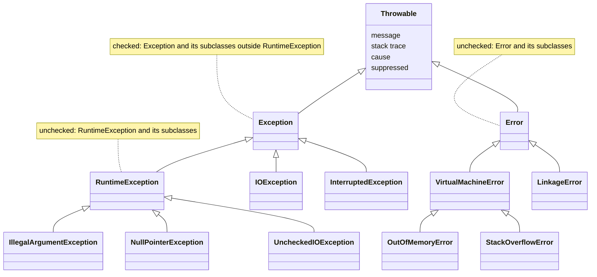
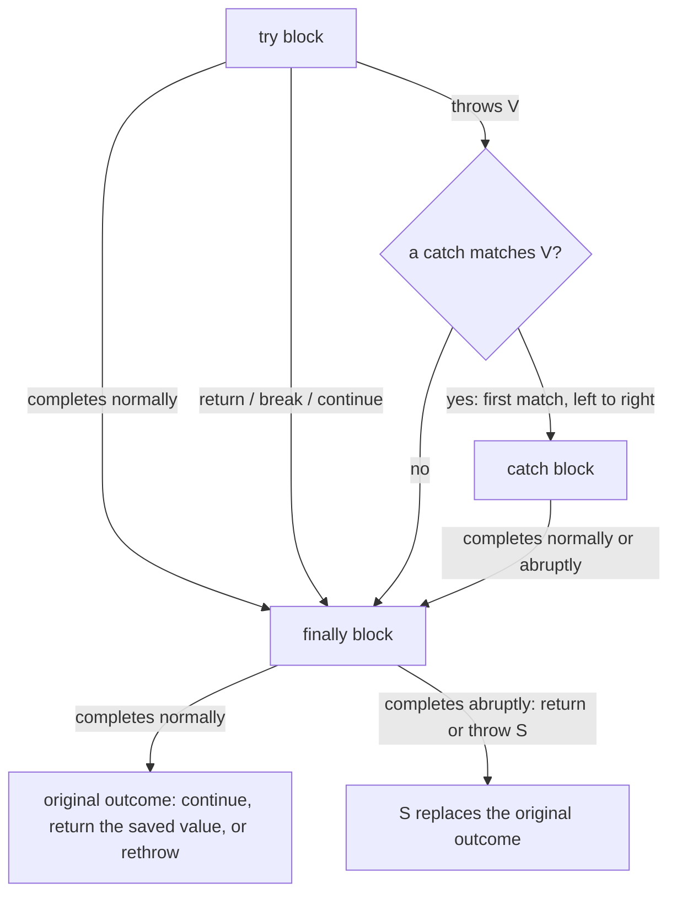
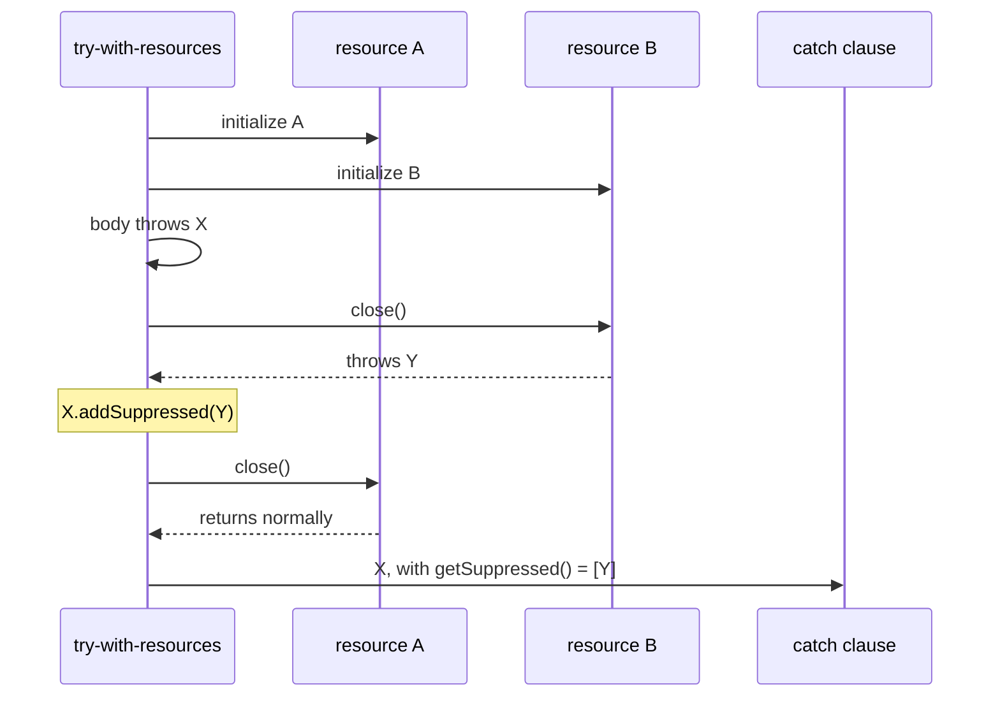
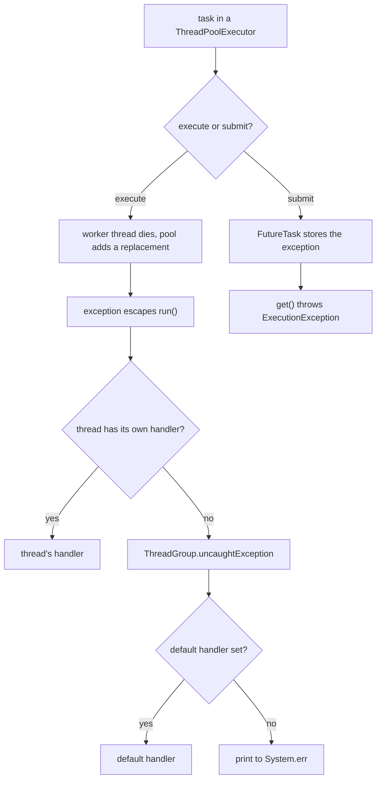
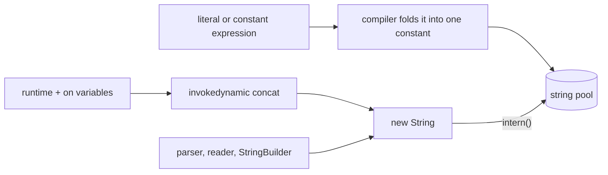
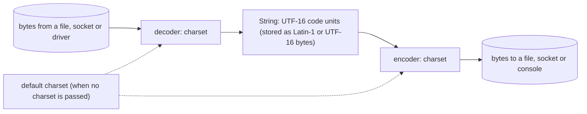
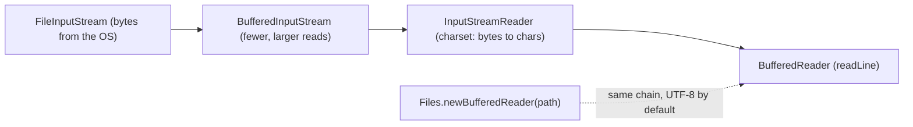

# 06. Exceptions, strings and I/O

> **What this covers:** how Java reports and handles failure, from the `Throwable` hierarchy and the exact control flow of `try`, `catch`, `finally` and try-with-resources to chaining, custom exceptions, the cost of stack traces, and what happens to an exception nobody catches, in a thread or in a thread pool. Then text and bytes: the string pool, compact strings and how `+` compiles, Unicode code points and charsets (UTF-8 by default since Java 18), byte and character streams and NIO.2, Java serialization and why deserializing untrusted data is dangerous, and locale-sensitive formatting.
> **Prerequisites:** [01. OOP fundamentals § 7. Inheritance, composition and `Object`](01-java-oop-fundamentals.md#7-inheritance-composition-and-object), [§ 8. Polymorphism: overloading, overriding and dispatch](01-java-oop-fundamentals.md#8-polymorphism-overloading-overriding-and-dispatch), [02. Equality, immutability and records § 5. Immutability](02-java-equality-immutability-records.md#5-immutability)
> **Leads to:** [22. JDBC and connection pooling](22-jdbc-and-connection-pooling.md)
> **Applies to:** Java 25
> **Study time:** ~6 hours reading + ~3 hours exercises
> **Short on time:** [1. The exception hierarchy: `Throwable`, `Error`, checked and unchecked](#1-the-exception-hierarchy-throwable-error-checked-and-unchecked), [3. try-with-resources, suppressed exceptions and chaining](#3-try-with-resources-suppressed-exceptions-and-chaining), [7. Unicode and charsets: `char`, code points and encodings](#7-unicode-and-charsets-char-code-points-and-encodings); questions [Q06.02](#q06-02), [Q06.03](#q06-03), [Q06.07](#q06-07), [Q06.13](#q06-13), [Q06.15](#q06-15), [Q06.22](#q06-22); then [Summary](#summary).
> **Labs:** [`labs/java-language/`](../labs/java-language/), package `dev.interview.javalanguage.m06`. Run: `JAVA_HOME=$(/usr/libexec/java_home -v 25) mvn -q -f java-backend-guide/labs/pom.xml -pl java-language -am verify`. Needs Docker: no.

## Contents

1. [The exception hierarchy: `Throwable`, `Error`, checked and unchecked](#1-the-exception-hierarchy-throwable-error-checked-and-unchecked)
2. [`try`, `catch` and `finally`: control flow and compile-time rules](#2-try-catch-and-finally-control-flow-and-compile-time-rules)
3. [try-with-resources, suppressed exceptions and chaining](#3-try-with-resources-suppressed-exceptions-and-chaining)
4. [Custom exceptions, the cost of stack traces, and the JVM's errors](#4-custom-exceptions-the-cost-of-stack-traces-and-the-jvms-errors)
5. [Exceptions at boundaries and uncaught exceptions](#5-exceptions-at-boundaries-and-uncaught-exceptions)
6. [Strings: the pool, compact strings, concatenation and the `String` API](#6-strings-the-pool-compact-strings-concatenation-and-the-string-api)
7. [Unicode and charsets: `char`, code points and encodings](#7-unicode-and-charsets-char-code-points-and-encodings)
8. [I/O: byte and character streams, buffering and NIO.2](#8-io-byte-and-character-streams-buffering-and-nio2)
9. [Java serialization and its risks](#9-java-serialization-and-its-risks)
10. [Internationalization: `Locale`, `ResourceBundle` and locale-sensitive formatting](#10-internationalization-locale-resourcebundle-and-locale-sensitive-formatting)
- [Summary](#summary)
- [Question bank](#question-bank)
- [Hands-on exercises](#hands-on-exercises)
- [Check your understanding](#check-your-understanding)
- [Connections](#connections)

## 1. The exception hierarchy: `Throwable`, `Error`, checked and unchecked
### The problem it solves

A stock service reserves items with `int reserve(String sku, int quantity)`, which returns a reservation number, or `-1` when the item is out of stock, or `-2` when the warehouse system did not answer. A new checkout flow calls it, never compares the result with `-1`, stores the number on the order and ships. Weeks later the warehouse finds orders that point at reservation `-1`. Nothing failed loudly, because a return code is a value like any other: the caller can ignore it, and the compiler cannot tell that it should not. The JLS describes this style as "returning funny values, such as the integer value -1", and notes that "too often such funny values are ignored or not checked for by callers" [Doc: JLS 25 §11](https://docs.oracle.com/javase/specs/jls/se25/html/jls-11.html). What the flow needed was a failure that cannot be mistaken for a result, that travels up the call stack until code able to handle it is found, and, for the failures a caller can plan for (an unavailable warehouse), a compiler that makes every caller decide what to do.

### Mental model

Think of an exception as an alarm raised on one floor of a building. It does not wait for the floor to check a status light: it goes up the stairwell (the call stack, the chain of method calls currently running) floor by floor, and every floor that has no responder for that kind of alarm is evacuated on the way (each method stops where it is). The first floor with a matching responder (a `catch` clause naming the exception's class or a superclass) takes over. If no floor has one, building management (the thread's uncaught-exception handler, [§5](#5-exceptions-at-boundaries-and-uncaught-exceptions)) gets it and the thread stops.

The building code adds a rule for some alarms. For **checked** exceptions, every floor must either have a responder or post a sign saying "this alarm passes through here" (a `throws` clause), and the inspector (the compiler) refuses the building otherwise. For **unchecked** exceptions there is no such rule: they are the alarms that can go off anywhere (a bug, the machine running out of memory), and a sign on every door would say nothing. Which rule applies depends only on the alarm's class, that is, on where it sits in this hierarchy:



What to notice: "checked" is a property of a class's position in the hierarchy, decided at compile time, not something that happens at run time; `IOException` and `UncheckedIOException` describe the same kind of failure and differ only in their superclass.

### How it actually works

**The root: `Throwable`.** "Only objects that are instances of this class (or one of its subclasses) are thrown by the Java Virtual Machine or can be thrown by the Java `throw` statement. Similarly, only this class or one of its subclasses can be the argument type in a `catch` clause" [Src: JDK 25, java.lang.Throwable](https://github.com/openjdk/jdk/blob/jdk-25-ga/src/java.base/share/classes/java/lang/Throwable.java). A throwable carries a message, a snapshot of its thread's stack taken when it was created (the *stack trace*: the list of method frames that were running), a *cause* (the throwable that caused this one) and the throwables it *suppressed* [Src: JDK 25, java.lang.Throwable](https://github.com/openjdk/jdk/blob/jdk-25-ga/src/java.base/share/classes/java/lang/Throwable.java); [§3](#3-try-with-resources-suppressed-exceptions-and-chaining) covers causes and suppression, [§4](#4-custom-exceptions-the-cost-of-stack-traces-and-the-jvms-errors) what the stack trace costs. `Throwable` is a direct subclass of `Object`, `Exception` and `Error` are its direct subclasses, and `RuntimeException` is a direct subclass of `Exception` [Doc: JLS 25 §11.1.1](https://docs.oracle.com/javase/specs/jls/se25/html/jls-11.html#jls-11.1.1). One restriction comes from the JVM: "a subclass of `Throwable` cannot be generic" [Doc: JLS 25 §11.1.1](https://docs.oracle.com/javase/specs/jls/se25/html/jls-11.html#jls-11.1.1), and "this restriction is needed since the catch mechanism of the Java Virtual Machine works only with non-generic classes" [Doc: JLS 25 §8.1.2](https://docs.oracle.com/javase/specs/jls/se25/html/jls-8.html#jls-8.1.2): a handler matches the thrown object's runtime class, which carries no type arguments ([03 §5](03-java-generics.md#5-type-erasure-and-bridge-methods) covers erasure). In the lab, `class Rules<T> extends Exception` fails with `compiler.err.generic.throwable` [Lab: ExceptionCompileRulesTest](../labs/java-language/src/test/java/dev/interview/javalanguage/m06/s01/ExceptionCompileRulesTest.java).

**`Exception`, `Error` and the checked/unchecked split.** The JLS defines the two groups by subclassing alone: "The unchecked exception classes are the run-time exception classes and the error classes", and "the checked exception classes are `Throwable` and all its subclasses other than `RuntimeException` and its subclasses and `Error` and its subclasses" [Doc: JLS 25 §11.1.1](https://docs.oracle.com/javase/specs/jls/se25/html/jls-11.html#jls-11.1.1). The Javadoc gives each branch its intent. `Exception` "indicates conditions that a reasonable application might want to catch" [Src: JDK 25, java.lang.Exception](https://github.com/openjdk/jdk/blob/jdk-25-ga/src/java.base/share/classes/java/lang/Exception.java); `Error` "indicates serious problems that a reasonable application should not try to catch" [Src: JDK 25, java.lang.Error](https://github.com/openjdk/jdk/blob/jdk-25-ga/src/java.base/share/classes/java/lang/Error.java); `RuntimeException` is "the superclass of those exceptions that can be thrown during the normal operation of the Java Virtual Machine" [Src: JDK 25, java.lang.RuntimeException](https://github.com/openjdk/jdk/blob/jdk-25-ga/src/java.base/share/classes/java/lang/RuntimeException.java). `Error` sits beside `Exception`, not under it, so that `catch (Exception e)` catches everything a program may recover from "without catching errors from which recovery is typically not possible" [Doc: JLS 25 §11.1.1](https://docs.oracle.com/javase/specs/jls/se25/html/jls-11.html#jls-11.1.1). The lab's `ExceptionKind.of` classifies a class by those two superclass checks and nothing else: `Throwable`, `Exception`, `IOException` and a class that extends `Throwable` directly come out checked; `RuntimeException`, `UncheckedIOException`, `NullPointerException`, `Error` and `OutOfMemoryError` come out unchecked [Lab: ExceptionHierarchyTest](../labs/java-language/src/test/java/dev/interview/javalanguage/m06/s01/ExceptionHierarchyTest.java).

**Where exceptions come from.** An exception is thrown for one of four reasons: a `throw` statement ran; an enabled `assert` failed; the JVM detected an abnormal condition synchronously; or an *asynchronous* exception occurred, one that is not tied to a particular statement and is always a `VirtualMachineError` [Doc: JLS 25 §11.1.2](https://docs.oracle.com/javase/specs/jls/se25/html/jls-11.html#jls-11.1.2) [Doc: JLS 25 §11.1.3](https://docs.oracle.com/javase/specs/jls/se25/html/jls-11.html#jls-11.1.3). The synchronous JVM conditions fall into three kinds: an expression violates the language's semantics, an error occurs while loading, linking or initializing a class (a `LinkageError`, [08](08-jvm-memory-and-class-loading.md)'s subject), or a resource limit stops the JVM (a `VirtualMachineError`) [Doc: JLS 25 §11.1.2](https://docs.oracle.com/javase/specs/jls/se25/html/jls-11.html#jls-11.1.2). JLS §15.6 lists the first kind operator by operator: integer division or remainder by zero throws `ArithmeticException`, an index outside an array throws `ArrayIndexOutOfBoundsException`, a negative array size `NegativeArraySizeException`, an impermissible cast `ClassCastException`, storing the wrong type into an array `ArrayStoreException`, dereferencing `null` through an array access, a field access or an instance method call `NullPointerException`, a `switch` expression or enhanced `switch` statement with no matching label `MatchException`, and creating an object or array `OutOfMemoryError` when memory runs out [Doc: JLS 25 §15.6](https://docs.oracle.com/javase/specs/jls/se25/html/jls-15.html#jls-15.6). In the lab the JVM raises each of the first six itself, and every one is unchecked [Lab: ExceptionHierarchyTest](../labs/java-language/src/test/java/dev/interview/javalanguage/m06/s01/ExceptionHierarchyTest.java). The `throw` statement accepts any expression assignable to `Throwable`, or `null`, and a `null` value makes it throw a new `NullPointerException` instead [Doc: JLS 25 §14.18](https://docs.oracle.com/javase/specs/jls/se25/html/jls-14.html#jls-14.18); the lab's `throw nothing` with a `null` variable throws exactly that [Lab: ExceptionHierarchyTest](../labs/java-language/src/test/java/dev/interview/javalanguage/m06/s01/ExceptionHierarchyTest.java).

**Propagation.** While an exception is being thrown, the JVM "abruptly completes, one by one, any expressions, statements, method and constructor invocations, initializers, and field initialization expressions that have begun but not completed execution in the current thread", until it finds a handler "that indicates that it handles that particular exception by naming the class of the exception or a superclass of the class of the exception" [Doc: JLS 25 §11](https://docs.oracle.com/javase/specs/jls/se25/html/jls-11.html). (*Abrupt completion* is the JLS term for a statement or expression that ends without producing its normal result.) The code that threw "is never resumed", and exceptions are *precise*: every effect before the throw point appears to have happened and nothing after it does [Doc: JLS 25 §11.3](https://docs.oracle.com/javase/specs/jls/se25/html/jls-11.html#jls-11.3). Monitors held by `synchronized` blocks and methods are released on the way out [Doc: JLS 25 §11](https://docs.oracle.com/javase/specs/jls/se25/html/jls-11.html). If no handler exists, the thread runs its `finally` clauses and terminates, and its uncaught-exception handler runs ([§5](#5-exceptions-at-boundaries-and-uncaught-exceptions)) [Doc: JLS 25 §11.3](https://docs.oracle.com/javase/specs/jls/se25/html/jls-11.html#jls-11.3). This is what exceptions buy over return codes: the normal path stays free of error checks, handlers are chosen by type, and a method that cannot handle a failure does nothing at all to pass it on. The five keywords involved are `try`, `catch` and `finally`, which form the handling statement ([§2](#2-try-catch-and-finally-control-flow-and-compile-time-rules)), and `throw` and `throws`, below.

**Catch or declare: what the compiler checks.** "For each checked exception which is a possible result, the `throws` clause for the method or constructor must mention the class of that exception or one of the superclasses of the class of that exception" [Doc: JLS 25 §11.2](https://docs.oracle.com/javase/specs/jls/se25/html/jls-11.html#jls-11.2). Formally, it is a compile-time error if a method or constructor body *can throw* a checked class that is not a subclass of a class in its `throws` clause [Doc: JLS 25 §11.2.3](https://docs.oracle.com/javase/specs/jls/se25/html/jls-11.html#jls-11.2.3). "Can throw" is computed from declarations, not from what the code really does: a method call can throw the exception types of the chosen method's `throws` clause, and a `throw` statement can throw the static type of its expression [Doc: JLS 25 §11.2.1](https://docs.oracle.com/javase/specs/jls/se25/html/jls-11.html#jls-11.2.1) [Doc: JLS 25 §11.2.2](https://docs.oracle.com/javase/specs/jls/se25/html/jls-11.html#jls-11.2.2). The two ways out are a `catch` around the call or the exception (or a superclass) in the caller's own `throws` clause. In the lab, a call to a method declaring `throws IOException` from a method that does neither fails with `compiler.err.unreported.exception.need.to.catch.or.throw`, and declaring or catching it compiles [Lab: ExceptionCompileRulesTest](../labs/java-language/src/test/java/dev/interview/javalanguage/m06/s01/ExceptionCompileRulesTest.java). Static initializers may not throw checked exceptions at all, since there is no `throws` clause to declare them in [Doc: JLS 25 §11.2.3](https://docs.oracle.com/javase/specs/jls/se25/html/jls-11.html#jls-11.2.3) ([01 §5](01-java-oop-fundamentals.md#5-constructors-and-initialization-order) shows what an unchecked one does).

**Why unchecked classes are exempt.** The JLS gives one reason for each group. Errors "can occur at many points in the program and recovery from them is difficult or impossible. A program declaring such exceptions would be cluttered, pointlessly." Run-time exceptions are exempt because "having to declare such exceptions would not aid significantly in establishing the correctness of programs": the compiler cannot prove that a `NullPointerException` is impossible even when the programmer knows it is, and requiring the declaration "would simply be an irritation to programmers" [Doc: JLS 25 §11.2](https://docs.oracle.com/javase/specs/jls/se25/html/jls-11.html#jls-11.2). A `throws` clause may still name unchecked classes; that is "permitted but not required" [Doc: JLS 25 §8.4.6](https://docs.oracle.com/javase/specs/jls/se25/html/jls-8.html#jls-8.4.6). In the lab, a method throwing `IllegalArgumentException` and `StackOverflowError`, its caller, and a method that lists `throws IllegalStateException` all compile without a `catch` [Lab: ExceptionCompileRulesTest](../labs/java-language/src/test/java/dev/interview/javalanguage/m06/s01/ExceptionCompileRulesTest.java). Unchecked exceptions propagate through methods that never mention them: the lab's `RateCards.current` declares nothing, and the loader's `IllegalArgumentException` reaches its caller unchanged [Lab: RateCardsTest](../labs/java-language/src/test/java/dev/interview/javalanguage/m06/s01/RateCardsTest.java).

**`throw` and `throws`.** `throw` is a statement that throws one object now. `throws` is part of a method or constructor declaration that lists exception *types*, class types or type variables, each a subtype of `Throwable` [Doc: JLS 25 §8.4.6](https://docs.oracle.com/javase/specs/jls/se25/html/jls-8.html#jls-8.4.6). The checked types in it "are part of the contract between the implementor and user of the method or constructor" [Doc: JLS 25 §11.2](https://docs.oracle.com/javase/specs/jls/se25/html/jls-11.html#jls-11.2), which is why overriding restricts them.

**The override rule.** "A method that overrides or hides another method, including methods that implement abstract methods defined in interfaces, may not be declared to throw more checked exceptions than the overridden or hidden method": every checked type in the override's `throws` clause must be the same class as, or a subclass of, one in the overridden method's clause [Doc: JLS 25 §8.4.8.3](https://docs.oracle.com/javase/specs/jls/se25/html/jls-8.html#jls-8.4.8.3). The reason is substitution: code that calls `move` through a `Point` reference was compiled against `Point.move`'s contract, so it has no handler for an exception only the subclass declares (JLS Example 8.4.8.3-3 makes this argument), and a subclass must work wherever its parent is expected ([01 §8](01-java-oop-fundamentals.md#8-polymorphism-overloading-overriding-and-dispatch) covers overriding in general). When one method overrides several interface methods at once, its `throws` clause must be compatible with all of them [Doc: JLS 25 §11.2](https://docs.oracle.com/javase/specs/jls/se25/html/jls-11.html#jls-11.2). In the lab, an override that adds `throws Exception` fails with `compiler.err.override.meth.doesnt.throw`; overrides of `save() throws IOException` that declare `FileNotFoundException`, nothing, or the unchecked `IllegalStateException` all compile [Lab: ExceptionCompileRulesTest](../labs/java-language/src/test/java/dev/interview/javalanguage/m06/s01/ExceptionCompileRulesTest.java).

**Only the compiler checks.** The `throws` clause is stored in the class file's `Exceptions` attribute, and the JVM specification says of the rule that a method throws only unchecked or declared exceptions: "These requirements are not enforced in the Java Virtual Machine; they are enforced only at compile time" [Doc: JVMS 25 §4.7.5](https://docs.oracle.com/javase/specs/jvms/se25/html/jvms-4.html#jvms-4.7.5). Code compiled against an older version of a library, code generated at run time, other JVM languages (Kotlin "treats all exceptions as unchecked" [Doc: Kotlin documentation, Exceptions](https://kotlinlang.org/docs/exceptions.html)), and Java code that tricks the compiler can all throw a checked exception from a method that does not declare it. The lab's `UncheckedThrow.sneakyThrow` uses a generic method whose `throws E` the compiler reads as `RuntimeException`; at run time the cast to `E` is erased, and the original `IOException` leaves a method with no `throws` clause [Lab: ExceptionHierarchyTest](../labs/java-language/src/test/java/dev/interview/javalanguage/m06/s01/ExceptionHierarchyTest.java). A lambda body is checked against the `throws` clause of its functional interface's method, which is why `Function` cannot wrap code that throws `IOException` ([05 §9](05-java-lambdas-streams-optional.md#9-checked-exceptions-and-resources-in-lambdas-and-streams)) [Doc: JLS 25 §11.2.3](https://docs.oracle.com/javase/specs/jls/se25/html/jls-11.html#jls-11.2.3).

**Choosing checked or unchecked.** The JLS suggests making most new exception classes checked, "to take advantage of compile-time checking for exception handlers" [Doc: JLS 25 §11.1.1](https://docs.oracle.com/javase/specs/jls/se25/html/jls-11.html#jls-11.1.1), and the JDK follows its own split: I/O, interruption and reflection failures are checked (`IOException`, `InterruptedException`, `ClassNotFoundException`), while precondition violations are unchecked (`IllegalArgumentException`, `IllegalStateException`, and the `NullPointerException` of `Objects.requireNonNull`), as the lab's classification of those classes confirms [Lab: ExceptionHierarchyTest](../labs/java-language/src/test/java/dev/interview/javalanguage/m06/s01/ExceptionHierarchyTest.java). The working rule that follows is about the caller, not the failure. A condition outside the program's control that the *immediate* caller can do something about (retry, fall back, ask the user) earns a checked exception, because the compiler then makes every caller decide. A bug in the caller, or a failure nobody near the call can handle, is unchecked, because a `catch` cannot fix a bug and a declaration on every method would only add noise. Many frameworks lean unchecked for the second reason: Spring's `DataAccessException` extends `RuntimeException` through `NestedRuntimeException`, and its Javadoc says "there is no need for user code to catch it or subclasses if any error is to be considered fatal (the usual case)" [Src: spring-tx 7.0.10, DataAccessException](https://github.com/spring-projects/spring-framework/blob/v7.0.10/spring-tx/src/main/java/org/springframework/dao/DataAccessException.java). The choice has consequences outside Java too: Spring rolls a transaction back by default only for unchecked exceptions and errors ([17 §5](17-spring-transactions.md#5-rollback-rules-and-rollback-only)), and [22](22-jdbc-and-connection-pooling.md) shows how JDBC's checked `SQLException` gets translated. [Q06.01](#q06-01) and [Q06.02](#q06-02) drill this section.

**Helpful `NullPointerException` messages.** Since Java 14 the JVM can compute a message that says which part of an expression was `null`, such as `Cannot read field "c" because "a.b" is null`: the first part names the action that failed, the second the null expression [Doc: JEP 358](https://openjdk.org/jeps/358). Local variable names appear only when the class was compiled with debug information (`javac -g`); otherwise the message uses a placeholder of the form `<local4>` [Doc: JEP 358](https://openjdk.org/jeps/358). In the lab, `order.customer().name()` with a null customer throws a message that starts with `Cannot invoke "` and ends with `Order.customer()" is null`, naming the method whose return value was null [Lab: ExceptionHierarchyTest](../labs/java-language/src/test/java/dev/interview/javalanguage/m06/s01/ExceptionHierarchyTest.java).

### Code

The approach: a rate-card loader whose two kinds of failure get the two kinds of exception, and a caller that handles only the one it can recover from.

1. Hide the storage behind a `RateSource` port whose `read` declares `IOException`, because a file share or a bucket can fail for reasons outside the program.
2. In `RateCardLoader.load`, reject a null or blank name with unchecked exceptions, because that is the caller's bug and no `catch` can repair it.
3. Declare `throws IOException` on `load` instead of catching it, because the loader cannot decide what a missing card means; its caller can.
4. In `RateCards.current`, catch only `IOException`, log it, and fall back to the last card that loaded, letting every unchecked exception propagate.

```java
// Excerpt of labs/java-language/src/main/java/dev/interview/javalanguage/m06/s01/RateCardLoader.java
    // IOException is declared: the storage can fail and the caller can do something about it.
    // A null or blank name is the caller's bug, reported with unchecked exceptions.
    public RateCard load(String name) throws IOException {
        Objects.requireNonNull(name, "name");
        if (name.isBlank()) {
            throw new IllegalArgumentException("rate card name is blank");
        }
        String text = source.read(name);
        return RateCard.parse(name, text);
    }
```

```java
// Excerpt of labs/java-language/src/main/java/dev/interview/javalanguage/m06/s01/RateCards.java
    public RateCard current(String name) {
        try {
            return loader.load(name);
        } catch (IOException e) {
            LOG.log(Level.WARNING, "rate card " + name + " unreadable, using last known good", e);
            return lastKnownGood;
        }
    }
```

`RateCardsTest` checks four outcomes: a readable source is parsed; a source that throws `IOException("share unreachable")` makes `load` throw it and `current` return the last known good card; a blank name throws `IllegalArgumentException` straight through `current`, which declares nothing; and a malformed line (`USD 1.10`) also propagates, because `RateCard.parse` reports it as `IllegalArgumentException` and a broken file is a defect to fix, not an outage to ride out [Lab: RateCardsTest](../labs/java-language/src/test/java/dev/interview/javalanguage/m06/s01/RateCardsTest.java). If `current` caught `Exception` instead, both bugs would silently turn into stale rates. Logging and rethrowing at boundaries is [§5](#5-exceptions-at-boundaries-and-uncaught-exceptions)'s subject.

The second snippet exists only to show that the check lives in the compiler. The approach: make the compiler believe a generic method throws `RuntimeException`, and let erasure throw the real object.

```java
// Excerpt of labs/java-language/src/main/java/dev/interview/javalanguage/m06/s01/UncheckedThrow.java
    public static void sneakyThrow(Throwable failure) {
        UncheckedThrow.<RuntimeException>rethrow(failure);
    }

    // E is RuntimeException at the call site, so javac sees no checked exception;
    // the cast is erased, so at run time the original Throwable is thrown unchanged.
    @SuppressWarnings("unchecked")
    private static <E extends Throwable> void rethrow(Throwable failure) throws E {
        throw (E) failure;
    }
```

`sneakyThrow(new IOException("disk"))` throws that same `IOException` object, from a method with no `throws` clause [Lab: ExceptionHierarchyTest](../labs/java-language/src/test/java/dev/interview/javalanguage/m06/s01/ExceptionHierarchyTest.java). The best practices below say why application code should not do this.

### Failure modes and operations

The runtime behavior of exceptions is the subject of the next sections: control flow through `finally` ([§2](#2-try-catch-and-finally-control-flow-and-compile-time-rules)), lost causes and suppressed failures ([§3](#3-try-with-resources-suppressed-exceptions-and-chaining)), the cost of stack traces and the JVM's errors ([§4](#4-custom-exceptions-the-cost-of-stack-traces-and-the-jvms-errors)), and exceptions nobody catches ([§5](#5-exceptions-at-boundaries-and-uncaught-exceptions)). One setting belongs here: the helpful `NullPointerException` message is controlled by the HotSpot flag `ShowCodeDetailsInExceptionMessages`, `true` by default in JDK 25 and declared manageable, with the description "Disable this to improve privacy" [Src: JDK 25, HotSpot globals.hpp](https://github.com/openjdk/jdk/blob/jdk-25-ga/src/hotspot/share/runtime/globals.hpp); `-XX:-ShowCodeDetailsInExceptionMessages` turns it off.

> [!NOTE]
> **Framework vs language.** Checked exceptions are a rule of the Java language, enforced by `javac` from `throws` clauses (JLS §11.2). The JVM stores the clause in the `Exceptions` attribute but does not enforce it [Doc: JVMS 25 §4.7.5](https://docs.oracle.com/javase/specs/jvms/se25/html/jvms-4.html#jvms-4.7.5), so Kotlin, which "treats all exceptions as unchecked" [Doc: Kotlin documentation, Exceptions](https://kotlinlang.org/docs/exceptions.html), and the lab's `sneakyThrow` can both throw a checked exception from a method that does not declare it [Lab: ExceptionHierarchyTest](../labs/java-language/src/test/java/dev/interview/javalanguage/m06/s01/ExceptionHierarchyTest.java). Frameworks add their own policies on top: Spring's data-access exceptions are unchecked by design [Src: spring-tx 7.0.10, DataAccessException](https://github.com/spring-projects/spring-framework/blob/v7.0.10/spring-tx/src/main/java/org/springframework/dao/DataAccessException.java), and its transaction rollback rules treat checked and unchecked exceptions differently ([17 §5](17-spring-transactions.md#5-rollback-rules-and-rollback-only)). Neither is a language rule.

> [!NOTE]
> **Version notes.** Java 1.0: `Throwable`, `Exception`, `RuntimeException` and `Error` are `@since 1.0` [Src: JDK 25, java.lang.Error](https://github.com/openjdk/jdk/blob/jdk-25-ga/src/java.base/share/classes/java/lang/Error.java) [Src: JDK 25, java.lang.RuntimeException](https://github.com/openjdk/jdk/blob/jdk-25-ga/src/java.base/share/classes/java/lang/RuntimeException.java). Java 14: helpful `NullPointerException` messages, off by default behind `-XX:+ShowCodeDetailsInExceptionMessages` [Final since Java 14, JEP 358] [Doc: JEP 358](https://openjdk.org/jeps/358). Java 15: [Changed in Java 15: `ShowCodeDetailsInExceptionMessages` defaults to `true`], so the messages print by default (JDK-8233014) [Doc: JDK 15 release notes, "Enable ShowCodeDetailsInExceptionMessages by default"](https://www.oracle.com/java/technologies/javase/15-relnote-issues.html). Java 21: `MatchException` (`@since 21`), thrown by a `switch` expression or enhanced `switch` statement that no label matches [Src: JDK 25, java.lang.MatchException](https://github.com/openjdk/jdk/blob/jdk-25-ga/src/java.base/share/classes/java/lang/MatchException.java) [Doc: JLS 25 §15.6](https://docs.oracle.com/javase/specs/jls/se25/html/jls-15.html#jls-15.6). Multi-catch and precise rethrow (Java 7) are [§2](#2-try-catch-and-finally-control-flow-and-compile-time-rules)'s; try-with-resources (Java 7, extended in 9) is [§3](#3-try-with-resources-suppressed-exceptions-and-chaining)'s.

### Best practices and anti-patterns

- Report a caller's bug with an unchecked exception (`IllegalArgumentException`, `IllegalStateException`, `Objects.requireNonNull`), because no caller can repair its own bug by catching it, and the JLS exempts these classes for exactly that reason [Doc: JLS 25 §11.2](https://docs.oracle.com/javase/specs/jls/se25/html/jls-11.html#jls-11.2).
- Declare a checked exception for a failure outside the program's control that the immediate caller can act on, because the compiler then forces each caller to choose between handling and declaring it; if no caller will ever handle it, prefer unchecked, because a `throws` clause repeated up twenty frames only moves the noise.
- Do not declare `throws Exception` or `throws Throwable`, because every caller must then catch or declare that broad type, and a `catch (Exception e)` is always legal [Doc: JLS 25 §11.2.3](https://docs.oracle.com/javase/specs/jls/se25/html/jls-11.html#jls-11.2.3), so the compiler can no longer tell anyone which failures are real.
- Catch `Exception`, not `Throwable`, at a last-resort boundary, because `Error` was placed outside `Exception` so that such a handler leaves errors alone [Doc: JLS 25 §11.1.1](https://docs.oracle.com/javase/specs/jls/se25/html/jls-11.html#jls-11.1.1); what a boundary handler must do is [§5](#5-exceptions-at-boundaries-and-uncaught-exceptions).
- Document the unchecked exceptions a caller should expect with Javadoc `@throws`, and list them in `throws` only when that helps readers, because the compiler ignores them there [Doc: JLS 25 §8.4.6](https://docs.oracle.com/javase/specs/jls/se25/html/jls-8.html#jls-8.4.6).
- Do not use "sneaky throw" helpers in application code, because callers cannot catch the hidden checked type by name: a `catch (IOException e)` around a call that declares nothing is a compile-time error [Doc: JLS 25 §11.2.3](https://docs.oracle.com/javase/specs/jls/se25/html/jls-11.html#jls-11.2.3). Wrap it in an unchecked exception with the original as cause instead ([§3](#3-try-with-resources-suppressed-exceptions-and-chaining)).
- **Security:** never return exception messages, helpful `NullPointerException` messages included, to a remote client, because they name internal fields and variables; the JDK 15 release note warns that such a message "could give remote attackers valuable hints about a potential vulnerable state of the software" [Doc: JDK 15 release notes, "Enable ShowCodeDetailsInExceptionMessages by default"](https://www.oracle.com/java/technologies/javase/15-relnote-issues.html). Send a generic error body ([18](18-spring-mvc-and-rest-controllers.md)) and keep the details in the logs ([44](44-observability-logging-metrics-slos.md)).

### Misconceptions and traps

- *"`Error`s cannot be caught."* `catch (StackOverflowError e)` works like any other handler, as the lab shows [Lab: ExceptionHierarchyTest](../labs/java-language/src/test/java/dev/interview/javalanguage/m06/s01/ExceptionHierarchyTest.java); the JLS even notes that "sophisticated programs may yet wish to catch and attempt to recover from some of these conditions" [Doc: JLS 25 §11.2](https://docs.oracle.com/javase/specs/jls/se25/html/jls-11.html#jls-11.2). The myth comes from the `Error` Javadoc's "should not try to catch", read as "cannot", and from `catch (Exception e)`, which indeed does not catch them.
- *"Checked exceptions are checked at run time."* Only `javac` checks them; the JVM does not [Doc: JVMS 25 §4.7.5](https://docs.oracle.com/javase/specs/jvms/se25/html/jvms-4.html#jvms-4.7.5) [Lab: ExceptionHierarchyTest](../labs/java-language/src/test/java/dev/interview/javalanguage/m06/s01/ExceptionHierarchyTest.java). The name suggests a runtime check, and the `throws` clause is visible in the class file, which makes it look enforced.
- *"`throws` must list every exception a method can throw."* It must list the checked ones; unchecked ones are "permitted but not required" [Doc: JLS 25 §8.4.6](https://docs.oracle.com/javase/specs/jls/se25/html/jls-8.html#jls-8.4.6) [Lab: ExceptionCompileRulesTest](../labs/java-language/src/test/java/dev/interview/javalanguage/m06/s01/ExceptionCompileRulesTest.java). The belief comes from reading `throws` as documentation of every failure, which it would be only if all exceptions were checked.
- *"A `RuntimeException` is an exception that happens at run time."* Every exception is thrown at run time. The name refers to exceptions that arise during expression evaluation and the normal operation of the JVM ([Doc: JLS 25 §11.1.1](https://docs.oracle.com/javase/specs/jls/se25/html/jls-11.html#jls-11.1.1) [Src: JDK 25, java.lang.RuntimeException](https://github.com/openjdk/jdk/blob/jdk-25-ga/src/java.base/share/classes/java/lang/RuntimeException.java)); what makes it special is only that it is exempt from compile-time checking. The confusion comes from contrasting "runtime" with "compile time", the two words used for the check.
- *"An overriding method must declare the same exceptions as the method it overrides."* It may declare fewer, narrower ones, none, or any unchecked ones; it may not add a checked exception the parent does not cover [Doc: JLS 25 §8.4.8.3](https://docs.oracle.com/javase/specs/jls/se25/html/jls-8.html#jls-8.4.8.3) [Lab: ExceptionCompileRulesTest](../labs/java-language/src/test/java/dev/interview/javalanguage/m06/s01/ExceptionCompileRulesTest.java). The myth comes from treating `throws` as part of the method's signature, which must match; the signature is only the name, type parameters and parameter types [Doc: JLS 25 §8.4.2](https://docs.oracle.com/javase/specs/jls/se25/html/jls-8.html#jls-8.4.2).
- *"Every exception class extends `Exception` or `Error`."* A class may extend `Throwable` directly, and it is then checked [Doc: JLS 25 §11.1.1](https://docs.oracle.com/javase/specs/jls/se25/html/jls-11.html#jls-11.1.1) [Lab: ExceptionHierarchyTest](../labs/java-language/src/test/java/dev/interview/javalanguage/m06/s01/ExceptionHierarchyTest.java). Nobody should write one, which is why the two-branch picture is the one everybody draws.

Questions that drill this section: [Q06.01](#q06-01), [Q06.02](#q06-02).

## 2. `try`, `catch` and `finally`: control flow and compile-time rules
### The problem it solves

A pricing service protects a slow downstream with a limiter: it counts calls in flight and rejects new ones above 20. The first version decrements the counter on the line after the downstream call returns. Every time the downstream resets a connection, the call throws, the decrement is skipped, and one slot is gone for good. After a few hundred resets over a week the counter sits at 20 with nothing running, and every request is rejected with "limit reached" while the downstream is idle. The code had one success path and the author wrote the cleanup for that path; the exception took a different exit. The problem is to run cleanup on *every* way out of a block (return, exception, `break`, `continue`) without writing it once per exit, and to know exactly what the caller sees when cleanup and failure meet.

### Mental model

A `try` statement is a room with one guarded exit. Code inside the room can leave in several ways: walk out normally, run out with an exception, or jump out with `return`, `break` or `continue`. The `catch` clauses are staff at the door who take the exceptions they were hired for, in the order they stand. The `finally` block is the exit corridor every path goes through, whatever happened inside. The corridor has one dangerous property: whoever walks through it carrying a new reason to leave (a `return` or a `throw` of its own) replaces whatever the room was about to hand to the caller.



What to notice: every arrow passes through `finally`, and the only way the caller does not get the original outcome is the last arrow, where `finally` itself returns or throws.

### How it actually works

**The forms and the grammar.** A `try` statement is `try Block Catches`, `try Block [Catches] Finally`, or a try-with-resources statement; only the last may omit both `catch` and `finally` [Doc: JLS 25 §14.20](https://docs.oracle.com/javase/specs/jls/se25/html/jls-14.html#jls-14.20). In the lab, a bare `try { … }` fails with `compiler.err.try.without.catch.finally.or.resource.decls` [Lab: TryCompileRulesTest](../labs/java-language/src/test/java/dev/interview/javalanguage/m06/s02/TryCompileRulesTest.java). The grammar puts the `catch` clauses and the `finally` clause directly after the block, so no statement may stand between them. Resources are [§3](#3-try-with-resources-suppressed-exceptions-and-chaining)'s subject.

**Choosing a handler.** "Exception handlers are considered in left-to-right order: the earliest possible catch clause accepts the exception" [Doc: JLS 25 §14.20](https://docs.oracle.com/javase/specs/jls/se25/html/jls-14.html#jls-14.20): the first clause whose type the thrown object's *runtime* class is assignment compatible with wins, and later clauses are not considered [Doc: JLS 25 §14.20.1](https://docs.oracle.com/javase/specs/jls/se25/html/jls-14.html#jls-14.20.1). In the lab, `CatchSelection.handle` returns "missing file" for a `FileNotFoundException`, "other I/O failure" for a plain `IOException`, "bug" for an `IllegalStateException` and "other checked" for an `InterruptedException` [Lab: FinallyFlowTest](../labs/java-language/src/test/java/dev/interview/javalanguage/m06/s02/FinallyFlowTest.java). If no clause matches, the `try` statement completes abruptly with the same exception, which continues to the next enclosing `try` in this method or up the call stack ([§1](#1-the-exception-hierarchy-throwable-error-checked-and-unchecked)); a nested `try` is simply the innermost enclosing one [Doc: JLS 25 §11.3](https://docs.oracle.com/javase/specs/jls/se25/html/jls-11.html#jls-11.3).

**Compile-time rules on handlers.** Four rules make most "does this compile?" questions mechanical:
- A clause that can catch only what an earlier clause already catches is an error: `catch (IOException e)` followed by `catch (FileNotFoundException e)` fails, because "a preceding catch clause of the immediately enclosing try statement can catch E1 or a superclass of E1" [Doc: JLS 25 §11.2.3](https://docs.oracle.com/javase/specs/jls/se25/html/jls-11.html#jls-11.2.3). The lab's key is `compiler.err.except.already.caught`. The reverse order (subclass first) is the correct one.
- Catching a checked exception the `try` block cannot throw is an error, "unless E1 is `Exception` or a superclass of `Exception`" [Doc: JLS 25 §11.2.3](https://docs.oracle.com/javase/specs/jls/se25/html/jls-11.html#jls-11.2.3). In the lab, `catch (IOException e)` around a `println` fails with `compiler.err.except.never.thrown.in.try`, while `catch (RuntimeException e)`, `catch (Exception e)` and `catch (Throwable t)` around the same code compile: unchecked classes can always occur, and `Exception` and `Throwable` include them.
- A statement after `throw` is unreachable, and "it is a compile-time error if a statement cannot be executed because it is unreachable" [Doc: JLS 25 §14.22](https://docs.oracle.com/javase/specs/jls/se25/html/jls-14.html#jls-14.22); a `throw` "always completes abruptly" [Doc: JLS 25 §14.18](https://docs.oracle.com/javase/specs/jls/se25/html/jls-14.html#jls-14.18). The lab's key is `compiler.err.unreachable.stmt`.
- A bare `try`, as above.

All four are asserted by diagnostic key in [Lab: TryCompileRulesTest](../labs/java-language/src/test/java/dev/interview/javalanguage/m06/s02/TryCompileRulesTest.java), and [Q06.05](#q06-05) drills them.

**What `finally` does with each outcome.** JLS §14.20.2 defines a `try` with `finally` case by case, and the cases reduce to one rule: `finally` runs after the `try` block and any `catch` block, "no matter how control leaves the try block or catch block" [Doc: JLS 25 §14.20](https://docs.oracle.com/javase/specs/jls/se25/html/jls-14.html#jls-14.20); if it completes normally, the statement ends the way it would have ended without it, and if it completes abruptly for a reason S, "the try statement completes abruptly for reason S (and reason R is discarded)" [Doc: JLS 25 §14.20.2](https://docs.oracle.com/javase/specs/jls/se25/html/jls-14.html#jls-14.20.2). *Completing abruptly* covers more than exceptions: `break`, `continue` and `return` are abrupt completions too, so `finally` runs for them. In the lab, a loop whose body `continue`s at 1 and `break`s at 3 records `finally` for iterations 0 to 3, and an `UnsupportedOperationException` that the only `catch` (for `IllegalArgumentException`) does not match leaves the events `try`, `finally` and then propagates [Lab: FinallyFlowTest](../labs/java-language/src/test/java/dev/interview/javalanguage/m06/s02/FinallyFlowTest.java).

**`return` and `finally`.** A `return` with a value "first evaluates the Expression"; then, if the `return` is inside a `try` with `finally`, "any finally clauses of those try statements will be executed, in order, innermost to outermost, before control is transferred to the invoker", and "abrupt completion of a finally clause can disrupt the transfer of control initiated by a return statement" [Doc: JLS 25 §14.17](https://docs.oracle.com/javase/specs/jls/se25/html/jls-14.html#jls-14.17). Three consequences, each in the lab [Lab: FinallyFlowTest](../labs/java-language/src/test/java/dev/interview/javalanguage/m06/s02/FinallyFlowTest.java):
- the order is: return expression evaluated, `finally` runs, caller resumes (events `try`, `return expression`, `finally`, `caller got result`);
- assigning the returned variable in `finally` does not change the result, because the value was already computed: `int count = 1; try { return count; } finally { count = 2; }` returns 1. For a reference, the *reference* was computed, so `finally` cannot swap the object but can mutate it: a returned list gains the element `finally` adds;
- a `return` in `finally` replaces the pending outcome, exception included: a `try` that throws `IllegalStateException` with `finally { return 42; }` returns 42 and the exception vanishes. A `throw` in `finally` does the same: the `IllegalArgumentException` from `try` is gone, and the `IllegalStateException` from `finally` has no cause and no suppressed exceptions. [Q06.03](#q06-03) drills all three.

**How javac compiles `finally`.** Class files of version 50.0 or below could compile `finally` as a subroutine called with the `jsr` and `ret` instructions; for a `return` inside `try`, the compiled code "saves the return value (if any) in a local variable", runs the `finally` code, and then returns the saved value, which is the mechanism behind the second consequence above [Doc: JVMS 25 §4.10.2.5](https://docs.oracle.com/javase/specs/jvms/se25/html/jvms-4.html#jvms-4.10.2.5). From class file version 51.0 on, `jsr`, `jsr_w` and `ret` "must not appear in the code array" [Doc: JVMS 25 §4.9.1](https://docs.oracle.com/javase/specs/jvms/se25/html/jvms-4.html#jvms-4.9.1), so javac copies the `finally` block into each exit path instead and adds a catch-all exception handler that runs the copy and rethrows. In the lab, reading the compiled `FinallyFlow.returnThenFinally` with the Class-File API [Final since Java 24, JEP 484] finds the `finally` block's string constant twice (normal path and handler), a handler with no catch type, and no `jsr` or `ret` [Lab: FinallyBytecodeTest](../labs/java-language/src/test/java/dev/interview/javalanguage/m06/s02/FinallyBytecodeTest.java) [Doc: JEP 484](https://openjdk.org/jeps/484). A large `finally` block therefore costs code size per exit path, one more reason to keep it short.

**When `finally` does not run.** `finally` runs whenever control leaves the `try` block. It does not run when control never leaves it, or when the JVM stops running Java code:
- **`System.exit` and `Runtime.exit`.** `exit` starts the shutdown sequence and "neither returns nor throws an exception; that is, it does not complete either normally or abruptly"; the shutdown hooks run, and when the JVM terminates, "`finally` clauses are not executed" [Src: JDK 25, java.lang.Runtime](https://github.com/openjdk/jdk/blob/jdk-25-ga/src/java.base/share/classes/java/lang/Runtime.java). In the lab, a child JVM that prints `try` and calls `System.exit(3)` inside `try` exits with status 3 and prints the shutdown hook's line but never `finally` [Lab: JvmExitTest](../labs/java-language/src/test/java/dev/interview/javalanguage/m06/s02/JvmExitTest.java).
- **`Runtime.halt`.** "Termination of the Java Virtual Machine is unconditional and immediate"; it does not even start the shutdown sequence, so hooks do not run either [Src: JDK 25, java.lang.Runtime](https://github.com/openjdk/jdk/blob/jdk-25-ga/src/java.base/share/classes/java/lang/Runtime.java).
- **Daemon threads at JVM exit.** The shutdown sequence starts "when the number of live non-daemon threads drops to zero", and at termination "threads' current methods do not complete normally or abruptly" [Src: JDK 25, java.lang.Runtime](https://github.com/openjdk/jdk/blob/jdk-25-ga/src/java.base/share/classes/java/lang/Runtime.java). In the lab, a daemon thread blocked inside `try` when `main` returns never prints its `finally` line [Lab: JvmExitTest](../labs/java-language/src/test/java/dev/interview/javalanguage/m06/s02/JvmExitTest.java). ([11](11-concurrency-threads-and-jmm.md) covers daemon threads.)
- **A `try` block that never finishes**, because of an infinite loop, a deadlock or a thread blocked forever: `finally` runs only after the block completes.
- **The process dies**: `kill -9`, an out-of-memory kill by the container runtime, a JVM crash. No Java code runs after that, by definition of the process being gone.

[Q06.04](#q06-04) drills these cases.

**Multi-catch.** A `catch` clause may name a union, `catch (IOException | InterruptedException e)`; it behaves like one clause per alternative sharing one body, and the parameter's type is the least upper bound of the alternatives [Doc: JLS 25 §14.20](https://docs.oracle.com/javase/specs/jls/se25/html/jls-14.html#jls-14.20). Two rules come with it. The parameter "is implicitly declared final", so assigning it is an error (lab key `compiler.err.multicatch.parameter.may.not.be.assigned`); and "it is a compile-time error if a union of types contains two alternatives Di and Dj (i ≠ j) where Di is a subtype of Dj" (lab key `compiler.err.multicatch.types.must.be.disjoint`), because the subclass alternative would add nothing [Doc: JLS 25 §14.20](https://docs.oracle.com/javase/specs/jls/se25/html/jls-14.html#jls-14.20) [Lab: TryCompileRulesTest](../labs/java-language/src/test/java/dev/interview/javalanguage/m06/s02/TryCompileRulesTest.java). The JLS notes that a compiler is "neither required nor recommended" to duplicate the body per alternative, since a class file can represent the clause without duplication [Doc: JLS 25 §14.20](https://docs.oracle.com/javase/specs/jls/se25/html/jls-14.html#jls-14.20).

**Precise rethrow.** A `throw` of a `final` or effectively final `catch` parameter can throw only the exception classes that the `try` block can throw, that the clause catches, and that no earlier clause catches [Doc: JLS 25 §11.2.2](https://docs.oracle.com/javase/specs/jls/se25/html/jls-11.html#jls-11.2.2). So a method whose `try` calls only `read() throws IOException` may `catch (Exception e) { log(e); throw e; }` and still declare just `throws IOException`. In the lab that compiles, and assigning `e = new Exception("wrapped", e)` before the `throw` turns the rule off: the parameter is no longer effectively final, the `throw` can throw `Exception`, and the method fails with `compiler.err.unreported.exception.need.to.catch.or.throw` [Lab: TryCompileRulesTest](../labs/java-language/src/test/java/dev/interview/javalanguage/m06/s02/TryCompileRulesTest.java). [Q06.06](#q06-06) drills multi-catch and precise rethrow.

### Code

The approach: release the limiter's slot in `finally`, so the release runs on every exit, and let a type variable carry the work's checked exception through unchanged.

1. Declare `Work<T, E extends Exception>` with `T run() throws E`, so the limiter can say "I throw whatever the work throws" (a type variable in a `throws` clause, [Doc: JLS 25 §8.4.6](https://docs.oracle.com/javase/specs/jls/se25/html/jls-8.html#jls-8.4.6)).
2. Take the slot with `incrementAndGet`; if that went over the limit, give it back and reject, before entering the `try`.
3. Enter `try` only after the slot is held, and release it in `finally`: the release must not run for a slot that was never taken.
4. Return the work's result from inside `try`; `finally` runs before the caller sees it.

```java
// Excerpt of labs/java-language/src/main/java/dev/interview/javalanguage/m06/s02/InFlightLimiter.java
    public <T, E extends Exception> T run(Work<T, E> work) throws E {
        if (inFlight.incrementAndGet() > limit) {
            inFlight.decrementAndGet();
            throw new RejectedExecutionException("limit " + limit + " reached");
        }
        try {
            return work.run();
        } finally {
            inFlight.decrementAndGet();
        }
    }
```

In the lab the slot is back to 0 after a normal return and after the work throws `IOException("downstream reset")`, and the next call is admitted [Lab: InFlightLimiterTest](../labs/java-language/src/test/java/dev/interview/javalanguage/m06/s02/InFlightLimiterTest.java). The caller catches exactly `IOException`; for a lambda that throws nothing checked, `E` is inferred as `RuntimeException` (a `throws` inference variable resolves to it [Doc: JLS 25 §18.4](https://docs.oracle.com/javase/specs/jls/se25/html/jls-18.html#jls-18.4)), so `limiter.run(() -> "priced")` needs no `try` at all.

#### Legacy

The version from the problem statement releases the slot after the call returns:

```java
// Excerpt of labs/java-language/src/main/java/dev/interview/javalanguage/m06/s02/LeakyLimiter.java
        T result = work.run();
        inFlight.decrementAndGet();
        return result;
```

In the lab, with a limit of 1, one failing call leaves the counter at 1, and the next call is rejected with `limit 1 reached` although nothing is running [Lab: InFlightLimiterTest](../labs/java-language/src/test/java/dev/interview/javalanguage/m06/s02/InFlightLimiterTest.java). Locks follow the same shape: `lock.lock(); try { … } finally { lock.unlock(); }` ([12](12-concurrency-locks-atomics-collections.md)). Anything that is an `AutoCloseable` resource is better closed with try-with-resources ([§3](#3-try-with-resources-suppressed-exceptions-and-chaining)).

### Failure modes and operations

- **The exception that disappears.** A `return` or `throw` in `finally`, or cleanup in `finally` that throws (a `close()` that fails while flushing), replaces the original exception with no trace of it: no cause, no suppressed entry [Doc: JLS 25 §14.20.2](https://docs.oracle.com/javase/specs/jls/se25/html/jls-14.html#jls-14.20.2) [Lab: FinallyFlowTest](../labs/java-language/src/test/java/dev/interview/javalanguage/m06/s02/FinallyFlowTest.java). The log shows the cleanup failure, whose top frame is the `finally` line, and the real failure is gone. javac has a lint category for this, `-Xlint:finally`, which "warns about finally clauses that do not terminate normally" [Doc: javac, -Xlint](https://docs.oracle.com/en/java/javase/25/docs/specs/man/javac.html); the lab's methods suppress that warning on purpose. [§3](#3-try-with-resources-suppressed-exceptions-and-chaining) has the incident and the fix (try-with-resources keeps the first exception and suppresses the second), and [Q06.08](#q06-08) the related case of a cause dropped while wrapping.
- **Leaked counters, permits and locks.** Cleanup written on the success path only, as in the problem statement, leaks one unit per failure. Under load the leak is proportional to the error rate, so it surfaces during a downstream incident, exactly when capacity is needed. A gauge of in-flight work that never returns to zero when traffic stops is the signal; the fix is the `try`/`finally` shape above, entered only after the resource is acquired.
- **`System.exit` in library or request code.** It ends the whole JVM: other requests in flight lose their `finally` blocks and try-with-resources closes, and in a container the main process exiting stops the container [Src: JDK 25, java.lang.Runtime](https://github.com/openjdk/jdk/blob/jdk-25-ga/src/java.base/share/classes/java/lang/Runtime.java). Throw an exception and let the application's entry point decide the exit status. When shutting down on purpose, put cleanup that must run at exit in a shutdown hook, not in a `finally` block, because hooks run on `exit` and on signals that start the shutdown sequence [Src: JDK 25, java.lang.Runtime](https://github.com/openjdk/jdk/blob/jdk-25-ga/src/java.base/share/classes/java/lang/Runtime.java).
- **Slow cleanup.** `finally` runs on the calling thread, before the caller sees the result or the exception, so a `finally` that does network I/O adds its latency, and its failures, to every exit path.

> [!NOTE]
> **Version notes.** Java 7: multi-catch and precise rethrow, together with try-with-resources, came from Project Coin, JSR 334, whose feature list includes "Multi-catch and more precise rethrow" and the "try-with-resources statement" [Doc: JSR 334](https://jcp.org/en/jsr/detail?id=334). Class files of version 51.0 and later may not contain `jsr` or `ret`, so current javac always inlines `finally` [Doc: JVMS 25 §4.9.1](https://docs.oracle.com/javase/specs/jvms/se25/html/jvms-4.html#jvms-4.9.1). Before Java 7, code that wanted one handler for two exception types either duplicated the body or caught a common superclass such as `Exception`, and a rethrow of `catch (Exception e)` forced the method to declare `throws Exception`. Java 9: try-with-resources accepts effectively final variables ([§3](#3-try-with-resources-suppressed-exceptions-and-chaining)). Java 24: the Class-File API used by the lab [Final since Java 24, JEP 484] [Doc: JEP 484](https://openjdk.org/jeps/484).

### Best practices and anti-patterns

- Acquire the resource immediately before `try` and release it in `finally` (or use try-with-resources), because entering `try` before the acquisition succeeds makes `finally` release something it never took.
- Never `return`, `throw`, `break` or `continue` out of a `finally` block, because each one replaces the pending outcome and silently discards an exception [Doc: JLS 25 §14.20.2](https://docs.oracle.com/javase/specs/jls/se25/html/jls-14.html#jls-14.20.2); enable `-Xlint:finally` so the compiler reports it [Doc: javac, -Xlint](https://docs.oracle.com/en/java/javase/25/docs/specs/man/javac.html).
- Keep `finally` blocks short and unable to fail where possible, because a failure there replaces the real one and the block is copied into every exit path of the compiled method [Lab: FinallyBytecodeTest](../labs/java-language/src/test/java/dev/interview/javalanguage/m06/s02/FinallyBytecodeTest.java).
- Order `catch` clauses from the most specific to the most general, because the first compatible clause wins and the compiler rejects a specific clause placed after a general one [Doc: JLS 25 §14.20.1](https://docs.oracle.com/javase/specs/jls/se25/html/jls-14.html#jls-14.20.1).
- Use multi-catch when two exceptions get the same handling, because duplicated handler bodies drift apart; do not widen to `catch (Exception e)` just to share a body, because that also catches every unchecked bug.
- When you catch broadly to log and rethrow, keep the parameter effectively final, because precise rethrow then keeps the method's `throws` clause narrow [Doc: JLS 25 §11.2.2](https://docs.oracle.com/javase/specs/jls/se25/html/jls-11.html#jls-11.2.2); logging and rethrowing at the same layer has its own cost ([§5](#5-exceptions-at-boundaries-and-uncaught-exceptions)).
- Do not call `System.exit` outside the application's entry point, because it skips every `finally` block in every thread [Src: JDK 25, java.lang.Runtime](https://github.com/openjdk/jdk/blob/jdk-25-ga/src/java.base/share/classes/java/lang/Runtime.java).

### Misconceptions and traps

- *"`finally` always runs."* It runs whenever control leaves the `try` block, which excludes `System.exit` and `halt`, daemon threads at JVM exit, a block that never finishes, and a dead process [Src: JDK 25, java.lang.Runtime](https://github.com/openjdk/jdk/blob/jdk-25-ga/src/java.base/share/classes/java/lang/Runtime.java) [Lab: JvmExitTest](../labs/java-language/src/test/java/dev/interview/javalanguage/m06/s02/JvmExitTest.java). The phrase is the usual one-line summary of JLS §14.20.2, which is about control leaving the block, not about the JVM stopping.
- *"A `return` in `finally` is harmless, it just returns."* It discards any exception in flight and any value `try` was returning [Lab: FinallyFlowTest](../labs/java-language/src/test/java/dev/interview/javalanguage/m06/s02/FinallyFlowTest.java). The myth survives because the method seems to work: it returns a value, and nothing logs the lost exception.
- *"`finally` can change the value being returned."* Not for the returned variable, whose value was computed before `finally` ran; only by mutating a returned object or by returning a new value, which is the trap above [Doc: JLS 25 §14.17](https://docs.oracle.com/javase/specs/jls/se25/html/jls-14.html#jls-14.17) [Lab: FinallyFlowTest](../labs/java-language/src/test/java/dev/interview/javalanguage/m06/s02/FinallyFlowTest.java). The confusion comes from the mutable-object case, which looks like the return value changed.
- *"Catch order does not matter as long as each type appears once."* The first compatible clause wins, and a subclass after its superclass does not compile [Doc: JLS 25 §11.2.3](https://docs.oracle.com/javase/specs/jls/se25/html/jls-11.html#jls-11.2.3) [Lab: TryCompileRulesTest](../labs/java-language/src/test/java/dev/interview/javalanguage/m06/s02/TryCompileRulesTest.java). The belief comes from `switch`, whose constant labels are disjoint and can be listed in any order.
- *"`catch (Exception e)` around code that throws nothing checked does not compile, like `catch (IOException e)`."* `Exception`, `Throwable` and every unchecked class are always allowed [Doc: JLS 25 §11.2.3](https://docs.oracle.com/javase/specs/jls/se25/html/jls-11.html#jls-11.2.3) [Lab: TryCompileRulesTest](../labs/java-language/src/test/java/dev/interview/javalanguage/m06/s02/TryCompileRulesTest.java). The rule is remembered as "you cannot catch what cannot be thrown", and `Exception` includes the unchecked exceptions, which can always be thrown.
- *"`throw e` from `catch (Exception e)` forces `throws Exception`."* Once true: until Java 6, the rethrown parameter had its declared type, so the method had to declare `throws Exception`. Now: [Changed in Java 7: precise rethrow] a rethrown effectively final parameter can throw only what the `try` block can throw [Doc: JSR 334](https://jcp.org/en/jsr/detail?id=334) [Doc: JLS 25 §11.2.2](https://docs.oracle.com/javase/specs/jls/se25/html/jls-11.html#jls-11.2.2) [Lab: TryCompileRulesTest](../labs/java-language/src/test/java/dev/interview/javalanguage/m06/s02/TryCompileRulesTest.java). The myth is the pre-Java 7 rule, still repeated in older books.

Questions that drill this section: [Q06.03](#q06-03), [Q06.04](#q06-04), [Q06.05](#q06-05), [Q06.06](#q06-06).

## 3. try-with-resources, suppressed exceptions and chaining
### The problem it solves

A nightly reconciliation job opens the bank's statement file, then borrows a connection from the ledger database's pool, and closes both in one `finally`: `finally { reader.close(); connection.close(); }`. It works for months. Then the database has a bad night. `getConnection` times out, `connection` is still `null`, and `finally` throws a `NullPointerException` that replaces the timeout, so the on-call engineer reads a stack trace about a null in cleanup code instead of "pool exhausted". On another night the statement file sits on a network mount that drops: `reader.close()` throws, `connection.close()` never runs, and the pool loses a connection for good. Writing cleanup correctly by hand means one nested `try`/`finally` per resource, each with its own null check, and even then a failing `close()` hides the exception that made the job fail. The problem is to close every resource that was opened, exactly once, in the right order, on every path, while keeping the first failure as the one the caller sees.

### Mental model

Think of checking out of a hotel at the end of a trip. You leave in the reverse order you arrived: the room you entered last is the first you hand back, and each handover happens even if the previous one went wrong. If the trip itself went wrong (a missed flight), that is the headline of your report; a broken key card at checkout is a footnote attached to it, not a replacement for it. try-with-resources is that checkout desk. Each `close()` failure is a footnote (a *suppressed* exception) on the headline exception, and the headline is whatever went wrong first.



What to notice: both resources are closed before the `catch` sees anything, and the exception that reaches it is the body's `X`; the close failure `Y` rides along inside it.

### How it actually works

**What can be a resource.** The header `try ( … )` holds one or more resources separated by `;`. Each is either a local variable declaration with an initializer, or a reference to an existing variable by name or field access [Doc: JLS 25 §14.20.3](https://docs.oracle.com/javase/specs/jls/se25/html/jls-14.html#jls-14.20.3). The rules, each asserted by diagnostic key in [Lab: TwrCompileRulesTest](../labs/java-language/src/test/java/dev/interview/javalanguage/m06/s03/TwrCompileRulesTest.java):
- the type "must be a subtype of `AutoCloseable`, or a compile-time error occurs": `try (String text = …)` fails with `compiler.err.prob.found.req`;
- a declared resource "is implicitly declared final", so assigning it in the body fails with `compiler.err.try.resource.may.not.be.assigned`;
- an existing variable "must be a final or effectively final variable that is definitely assigned before the try-with-resources statement": a reassigned local fails with `compiler.err.try.with.resources.expr.effectively.final.var`, and so does a non-final field, while a `final` field compiles;
- the `close()` call is part of the statement, so a try-with-resources statement "can throw" whatever "the automatic invocation of the `close()` method of a resource" can throw [Doc: JLS 25 §11.2.2](https://docs.oracle.com/javase/specs/jls/se25/html/jls-11.html#jls-11.2.2). `AutoCloseable.close()` declares `throws Exception`, so a resource whose static type is `AutoCloseable` forces the method to catch or declare `Exception`; the lab's key is `compiler.err.unreported.exception.implicit.close`. This is why `close()` overrides should declare the narrowest exception they can, which the `AutoCloseable` Javadoc "strongly" encourages [Src: JDK 25, java.lang.AutoCloseable](https://github.com/openjdk/jdk/blob/jdk-25-ga/src/java.base/share/classes/java/lang/AutoCloseable.java).

**What the compiler turns it into.** The JLS defines the statement by a translation into plain `try`/`catch`/`finally` [Doc: JLS 25 §14.20.3.1](https://docs.oracle.com/javase/specs/jls/se25/html/jls-14.html#jls-14.20.3.1). For one resource `R r = init`, the translation:
1. declares `final R r = init` *outside* the inner `try`, so if `init` throws, there is nothing to close and the statement throws that exception;
2. declares a hidden `Throwable primaryExc = null`;
3. runs the body in a `try` whose `catch (Throwable t)` records `primaryExc = t` and rethrows `t`;
4. in `finally`, if `r != null`: when `primaryExc` is set, calls `r.close()` inside its own `try` and passes any failure to `primaryExc.addSuppressed(…)`; otherwise calls `r.close()` directly, so a close failure after a normal body is thrown as is.

Several resources are handled by applying the same translation once per resource, which nests the `try` statements: "after n such translations, there are n nested try-catch-finally statements" [Doc: JLS 25 §14.20.3](https://docs.oracle.com/javase/specs/jls/se25/html/jls-14.html#jls-14.20.3). The nesting is what produces every ordering rule below; it is the hand-written code from the problem statement, written correctly once by the compiler.

**Order, `null` and failures during opening.** "Resources are initialized in left-to-right order"; if one "fails to initialize", "all resources initialized so far … are closed"; resources close "in the reverse order from that in which they were initialized"; "a resource is closed only if it initialized to a non-null value"; and "an exception from the closing of one resource does not prevent the closing of other resources" [Doc: JLS 25 §14.20.3](https://docs.oracle.com/javase/specs/jls/se25/html/jls-14.html#jls-14.20.3). In the lab, two resources record `open A`, `open B`, `body`, `close B`, `close A`; when `B`'s initializer throws, the events are `open A`, `open B failed`, `close A`, and the body never runs; a resource initialized to `null` is skipped without a `NullPointerException`; and `try (shared)` on an effectively final local closes it like a declared one [Lab: TryWithResourcesTest](../labs/java-language/src/test/java/dev/interview/javalanguage/m06/s03/TryWithResourcesTest.java).

**Which exception wins.** A close failure "is suppressed if an exception was thrown previously by an initializer, the try block, or the closing of a resource" [Doc: JLS 25 §14.20.3](https://docs.oracle.com/javase/specs/jls/se25/html/jls-14.html#jls-14.20.3). Three cases follow, each in [Lab: TryWithResourcesTest](../labs/java-language/src/test/java/dev/interview/javalanguage/m06/s03/TryWithResourcesTest.java):
- the body throws `IllegalArgumentException("body failed")` and `B.close()` throws: the caller gets the body's exception, and `getSuppressed()` holds exactly `close B failed`. `A` is still closed;
- the body completes and only `A.close()` throws: that exception is thrown, with nothing suppressed;
- the body completes and both closes throw: the exception "from the rightmost resource failing to close" is thrown and the others are added to its suppressed list [Doc: JLS 25 §14.20.3.1](https://docs.oracle.com/javase/specs/jls/se25/html/jls-14.html#jls-14.20.3.1). In the lab, `close B failed` is thrown with `close A failed` suppressed, because `B` closed first.

[Q06.07](#q06-07) drills these cases.

**`catch` and `finally` on the same statement.** A try-with-resources with a `catch` or `finally` is *extended*: the JLS translates it into the basic statement nested *inside* an ordinary `try` that carries the `catch` and `finally` clauses. "The effect of the translation is to put the resource specification 'inside' the try statement", so a `catch` can catch exceptions from opening and closing too, and "all resources will have been closed (or attempted to be closed) by the time the finally block is executed" [Doc: JLS 25 §14.20.3.2](https://docs.oracle.com/javase/specs/jls/se25/html/jls-14.html#jls-14.20.3.2). In the lab, the events are `close B`, `close A`, then `catch body failed`, then `finally` [Lab: TryWithResourcesTest](../labs/java-language/src/test/java/dev/interview/javalanguage/m06/s03/TryWithResourcesTest.java). A `catch` block therefore cannot use the resource: it is already closed, and the variable's scope is only "the remainder of the resource specification and the entire try block" [Doc: JLS 25 §6.3](https://docs.oracle.com/javase/specs/jls/se25/html/jls-6.html#jls-6.3).

**`AutoCloseable` and `Closeable`.** `java.io.Closeable` (since Java 5) extends `AutoCloseable` (since Java 7), so every `java.io` stream, reader and writer can be a resource [Src: JDK 25, java.io.Closeable](https://github.com/openjdk/jdk/blob/jdk-25-ga/src/java.base/share/classes/java/io/Closeable.java). The contracts differ on one point interviewers ask about: `Closeable.close()` on an already closed stream "has no effect", while `AutoCloseable.close()` "is *not* required to be idempotent" (calling it twice may have a visible effect), although implementers "are strongly encouraged" to make it so [Src: JDK 25, java.lang.AutoCloseable](https://github.com/openjdk/jdk/blob/jdk-25-ga/src/java.base/share/classes/java/lang/AutoCloseable.java). The same Javadoc gives two rules for writing a `close()` that can fail: release the underlying resource and mark the object closed *before* throwing, because "the `close` method is unlikely to be invoked more than once"; and do not throw `InterruptedException` from `close()`, because it "interacts with a thread's interrupted status, and runtime misbehavior is likely to occur" if it is suppressed ([11](11-concurrency-threads-and-jmm.md) covers interruption) [Src: JDK 25, java.lang.AutoCloseable](https://github.com/openjdk/jdk/blob/jdk-25-ga/src/java.base/share/classes/java/lang/AutoCloseable.java).

**Only declared variables are resources.** In `try (InputStream in = new GZIPInputStream(opener.open()))` the resource is `in`; the stream returned by `opener.open()` is just an argument. The `GZIPInputStream` constructor reads the GZIP header and throws `ZipException` "if a GZIP format error has occurred" [Src: JDK 25, java.util.zip.GZIPInputStream](https://github.com/openjdk/jdk/blob/jdk-25-ga/src/java.base/share/classes/java/util/zip/GZIPInputStream.java). When it does, `in` was never initialized, so nothing is closed, and the inner stream leaks. In the lab, reading plain text through that one-resource form throws `ZipException` and leaves the inner stream open; declaring `raw` and `in` as two resources closes `raw` [Lab: GzipReadingTest](../labs/java-language/src/test/java/dev/interview/javalanguage/m06/s03/GzipReadingTest.java). The rule follows from the translation: only declared variables are closed, and a resource that fails to initialize is not.

**The chaining API on `Throwable`.** Two exceptions can be linked in two ways, and they mean different things. A *cause* says "this exception was thrown because of that one" and is "semantically known at the time of its creation"; a *suppressed* exception is an independent failure from a sibling block that could not be propagated at the same time [Src: JDK 25, java.lang.Throwable](https://github.com/openjdk/jdk/blob/jdk-25-ga/src/java.base/share/classes/java/lang/Throwable.java). The methods, each in [Lab: ThrowableApiTest](../labs/java-language/src/test/java/dev/interview/javalanguage/m06/s03/ThrowableApiTest.java) unless noted:
- **The cause** is set by a constructor that takes a `Throwable`, or once by `initCause`. `initCause` "can be called at most once", and not at all after a cause constructor: a second call throws `IllegalStateException` ("Can't overwrite cause …"), and `initCause(this)` throws `IllegalArgumentException("Self-causation not permitted")` [Src: JDK 25, java.lang.Throwable](https://github.com/openjdk/jdk/blob/jdk-25-ga/src/java.base/share/classes/java/lang/Throwable.java). `initCause` exists for older exception classes that have no cause constructor. `getCause()` returns the cause or `null`.
- **The message.** `getMessage()` returns the detail message, possibly `null`. `getLocalizedMessage()` returns the same unless a subclass overrides it. `toString()` is the class name, then `": "` and the localized message when it is not `null`. The `Throwable(Throwable cause)` constructor uses `cause.toString()` as the message, so `new RuntimeException(new IOException("disk full"))` has the message `java.io.IOException: disk full` [Src: JDK 25, java.lang.Throwable](https://github.com/openjdk/jdk/blob/jdk-25-ga/src/java.base/share/classes/java/lang/Throwable.java).
- **Suppressed exceptions.** `addSuppressed` appends to the list; it rejects `this` (`IllegalArgumentException`) and `null` (`NullPointerException`). `getSuppressed()` returns a copy, so writing into the array changes nothing. Suppression can be turned off with the four-argument constructor `Throwable(message, cause, enableSuppression, writableStackTrace)`, after which `addSuppressed` does nothing and `getSuppressed()` is empty [Src: JDK 25, java.lang.Throwable](https://github.com/openjdk/jdk/blob/jdk-25-ga/src/java.base/share/classes/java/lang/Throwable.java). The other flag, `writableStackTrace`, is about the cost of exceptions ([§4](#4-custom-exceptions-the-cost-of-stack-traces-and-the-jvms-errors)).
- **`printStackTrace`.** It prints `toString()`, then one `\tat` line per frame, then each suppressed exception indented by a tab under the caption `Suppressed: `, then the cause under `Caused by: `, recursively. Frames an enclosed exception shares with its enclosing trace are collapsed to `... n more`, and a cause cycle is printed as `[CIRCULAR REFERENCE: …]` instead of looping, because the printer keeps an identity set of the exceptions already printed [Src: JDK 25, java.lang.Throwable](https://github.com/openjdk/jdk/blob/jdk-25-ga/src/java.base/share/classes/java/lang/Throwable.java). In the lab, an `ExportFailedException` with an `IOException` cause and one suppressed exception prints the `Suppressed:` line before the `Caused by:` line, and a two-exception cause cycle prints the circular-reference marker. The chain exists only on the exception object, which is why the object must be passed to the logger as the exception argument, not flattened into text.

**Chaining and translation between layers.** The `Throwable` Javadoc gives two reasons for a cause. A layer built on a lower one should not let the lower layer's exception escape, because "it is generally unrelated to the abstraction provided by the upper layer" and would "tie the API of the upper layer to the details of its implementation"; throwing a wrapped exception keeps the details without that coupling. And a method that implements a general interface (its example is a `Collection` whose `add` does I/O) may have to wrap a checked exception in an unchecked one because the interface does not declare it [Src: JDK 25, java.lang.Throwable](https://github.com/openjdk/jdk/blob/jdk-25-ga/src/java.base/share/classes/java/lang/Throwable.java). This is *exception translation*: a repository catches `SQLException` and throws its own `DataUnavailableException` with the `SQLException` as the cause, so callers depend on the domain type and the log still shows the driver's message. Spring does this for you with its unchecked `DataAccessException` hierarchy, which lets code "find and handle the kind of error encountered without knowing the details of the particular data access API in use" [Src: spring-tx 7.0.10, DataAccessException](https://github.com/spring-projects/spring-framework/blob/v7.0.10/spring-tx/src/main/java/org/springframework/dao/DataAccessException.java); how it maps vendor error codes belongs to [22](22-jdbc-and-connection-pooling.md), and which of those exceptions roll a transaction back to [17 §5](17-spring-transactions.md#5-rollback-rules-and-rollback-only). JDBC also has its own second chain, `SQLException.getNextException()`, for drivers that report several errors at once [Src: JDK 25, java.sql.SQLException](https://github.com/openjdk/jdk/blob/jdk-25-ga/src/java.sql/share/classes/java/sql/SQLException.java), covered in [22](22-jdbc-and-connection-pooling.md). The classic mistake is translating with `new RuntimeException(e.getMessage())`: the message survives, the cause, its class and its stack trace do not. In the lab, that wrapper has `getCause() == null` and its printed trace never mentions `IOException`, while `new RuntimeException("Failed to export batch b-7", e)` prints `Caused by: java.io.IOException: Connection reset` [Lab: ThrowableApiTest](../labs/java-language/src/test/java/dev/interview/javalanguage/m06/s03/ThrowableApiTest.java). Checked exceptions inside lambdas and streams, where `UncheckedIOException` is the standard wrapper, are [05 §9](05-java-lambdas-streams-optional.md#9-checked-exceptions-and-resources-in-lambdas-and-streams)'s subject. [Q06.08](#q06-08) and [Q06.09](#q06-09) drill chaining and translation.

### Code

The approach: let try-with-resources own the channel to the payment processor, so it is closed on every path and a close failure cannot hide a validation error, and translate only the transport's `IOException` into the exporter's own exception, keeping it as the cause.

1. Open the channel in the resource header, so a failure to open is a plain exception with nothing to close.
2. Validate and write each record in the body; an invalid record throws `IllegalArgumentException`, which is not an I/O failure and is not translated.
3. Catch `IOException` on the same statement: it covers `open`, `write` and the implicit `close()`, and by the time it runs the channel is already closed.
4. Throw `ExportFailedException` with a message that names the batch and the `IOException` as the cause.

```java
// Excerpt of labs/java-language/src/main/java/dev/interview/javalanguage/m06/s03/PaymentExporter.java
    public void export(String batchId, List<String> records) {
        try (ExportChannel channel = channels.open(batchId)) {
            for (String record : records) {
                channel.write(RecordValidator.validated(record));
            }
        } catch (IOException e) {
            throw new ExportFailedException("Failed to export batch " + batchId, e);
        }
    }
```

In the lab, a good batch is written and the channel closed; a batch with a blank record whose channel also fails to close throws `IllegalArgumentException("blank payment record")` with the `IOException("Connection reset")` in `getSuppressed()`; and a channel that cannot open produces `ExportFailedException("Failed to export batch b-7")` whose cause is the same `IOException` object [Lab: PaymentExporterTest](../labs/java-language/src/test/java/dev/interview/javalanguage/m06/s03/PaymentExporterTest.java). The `catch (IOException e)` does not catch the validation error, even though an `IOException` is suppressed inside it: a `catch` matches the primary exception only.

#### Legacy

Before Java 7 the same exporter closed the channel in `finally`:

```java
// Excerpt of labs/java-language/src/main/java/dev/interview/javalanguage/m06/s03/LegacyPaymentExporter.java
    public void export(String batchId, List<String> records) {
        try {
            ExportChannel channel = channels.open(batchId);
            try {
                for (String record : records) {
                    channel.write(RecordValidator.validated(record));
                }
            } finally {
                channel.close();
            }
        } catch (IOException e) {
            throw new ExportFailedException("Failed to export batch " + batchId, e);
        }
    }
```

With the same bad batch and failing `close()`, the caller gets `ExportFailedException` caused by `IOException("Connection reset")`, and the validation error is gone: no cause, no suppressed entry anywhere in the chain [Lab: PaymentExporterTest](../labs/java-language/src/test/java/dev/interview/javalanguage/m06/s03/PaymentExporterTest.java). The inner `try`/`finally` is already the careful version (opening is outside it, so there is no `null` check); with two resources it needs a second level of nesting, which is what the compiler writes for you.

### Failure modes and operations

- **The root cause replaced by a cleanup failure.** Hand-written `close()` in `finally` throws away the body's exception whenever `close()` also fails, and a `close()` that flushes buffered data fails most often exactly when the body failed (the connection is already broken) [Lab: PaymentExporterTest](../labs/java-language/src/test/java/dev/interview/javalanguage/m06/s03/PaymentExporterTest.java). The callout below is that incident, and [Q06.08](#q06-08) the related one where wrapping drops the cause.
- **Leaks on the error path, under load.** A resource that is opened but not declared in the header (an inner stream passed to a wrapper constructor, a connection obtained before the `try`) leaks when the next step throws [Lab: GzipReadingTest](../labs/java-language/src/test/java/dev/interview/javalanguage/m06/s03/GzipReadingTest.java). The leak is proportional to the error rate, so it appears during an incident: file descriptors run out ("Too many open files"), or a connection pool is drained until every borrower waits for its timeout ([22](22-jdbc-and-connection-pooling.md)). The JVM reports its own descriptor use through `com.sun.management.UnixOperatingSystemMXBean.getOpenFileDescriptorCount()` and `getMaxFileDescriptorCount()` on Unix-like systems [Src: JDK 25, com.sun.management.UnixOperatingSystemMXBean](https://github.com/openjdk/jdk/blob/jdk-25-ga/src/jdk.management/share/classes/com/sun/management/UnixOperatingSystemMXBean.java); a count that climbs with the error rate and never falls is the signal, and pool metrics show the same for connections.
- **A `close()` that is not idempotent.** A decorator closes the stream it wraps, so code that also closes the inner stream calls `close()` twice. That is harmless for a `Closeable`, whose contract says the second call "has no effect", but an `AutoCloseable` is "not required to be idempotent" [Src: JDK 25, java.lang.AutoCloseable](https://github.com/openjdk/jdk/blob/jdk-25-ga/src/java.base/share/classes/java/lang/AutoCloseable.java). A custom resource that returns a pooled object to its pool on `close()` returns it twice, and two borrowers then share one object. Make `close()` check a closed flag.
- **Slow or blocking `close()`.** Closing runs on the calling thread before the caller sees the result or the exception, so a `close()` that flushes over the network adds its latency and timeouts to every call. Bound it with the transport's own timeouts; a `close()` with no timeout can hold the request thread indefinitely.
- **Very long chains in logs.** Each translation layer adds a `Caused by:` block, and each suppressed failure its own indented trace. The `... n more` folding keeps repeated frames out, but a chain through five layers is still long, and a log pipeline that splits events by line or caps their size separates or cuts it; when the end is cut, the part lost is the bottom `Caused by:`, the root cause. Translate once per boundary, not in every method, and configure the log pipeline for multi-line events ([44](44-observability-logging-metrics-slos.md)).

> [!IMPORTANT]
> **Production scenario: a payment export logs only "Connection reset" and the real error is gone.** *As the interviewer frames it:* "Every few days the nightly payment export to the processor fails. The log shows `ExportFailedException: Failed to export batch` caused by `java.io.IOException: Connection reset`, so the team has been raising it with the processor, who says their endpoint was up. Retries fail the same way for the same batch, and other batches succeed."
> **Reasoning.** A network fault would not follow one batch through every retry, so the reset is probably a consequence, not the cause. The top frame of the `IOException` is the channel's `close()`, called from the exporter's `finally` line, and the chain has no other `Caused by:` and no `Suppressed:` entry. That is the signature of the Legacy shape above: the body failed first (here, a record the exporter rejects), control went to `finally`, `close()` tried to flush a half-written batch, the processor reset the connection, and that `IOException` replaced the body's exception [Doc: JLS 25 §14.20.2](https://docs.oracle.com/javase/specs/jls/se25/html/jls-14.html#jls-14.20.2) [Lab: PaymentExporterTest](../labs/java-language/src/test/java/dev/interview/javalanguage/m06/s03/PaymentExporterTest.java). Confirm by rerunning the failing batch with the channel replaced by an in-memory one, or by logging each record before writing it: the failure moves to a specific record. The fix is try-with-resources, which keeps the validation error as the primary exception with the `Connection reset` suppressed inside it [Doc: JLS 25 §14.20.3.1](https://docs.oracle.com/javase/specs/jls/se25/html/jls-14.html#jls-14.20.3.1); where a `finally` must stay, catch the cleanup failure and call `primary.addSuppressed(cleanupFailure)`. Prevention: forbid `close()` in `finally` in code review and static analysis, log exceptions through the logger's exception argument so `Suppressed:` blocks appear, and alert on exports that fail repeatedly for the same batch, which points at data rather than the network.

> [!NOTE]
> **Version notes.** Java 7: the try-with-resources statement came from Project Coin [Doc: JSR 334](https://jcp.org/en/jsr/detail?id=334), and `AutoCloseable`, `Throwable.addSuppressed`, `getSuppressed` and the four-argument constructor arrived in the same release (each `@since 1.7`) [Src: JDK 25, java.lang.Throwable](https://github.com/openjdk/jdk/blob/jdk-25-ga/src/java.base/share/classes/java/lang/Throwable.java); cause chaining (`getCause`, `initCause`, the cause constructors) is older, `@since 1.4`. Before Java 7, `close()` in `finally`, often wrapped in a helper that swallowed its exception, was the only way. Java 9: an effectively final variable can be named as the resource, `try (existing) { … }`, instead of declaring a new one [Doc: JEP 213](https://openjdk.org/jeps/213).

### Best practices and anti-patterns

- Use try-with-resources for every `AutoCloseable` you open, because it closes on every path, in reverse order, skips `null`, and keeps the first exception as the primary one [Doc: JLS 25 §14.20.3](https://docs.oracle.com/javase/specs/jls/se25/html/jls-14.html#jls-14.20.3).
- Declare each layer of a decorator chain as its own resource when a wrapper's constructor can throw (`GZIPInputStream`; `ObjectInputStream`, whose constructor reads and verifies a "serialization stream header" [Src: JDK 25, java.io.ObjectInputStream](https://github.com/openjdk/jdk/blob/jdk-25-ga/src/java.base/share/classes/java/io/ObjectInputStream.java)), because only declared variables are closed [Lab: GzipReadingTest](../labs/java-language/src/test/java/dev/interview/javalanguage/m06/s03/GzipReadingTest.java).
- Declare `close()` with the narrowest exception, or none, because the implicit `close()` call counts in the catch-or-declare analysis and `throws Exception` leaks into every caller [Doc: JLS 25 §11.2.2](https://docs.oracle.com/javase/specs/jls/se25/html/jls-11.html#jls-11.2.2) [Lab: TwrCompileRulesTest](../labs/java-language/src/test/java/dev/interview/javalanguage/m06/s03/TwrCompileRulesTest.java).
- In your own `close()`, release the resource and mark it closed before throwing, make a second call a no-op, and never throw `InterruptedException`, because that is what the `AutoCloseable` contract asks for and what callers that close twice rely on [Src: JDK 25, java.lang.AutoCloseable](https://github.com/openjdk/jdk/blob/jdk-25-ga/src/java.base/share/classes/java/lang/AutoCloseable.java).
- Translate exceptions at a layer boundary with the original as the cause (`new ExportFailedException("…batch " + id, e)`), because the cause keeps the class, message and stack trace of the real failure, and the message can add context the low-level exception lacks.
- Log an exception by passing it to the logger as the exception argument, not `e.getMessage()` or string concatenation, because only the full rendering shows `Caused by:` and `Suppressed:` [Src: JDK 25, java.lang.Throwable](https://github.com/openjdk/jdk/blob/jdk-25-ga/src/java.base/share/classes/java/lang/Throwable.java).
- When you must keep a hand-written `finally` (a lock, a counter), and the cleanup can fail, add its failure to the primary exception with `addSuppressed` instead of letting it escape, because that is the only way both survive [Src: JDK 25, java.lang.Throwable](https://github.com/openjdk/jdk/blob/jdk-25-ga/src/java.base/share/classes/java/lang/Throwable.java).
- **Security:** close resources on error paths with the same care as on the success path, because a request that a client can make fail on purpose, and that leaks a descriptor or a pooled connection each time, is a cheap way to exhaust the service; and never send a cause chain or `printStackTrace` output to the client, because translation exists to keep lower-layer details (SQL, hostnames, file paths) inside the service ([§5](#5-exceptions-at-boundaries-and-uncaught-exceptions) covers what the boundary returns).

### Misconceptions and traps

- *"try-with-resources swallows close exceptions."* A close failure after a normal body is thrown; one that happens while another exception is propagating is kept in that exception's `getSuppressed()` [Lab: TryWithResourcesTest](../labs/java-language/src/test/java/dev/interview/javalanguage/m06/s03/TryWithResourcesTest.java). The myth comes from logs that print only the top exception's `toString()`, where suppressed entries never appear, and from the pre-Java 7 "close quietly" helpers that really did swallow them.
- *"Resources are closed after the `catch` block, so the `catch` can still use them."* They are closed before any `catch` or `finally` of the same statement runs [Doc: JLS 25 §14.20.3.2](https://docs.oracle.com/javase/specs/jls/se25/html/jls-14.html#jls-14.20.3.2) [Lab: TryWithResourcesTest](../labs/java-language/src/test/java/dev/interview/javalanguage/m06/s03/TryWithResourcesTest.java). The belief comes from the layout: the header sits outside the braces, so the resources look like they belong to the whole statement.
- *"`catch (IOException e)` on a try-with-resources catches the close failure."* Only if the close failure is the primary exception. When the body threw something else, the `IOException` is suppressed inside it, and the `catch` never sees it [Lab: PaymentExporterTest](../labs/java-language/src/test/java/dev/interview/javalanguage/m06/s03/PaymentExporterTest.java). The confusion comes from thinking of the close failure as "thrown"; it was recorded, not thrown.
- *"Logging `e.getMessage()` is enough."* The message omits the exception's class, its stack trace, its cause chain and its suppressed exceptions, and is sometimes `null` [Src: JDK 25, java.lang.Throwable](https://github.com/openjdk/jdk/blob/jdk-25-ga/src/java.base/share/classes/java/lang/Throwable.java). It survives because the message is what users see on screen, so it feels like the important part.
- *"Wrapping in `RuntimeException` loses nothing."* `new RuntimeException(e)` and `new RuntimeException("context", e)` keep the cause; `new RuntimeException(e.getMessage())` keeps only the text [Lab: ThrowableApiTest](../labs/java-language/src/test/java/dev/interview/javalanguage/m06/s03/ThrowableApiTest.java). The two look the same in a one-line log, which is where the habit forms.
- *"Calling `close()` twice is always safe."* Only `Closeable` requires it; `AutoCloseable.close()` is explicitly not required to be idempotent [Src: JDK 25, java.lang.AutoCloseable](https://github.com/openjdk/jdk/blob/jdk-25-ga/src/java.base/share/classes/java/lang/AutoCloseable.java). The belief comes from `java.io`, where nearly every resource is a `Closeable`.
- *"The resource must be declared in the `try` header."* Once true: until Java 8, each resource had to be a new variable declared in the header. Now: [Changed in Java 9: an effectively final variable may be the resource] `try (existing) { … }` closes it [Doc: JEP 213](https://openjdk.org/jeps/213) [Lab: TryWithResourcesTest](../labs/java-language/src/test/java/dev/interview/javalanguage/m06/s03/TryWithResourcesTest.java). Older books and style guides still show only the Java 7 form.

Questions that drill this section: [Q06.07](#q06-07), [Q06.08](#q06-08), [Q06.09](#q06-09).

## 4. Custom exceptions, the cost of stack traces, and the JVM's errors
### The problem it solves

A checkout service calls a payment provider and has to react three ways: ask the customer for another card when the card is expired or the funds are short, stop and flag the order when the provider suspects fraud, and retry later when the provider is down. The first version throws `RuntimeException("declined: card expired")` for every case, so the controller parses the message with `contains("expired")` to decide what to do. A provider changes its wording, the parsing falls through to the generic branch, and customers with expired cards see "try again later" for a week. Separately, the same service's rate limiter throws a new exception for each rejected request; during a traffic spike it rejects tens of thousands a second, and allocation profiles show the time going into building stack traces nobody reads. And when the service fails to start in a new environment, the log is full of `NoClassDefFoundError: Could not initialize class PaymentConfig`, which the team reads as "a JAR is missing" for an hour. The problem is to design exceptions the caller can act on without parsing text, to know what an exception costs and where that cost comes from, and to read the JVM's own errors for what they actually say.

### Mental model

An exception type is a label on a parcel that the sorting office reads: the label decides which desk the parcel goes to, so each label should mean "a different desk", and everything that desk needs (the order id, the decline reason) goes inside the parcel as fields, not scribbled on the outside as a sentence to interpret. A stack trace is a photograph of the call stack taken when the parcel is *packed* (the exception is constructed), not when it is posted (thrown): packing is the expensive step, and a parcel that is sent ten thousand times a second with the same contents does not need a new photograph each time. The JVM's errors are a different kind of parcel: they come from the building itself (the stack ran out, memory ran out, a class could not be loaded or initialized), and most of them say "stop and look at the building", not "handle this and carry on".

### How it actually works

**A type per decision.** A caller can branch on a type with `catch`, and on a field with ordinary code, but on a message only by parsing text. So a new exception class earns its place when some caller handles it differently from its superclass; when every caller handles it the same way, an existing type with a good message is enough. Whether it is checked follows [§1](#1-the-exception-hierarchy-throwable-error-checked-and-unchecked)'s rule: checked when the caller can reasonably recover and the compiler should force the decision, unchecked for bugs and for failures the immediate caller cannot handle. The `Throwable` Javadoc sets the conventions for the constructors: a no-argument one and one taking a message, and, for an exception "that might likely have a cause", one taking the cause and one taking both [Src: JDK 25, java.lang.Throwable](https://github.com/openjdk/jdk/blob/jdk-25-ga/src/java.base/share/classes/java/lang/Throwable.java). Context goes in `final` fields with accessors, set in the constructor, and the message is built from them, so the log line and the code read the same values. In the lab, `PaymentDeclinedException` carries `orderId` and a `DeclineReason` enum whose `customerCanRetry()` drives the controller's branch, and its message is `payment for order ord-42 declined: CARD_EXPIRED` [Lab: CustomExceptionTest](../labs/java-language/src/test/java/dev/interview/javalanguage/m06/s04/CustomExceptionTest.java).

**Exceptions are serializable.** `Throwable` implements `java.io.Serializable`, so every exception class is serializable whether its author meant it or not, and its fields are written with it [Src: JDK 25, java.lang.Throwable](https://github.com/openjdk/jdk/blob/jdk-25-ga/src/java.base/share/classes/java/lang/Throwable.java). In the lab, a `PaymentDeclinedException` written with `ObjectOutputStream` and read back keeps its message and its `reason` field [Lab: CustomExceptionTest](../labs/java-language/src/test/java/dev/interview/javalanguage/m06/s04/CustomExceptionTest.java). A serializable class without an explicit `serialVersionUID` gets a default one computed "based on various aspects of the class", a computation the `Serializable` Javadoc calls "highly sensitive to class details that may vary depending on compiler implementations", which can cause "unexpected `InvalidClassException`s during deserialization" [Src: JDK 25, java.io.Serializable](https://github.com/openjdk/jdk/blob/jdk-25-ga/src/java.base/share/classes/java/io/Serializable.java) ([§9](#9-java-serialization-and-its-risks) explains serialization); `javac -Xlint:serial` warns about it, and the lab's key for an exception without one is `compiler.warn.missing.SVUID` [Lab: CustomExceptionTest](../labs/java-language/src/test/java/dev/interview/javalanguage/m06/s04/CustomExceptionTest.java). Declare `private static final long serialVersionUID` (with `@Serial`), and keep fields of an exception serializable or `transient`, because an exception is written along with any serialized object graph that holds it.

**Error codes vs exceptions.** Inside one process, an exception is the better channel for a failure: it cannot be ignored silently the way a returned code can, it carries a stack trace, and it unwinds to the layer that can handle it. At a boundary between processes the exception object does not travel: an HTTP API returns a status and a machine-readable error body with a stable code (Spring's `ProblemDetail`, [18](18-spring-mvc-and-rest-controllers.md)), and the client turns that code back into its own exception. Expected business outcomes that are not failures ("no such customer" on a search) are often better modelled as return values (`Optional`, a result type, a sealed interface) than as exceptions ([05](05-java-lambdas-streams-optional.md) covers `Optional`).

**Where the cost of an exception comes from.** Every public `Throwable` constructor calls `fillInStackTrace()`, which "records within this `Throwable` object information about the current state of the stack frames for the current thread" by calling a native method; the `StackTraceElement[]` array is built later, only when `getStackTrace()` or `printStackTrace()` first asks for it [Src: JDK 25, java.lang.Throwable](https://github.com/openjdk/jdk/blob/jdk-25-ga/src/java.base/share/classes/java/lang/Throwable.java). So the walk of the stack happens at construction, its cost grows with the depth of the stack (deep in a framework call chain, hundreds of frames), and `throw` itself only transfers control. In the lab, an exception created in `createHere()` and thrown later from `throwElsewhere()` has `createHere` as its top frame and no `throwElsewhere` frame at all [Lab: StackTraceCostTest](../labs/java-language/src/test/java/dev/interview/javalanguage/m06/s04/StackTraceCostTest.java). HotSpot also caps the recorded depth with `MaxJavaStackTraceDepth`, default 1024 ("0 means all") [Src: HotSpot jdk-25-ga, globals.hpp](https://github.com/openjdk/jdk/blob/jdk-25-ga/src/hotspot/share/runtime/globals.hpp).

**Turning the stack trace off.** The protected four-argument constructor `Throwable(message, cause, enableSuppression, writableStackTrace)` with `writableStackTrace = false` does not call `fillInStackTrace()`; later calls to `fillInStackTrace` and `setStackTrace` "will not set the stack trace", and `getStackTrace` returns "a zero length array". The Javadoc names the cases it is meant for: "a virtual machine reusing exception objects under low-memory situations", and an exception "repeatedly caught and rethrown, such as to implement control flow between two sub-systems" [Src: JDK 25, java.lang.Throwable](https://github.com/openjdk/jdk/blob/jdk-25-ga/src/java.base/share/classes/java/lang/Throwable.java). In the lab, `RateLimitedException` passes `false, false`: after `fillInStackTrace()`, `setStackTrace(…)` and `addSuppressed(…)` its stack trace and suppressed list are still empty. The older way, overriding `fillInStackTrace()` to `return this`, gives the same empty trace [Lab: StackTraceCostTest](../labs/java-language/src/test/java/dev/interview/javalanguage/m06/s04/StackTraceCostTest.java). What you lose is the location: when such an exception escapes to a log, it says what happened and nothing about where. That is acceptable only for a high-rate, expected outcome whose origin is always the same place, such as a rate limiter's rejection.

**The JVM does the same for some of its own exceptions.** HotSpot has a product flag `OmitStackTraceInFastThrow`, default `true`, described as "Omit backtraces for some 'hot' exceptions in optimized code" [Src: HotSpot jdk-25-ga, globals.hpp](https://github.com/openjdk/jdk/blob/jdk-25-ga/src/hotspot/share/runtime/globals.hpp). In the C2 compiler, a throw site of an implicit `NullPointerException`, `ArithmeticException`, `ArrayIndexOutOfBoundsException`, `ClassCastException` or `ArrayStoreException` that has become hot may throw a *preallocated* instance instead, and the compiled code clears that instance's detail message [Src: HotSpot jdk-25-ga, graphKit.cpp](https://github.com/openjdk/jdk/blob/jdk-25-ga/src/hotspot/share/opto/graphKit.cpp). In logs this shows up as a bare `java.lang.NullPointerException` with no message and no frames, after the same exception was logged with full traces earlier. The cure is to find the first occurrences in older logs, or to run with `-XX:-OmitStackTraceInFastThrow` while investigating. The lab does not assert this: it depends on JIT compilation and thresholds, and a test of it would be flaky (STYLE-GUIDE §7.5).

**The JVM's errors, from the caller's side.** These are `Error` subclasses, outside the checked hierarchy ([§1](#1-the-exception-hierarchy-throwable-error-checked-and-unchecked)), except `ClassNotFoundException`, which is a checked exception and is often confused with them.

| Throwable | What failed | Typical cause | First thing to check | Owning module |
|---|---|---|---|---|
| `ClassNotFoundException` (checked) | a lookup *by name*: `Class.forName`, `ClassLoader.loadClass` or `findSystemClass` found no definition [Src: JDK 25, ClassNotFoundException](https://github.com/openjdk/jdk/blob/jdk-25-ga/src/java.base/share/classes/java/lang/ClassNotFoundException.java) | a driver, plugin or configured class name absent from the classpath, or a typo in the name | the exact name in the message, and the classpath or module path of that loader | [08](08-jvm-memory-and-class-loading.md) |
| `NoClassDefFoundError` | linking a class that "existed when the currently executing class was compiled, but the definition can no longer be found" [Src: JDK 25, NoClassDefFoundError](https://github.com/openjdk/jdk/blob/jdk-25-ga/src/java.base/share/classes/java/lang/NoClassDefFoundError.java), or using a class whose initialization already failed | a dependency missing at run time (a `provided` scope, a shaded JAR); or a failed static initializer | the message: a class name means "not found", `Could not initialize class X` means "its initializer failed earlier"; then the cause | [08](08-jvm-memory-and-class-loading.md), [01 §5](01-java-oop-fundamentals.md#5-constructors-and-initialization-order) |
| `ExceptionInInitializerError` | "an exception occurred during evaluation of a static initializer or the initializer for a static variable" [Src: JDK 25, ExceptionInInitializerError](https://github.com/openjdk/jdk/blob/jdk-25-ga/src/java.base/share/classes/java/lang/ExceptionInInitializerError.java) | configuration parsed in a `static` field, a missing environment variable, a static connection | `getCause()`: the real exception | [01 §5](01-java-oop-fundamentals.md#5-constructors-and-initialization-order) |
| `StackOverflowError` | the thread's stack, when "an application recurses too deeply" [Src: JDK 25, StackOverflowError](https://github.com/openjdk/jdk/blob/jdk-25-ga/src/java.base/share/classes/java/lang/StackOverflowError.java) | unbounded recursion, often `toString`/`equals`/`hashCode` cycles between two objects; a deep recursive parser | the repeating frames at the top of the trace | [02](02-java-equality-immutability-records.md), [10](10-jvm-performance-and-troubleshooting.md) |
| `OutOfMemoryError` | an allocation the JVM "cannot allocate … and no more memory could be made available by the garbage collector" [Src: JDK 25, OutOfMemoryError](https://github.com/openjdk/jdk/blob/jdk-25-ga/src/java.base/share/classes/java/lang/OutOfMemoryError.java), or a native resource | a leak, a heap too small for the load, too many threads | the message (below), then a heap dump | [10](10-jvm-performance-and-troubleshooting.md), [09](09-jvm-garbage-collection.md) |

What to notice: the first column's name says *when* it was detected, and only the message and the cause say *what* is wrong.

**`ClassNotFoundException` vs `NoClassDefFoundError`.** In the lab, `Class.forName` of a name that does not exist throws `ClassNotFoundException` with the name as the message. Compiling `Caller` together with `Dependency` and then loading `Caller` from a class loader that lacks `Dependency` makes the call fail with `NoClassDefFoundError: Dependency`, whose cause is the loader's `ClassNotFoundException`: the JVM needed the class to link `Caller`'s call, the loader's by-name lookup failed, and the JVM reported it as an error [Lab: JvmErrorsTest](../labs/java-language/src/test/java/dev/interview/javalanguage/m06/s04/JvmErrorsTest.java). How loaders delegate is [08](08-jvm-memory-and-class-loading.md)'s subject.

**A failed static initializer.** JLS §12.4.2 defines class initialization step by step. If the initializers complete abruptly with an exception E that is not an `Error`, the JVM wraps it in a new `ExceptionInInitializerError`; in either case it labels the class "erroneous", and every later attempt finds the class "in an erroneous state" and throws `NoClassDefFoundError` [Doc: JLS 25 §12.4.2](https://docs.oracle.com/javase/specs/jls/se25/html/jls-12.html#jls-12.4.2). A class that failed to initialize stays unusable for the life of its class loader. In the lab, a class whose `static final int PORT` parses `"eighty"` throws `ExceptionInInitializerError` caused by `NumberFormatException` on the first call and `NoClassDefFoundError: Could not initialize class PortConfig` on the second, and an initializer that throws `AssertionError` (an `Error`) propagates it unwrapped the first time [Lab: JvmErrorsTest](../labs/java-language/src/test/java/dev/interview/javalanguage/m06/s04/JvmErrorsTest.java). In JDK 25 the second error's cause is an `ExceptionInInitializerError` that records the first failure: HotSpot keeps the initialization error and attaches it as the cause [Src: HotSpot jdk-25-ga, instanceKlass.cpp](https://github.com/openjdk/jdk/blob/jdk-25-ga/src/hotspot/share/oops/instanceKlass.cpp), and in the lab its message is `Exception java.lang.NumberFormatException: For input string: "eighty" [in thread "…"]`. [Q06.12](#q06-12) drills this sequence. Static initialization order itself is [01 §5](01-java-oop-fundamentals.md#5-constructors-and-initialization-order)'s subject.

**`StackOverflowError`.** Each thread has its own stack, sized by `-Xss` (the `java` man page gives defaults per platform, for example 1024 KB on Linux/x64) [Doc: java command, -Xss](https://docs.oracle.com/en/java/javase/25/docs/specs/man/java.html), or per thread by the `stackSize` argument of a `Thread` constructor, which the JVM "is free to treat … as a suggestion" and "on some platforms" may ignore [Src: JDK 25, java.lang.Thread](https://github.com/openjdk/jdk/blob/jdk-25-ga/src/java.base/share/classes/java/lang/Thread.java). In the lab, unbounded recursion in a thread created with a 256 KB stack request ends with `StackOverflowError`, a `VirtualMachineError`; the test asserts only the type, never a depth [Lab: JvmErrorsTest](../labs/java-language/src/test/java/dev/interview/javalanguage/m06/s04/JvmErrorsTest.java). Catching it is legal but rarely useful: the error can surface in any frame, including inside library code that was halfway through updating its state, so code that catches it cannot know what is consistent.

**`OutOfMemoryError` and its messages.** `OutOfMemoryError` is a `VirtualMachineError`, "thrown to indicate that the Java Virtual Machine is broken or has run out of resources necessary for it to continue operating" [Src: JDK 25, VirtualMachineError](https://github.com/openjdk/jdk/blob/jdk-25-ga/src/java.base/share/classes/java/lang/VirtualMachineError.java), and the JVM may construct it "as if suppression were disabled and/or the stack trace was not writable" [Src: JDK 25, OutOfMemoryError](https://github.com/openjdk/jdk/blob/jdk-25-ga/src/java.base/share/classes/java/lang/OutOfMemoryError.java), because there may be no memory to record either. The message names the resource. HotSpot's preallocated errors carry `Java heap space`, `Metaspace`, `Compressed class space`, `Requested array size exceeds VM limit` and `GC overhead limit exceeded` [Src: HotSpot jdk-25-ga, universe.cpp](https://github.com/openjdk/jdk/blob/jdk-25-ga/src/hotspot/share/memory/universe.cpp), and a failed thread start reports `unable to create native thread: possibly out of memory or process/resource limits reached` [Src: HotSpot jdk-25-ga, os.hpp](https://github.com/openjdk/jdk/blob/jdk-25-ga/src/hotspot/share/runtime/os.hpp). Heap space points at the heap and the objects in it; Metaspace at class metadata and class-loader leaks ([08](08-jvm-memory-and-class-loading.md)); native threads at thread counts and operating-system limits, not the heap. Diagnosis, heap dumps and sizing are [10](10-jvm-performance-and-troubleshooting.md)'s. The lab has no `OutOfMemoryError` test: provoking one would destabilize the shared test JVM.

### Code

The approach: one checked exception for "the provider declined", with the decision-relevant context as fields, and one unchecked, trace-free exception for the rate limiter's high-rate rejection.

1. Make `PaymentDeclinedException` checked, because the caller must decide (another card, or stop) and the compiler should force that decision; declare `serialVersionUID`.
2. Reduce the provider's many codes to a `DeclineReason` enum with the property the caller branches on, `customerCanRetry()`.
3. Provide the conventional constructors, with and without a cause, store the context in `final` fields, reject `null`, and build the message from the fields.
4. Make `RateLimitedException` unchecked and pass `writableStackTrace = false` (and `enableSuppression = false`) to the four-argument constructor, because it is thrown at the request rate and its origin is always the limiter.

```java
// Excerpt of labs/java-language/src/main/java/dev/interview/javalanguage/m06/s04/PaymentDeclinedException.java
public class PaymentDeclinedException extends Exception {

    @Serial
    private static final long serialVersionUID = 1L;

    private final String orderId;
    private final DeclineReason reason;

    public PaymentDeclinedException(String orderId, DeclineReason reason) {
        this(orderId, reason, null);
    }

    public PaymentDeclinedException(String orderId, DeclineReason reason, Throwable cause) {
        super("payment for order " + orderId + " declined: " + reason, cause);
        this.orderId = Objects.requireNonNull(orderId);
        this.reason = Objects.requireNonNull(reason);
    }
```

```java
// Excerpt of labs/java-language/src/main/java/dev/interview/javalanguage/m06/s04/RateLimitedException.java
    public RateLimitedException(String clientId) {
        super("rate limit exceeded for client " + clientId, null, false, false);
    }
```

In the lab, the declined exception exposes `orderId` and `reason` and keeps a `SocketTimeoutException` cause when given one, and the rate-limit exception has an empty stack trace and ignores `addSuppressed` [Lab: CustomExceptionTest](../labs/java-language/src/test/java/dev/interview/javalanguage/m06/s04/CustomExceptionTest.java) [Lab: StackTraceCostTest](../labs/java-language/src/test/java/dev/interview/javalanguage/m06/s04/StackTraceCostTest.java). The controller then branches with `catch (PaymentDeclinedException e)` and `e.reason().customerCanRetry()`, never on the message.

### Failure modes and operations

- **Exceptions as control flow at high rates.** Using an exception for an expected, frequent outcome (a cache miss, "not found" on a lookup, a validation result) costs an allocation plus a stack walk per occurrence, and the walk is deeper the deeper the framework stack [Src: JDK 25, java.lang.Throwable](https://github.com/openjdk/jdk/blob/jdk-25-ga/src/java.base/share/classes/java/lang/Throwable.java). Under load this shows as allocation pressure and CPU in `fillInStackTrace` in a profiler; an allocation profile shows which exception type is built how often ([10](10-jvm-performance-and-troubleshooting.md)). The fix is a return value for expected outcomes, or a trace-free exception where an exception must stay; never a number taken from someone else's benchmark.
- **The first error hidden by the repeats.** A failed static initializer produces one `ExceptionInInitializerError` and then a `NoClassDefFoundError` on every later use [Doc: JLS 25 §12.4.2](https://docs.oracle.com/javase/specs/jls/se25/html/jls-12.html#jls-12.4.2), so a busy service logs thousands of the second and one of the first, often at startup and long before the window someone is looking at. On JDK 18 and later the repeats carry the first failure as their cause [Src: HotSpot jdk-18-ga, instanceKlass.cpp](https://github.com/openjdk/jdk/blob/jdk-18-ga/src/hotspot/share/oops/instanceKlass.cpp); on older JDKs, search the log for the first `ExceptionInInitializerError`. The class stays broken until its loader is discarded, which in practice means a restart; avoid work that can fail in static initializers, and do it in an explicit startup step that fails the deployment's readiness check instead.
- **`StackOverflowError` from accidental recursion.** Two objects whose `toString`, `equals` or `hashCode` include each other (a bidirectional JPA association, a parent and child that print each other) recurse until the stack runs out, typically the first time something logs one of them ([02](02-java-equality-immutability-records.md)). The trace is a long run of the same two or three frames. Raising `-Xss` hides real bugs and raises memory use for every thread [Doc: java command, -Xss](https://docs.oracle.com/en/java/javase/25/docs/specs/man/java.html); fix the cycle.
- **Carrying on after an `OutOfMemoryError`.** A request handler that catches `Throwable` and returns an error response keeps the JVM serving after an `OutOfMemoryError`, when any allocation in any thread may fail next, including inside a lock, a connection pool or a cache halfway through an update. Let it propagate, and let the process die and be replaced: HotSpot has `ExitOnOutOfMemoryError` ("JVM exits on the first occurrence of an out-of-memory error thrown from JVM") and `CrashOnOutOfMemoryError` (which also writes an error log and a core dump), both default `false` [Src: HotSpot jdk-25-ga, globals.hpp](https://github.com/openjdk/jdk/blob/jdk-25-ga/src/hotspot/share/runtime/globals.hpp), and `-XX:+HeapDumpOnOutOfMemoryError` writes a heap dump first, "disabled" by default [Doc: java command, -XX:+HeapDumpOnOutOfMemoryError](https://docs.oracle.com/en/java/javase/25/docs/specs/man/java.html). A container orchestrator then restarts the instance; the dump is what [10](10-jvm-performance-and-troubleshooting.md) analyzes.
- **Messages and traces that vanish in hot code.** After a hot implicit exception switches to the preallocated instance, the log shows it without message or frames [Src: HotSpot jdk-25-ga, graphKit.cpp](https://github.com/openjdk/jdk/blob/jdk-25-ga/src/hotspot/share/opto/graphKit.cpp). Count such lines as a signal in themselves: a rising rate of bare `NullPointerException` lines is a hot bug, not a quiet one.

> [!NOTE]
> **Version notes.** Java 7: the four-argument `Throwable` constructor that can disable suppression and the writable stack trace (`@since 1.7`) [Src: JDK 25, java.lang.Throwable](https://github.com/openjdk/jdk/blob/jdk-25-ga/src/java.base/share/classes/java/lang/Throwable.java). JDK 18: a `NoClassDefFoundError` for a class whose initialization failed carries the original failure, as an `ExceptionInInitializerError`, as its cause [Changed in Java 18: `Could not initialize class` errors carry the initialization failure as their cause]; in JDK 17 HotSpot threw it with the message only [Src: HotSpot jdk-17-ga, instanceKlass.cpp](https://github.com/openjdk/jdk/blob/jdk-17-ga/src/hotspot/share/oops/instanceKlass.cpp) [Src: HotSpot jdk-18-ga, instanceKlass.cpp](https://github.com/openjdk/jdk/blob/jdk-18-ga/src/hotspot/share/oops/instanceKlass.cpp).

### Best practices and anti-patterns

- Create an exception type only when a caller handles it differently, and put the facts it branches on in fields, because a caller that has to parse the message breaks when the wording changes.
- Provide the four conventional constructors where they make sense (none, message, cause, message and cause), and always pass the cause through, because the `Throwable` conventions and every framework that wraps your exception assume a cause constructor [Src: JDK 25, java.lang.Throwable](https://github.com/openjdk/jdk/blob/jdk-25-ga/src/java.base/share/classes/java/lang/Throwable.java).
- Keep exception fields small, immutable and serializable (an id and an enum, not the whole request or an open connection), because exceptions are logged, serialized and kept in memory longer than the operation that threw them [Lab: CustomExceptionTest](../labs/java-language/src/test/java/dev/interview/javalanguage/m06/s04/CustomExceptionTest.java).
- Declare `serialVersionUID` on exception classes, because every exception is `Serializable` through `Throwable` and `-Xlint:serial` reports the missing field [Lab: CustomExceptionTest](../labs/java-language/src/test/java/dev/interview/javalanguage/m06/s04/CustomExceptionTest.java).
- Use return values (`Optional`, a result type) for expected, frequent outcomes, and exceptions for failures, because each exception pays for a stack walk at construction [Src: JDK 25, java.lang.Throwable](https://github.com/openjdk/jdk/blob/jdk-25-ga/src/java.base/share/classes/java/lang/Throwable.java).
- Disable the stack trace only for high-rate exceptions whose origin is always known, because a trace-free exception that escapes to a log cannot be located [Lab: StackTraceCostTest](../labs/java-language/src/test/java/dev/interview/javalanguage/m06/s04/StackTraceCostTest.java).
- Never catch `Error` or `Throwable` to keep serving requests, and run with `-XX:+HeapDumpOnOutOfMemoryError` and `-XX:+ExitOnOutOfMemoryError` where an orchestrator restarts the process, because after an `OutOfMemoryError` no state is known to be consistent [Src: HotSpot jdk-25-ga, globals.hpp](https://github.com/openjdk/jdk/blob/jdk-25-ga/src/hotspot/share/runtime/globals.hpp).
- Keep fallible work out of static initializers, because one failure there makes the class unusable until the class loader is discarded, and the repeated `NoClassDefFoundError`s hide the first failure [Doc: JLS 25 §12.4.2](https://docs.oracle.com/javase/specs/jls/se25/html/jls-12.html#jls-12.4.2).
- **Security:** do not put secrets or personal data (card numbers, tokens, full requests) in exception messages or fields, because messages go to logs and error trackers, and fields are serialized with the exception [Lab: CustomExceptionTest](../labs/java-language/src/test/java/dev/interview/javalanguage/m06/s04/CustomExceptionTest.java); and do not let deep recursion on client input reach `StackOverflowError` (a deeply nested JSON or XML document, a recursive pattern), because a client that controls the depth can then make every request fail; bound the depth instead.

### Misconceptions and traps

- *"Throwing an exception is slow."* Constructing it is the expensive part, because the constructor walks the stack through `fillInStackTrace()`; `throw` transfers control [Src: JDK 25, java.lang.Throwable](https://github.com/openjdk/jdk/blob/jdk-25-ga/src/java.base/share/classes/java/lang/Throwable.java) [Lab: StackTraceCostTest](../labs/java-language/src/test/java/dev/interview/javalanguage/m06/s04/StackTraceCostTest.java). The myth is a compression of "exceptions are slow", which comes from benchmarks that construct a new exception for every throw.
- *"`NoClassDefFoundError` means the JAR is missing."* Often it means the class was found and its static initializer failed earlier: the message is then `Could not initialize class X`, and the cause or an earlier `ExceptionInInitializerError` has the real error [Doc: JLS 25 §12.4.2](https://docs.oracle.com/javase/specs/jls/se25/html/jls-12.html#jls-12.4.2) [Lab: JvmErrorsTest](../labs/java-language/src/test/java/dev/interview/javalanguage/m06/s04/JvmErrorsTest.java). The belief comes from the name, and from the other case, a class missing at run time, which is common with misconfigured dependencies.
- *"`ClassNotFoundException` and `NoClassDefFoundError` are the same thing."* The first is a checked exception from a lookup by name that your code asked for; the second is an `Error` the JVM throws while linking or initializing a class your code already refers to, often with a `ClassNotFoundException` as its cause [Lab: JvmErrorsTest](../labs/java-language/src/test/java/dev/interview/javalanguage/m06/s04/JvmErrorsTest.java). Both mean "the class is not available", which is why they blur.
- *"You can recover from `OutOfMemoryError` by catching it."* You can catch it, but the failed allocation could have been in any thread and any library, so the program's state afterwards is unknown, and the JVM may not even have recorded a stack trace [Src: JDK 25, OutOfMemoryError](https://github.com/openjdk/jdk/blob/jdk-25-ga/src/java.base/share/classes/java/lang/OutOfMemoryError.java). The myth comes from cases where one huge allocation failed and the rest of the program was fine, such as `Requested array size exceeds VM limit` [Src: HotSpot jdk-25-ga, universe.cpp](https://github.com/openjdk/jdk/blob/jdk-25-ga/src/hotspot/share/memory/universe.cpp); those are the exception, not the rule.
- *"A missing stack trace means the logger is misconfigured."* It can also be HotSpot's fast-throw optimization, which throws preallocated instances of five implicit exceptions in hot compiled code [Src: HotSpot jdk-25-ga, graphKit.cpp](https://github.com/openjdk/jdk/blob/jdk-25-ga/src/hotspot/share/opto/graphKit.cpp), or an exception built with `writableStackTrace = false` [Lab: StackTraceCostTest](../labs/java-language/src/test/java/dev/interview/javalanguage/m06/s04/StackTraceCostTest.java). Logger configuration is the usual suspect because that is where stack traces are usually lost.
- *"Every exception from a static initializer is wrapped in `ExceptionInInitializerError`."* Only exceptions that are not `Error`s; an `Error` such as `AssertionError` propagates as itself [Doc: JLS 25 §12.4.2](https://docs.oracle.com/javase/specs/jls/se25/html/jls-12.html#jls-12.4.2) [Lab: JvmErrorsTest](../labs/java-language/src/test/java/dev/interview/javalanguage/m06/s04/JvmErrorsTest.java). The shortcut comes from the Javadoc's one-line summary, "an unexpected exception has occurred in a static initializer".

Questions that drill this section: [Q06.10](#q06-10), [Q06.11](#q06-11), [Q06.12](#q06-12).

## 5. Exceptions at boundaries and uncaught exceptions
### The problem it solves

An order service consumes messages from a queue. When the inventory service times out, the repository catches the `IOException`, logs it and rethrows it wrapped; the service layer catches that, logs it and rethrows it wrapped again; the listener logs it a third time. One failure becomes three stack traces in three formats, the error-rate alert counts it three times, and on-call engineers cannot tell one incident from three. Another class in the same service catches the exception, logs it at debug level and returns `null`, so a caller later fails with a `NullPointerException` far from the cause. A cache-refresh job runs in a thread pool through `submit`, starts failing after a schema change, and nothing anywhere says so, because nobody calls `get()` on the `Future`. And on deployment, the old instance never stops: a worker caught `InterruptedException`, ignored it and went back to waiting. The problem is to decide where an exception is caught and logged, what code that cannot handle an exception must do with it, and what the JVM and the thread pools do with an exception nobody catches.

### Mental model

Think of a failure as a complaint passed up a company. The clerk who receives it either solves it or passes it up unchanged, with notes attached (a cause), and does not photocopy it into the archive on the way (log it). Only the desk that can decide what happens next, a request handler, a message listener or a batch step, files it once, with the whole chain of notes, and answers the customer. A complaint nobody handles does not vanish: in a thread it ends that thread's work, and the JVM hands it to a chain of handlers that ends with "print it to standard error". A thread pool has two doors for work. Through `execute`, a failure travels that same chain. Through `submit`, the failure is sealed in an envelope, the `Future`, and stays there until someone opens it.



What to notice: the `submit` branch never reaches a handler, so it is the one place where a failure can print nothing at all.

### How it actually works

**Catch where you can decide.** A `catch` block is useful only if it does something the caller could not: retry, use a fallback, translate the failure into the vocabulary of the layer above ([§3](#3-try-with-resources-suppressed-exceptions-and-chaining)), or decide the fate of the whole unit of work. That last decision lives at a boundary: the HTTP handler that picks a status code, the message listener that acknowledges, retries or dead-letters the message, the batch step that skips a record or fails the job. Layers in between let exceptions pass, wrapping them only to translate. In the lab, `OrderListener.handle` is the only `catch` in the path: a `TransientFailureException` is logged once and the message is retried, any other `RuntimeException` is logged once and dead-lettered, and the object logged is the original exception with its cause chain intact [Lab: OrderListenerTest](../labs/java-language/src/test/java/dev/interview/javalanguage/m06/s05/OrderListenerTest.java). Logging once with the whole chain is enough, because a stack trace prints every `Caused by:` link ([§3](#3-try-with-resources-suppressed-exceptions-and-chaining)); log format, levels and correlation ids are [44](44-observability-logging-metrics-slos.md)'s subject, and what to do around a slow or failing downstream call (timeouts, circuit breakers, bulkheads) is [42](42-resilience-patterns.md)'s.

**`InterruptedException`: restore the flag or propagate.** Interruption is how one thread asks another to stop, and it is a request carried by a flag on the thread. When a thread blocked in `sleep`, `join` or `wait` is interrupted, "its interrupt status will be cleared and it will receive an `InterruptedException`" [Src: JDK 25, java.lang.Thread](https://github.com/openjdk/jdk/blob/jdk-25-ga/src/java.base/share/classes/java/lang/Thread.java). So catching the exception removes the only trace of the request. Code that can declare `throws InterruptedException` should, and code that cannot (a `Runnable`, an interface method) must call `Thread.currentThread().interrupt()` before returning, so that the code above it sees the request. In the lab, a latch wait in an already interrupted thread throws at once; `Interrupts.awaitRestoringInterrupt` catches it, restores the flag and returns `false`, and `isInterrupted()` is `true` afterwards, while a version that swallows the exception leaves `isInterrupted()` `false` [Lab: InterruptHandlingTest](../labs/java-language/src/test/java/dev/interview/javalanguage/m06/s05/InterruptHandlingTest.java). The listener does the same: it restores the flag and asks for a retry, without logging an error, because a shutdown is not a failure [Lab: OrderListenerTest](../labs/java-language/src/test/java/dev/interview/javalanguage/m06/s05/OrderListenerTest.java). How interruption works, and which blocking calls respond to it, is [11](11-concurrency-threads-and-jmm.md)'s subject.

**What happens to an uncaught exception.** When an exception leaves a thread's `run` method, the thread terminates, and "the Java Virtual Machine will query the thread for its `UncaughtExceptionHandler` using `getUncaughtExceptionHandler` and will invoke the handler's `uncaughtException` method" [Src: JDK 25, java.lang.Thread](https://github.com/openjdk/jdk/blob/jdk-25-ga/src/java.base/share/classes/java/lang/Thread.java). `getUncaughtExceptionHandler` returns the handler set on the thread, or else the thread's `ThreadGroup`, which implements the same interface. `ThreadGroup.uncaughtException` passes the call to its parent group, and the root group calls the default handler set by `Thread.setDefaultUncaughtExceptionHandler`, or, if there is none, prints `Exception in thread "<name>"` and the stack trace to `System.err` [Src: JDK 25, java.lang.ThreadGroup](https://github.com/openjdk/jdk/blob/jdk-25-ga/src/java.base/share/classes/java/lang/ThreadGroup.java). Any exception thrown by a handler "will be ignored by the Java Virtual Machine" [Src: JDK 25, java.lang.Thread](https://github.com/openjdk/jdk/blob/jdk-25-ga/src/java.base/share/classes/java/lang/Thread.java). In the lab, a thread's own handler receives the thread and the very exception object; with no handler on the thread, the default handler receives it; when both exist, the thread's own wins; and an unstarted thread with no handler reports its `ThreadGroup` as its handler [Lab: UncaughtHandlerTest](../labs/java-language/src/test/java/dev/interview/javalanguage/m06/s05/UncaughtHandlerTest.java). Virtual threads take part in the same chain; all of them share one `ThreadGroup` named `VirtualThreads` [Src: JDK 25, java.lang.Thread](https://github.com/openjdk/jdk/blob/jdk-25-ga/src/java.base/share/classes/java/lang/Thread.java), and [14](14-concurrency-virtual-threads.md) covers them.

**The main thread and the exit status.** An exception that escapes `main` goes through the same chain, and then the `java` launcher sets its exit code: it "will be non-zero if main threw an exception", and "an uncaught exception handler cannot change the launcher's return code except by calling `System.exit`". Before destroying the JVM, the launcher waits "for all non-daemon threads to end" [Src: JDK 25, libjli java.c](https://github.com/openjdk/jdk/blob/jdk-25-ga/src/java.base/share/native/libjli/java.c). In the lab, run in child JVMs: a `main` that throws prints `Exception in thread "main" java.lang.IllegalStateException: config missing` and exits with status 1; with a default handler installed, the handler's line is printed instead of the stack trace and the status is still 1; and a program whose `worker` thread dies with an exception prints that thread's trace, carries on, and exits with 0 [Lab: MainThreadExitTest](../labs/java-language/src/test/java/dev/interview/javalanguage/m06/s05/MainThreadExitTest.java). So an uncaught exception kills one thread, never the JVM by itself, and only an exception from `main` reaches the exit status.

**Thread pools: `execute` and `submit`.** `ThreadPoolExecutor.runWorker` runs each task inside `try { task.run(); afterExecute(task, null); } catch (Throwable ex) { afterExecute(task, ex); throw ex; }`, and the rethrown exception ends the worker thread, so it reaches that thread's uncaught-exception handler. In a `finally` block around the loop, `processWorkerExit` removes the dead worker and, while the pool is running, calls `addWorker` to start a replacement [Src: JDK 25, java.util.concurrent.ThreadPoolExecutor](https://github.com/openjdk/jdk/blob/jdk-25-ga/src/java.base/share/classes/java/util/concurrent/ThreadPoolExecutor.java). `submit` does not hand the pool your task: `AbstractExecutorService.submit` wraps it with `newTaskFor` in a `FutureTask` and executes that [Src: JDK 25, java.util.concurrent.AbstractExecutorService](https://github.com/openjdk/jdk/blob/jdk-25-ga/src/java.base/share/classes/java/util/concurrent/AbstractExecutorService.java), and `FutureTask.run` catches every `Throwable` from your code and stores it with `setException`, so that `get()` later reports "an `ExecutionException` with the given throwable as its cause" [Src: JDK 25, java.util.concurrent.FutureTask](https://github.com/openjdk/jdk/blob/jdk-25-ga/src/java.base/share/classes/java/util/concurrent/FutureTask.java). The worker survives, and no handler runs. In the lab, a task run with `execute` reaches the handler installed by the pool's `ThreadFactory`, on a thread named by that factory, and the next task runs on a different thread of the same factory; the same task run with `submit` gives an `ExecutionException` whose cause is the original exception from `get()`, a `Future.state()` of `FAILED`, and no handler call at all [Lab: ThreadPoolFailureTest](../labs/java-language/src/test/java/dev/interview/javalanguage/m06/s05/ThreadPoolFailureTest.java). The same applies to periodic tasks: if an execution of a `scheduleAtFixedRate` task throws, "subsequent executions are suppressed" and only the returned future's `get()` shows why [Src: JDK 25, java.util.concurrent.ScheduledExecutorService](https://github.com/openjdk/jdk/blob/jdk-25-ga/src/java.base/share/classes/java/util/concurrent/ScheduledExecutorService.java). `CompletableFuture.runAsync` likewise catches the exception and completes its future exceptionally [Src: JDK 25, java.util.concurrent.CompletableFuture](https://github.com/openjdk/jdk/blob/jdk-25-ga/src/java.base/share/classes/java/util/concurrent/CompletableFuture.java); its `exceptionally` and `handle` stages, and executor design in general, are [13](13-concurrency-executors-and-completablefuture.md)'s subject.

**`afterExecute`, the pool-level hook.** `afterExecute(Runnable, Throwable)` runs on the worker thread after every task; its `Throwable` is "the uncaught `RuntimeException` or `Error` that caused execution to terminate abruptly", and the Javadoc warns that tasks such as `FutureTask` "catch and maintain computational exceptions … and the internal exceptions are *not* passed to this method" [Src: JDK 25, java.util.concurrent.ThreadPoolExecutor](https://github.com/openjdk/jdk/blob/jdk-25-ga/src/java.base/share/classes/java/util/concurrent/ThreadPoolExecutor.java). In the lab, a pool that records what `afterExecute` receives gets the exception once, for the `execute` task, and `null` once, for the failed `submit` task [Lab: ThreadPoolFailureTest](../labs/java-language/src/test/java/dev/interview/javalanguage/m06/s05/ThreadPoolFailureTest.java). To see both kinds, the hook has to look inside the task when it receives `null`, which the Code below does.

### Code

The approach: a pool that reports every task failure, whichever door the task came through, plus a `ThreadFactory` that names threads and installs a handler as a last line of defence.

1. Build the pool's threads with `Thread.ofPlatform().name(prefix, 0).uncaughtExceptionHandler(handler).factory()`: the factory names threads `prefix0`, `prefix1`, … and is "safe for use by multiple concurrent threads" [Src: JDK 25, java.lang.Thread](https://github.com/openjdk/jdk/blob/jdk-25-ga/src/java.base/share/classes/java/lang/Thread.java).
2. Subclass `ThreadPoolExecutor` and override `afterExecute`, calling `super` first, as the Javadoc advises for nesting.
3. When the `Throwable` argument is `null`, check whether the task is a `Future` in state `FAILED` and take its exception with `exceptionNow()`; both methods exist since Java 19 [Src: JDK 25, java.util.concurrent.Future](https://github.com/openjdk/jdk/blob/jdk-25-ga/src/java.base/share/classes/java/util/concurrent/Future.java).
4. Hand every failure to a `TaskFailureListener` port, so the pool decides nothing about logging or alerting.

```java
// Excerpt of labs/java-language/src/main/java/dev/interview/javalanguage/m06/s05/PoolThreads.java
    public static ThreadFactory withHandler(String namePrefix, Thread.UncaughtExceptionHandler handler) {
        return Thread.ofPlatform()
                .name(namePrefix, 0)
                .uncaughtExceptionHandler(handler)
                .factory();
    }
```

```java
// Excerpt of labs/java-language/src/main/java/dev/interview/javalanguage/m06/s05/FailureReportingExecutor.java
    @Override
    protected void afterExecute(Runnable task, Throwable thrown) {
        super.afterExecute(task, thrown);
        Throwable failure = thrown != null ? thrown : failureStoredIn(task);
        if (failure != null) {
            listener.taskFailed(task, failure);
        }
    }

    // A submitted task is a FutureTask that caught the exception, so afterExecute receives null.
    private static Throwable failureStoredIn(Runnable task) {
        if (task instanceof Future<?> future && future.state() == Future.State.FAILED) {
            return future.exceptionNow();
        }
        return null;
    }
```

In the lab, this executor reports two failures for one failing `execute` task, one failing `submit` task and one successful `submit` task [Lab: ThreadPoolFailureTest](../labs/java-language/src/test/java/dev/interview/javalanguage/m06/s05/ThreadPoolFailureTest.java). The boundary itself, the listener that decides and logs once, is short:

```java
// Excerpt of labs/java-language/src/main/java/dev/interview/javalanguage/m06/s05/OrderListener.java
    public Outcome handle(String message) {
        try {
            processor.process(message);
            return Outcome.ACK;
        } catch (TransientFailureException e) {
            failureLog.failed(message, e);
            return Outcome.RETRY;
        } catch (InterruptedException e) {
            Thread.currentThread().interrupt();
            return Outcome.RETRY;
        } catch (RuntimeException e) {
            failureLog.failed(message, e);
            return Outcome.DEAD_LETTER;
        }
    }
```

The order of the `catch` clauses matters: `TransientFailureException` is a `RuntimeException`, so it must come first ([§2](#2-try-catch-and-finally-control-flow-and-compile-time-rules)). Catching `RuntimeException` is right here and wrong in the layers below, because this is the one place that decides the message's fate; `Error`s still pass through ([§4](#4-custom-exceptions-the-cost-of-stack-traces-and-the-jvms-errors)).

### Failure modes and operations

- **Silent failures in pools.** A task run with `submit`, or a periodic task, whose `Future` nobody reads, fails without a log line, and a periodic task also stops running [Src: JDK 25, java.util.concurrent.FutureTask](https://github.com/openjdk/jdk/blob/jdk-25-ga/src/java.base/share/classes/java/util/concurrent/FutureTask.java) [Src: JDK 25, java.util.concurrent.ScheduledExecutorService](https://github.com/openjdk/jdk/blob/jdk-25-ga/src/java.base/share/classes/java/util/concurrent/ScheduledExecutorService.java). The evidence is negative: the job's own success metric or "last run" timestamp stops moving while the error rate stays flat. Read every `Future`, catch inside the task body, or report from `afterExecute` as in the Code; [Q06.13](#q06-13) works through an incident.
- **Thread churn from `execute` failures.** Each failing `execute` task kills its worker and the pool creates another [Src: JDK 25, java.util.concurrent.ThreadPoolExecutor](https://github.com/openjdk/jdk/blob/jdk-25-ga/src/java.base/share/classes/java/util/concurrent/ThreadPoolExecutor.java). Under a steady stream of failing tasks the pool keeps creating platform threads, and with a naming factory the sign is thread names with ever larger numbers in thread dumps and logs, because the factory's counter grows with every thread it creates [Src: JDK 25, java.lang.Thread](https://github.com/openjdk/jdk/blob/jdk-25-ga/src/java.base/share/classes/java/lang/Thread.java) [Lab: ThreadPoolFailureTest](../labs/java-language/src/test/java/dev/interview/javalanguage/m06/s05/ThreadPoolFailureTest.java). Catch expected failures inside the task.
- **Duplicated traces from catch-log-rethrow.** Every layer that logs and rethrows adds one more copy of the same failure, so log volume, error counts and alerts all scale with the depth of the call stack rather than with the number of failures. Under an outage of a downstream service this multiplies log ingestion at the worst moment. Log at the boundary only, once, passing the exception itself rather than `e.getMessage()`, so the stack trace and its `Caused by:` links ([§3](#3-try-with-resources-suppressed-exceptions-and-chaining)) are printed [Lab: OrderListenerTest](../labs/java-language/src/test/java/dev/interview/javalanguage/m06/s05/OrderListenerTest.java); [44](44-observability-logging-metrics-slos.md) covers log pipelines.
- **Shutdown that hangs.** `ExecutorService.shutdownNow` makes only "best-effort attempts" to stop running tasks: "typical implementations will cancel via `Thread#interrupt`, so any task that fails to respond to interrupts may never terminate" [Src: JDK 25, java.util.concurrent.ExecutorService](https://github.com/openjdk/jdk/blob/jdk-25-ga/src/java.base/share/classes/java/util/concurrent/ExecutorService.java). A worker that swallows `InterruptedException` loses the request and goes back to waiting [Src: JDK 25, java.lang.Thread](https://github.com/openjdk/jdk/blob/jdk-25-ga/src/java.base/share/classes/java/lang/Thread.java) [Lab: InterruptHandlingTest](../labs/java-language/src/test/java/dev/interview/javalanguage/m06/s05/InterruptHandlingTest.java). At deployment this shows as an old instance that runs until the orchestrator's grace period ends and it is killed, possibly in the middle of a unit of work. A thread dump of the stuck process shows the worker back in its blocking call ([10](10-jvm-performance-and-troubleshooting.md)); [11](11-concurrency-threads-and-jmm.md) covers interruption.
- **Uncaught traces that never reach the log system.** Without a default handler, the root `ThreadGroup` prints uncaught exceptions with `System.err.print` and `printStackTrace(System.err)` [Src: JDK 25, java.lang.ThreadGroup](https://github.com/openjdk/jdk/blob/jdk-25-ga/src/java.base/share/classes/java/lang/ThreadGroup.java), bypassing the logging framework, its format and its correlation ids. In a container, those lines appear in the container's stderr stream but not in the application's structured log index, or as one log event per line. Install a default handler at startup that logs through the application's logger, and keep it simple, because an exception it throws is ignored [Src: JDK 25, java.lang.Thread](https://github.com/openjdk/jdk/blob/jdk-25-ga/src/java.base/share/classes/java/lang/Thread.java).
- **An exit status that hides failure.** A batch program whose work happens in other threads exits with status 0 even if every one of them died with an exception, because only `main`'s exception sets the launcher's status [Src: JDK 25, libjli java.c](https://github.com/openjdk/jdk/blob/jdk-25-ga/src/java.base/share/native/libjli/java.c) [Lab: MainThreadExitTest](../labs/java-language/src/test/java/dev/interview/javalanguage/m06/s05/MainThreadExitTest.java). A scheduler that judges the run by its exit status then records success. Collect the workers' results in `main` (`Future.get`, or an explicit failure count) and call `System.exit` with a non-zero status when any failed.

> [!NOTE]
> **Version notes.** Java 19: `Future.state()` and `Future.exceptionNow()` (`@since 19`) [Src: JDK 25, java.util.concurrent.Future](https://github.com/openjdk/jdk/blob/jdk-25-ga/src/java.base/share/classes/java/util/concurrent/Future.java); before them, `afterExecute` had to call `get()` on a done `Future`, unwrap `ExecutionException` and restore the interrupt flag, as the `afterExecute` Javadoc sample still does [Src: JDK 25, java.util.concurrent.ThreadPoolExecutor](https://github.com/openjdk/jdk/blob/jdk-25-ga/src/java.base/share/classes/java/util/concurrent/ThreadPoolExecutor.java). Java 21: `Thread.ofPlatform()` and `Thread.Builder` with `uncaughtExceptionHandler(…)` and `factory()` (`@since 21`) [Src: JDK 25, java.lang.Thread](https://github.com/openjdk/jdk/blob/jdk-25-ga/src/java.base/share/classes/java/lang/Thread.java); on Java 8 to 17, a `ThreadFactory` is a class that calls `new Thread(r, name)` and `setUncaughtExceptionHandler` itself.

> [!NOTE]
> **Framework vs language.** The JVM and `java.lang.Thread` define what happens to an exception that leaves a thread (the handler chain above), and `java.util.concurrent` defines what a pool does with it (`execute` kills the worker, `submit` stores it in the `Future`). Spring adds its own boundaries on top. For `@Async` methods that return `void`, Spring's `AsyncUncaughtExceptionHandler` is "a strategy for handling uncaught exceptions thrown from asynchronous methods" that do not return a `Future` [Src: Spring Framework 7.0.10, AsyncUncaughtExceptionHandler](https://github.com/spring-projects/spring-framework/blob/v7.0.10/spring-aop/src/main/java/org/springframework/aop/interceptor/AsyncUncaughtExceptionHandler.java), and its default, `SimpleAsyncUncaughtExceptionHandler`, logs the exception at error level [Src: Spring Framework 7.0.10, SimpleAsyncUncaughtExceptionHandler](https://github.com/spring-projects/spring-framework/blob/v7.0.10/spring-aop/src/main/java/org/springframework/aop/interceptor/SimpleAsyncUncaughtExceptionHandler.java). For web requests, `@ControllerAdvice` and `ProblemDetail` are the boundary that turns an exception into a response ([18](18-spring-mvc-and-rest-controllers.md)). Neither changes what a plain `ExecutorService` does with a task you submit yourself.

### Best practices and anti-patterns

- Catch an exception only where the code can retry, fall back, translate or decide the outcome of the unit of work, because a `catch` that does none of these only hides the failure or duplicates its log line [Lab: OrderListenerTest](../labs/java-language/src/test/java/dev/interview/javalanguage/m06/s05/OrderListenerTest.java).
- Log a failure once, at the boundary, passing the exception itself so the whole cause chain is printed, because every extra log-and-rethrow multiplies log volume and alert counts by the depth of the stack.
- Never swallow an exception with an empty `catch`, a debug-level log or a `return null`, because the caller then fails later, somewhere else, without the original cause.
- Restore the interrupt flag with `Thread.currentThread().interrupt()` whenever you catch `InterruptedException` and cannot rethrow it, because catching it clears the flag and the code above can no longer see the stop request [Lab: InterruptHandlingTest](../labs/java-language/src/test/java/dev/interview/javalanguage/m06/s05/InterruptHandlingTest.java).
- Read every `Future` you get from `submit`, or report failures from `afterExecute`, because a failure stored in an unread `Future` is invisible [Lab: ThreadPoolFailureTest](../labs/java-language/src/test/java/dev/interview/javalanguage/m06/s05/ThreadPoolFailureTest.java).
- Give every pool a `ThreadFactory` that names its threads and installs an uncaught-exception handler, because thread dumps and log lines are then attributable to a pool, and `execute` failures reach the application's logger [Lab: ThreadPoolFailureTest](../labs/java-language/src/test/java/dev/interview/javalanguage/m06/s05/ThreadPoolFailureTest.java).
- Install a default uncaught-exception handler at startup that logs through the application's logger, because the built-in fallback writes to `System.err`, outside the log pipeline [Src: JDK 25, java.lang.ThreadGroup](https://github.com/openjdk/jdk/blob/jdk-25-ga/src/java.base/share/classes/java/lang/ThreadGroup.java).
- Make a batch program's exit status reflect its workers' results, because only an exception from `main` makes the launcher exit non-zero [Lab: MainThreadExitTest](../labs/java-language/src/test/java/dev/interview/javalanguage/m06/s05/MainThreadExitTest.java).
- **Security:** never return an exception's message or stack trace to a client; log the detail at the boundary and return a generic error with a correlation id, because messages and traces expose class names, library versions, SQL and file paths that help an attacker ([18](18-spring-mvc-and-rest-controllers.md) for `ProblemDetail`, [39](39-api-security-and-secrets.md) for API hardening).

### Misconceptions and traps

- *"An exception in a pool task will show up in the logs."* Only for `execute`, where it reaches the worker's handler; with `submit` it is stored in the `Future` and nothing prints until `get()` is called [Lab: ThreadPoolFailureTest](../labs/java-language/src/test/java/dev/interview/javalanguage/m06/s05/ThreadPoolFailureTest.java). The belief comes from plain threads and `execute`, where the default fallback does print the trace to standard error.
- *"Catch and log at every layer, to be safe."* It does not add safety, only copies: the boundary's single log line already holds the whole cause chain ([§3](#3-try-with-resources-suppressed-exceptions-and-chaining)) [Lab: OrderListenerTest](../labs/java-language/src/test/java/dev/interview/javalanguage/m06/s05/OrderListenerTest.java). The habit comes from code where exceptions were swallowed somewhere above, so logging early was the only way to see them; the fix for that is to stop the swallowing.
- *"`InterruptedException` is noise: catch it and carry on."* It is a request to stop, and catching it clears the flag that carried the request [Src: JDK 25, java.lang.Thread](https://github.com/openjdk/jdk/blob/jdk-25-ga/src/java.base/share/classes/java/lang/Thread.java) [Lab: InterruptHandlingTest](../labs/java-language/src/test/java/dev/interview/javalanguage/m06/s05/InterruptHandlingTest.java). The myth exists because it is a checked exception on `Thread.sleep`, so the first time most people meet it is as a compile error to silence.
- *"An uncaught exception crashes the JVM."* It ends the thread it was thrown in; other threads, and the JVM, carry on, and the exit status changes only for an exception from `main` [Lab: MainThreadExitTest](../labs/java-language/src/test/java/dev/interview/javalanguage/m06/s05/MainThreadExitTest.java). Single-threaded programs are where the belief comes from: there, the main thread is the whole program.
- *"A default handler that logs the exception makes the program exit normally."* The launcher's status is 1 whenever `main` threw, handler or not; only `System.exit` changes it [Src: JDK 25, libjli java.c](https://github.com/openjdk/jdk/blob/jdk-25-ga/src/java.base/share/native/libjli/java.c) [Lab: MainThreadExitTest](../labs/java-language/src/test/java/dev/interview/javalanguage/m06/s05/MainThreadExitTest.java). The confusion comes from the word "handler", which suggests the exception was dealt with.

Questions that drill this section: [Q06.13](#q06-13), [Q06.14](#q06-14).

## 6. Strings: the pool, compact strings, concatenation and the `String` API
### The problem it solves

A payment service compares a status read from a message with `if (status == "SETTLED")`. Every unit test passes, because the tests pass the literal `"SETTLED"`, and in production the branch never runs, because the status now comes from a JSON parser that builds a new `String`. Months later, a heap dump of the same service shows 40% of the heap in `String` objects, most of them the same few hundred currency codes and country names, copied once per parsed record. Someone fixes that by calling `intern()` on every field read from input, and the next heap dump shows the JVM's string table growing with every distinct customer name. Meanwhile an export splits CSV lines with `line.split(",")`, and records whose last two columns are empty silently arrive with two fields missing. The problem is to know when two strings are the same object and when they are only equal, what the pool is and what is in it, how a `String` stores its text and how `+` turns into code, and where the `String` API's sharp edges are.

### Mental model

A `String` is an immutable value, so the JVM is free to hand out the same object to everyone who asks for the same text ([02 §5](02-java-equality-immutability-records.md#5-immutability) explains why it is immutable). The string pool is a shared shelf of such objects. The compiler stocks it: every literal and every constant expression in your code is put on the shelf, so two places that write `"SETTLED"` get the same object. Text built while the program runs, by a parser, a `+` on variables or a `StringBuilder`, is a new object made to order, and it goes on the shelf only if you ask with `intern()`. `==` asks "is this the same object?" and `equals` asks "is this the same text?" ([02 §1](02-java-equality-immutability-records.md#1-identity-vs-equality-and-the-equals-contract)); literals make the first question look like the second, until the text comes from outside.



What to notice: only the compiler's constants and an explicit `intern()` reach the pool; everything built at run time is a new object.

### How it actually works

**What is pooled.** JLS §3.10.5 says a string literal "always refers to the same instance of class `String`", because "string literals - or, more generally, strings that are the values of constant expressions (§15.29) - are 'interned' so as to share unique instances, as if by execution of the method `String.intern`". It adds that "strings computed by concatenation at run time are newly created and therefore distinct", and that "the result of explicitly interning a computed string is the same `String` object as any pre-existing string literal with the same contents" [Doc: JLS 25 §3.10.5](https://docs.oracle.com/javase/specs/jls/se25/html/jls-3.html#jls-3.10.5). A constant expression (JLS §15.29) is built from literals, operators and *constant variables*: `final` variables of primitive or `String` type initialized with a constant expression [Doc: JLS 25 §15.29](https://docs.oracle.com/javase/specs/jls/se25/html/jls-15.html#jls-15.29). In the lab, `"order"`, `"or" + "der"`, `PREFIX + "der"` with a `static final` `PREFIX`, the same with a `final` local, and a constant declared in another class are all the same object; `notConstant + "der"` with a plain local is equal to `"order"` but a different object, and its `intern()` is the pooled one [Lab: StringPoolTest](../labs/java-language/src/test/java/dev/interview/javalanguage/m06/s06/StringPoolTest.java). Dropping `final` from a local is enough to move a comparison from `true` to `false`.

**`new String` and `intern()`.** `new String("order")` copies the pooled literal's text into a new object, so it is `equals` to the literal but never `==` to it [Lab: StringPoolTest](../labs/java-language/src/test/java/dev/interview/javalanguage/m06/s06/StringPoolTest.java). So the expression involves two objects: the pooled literal, and the new copy. `intern()` returns the pooled string equal to the receiver if there is one, and otherwise adds the receiver to the pool and returns it, so that "`s.intern() == t.intern()` is `true` if and only if `s.equals(t)` is `true`" [Src: JDK 25, java.lang.String](https://github.com/openjdk/jdk/blob/jdk-25-ga/src/java.base/share/classes/java/lang/String.java). Since JDK 7, "interned strings are no longer allocated in the permanent generation of the Java heap, but are instead allocated in the main part of the Java heap", which the release notes warn "may require heap sizes to be adjusted" [Doc: JDK 7 release notes](https://www.oracle.com/java/technologies/javase/jdk7-relnotes.html). The pool is one table for the whole JVM, so interning values read from input grows it with every distinct value and adds a lookup per call. For a heap full of duplicate strings, the JVM has `-XX:+UseStringDeduplication`: it is "disabled" by default, and lets identical `String` objects "point to and share the same character array" instead of each having its own [Doc: java command, -XX:+UseStringDeduplication](https://docs.oracle.com/en/java/javase/25/docs/specs/man/java.html), with no change to identity; it arrived with G1 in 8u20 [Doc: JEP 192](https://openjdk.org/jeps/192), and [09](09-jvm-garbage-collection.md) covers it with the collectors.

**Compact strings.** Since Java 9, JEP 254 changed `String`'s representation "from a UTF-16 char array to a byte array plus an encoding-flag field": text that fits ISO-8859-1/Latin-1 takes one byte per character, anything else UTF-16, two bytes per character [Doc: JEP 254](https://openjdk.org/jeps/254). In JDK 25 the fields are `private final byte[] value` and `private final byte coder`, whose values are `LATIN1` (0) and `UTF16` (1), and the JVM injects the `COMPACT_STRINGS` switch that turns the Latin-1 form on [Src: JDK 25, java.lang.String](https://github.com/openjdk/jdk/blob/jdk-25-ga/src/java.base/share/classes/java/lang/String.java). The API did not change: `length()` is still "the number of Unicode code units in the string" [Src: JDK 25, java.lang.String](https://github.com/openjdk/jdk/blob/jdk-25-ga/src/java.base/share/classes/java/lang/String.java), so in the lab `"é"` has length 1, stored in Latin-1, and an emoji has length 2, stored as a UTF-16 surrogate pair [Lab: StringApiTest](../labs/java-language/src/test/java/dev/interview/javalanguage/m06/s06/StringApiTest.java). Code points and surrogates are [§7](#7-unicode-and-charsets-char-code-points-and-encodings)'s subject; an array's `length` is a field, a string's `length()` a method, and only the second counts UTF-16 units.

**Comparing strings.** `equals` compares the text of two `String`s and is `false` for any other type, even a `StringBuilder` holding the same characters; `contentEquals(CharSequence)` compares against any character sequence, and `equalsIgnoreCase` ignores case [Lab: StringApiTest](../labs/java-language/src/test/java/dev/interview/javalanguage/m06/s06/StringApiTest.java). The general `==` vs `equals` rule and the `equals` contract are [02 §1](02-java-equality-immutability-records.md#1-identity-vs-equality-and-the-equals-contract)'s; the `Integer` cache is the same trap with boxed numbers ([01 §13](01-java-oop-fundamentals.md#13-wrappers-autoboxing-and-the-integer-cache)).

**How `+` compiles.** If both operands are constants, the compiler computes the result: "strings concatenated from constant expressions (§15.29) are computed at compile time and then treated as if they were literals" [Doc: JLS 25 §3.10.5](https://docs.oracle.com/javase/specs/jls/se25/html/jls-3.html#jls-3.10.5). In the lab, `"order " + "42"` compiles to one constant-pool entry, `order 42`, with no call at all [Lab: ConcatCompileTest](../labs/java-language/src/test/java/dev/interview/javalanguage/m06/s06/ConcatCompileTest.java). Otherwise, the result "is newly created (§12.5) unless the expression is a constant expression", and "an implementation may choose to perform conversion and concatenation in one step" [Doc: JLS 25 §15.18.1](https://docs.oracle.com/javase/specs/jls/se25/html/jls-15.html#jls-15.18.1). Before Java 9, javac translated it "into `StringBuilder::append` chains"; JEP 280 replaced that with an `invokedynamic` call site whose bootstrap method, in `StringConcatFactory`, picks the strategy at run time, so the JDK can improve concatenation without recompiling your code [Doc: JEP 280](https://openjdk.org/jeps/280). In the lab, `"order " + id + "#" + n` compiles to an `invokedynamic` bootstrapped by `StringConcatFactory.makeConcatWithConstants`, and the same source compiled with `--release 8` uses `StringBuilder.append` and `toString` and no `invokedynamic` [Lab: ConcatCompileTest](../labs/java-language/src/test/java/dev/interview/javalanguage/m06/s06/ConcatCompileTest.java).

**`String + number`.** `+` is left-associative, and it is string concatenation only when one operand of that particular `+` is a `String`; a primitive operand is converted by string conversion, for a `double` "as if by" `Double.valueOf(x)` and then `toString`, and a `null` reference becomes `"null"` [Doc: JLS 25 §5.1.11](https://docs.oracle.com/javase/specs/jls/se25/html/jls-5.html#jls-5.1.11). In the lab, `1 + 2 + "3"` is `"33"`, `"1" + 2 + 3` is `"123"`, `"total " + 0.1 + 0.2` is `"total 0.10.2"`, `"total " + (0.1 + 0.2)` is `"total 0.30000000000000004"`, and `"x" + null` is `"xnull"` [Lab: StringPoolTest](../labs/java-language/src/test/java/dev/interview/javalanguage/m06/s06/StringPoolTest.java).

**`+` in a loop, `StringBuilder` and `StringBuffer`.** Each `+` produces a new `String` ([JLS §15.18.1](https://docs.oracle.com/javase/specs/jls/se25/html/jls-15.html#jls-15.18.1)), so `result = result + line` in a loop copies everything built so far on every iteration, and the work grows with the square of the output length; `invokedynamic` makes each single concatenation efficient but cannot merge iterations. One `StringBuilder` for the whole loop appends into one growing buffer. `StringBuilder` gives "no guarantee of synchronization" and is not safe for use by multiple threads; `StringBuffer` is the older, "safe for use by multiple threads" variant whose methods "are synchronized where necessary" [Src: JDK 25, java.lang.StringBuilder](https://github.com/openjdk/jdk/blob/jdk-25-ga/src/java.base/share/classes/java/lang/StringBuilder.java) [Src: JDK 25, java.lang.StringBuffer](https://github.com/openjdk/jdk/blob/jdk-25-ga/src/java.base/share/classes/java/lang/StringBuffer.java). A builder is almost always a local variable used by one thread, so `StringBuilder` is the default. For "elements with a separator", `String.join` and `Collectors.joining` do the separator bookkeeping ([05](05-java-lambdas-streams-optional.md) covers collectors).

**Text blocks.** A text block (Java 15, JEP 378 [Doc: JEP 378](https://openjdk.org/jeps/378)) starts with `"""` and a line terminator, and its content is processed in three steps: line terminators are normalized to LF, "incidental white space is removed, as if by execution of `String.stripIndent`", and escape sequences are interpreted "as if by execution of `String.translateEscapes`" [Doc: JLS 25 §3.10.6](https://docs.oracle.com/javase/specs/jls/se25/html/jls-3.html#jls-3.10.6). `stripIndent` takes the minimum indentation over the non-blank lines and the last line, "even if blank", which is the line of the closing delimiter, removes that much from every line, and removes trailing white space [Src: JDK 25, java.lang.String](https://github.com/openjdk/jdk/blob/jdk-25-ga/src/java.base/share/classes/java/lang/String.java); so moving the closing `"""` left keeps indentation in the result. `\<line-terminator>` is a line continuation, "replaced with nothing", and `\s` is a single space, which survives the stripping of trailing spaces [Doc: JLS 25 §3.10.7](https://docs.oracle.com/javase/specs/jls/se25/html/jls-3.html#jls-3.10.7). In the lab, a block whose lines and closing delimiter share an 8-space indent yields `"<p>\n  hi\n</p>\n"`, the same block with the closing delimiter two spaces further left yields `"  <p>\n"`, and `one \` followed by `line\s` yields `"one line \n"` [Lab: StringApiTest](../labs/java-language/src/test/java/dev/interview/javalanguage/m06/s06/StringApiTest.java). A text block is interned like a literal: it "always refers to the same instance of class `String`" [Doc: JLS 25 §3.10.6](https://docs.oracle.com/javase/specs/jls/se25/html/jls-3.html#jls-3.10.6).

**`formatted` and `String.format`.** `"…".formatted(args)` (Java 15) "is equivalent to `String.format(this, args)`" [Src: JDK 25, java.lang.String](https://github.com/openjdk/jdk/blob/jdk-25-ga/src/java.base/share/classes/java/lang/String.java), and `String.format` without a `Locale` argument uses the default locale of the `FORMAT` category, so a decimal separator or digit grouping can change with the machine; text meant for machines passes `Locale.ROOT` ([§10](#10-internationalization-locale-resourcebundle-and-locale-sensitive-formatting)).

**`split` takes a regular expression.** `split(regex)` behaves like `split(regex, 0)`, which equals `Pattern.compile(regex).split(str, n)`. With a limit of zero, "trailing empty strings will be discarded"; with a negative limit, the pattern is applied "as many times as possible"; and "when there is a positive-width match at the beginning of this string then an empty leading substring is included" [Src: JDK 25, java.lang.String](https://github.com/openjdk/jdk/blob/jdk-25-ga/src/java.base/share/classes/java/lang/String.java). In the lab, `"42,alice,,".split(",")` gives two fields and `split(",", -1)` four, `",42".split(",")` keeps its leading empty string, `"25.0.5".split(".")` gives an empty array because `.` matches every character, so every field is empty and trailing, `"a|b".split("|")` splits between every character because `|` alone matches the empty string, and `"\\."` or `Pattern.quote(".")` give `25`, `0`, `5` [Lab: StringApiTest](../labs/java-language/src/test/java/dev/interview/javalanguage/m06/s06/StringApiTest.java).

**`strip` vs `trim`, and the Java 11 helpers.** `trim()` removes leading and trailing characters whose code point is "less than or equal to `'U+0020'`", which includes ASCII control characters; `strip()` (Java 11) removes what `Character.isWhitespace(int)` calls white space [Src: JDK 25, java.lang.String](https://github.com/openjdk/jdk/blob/jdk-25-ga/src/java.base/share/classes/java/lang/String.java). In the lab, `trim` keeps a U+2003 EM SPACE that `strip` removes, and `strip` keeps a leading U+0007 BEL that `trim` removes; `isBlank` is `true` for an EM SPACE and a space, `"ab".repeat(3)` is `"ababab"`, and `lines()` splits on `\r\n` and `\n` alike [Lab: StringApiTest](../labs/java-language/src/test/java/dev/interview/javalanguage/m06/s06/StringApiTest.java).

### Code

The approach: a receipt renderer that uses each string tool where it fits, and a CSV field splitter without the two `split` traps.

1. Keep the fixed header as a text block, because it is multi-line text whose layout should read as it prints.
2. Build the variable part with one `StringBuilder`, appending pieces rather than concatenating inside the loop.
3. Use `Collectors.joining` where the output is "elements with a separator".
4. Split with the delimiter quoted by `Pattern.quote` and a negative limit, so a `|` or `.` delimiter is literal and trailing empty fields survive.

```java
// Excerpt of labs/java-language/src/main/java/dev/interview/javalanguage/m06/s06/ReceiptRenderer.java
    private static final String HEADER = """
            RECEIPT
            -------
            """;

    // One builder for the whole loop: + inside the loop would build a new String on every iteration.
    public static String render(List<LineItem> items) {
        StringBuilder out = new StringBuilder(HEADER);
        int total = 0;
        for (LineItem item : items) {
            out.append(item.name()).append(" x").append(item.quantity()).append('\n');
            total += item.quantity();
        }
        return out.append("items: ").append(total).append('\n').toString();
    }

    // A separator between elements, none at the ends: joining does the bookkeeping.
    public static String names(List<LineItem> items) {
        return items.stream().map(LineItem::name).collect(Collectors.joining(", "));
    }
```

```java
// Excerpt of labs/java-language/src/main/java/dev/interview/javalanguage/m06/s06/CsvFields.java
    // split takes a regex, so the delimiter is quoted; a negative limit keeps trailing empty fields.
    public static List<String> split(String line, String delimiter) {
        return List.of(line.split(Pattern.quote(delimiter), -1));
    }
```

In the lab, two items render as `RECEIPT`, `-------`, `tea x2`, `scone x1`, `items: 3`, the names join as `tea, scone` (and as `""` for no items), and `CsvFields.split("42|alice||", "|")` returns four fields, the last two empty [Lab: ReceiptRendererTest](../labs/java-language/src/test/java/dev/interview/javalanguage/m06/s06/ReceiptRendererTest.java). For a real CSV format, with quoted fields and embedded delimiters, use a CSV library: `split` knows nothing about quoting.

### Failure modes and operations

- **`==` that passes in tests and fails in production.** Tests compare against literals, which are pooled, while production strings come from parsers, readers and `+` at run time, which are new objects [Doc: JLS 25 §3.10.5](https://docs.oracle.com/javase/specs/jls/se25/html/jls-3.html#jls-3.10.5) [Lab: StringPoolTest](../labs/java-language/src/test/java/dev/interview/javalanguage/m06/s06/StringPoolTest.java). The symptom is a branch that never runs for real input. Make code review and static analysis treat `==` between strings as a defect, which is cheaper than finding it in production; use `equals`, with the constant first (`"SETTLED".equals(status)`) if `status` may be `null`.
- **A heap full of duplicate strings.** Parsing millions of records creates one `String` per field even when the values repeat. The evidence is a heap histogram or dump in which `String` and `byte[]` dominate ([10](10-jvm-performance-and-troubleshooting.md)). Options, in order: do not keep what you do not need; map repeated values to enums or a bounded cache you own; turn on `-XX:+UseStringDeduplication`, off by default [Doc: java command, -XX:+UseStringDeduplication](https://docs.oracle.com/en/java/javase/25/docs/specs/man/java.html). `intern()` on unbounded input is not one of them: every distinct value goes into the JVM-wide pool [Src: JDK 25, java.lang.String](https://github.com/openjdk/jdk/blob/jdk-25-ga/src/java.base/share/classes/java/lang/String.java), which since JDK 7 lives in the main heap [Doc: JDK 7 release notes](https://www.oracle.com/java/technologies/javase/jdk7-relnotes.html), and every call pays a lookup.
- **`+` in a hot loop.** Concatenating in a loop copies the accumulated text on every iteration, so CPU and allocation grow with the square of the output size [Doc: JLS 25 §15.18.1](https://docs.oracle.com/javase/specs/jls/se25/html/jls-15.html#jls-15.18.1); a report that takes milliseconds for 100 rows takes far longer for 100,000, and allocation profiles show `byte[]` from string concatenation. One `StringBuilder` or `Collectors.joining` fixes it [Lab: ReceiptRendererTest](../labs/java-language/src/test/java/dev/interview/javalanguage/m06/s06/ReceiptRendererTest.java).
- **Missing trailing fields.** `split(",")` drops trailing empty strings, so a record whose last columns are empty has fewer fields, and the code that reads `fields[5]` throws `ArrayIndexOutOfBoundsException`, or silently shifts columns [Src: JDK 25, java.lang.String](https://github.com/openjdk/jdk/blob/jdk-25-ga/src/java.base/share/classes/java/lang/String.java) [Lab: StringApiTest](../labs/java-language/src/test/java/dev/interview/javalanguage/m06/s06/StringApiTest.java). It happens only for some records, typically after a partner starts sending optional columns empty. Use a negative limit and check the field count.
- **Formatting that changes with the machine.** `String.format` and `formatted` without a `Locale` follow the default locale [Src: JDK 25, java.lang.String](https://github.com/openjdk/jdk/blob/jdk-25-ga/src/java.base/share/classes/java/lang/String.java), so a file, a log field or an SQL literal written with `%.2f` can get a decimal comma when the service is deployed to a host or container with another locale ([§10](#10-internationalization-locale-resourcebundle-and-locale-sensitive-formatting)).

> [!NOTE]
> **Version notes.** Java 7: interned strings moved from the permanent generation to the main heap [Doc: JDK 7 release notes](https://www.oracle.com/java/technologies/javase/jdk7-relnotes.html). Java 8u20: G1 string deduplication, `-XX:+UseStringDeduplication` [Doc: JEP 192](https://openjdk.org/jeps/192). Java 9: compact strings, a `byte[]` plus a coder instead of a `char[]` [Changed in Java 9: `String` stores Latin-1 text in one byte per character, JEP 254] [Doc: JEP 254](https://openjdk.org/jeps/254); non-constant `+` compiles to `invokedynamic` instead of `StringBuilder` chains [Changed in Java 9: string concatenation is an `invokedynamic` call site, JEP 280] [Doc: JEP 280](https://openjdk.org/jeps/280), and code compiled with `--release 8` still contains the chains [Lab: ConcatCompileTest](../labs/java-language/src/test/java/dev/interview/javalanguage/m06/s06/ConcatCompileTest.java). Java 11: `strip`, `isBlank`, `lines` and `repeat` (`@since 11`). Java 15: text blocks [Final since Java 15, JEP 378] [Doc: JEP 378](https://openjdk.org/jeps/378), and `formatted`, `stripIndent` and `translateEscapes` (`@since 15`) [Src: JDK 25, java.lang.String](https://github.com/openjdk/jdk/blob/jdk-25-ga/src/java.base/share/classes/java/lang/String.java).

### Best practices and anti-patterns

- Compare strings with `equals`, never `==`, because only the compiler's constants are guaranteed to be the same object and real input never is [Lab: StringPoolTest](../labs/java-language/src/test/java/dev/interview/javalanguage/m06/s06/StringPoolTest.java).
- Put the constant first (`"SETTLED".equals(status)`) or use `Objects.equals`, because `status.equals(…)` throws `NullPointerException` when the field is missing.
- Do not `intern()` values read from input to save memory, because the pool is JVM-wide and grows with every distinct value; map repeated values to enums or use string deduplication instead [Doc: java command, -XX:+UseStringDeduplication](https://docs.oracle.com/en/java/javase/25/docs/specs/man/java.html).
- Use one `StringBuilder` for text built in a loop, and `String.join` or `Collectors.joining` for elements with a separator, because `+` in a loop copies the accumulated text every iteration [Lab: ReceiptRendererTest](../labs/java-language/src/test/java/dev/interview/javalanguage/m06/s06/ReceiptRendererTest.java).
- Write single-expression concatenation with `+`, because since Java 9 the JDK chooses the strategy at run time and a hand-written `StringBuilder` there is only noise [Doc: JEP 280](https://openjdk.org/jeps/280).
- Use `StringBuilder`, not `StringBuffer`, because a builder is almost always confined to one thread and `StringBuffer`'s synchronization buys nothing there [Src: JDK 25, java.lang.StringBuffer](https://github.com/openjdk/jdk/blob/jdk-25-ga/src/java.base/share/classes/java/lang/StringBuffer.java).
- Use text blocks for multi-line SQL, JSON and templates, and place the closing delimiter deliberately, because its position decides the indentation that is kept [Lab: StringApiTest](../labs/java-language/src/test/java/dev/interview/javalanguage/m06/s06/StringApiTest.java).
- Use `strip` and `isBlank` for user-entered text, because `trim` treats only characters up to U+0020 as space and leaves Unicode spaces such as U+2003 in place [Lab: StringApiTest](../labs/java-language/src/test/java/dev/interview/javalanguage/m06/s06/StringApiTest.java).
- Call `split` with a negative limit when empty fields matter, and with a precompiled `Pattern` in hot paths, because the default limit drops trailing empty fields and the argument is a regular expression [Src: JDK 25, java.lang.String](https://github.com/openjdk/jdk/blob/jdk-25-ga/src/java.base/share/classes/java/lang/String.java).
- **Security:** never pass untrusted text as the regex of `split`, `matches` or `replaceAll`; quote it with `Pattern.quote`, because `split(regex)` compiles its argument as a pattern [Src: JDK 25, java.lang.String](https://github.com/openjdk/jdk/blob/jdk-25-ga/src/java.base/share/classes/java/lang/String.java), so input becomes part of the pattern and can change what is matched.

### Misconceptions and traps

- *"`new String("a")` and `"a"` are the same object."* They are equal, never the same: `new` always creates an object, and only the literal is pooled [Lab: StringPoolTest](../labs/java-language/src/test/java/dev/interview/javalanguage/m06/s06/StringPoolTest.java). The belief comes from `==` on two literals, which is `true` because both are the pooled instance.
- *"`+` always creates a `StringBuilder`."* Once true: javac emitted `StringBuilder::append` chains until Java 8. Now: a constant `+` is folded at compile time, and a non-constant one is an `invokedynamic` call site [Changed in Java 9: string concatenation is an `invokedynamic` call site, JEP 280] [Doc: JEP 280](https://openjdk.org/jeps/280) [Lab: ConcatCompileTest](../labs/java-language/src/test/java/dev/interview/javalanguage/m06/s06/ConcatCompileTest.java). The advice "never use `+`, use `StringBuilder`" survives from that era; it still holds for loops, for a different reason.
- *"`StringBuffer` is the thread-safe choice you need."* Its methods are synchronized [Src: JDK 25, java.lang.StringBuffer](https://github.com/openjdk/jdk/blob/jdk-25-ga/src/java.base/share/classes/java/lang/StringBuffer.java), but a builder shared between threads is rare, and when it is shared, each `append` being atomic does not make a sequence of appends atomic. It is taught first because it is older: `StringBuffer` is `@since 1.0`, `StringBuilder` `@since 1.5` [Src: JDK 25, java.lang.StringBuilder](https://github.com/openjdk/jdk/blob/jdk-25-ga/src/java.base/share/classes/java/lang/StringBuilder.java).
- *"A `String` stores UTF-16 `char`s."* Once true: a `char[]` until Java 8. Now: a `byte[]` with a Latin-1 or UTF-16 coder [Changed in Java 9: `String` stores Latin-1 text in one byte per character, JEP 254] [Src: JDK 25, java.lang.String](https://github.com/openjdk/jdk/blob/jdk-25-ga/src/java.base/share/classes/java/lang/String.java). The API still speaks UTF-16 (`length()`, `charAt`), which keeps the old picture alive.
- *"`split(".")` splits on dots."* The argument is a regular expression and `.` matches any character, so the result is an empty array [Lab: StringApiTest](../labs/java-language/src/test/java/dev/interview/javalanguage/m06/s06/StringApiTest.java). The name `split` suggests a plain delimiter, as in other languages' string APIs.

Questions that drill this section: [Q06.15](#q06-15), [Q06.16](#q06-16), [Q06.17](#q06-17), [Q06.18](#q06-18), [Q06.19](#q06-19).

## 7. Unicode and charsets: `char`, code points and encodings
### The problem it solves

A sign-up service limits display names to 20 characters with `name.substring(0, 20)`. For most users that works. Then a user whose name ends in an emoji gets a profile that shows a black diamond with a question mark, and the push-notification provider rejects every message to them, because the cut went through the middle of the emoji and left half of it in the string. The same team runs a nightly import of a partner's customer file, and after a platform migration some names arrive as `José`, others as `Jos�`, and nobody can say which bytes the partner actually sent. Both bugs come from the same gap: a Java `String` is not a list of characters, and text becomes bytes and bytes become text only at a boundary, through a charset that the code either names or silently inherits. The problem is to know what a `char` really holds, how code points and encodings relate, where the conversion happens, and what Java does with bytes that do not fit.

### Mental model

Think of three layers. At the top are the characters a person sees. In the middle are Unicode code points: one number per abstract character, from U+0000 to U+10FFFF. At the bottom are bytes, and an encoding (a *charset* in Java's API) is the rule that turns code points into bytes and back. A Java `String` lives in the middle, but it counts in UTF-16 *code units*: most code points take one `char`, and the rest take two. Every time text leaves the JVM (a file, a socket, a database driver, the console) or enters it, a charset is applied. If the code passes one, that is the charset; if it does not, the JVM's *default charset* is applied, a hidden input that comes from the JVM's start-up configuration.



What to notice: every arrow is a place where the code should name the charset; the dotted arrows are what happens when it does not.

### How it actually works

**Code points and code units.** JLS §3.1 says the Unicode Standard "was originally designed as a fixed-width 16-bit character encoding" and "has since been changed to allow for characters whose representation requires more than 16 bits"; "the range of legal code points is now U+0000 to U+10FFFF", characters above U+FFFF "are called supplementary characters", and in UTF-16 they "are represented as pairs of 16-bit code units, the first from the high-surrogates range (U+D800 to U+DBFF), and the second from the low-surrogates range (U+DC00 to U+DFFF)". It then states the rule that explains every surprise below: "The Java programming language represents text in sequences of 16-bit code units, using the UTF-16 encoding" [Doc: JLS 25 §3.1](https://docs.oracle.com/javase/specs/jls/se25/html/jls-3.html#jls-3.1). The `Character` Javadoc puts it the same way: a `char` value represents BMP code points "or code units of the UTF-16 encoding", and "an `int` value represents all Unicode code points", using its lower 21 bits; in JDK 25, character information "is based on the Unicode Standard, version 16.0" [Src: JDK 25, java.lang.Character](https://github.com/openjdk/jdk/blob/jdk-25-ga/src/java.base/share/classes/java/lang/Character.java). So `char`'s range is `'\u0000'` to `'￿'`, "that is, from 0 to 65535" [Doc: JLS 25 §4.2.1](https://docs.oracle.com/javase/specs/jls/se25/html/jls-4.html#jls-4.2.1), and a `char` is a code unit, not a character.

**What the `String` API counts.** `length()` counts code units ([§6](#6-strings-the-pool-compact-strings-concatenation-and-the-string-api)); `codePointCount` counts code points, with "unpaired surrogates within the text range" counted "as one code point each"; `codePointAt(i)` returns the supplementary code point when index `i` holds a high surrogate followed by a low one, and "otherwise, the `char` value at the given index" [Src: JDK 25, java.lang.String](https://github.com/openjdk/jdk/blob/jdk-25-ga/src/java.base/share/classes/java/lang/String.java). In the lab, the emoji U+1F600 has `length()` 2, one code point, `codePointAt(0)` `0x1F600`, a high surrogate at index 0 and a low one at index 1, and `Character.charCount(0x1F600)` is 2 [Lab: CodePointsTest](../labs/java-language/src/test/java/dev/interview/javalanguage/m06/s07/CodePointsTest.java). Cutting `"ana"` plus that emoji at index 4 keeps the high surrogate alone; encoding the result to UTF-8 writes `?` in its place, because a lone surrogate cannot be encoded; cutting at `offsetByCodePoints(0, 4)` keeps the whole emoji [Lab: CodePointsTest](../labs/java-language/src/test/java/dev/interview/javalanguage/m06/s07/CodePointsTest.java). The same split exists in `Character`: methods that take a `char` "cannot support supplementary characters" and treat surrogates "as undefined characters", while methods that take an `int` "support all Unicode characters"; the Javadoc's own examples, `isLetter('\uD840')` `false` and `isLetter(0x2F81A)` `true`, hold in the lab [Src: JDK 25, java.lang.Character](https://github.com/openjdk/jdk/blob/jdk-25-ga/src/java.base/share/classes/java/lang/Character.java) [Lab: CodePointsTest](../labs/java-language/src/test/java/dev/interview/javalanguage/m06/s07/CodePointsTest.java). So iterate with `codePoints()` and test with the `int` overloads when the text may hold anything outside the BMP, which includes every emoji.

**A code point is still not what the user sees.** A user-perceived character can be several code points: `e` followed by U+0301 COMBINING ACUTE ACCENT is two code points that display as one `é`, and a national flag is two regional-indicator code points (four `char`s). `java.text.BreakIterator.getCharacterInstance()` finds those boundaries; its default implementation "conforms to the Unicode Consortium's Extended Grapheme Cluster breaks" [Src: JDK 25, java.text.BreakIterator](https://github.com/openjdk/jdk/blob/jdk-25-ga/src/java.base/share/classes/java/text/BreakIterator.java). In the lab it counts one character for each of the two examples [Lab: CodePointsTest](../labs/java-language/src/test/java/dev/interview/javalanguage/m06/s07/CodePointsTest.java). The same `é` can also be one code point, U+00E9, so two strings that look identical can differ: the `Normalizer` Javadoc gives the "composed" and "decomposed" forms of A-acute and says that when "searching or comparing text, you must ensure that these two sequences are treated as equivalent" [Src: JDK 25, java.text.Normalizer](https://github.com/openjdk/jdk/blob/jdk-25-ga/src/java.base/share/classes/java/text/Normalizer.java). In the lab the two `é`s are not `equals`, and are after `Normalizer.normalize(…, Form.NFC)`; NFD turns the composed one back into two code points [Lab: CodePointsTest](../labs/java-language/src/test/java/dev/interview/javalanguage/m06/s07/CodePointsTest.java).

**`char` literals and `char` arithmetic.** "A character literal is always of type `char`", and character literals "can only represent UTF-16 code units", so "it is a compile-time error to attempt to represent a supplementary character in a character literal" [Doc: JLS 25 §3.10.4](https://docs.oracle.com/javase/specs/jls/se25/html/jls-3.html#jls-3.10.4); `'a'` is a number-like `char` and `"a"` a `String` object. `char` is an integral type, and for an integer operator without a `long` operand "the operation is carried out using 32-bit precision, and the result of the numerical operator is of type `int`", after widening any operand that "is not an `int`" [Doc: JLS 25 §4.2.2](https://docs.oracle.com/javase/specs/jls/se25/html/jls-4.html#jls-4.2.2). In the lab `'a' + 1` is the `Integer` 98, `'a' + 'b'` is 195, `(char) ('a' + 1)` is `'b'`, `"" + 'a' + 1` is `"a1"` and `'a' + 1 + ""` is `"98"`, the last two by the left-to-right rule of [§6](#6-strings-the-pool-compact-strings-concatenation-and-the-string-api) [Lab: CodePointsTest](../labs/java-language/src/test/java/dev/interview/javalanguage/m06/s07/CodePointsTest.java).

**ASCII, ISO-8859-1, UTF-8 and UTF-16.** These are encodings, not alphabets. `US-ASCII` is "seven-bit ASCII", 128 characters, and the "Basic Latin block of the Unicode character set"; `ISO-8859-1` is "ISO Latin Alphabet No. 1", one byte per character; UTF-8 is the "Eight-bit UCS Transformation Format"; UTF-16 is "sixteen-bit" and comes in big-endian, little-endian and BOM-detected variants [Src: JDK 25, java.nio.charset.Charset](https://github.com/openjdk/jdk/blob/jdk-25-ga/src/java.base/share/classes/java/nio/charset/Charset.java). Both UTF forms are variable-length. In the lab, UTF-8 takes 1, 2, 3 and 4 bytes for `A`, `é`, `€` and U+1F600, and 4 for U+10FFFF, the last code point; UTF-16BE takes 2, 2, 2 and 4; ISO-8859-1 writes `é` as the single byte `0xE9`; and `getBytes` writes `?` for a character the charset cannot represent (`€` in ISO-8859-1, `é` in US-ASCII), without an error [Lab: CodePointsTest](../labs/java-language/src/test/java/dev/interview/javalanguage/m06/s07/CodePointsTest.java). The last point is the documented contract: `getBytes(Charset)` "always replaces malformed-input and unmappable-character sequences with this charset's default replacement byte array" [Src: JDK 25, java.lang.String](https://github.com/openjdk/jdk/blob/jdk-25-ga/src/java.base/share/classes/java/lang/String.java). Since Java 9, a `String`'s internal storage is Latin-1 or UTF-16 bytes ([§6](#6-strings-the-pool-compact-strings-concatenation-and-the-string-api)); that is a memory detail and never the encoding of anything the program writes.

**Where bytes become text.** Conversion happens only at boundaries: `getBytes`, `new String(bytes, …)`, `InputStreamReader` and `OutputStreamWriter`, `Files.readString` and `writeString`, and the readers and writers built on them ([§8](#8-io-byte-and-character-streams-buffering-and-nio2) covers the I/O classes). Decoding the right bytes with the wrong charset is *mojibake*: in the lab, the five UTF-8 bytes of `café` decoded as ISO-8859-1 become `café`, and because ISO-8859-1 decodes each of the 256 byte values to a character and encodes it back to the same byte (checked for all 256 in the lab), re-encoding with ISO-8859-1 and decoding as UTF-8 recovers `café` [Lab: CharsetDecodingTest](../labs/java-language/src/test/java/dev/interview/javalanguage/m06/s07/CharsetDecodingTest.java). The other direction loses data, as the next paragraph shows.

**Malformed input: replace or report.** A decoder meets two kinds of error: input that "is not legal for this charset" is *malformed*, and input that is legal but "cannot be mapped to a valid Unicode character" is *unmappable*; the action for each is `IGNORE`, `REPLACE` (with a replacement whose initial value is `"�"`) or `REPORT`, and "the default action for malformed-input and unmappable-character errors is to report them" [Doc: Java 25 API, CharsetDecoder](https://docs.oracle.com/en/java/javase/25/docs/api/java.base/java/nio/charset/CharsetDecoder.html) [Src: JDK 25, java.nio.charset.CodingErrorAction](https://github.com/openjdk/jdk/blob/jdk-25-ga/src/java.base/share/classes/java/nio/charset/CodingErrorAction.java). The convenience constructor does the opposite: `new String(bytes, charset)` "always replaces malformed-input and unmappable-character sequences with this charset's default replacement string" [Src: JDK 25, java.lang.String](https://github.com/openjdk/jdk/blob/jdk-25-ga/src/java.base/share/classes/java/lang/String.java). In the lab, the ISO-8859-1 bytes of `café` decoded as UTF-8 by `new String` give `caf�` (shown as `�`), and the original `0xE9` cannot be recovered from it; a fresh `UTF_8.newDecoder()` reports `REPORT` as its malformed-input action and throws `MalformedInputException` with input length 1 for the same bytes; set to `REPLACE`, it behaves like `new String` [Lab: CharsetDecodingTest](../labs/java-language/src/test/java/dev/interview/javalanguage/m06/s07/CharsetDecodingTest.java). `Files.readString` decodes strictly too: it throws `IOException` "if an I/O error occurs reading from the file or a malformed or unmappable byte sequence is read", and the one-argument form uses UTF-8 [Src: JDK 25, java.nio.file.Files](https://github.com/openjdk/jdk/blob/jdk-25-ga/src/java.base/share/classes/java/nio/file/Files.java); in the lab `readString` and `readAllLines` throw `MalformedInputException` on the ISO-8859-1 file, and `readString(file, ISO_8859_1)` reads `café` [Lab: CharsetDecodingTest](../labs/java-language/src/test/java/dev/interview/javalanguage/m06/s07/CharsetDecodingTest.java).

**Byte-order marks.** The `Charset` Javadoc defines BOM handling only for UTF-16 and UTF-32: `UTF-16` uses an initial BOM to pick the byte order, while `UTF-16BE` and `UTF-16LE` "interpret the initial byte-order marks as a ZERO-WIDTH NON-BREAKING SPACE" [Src: JDK 25, java.nio.charset.Charset](https://github.com/openjdk/jdk/blob/jdk-25-ga/src/java.base/share/classes/java/nio/charset/Charset.java). For UTF-8 the lab shows the consequence: the bytes `EF BB BF` followed by `id` decode to the three-character string `"id"`, which is not `equals` to `"id"`; `UTF_16` consumes its BOM and `UTF_16BE` keeps it [Lab: CharsetDecodingTest](../labs/java-language/src/test/java/dev/interview/javalanguage/m06/s07/CharsetDecodingTest.java). A CSV exported by a spreadsheet tool with a BOM therefore has a first header that does not match `"id"`.

**The default charset.** Since Java 18, `Charset.defaultCharset()` is "`UTF-8`, unless changed in an implementation specific manner"; the implementation note says the JDK may override it "with the system property `file.encoding` on the command line", and "if the value is `COMPAT`, the default charset is derived from the `native.encoding` system property, which typically depends upon the locale and charset of the underlying operating system" [Src: JDK 25, java.nio.charset.Charset](https://github.com/openjdk/jdk/blob/jdk-25-ga/src/java.base/share/classes/java/nio/charset/Charset.java). `System.getProperties` documents `file.encoding` as accepting `UTF-8` or `COMPAT` on the command line, any other value giving "unspecified behavior", and `native.encoding` as derived "from the host environment and the user's settings", with no effect if set on the command line [Src: JDK 25, java.lang.System](https://github.com/openjdk/jdk/blob/jdk-25-ga/src/java.base/share/classes/java/lang/System.java). JEP 400 gives the history: in JDK 17 and earlier the default "is determined when the Java runtime starts", on macOS "UTF-8 except in the POSIX C locale", elsewhere from "the user's locale and the default encoding", for example "windows-1252 or windows-31j" on Windows; setting `file.encoding` "has never been supported" before; and APIs that take no charset include the `InputStreamReader`, `FileReader`, `OutputStreamWriter`, `FileWriter` and `PrintStream` constructors and `Formatter` and `Scanner`, while "the methods in `java.nio.file.Files` that read or write files without a `Charset` argument are specified to always use UTF-8" [Doc: JEP 400](https://openjdk.org/jeps/400). In the lab, child JVMs started in the POSIX `C` locale report a default of `UTF-8`, and with `-Dfile.encoding=COMPAT` a default equal to `native.encoding`; `Charset.forName("default")`, an alias for US-ASCII until JDK 17, throws `UnsupportedCharsetException` [Lab: DefaultCharsetTest](../labs/java-language/src/test/java/dev/interview/javalanguage/m06/s07/DefaultCharsetTest.java) [Doc: JEP 400](https://openjdk.org/jeps/400).

**The console is the exception.** JEP 400 standardizes on UTF-8 "except for console I/O" [Doc: JEP 400](https://openjdk.org/jeps/400). `System.out` encodes with `stdout.encoding` and `System.err` with `stderr.encoding` [Src: JDK 25, java.lang.System](https://github.com/openjdk/jdk/blob/jdk-25-ga/src/java.base/share/classes/java/lang/System.java), standard properties since Java 19 (the Java 18 `System` Javadoc does not list them) [Doc: Java 19 API, System](https://docs.oracle.com/en/java/javase/19/docs/api/java.base/java/lang/System.html); JDK 25's start-up code says they match the terminal when there is one, and "otherwise the encodings of those properties default to `native.encoding`" [Src: JDK 25, java.lang.System](https://github.com/openjdk/jdk/blob/jdk-25-ga/src/java.base/share/classes/java/lang/System.java). In the lab, a child JVM whose output is piped to the test uses `native.encoding` for `System.out`; on Linux in the `C` locale that is ASCII, so `café` arrives as `caf?` while the default charset is still UTF-8 [Lab: DefaultCharsetTest](../labs/java-language/src/test/java/dev/interview/javalanguage/m06/s07/DefaultCharsetTest.java). A container whose logs are collected from standard output is exactly that setup.

### Code

The approach: read a partner's file at the boundary with the charset the contract names, fail loudly when the bytes do not fit it, and hand the rest of the program clean text.

1. Take the charset as a parameter, because it is part of the agreement with the partner, not a property of the machine.
2. Read with `Files.readAllLines(file, charset)`, which reports malformed input, instead of decoding with `new String`, which replaces it.
3. Translate the `CharacterCodingException` into a domain exception that names the file and the charset, keeping the cause ([§3](#3-try-with-resources-suppressed-exceptions-and-chaining)).
4. Normalize each line to NFC and drop a leading BOM, so equal-looking names compare equal and the first header matches.

```java
// Excerpt of labs/java-language/src/main/java/dev/interview/javalanguage/m06/s07/PartnerFeed.java
    public static List<String> readLines(Path file, Charset declared) throws IOException {
        List<String> lines;
        try {
            // Files.readAllLines reports malformed input; new String(bytes, cs) would hide it as U+FFFD.
            lines = Files.readAllLines(file, declared);
        } catch (CharacterCodingException e) {
            throw new FeedEncodingException(file, declared, e);
        }
        List<String> normalized = lines.stream()
                .map(line -> Normalizer.normalize(line, Normalizer.Form.NFC))
                .toList();
        return withoutByteOrderMark(normalized);
    }
```

In the lab, the same names written in UTF-8 and in ISO-8859-1 both read back as `1,José` when the right charset is passed; the ISO-8859-1 file read as UTF-8 fails with `FeedEncodingException` "latin1.csv is not valid UTF-8", caused by a `MalformedInputException`; a file starting with a BOM yields `id,name` as its first line (plain `Files.readAllLines` keeps the ``); and a decomposed `José` comes back with the composed `é` [Lab: PartnerFeedTest](../labs/java-language/src/test/java/dev/interview/javalanguage/m06/s07/PartnerFeedTest.java).

### Failure modes and operations

- **Mojibake at a boundary.** One side writes UTF-8, the other reads with another charset, often because one of them relies on the default. The signature is two characters where one was expected (`é` for `é`) [Lab: CharsetDecodingTest](../labs/java-language/src/test/java/dev/interview/javalanguage/m06/s07/CharsetDecodingTest.java), appearing only in names and addresses with accents, after a JDK upgrade or a move to another OS or image [Doc: JEP 400](https://openjdk.org/jeps/400). [Q06.22](#q06-22) works through the incident.
- **Silent `U+FFFD` replacement.** `new String(bytes, cs)` turns invalid bytes into `�` and keeps going [Src: JDK 25, java.lang.String](https://github.com/openjdk/jdk/blob/jdk-25-ga/src/java.base/share/classes/java/lang/String.java), so the damage is stored and the original bytes are gone [Lab: CharsetDecodingTest](../labs/java-language/src/test/java/dev/interview/javalanguage/m06/s07/CharsetDecodingTest.java). Counting rows that contain `�` after an import is a cheap alarm; decoding strictly at the boundary is the fix.
- **Truncating by `char` count.** `substring(0, n)` can cut a surrogate pair, and the half emoji then turns into `?` or `�` downstream [Lab: CodePointsTest](../labs/java-language/src/test/java/dev/interview/javalanguage/m06/s07/CodePointsTest.java). A column limit can also be counted in bytes, which `length()` does not measure: `"Zoë Ångström"` has length 12 and 15 UTF-8 bytes [Lab: CharsetDecodingTest](../labs/java-language/src/test/java/dev/interview/javalanguage/m06/s07/CharsetDecodingTest.java). Check what your database counts for its text types ([26](26-postgresql-internals.md) covers PostgreSQL's) and cut at code-point boundaries ([Ex06.2](#ex06-2)).
- **Console and log output in the wrong encoding.** The default charset is UTF-8, but `System.out` piped to a log collector uses `native.encoding`, which in a POSIX `C` locale is ASCII on Linux, so accented text in logs becomes `?` [Lab: DefaultCharsetTest](../labs/java-language/src/test/java/dev/interview/javalanguage/m06/s07/DefaultCharsetTest.java). `stdout.encoding` and `stderr.encoding` can be set to `UTF-8` on the command line; the Javadoc leaves any other value unspecified [Src: JDK 25, java.lang.System](https://github.com/openjdk/jdk/blob/jdk-25-ga/src/java.base/share/classes/java/lang/System.java); logging frameworks that write through their own encoders follow their own configuration ([44](44-observability-logging-metrics-slos.md)).

> [!NOTE]
> **Version notes.** Java 1.4: `java.nio.charset` with `CharsetDecoder` and `CodingErrorAction` (`@since 1.4`). Java 5: code-point methods such as `String.codePointAt` and `codePointCount` and `Charset.defaultCharset` (`@since 1.5`) [Src: JDK 25, java.lang.String](https://github.com/openjdk/jdk/blob/jdk-25-ga/src/java.base/share/classes/java/lang/String.java). Java 6: `Normalizer` (`@since 1.6`). Java 7: `StandardCharsets` (`@since 1.7`). Java 9: compact strings change only the internal storage ([§6](#6-strings-the-pool-compact-strings-concatenation-and-the-string-api)). Java 11: `Files.readString` and `writeString`. Java 17: the `native.encoding` property [Doc: JEP 400](https://openjdk.org/jeps/400). Java 18: UTF-8 by default [Changed in Java 18: the default charset is UTF-8 on every platform, JEP 400] [Doc: JEP 400](https://openjdk.org/jeps/400); JEP 400 expects the main impact on "users of Windows in Asian locales, and possibly some server environments", while on macOS the default was already UTF-8 "except when configured to use the POSIX C locale", as it was "in many Linux distributions, though not all"; `javac` also assumes UTF-8 source files unless `-encoding` is given; `-Dfile.encoding=COMPAT` restores the old default; and `Charset.forName("default")` throws. Java 19: `stdout.encoding` and `stderr.encoding` become documented properties [Doc: Java 19 API, System](https://docs.oracle.com/en/java/javase/19/docs/api/java.base/java/lang/System.html). Java 22: `StandardCharsets.UTF_32`, `UTF_32BE` and `UTF_32LE` (`@since 22`) [Src: JDK 25, java.nio.charset.StandardCharsets](https://github.com/openjdk/jdk/blob/jdk-25-ga/src/java.base/share/classes/java/nio/charset/StandardCharsets.java).

### Best practices and anti-patterns

- Pass a `Charset` to every API that converts between bytes and text, because without one the conversion depends on how the JVM was started [Doc: JEP 400](https://openjdk.org/jeps/400).
- Use the `StandardCharsets` constants rather than `Charset.forName("…")` strings, because they cannot be misspelled and need no lookup; JEP 400 recommends `StandardCharsets.US_ASCII` "to make their intent clear" [Doc: JEP 400](https://openjdk.org/jeps/400).
- Decode input you do not control with a reporting decoder or `Files.readString`/`readAllLines`, and reject or quarantine what fails, because `new String(bytes, cs)` replaces bad bytes and the originals are lost [Lab: CharsetDecodingTest](../labs/java-language/src/test/java/dev/interview/javalanguage/m06/s07/CharsetDecodingTest.java).
- Treat the charset of a file or message as part of its contract (a header, a field, a format specification) and store it with the data, because bytes do not say which charset produced them.
- Iterate with `codePoints()`, test with `Character`'s `int` overloads, and cut text with `offsetByCodePoints`, because `char`-based code breaks on every character outside the BMP, which includes every emoji [Lab: CodePointsTest](../labs/java-language/src/test/java/dev/interview/javalanguage/m06/s07/CodePointsTest.java).
- Strip a leading U+FEFF when reading UTF-8 from tools that write one, because Java's UTF-8 decoder keeps it as a character [Lab: CharsetDecodingTest](../labs/java-language/src/test/java/dev/interview/javalanguage/m06/s07/CharsetDecodingTest.java).
- Start JVMs on JDK 8 to 17 with `-Dfile.encoding=UTF-8` and compile with `javac -encoding UTF-8` before upgrading, as JEP 400 advises, so encoding bugs show up before the upgrade does [Doc: JEP 400](https://openjdk.org/jeps/400).
- **Security:** decode first, then normalize (`Normalizer.Form.NFC`, or NFKC when compatibility characters such as the `ffi` ligature should match the plain letters) and validate the normalized text, because the same visible text has several code-point sequences and a check on one form does not hold for another [Src: JDK 25, java.text.Normalizer](https://github.com/openjdk/jdk/blob/jdk-25-ga/src/java.base/share/classes/java/text/Normalizer.java) [Lab: CodePointsTest](../labs/java-language/src/test/java/dev/interview/javalanguage/m06/s07/CodePointsTest.java); [39](39-api-security-and-secrets.md) covers input validation at the API.

### Misconceptions and traps

- *"A `char` is a character."* A `char` is a UTF-16 code unit; a supplementary character takes two, and a user-perceived character can take several code points [Doc: JLS 25 §3.1](https://docs.oracle.com/javase/specs/jls/se25/html/jls-3.html#jls-3.1) [Lab: CodePointsTest](../labs/java-language/src/test/java/dev/interview/javalanguage/m06/s07/CodePointsTest.java). The belief dates from the original 16-bit Unicode design that `char` was built on, which the `Character` Javadoc still describes.
- *"Unicode is a 16-bit encoding."* Unicode assigns code points from U+0000 to U+10FFFF, 21 bits, and is not an encoding at all; UTF-8, UTF-16 and UTF-32 are its encodings [Doc: JLS 25 §3.1](https://docs.oracle.com/javase/specs/jls/se25/html/jls-3.html#jls-3.1). Older interview material repeats the 16-bit, 0 to 65535 figure, which is `char`'s range [Doc: JLS 25 §4.2.1](https://docs.oracle.com/javase/specs/jls/se25/html/jls-4.html#jls-4.2.1), not Unicode's.
- *"UTF-8 is always 1 byte per character."* Only for ASCII; UTF-8 uses 1 to 4 bytes per code point [Lab: CodePointsTest](../labs/java-language/src/test/java/dev/interview/javalanguage/m06/s07/CodePointsTest.java). It comes from testing with English text, where every byte count matches.
- *"ASCII has 256 characters."* ASCII is seven-bit, 128 characters [Src: JDK 25, java.nio.charset.Charset](https://github.com/openjdk/jdk/blob/jdk-25-ga/src/java.base/share/classes/java/nio/charset/Charset.java); the 256-character tables are 8-bit extensions such as ISO-8859-1 or windows-1252, often loosely called "extended ASCII".
- *"The default charset is the operating system's."* Once true: until Java 17 it came from the OS and locale. Now: UTF-8 everywhere unless `-Dfile.encoding=COMPAT` [Changed in Java 18: the default charset is UTF-8 on every platform, JEP 400] [Doc: JEP 400](https://openjdk.org/jeps/400) [Lab: DefaultCharsetTest](../labs/java-language/src/test/java/dev/interview/javalanguage/m06/s07/DefaultCharsetTest.java). The console is the part that still follows the OS.
- *"`-Dfile.encoding=ISO-8859-1` sets the default charset."* Only `UTF-8` and `COMPAT` are specified; other values give "unspecified behavior" [Src: JDK 25, java.lang.System](https://github.com/openjdk/jdk/blob/jdk-25-ga/src/java.base/share/classes/java/lang/System.java). The flag was a widespread workaround before JEP 400 even though setting it "has never been supported" [Doc: JEP 400](https://openjdk.org/jeps/400).

Questions that drill this section: [Q06.20](#q06-20), [Q06.21](#q06-21), [Q06.22](#q06-22).

## 8. I/O: byte and character streams, buffering and NIO.2
### The problem it solves

A document service accepts invoice uploads. The first version reads the request body with `readAllBytes()` and writes the array to disk: it works until a customer uploads a 2 GB scan and the instance dies with `OutOfMemoryError`. The fix reads the body one byte at a time with `read()` in a loop and writes each byte to a `FileOutputStream`, and now a large upload takes minutes. The cleanup job that removes processed files calls `new File(name).delete()` and ignores the result, so when the directory permissions change after a deployment, nothing is deleted, nothing is logged, and the disk fills up. And a file name taken from the upload form, `../../config/application.yml`, lands outside the upload directory. The problem is to know Java's two families of streams and where the charset enters, why buffering matters, what the stream methods return at the end, how NIO.2's `Path` and `Files` improve on `java.io.File`, and when to use random access, channels and buffers.

### Mental model

Bytes flow through pipes. An `InputStream` or `OutputStream` is a pipe of bytes; a `Reader` or `Writer` is a pipe of characters. The pipes are built by screwing fittings onto each other: a buffer fitting turns many small reads into few large ones, a data fitting reads `int`s and `long`s instead of bytes, and one special fitting, `InputStreamReader` or `OutputStreamWriter`, turns bytes into characters with a charset ([§7](#7-unicode-and-charsets-char-code-points-and-encodings)). NIO.2's `Files` class hands you a ready-assembled pipe (`Files.newBufferedReader(path)`) and reports failures as exceptions that say what went wrong.



What to notice: the charset enters at exactly one link, the bridge from bytes to characters; everything before it is bytes and everything after it is text.

### How it actually works

**Two families.** `InputStream` and `OutputStream` move bytes; `Reader` and `Writer` move characters. The bridge is explicit: "an `InputStreamReader` is a bridge from byte streams to character streams: It reads bytes and decodes them into characters using a specified charset", which "may be specified by name or may be given explicitly, or the default charset may be used" [Src: JDK 25, java.io.InputStreamReader](https://github.com/openjdk/jdk/blob/jdk-25-ga/src/java.base/share/classes/java/io/InputStreamReader.java). In the lab, the same UTF-8 bytes read through an `InputStreamReader` built with UTF-8 give `café`, and with ISO-8859-1 give `café` [Lab: StreamBasicsTest](../labs/java-language/src/test/java/dev/interview/javalanguage/m06/s08/StreamBasicsTest.java). Binary data (images, PDFs, compressed or encrypted content) stays in the byte family, because a charset would corrupt it; text goes through a reader with the charset named.

**Decorators.** The `java.io` classes compose by wrapping: "a `FilterInputStream` wraps some other input stream, which it uses as its basic source of data, possibly transforming the data along the way or providing additional functionality" [Src: JDK 25, java.io.FilterInputStream](https://github.com/openjdk/jdk/blob/jdk-25-ga/src/java.base/share/classes/java/io/FilterInputStream.java). `BufferedInputStream`, `DataInputStream` and the readers follow the same shape: each adds one responsibility and delegates the rest, which is the decorator pattern ([51](51-design-principles-and-patterns.md) covers it as a pattern). In the lab, a `DataOutputStream` over a `BufferedOutputStream` writes an `int` and a `long` as 12 bytes, and a `DataInputStream` reads them back and then returns -1 [Lab: StreamBasicsTest](../labs/java-language/src/test/java/dev/interview/javalanguage/m06/s08/StreamBasicsTest.java). `FilterInputStream.close` "simply performs `in.close()`" [Src: JDK 25, java.io.FilterInputStream](https://github.com/openjdk/jdk/blob/jdk-25-ga/src/java.base/share/classes/java/io/FilterInputStream.java), so closing the outermost wrapper closes the chain, and a try-with-resources on the outer object is enough ([§3](#3-try-with-resources-suppressed-exceptions-and-chaining)).

**Why buffering matters.** The `BufferedReader` Javadoc says that "each read request made of a Reader causes a corresponding read request to be made of the underlying character or byte stream", and that without buffering "each invocation of `read()` or `readLine()` could cause bytes to be read from the file, converted into characters, and then returned, which can be very inefficient" [Src: JDK 25, java.io.BufferedReader](https://github.com/openjdk/jdk/blob/jdk-25-ga/src/java.base/share/classes/java/io/BufferedReader.java). A `BufferedInputStream` keeps an internal array that "is refilled as necessary from the contained input stream, many bytes at a time" [Src: JDK 25, java.io.BufferedInputStream](https://github.com/openjdk/jdk/blob/jdk-25-ga/src/java.base/share/classes/java/io/BufferedInputStream.java), 8192 bytes by default in JDK 25. In the lab, reading 10,000 bytes one at a time makes 10,001 `read` calls on the underlying stream without a buffer (the last returns -1) and fewer than 10 through a `BufferedInputStream` [Lab: StreamBasicsTest](../labs/java-language/src/test/java/dev/interview/javalanguage/m06/s08/StreamBasicsTest.java). On a file or a socket, each of those underlying reads is a call into the operating system, which is where the minutes of the opening story went. Reading into your own `byte[]` chunk, or using `transferTo` or `Files.copy`, gets the same effect without a wrapper.

**End of stream.** `InputStream.read()` returns the next byte "as an `int` in the range 0 to 255", and "if no byte is available because the end of the stream has been reached, the value -1 is returned"; it "blocks until input data is available, the end of the stream is detected, or an exception is thrown" [Src: JDK 25, java.io.InputStream](https://github.com/openjdk/jdk/blob/jdk-25-ga/src/java.base/share/classes/java/io/InputStream.java). The return type is `int` precisely so that -1 cannot be confused with a data byte: in the lab, the byte `0xFF` is returned as 255 and only then -1 [Lab: StreamBasicsTest](../labs/java-language/src/test/java/dev/interview/javalanguage/m06/s08/StreamBasicsTest.java). `BufferedReader.readLine()` treats `\n`, `\r` or `\r\n` as a line end and returns the line "not including any line-termination characters, or null if the end of the stream has been reached without reading any characters" [Src: JDK 25, java.io.BufferedReader](https://github.com/openjdk/jdk/blob/jdk-25-ga/src/java.base/share/classes/java/io/BufferedReader.java); in the lab `"a\r\nb"` gives `a`, `b`, then `null` [Lab: StreamBasicsTest](../labs/java-language/src/test/java/dev/interview/javalanguage/m06/s08/StreamBasicsTest.java).

**Copying and reading everything.** `transferTo(out)` (Java 9) "reads all bytes from this input stream and writes the bytes to the given output stream", leaves the input "at end of stream", and "does not close either stream" [Src: JDK 25, java.io.InputStream](https://github.com/openjdk/jdk/blob/jdk-25-ga/src/java.base/share/classes/java/io/InputStream.java); in the lab it copies 20,000 bytes and returns that count [Lab: StreamBasicsTest](../labs/java-language/src/test/java/dev/interview/javalanguage/m06/s08/StreamBasicsTest.java). `readAllBytes()` (Java 9) "is not intended for reading input streams with large amounts of data" and throws `OutOfMemoryError` "if an array of the required size cannot be allocated" [Src: JDK 25, java.io.InputStream](https://github.com/openjdk/jdk/blob/jdk-25-ga/src/java.base/share/classes/java/io/InputStream.java); `Files.readString` carries the same warning, "not intended for reading very large files" [Src: JDK 25, java.nio.file.Files](https://github.com/openjdk/jdk/blob/jdk-25-ga/src/java.base/share/classes/java/nio/file/Files.java). Both are right for a configuration file and wrong for an upload.

**`flush` is not `close`.** `flush` "forces any buffered output bytes to be written out"; for a file, it "guarantees only that bytes previously written to the stream are passed to the operating system for writing; it does not guarantee that they are actually written to a physical device such as a disk drive" [Src: JDK 25, java.io.OutputStream](https://github.com/openjdk/jdk/blob/jdk-25-ga/src/java.base/share/classes/java/io/OutputStream.java). In the lab, three bytes written to a `BufferedOutputStream` reach the underlying stream only on `flush`, and the stream accepts a fourth byte afterwards; `close` flushes and ends it [Lab: StreamBasicsTest](../labs/java-language/src/test/java/dev/interview/javalanguage/m06/s08/StreamBasicsTest.java). When the data must survive a crash, `FileChannel.force` is the call that asks for it to be "forced out to the underlying storage device" [Src: JDK 25, java.nio.channels.FileChannel](https://github.com/openjdk/jdk/blob/jdk-25-ga/src/java.base/share/classes/java/nio/channels/FileChannel.java).

**`System`'s streams.** `System.in`, `System.out` and `System.err` are the process's standard streams; `out` and `err` are `PrintStream`s whose charset is [§7](#7-unicode-and-charsets-char-code-points-and-encodings)'s `stdout.encoding` and `stderr.encoding`, and since Java 25 the `InputStreamReader` Javadoc says to read `System.in` with the `stdin.encoding` property as the charset [Src: JDK 25, java.io.InputStreamReader](https://github.com/openjdk/jdk/blob/jdk-25-ga/src/java.base/share/classes/java/io/InputStreamReader.java) [Doc: Java 25 API, System](https://docs.oracle.com/en/java/javase/25/docs/api/java.base/java/lang/System.html). The same class gives `getProperty` (JVM system properties), `getenv` (the process's environment variables) and `exit` ([§2](#2-try-catch-and-finally-control-flow-and-compile-time-rules) covers what `exit` does to `finally`) [Src: JDK 25, java.lang.System](https://github.com/openjdk/jdk/blob/jdk-25-ga/src/java.base/share/classes/java/lang/System.java).

**`File` vs `Path` and `Files`.** `java.io.File` (Java 1.0) is a path name with some file operations, and most of them report failure as a `boolean`. Its own Javadoc points elsewhere: `delete` returns `true` "if and only if the file or directory is successfully deleted; `false` otherwise", and "the `Files` class defines the `delete` method to throw an `IOException` when a file cannot be deleted. This is useful for error reporting and to diagnose why a file cannot be deleted"; the class description says `java.nio.file` "may be used to overcome many of the limitations of the `java.io.File` class" and offers `toPath` to move over [Src: JDK 25, java.io.File](https://github.com/openjdk/jdk/blob/jdk-25-ga/src/java.base/share/classes/java/io/File.java). In the lab, deleting a missing file gives `false` from `File.delete` and a `NoSuchFileException` naming the file from `Files.delete`, and deleting a non-empty directory gives `false` again versus a `DirectoryNotEmptyException`; `Files.deleteIfExists` returns `false` for the missing file [Lab: FilesVsFileTest](../labs/java-language/src/test/java/dev/interview/javalanguage/m06/s08/FilesVsFileTest.java). `Path` and `Files` arrived in Java 7 (`@since 1.7`), `Path.of` in Java 11 [Src: JDK 25, java.nio.file.Path](https://github.com/openjdk/jdk/blob/jdk-25-ga/src/java.base/share/classes/java/nio/file/Path.java); `Files.newBufferedReader(path)` decodes "using the UTF-8 charset" and is equivalent to `newBufferedReader(path, StandardCharsets.UTF_8)` (Java 8), and the reader it returns throws when "a malformed or unmappable byte sequence is read" [Src: JDK 25, java.nio.file.Files](https://github.com/openjdk/jdk/blob/jdk-25-ga/src/java.base/share/classes/java/nio/file/Files.java). In the lab, it reads a UTF-8 file correctly and throws `MalformedInputException` from `readLine` on an ISO-8859-1 file [Lab: StreamBasicsTest](../labs/java-language/src/test/java/dev/interview/javalanguage/m06/s08/StreamBasicsTest.java). `File` is not deprecated; in JDK 25 the only deprecated member is `toURL` [Src: JDK 25, java.io.File](https://github.com/openjdk/jdk/blob/jdk-25-ga/src/java.base/share/classes/java/io/File.java).

**Paths are names, not files.** `normalize()` removes "redundant name elements": every `.`, and a `..` together with the name before it. It "does not access the file system", and removing `..` "may result in the path that locates a different file than the original path" when the preceding name is a symbolic link [Src: JDK 25, java.nio.file.Path](https://github.com/openjdk/jdk/blob/jdk-25-ga/src/java.base/share/classes/java/nio/file/Path.java). `resolve(other)` "trivially returns `other`" when `other` is absolute, and `startsWith` compares name elements, not characters. In the lab, `a/./b/../c` normalizes to `a/c`, `/srv/uploads` resolved against `../etc/passwd` and normalized is `/srv/etc/passwd`, resolved against `/etc/passwd` it is `/etc/passwd`, and `/srv/uploads-old` does not start with `/srv/uploads` [Lab: FilesVsFileTest](../labs/java-language/src/test/java/dev/interview/javalanguage/m06/s08/FilesVsFileTest.java). Those three facts are the whole of a path-traversal check, shown in Code below.

**Random access: `RandomAccessFile` and `FileChannel`.** A `RandomAccessFile` "behaves like a large array of bytes stored in the file system" with a "file pointer" that reads and writes advance; `seek` sets it, and "setting the offset beyond the end of the file does not change the file length" until something is written there [Src: JDK 25, java.io.RandomAccessFile](https://github.com/openjdk/jdk/blob/jdk-25-ga/src/java.base/share/classes/java/io/RandomAccessFile.java). In the lab, seeking to offset 4 and writing four bytes turns `AAAABBBBCCCC` into `AAAAbbbbCCCC`, and seeking to 100 leaves the length at 12 [Lab: RandomAccessTest](../labs/java-language/src/test/java/dev/interview/javalanguage/m06/s08/RandomAccessTest.java). `FileChannel` (Java 1.4, NIO) is the channel form: it has a position that can be "queried" and "modified", can read or write "at an absolute position in a file in a way that does not affect the channel's current position", can map a region into memory, force updates to storage, and transfer bytes to another channel "in a way that can be optimized by many operating systems"; it is "safe for use by multiple concurrent threads" [Src: JDK 25, java.nio.channels.FileChannel](https://github.com/openjdk/jdk/blob/jdk-25-ga/src/java.base/share/classes/java/nio/channels/FileChannel.java). In the lab, a relative read of four bytes moves the position to 4, an absolute read at offset 8 returns `89` and leaves it at 4, and `transferTo` copies all 10 bytes to a second channel [Lab: RandomAccessTest](../labs/java-language/src/test/java/dev/interview/javalanguage/m06/s08/RandomAccessTest.java).

**Buffers.** Channels read into and write from `ByteBuffer`s. A buffer has a *capacity*, "the number of elements it contains", which "never changes"; a *limit*, "the index of the first element that should not be read or written"; and a *position*, "the index of the next element to be read or written", with position ≤ limit ≤ capacity. `flip()` sets "the limit to the current position and then the position to zero", and is what you call "after a sequence of channel-read or put operations" and before reading what was written [Src: JDK 25, java.nio.Buffer](https://github.com/openjdk/jdk/blob/jdk-25-ga/src/java.base/share/classes/java/nio/Buffer.java). In the lab, after putting three bytes into an 8-byte buffer the position is 3 and five elements remain, so a `get()` without `flip` reads the unwritten zero after the data; after `flip` the position is 0, the limit 3, and three `get`s return the three bytes [Lab: RandomAccessTest](../labs/java-language/src/test/java/dev/interview/javalanguage/m06/s08/RandomAccessTest.java).

**Memory-mapped files.** `FileChannel.map` returns a `MappedByteBuffer` whose mapping "will remain valid until the buffer itself is garbage-collected", independent of the channel; the Javadoc's trade-off is that "for most operating systems, mapping a file into memory is more expensive than reading or writing a few tens of kilobytes of data via the usual `read` and `write` methods", so "it is generally only worth mapping relatively large files into memory" [Src: JDK 25, java.nio.channels.FileChannel](https://github.com/openjdk/jdk/blob/jdk-25-ga/src/java.base/share/classes/java/nio/channels/FileChannel.java). A `MappedByteBuffer` is "a direct byte buffer whose content is a memory-mapped region of a file" [Src: JDK 25, java.nio.MappedByteBuffer](https://github.com/openjdk/jdk/blob/jdk-25-ga/src/java.base/share/classes/java/nio/MappedByteBuffer.java), and the contents of direct buffers "may reside outside of the normal garbage-collected heap" [Doc: Java 25 API, ByteBuffer](https://docs.oracle.com/en/java/javase/25/docs/api/java.base/java/nio/ByteBuffer.html), which is why [10](10-jvm-performance-and-troubleshooting.md) takes them up with native memory.

**Closing.** Every stream, reader, writer and channel holds an operating-system file descriptor until closed, so each is opened in a try-with-resources ([§3](#3-try-with-resources-suppressed-exceptions-and-chaining)). `Files.lines`, `Files.list` and `Files.walk` return streams that hold an open directory or file and must be closed the same way; [05 §9](05-java-lambdas-streams-optional.md#9-checked-exceptions-and-resources-in-lambdas-and-streams) covers those cases and the descriptor leak they cause.

### Code

The approach: store an upload by streaming it into a file under one directory, refusing names that escape it.

1. Normalize the base directory once, as an absolute path, so every comparison uses the same form.
2. Resolve the client's name against the base and normalize the result, which turns `..` segments and absolute names into the path they really mean.
3. Reject the result unless it starts with the base (by name elements) and is not the base itself.
4. Copy with `Files.copy(InputStream, Path)`, which in JDK 25 opens the target with `CREATE_NEW` and copies with `transferTo`, so it streams and, without `REPLACE_EXISTING`, refuses to overwrite.

```java
// Excerpt of labs/java-language/src/main/java/dev/interview/javalanguage/m06/s08/UploadStore.java
    public Path store(String fileName, InputStream content) throws IOException {
        Path target = resolveInside(fileName);
        // Files.copy reads and writes in chunks and fails if the target exists (no REPLACE_EXISTING).
        Files.copy(content, target);
        return target;
    }

    // A client-supplied name is untrusted: "../x" or an absolute path must not leave the base directory.
    public Path resolveInside(String fileName) {
        Path target = base.resolve(fileName).normalize();
        if (!target.startsWith(base) || target.equals(base)) {
            throw new IllegalArgumentException("file name escapes the upload directory: " + fileName);
        }
        return target;
    }
```

In the lab, a 100,000-byte upload is stored byte for byte under the base directory; `../secrets.txt`, `a/../../secrets.txt`, `/etc/passwd` and `.` are rejected, while `2026/a/../invoice.pdf` stays inside; and a second upload with an existing name fails with `FileAlreadyExistsException`, leaving the first file intact [Lab: UploadStoreTest](../labs/java-language/src/test/java/dev/interview/javalanguage/m06/s08/UploadStoreTest.java) [Src: JDK 25, java.nio.file.Files](https://github.com/openjdk/jdk/blob/jdk-25-ga/src/java.base/share/classes/java/nio/file/Files.java). Because `normalize` does not look at the file system, a symbolic link inside the base can still point outside it; where users or other processes can create links there, compare `toRealPath()` results, which resolve links, instead.

### Failure modes and operations

- **Unbuffered I/O in a loop.** One-byte or one-character reads and writes on an unbuffered file or socket stream turn each call into an underlying read or write [Src: JDK 25, java.io.BufferedReader](https://github.com/openjdk/jdk/blob/jdk-25-ga/src/java.base/share/classes/java/io/BufferedReader.java) [Lab: StreamBasicsTest](../labs/java-language/src/test/java/dev/interview/javalanguage/m06/s08/StreamBasicsTest.java). The symptom is high CPU in system time and slow transfers that get worse with size; a profiler or `strace` shows a storm of small reads. Wrap in a buffered stream, read into chunks, or use `transferTo`/`Files.copy`.
- **Whole files in memory.** `readAllBytes`, `Files.readAllBytes`, `Files.readString` and `readAllLines` hold the entire content at once and are documented as not meant for large inputs [Src: JDK 25, java.io.InputStream](https://github.com/openjdk/jdk/blob/jdk-25-ga/src/java.base/share/classes/java/io/InputStream.java) [Src: JDK 25, java.nio.file.Files](https://github.com/openjdk/jdk/blob/jdk-25-ga/src/java.base/share/classes/java/nio/file/Files.java). With concurrent requests the memory multiplies; the failure is `OutOfMemoryError` or long GC pauses under load, never in tests with small files. Stream the content, and enforce a size limit at the edge.
- **Unclosed streams.** Each leaked stream keeps a file descriptor until the process hits its limit, and then unrelated code fails with "Too many open files"; [05 §9](05-java-lambdas-streams-optional.md#9-checked-exceptions-and-resources-in-lambdas-and-streams) has the production scenario and [§3](#3-try-with-resources-suppressed-exceptions-and-chaining) the descriptor gauge to watch.
- **`File.delete()` returning `false` unchecked.** A permission change or a non-empty directory makes `delete` return `false` with no reason given [Src: JDK 25, java.io.File](https://github.com/openjdk/jdk/blob/jdk-25-ga/src/java.base/share/classes/java/io/File.java) [Lab: FilesVsFileTest](../labs/java-language/src/test/java/dev/interview/javalanguage/m06/s08/FilesVsFileTest.java); code that ignores it leaves files behind until the disk fills. `Files.delete` throws an exception that names the cause; `Files.deleteIfExists` is the call when absence is fine.
- **Data that was "written" but lost.** `flush` hands bytes to the OS, not to the disk [Src: JDK 25, java.io.OutputStream](https://github.com/openjdk/jdk/blob/jdk-25-ga/src/java.base/share/classes/java/io/OutputStream.java); a power loss or a killed container after `flush` can still lose them. For files that must survive (a local journal, an outbox), call `FileChannel.force` before reporting success.

> [!NOTE]
> **Version notes.** Java 1.0: `java.io` streams and `File`; Java 1.1: readers and writers (`InputStreamReader` is `@since 1.1`). Java 1.4: NIO, `FileChannel` and buffers (`@since 1.4`) [Src: JDK 25, java.nio.channels.FileChannel](https://github.com/openjdk/jdk/blob/jdk-25-ga/src/java.base/share/classes/java/nio/channels/FileChannel.java). Java 7: NIO.2, `Path` and `Files` (`@since 1.7`) [Src: JDK 25, java.nio.file.Path](https://github.com/openjdk/jdk/blob/jdk-25-ga/src/java.base/share/classes/java/nio/file/Path.java). Java 8: `Files.newBufferedReader(path)` without a charset, UTF-8. Java 9: `InputStream.transferTo` and `readAllBytes` [Src: JDK 25, java.io.InputStream](https://github.com/openjdk/jdk/blob/jdk-25-ga/src/java.base/share/classes/java/io/InputStream.java). Java 11: `Path.of`, `Files.readString` and `writeString` [Src: JDK 25, java.nio.file.Files](https://github.com/openjdk/jdk/blob/jdk-25-ga/src/java.base/share/classes/java/nio/file/Files.java). Java 18: UTF-8 is the default charset for the `java.io` readers and writers built without one ([§7](#7-unicode-and-charsets-char-code-points-and-encodings)). Java 25: the `stdin.encoding` property appears in the `System` Javadoc (absent from Java 24's) [Doc: Java 25 API, System](https://docs.oracle.com/en/java/javase/25/docs/api/java.base/java/lang/System.html).

### Best practices and anti-patterns

- Use the byte family for binary data and a reader or writer with an explicit charset for text, because the charset is applied exactly once, at the bridge [Src: JDK 25, java.io.InputStreamReader](https://github.com/openjdk/jdk/blob/jdk-25-ga/src/java.base/share/classes/java/io/InputStreamReader.java).
- Prefer `Files.newBufferedReader` and `newBufferedWriter` over hand-built `File*` reader chains, because they are buffered, default to UTF-8, and report errors with specific exceptions; `Files.newInputStream` "will not be buffered", so wrap it or read in chunks [Src: JDK 25, java.nio.file.Files](https://github.com/openjdk/jdk/blob/jdk-25-ga/src/java.base/share/classes/java/nio/file/Files.java).
- Buffer every stream you read or write in small pieces, because each unbuffered call may reach the file or socket [Lab: StreamBasicsTest](../labs/java-language/src/test/java/dev/interview/javalanguage/m06/s08/StreamBasicsTest.java).
- Stream large content with `transferTo` or `Files.copy` and keep `readAllBytes`/`readString` for small, bounded files, because the whole-content methods allocate the whole content [Src: JDK 25, java.io.InputStream](https://github.com/openjdk/jdk/blob/jdk-25-ga/src/java.base/share/classes/java/io/InputStream.java).
- Use `Path` and `Files` for file operations and convert legacy `File` values with `toPath()`, because `Files` says why an operation failed where `File` returns `false` [Lab: FilesVsFileTest](../labs/java-language/src/test/java/dev/interview/javalanguage/m06/s08/FilesVsFileTest.java).
- Open every stream, reader, writer and channel in try-with-resources, closing the outermost wrapper, because it holds an OS descriptor until closed ([§3](#3-try-with-resources-suppressed-exceptions-and-chaining)).
- Use `FileChannel` positional reads and writes for record-style files read by several threads, because absolute-position operations do not touch the shared position [Lab: RandomAccessTest](../labs/java-language/src/test/java/dev/interview/javalanguage/m06/s08/RandomAccessTest.java).
- **Security:** resolve every client-supplied file name against a fixed base directory, `normalize()` it, and accept it only if it still `startsWith` the base (or compare `toRealPath()` results where symbolic links can exist), because `..` segments and absolute names otherwise reach any file the process can open [Lab: UploadStoreTest](../labs/java-language/src/test/java/dev/interview/javalanguage/m06/s08/UploadStoreTest.java) [Src: JDK 25, java.nio.file.Path](https://github.com/openjdk/jdk/blob/jdk-25-ga/src/java.base/share/classes/java/nio/file/Path.java); [39](39-api-security-and-secrets.md) covers input validation at the API.

### Misconceptions and traps

- *"`Reader` and `InputStream` are interchangeable."* One delivers characters and the other bytes, and the conversion between them needs a charset; reading binary data through a reader corrupts it, and reading text as bytes leaves the decoding undone [Lab: StreamBasicsTest](../labs/java-language/src/test/java/dev/interview/javalanguage/m06/s08/StreamBasicsTest.java). Both have a `read()` returning `int`, which makes them look alike.
- *"`File` is deprecated."* It is not; in JDK 25 only its `toURL` method is deprecated [Src: JDK 25, java.io.File](https://github.com/openjdk/jdk/blob/jdk-25-ga/src/java.base/share/classes/java/io/File.java). NIO.2 is preferred because it reports errors and handles links and attributes, and `File`'s own Javadoc points to it; the "deprecated" belief comes from that advice.
- *"`flush` closes the stream."* `flush` passes buffered bytes on and the stream stays open; `close` flushes and then releases the descriptor [Lab: StreamBasicsTest](../labs/java-language/src/test/java/dev/interview/javalanguage/m06/s08/StreamBasicsTest.java). The confusion comes from `close` calling `flush`, so code that only calls `close` never sees the difference.
- *"`read()` returning a byte would be simpler."* A `byte` has no spare value for "end of stream": `0xFF` is a valid byte, and `read()` returns it as 255 so that -1 can mean the end [Src: JDK 25, java.io.InputStream](https://github.com/openjdk/jdk/blob/jdk-25-ga/src/java.base/share/classes/java/io/InputStream.java) [Lab: StreamBasicsTest](../labs/java-language/src/test/java/dev/interview/javalanguage/m06/s08/StreamBasicsTest.java). Casting the result to `byte` before comparing with -1 ends the loop at the first `0xFF`.
- *"`normalize()` makes a path safe."* It only rewrites names: it does not check that the result is inside any directory, and a symbolic link can still point elsewhere [Src: JDK 25, java.nio.file.Path](https://github.com/openjdk/jdk/blob/jdk-25-ga/src/java.base/share/classes/java/nio/file/Path.java). The check is the `startsWith` that follows it.

Questions that drill this section: [Q06.23](#q06-23), [Q06.24](#q06-24).

## 9. Java serialization and its risks
<!-- TASK: SEC-M06-09 -->
### The problem it solves
### Mental model
### How it actually works
### Code
### Failure modes and operations
### Best practices and anti-patterns
### Misconceptions and traps
<!-- /TASK: SEC-M06-09 -->

## 10. Internationalization: `Locale`, `ResourceBundle` and locale-sensitive formatting
<!-- TASK: SEC-M06-10 -->
### The problem it solves
### Mental model
### How it actually works
### Code
### Failure modes and operations
### Best practices and anti-patterns
### Misconceptions and traps
<!-- /TASK: SEC-M06-10 -->

## Summary
<!-- TASK: CLOSE-M06 -->
<!-- /TASK: CLOSE-M06 -->

## Question bank

<!-- TASK: QB-M06-01 -->
<a id="q06-01"></a>
### Q06.01 · Concept · The `Throwable` family: `Error`, `Exception` and `RuntimeException`, what `catch` may name, and which exceptions the JVM throws itself

<a id="q06-02"></a>
### Q06.02 · Difference · Checked vs unchecked exceptions: the catch-or-declare rule, `throw` vs `throws`, and when to use each

<a id="q06-03"></a>
### Q06.03 · Output · `return` in `try`, a change in `finally`, and a `return` in `finally`: what does each method return or throw?

<a id="q06-04"></a>
### Q06.04 · Concept · When does `finally` not run? `System.exit`, `halt`, a crash, a thread that never leaves `try`, and daemon threads

<a id="q06-05"></a>
### Q06.05 · Bug hunt · Five `try`/`catch` snippets: which compile, and why? (catch order, an unthrown checked exception, code after `throw`, a bare `try`, nesting)

<a id="q06-06"></a>
### Q06.06 · Concept · Multi-catch and precise rethrow: why the parameter is final, why alternatives cannot be subclasses, and what `throws` a rethrow needs

<a id="q06-07"></a>
### Q06.07 · Output · try-with-resources with two resources whose `close` and body throw: what is printed, in what order, and what does `getSuppressed` hold?

<!-- /TASK: QB-M06-01 -->

<!-- TASK: QB-M06-02 -->
<a id="q06-08"></a>
### Q06.08 · Production scenario · The incident report says only "Failed to export batch": a wrapped exception that dropped its cause

<a id="q06-09"></a>
### Q06.09 · Concept · Chaining and translation: `getCause`, `initCause`, "Caused by:" and "Suppressed:" in a stack trace, and where to translate between layers

<a id="q06-10"></a>
### Q06.10 · Design · Designing a custom exception: checked or unchecked, what context it carries, and error codes vs exceptions

<a id="q06-11"></a>
### Q06.11 · Trade-off · What does an exception cost? Stack-trace capture, `writableStackTrace`, preallocated exceptions and exceptions as control flow

<a id="q06-12"></a>
### Q06.12 · Difference · Output · `ClassNotFoundException` vs `NoClassDefFoundError`: what does a class with a failing static initializer throw on the first and the second use?

<a id="q06-13"></a>
### Q06.13 · Production scenario · Nightly tasks in a thread pool stop doing their work and nothing appears in the logs

<a id="q06-14"></a>
### Q06.14 · Bug hunt · A service layer that catches, logs and returns `null`, and swallows `InterruptedException`: what goes wrong, and what the boundary should do instead

<!-- /TASK: QB-M06-02 -->

<!-- TASK: QB-M06-03 -->
<a id="q06-15"></a>
### Q06.15 · Output · `==` between literals, constant expressions, runtime concatenation, `new String` and `intern()`: which comparisons print `true`?

<a id="q06-16"></a>
### Q06.16 · Concept · The string pool and compact strings: what is pooled, what `intern` does, where the pool lives, and how a `String` stores its characters

<a id="q06-17"></a>
### Q06.17 · Concept · How `+` compiles: constant folding, `StringConcatFactory` and `invokedynamic`, `String + double`, and concatenation in a loop

<a id="q06-18"></a>
### Q06.18 · Difference · `String` vs `StringBuilder` vs `StringBuffer`: mutability, synchronization, and what to use when

<a id="q06-19"></a>
### Q06.19 · Output · `String` API traps: `split` with `"."` and with trailing empty fields, a text block's indentation, and `strip` vs `trim`

<a id="q06-20"></a>
### Q06.20 · Concept · ASCII, Unicode, UTF-8 and UTF-16: code points, code units, how many bytes each encoding uses, and what a Java `char` is

<a id="q06-21"></a>
### Q06.21 · Output · An emoji and an accented letter: what do `length()`, `codePointCount`, `charAt`, `getBytes(UTF_8).length` and `'a' + 1` give?

<!-- /TASK: QB-M06-03 -->

<!-- TASK: QB-M06-04 -->
<a id="q06-22"></a>
### Q06.22 · Production scenario · After a JDK upgrade and a move to containers, a partner's CSV import shows `é` where customers' names had `é`

<a id="q06-23"></a>
### Q06.23 · Difference · Byte streams vs readers and writers: the decorator chain, buffering, where the charset enters, and what `read` and `readLine` return at the end

<a id="q06-24"></a>
### Q06.24 · Difference · `File` vs `Path` and `Files` vs `RandomAccessFile` and `FileChannel`: what each is for, and why NIO.2 reports errors better

<a id="q06-25"></a>
### Q06.25 · Trade-off · Java serialization end to end: what is written, `transient`, `static`, `serialVersionUID`, why deserializing untrusted bytes is dangerous, and why JSON or Protobuf replaced it

<a id="q06-26"></a>
### Q06.26 · Concept · `Locale` and `ResourceBundle`: how bundle lookup falls back, UTF-8 properties, locale-sensitive formatting, and why machine text uses `Locale.ROOT`

<!-- /TASK: QB-M06-04 -->

## Hands-on exercises

<!-- TASK: EX-M06-01 -->
<a id="ex06-1"></a>
### Exercise 06.1 · A batch exporter that never loses an error
<!-- /TASK: EX-M06-01 -->

<!-- TASK: EX-M06-02 -->
<a id="ex06-2"></a>
### Exercise 06.2 · A Unicode-safe text toolkit
<!-- /TASK: EX-M06-02 -->

<!-- TASK: EX-M06-03 -->
<a id="ex06-3"></a>
### Exercise 06.3 · Safe deserialization of a legacy cache entry
<!-- /TASK: EX-M06-03 -->

## Check your understanding
<!-- TASK: CLOSE-M06 -->
<!-- /TASK: CLOSE-M06 -->

## Connections
<!-- TASK: CLOSE-M06 -->
<!-- /TASK: CLOSE-M06 -->
