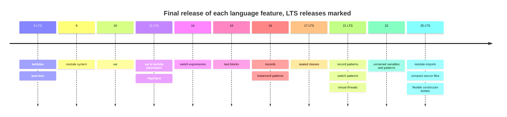

# 07. Modern language features: Java 8 to 25

> **What this covers:** what changed in the Java language and platform from Java 8 to Java 25, and how to use it: the release model and preview features, `var` and `switch` expressions, sealed types, pattern matching for `instanceof` and `switch` with records, the newest final and preview features of Java 25, and the module system. Then the library changes an interviewer expects (`HttpClient` above all), date and time with `java.time` against the legacy `Date` and `Calendar`, and how to migrate a service from Java 8 to 25.
> **Prerequisites:** [02. Equality, immutability and records § 6. Records](02-java-equality-immutability-records.md#6-records), [05. Lambdas, streams and Optional § 1. Functional interfaces and lambda expressions](05-java-lambdas-streams-optional.md#1-functional-interfaces-and-lambda-expressions), [01. OOP fundamentals § 12. Enums](01-java-oop-fundamentals.md#12-enums)
> **Leads to:** [08. JVM memory and class loading](08-jvm-memory-and-class-loading.md), [14. Virtual threads](14-concurrency-virtual-threads.md), [20. Spring Boot auto-configuration and configuration](20-spring-boot-autoconfiguration-and-config.md)
> **Applies to:** Java 25
> **Study time:** ~6 hours reading + ~3 hours exercises
> **Short on time:** [3. Sealed classes and interfaces](#3-sealed-classes-and-interfaces), [5. Pattern matching for `switch`: guards, dominance, `null` and exhaustiveness](#5-pattern-matching-for-switch-guards-dominance-null-and-exhaustiveness), [7. The module system (JPMS)](#7-the-module-system-jpms), [9. Date and time: from `Date` and `Calendar` to `java.time`](#9-date-and-time-from-date-and-calendar-to-javatime); questions [Q07.01](#q07-01), [Q07.08](#q07-08), [Q07.12](#q07-12), [Q07.17](#q07-17), [Q07.23](#q07-23), [Q07.26](#q07-26); then [Summary](#summary).
> **Labs:** [`labs/java-language/`](../labs/java-language/), package `dev.interview.javalanguage.m07`. Run: `JAVA_HOME=$(/usr/libexec/java_home -v 25) mvn -q -f java-backend-guide/labs/pom.xml -pl java-language -am verify`. Needs Docker: no.

## Contents

1. [The release model: cadence, LTS and preview features](#1-the-release-model-cadence-lts-and-preview-features)
2. [`var` and `switch` expressions](#2-var-and-switch-expressions)
3. [Sealed classes and interfaces](#3-sealed-classes-and-interfaces)
4. [Pattern matching: `instanceof`, record patterns and unnamed patterns](#4-pattern-matching-instanceof-record-patterns-and-unnamed-patterns)
5. [Pattern matching for `switch`: guards, dominance, `null` and exhaustiveness](#5-pattern-matching-for-switch-guards-dominance-null-and-exhaustiveness)
6. [The newest language features: module imports and primitive patterns](#6-the-newest-language-features-module-imports-and-primitive-patterns)
7. [The module system (JPMS)](#7-the-module-system-jpms)
8. [`HttpClient` and the library changes worth knowing](#8-httpclient-and-the-library-changes-worth-knowing)
9. [Date and time: from `Date` and `Calendar` to `java.time`](#9-date-and-time-from-date-and-calendar-to-javatime)
10. [Migration paths from Java 8 to 25](#10-migration-paths-from-java-8-to-25)
- [Summary](#summary)
- [Question bank](#question-bank)
- [Hands-on exercises](#hands-on-exercises)
- [Check your understanding](#check-your-understanding)
- [Connections](#connections)

## 1. The release model: cadence, LTS and preview features
### The problem it solves

Two teams, two failures. The first team adopted string templates (`STR."Hello \{name}"`) [Removed in Java 23] in 2024. They were a preview feature in JDK 21 and again in JDK 22, so the team turned on `--enable-preview` in the build. Then the feature was withdrawn: the JEP that would have made it final says "we withdrew this feature and removed it from JDK 23" [Doc: JEP 430](https://openjdk.org/jeps/430) [Doc: JEP 459](https://openjdk.org/jeps/459) [Doc: JEP 465](https://openjdk.org/jeps/465). On JDK 23 their source no longer compiled, and their JDK 22 class files would not even load, because a class compiled with preview features runs only on the release that compiled it ([How it actually works](#how-it-actually-works)). The second team is still on Java 8 because "every new Java breaks something". They cannot use any language feature added after Java 8, and the distance to the current release grows every six months. Both teams misread the same thing: how Java releases work, what "LTS" promises, and what "preview" really means.

### Mental model

Think of the JDK as a train that leaves the station every six months whether or not a given feature is on board. A feature that is ready boards the next train; one that is not waits for a later one. Releases are time-based, not feature-based [Doc: JEP 3](https://openjdk.org/jeps/3) [Doc: JEP 322](https://openjdk.org/jeps/322). Some trains are also signed up for a long maintenance contract by the vendors who ship them: those are the LTS (long-term support) releases. The contract is between you and a vendor, not a property of the train. A **preview feature** is a finished carriage with a "do not couple permanently" tag: it is built to the final standard, but it can be changed or taken off at the next station, and a class file that uses it carries the tag for one specific train.



What to notice: every language feature that became final from Java 14 on was previewed in one or more earlier releases first (the table below lists them), so a team that moves only from LTS to LTS meets several finished features at once.

### How it actually works

**Feature releases and update releases.** Since JDK 10 a feature release ships every six months, in March and September: "The March 2018 release is JDK 10, the September 2018 release is JDK 11, and so forth". The first number of the version, `$FEATURE`, counts these releases; `$INTERIM` is always zero; `$UPDATE` "is incremented one month after `$FEATURE` is incremented, and every three months thereafter", and update releases are expected "never to include incompatible changes" [Doc: JEP 322](https://openjdk.org/jeps/322). JEP 322 replaced the JDK 9 scheme of JEP 223, which had itself dropped the `1.` prefix of `1.8.0_x` strings [Doc: JEP 223](https://openjdk.org/jeps/223). Code reads the numbers with `Runtime.version()` (since 9) and `Runtime.Version.feature()`, `interim()` and `update()` (since 10) [Src: JDK 25, java.lang.Runtime](https://github.com/openjdk/jdk/blob/jdk-25-ga/src/java.base/share/classes/java/lang/Runtime.java). In the lab, `Runtime.version().feature()` returns 25 and `interim()` returns 0 [Lab: ReleaseModelTest](../labs/java-language/src/test/java/dev/interview/javalanguage/m07/s01/ReleaseModelTest.java). Each release is forked from the main line three months before it ships and stabilized in three rampdown phases [Doc: JEP 3](https://openjdk.org/jeps/3).

**LTS is a support promise, not a kind of release.** The OpenJDK process is the same for every feature release. JEP 322 only gives "an implementor" a way to say that it "offers long-term support" for a release, through an `LTS` suffix in the version string [Doc: JEP 322](https://openjdk.org/jeps/322). Oracle's roadmap names 8, 11, 17, 21 and 25 as its LTS releases, says it "intends to make future LTS releases every two years", and lists Java 29 in September 2027 as the next one, a date marked "subject to change". For Oracle, a non-LTS release is "superseded" as soon as the next feature release appears [Doc: Oracle Java SE Support Roadmap](https://www.oracle.com/java/technologies/java-se-support-roadmap.html). Other vendors publish their own dates, listed in [VERSIONS.md "Support policies"](../VERSIONS.md#support-policies).

**Three kinds of not-yet-final.** JEP 12 defines a preview feature as one that is "fully specified, fully implemented, and yet impermanent": it exists to collect feedback and "may lead to it becoming permanent in a future Java SE Platform" [Doc: JEP 12](https://openjdk.org/jeps/12). It must not be experimental: "if an experimental feature in HotSpot is considered 25% 'done', then a preview feature in Java SE should be at least 95% 'done'". It uses the syntax intended for its final form, never a temporary package in `java.*`, and two rounds of preview are the norm [Doc: JEP 12](https://openjdk.org/jeps/12). An **incubator module** is different: it holds a non-final API in a `jdk.incubator.*` module, which is not part of Java SE and is not resolved by default, so an application on the class path must ask for it with `--add-modules` [Doc: JEP 11](https://openjdk.org/jeps/11). In the lab, `jdk.incubator.vector` [Incubator in Java 25, JEP 508] [Doc: JEP 508](https://openjdk.org/jeps/508) is present in the JDK's system modules but missing from the boot layer of a JVM started without that flag [Lab: ReleaseModelTest](../labs/java-language/src/test/java/dev/interview/javalanguage/m07/s01/ReleaseModelTest.java). An **experimental** feature is a HotSpot (the OpenJDK JVM) option that must be unlocked at run time; JEP 12's example is ZGC in JDK 11, "enabled via `java -XX:+UnlockExperimentalVMOptions -XX:+UseZGC`" [Doc: JEP 12](https://openjdk.org/jeps/12). Garbage collectors themselves are [09](09-jvm-garbage-collection.md)'s topic.

**At compile time, preview is all or nothing, and tied to one release.** All preview features are off by default, and an implementation "must not allow preview features to be enabled on an individual basis" [Doc: JEP 12](https://openjdk.org/jeps/12). `javac` takes `--enable-preview` "in conjunction with either `-source` or `--release`" [Doc: javac 25 man page](https://docs.oracle.com/en/java/javase/25/docs/specs/man/javac.html), and JEP 12 adds that the operand must be the compiler's own release [Doc: JEP 12](https://openjdk.org/jeps/12). The lab shows the three outcomes on JDK 25 [Lab: ReleaseModelTest](../labs/java-language/src/test/java/dev/interview/javalanguage/m07/s01/ReleaseModelTest.java):
- a primitive type pattern (`case byte b` on an `int`) [Preview in Java 25, JEP 507] without the flag fails with `compiler.err.preview.feature.disabled.plural`;
- `--release 24 --enable-preview` fails with `compiler.err.preview.not.latest` ("preview language features are only supported for release 25"), and `--enable-preview` alone fails with `compiler.err.preview.without.source.or.release`;
- `--release 25 --enable-preview` (or `-source 25 --enable-preview`) compiles, and `javac` still prints two notes, "uses preview features of Java SE 25" and "Recompile with -Xlint:preview for details". JEP 12 explains that this message cannot be suppressed "because developers must be unfailingly aware of their reliance on the Java SE $N version of a preview language feature".

**The class file records the dependency.** A class file starts with a magic number, then a minor and a major version ([01 §1](01-java-oop-fundamentals.md#1-how-java-runs) covers the major version and `UnsupportedClassVersionError`). "A class file with version number 69.65535 depends on the preview features of Java SE 25", and one with version M.65535 for an older M "may not be loaded, regardless of whether preview features are enabled" [Doc: JVMS 25 §4.1](https://docs.oracle.com/javase/specs/jvms/se25/html/jvms-4.html#jvms-4.1). JEP 12 gives the reason: it "prevents such class files from running years into the future, long after the preview features that were enjoyed by the developer have been removed or finalized in a different form" [Doc: JEP 12](https://openjdk.org/jeps/12). Only classes that use a preview feature are marked: in the lab, a class compiled with `--enable-preview` that uses only final features keeps version 69.0 [Lab: ReleaseModelTest](../labs/java-language/src/test/java/dev/interview/javalanguage/m07/s01/ReleaseModelTest.java).

**At run time, the JVM checks the mark when it defines the class.** The `java` launcher's `--enable-preview` "allows classes to depend on preview features of the release" [Doc: java 25 man page](https://docs.oracle.com/en/java/javase/25/docs/specs/man/java.html), and without it `ClassLoader.defineClass` must fail for such bytes [Doc: JEP 12](https://openjdk.org/jeps/12). The lab shows both messages on JDK 25 [Lab: ReleaseModelTest](../labs/java-language/src/test/java/dev/interview/javalanguage/m07/s01/ReleaseModelTest.java):
- the preview class launched without the flag: `UnsupportedClassVersionError: Preview features are not enabled for PreviewMain (class file version 69.65535). Try running with '--enable-preview'`; with the flag it prints its output;
- the same bytes with the major version rewritten to 68, the header of a Java 24 preview class: `(class file version 68.65535) was compiled with preview features that are unsupported`, even in a JVM that would accept a plain 68.0 class.

JEP 12 also describes `-Xlog:class+preview`, which logs every loaded class that depends on preview features [Doc: JEP 12](https://openjdk.org/jeps/12).

**The map from Java 8 to 25.** Each row names the JEPs, read from their openjdk.org pages; the release numbers are each JEP's Release field. The same data, with statuses, is in [VERSIONS.md "Java language JEPs"](../VERSIONS.md#java-language-jeps-from-openjdkorg-jep-pages-checked-2026-11-28). Rows taught in another module link there.

| Feature | Preview or incubator (release) | Final (release) | Taught in |
|---|---|---|---|
| Lambda expressions and default methods | none | [JEP 126](https://openjdk.org/jeps/126) (8) | [05 §1](05-java-lambdas-streams-optional.md#1-functional-interfaces-and-lambda-expressions) |
| Date and time API (`java.time`) | none | [JEP 150](https://openjdk.org/jeps/150) (8) | [§9](#9-date-and-time-from-date-and-calendar-to-javatime) |
| Module system | none | [JEP 261](https://openjdk.org/jeps/261) (9) | [§7](#7-the-module-system-jpms) |
| `var` for local variables; in lambda parameters | none | [JEP 286](https://openjdk.org/jeps/286) (10); [JEP 323](https://openjdk.org/jeps/323) (11) | [§2](#2-var-and-switch-expressions) |
| `HttpClient` | incubator [JEP 110](https://openjdk.org/jeps/110) (9) | [JEP 321](https://openjdk.org/jeps/321) (11) | [§8](#8-httpclient-and-the-library-changes-worth-knowing) |
| Switch expressions | [JEP 325](https://openjdk.org/jeps/325) (12), [JEP 354](https://openjdk.org/jeps/354) (13) | [JEP 361](https://openjdk.org/jeps/361) (14) | [§2](#2-var-and-switch-expressions) |
| Text blocks | [JEP 355](https://openjdk.org/jeps/355) (13), [JEP 368](https://openjdk.org/jeps/368) (14) | [JEP 378](https://openjdk.org/jeps/378) (15) | [06 §6](06-java-exceptions-strings-io.md#6-strings-the-pool-compact-strings-concatenation-and-the-string-api) |
| Pattern matching for `instanceof` | [JEP 305](https://openjdk.org/jeps/305) (14), [JEP 375](https://openjdk.org/jeps/375) (15) | [JEP 394](https://openjdk.org/jeps/394) (16) | [§4](#4-pattern-matching-instanceof-record-patterns-and-unnamed-patterns) |
| Records | [JEP 359](https://openjdk.org/jeps/359) (14), [JEP 384](https://openjdk.org/jeps/384) (15) | [JEP 395](https://openjdk.org/jeps/395) (16) | [02 §6](02-java-equality-immutability-records.md#6-records) |
| Sealed classes | [JEP 360](https://openjdk.org/jeps/360) (15), [JEP 397](https://openjdk.org/jeps/397) (16) | [JEP 409](https://openjdk.org/jeps/409) (17) | [§3](#3-sealed-classes-and-interfaces) |
| Record patterns | [JEP 405](https://openjdk.org/jeps/405) (19), [JEP 432](https://openjdk.org/jeps/432) (20) | [JEP 440](https://openjdk.org/jeps/440) (21) | [§4](#4-pattern-matching-instanceof-record-patterns-and-unnamed-patterns) |
| Pattern matching for `switch` | [JEP 406](https://openjdk.org/jeps/406) (17), [JEP 420](https://openjdk.org/jeps/420) (18), [JEP 427](https://openjdk.org/jeps/427) (19), [JEP 433](https://openjdk.org/jeps/433) (20) | [JEP 441](https://openjdk.org/jeps/441) (21) | [§5](#5-pattern-matching-for-switch-guards-dominance-null-and-exhaustiveness) |
| Sequenced collections | none | [JEP 431](https://openjdk.org/jeps/431) (21) | [04 §1](04-java-collections-internals.md#1-the-collections-framework-interfaces-contracts-and-sequenced-collections) |
| Virtual threads | [JEP 425](https://openjdk.org/jeps/425) (19), [JEP 436](https://openjdk.org/jeps/436) (20) | [JEP 444](https://openjdk.org/jeps/444) (21) | [14](14-concurrency-virtual-threads.md) |
| String templates | [JEP 430](https://openjdk.org/jeps/430) (21), [JEP 459](https://openjdk.org/jeps/459) (22) | never: removed from 23 ([JEP 465](https://openjdk.org/jeps/465), Withdrawn) | this section only |
| Unnamed variables and patterns | [JEP 443](https://openjdk.org/jeps/443) (21) | [JEP 456](https://openjdk.org/jeps/456) (22) | [§4](#4-pattern-matching-instanceof-record-patterns-and-unnamed-patterns) |
| Stream gatherers | [JEP 461](https://openjdk.org/jeps/461) (22), [JEP 473](https://openjdk.org/jeps/473) (23) | [JEP 485](https://openjdk.org/jeps/485) (24) | [05](05-java-lambdas-streams-optional.md) |
| Compact source files and instance `main` methods | [JEP 445](https://openjdk.org/jeps/445) (21), [JEP 463](https://openjdk.org/jeps/463) (22), [JEP 477](https://openjdk.org/jeps/477) (23), [JEP 495](https://openjdk.org/jeps/495) (24) | [JEP 512](https://openjdk.org/jeps/512) (25) | [Q01.02](01-java-oop-fundamentals.md#q01-02) |
| Flexible constructor bodies | [JEP 447](https://openjdk.org/jeps/447) (22), [JEP 482](https://openjdk.org/jeps/482) (23), [JEP 492](https://openjdk.org/jeps/492) (24) | [JEP 513](https://openjdk.org/jeps/513) (25) | [01 §5](01-java-oop-fundamentals.md#5-constructors-and-initialization-order) |
| Module import declarations | [JEP 476](https://openjdk.org/jeps/476) (23), [JEP 494](https://openjdk.org/jeps/494) (24) | [JEP 511](https://openjdk.org/jeps/511) (25) | [§6](#6-the-newest-language-features-module-imports-and-primitive-patterns) |
| Scoped values | [JEP 446](https://openjdk.org/jeps/446) (21) and later previews | [JEP 506](https://openjdk.org/jeps/506) (25) | [14](14-concurrency-virtual-threads.md) |
| Structured concurrency | previews since 21; fifth preview in 25 ([JEP 505](https://openjdk.org/jeps/505)) | not final in 25 | [14](14-concurrency-virtual-threads.md) |
| Primitive types in patterns, `instanceof` and `switch` | [JEP 455](https://openjdk.org/jeps/455) (23), [JEP 488](https://openjdk.org/jeps/488) (24), [JEP 507](https://openjdk.org/jeps/507) (25) | not final in 25 | [§6](#6-the-newest-language-features-module-imports-and-primitive-patterns) |

Garbage-collector changes over the same releases are [09](09-jvm-garbage-collection.md)'s. Only the last two rows are not final in Java 25: primitive patterns [Preview in Java 25, JEP 507] and structured concurrency [Preview in Java 25, JEP 505] [Doc: JEP 507](https://openjdk.org/jeps/507) [Doc: JEP 505](https://openjdk.org/jeps/505).

### Code

The approach: give a build a way to prove that no preview class reaches production, by reading the version the compiler stamped into each class file instead of trusting the build flags.

1. Read the first eight bytes of a class file: the magic number `0xCAFEBABE`, then `minor_version` and `major_version` as unsigned 16-bit values [Doc: JVMS 25 §4.1](https://docs.oracle.com/javase/specs/jvms/se25/html/jvms-4.html#jvms-4.1).
2. Treat a minor version with all 16 bits set (65535) as "depends on the preview features of this release".
3. Encode the JVMS loading rule in one method, so the build can ask whether a class will load on the runtime it is deploying to.
4. Walk a directory, or the root of a JAR opened as a zip file system, and list every class that depends on preview features.

```java
// Excerpt of labs/java-language/src/main/java/dev/interview/javalanguage/m07/s01/ClassFileVersion.java
    public static ClassFileVersion of(byte[] classFile) {
        if (classFile.length < HEADER_BYTES) {
            throw new IllegalArgumentException("not a class file: " + classFile.length + " bytes");
        }
        ByteBuffer header = ByteBuffer.wrap(classFile, 0, HEADER_BYTES);
        if (header.getInt() != MAGIC) {
            throw new IllegalArgumentException("not a class file: wrong magic number");
        }
        int minor = Short.toUnsignedInt(header.getShort());
        int major = Short.toUnsignedInt(header.getShort());
        return new ClassFileVersion(major, minor);
    }

    // All 16 bits of minor_version set: the class depends on the preview features of its release.
    public boolean dependsOnPreview() {
        return minor == PREVIEW_MINOR;
    }

    // The Java SE release whose compiler targeted this file (52 is Java 8, 69 is Java 25).
    public int javaRelease() {
        return major - MAJOR_OF_RELEASE_ZERO;
    }

    // The JVMS §4.1 rule: a preview class loads only on its own release with preview enabled;
    // any other class loads on its own release or a later one.
    public boolean loadableOn(int runtimeFeature, boolean previewEnabled) {
        if (dependsOnPreview()) {
            return previewEnabled && javaRelease() == runtimeFeature;
        }
        return javaRelease() <= runtimeFeature;
    }
```

```java
// Excerpt of labs/java-language/src/main/java/dev/interview/javalanguage/m07/s01/PreviewClassScan.java
    public static List<Path> previewClasses(Path root) throws IOException {
        try (Stream<Path> files = Files.walk(root)) {
            return files.filter(PreviewClassScan::isClassFile)
                    .filter(PreviewClassScan::dependsOnPreview)
                    .sorted()
                    .toList();
        }
    }
```

The tests check the stamped versions against the real compiler: `--release 8`, `11`, `17`, `21` and `25` give major versions 52, 55, 61, 65 and 69, and a class that uses a primitive pattern reads as `69.65535` [Lab: ClassFileVersionTest](../labs/java-language/src/test/java/dev/interview/javalanguage/m07/s01/ClassFileVersionTest.java). The scan compiles two classes in one `--enable-preview` build, the way a build that turned the flag on for every module would, and finds only the one that uses a preview feature, both in a directory and inside a JAR [Lab: PreviewClassScanTest](../labs/java-language/src/test/java/dev/interview/javalanguage/m07/s01/PreviewClassScanTest.java). `loadableOn` agrees with what the JVM did in `ReleaseModelTest`: a 69.65535 class is refused without preview and accepted with it, a 68.65535 class is refused either way.

For trying a preview feature by hand, the flag goes on both tools. A source-file launch (`java --enable-preview Main.java`, [01 §1](01-java-oop-fundamentals.md#1-how-java-runs)) needs it only once, because the launcher passes `--enable-preview` to its in-memory compilation [Doc: java 25 man page](https://docs.oracle.com/en/java/javase/25/docs/specs/man/java.html):

```bash
javac --release 25 --enable-preview -d out PreviewMain.java
java --enable-preview -cp out PreviewMain
```

### Failure modes and operations

- **A preview feature shipped to production.** The class files are pinned to one feature release, so the JDK upgrade that the security team asks for becomes a code change, and if the feature changed or was removed (string templates), a rewrite [Doc: JVMS 25 §4.1](https://docs.oracle.com/javase/specs/jvms/se25/html/jvms-4.html#jvms-4.1) [Doc: JEP 465](https://openjdk.org/jeps/465). The symptom is an `UnsupportedClassVersionError` naming "preview features" at start-up; `javap -v` on the class shows `minor version: 65535`, and `-Xlog:class+preview` lists every preview class that loads [Doc: JEP 12](https://openjdk.org/jeps/12). [Q07.03](#q07-03) works the incident end to end. The guard is a build step like `PreviewClassScan` and a pipeline that never passes `--enable-preview` to `javac` or `java` for production artifacts.
- **`--enable-preview` left in a shared build configuration.** Nothing breaks the day it is added, because only the classes that use a preview feature are marked [Lab: ReleaseModelTest](../labs/java-language/src/test/java/dev/interview/javalanguage/m07/s01/ReleaseModelTest.java). The first time someone uses one, the artifact silently becomes release-pinned. The build compiles, the tests pass, and the `javac` note is the only signal, which is why the scan reads the class files rather than the flags.
- **An incubator API in an application.** On the class path, the incubator module is not resolved by default, so the code fails at run time until `--add-modules jdk.incubator.<name>` is added, and the JVM then warns that incubator modules are in use [Doc: JEP 11](https://openjdk.org/jeps/11) [Lab: ReleaseModelTest](../labs/java-language/src/test/java/dev/interview/javalanguage/m07/s01/ReleaseModelTest.java). The API can change in every release: the Vector API was in its tenth incubator round in JDK 25 ([VERSIONS.md](../VERSIONS.md#java-concurrency-jeps-from-openjdkorg-jep-and-release-pages)).
- **Running a release nobody supports any more.** Oracle treats a non-LTS release as superseded as soon as the next feature release ships; an LTS release has dated premier and extended support per vendor [Doc: Oracle Java SE Support Roadmap](https://www.oracle.com/java/technologies/java-se-support-roadmap.html) ([VERSIONS.md "Support policies"](../VERSIONS.md#support-policies)). The observable is the version string in `java -version` or `Runtime.version()` on each host, compared against the vendor's dates. Update releases arrive one month after each feature release and then every three months [Doc: JEP 322](https://openjdk.org/jeps/322), so patching is a quarterly routine, not a project.
- **Compiling with `-source`/`-target` instead of `--release`.** The class files claim an old release but can call APIs that do not exist there; [01 §1](01-java-oop-fundamentals.md#1-how-java-runs) and [Q01.03](01-java-oop-fundamentals.md#q01-03) cover it.

Load has no part in this topic: the release model decides what runs, not how fast; the start-up checks above are the only runtime behavior.

> [!NOTE]
> **Version notes.** Java 9: `--release N` compiles against the API of release N [Final since Java 9, JEP 247] [Doc: JEP 247](https://openjdk.org/jeps/247); the version string loses its `1.` prefix and `Runtime.version()` appears [Doc: JEP 223](https://openjdk.org/jeps/223) [Src: JDK 25, java.lang.Runtime](https://github.com/openjdk/jdk/blob/jdk-25-ga/src/java.base/share/classes/java/lang/Runtime.java). Java 10: time-based versioning with `feature()`, `interim()`, `update()` [Final since Java 10, JEP 322] [Doc: JEP 322](https://openjdk.org/jeps/322). Java 12: preview features arrive with the first preview language feature, switch expressions, and class files get minor version 65535 for them [Doc: JEP 12](https://openjdk.org/jeps/12) [Doc: JEP 325](https://openjdk.org/jeps/325) [Doc: JVMS 25 §4.1](https://docs.oracle.com/javase/specs/jvms/se25/html/jvms-4.html#jvms-4.1); in Java 12 and 13 the APIs tied to preview features were "terminally deprecated at birth", a practice later dropped [Doc: JEP 12](https://openjdk.org/jeps/12). Java 23: string templates removed after two previews [Doc: JEP 465](https://openjdk.org/jeps/465). Java 25 (default): primitive patterns in their third preview [Doc: JEP 507](https://openjdk.org/jeps/507). Java 26 and 27: still preview, fourth and fifth rounds ([VERSIONS.md](../VERSIONS.md#java-concurrency-jeps-from-openjdkorg-jep-and-release-pages)).

### Best practices and anti-patterns

- Build production artifacts without `--enable-preview`, and fail the build if any class file has minor version 65535, because the JVM loads such a class only on the release that compiled it [Doc: JVMS 25 §4.1](https://docs.oracle.com/javase/specs/jvms/se25/html/jvms-4.html#jvms-4.1), and `javac` marks only the classes that use the feature, so checking the flags is not enough [Lab: PreviewClassScanTest](../labs/java-language/src/test/java/dev/interview/javalanguage/m07/s01/PreviewClassScanTest.java).
- Try preview features in a separate module, branch or throwaway project, because JEP 12 exists to collect feedback, and its authors "very strongly" recommend that programs using preview APIs are not distributed [Doc: JEP 12](https://openjdk.org/jeps/12).
- Compile with `--release N` for the oldest runtime you deploy to, because it checks the API as well as the class-file version ([01 §1](01-java-oop-fundamentals.md#1-how-java-runs)).
- Run CI on the newest feature release as well as on your LTS, because each feature release can remove APIs deprecated for removal earlier (the Applet API in JDK 26, [VERSIONS.md](../VERSIONS.md#java-jep-statuses)), and finding that out one release at a time is cheaper than all at once at the next LTS.
- Read the version with `Runtime.version().feature()`, not by parsing `java.version`, because the string format changed twice (JEP 223 in 9, JEP 322 in 10) and old parsers that expect `1.x` misread `25` [Doc: JEP 223](https://openjdk.org/jeps/223) [Doc: JEP 322](https://openjdk.org/jeps/322).
- Keep incubator modules out of libraries you publish, because an incubator API is "not part of the Java SE Platform" and needs `--add-modules` from every application that uses your library [Doc: JEP 12](https://openjdk.org/jeps/12) [Doc: JEP 11](https://openjdk.org/jeps/11).
- **Security:** apply each quarterly update release, and plan the move off a release before its vendor support ends, because security fixes ship in update releases and an unsupported release gets none [Doc: JEP 322](https://openjdk.org/jeps/322) [Doc: Oracle Java SE Support Roadmap](https://www.oracle.com/java/technologies/java-se-support-roadmap.html).

### Misconceptions and traps

- *"LTS releases are special builds with more features."* Every feature release goes through the same process and gets the features that are ready [Doc: JEP 3](https://openjdk.org/jeps/3); LTS is a vendor's support commitment, signalled by an `LTS` suffix that "the implementor" chooses to add [Doc: JEP 322](https://openjdk.org/jeps/322). The myth comes from teams that skip non-LTS releases and so see features arrive in batches at each LTS.
- *"Preview means beta quality."* A preview feature is "fully specified, fully implemented, and yet impermanent", at least "95% done", and must not be experimental [Doc: JEP 12](https://openjdk.org/jeps/12). What is not guaranteed is its permanence, not its quality. The word "preview" suggests a beta because that is what it means for most products.
- *"Preview features always become final."* String templates were previewed twice and then removed [Doc: JEP 465](https://openjdk.org/jeps/465). Most previews did become final, which is why the exception surprises people.
- *"A class compiled with preview features today will run on the next JDK with `--enable-preview`."* It will not: a JVM refuses M.65535 for any older M "regardless of whether preview features are enabled" [Doc: JVMS 25 §4.1](https://docs.oracle.com/javase/specs/jvms/se25/html/jvms-4.html#jvms-4.1) [Lab: ReleaseModelTest](../labs/java-language/src/test/java/dev/interview/javalanguage/m07/s01/ReleaseModelTest.java). The belief comes from Java's usual promise that old class files run on new JVMs, which holds only for classes that do not depend on preview features.
- *"`--enable-preview` turns on the one feature I want."* It turns on every preview feature of that release; enabling them one at a time is not allowed [Doc: JEP 12](https://openjdk.org/jeps/12). Flags such as `-XX:+UseZGC` that do select one feature are HotSpot options, a different mechanism.
- *"Every class compiled with `--enable-preview` is marked as preview."* Only classes that use a preview feature get 65535 [Lab: ReleaseModelTest](../labs/java-language/src/test/java/dev/interview/javalanguage/m07/s01/ReleaseModelTest.java). The myth leads to trusting the build flag in both directions: assuming a flagged build is always pinned, or that an unflagged-looking artifact is safe without reading its classes.

Questions that drill this section: [Q07.01](#q07-01), [Q07.02](#q07-02), [Q07.03](#q07-03).

## 2. `var` and `switch` expressions
<!-- TASK: SEC-M07-02 -->
### The problem it solves
### Mental model
### How it actually works
### Code
### Failure modes and operations
### Best practices and anti-patterns
### Misconceptions and traps
<!-- /TASK: SEC-M07-02 -->

## 3. Sealed classes and interfaces
<!-- TASK: SEC-M07-03 -->
### The problem it solves
### Mental model
### How it actually works
### Code
### Failure modes and operations
### Best practices and anti-patterns
### Misconceptions and traps
<!-- /TASK: SEC-M07-03 -->

## 4. Pattern matching: `instanceof`, record patterns and unnamed patterns
<!-- TASK: SEC-M07-04 -->
### The problem it solves
### Mental model
### How it actually works
### Code
### Failure modes and operations
### Best practices and anti-patterns
### Misconceptions and traps
<!-- /TASK: SEC-M07-04 -->

## 5. Pattern matching for `switch`: guards, dominance, `null` and exhaustiveness
<!-- TASK: SEC-M07-05 -->
### The problem it solves
### Mental model
### How it actually works
### Code
### Failure modes and operations
### Best practices and anti-patterns
### Misconceptions and traps
<!-- /TASK: SEC-M07-05 -->

## 6. The newest language features: module imports and primitive patterns
<!-- TASK: SEC-M07-06 -->
### The problem it solves
### Mental model
### How it actually works
### Code
### Failure modes and operations
### Best practices and anti-patterns
### Misconceptions and traps
<!-- /TASK: SEC-M07-06 -->

## 7. The module system (JPMS)
<!-- TASK: SEC-M07-07 -->
### The problem it solves
### Mental model
### How it actually works
### Code
### Failure modes and operations
### Best practices and anti-patterns
### Misconceptions and traps
<!-- /TASK: SEC-M07-07 -->

## 8. `HttpClient` and the library changes worth knowing
<!-- TASK: SEC-M07-08 -->
### The problem it solves
### Mental model
### How it actually works
### Code
### Failure modes and operations
### Best practices and anti-patterns
### Misconceptions and traps
<!-- /TASK: SEC-M07-08 -->

## 9. Date and time: from `Date` and `Calendar` to `java.time`
<!-- TASK: SEC-M07-09 -->
### The problem it solves
### Mental model
### How it actually works
### Code
### Failure modes and operations
### Best practices and anti-patterns
### Misconceptions and traps
<!-- /TASK: SEC-M07-09 -->

## 10. Migration paths from Java 8 to 25
<!-- TASK: SEC-M07-10 -->
### The problem it solves
### Mental model
### How it actually works
### Code
### Failure modes and operations
### Best practices and anti-patterns
### Misconceptions and traps
<!-- /TASK: SEC-M07-10 -->

## Summary
<!-- TASK: CLOSE-M07 -->
<!-- /TASK: CLOSE-M07 -->

## Question bank

<!-- TASK: QB-M07-01 -->
<a id="q07-01"></a>
### Q07.01 · Concept · The Java release model: six-month feature releases, LTS, and what preview, incubator and experimental mean

<a id="q07-02"></a>
### Q07.02 · Output · A preview feature with and without `--enable-preview`: what does `javac` report, what does the class file record, and what does `java` say?

<a id="q07-03"></a>
### Q07.03 · Production scenario · After a JDK upgrade, a service built with `--enable-preview` no longer starts

<a id="q07-04"></a>
### Q07.04 · Concept · `var`: what it infers, where it is not allowed, and when it hurts readability

<a id="q07-05"></a>
### Q07.05 · Output · `switch` statement vs `switch` expression: fall-through, arrow labels, `yield`, and an enum switch without `default`

<a id="q07-06"></a>
### Q07.06 · Concept · Sealed classes and interfaces: `permits`, the `final`/`sealed`/`non-sealed` rule, where subclasses may live, and what the JVM enforces

<a id="q07-07"></a>
### Q07.07 · Bug hunt · Five sealed hierarchies: which compile, and why?
<!-- /TASK: QB-M07-01 -->

<!-- TASK: QB-M07-02 -->
<a id="q07-08"></a>
### Q07.08 · Design · Trade-off · Model a payment outcome as an algebraic data type: sealed interface, records and exhaustive `switch`, versus an enum, a class hierarchy with methods, and the visitor pattern

<a id="q07-09"></a>
### Q07.09 · Output · Pattern matching for `instanceof`: where is the binding in scope, and what happens with `null`?

<a id="q07-10"></a>
### Q07.10 · Concept · Record patterns, nested deconstruction, `var` in patterns, and unnamed variables and patterns

<a id="q07-11"></a>
### Q07.11 · Output · A pattern `switch` with guards, `case null` and overlapping types: which label runs, and which version does not compile?

<a id="q07-12"></a>
### Q07.12 · Concept · Exhaustiveness: when a `switch` must cover every case, how the compiler checks sealed types and record patterns, and how a pattern `switch` compiles

<a id="q07-13"></a>
### Q07.13 · Production scenario · `MatchException` in production after a dependency upgrade, in code that has not changed
<!-- /TASK: QB-M07-02 -->

<!-- TASK: QB-M07-03 -->
<a id="q07-14"></a>
### Q07.14 · Concept · Primitive types in patterns (preview in Java 25): what `case byte b` means for an `int`, and why it is not in production code

<a id="q07-15"></a>
### Q07.15 · Difference · `import module java.base;` vs `import java.util.*;`: what each imports, how ambiguities resolve, and where module imports belong

<a id="q07-16"></a>
### Q07.16 · Concept · `module-info.java`: `requires`, `requires transitive`, `exports`, `opens`, `uses` and `provides`, and what strong encapsulation means

<a id="q07-17"></a>
### Q07.17 · Difference · Output · `exports` vs `opens`: why a framework's reflection fails with `InaccessibleObjectException`, and what `--add-opens` changes

<a id="q07-18"></a>
### Q07.18 · Trade-off · Classpath vs module path in practice: the unnamed module, automatic modules, split packages, and why most Spring Boot services stay on the classpath

<a id="q07-19"></a>
### Q07.19 · Concept · `HttpClient`: synchronous and asynchronous calls, HTTP/2, timeouts and redirects, and why it replaced `HttpURLConnection`

<a id="q07-20"></a>
### Q07.20 · Production scenario · After the move to `HttpClient`, a status poller stops making progress and logs nothing
<!-- /TASK: QB-M07-03 -->

<!-- TASK: QB-M07-04 -->
<a id="q07-21"></a>
### Q07.21 · Concept · The library additions since Java 8 an interviewer expects you to know, and the exact `Math` methods

<a id="q07-22"></a>
### Q07.22 · Difference · `Date`, `Calendar`, `GregorianCalendar` and `TimeZone` vs `java.time`: what went wrong with the old API and what replaces each type

<a id="q07-23"></a>
### Q07.23 · Concept · Choosing a `java.time` type: `Instant`, `LocalDateTime`, `ZonedDateTime`, `OffsetDateTime`, `Duration` vs `Period`, and `Clock`

<a id="q07-24"></a>
### Q07.24 · Production scenario · Twice a year a nightly billing job runs twice, or not at all

<a id="q07-25"></a>
### Q07.25 · Production scenario · After the move from Java 11 to 17, the service fails at start-up with `InaccessibleObjectException`

<a id="q07-26"></a>
### Q07.26 · Design · Plan the upgrade of a Java 8 Spring Boot 2 service to Java 25: order, tools, removed APIs, and what is not a Java change
<!-- /TASK: QB-M07-04 -->

## Hands-on exercises

<!-- TASK: EX-M07-01 -->
<a id="ex07-1"></a>
### Exercise 07.1 · Replace a legacy billing calendar with `java.time`
<!-- /TASK: EX-M07-01 -->

<!-- TASK: EX-M07-02 -->
<a id="ex07-2"></a>
### Exercise 07.2 · An expression evaluator with sealed types and pattern `switch`
<!-- /TASK: EX-M07-02 -->

<!-- TASK: EX-M07-03 -->
<a id="ex07-3"></a>
### Exercise 07.3 · A modular plugin host
<!-- /TASK: EX-M07-03 -->

## Check your understanding
<!-- TASK: CLOSE-M07 -->
<!-- /TASK: CLOSE-M07 -->

## Connections
<!-- TASK: CLOSE-M07 -->
<!-- /TASK: CLOSE-M07 -->
