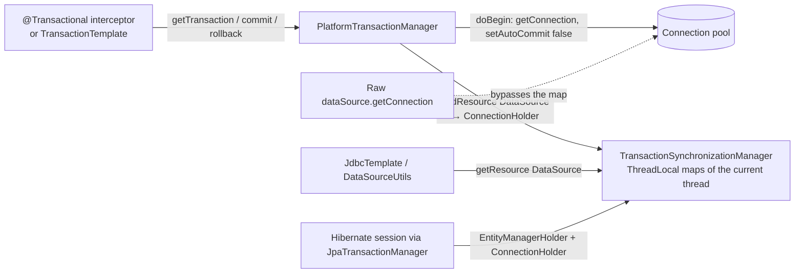
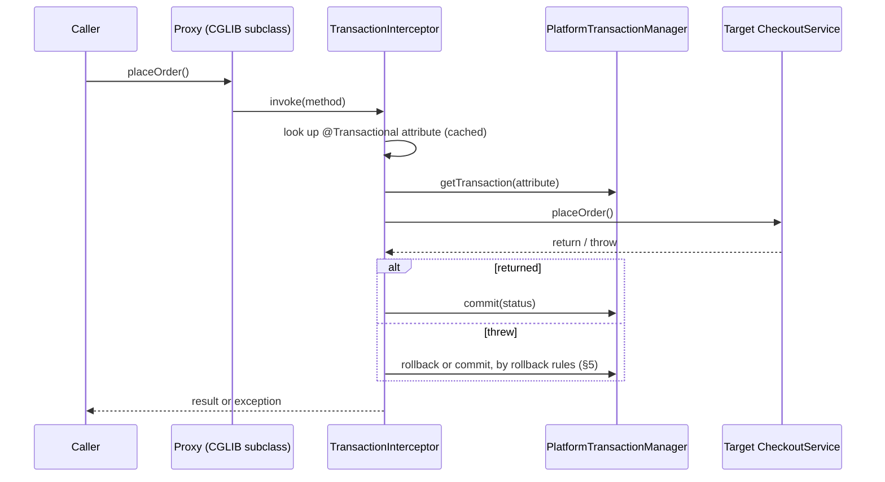
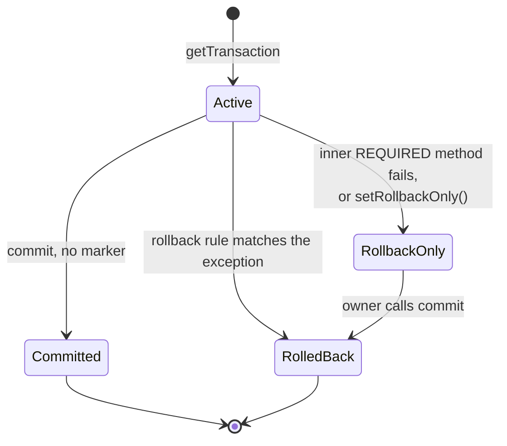
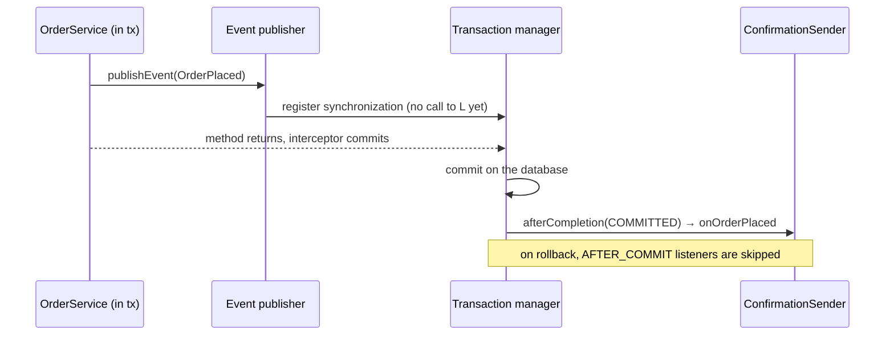

# 17. Spring transactions

> **What this covers:** how a Spring transaction really works, from a JDBC connection and the transaction manager to the proxy that `@Transactional` creates, and the ways it silently fails. Propagation, rollback rules, isolation anomalies in PostgreSQL, locking and retries, side effects after commit, and the production incidents long transactions cause.
> **Prerequisites:** [16. Spring AOP and proxies](16-spring-aop-and-proxies.md) (whole module: how proxies are built), [22. JDBC and connection pooling](22-jdbc-and-connection-pooling.md) (whole module: connections and HikariCP)
> **Leads to:** [23. JPA and Hibernate fundamentals](23-jpa-hibernate-fundamentals.md), [31. Kafka reliability and Spring Kafka](31-kafka-reliability-and-spring-kafka.md), [43. Distributed transactions and data patterns](43-distributed-transactions-and-data-patterns.md), [54. Architect production scenarios](54-architect-production-scenarios.md)
> **Applies to:** Java 25, Spring Boot 4.1.2 (Spring Framework 7.0.10, Spring Data JPA 4.1.2), Hibernate ORM 7.4.13.Final, PostgreSQL 18, Testcontainers 2.0.5
> **Study time:** ~7 hours reading + ~6 hours exercises
> **Short on time:** [3. `@Transactional` through the proxy](#3-transactional-through-the-proxy), [4. When `@Transactional` silently does nothing](#4-when-transactional-silently-does-nothing), [6. Propagation](#6-propagation), [7. Isolation levels and anomalies](#7-isolation-levels-and-anomalies); questions [Q17.06](#q17-06), [Q17.10](#q17-10), [Q17.13](#q17-13), [Q17.25](#q17-25), [Q17.30](#q17-30); then [Summary](#summary).
> **Labs:** [`labs/spring-transactions/`](../labs/spring-transactions/), package `dev.interview.springtransactions.m17`. Run: `JAVA_HOME=$(/usr/libexec/java_home -v 25) mvn -q -f java-backend-guide/labs/pom.xml -pl spring-transactions -am verify` (add `-DexcludedGroups=docker` without Docker). Needs Docker: yes (PostgreSQL through Testcontainers; tests that only need the recording transaction manager run without it).

## Contents

1. [Local transactions on a JDBC connection](#1-local-transactions-on-a-jdbc-connection)
2. [Spring's transaction abstraction](#2-springs-transaction-abstraction)
3. [`@Transactional` through the proxy](#3-transactional-through-the-proxy)
4. [When `@Transactional` silently does nothing](#4-when-transactional-silently-does-nothing)
5. [Rollback rules and rollback-only](#5-rollback-rules-and-rollback-only)
6. [Propagation](#6-propagation)
7. [Isolation levels and anomalies](#7-isolation-levels-and-anomalies)
8. [Read-only, timeouts and programmatic transactions](#8-read-only-timeouts-and-programmatic-transactions)
9. [Transactions and the JPA persistence context](#9-transactions-and-the-jpa-persistence-context)
10. [Optimistic and pessimistic locking, retries and deadlocks](#10-optimistic-and-pessimistic-locking-retries-and-deadlocks)
11. [Side effects after commit: transaction-bound events](#11-side-effects-after-commit-transaction-bound-events)
12. [Transactions across threads](#12-transactions-across-threads)
13. [Long transactions in production](#13-long-transactions-in-production)
14. [Testing transactional code](#14-testing-transactional-code)
- [Summary](#summary)
- [Question bank](#question-bank)
- [Hands-on exercises](#hands-on-exercises)
- [Check your understanding](#check-your-understanding)
- [Connections](#connections)

## 1. Local transactions on a JDBC connection
<!-- TASK: SEC-M17-01 -->
### The problem it solves
### Mental model
### How it actually works
### Code
### Failure modes and operations
### Best practices and anti-patterns
### Misconceptions and traps
<!-- /TASK: SEC-M17-01 -->

## 2. Spring's transaction abstraction
### The problem it solves

A checkout service writes the order through JPA and the stock movement through `JdbcTemplate`. With raw JDBC, every DAO needs the same `Connection` passed down by hand, and the service must know whether the store is JDBC, JPA or XA. Get the hand-off wrong once and the stock write commits while the order rolls back. Spring replaces that plumbing with one strategy interface for begin, commit and rollback, and a connection that travels with the thread.

### Mental model

Think of a cloakroom. The transaction manager takes a connection from the pool, switches off auto-commit, and hangs it on the current thread's hook labelled with the `DataSource`. Every Spring data-access helper checks that hook first. Code that walks to the pool itself gets another connection, which nobody commits or rolls back.



What to notice: the only link between the manager and the code doing the SQL is a `ThreadLocal` map keyed by the `DataSource`; the dashed path never reaches it.

### How it actually works

`PlatformTransactionManager` has three methods: `getTransaction(TransactionDefinition)`, `commit(TransactionStatus)` and `rollback(TransactionStatus)`. `TransactionDefinition` carries propagation, isolation, timeout, read-only and a name, with defaults `PROPAGATION_REQUIRED`, `ISOLATION_DEFAULT` and `TIMEOUT_DEFAULT` (-1, meaning the resource's own default). `TransactionStatus` is the handle passed back; it can mark rollback-only or hold savepoints [Src: spring-tx 7.0.10, [PlatformTransactionManager](https://github.com/spring-projects/spring-framework/blob/v7.0.10/spring-tx/src/main/java/org/springframework/transaction/PlatformTransactionManager.java), [TransactionDefinition](https://github.com/spring-projects/spring-framework/blob/v7.0.10/spring-tx/src/main/java/org/springframework/transaction/TransactionDefinition.java)].

Implementations extend `AbstractPlatformTransactionManager`, a Template Method: `getTransaction` calls `doGetTransaction()`, then either applies propagation rules to an existing transaction ([§6](#6-propagation)) or calls `doBegin` and initializes the thread's synchronization. `commit` refuses a status that is already completed and rolls back instead when the status is marked rollback-only ([§5](#5-rollback-rules-and-rollback-only)) [Src: spring-tx 7.0.10, [AbstractPlatformTransactionManager](https://github.com/spring-projects/spring-framework/blob/v7.0.10/spring-tx/src/main/java/org/springframework/transaction/support/AbstractPlatformTransactionManager.java)]. In the lab, `getTransaction` followed by `commit` produced exactly `begin tx1`, `commit tx1`, and a second completion call failed with `IllegalTransactionStateException` "already completed" [Lab: TransactionAbstractionTest](../labs/spring-transactions/src/test/java/dev/interview/springtransactions/m17/s02/TransactionAbstractionTest.java).

The thread binding lives in `TransactionSynchronizationManager`: static `ThreadLocal`s for the resource map, the synchronization callbacks, the transaction name, read-only flag, isolation level and "actual transaction active" [Src: spring-tx 7.0.10, [TransactionSynchronizationManager](https://github.com/spring-projects/spring-framework/blob/v7.0.10/spring-tx/src/main/java/org/springframework/transaction/support/TransactionSynchronizationManager.java)]. `DataSourceTransactionManager.doBegin` takes a connection from the `DataSource`, calls `setAutoCommit(false)` if needed, and binds a `ConnectionHolder` under the `DataSource` key; cleanup restores auto-commit and releases the connection [Src: spring-jdbc 7.0.10, [DataSourceTransactionManager](https://github.com/spring-projects/spring-framework/blob/v7.0.10/spring-jdbc/src/main/java/org/springframework/jdbc/datasource/DataSourceTransactionManager.java)]. `DataSourceUtils.getConnection(dataSource)`, which `JdbcTemplate` uses, returns the bound connection when there is one [Src: spring-jdbc 7.0.10, [DataSourceUtils](https://github.com/spring-projects/spring-framework/blob/v7.0.10/spring-jdbc/src/main/java/org/springframework/jdbc/datasource/DataSourceUtils.java)]. `JpaTransactionManager` binds an `EntityManagerHolder` under the `EntityManagerFactory` and, when it knows the `DataSource`, also a `ConnectionHolder`, so `JdbcTemplate` code joins the JPA transaction [Src: spring-orm 7.0.10, [JpaTransactionManager](https://github.com/spring-projects/spring-framework/blob/v7.0.10/spring-orm/src/main/java/org/springframework/orm/jpa/JpaTransactionManager.java)]. `JtaTransactionManager` delegates to a Jakarta Transactions (JTA) coordinator for transactions spanning several resources ([43](43-distributed-transactions-and-data-patterns.md)); `ReactiveTransactionManager` is the non-blocking counterpart, with no `ThreadLocal` ([19](19-spring-reactive-webflux.md)).

Spring Boot registers a `JpaTransactionManager` when Hibernate is present, otherwise a `JdbcTransactionManager` (a `DataSourceTransactionManager` that translates exceptions) for a single `DataSource`; both back off if any `TransactionManager` bean exists [Src: spring-boot 4.1.2, [JpaBaseConfiguration](https://github.com/spring-projects/spring-boot/blob/v4.1.2/module/spring-boot-jpa/src/main/java/org/springframework/boot/jpa/autoconfigure/JpaBaseConfiguration.java), [DataSourceTransactionManagerAutoConfiguration](https://github.com/spring-projects/spring-boot/blob/v4.1.2/module/spring-boot-jdbc/src/main/java/org/springframework/boot/jdbc/autoconfigure/DataSourceTransactionManagerAutoConfiguration.java)].

### Code

Approach: write by hand the template that `TransactionTemplate` and the `@Transactional` interceptor both run.

1. Ask the manager for a transaction with a definition.
2. Run the work; on a `RuntimeException` or `Error`, roll back and rethrow.
3. Otherwise commit, and return the result.

```java
package dev.interview.springtransactions.m17.s02;

import java.util.function.Supplier;
import org.springframework.transaction.PlatformTransactionManager;
import org.springframework.transaction.TransactionDefinition;
import org.springframework.transaction.TransactionStatus;

/** The begin/commit/rollback template that TransactionTemplate and the @Transactional interceptor implement. */
public final class ManualTransactionRunner {

    private final PlatformTransactionManager transactionManager;

    public ManualTransactionRunner(PlatformTransactionManager transactionManager) {
        this.transactionManager = transactionManager;
    }

    public <T> T inTransaction(TransactionDefinition definition, Supplier<T> work) {
        TransactionStatus status = transactionManager.getTransaction(definition);
        T result;
        try {
            result = work.get();
        } catch (RuntimeException | Error ex) {
            transactionManager.rollback(status);
            throw ex;
        }
        transactionManager.commit(status);
        return result;
    }
}
```
<sub>Source: [labs/spring-transactions/src/main/java/dev/interview/springtransactions/m17/s02/ManualTransactionRunner.java](../labs/spring-transactions/src/main/java/dev/interview/springtransactions/m17/s02/ManualTransactionRunner.java)</sub>

`TransactionTemplate.execute` and `TransactionAspectSupport` call the same three manager methods [Src: spring-tx 7.0.10, [TransactionTemplate](https://github.com/spring-projects/spring-framework/blob/v7.0.10/spring-tx/src/main/java/org/springframework/transaction/support/TransactionTemplate.java), [TransactionAspectSupport](https://github.com/spring-projects/spring-framework/blob/v7.0.10/spring-tx/src/main/java/org/springframework/transaction/interceptor/TransactionAspectSupport.java)]. The test below runs it over a real `DataSourceTransactionManager` with mocked JDBC objects: `DataSourceUtils` returns the connection taken at begin; a raw `getConnection()` gets a second one, never committed.

```java
// Excerpt of labs/spring-transactions/src/test/java/dev/interview/springtransactions/m17/s02/TransactionAbstractionTest.java
    void onlyDataSourceUtilsSeesTheBoundConnection() throws SQLException {
        Connection transactional = mock(Connection.class);
        Connection raw = mock(Connection.class);
        when(transactional.getAutoCommit()).thenReturn(true);
        DataSource dataSource = mock(DataSource.class);
        when(dataSource.getConnection()).thenReturn(transactional, raw);
        ManualTransactionRunner jdbcRunner = new ManualTransactionRunner(new DataSourceTransactionManager(dataSource));

        Connection[] seen = jdbcRunner.inTransaction(TransactionDefinition.withDefaults(), () ->
                new Connection[] {DataSourceUtils.getConnection(dataSource), getRaw(dataSource)});

        assertThat(seen[0]).isSameAs(transactional);
        assertThat(seen[1]).isSameAs(raw);
        InOrder order = inOrder(transactional);
        order.verify(transactional).setAutoCommit(false);
        order.verify(transactional).commit();
        order.verify(transactional).setAutoCommit(true);
        order.verify(transactional).close();
        verify(raw, never()).commit();
        verify(raw, never()).setAutoCommit(false);
    }
```

What the database does with the raw connection's writes is drilled in [Q17.03](#q17-03).

### Failure modes and operations

- **The binding is per thread.** Work handed to another thread sees no transaction: in the lab, `isActualTransactionActive()` was `false` inside `CompletableFuture.supplyAsync` started from a transaction [Lab: TransactionAbstractionTest](../labs/spring-transactions/src/test/java/dev/interview/springtransactions/m17/s02/TransactionAbstractionTest.java). See [§12](#12-transactions-across-threads).
- **A connection is held from begin to completion.** `DataSourceTransactionManager` takes it in `doBegin`, before the first SQL statement [Src: spring-jdbc 7.0.10, DataSourceTransactionManager]. Under load, transaction duration sets how many pool connections are busy; slow work inside the boundary queues other requests on the pool ([§13](#13-long-transactions-in-production), sizing in [22](22-jdbc-and-connection-pooling.md)).
- **Observability.** `logging.level.org.springframework.transaction=DEBUG` shows `Creating new transaction with name [...]`, and `org.springframework.jdbc.datasource` logs `Switching JDBC Connection [...] to manual commit` [Src: spring-tx and spring-jdbc 7.0.10, log statements in AbstractPlatformTransactionManager and DataSourceTransactionManager].

> [!IMPORTANT]
> **Production scenario: reporting writes survive a rollback.** *As the interviewer frames it:* "We added a second `DataSource` for a reporting schema. When checkout fails, the order rolls back but its reporting rows stay. No errors in the logs."
> **Reasoning.** `@Transactional` uses the one auto-configured manager, bound to the primary `DataSource`. `DataSourceUtils` finds no holder under the reporting `DataSource` key, so it fetches a fresh connection in auto-commit mode; synchronization only makes later calls reuse it [Src: spring-jdbc 7.0.10, DataSourceUtils.doGetConnection]. Each statement commits on its own. Diagnosis: DEBUG transaction logs show one transaction per request, naming one manager. Fix: a manager per `DataSource`, chosen with `@Transactional(transactionManager = "reportingTx")` [Src: spring-tx 7.0.10, [Transactional](https://github.com/spring-projects/spring-framework/blob/v7.0.10/spring-tx/src/main/java/org/springframework/transaction/annotation/Transactional.java)], or a design where one business operation writes to one database ([43](43-distributed-transactions-and-data-patterns.md)).

> [!NOTE]
> **Framework vs language.** JDBC (Java SE) gives one `Connection` with `setAutoCommit`, `commit` and `rollback`, and nothing more. Jakarta Persistence (JPA) defines `EntityTransaction`; Jakarta Transactions (JTA) defines distributed transactions. Spring adds the strategy interface, the `ThreadLocal` binding, propagation and declarative demarcation; none of this exists outside Spring-managed access paths.

> [!NOTE]
> **Version notes.** Spring Framework 5.2: `TransactionManager` became the common supertype of `PlatformTransactionManager` and the new `ReactiveTransactionManager` [Src: spring-tx 7.0.10, `@since 5.2` in TransactionManager and ReactiveTransactionManager]. Spring Framework 5.3: `JdbcTransactionManager` added [Src: spring-jdbc 7.0.10, `@since 5.3`]. Spring Boot 3.x: the transaction-manager auto-configuration lived in `org.springframework.boot.autoconfigure.jdbc` and `...orm.jpa` inside `spring-boot-autoconfigure` [Src: spring-boot-autoconfigure 3.5.3 jar]. [Changed in Spring Boot 4.0: it moved to per-technology modules, `org.springframework.boot.jdbc.autoconfigure` and `org.springframework.boot.jpa.autoconfigure`] [Src: spring-boot-jdbc and spring-boot-jpa 4.1.2 jars]; exclusions by class name must use the new names.

### Best practices and anti-patterns

- Access data only through Spring paths (`JdbcTemplate`, `JdbcClient`, Spring Data, an injected `EntityManager`), because only they look up the thread-bound resource.
- Wrap a legacy library that calls `dataSource.getConnection()` in `TransactionAwareDataSourceProxy`, because its connections then delegate to the bound one [Src: spring-jdbc 7.0.10, [TransactionAwareDataSourceProxy](https://github.com/spring-projects/spring-framework/blob/v7.0.10/spring-jdbc/src/main/java/org/springframework/jdbc/datasource/TransactionAwareDataSourceProxy.java)].
- With JPA and JDBC on one database, keep Boot's single `JpaTransactionManager`, because it shares its connection with `JdbcTemplate`.
- Anti-pattern: calling `commit` and `rollback` by hand in services, because a missed rollback path leaves thread-bound state open; use `TransactionTemplate` or `@Transactional`.

### Misconceptions and traps

- *"All code using the same `DataSource` joins the transaction."* Only code that asks through `DataSourceUtils` does; in the lab a raw `getConnection()` got a second, never-committed connection [Lab: TransactionAbstractionTest](../labs/spring-transactions/src/test/java/dev/interview/springtransactions/m17/s02/TransactionAbstractionTest.java). The pool hides that connections differ.
- *"The connection is taken at the first query."* With `DataSourceTransactionManager` it is taken in `doBegin`, at method entry. The myth comes from auto-commit code, where it is true.
- *"`TransactionTemplate` is a different mechanism from `@Transactional`."* Both drive the same `PlatformTransactionManager`; only the demarcation style differs ([§8](#8-read-only-timeouts-and-programmatic-transactions)).

## 3. `@Transactional` through the proxy
### The problem it solves

[§2](#2-springs-transaction-abstraction) still leaves `getTransaction`, `commit` and `rollback` calls in every service method. Copy that block into two hundred methods and someone forgets the rollback branch. `@Transactional` moves the block out of business code: you declare the boundary, and Spring runs the template around the method. The price is that the boundary is no longer visible in the code, so when it is missing you only notice at the first rollback that does not happen.

### Mental model

The bean you inject is not your object. It is a stand-in, a proxy (a generated object that receives each call and decides what to do before and after delegating, owned by [16](16-spring-aop-and-proxies.md)), wrapping your object like a receptionist who opens a ledger before showing the visitor in and closes it on the way out. Only visitors who come through reception get a ledger.



What to notice: the transaction exists only between the interceptor's `getTransaction` and its `commit`; a call that starts inside `T` never passes through `P`.

### How it actually works

**At startup.** Spring Boot applies `@EnableTransactionManagement` when a `TransactionManager` bean exists, with `proxyTargetClass = true` unless `spring.aop.proxy-target-class=false` [Src: spring-boot 4.1.2, [TransactionAutoConfiguration](https://github.com/spring-projects/spring-boot/blob/v4.1.2/module/spring-boot-transaction/src/main/java/org/springframework/boot/transaction/autoconfigure/TransactionAutoConfiguration.java)]. That annotation registers three infrastructure beans: an `AnnotationTransactionAttributeSource` created with `publicMethodsOnly = false`, a `TransactionInterceptor`, and a `BeanFactoryTransactionAttributeSourceAdvisor` whose pointcut matches any method for which the attribute source finds an attribute [Src: spring-tx 7.0.10, [ProxyTransactionManagementConfiguration](https://github.com/spring-projects/spring-framework/blob/v7.0.10/spring-tx/src/main/java/org/springframework/transaction/annotation/ProxyTransactionManagementConfiguration.java), [AbstractTransactionManagementConfiguration](https://github.com/spring-projects/spring-framework/blob/v7.0.10/spring-tx/src/main/java/org/springframework/transaction/annotation/AbstractTransactionManagementConfiguration.java)]. The auto-proxy creator then wraps every bean with at least one matching method; how the proxy class is generated belongs to [16](16-spring-aop-and-proxies.md).

**Finding the attribute.** For a method, the source looks first at the method on the target class, then at the target class, then at the interface method, then at the interface; the first hit wins, so a method annotation overrides the class annotation. Non-public methods are skipped only when `publicMethodsOnly` is true [Src: spring-tx 7.0.10, [AbstractFallbackTransactionAttributeSource](https://github.com/spring-projects/spring-framework/blob/v7.0.10/spring-tx/src/main/java/org/springframework/transaction/interceptor/AbstractFallbackTransactionAttributeSource.java).computeTransactionAttribute]. Besides Spring's annotation it parses `jakarta.transaction.Transactional` when that class is on the classpath [Src: spring-tx 7.0.10, [AnnotationTransactionAttributeSource](https://github.com/spring-projects/spring-framework/blob/v7.0.10/spring-tx/src/main/java/org/springframework/transaction/annotation/AnnotationTransactionAttributeSource.java)]; in the lab a method carrying only the Jakarta annotation ran inside `begin tx1` / `commit tx1` [Lab: TransactionalProxyTest](../labs/spring-transactions/src/test/java/dev/interview/springtransactions/m17/s03/TransactionalProxyTest.java).

**Per call.** `TransactionInterceptor.invoke` calls `invokeWithinTransaction`: resolve the attribute, choose the manager (the annotation's `transactionManager` qualifier, else the single `TransactionManager` bean), `createTransactionIfNecessary` (which calls `getTransaction` and binds a `TransactionInfo` to the thread), proceed to the target, then `completeTransactionAfterThrowing` or `commitTransactionAfterReturning` [Src: spring-tx 7.0.10, [TransactionAspectSupport](https://github.com/spring-projects/spring-framework/blob/v7.0.10/spring-tx/src/main/java/org/springframework/transaction/interceptor/TransactionAspectSupport.java)]. The transaction name is the qualified method name: in the lab, inside `placeOrder` the thread reported an active transaction named `dev.interview.springtransactions.m17.s03.CheckoutService.placeOrder`, and the injected bean was a CGLIB proxy [Lab: TransactionalProxyTest](../labs/spring-transactions/src/test/java/dev/interview/springtransactions/m17/s03/TransactionalProxyTest.java).

### Code

Approach: wire the real Spring infrastructure around a plain class, with the recording manager from §2 instead of a database, and read the thread's transaction state from inside the method.

1. Annotate one method with Spring's `@Transactional`, one with Jakarta's, and leave one plain.
2. Each method returns a `TxSnapshot` built from `TransactionSynchronizationManager.isActualTransactionActive()` and `getCurrentTransactionName()`.
3. Register the class and the manager in a configuration with `@EnableTransactionManagement(proxyTargetClass = true)`, the same setting Boot uses by default.

```java
package dev.interview.springtransactions.m17.s03;

import org.springframework.transaction.annotation.Transactional;

public class CheckoutService {

    @Transactional
    public TxSnapshot placeOrder() {
        return TxSnapshot.current();
    }

    @jakarta.transaction.Transactional
    public TxSnapshot placeOrderWithJakartaAnnotation() {
        return TxSnapshot.current();
    }

    public TxSnapshot quote() {
        return TxSnapshot.current();
    }
}
```
<sub>Source: [labs/spring-transactions/src/main/java/dev/interview/springtransactions/m17/s03/CheckoutService.java](../labs/spring-transactions/src/main/java/dev/interview/springtransactions/m17/s03/CheckoutService.java)</sub>

```java
// Excerpt of labs/spring-transactions/src/test/java/dev/interview/springtransactions/m17/s03/TransactionalProxyTest.java
    void proxiedCallBeginsAndCommits() {
        TxSnapshot inside = checkout.placeOrder();

        assertThat(AopUtils.isCglibProxy(checkout)).isTrue();
        assertThat(inside)
                .isEqualTo(new TxSnapshot(true, "dev.interview.springtransactions.m17.s03.CheckoutService.placeOrder"));
        assertThat(transactionManager.events()).containsExactly("begin tx1", "commit tx1");
    }
```

`quote()` reports no transaction. This check is the cheapest runtime proof of a transaction ([Q17.11](#q17-11)).

### Failure modes and operations

- **Two transaction managers, no qualifier.** With no `transactionManager` attribute the interceptor asks the bean factory for the one `TransactionManager` bean [Src: spring-tx 7.0.10, TransactionAspectSupport.determineTransactionManager]; with two candidates and no `@Primary`, the context starts and the first transactional call fails: in the lab, with `NoUniqueBeanDefinitionException` [Lab: TransactionalProxyTest](../labs/spring-transactions/src/test/java/dev/interview/springtransactions/m17/s03/TransactionalProxyTest.java). Name the manager on the annotation or mark one primary.
- **Load.** The interceptor caches the attribute per method and target class, so per-call overhead is a map lookup plus the manager's work [Src: spring-tx 7.0.10, AbstractFallbackTransactionAttributeSource]; the real cost under load is the connection the boundary holds ([§2](#2-springs-transaction-abstraction), [§13](#13-long-transactions-in-production)).
- **Observability.** `logging.level.org.springframework.transaction.interceptor=TRACE` logs `Getting transaction for [<class>.<method>]` per call, which shows which methods are actually advised [Src: spring-tx 7.0.10, TransactionAspectSupport.prepareTransactionInfo].

> [!NOTE]
> **Framework vs language.** A Java method call is a plain `invokevirtual`; the language has no idea of a transaction. Jakarta Transactions defines `jakarta.transaction.Transactional` as an annotation for container-managed beans. The behaviour (proxy, interceptor, rollback rules) is Spring's, and exists only for calls that go through a Spring proxy.

> [!NOTE]
> **Version notes.** Spring Framework 6.0 (Boot 3.0): protected and package-visible methods are transactional by default on class-based proxies; before, only public methods were [Doc: [Spring Framework reference, "Method visibility and @Transactional in proxy mode"](https://docs.spring.io/spring-framework/reference/data-access/transaction/declarative/annotations.html)]. Spring 6 / Boot 3 also moved to Jakarta EE: the attribute source looks for `jakarta.transaction.Transactional`, so `javax.transaction.Transactional` on old code is silently ignored after the upgrade [Src: spring-tx 7.0.10, AnnotationTransactionAttributeSource checks only `jakarta.*`].

### Best practices and anti-patterns

- Put `@Transactional` on the concrete class or its methods, not only on an interface, because an interface-level annotation is found only as a fallback and the visibility rule for interface proxies is stricter [Doc: same reference page].
- Use Spring's annotation in Spring code, because `propagation`, `isolation`, `readOnly`, `timeout` and `transactionManager` exist only there; Jakarta's has only `value` (`TxType`), `rollbackOn` and `dontRollbackOn` [Src: jakarta.transaction-api 2.0.1, `Transactional`].
- Name the manager (`@Transactional(transactionManager = "…")`) whenever the context has more than one, because resolution by type fails only at call time.
- Anti-pattern: `@Transactional` on every class "to be safe", because each boundary holds a connection for the whole method, including remote calls inside it ([§13](#13-long-transactions-in-production)).

### Misconceptions and traps

- *"`@Transactional` is a compiler or JVM feature."* It is metadata; nothing happens unless a Spring proxy intercepts the call ([§4](#4-when-transactional-silently-does-nothing)). The myth exists because the annotation sits on the method like `synchronized` does.
- *"Spring Boot uses JDK interface proxies."* Boot 4.1.2 enables class-based (CGLIB) proxies unless `spring.aop.proxy-target-class=false` [Src: spring-boot 4.1.2, TransactionAutoConfiguration]; the lab bean was a CGLIB proxy. Interview answers from plain Spring XML days still say JDK proxy.
- *"Only public methods can be transactional."* Once true: until Spring Framework 5.3. Now: protected and package-visible methods work on class-based proxies; `private` and `final` still cannot, because a subclass cannot override them ([§4](#4-when-transactional-silently-does-nothing)).

## 4. When `@Transactional` silently does nothing
### The problem it solves

`@Transactional` fails without an error. When no proxy sees the call, the method runs in auto-commit mode or in whatever repository transactions it calls. Nothing is logged, happy-path tests pass, and the first sign is a partial write in production.

### Mental model

The receptionist from [§3](#3-transactional-through-the-proxy) opens a ledger only for visitors entering through reception. A colleague walking into the next office (self-invocation), a back door (`private`, `final`, `static`), or a building with no receptionist (an object made with `new`) all skip it.

### How it actually works

A CGLIB proxy is a generated subclass whose overriding methods call the interceptor and then the target bean, a separate instance [Src: spring-aop 7.0.10, [CglibAopProxy](https://github.com/spring-projects/spring-framework/blob/v7.0.10/spring-aop/src/main/java/org/springframework/aop/framework/CglibAopProxy.java)]. Each silent case follows from that:

| Case | Why the interceptor never runs | Lab result |
|---|---|---|
| Self-invocation: `placeOrder()` calls `this.saveOrder()` | `this` inside the target is the target, not the proxy | no transaction, no manager calls [Lab: SilentNoTransactionTest](../labs/spring-transactions/src/test/java/dev/interview/springtransactions/m17/s04/SilentNoTransactionTest.java) |
| `private` method | a subclass cannot override it; reflection on the proxy runs the original | no transaction [Lab: SilentNoTransactionTest](../labs/spring-transactions/src/test/java/dev/interview/springtransactions/m17/s04/SilentNoTransactionTest.java) |
| `final` method | cannot be overridden, so the call runs the original code *on the proxy instance*, whose fields were never set (Spring instantiates the proxy class through Objenesis, without a constructor call) | no transaction; a field read throws `NullPointerException` [Lab: SilentNoTransactionTest](../labs/spring-transactions/src/test/java/dev/interview/springtransactions/m17/s04/SilentNoTransactionTest.java) |
| `static` method | not dispatched on an instance at all | no transaction [Lab: SilentNoTransactionTest](../labs/spring-transactions/src/test/java/dev/interview/springtransactions/m17/s04/SilentNoTransactionTest.java) |
| `new OrderWorkflow(...)` | not a bean, so never wrapped | no transaction [Lab: SilentNoTransactionTest](../labs/spring-transactions/src/test/java/dev/interview/springtransactions/m17/s04/SilentNoTransactionTest.java) |
| `protected` or package-visible method (control) | overridden by the subclass since Spring Framework 6.0 | transaction begins [Lab: SilentNoTransactionTest](../labs/spring-transactions/src/test/java/dev/interview/springtransactions/m17/s04/SilentNoTransactionTest.java) |

Spring's reference documentation states the self-invocation rule: only external calls through the proxy are intercepted [Doc: [Spring Framework reference, "Using @Transactional"](https://docs.spring.io/spring-framework/reference/data-access/transaction/declarative/annotations.html)]. Two more silent cases come from earlier sections: a write through a `DataSource` the manager does not manage ([§2](#2-springs-transaction-abstraction)), and an exception the method catches itself, so the interceptor sees a normal return and commits ([§5](#5-rollback-rules-and-rollback-only)).

### Code

Approach: put every broken variant on one class, call each through the proxy, then fix.

1. `placeOrder()` is public and unannotated and calls the annotated `saveOrder()` on `this`.
2. The `private`, `final` and `static` variants carry the annotation but cannot be intercepted.
3. The fix moves `saveOrder()` into a separate bean, `OrderWriter`, which `OrderFacade` receives through its constructor.

```java
package dev.interview.springtransactions.m17.s04;

import dev.interview.springtransactions.m17.s03.TxSnapshot;
import java.time.Clock;
import java.time.Instant;
import org.springframework.transaction.annotation.Transactional;

/** Every way a @Transactional method on this class runs without a transaction. */
public class OrderWorkflow {

    private final Clock clock;

    public OrderWorkflow(Clock clock) {
        this.clock = clock;
    }

    public TxSnapshot placeOrder() {
        return saveOrder(); // self-invocation: `this` is the target, not the proxy
    }

    @Transactional
    public TxSnapshot saveOrder() {
        return TxSnapshot.current();
    }

    @Transactional
    protected TxSnapshot saveProtected() {
        return TxSnapshot.current();
    }

    @Transactional
    private TxSnapshot savePrivate() {
        return TxSnapshot.current();
    }

    @Transactional
    public final TxSnapshot saveFinal() {
        return TxSnapshot.current();
    }

    @Transactional
    public final Instant stampFinal() {
        return clock.instant(); // on the proxy instance `clock` is null
    }

    @Transactional
    public static TxSnapshot saveStatic() {
        return TxSnapshot.current();
    }
}
```
<sub>Source: [labs/spring-transactions/src/main/java/dev/interview/springtransactions/m17/s04/OrderWorkflow.java](../labs/spring-transactions/src/main/java/dev/interview/springtransactions/m17/s04/OrderWorkflow.java)</sub>

```java
// Excerpt of labs/spring-transactions/src/main/java/dev/interview/springtransactions/m17/s04/OrderFacade.java
public class OrderFacade {

    private final OrderWriter writer;

    public OrderFacade(OrderWriter writer) {
        this.writer = writer;
    }

    public TxSnapshot placeOrder() {
        return writer.saveOrder();
    }
}
```

In the lab, `OrderFacade.placeOrder()` produced `begin tx1`, `commit tx1`, while `OrderWorkflow.placeOrder()` produced no manager calls at all [Lab: SilentNoTransactionTest](../labs/spring-transactions/src/test/java/dev/interview/springtransactions/m17/s04/SilentNoTransactionTest.java). The other fixes, self-injection, `TransactionTemplate` and AspectJ weaving, are compared in [Q17.12](#q17-12).

### Failure modes and operations

- **Partial writes under failure only.** The gap appears only when a later statement fails, so load tests rarely find it.
- **Startup evidence.** For a public `final` method on a class it proxies, Spring logs at WARN `Public final method [...] cannot get proxied via CGLIB` [Src: spring-aop 7.0.10, CglibAopProxy.doValidateClass]. Treat that line as a build failure.
- **Runtime evidence.** With `org.springframework.transaction.interceptor` at TRACE, a business call with no `Getting transaction for [...]` line was not advised ([§3](#3-transactional-through-the-proxy)).

> [!IMPORTANT]
> **Production scenario: half an order saved, no error.** *As the interviewer frames it:* "After a refactoring that merged `OrderService` and `OrderPersistence` into one class, a failed payment leaves orders without lines. Nothing changed in the annotations."
> **Reasoning.** The merge turned a cross-bean call into `this.saveOrder()`, so the boundary vanished. Each Spring Data repository call still ran in its own transaction, because `SimpleJpaRepository.save` is itself `@Transactional` [Src: spring-data-jpa 4.1.2, [SimpleJpaRepository](https://github.com/spring-projects/spring-data-jpa/blob/4.1.2/spring-data-jpa/src/main/java/org/springframework/data/jpa/repository/support/SimpleJpaRepository.java)], so the order committed before the lines failed. Diagnose with TRACE interceptor logs or an `isActualTransactionActive()` assertion; fix by moving the boundary to a separate bean; prevent it with a test that fails the second write and asserts no rows remain ([§14](#14-testing-transactional-code)).

### Best practices and anti-patterns

- Put the transaction boundary on the public entry method of a bean that callers reach through injection, because that call always crosses the proxy.
- Keep transactional classes non-`final` and their transactional methods non-`final`, because CGLIB must subclass and override them.
- Anti-pattern: annotating helper methods called only from inside the same class, because the annotation is dead code that misleads reviewers.
- Anti-pattern: catching `Exception` inside the boundary and logging it, because the interceptor then commits a half-done unit ([§5](#5-rollback-rules-and-rollback-only)).

### Misconceptions and traps

- *"An annotated inner method gets its own transaction when called from the same class."* It gets none from that call; the myth comes from reading annotations as language semantics. Drilled in [Q17.06](#q17-06).
- *"A `final` method is just not transactional."* Worse: it runs on the proxy instance and sees `null` fields [Lab: SilentNoTransactionTest](../labs/spring-transactions/src/test/java/dev/interview/springtransactions/m17/s04/SilentNoTransactionTest.java). The myth exists because the missing transaction is usually noticed first.
- *"`private` methods became transactional in Spring Framework 6.0."* Only `protected` and package-visible ones did, on class-based proxies; `private` still needs AspectJ weaving ([16](16-spring-aop-and-proxies.md)).

## 5. Rollback rules and rollback-only
### The problem it solves

A nightly import inserts rows and declares `throws IOException`. Halfway through, a read fails; the method exits with an exception, yet half the rows are in the table next morning, because by default a checked exception commits. The reverse surprise: a caller catches an inner transactional method's failure, carries on, and gets `UnexpectedRollbackException` at the end.

### Mental model

A transaction carries a ballot any participant can spoil. At the method's exit, the interceptor decides by the exception's type whether to commit or roll back. A joined inner method cannot roll back the shared transaction itself, so it spoils the ballot (rollback-only), and the owner's later "commit" becomes a rollback.



What to notice: from `RollbackOnly` there is no path to `Committed`; catching the exception changes nothing.

### How it actually works

When the method throws, `TransactionAspectSupport.completeTransactionAfterThrowing` asks the attribute `rollbackOn(ex)`: true means rollback, false means **commit**, and the exception is rethrown either way [Src: spring-tx 7.0.10, [TransactionAspectSupport](https://github.com/spring-projects/spring-framework/blob/v7.0.10/spring-tx/src/main/java/org/springframework/transaction/interceptor/TransactionAspectSupport.java)]. The default rule is `ex instanceof RuntimeException || ex instanceof Error` [Src: spring-tx 7.0.10, [DefaultTransactionAttribute](https://github.com/spring-projects/spring-framework/blob/v7.0.10/spring-tx/src/main/java/org/springframework/transaction/interceptor/DefaultTransactionAttribute.java)]. `rollbackFor`, `noRollbackFor` and their `…ClassName` forms become `RollbackRuleAttribute`s; `RuleBasedTransactionAttribute` walks up the thrown class's hierarchy, the rule matching at the smallest depth wins, a winning `NoRollbackRuleAttribute` commits, and with no match the default applies [Src: spring-tx 7.0.10, [RuleBasedTransactionAttribute](https://github.com/spring-projects/spring-framework/blob/v7.0.10/spring-tx/src/main/java/org/springframework/transaction/interceptor/RuleBasedTransactionAttribute.java)]. A rule given as a class matches only that exact type in the hierarchy; a rule given as a name pattern matches any class whose fully qualified name *contains* the pattern [Src: spring-tx 7.0.10, [RollbackRuleAttribute](https://github.com/spring-projects/spring-framework/blob/v7.0.10/spring-tx/src/main/java/org/springframework/transaction/interceptor/RollbackRuleAttribute.java)].

Rollback-only has two sources. Code can call `TransactionAspectSupport.currentTransactionStatus().setRollbackOnly()` (local): `commit` then rolls back quietly. A participating method that fails marks the *shared* transaction (global), because `globalRollbackOnParticipationFailure` defaults to true; the owner's `commit` sees the global marker, rolls back and throws `UnexpectedRollbackException` [Src: spring-tx 7.0.10, [AbstractPlatformTransactionManager](https://github.com/spring-projects/spring-framework/blob/v7.0.10/spring-tx/src/main/java/org/springframework/transaction/support/AbstractPlatformTransactionManager.java)]. In the lab, a checked exception produced `begin`, `commit`; with `rollbackFor` it produced `begin`, `rollback`; `setRollbackOnly()` rolled back with no exception; and a caught inner failure produced `begin`, `set rollback-only`, `rollback`, then `UnexpectedRollbackException` [Lab: RollbackRulesTest](../labs/spring-transactions/src/test/java/dev/interview/springtransactions/m17/s05/RollbackRulesTest.java).

### Code

Approach: one method per rule on the recording manager, so each outcome is a list of manager calls.

1. `chargeDefault` throws the checked `PaymentException`.
2. `chargeWithRollbackFor` throws it with `rollbackFor`.
3. `chargeAndCancel` marks the transaction rollback-only and returns normally.
4. `CheckoutFlow.placeOrder` catches the failure of an inner `REQUIRED` method on another bean.

```java
package dev.interview.springtransactions.m17.s05;

import org.springframework.transaction.annotation.Transactional;
import org.springframework.transaction.interceptor.TransactionAspectSupport;

public class PaymentService {

    @Transactional
    public void chargeDefault() throws PaymentException {
        throw new PaymentException("card declined");
    }

    @Transactional(rollbackFor = PaymentException.class)
    public void chargeWithRollbackFor() throws PaymentException {
        throw new PaymentException("card declined");
    }

    @Transactional
    public void chargeAndCancel() {
        TransactionAspectSupport.currentTransactionStatus().setRollbackOnly();
    }
}
```
<sub>Source: [labs/spring-transactions/src/main/java/dev/interview/springtransactions/m17/s05/PaymentService.java](../labs/spring-transactions/src/main/java/dev/interview/springtransactions/m17/s05/PaymentService.java)</sub>

```java
package dev.interview.springtransactions.m17.s05;

import org.springframework.transaction.annotation.Transactional;

public class CheckoutFlow {

    private final InventoryService inventory;

    public CheckoutFlow(InventoryService inventory) {
        this.inventory = inventory;
    }

    @Transactional
    public String placeOrder(String sku) {
        try {
            inventory.reserve(sku); // joins this transaction (REQUIRED) and fails
        } catch (IllegalStateException ex) {
            return "backordered"; // swallowing it does not undo the rollback-only mark
        }
        return "reserved";
    }
}
```
<sub>Source: [labs/spring-transactions/src/main/java/dev/interview/springtransactions/m17/s05/CheckoutFlow.java](../labs/spring-transactions/src/main/java/dev/interview/springtransactions/m17/s05/CheckoutFlow.java)</sub>

The step-by-step answer for the caught inner failure is drilled in [Q17.10](#q17-10); checked exceptions in [Q17.09](#q17-09).

### Failure modes and operations

- **Commit on a checked exception** looks like a crash in the logs and like success in the database.
- **`UnexpectedRollbackException` at the outermost boundary** arrives far from the cause. The cause is logged at DEBUG as `Participating transaction failed - marking existing transaction as rollback-only` [Src: spring-tx 7.0.10, AbstractPlatformTransactionManager.processRollback]; enable `org.springframework.transaction` DEBUG when it appears.
- **Retries.** A retry *inside* a marked transaction cannot succeed; retry around the boundary ([§10](#10-optimistic-and-pessimistic-locking-retries-and-deadlocks)).

> [!IMPORTANT]
> **Production scenario: the import that commits on failure.** *As the interviewer frames it:* "The nightly CSV import throws `IOException` halfway through. We get an alert, but the table has 40% of the rows and reruns create duplicates."
> **Reasoning.** `IOException` is checked, so the default rule commits [Src: spring-tx 7.0.10, DefaultTransactionAttribute.rollbackOn]. Evidence: a stack trace, yet no rollback in the DEBUG transaction log. Fix: `@Transactional(rollbackFor = Exception.class)` on the import, or `@EnableTransactionManagement(rollbackOn = RollbackOn.ALL_EXCEPTIONS)` application-wide [Src: spring-tx 7.0.10, [EnableTransactionManagement](https://github.com/spring-projects/spring-framework/blob/v7.0.10/spring-tx/src/main/java/org/springframework/transaction/annotation/EnableTransactionManagement.java)]. Prevention: make the import idempotent ([Q17.31](#q17-31)) so a rerun is safe.

> [!NOTE]
> **Version notes.** [Changed in Spring Framework 6.0: a rollback rule declared with a class matches that exact type; before, it matched any exception whose name contained the class name] [Src: spring-tx 7.0.10, RollbackRuleAttribute `exceptionType` `@since 6.0`]. [Added in Spring Framework 6.2: `@EnableTransactionManagement(rollbackOn = …)` and `RollbackOn.ALL_EXCEPTIONS`] [Src: spring-tx 7.0.10, RollbackOn `@since 6.2`].

### Best practices and anti-patterns

- Declare `rollbackFor` for every checked exception a transactional method throws, or switch the application to `ALL_EXCEPTIONS`, because the default commits on them.
- Prefer `rollbackFor = X.class` over `rollbackForClassName = "X"`, because the name form matches by substring.
- Let exceptions leave the boundary, because one caught inside looks like success to the interceptor.
- Anti-pattern: catching a failure from an inner `REQUIRED` method and continuing, because the shared transaction is already doomed; use `REQUIRES_NEW` or `NESTED` if the inner work may fail independently ([§6](#6-propagation)).

### Misconceptions and traps

- *"Any exception rolls back."* Only unchecked ones and errors, by default. The myth exists because Spring's data-access exceptions are unchecked (`DataAccessException` extends `RuntimeException` through `NestedRuntimeException` [Src: spring-tx 7.0.10]), so rollback is what people usually see.
- *"Catching the inner exception saves the outer transaction."* The rollback-only marker is already set [Lab: RollbackRulesTest](../labs/spring-transactions/src/test/java/dev/interview/springtransactions/m17/s05/RollbackRulesTest.java). The myth exists because, without a transaction, catching does recover.
- *"`setRollbackOnly()` throws."* A local marker rolls back quietly; only a failed participant's global marker throws.

## 6. Propagation
<!-- TASK: SEC-M17-06 -->
### The problem it solves
### Mental model
### How it actually works
### Code
### Failure modes and operations
### Best practices and anti-patterns
### Misconceptions and traps
<!-- /TASK: SEC-M17-06 -->

## 7. Isolation levels and anomalies
<!-- TASK: SEC-M17-07 -->
### The problem it solves
### Mental model
### How it actually works
### Code
### Failure modes and operations
### Best practices and anti-patterns
### Misconceptions and traps
<!-- /TASK: SEC-M17-07 -->

## 8. Read-only, timeouts and programmatic transactions
<!-- TASK: SEC-M17-08 -->
### The problem it solves
### Mental model
### How it actually works
### Code
### Failure modes and operations
### Best practices and anti-patterns
### Misconceptions and traps
<!-- /TASK: SEC-M17-08 -->

## 9. Transactions and the JPA persistence context
<!-- TASK: SEC-M17-09 -->
### The problem it solves
### Mental model
### How it actually works
### Code
### Failure modes and operations
### Best practices and anti-patterns
### Misconceptions and traps
<!-- /TASK: SEC-M17-09 -->

## 10. Optimistic and pessimistic locking, retries and deadlocks
<!-- TASK: SEC-M17-10 -->
### The problem it solves
### Mental model
### How it actually works
### Code
### Failure modes and operations
### Best practices and anti-patterns
### Misconceptions and traps
<!-- /TASK: SEC-M17-10 -->

## 11. Side effects after commit: transaction-bound events
### The problem it solves

`placeOrder` saves the order and sends the confirmation e-mail. If the e-mail goes out inside the method and the commit then fails, the customer is told about an order that does not exist. Moving the send after the method's return does not help when the method is one participant of a larger transaction. The side effect must wait for the outcome of the *transaction*, not of the method.

### Mental model

The transaction keeps a to-do list for "when I finish". Code inside it can add entries; the manager runs them at commit or rollback, in the thread that completes the transaction. A `@TransactionalEventListener` is an entry added for you when an event is published.



What to notice: the listener runs after the database commit but before the transaction's resources are released.

### How it actually works

Publishing an event with a transactional listener registers a `TransactionSynchronization` instead of calling the listener; if no synchronization is active, the listener runs immediately only when `fallbackExecution = true`, and is otherwise skipped with a DEBUG log [Src: spring-tx 7.0.10, [TransactionalApplicationListenerMethodAdapter](https://github.com/spring-projects/spring-framework/blob/v7.0.10/spring-tx/src/main/java/org/springframework/transaction/event/TransactionalApplicationListenerMethodAdapter.java)]. The default phase is `AFTER_COMMIT`; the others are `BEFORE_COMMIT`, `AFTER_ROLLBACK` and `AFTER_COMPLETION` [Src: spring-tx 7.0.10, [TransactionalEventListener](https://github.com/spring-projects/spring-framework/blob/v7.0.10/spring-tx/src/main/java/org/springframework/transaction/event/TransactionalEventListener.java)]. `AFTER_COMMIT` runs inside the `afterCompletion` callback with status committed [Src: spring-tx 7.0.10, [TransactionalApplicationListenerSynchronization](https://github.com/spring-projects/spring-framework/blob/v7.0.10/spring-tx/src/main/java/org/springframework/transaction/event/TransactionalApplicationListenerSynchronization.java)], and exceptions from `afterCompletion` callbacks are logged at ERROR and not rethrown [Src: spring-tx 7.0.10, [TransactionSynchronizationUtils](https://github.com/spring-projects/spring-framework/blob/v7.0.10/spring-tx/src/main/java/org/springframework/transaction/support/TransactionSynchronizationUtils.java)]. At that moment the transaction's resources are still bound to the thread, so data access in the listener "participates" in the finished transaction with no commit following; the Javadoc says to use `REQUIRES_NEW` [Src: spring-tx 7.0.10, [TransactionSynchronization](https://github.com/spring-projects/spring-framework/blob/v7.0.10/spring-tx/src/main/java/org/springframework/transaction/support/TransactionSynchronization.java).afterCommit].

In the lab: the listener ran after commit, not after rollback, and not without a transaction; its exception never reached the caller; a `REQUIRED` write inside it started no transaction (manager calls `begin tx1`, `commit tx1` only), while `REQUIRES_NEW` produced `suspend tx1`, `begin tx2`, `commit tx2`, `resume tx1`; and a listener annotated `@Transactional` (`REQUIRED`) failed at startup [Lab: TransactionalEventsTest](../labs/spring-transactions/src/test/java/dev/interview/springtransactions/m17/s11/TransactionalEventsTest.java).

### Code

Approach: publish a domain event inside the transaction and let a listener do the side effect.

1. Inject `ApplicationEventPublisher` and publish `OrderPlaced` inside the `@Transactional` method.
2. Annotate the listener method with `@TransactionalEventListener`; the default phase is `AFTER_COMMIT`.

```java
// Excerpt of labs/spring-transactions/src/main/java/dev/interview/springtransactions/m17/s11/OrderService.java
public class OrderService {

    private final ApplicationEventPublisher events;

    public OrderService(ApplicationEventPublisher events) {
        this.events = events;
    }

    @Transactional
    public void place(String orderId) {
        events.publishEvent(new OrderPlaced(orderId)); // held until the transaction completes
    }

    @Transactional
    public void placeThenFail(String orderId) {
        events.publishEvent(new OrderPlaced(orderId));
        throw new IllegalStateException("payment declined");
    }

    public void placeWithoutTransaction(String orderId) {
        events.publishEvent(new OrderPlaced(orderId));
    }
}
```

```java
// Excerpt of labs/spring-transactions/src/main/java/dev/interview/springtransactions/m17/s11/ConfirmationSender.java
public class ConfirmationSender {

    private final List<String> sent = new CopyOnWriteArrayList<>();

    @TransactionalEventListener // phase = AFTER_COMMIT, fallbackExecution = false
    public void onOrderPlaced(OrderPlaced event) {
        sent.add(event.orderId()); // stands in for an e-mail or a broker send
    }

    public List<String> sent() {
        return List.copyOf(sent);
    }
}
```

The variants (rollback, no transaction) are drilled in [Q17.27](#q17-27); designing a reliable send in [Q17.28](#q17-28).

### Failure modes and operations

- **Lost side effects.** If the process dies between the commit and the listener, the e-mail is never sent; nothing records it. When a send must not be lost, write an outbox row in the same transaction and publish from it ([43](43-distributed-transactions-and-data-patterns.md)); for Kafka, see [31](31-kafka-reliability-and-spring-kafka.md).
- **Silent listener failures.** Exceptions show only as the ERROR log `TransactionSynchronization.afterCompletion threw exception`; alert on it.
- **Latency.** Listeners run synchronously in the request thread, after commit and before the connection is released, so a slow SMTP call holds a pool connection ([§13](#13-long-transactions-in-production)).

> [!NOTE]
> **Version notes.** `@TransactionalEventListener` exists since Spring Framework 4.2 [Src: spring-tx 7.0.10, `@since 4.2`]. [Changed in Spring Framework 6.1: a listener method annotated `@Transactional` must declare `REQUIRES_NEW` or `NOT_SUPPORTED`, otherwise startup fails] [Src: spring-tx 7.0.10, RestrictedTransactionalEventListenerFactory `@since 6.1`].

### Best practices and anti-patterns

- Use `AFTER_COMMIT` for notifications and cache evictions, because they must reflect committed state.
- Give any listener that writes `@Transactional(propagation = REQUIRES_NEW)`, because otherwise its writes join a transaction that will never commit again.
- **Security:** put identifiers in events, not whole entities, and never log events whole, because events often carry personal data (e-mail, address) that then leaks into logs.
- Anti-pattern: calling a broker or SMTP server inside the transaction, because a rollback cannot recall the message.

### Misconceptions and traps

- *"An exception in the AFTER_COMMIT listener rolls the order back."* The commit already happened; the exception is only logged [Lab: TransactionalEventsTest](../labs/spring-transactions/src/test/java/dev/interview/springtransactions/m17/s11/TransactionalEventsTest.java). The myth comes from treating the listener as part of the method.
- *"The listener always runs."* Without a transaction it is skipped unless `fallbackExecution = true` [Lab: TransactionalEventsTest](../labs/spring-transactions/src/test/java/dev/interview/springtransactions/m17/s11/TransactionalEventsTest.java); the myth exists because plain `@EventListener` always runs.

## 12. Transactions across threads
### The problem it solves

To shorten checkout, invoice rendering moves into an `@Async` method called from the transactional `placeOrder`. Sometimes the invoice finds no order yet; sometimes the order rolls back and the invoice row stays. The async work was assumed to be part of the checkout transaction. It never is.

### Mental model

The transaction is a note pinned to one worker's desk ([§2](#2-springs-transaction-abstraction)). Handing a task to another worker does not hand over the note: the other worker starts with an empty desk.

### How it actually works

Every piece of transaction state lives in `ThreadLocal`s of `TransactionSynchronizationManager` [Src: spring-tx 7.0.10, [TransactionSynchronizationManager](https://github.com/spring-projects/spring-framework/blob/v7.0.10/spring-tx/src/main/java/org/springframework/transaction/support/TransactionSynchronizationManager.java)], and each thread sees only its own `ThreadLocal` copy [Doc: [`ThreadLocal` Javadoc, Java 25](https://docs.oracle.com/en/java/javase/25/docs/api/java.base/java/lang/ThreadLocal.html)]. Executors, `CompletableFuture`, `@Async` and virtual threads all run the task on another thread, so it starts with no transaction; in the lab, work submitted from inside a transaction to a virtual-thread executor and to a platform pool both reported none [Lab: TransactionsAcrossThreadsTest](../labs/spring-transactions/src/test/java/dev/interview/springtransactions/m17/s12/TransactionsAcrossThreadsTest.java).

When one method carries both `@Async` and `@Transactional`, the async advisor is added before existing advisors [Src: spring-context 7.0.10, [AsyncAnnotationBeanPostProcessor](https://github.com/spring-projects/spring-framework/blob/v7.0.10/spring-context/src/main/java/org/springframework/scheduling/annotation/AsyncAnnotationBeanPostProcessor.java)], so the call is handed to the executor first and the transaction begins on the executor thread. In the lab, over 10 repetitions, the caller's transaction and the async one were always separate (`begin tx1`/`commit tx1` and `begin tx2`/`commit tx2`, never a suspend), interleaved in any order [Lab: TransactionsAcrossThreadsTest](../labs/spring-transactions/src/test/java/dev/interview/springtransactions/m17/s12/TransactionsAcrossThreadsTest.java).

Because the two transactions are independent, the async one sees the caller's rows only after the caller commits; PostgreSQL never shows uncommitted rows of another transaction, even at Read Uncommitted [Doc: [PostgreSQL 18, Transaction Isolation](https://www.postgresql.org/docs/18/transaction-iso.html)].

### Code

Approach: put both annotations on the method that runs elsewhere, and call it through its bean.

1. `InvoiceService.renderInvoice()` is `@Async` and `@Transactional`, and returns a `CompletableFuture`.
2. The transactional caller receives the future and shares no transaction with it.

```java
// Excerpt of labs/spring-transactions/src/main/java/dev/interview/springtransactions/m17/s12/InvoiceService.java
public class InvoiceService {

    @Async // the async advisor runs first, so the transaction begins on the executor thread
    @Transactional
    public CompletableFuture<TxSnapshot> renderInvoice() {
        return CompletableFuture.completedFuture(TxSnapshot.current());
    }
}
```

The question form is [Q17.29](#q17-29).

### Failure modes and operations

- **Reads before commit.** The task may run before the caller commits and miss its rows; start it `AFTER_COMMIT` ([§11](#11-side-effects-after-commit-transaction-bound-events)).
- **Two pools under load.** Each async transaction takes its own connection while the caller still holds one; an executor with more threads than the connection pool queues on the pool (sizing in [22](22-jdbc-and-connection-pooling.md)).

> [!NOTE]
> **Framework vs language.** `ThreadLocal` scoping, platform and virtual threads are the JVM's; `ExecutorService` is the JDK's; `@Async` and its executor selection are Spring's. None of them copies transaction state, because the state is just a `ThreadLocal` value.

### Best practices and anti-patterns

- Start async work after commit, because then the data it reads exists.
- Make each async task its own unit of work with its own `@Transactional`, because nothing joins across threads.
- Anti-pattern: passing a managed JPA entity to another thread, because its persistence context stays with the original transaction ([§9](#9-transactions-and-the-jpa-persistence-context)).

### Misconceptions and traps

- *"Virtual threads inherit the transaction."* For `ThreadLocal`s they are ordinary threads [Lab: TransactionsAcrossThreadsTest](../labs/spring-transactions/src/test/java/dev/interview/springtransactions/m17/s12/TransactionsAcrossThreadsTest.java); the myth comes from their cheapness making them feel like coroutines.
- *"`@Async` inside a transaction joins it."* It runs in its own transaction or none; the myth exists because the call looks like a normal method call.

## 13. Long transactions in production
<!-- TASK: SEC-M17-13 -->
### The problem it solves
### Mental model
### How it actually works
### Code
### Failure modes and operations
### Best practices and anti-patterns
### Misconceptions and traps
<!-- /TASK: SEC-M17-13 -->

## 14. Testing transactional code
<!-- TASK: SEC-M17-14 -->
### The problem it solves
### Mental model
### How it actually works
### Code
### Failure modes and operations
### Best practices and anti-patterns
### Misconceptions and traps
<!-- /TASK: SEC-M17-14 -->

## Summary
<!-- TASK: CLOSE-M17 -->
<!-- /TASK: CLOSE-M17 -->

## Question bank

<!-- TASK: QB-M17-01 -->
<a id="q17-01"></a>
### Q17.01 · Concept · What problem does a transaction solve, and what does auto-commit do?

<a id="q17-02"></a>
### Q17.02 · Concept · Why does Spring abstract transactions behind `PlatformTransactionManager`?

<a id="q17-03"></a>
### Q17.03 · Output · Which writes roll back when one repository uses a `DataSource` the transaction manager does not manage?

<a id="q17-04"></a>
### Q17.04 · Concept · What happens, step by step, when a `@Transactional` method is called?

<a id="q17-05"></a>
### Q17.05 · Difference · JDK proxy vs class-based proxy for `@Transactional`: which does Spring Boot use and why does it matter?

<a id="q17-06"></a>
### Q17.06 · Output · Self-invocation: does the inner `REQUIRES_NEW` method get its own transaction?

<a id="q17-07"></a>
### Q17.07 · Bug hunt · `@Transactional` on `private`, `final` and `protected` methods: which ones are advised?

<a id="q17-08"></a>
### Q17.08 · Production scenario · An order is half saved and nothing appears in the logs

<!-- /TASK: QB-M17-01 -->

<!-- TASK: QB-M17-02 -->
<a id="q17-09"></a>
### Q17.09 · Output · A checked exception leaves a `@Transactional` method: commit or rollback? And with `rollbackFor`?

<a id="q17-10"></a>
### Q17.10 · Output · The outer method catches the inner `REQUIRED` method's exception: what happens at commit?

<a id="q17-11"></a>
### Q17.11 · Concept · How do you prove at runtime that code runs inside a transaction?

<a id="q17-12"></a>
### Q17.12 · Trade-off · Fixing self-invocation: extract a bean, self-inject, `TransactionTemplate` or AspectJ mode?

<a id="q17-13"></a>
### Q17.13 · Difference · `REQUIRED` vs `REQUIRES_NEW` vs `NESTED`: connections, savepoints and failure isolation

<a id="q17-14"></a>
### Q17.14 · Output · Which rows exist after the outer transaction rolls back, when the audit insert ran in `REQUIRES_NEW`?

<a id="q17-15"></a>
### Q17.15 · Production scenario · After adding an audit log with `REQUIRES_NEW`, requests hang at 200 concurrent users with a pool of 10

<a id="q17-16"></a>
### Q17.16 · Concept · `SUPPORTS`, `NOT_SUPPORTED`, `MANDATORY`, `NEVER`: when is each the right choice?

<!-- /TASK: QB-M17-02 -->

<!-- TASK: QB-M17-03 -->
<a id="q17-17"></a>
### Q17.17 · Concept · Dirty read, non-repeatable read, phantom, lost update, write skew: what each looks like

<a id="q17-18"></a>
### Q17.18 · Difference · SQL-standard isolation levels vs what PostgreSQL implements; what `Isolation.DEFAULT` means

<a id="q17-19"></a>
### Q17.19 · Output · Two doctors go off call at once: what can happen under `REPEATABLE_READ` and under `SERIALIZABLE`?

<a id="q17-20"></a>
### Q17.20 · Trade-off · Does raising the isolation level cure deadlocks?

<a id="q17-21"></a>
### Q17.21 · Output · A managed entity is modified inside `readOnly = true`: is the change written?

<a id="q17-22"></a>
### Q17.22 · Difference · Declarative vs programmatic transactions: when does `TransactionTemplate` win?

<a id="q17-23"></a>
### Q17.23 · Concept · What does the `timeout` attribute actually bound?

<a id="q17-24"></a>
### Q17.24 · Concept · Why are entity changes saved without calling `save()`?

<!-- /TASK: QB-M17-03 -->

<!-- TASK: QB-M17-04 -->
<a id="q17-25"></a>
### Q17.25 · Trade-off · Optimistic vs pessimistic locking: which one, and what changes when you switch?

<a id="q17-26"></a>
### Q17.26 · Design · Where and how do you retry optimistic-lock and serialization failures?

<a id="q17-27"></a>
### Q17.27 · Output · Does an `AFTER_COMMIT` listener run when the transaction rolls back, or when there is no transaction?

<a id="q17-28"></a>
### Q17.28 · Design · Send a confirmation email or Kafka message only when the order is committed

<a id="q17-29"></a>
### Q17.29 · Output · An `@Async` method is called inside a transaction: does it join it, and does it see the new row?

<a id="q17-30"></a>
### Q17.30 · Production scenario · The connection pool is exhausted while the database is idle

<a id="q17-31"></a>
### Q17.31 · Production scenario · Client retries created duplicate orders

<a id="q17-32"></a>
### Q17.32 · Bug hunt · The `@Transactional` integration test passes, production fails

<!-- /TASK: QB-M17-04 -->

## Hands-on exercises

<!-- TASK: EX-M17-01 -->
<a id="ex17-1"></a>
### Exercise 17.1 · Repair a silently non-transactional service
<!-- /TASK: EX-M17-01 -->

<!-- TASK: EX-M17-02 -->
<a id="ex17-2"></a>
### Exercise 17.2 · An audit trail that survives rollback without deadlocking the pool
<!-- /TASK: EX-M17-02 -->

<!-- TASK: EX-M17-03 -->
<a id="ex17-3"></a>
### Exercise 17.3 · Reserve stock under concurrency
<!-- /TASK: EX-M17-03 -->

<!-- TASK: EX-M17-04 -->
<a id="ex17-4"></a>
### Exercise 17.4 · Place an order idempotently and notify after commit
<!-- /TASK: EX-M17-04 -->

## Check your understanding
<!-- TASK: CLOSE-M17 -->
<!-- /TASK: CLOSE-M17 -->

## Connections
<!-- TASK: CLOSE-M17 -->
<!-- /TASK: CLOSE-M17 -->
