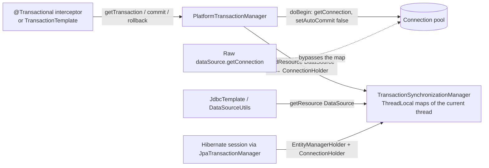
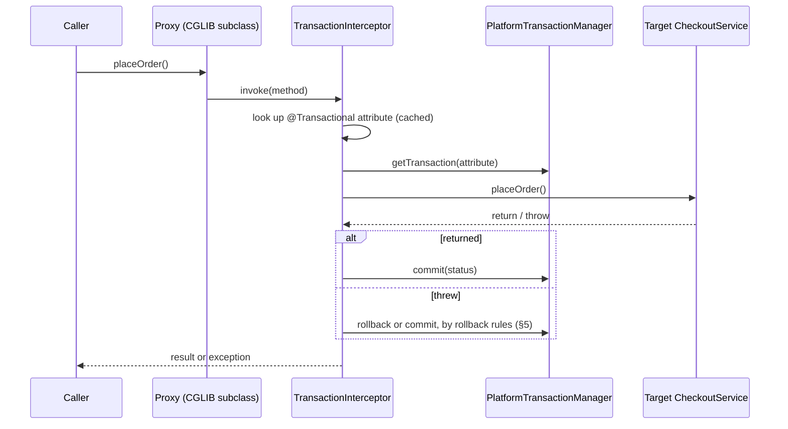
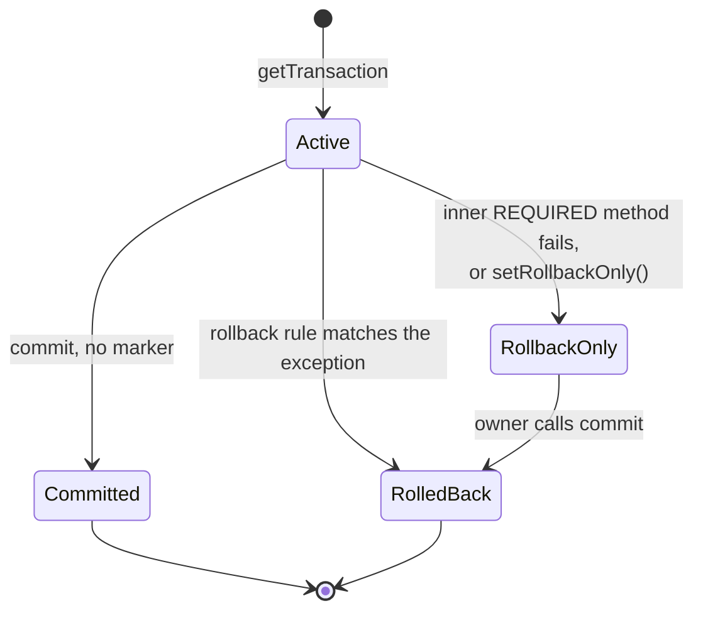
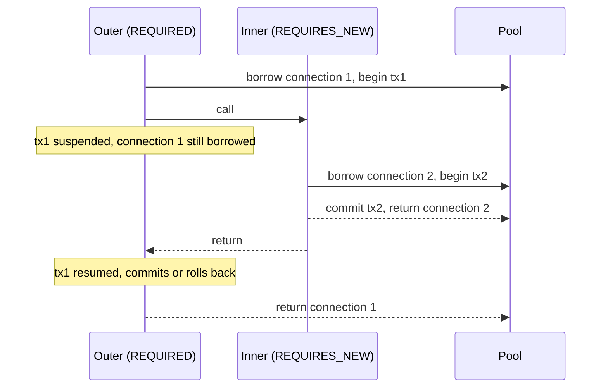
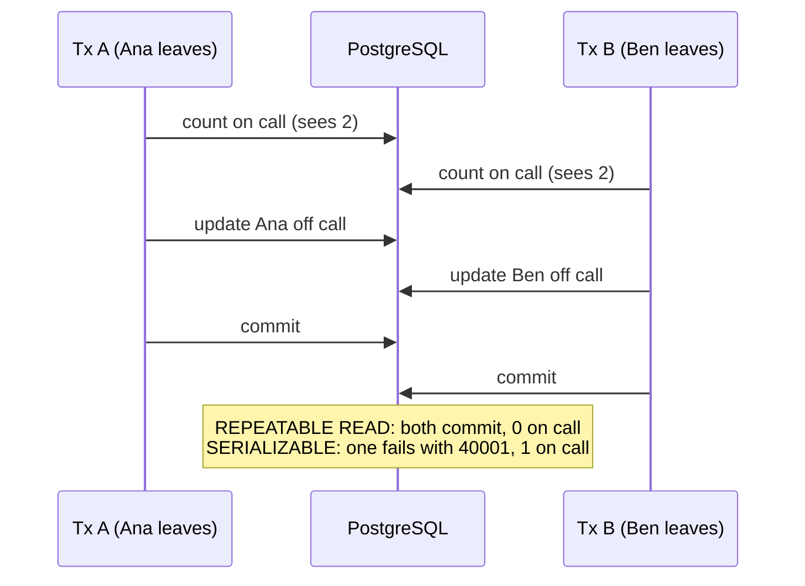
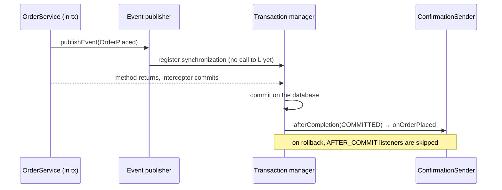

# 17. Spring transactions

> **What this covers:** how a Spring transaction really works, from a JDBC connection and the transaction manager to the proxy that `@Transactional` creates, and the ways it silently fails. Propagation, rollback rules, isolation anomalies in PostgreSQL, locking and retries, side effects after commit, and the production incidents long transactions cause.
> **Prerequisites:** [16. Spring AOP and proxies](16-spring-aop-and-proxies.md) (whole module: how proxies are built), [22. JDBC and connection pooling](22-jdbc-and-connection-pooling.md) (whole module: connections and HikariCP)
> **Leads to:** [23. JPA and Hibernate fundamentals](23-jpa-hibernate-fundamentals.md), [31. Kafka reliability and Spring Kafka](31-kafka-reliability-and-spring-kafka.md), [43. Distributed transactions and data patterns](43-distributed-transactions-and-data-patterns.md), [54. Architect production scenarios](54-architect-production-scenarios.md)
> **Applies to:** Java 25, Spring Boot 4.1.2 (Spring Framework 7.0.10, Spring Data JPA 4.1.2), Hibernate ORM 7.4.13.Final, HikariCP 7.0.2, PostgreSQL 18, Testcontainers 2.0.5
> **Study time:** ~7 hours reading + ~6 hours exercises
> **Short on time:** [3. `@Transactional` through the proxy](#3-transactional-through-the-proxy), [4. When `@Transactional` silently does nothing](#4-when-transactional-silently-does-nothing), [6. Propagation](#6-propagation), [7. Isolation levels and anomalies](#7-isolation-levels-and-anomalies); questions [Q17.06](#q17-06), [Q17.10](#q17-10), [Q17.13](#q17-13), [Q17.25](#q17-25), [Q17.30](#q17-30); then [Summary](#summary).
> **Labs:** [`labs/spring-transactions/`](../labs/spring-transactions/), package `dev.interview.springtransactions.m17`. Run: `JAVA_HOME=$(/usr/libexec/java_home -v 25) mvn -q -f java-backend-guide/labs/pom.xml -pl spring-transactions -am verify` (add `-DexcludedGroups=docker` without Docker). Needs Docker: yes (PostgreSQL through Testcontainers; tests that only need the recording transaction manager run without it).

## Contents

1. [Local transactions on a JDBC connection](#1-local-transactions-on-a-jdbc-connection)
2. [Spring's transaction abstraction](#2-springs-transaction-abstraction)
3. [`@Transactional` through the proxy](#3-transactional-through-the-proxy)
4. [When `@Transactional` silently does nothing](#4-when-transactional-silently-does-nothing)
5. [Rollback rules and rollback-only](#5-rollback-rules-and-rollback-only)
6. [Propagation](#6-propagation)
7. [Isolation levels and anomalies](#7-isolation-levels-and-anomalies)
8. [Read-only, timeouts and programmatic transactions](#8-read-only-timeouts-and-programmatic-transactions)
9. [Transactions and the JPA persistence context](#9-transactions-and-the-jpa-persistence-context)
10. [Optimistic and pessimistic locking, retries and deadlocks](#10-optimistic-and-pessimistic-locking-retries-and-deadlocks)
11. [Side effects after commit: transaction-bound events](#11-side-effects-after-commit-transaction-bound-events)
12. [Transactions across threads](#12-transactions-across-threads)
13. [Long transactions in production](#13-long-transactions-in-production)
14. [Testing transactional code](#14-testing-transactional-code)
- [Summary](#summary)
- [Question bank](#question-bank)
- [Hands-on exercises](#hands-on-exercises)
- [Check your understanding](#check-your-understanding)
- [Connections](#connections)

## 1. Local transactions on a JDBC connection
### The problem it solves

An order service inserts an `orders` row, then its `order_line` row. The line violates a check constraint. With JDBC's defaults the order is already committed: the database now holds an order with no lines, and the client's retry fails on a duplicate key. A transaction turns the two inserts into one unit: both persist, or neither does.

### Mental model

A transaction is a shopping cart held by one connection. Statements go into the cart; `commit` pays for everything at once, and `rollback` empties it. Auto-commit is a checkout after every single item. Nobody else sees the cart's contents until checkout, and a second connection is a second cart.

### How it actually works

A new `Connection` is in auto-commit mode: each statement is committed as its own transaction when it completes. `setAutoCommit(false)` groups the following statements until `commit()` or `rollback()`. Calling either in auto-commit mode is an `SQLException` case, and `close()` with an active transaction has an implementation-defined outcome [Doc: [java.sql.Connection, Java 25](https://docs.oracle.com/en/java/javase/25/docs/api/java.sql/java/sql/Connection.html)].

PostgreSQL wraps a statement sent without `BEGIN` in an implicit `BEGIN` and `COMMIT`; inside a transaction block, changes stay invisible to other transactions until commit, then appear together [Doc: [PostgreSQL 18, Transactions](https://www.postgresql.org/docs/18/tutorial-transactions.html)]. A transaction is the state of the server session behind one connection, which is why Spring binds that connection to the thread ([§2](#2-springs-transaction-abstraction)).

After a failed statement, PostgreSQL puts the block in an aborted state that only `ROLLBACK`, or `ROLLBACK TO` a savepoint, leaves [Doc: [PostgreSQL 18, Transactions](https://www.postgresql.org/docs/18/tutorial-transactions.html)]. In the lab, the line insert failed with SQLSTATE (PostgreSQL's five-character error code [Doc: [PostgreSQL 18, Error Codes](https://www.postgresql.org/docs/18/errcodes-appendix.html)]) `23514` (`check_violation`) and the next insert on the same connection with `25P02` (`in_failed_sql_transaction`) [Lab: LocalTransactionTest](../labs/spring-transactions/src/test/java/dev/interview/springtransactions/m17/s01/LocalTransactionTest.java) [Doc: [PostgreSQL 18, Appendix A](https://www.postgresql.org/docs/18/errcodes-appendix.html)]. The pgjdbc property `autosave` (default `never`) can set a savepoint before each statement and roll back to it on failure [Src: pgjdbc 42.7.14, [PGProperty](https://github.com/pgjdbc/pgjdbc/blob/REL42.7.14/pgjdbc/src/main/java/org/postgresql/PGProperty.java)].

### Code

Approach: the begin/commit/rollback template, in plain JDBC.

1. Remember the auto-commit mode, then switch it off.
2. Run the statements, commit, and restore the previous mode, because the connection outlives the transaction.
3. On any failure, including an `Error`, roll back, and restore the mode only once the rollback has worked: switching auto-commit back on commits an open transaction.
4. Keep a cleanup failure as suppressed and rethrow the original, so a lost connection does not hide the first error.

```java
package dev.interview.springtransactions.m17.s01;

import java.sql.Connection;
import java.sql.SQLException;

/** A local transaction on one JDBC connection: the begin/commit/rollback template, without Spring. */
public final class LocalTransaction {

    @FunctionalInterface
    public interface SqlWork {
        void run(Connection connection) throws SQLException;
    }

    private LocalTransaction() {}

    public static void inTransaction(Connection connection, SqlWork work) throws SQLException {
        boolean previousAutoCommit = connection.getAutoCommit();
        connection.setAutoCommit(false);
        try {
            work.run(connection);
            connection.commit();
        } catch (SQLException | RuntimeException | Error ex) {
            // Error too: restoring auto-commit on an open transaction would commit it.
            rollbackKeeping(connection, previousAutoCommit, ex);
            throw ex;
        }
        connection.setAutoCommit(previousAutoCommit);
    }

    private static void rollbackKeeping(Connection connection, boolean previousAutoCommit, Throwable original) {
        try {
            connection.rollback();
            connection.setAutoCommit(previousAutoCommit);
        } catch (SQLException cleanupFailure) {
            original.addSuppressed(cleanupFailure);
        }
    }
}
```
<sub>Source: [labs/spring-transactions/src/main/java/dev/interview/springtransactions/m17/s01/LocalTransaction.java](../labs/spring-transactions/src/main/java/dev/interview/springtransactions/m17/s01/LocalTransaction.java)</sub>

The tests run the same failing order both ways against PostgreSQL 18 (Testcontainers, image `postgres:18.6`):

```java
// Excerpt of labs/spring-transactions/src/test/java/dev/interview/springtransactions/m17/s01/LocalTransactionTest.java
    @Test
    @DisplayName("M17 §1 · auto-commit commits each statement")
    void autoCommitCommitsEachStatement() throws SQLException {
        try (Connection connection = openConnection()) {
            assertThatThrownBy(() -> OrderStatements.placeOrder(connection, 1, "ana", "SKU-1", 0))
                    .isInstanceOfSatisfying(
                            SQLException.class,
                            ex -> assertThat(ex.getSQLState()).isEqualTo(CHECK_VIOLATION));
        }
        assertCounts(1, 0);
    }

    @Test
    @DisplayName("M17 §1 · rollback undoes both inserts")
    void rollbackUndoesBothInserts() throws SQLException {
        try (Connection connection = openConnection()) {
            assertThatThrownBy(() -> LocalTransaction.inTransaction(
                            connection, c -> OrderStatements.placeOrder(c, 1, "ana", "SKU-1", 0)))
                    .isInstanceOfSatisfying(
                            SQLException.class,
                            ex -> assertThat(ex.getSQLState()).isEqualTo(CHECK_VIOLATION));
            assertThat(connection.getAutoCommit()).isTrue();
        }
        assertCounts(0, 0);
    }
```

The inserts bind values through `PreparedStatement` parameters ([OrderStatements](../labs/spring-transactions/src/main/java/dev/interview/springtransactions/m17/s01/OrderStatements.java)). [Q17.01](#q17-01) drills this section.

### Failure modes and operations

- **Held locks and connections.** `commit` and `rollback` release the locks the connection holds [Doc: [java.sql.Connection](https://docs.oracle.com/en/java/javase/25/docs/api/java.sql/java/sql/Connection.html)]. A transaction left open keeps them, and its connection, so concurrent writers queue behind it ([§13](#13-long-transactions-in-production); pool sizing in [22](22-jdbc-and-connection-pooling.md)).
- **Observability.** `pg_stat_activity.state` shows `idle in transaction` for a session inside a transaction that is not running a query, and `idle in transaction (aborted)` after an error [Doc: [PostgreSQL 18, pg_stat_activity](https://www.postgresql.org/docs/18/monitoring-stats.html#MONITORING-PG-STAT-ACTIVITY-VIEW)].

> [!IMPORTANT]
> **Production scenario: one bad row stops the whole import.** *As the interviewer frames it:* "A nightly job inserts 50,000 rows in one transaction and is supposed to log and skip bad rows. After the first bad row, every remaining insert fails with 'current transaction is aborted', and nothing is imported."
> **Reasoning.** PostgreSQL aborted the block at the first error; catching the `SQLException` in Java does not reset the server [Doc: [PostgreSQL 18, Transactions](https://www.postgresql.org/docs/18/tutorial-transactions.html)]. Evidence: one `23514`, then a stream of `25P02` [Lab: LocalTransactionTest](../labs/spring-transactions/src/test/java/dev/interview/springtransactions/m17/s01/LocalTransactionTest.java). Fix: validate rows before inserting, or take a savepoint per row with `setSavepoint()` and `rollback(Savepoint)` [Doc: [java.sql.Connection](https://docs.oracle.com/en/java/javase/25/docs/api/java.sql/java/sql/Connection.html)]. Prevention: a test that feeds a bad row mid-batch.

### Best practices and anti-patterns

- Switch auto-commit off for any operation with more than one write, because only a transaction makes the writes atomic.
- End every transaction with `commit` or `rollback` on every path, through a template, because closing an open one is implementation-defined.
- **Security:** bind values as `PreparedStatement` parameters, never by string concatenation, because concatenated input is parsed as SQL ([22](22-jdbc-and-connection-pooling.md)).
- Anti-pattern: catching an `SQLException` and carrying on in the same PostgreSQL transaction, because every later statement fails with `25P02`.

### Misconceptions and traps

- *"`rollback()` after an auto-commit failure undoes the earlier statements."* They are already committed, and in the lab pgjdbc rejected the call with "Cannot rollback when autoCommit is enabled" [Lab: LocalTransactionTest](../labs/spring-transactions/src/test/java/dev/interview/springtransactions/m17/s01/LocalTransactionTest.java). The myth comes from treating a Java method as the unit of work.
- *"A transaction belongs to a thread."* It belongs to a connection; Spring makes the thread carry the connection, hence the confusion.
- *"`setAutoCommit(true)` mid-transaction discards pending work."* The call reads like a mode switch, but it commits [Doc: [java.sql.Connection](https://docs.oracle.com/en/java/javase/25/docs/api/java.sql/java/sql/Connection.html)].

## 2. Spring's transaction abstraction
### The problem it solves

A checkout service writes the order through JPA and the stock movement through `JdbcTemplate`. With raw JDBC, every DAO needs the same `Connection` passed down by hand, and the service must know whether the store is JDBC, JPA or XA. Get the hand-off wrong once and the stock write commits while the order rolls back. Spring replaces that plumbing with one strategy interface for begin, commit and rollback, and a connection that travels with the thread.

### Mental model

Think of a cloakroom. The transaction manager takes a connection from the pool, switches off auto-commit, and hangs it on the current thread's hook labelled with the `DataSource`. Every Spring data-access helper checks that hook first. Code that walks to the pool itself gets another connection, which nobody commits or rolls back.



What to notice: the only link between the manager and the code doing the SQL is a `ThreadLocal` map keyed by the `DataSource`; the dashed path never reaches it.

### How it actually works

`PlatformTransactionManager` has three methods: `getTransaction(TransactionDefinition)`, `commit(TransactionStatus)` and `rollback(TransactionStatus)`. `TransactionDefinition` carries propagation, isolation, timeout, read-only and a name, with defaults `PROPAGATION_REQUIRED`, `ISOLATION_DEFAULT` and `TIMEOUT_DEFAULT` (-1, meaning the resource's own default). `TransactionStatus` is the handle passed back; it can mark rollback-only or hold savepoints [Src: spring-tx 7.0.10, [PlatformTransactionManager](https://github.com/spring-projects/spring-framework/blob/v7.0.10/spring-tx/src/main/java/org/springframework/transaction/PlatformTransactionManager.java), [TransactionDefinition](https://github.com/spring-projects/spring-framework/blob/v7.0.10/spring-tx/src/main/java/org/springframework/transaction/TransactionDefinition.java)].

Implementations extend `AbstractPlatformTransactionManager`, a Template Method: `getTransaction` calls `doGetTransaction()`, then either applies propagation rules to an existing transaction ([§6](#6-propagation)) or calls `doBegin` and initializes the thread's synchronization. `commit` refuses a status that is already completed and rolls back instead when the status is marked rollback-only ([§5](#5-rollback-rules-and-rollback-only)) [Src: spring-tx 7.0.10, [AbstractPlatformTransactionManager](https://github.com/spring-projects/spring-framework/blob/v7.0.10/spring-tx/src/main/java/org/springframework/transaction/support/AbstractPlatformTransactionManager.java)]. In the lab, `getTransaction` followed by `commit` produced exactly `begin tx1`, `commit tx1`, and a second completion call failed with `IllegalTransactionStateException` "already completed" [Lab: TransactionAbstractionTest](../labs/spring-transactions/src/test/java/dev/interview/springtransactions/m17/s02/TransactionAbstractionTest.java).

The thread binding lives in `TransactionSynchronizationManager`: static `ThreadLocal`s for the resource map, the synchronization callbacks, the transaction name, read-only flag, isolation level and "actual transaction active" [Src: spring-tx 7.0.10, [TransactionSynchronizationManager](https://github.com/spring-projects/spring-framework/blob/v7.0.10/spring-tx/src/main/java/org/springframework/transaction/support/TransactionSynchronizationManager.java)]. `DataSourceTransactionManager.doBegin` takes a connection from the `DataSource`, calls `setAutoCommit(false)` if needed, and binds a `ConnectionHolder` under the `DataSource` key; cleanup restores auto-commit and releases the connection [Src: spring-jdbc 7.0.10, [DataSourceTransactionManager](https://github.com/spring-projects/spring-framework/blob/v7.0.10/spring-jdbc/src/main/java/org/springframework/jdbc/datasource/DataSourceTransactionManager.java)]. `DataSourceUtils.getConnection(dataSource)`, which `JdbcTemplate` uses, returns the bound connection when there is one [Src: spring-jdbc 7.0.10, [DataSourceUtils](https://github.com/spring-projects/spring-framework/blob/v7.0.10/spring-jdbc/src/main/java/org/springframework/jdbc/datasource/DataSourceUtils.java)]. `JpaTransactionManager` binds an `EntityManagerHolder` under the `EntityManagerFactory` and, when it knows the `DataSource`, also a `ConnectionHolder`, so `JdbcTemplate` code joins the JPA transaction [Src: spring-orm 7.0.10, [JpaTransactionManager](https://github.com/spring-projects/spring-framework/blob/v7.0.10/spring-orm/src/main/java/org/springframework/orm/jpa/JpaTransactionManager.java)]. `JtaTransactionManager` delegates to a Jakarta Transactions (JTA) coordinator for transactions spanning several resources ([43](43-distributed-transactions-and-data-patterns.md)); `ReactiveTransactionManager` is the non-blocking counterpart, with no `ThreadLocal` ([19](19-spring-reactive-webflux.md)).

Spring Boot registers a `JpaTransactionManager` when Hibernate is present, otherwise a `JdbcTransactionManager` (a `DataSourceTransactionManager` that translates exceptions) for a single `DataSource`; both back off if any `TransactionManager` bean exists [Src: spring-boot 4.1.2, [JpaBaseConfiguration](https://github.com/spring-projects/spring-boot/blob/v4.1.2/module/spring-boot-jpa/src/main/java/org/springframework/boot/jpa/autoconfigure/JpaBaseConfiguration.java), [DataSourceTransactionManagerAutoConfiguration](https://github.com/spring-projects/spring-boot/blob/v4.1.2/module/spring-boot-jdbc/src/main/java/org/springframework/boot/jdbc/autoconfigure/DataSourceTransactionManagerAutoConfiguration.java)].

### Code

Approach: write by hand the template that `TransactionTemplate` and the `@Transactional` interceptor both run.

1. Ask the manager for a transaction with a definition.
2. Run the work; on a `RuntimeException` or `Error`, roll back and rethrow.
3. Otherwise commit, and return the result.

```java
package dev.interview.springtransactions.m17.s02;

import java.util.function.Supplier;
import org.springframework.transaction.PlatformTransactionManager;
import org.springframework.transaction.TransactionDefinition;
import org.springframework.transaction.TransactionStatus;

/** The begin/commit/rollback template that TransactionTemplate and the @Transactional interceptor implement. */
public final class ManualTransactionRunner {

    private final PlatformTransactionManager transactionManager;

    public ManualTransactionRunner(PlatformTransactionManager transactionManager) {
        this.transactionManager = transactionManager;
    }

    public <T> T inTransaction(TransactionDefinition definition, Supplier<T> work) {
        TransactionStatus status = transactionManager.getTransaction(definition);
        T result;
        try {
            result = work.get();
        } catch (RuntimeException | Error ex) {
            transactionManager.rollback(status);
            throw ex;
        }
        transactionManager.commit(status);
        return result;
    }
}
```
<sub>Source: [labs/spring-transactions/src/main/java/dev/interview/springtransactions/m17/s02/ManualTransactionRunner.java](../labs/spring-transactions/src/main/java/dev/interview/springtransactions/m17/s02/ManualTransactionRunner.java)</sub>

`TransactionTemplate.execute` and `TransactionAspectSupport` call the same three manager methods [Src: spring-tx 7.0.10, [TransactionTemplate](https://github.com/spring-projects/spring-framework/blob/v7.0.10/spring-tx/src/main/java/org/springframework/transaction/support/TransactionTemplate.java), [TransactionAspectSupport](https://github.com/spring-projects/spring-framework/blob/v7.0.10/spring-tx/src/main/java/org/springframework/transaction/interceptor/TransactionAspectSupport.java)]. The test below runs it over a real `DataSourceTransactionManager` with mocked JDBC objects: `DataSourceUtils` returns the connection taken at begin; a raw `getConnection()` gets a second one, never committed.

```java
// Excerpt of labs/spring-transactions/src/test/java/dev/interview/springtransactions/m17/s02/TransactionAbstractionTest.java
    void onlyDataSourceUtilsSeesTheBoundConnection() throws SQLException {
        Connection transactional = mock(Connection.class);
        Connection raw = mock(Connection.class);
        when(transactional.getAutoCommit()).thenReturn(true);
        DataSource dataSource = mock(DataSource.class);
        when(dataSource.getConnection()).thenReturn(transactional, raw);
        ManualTransactionRunner jdbcRunner = new ManualTransactionRunner(new DataSourceTransactionManager(dataSource));

        Connection[] seen = jdbcRunner.inTransaction(TransactionDefinition.withDefaults(), () ->
                new Connection[] {DataSourceUtils.getConnection(dataSource), getRaw(dataSource)});

        assertThat(seen[0]).isSameAs(transactional);
        assertThat(seen[1]).isSameAs(raw);
        InOrder order = inOrder(transactional);
        order.verify(transactional).setAutoCommit(false);
        order.verify(transactional).commit();
        order.verify(transactional).setAutoCommit(true);
        order.verify(transactional).close();
        verify(raw, never()).commit();
        verify(raw, never()).setAutoCommit(false);
    }
```

What the database does with the raw connection's writes is drilled in [Q17.03](#q17-03).

### Failure modes and operations

- **The binding is per thread.** Work handed to another thread sees no transaction: in the lab, `isActualTransactionActive()` was `false` inside `CompletableFuture.supplyAsync` started from a transaction [Lab: TransactionAbstractionTest](../labs/spring-transactions/src/test/java/dev/interview/springtransactions/m17/s02/TransactionAbstractionTest.java). See [§12](#12-transactions-across-threads).
- **A connection is held from begin to completion.** `DataSourceTransactionManager` takes it in `doBegin`, before the first SQL statement [Src: spring-jdbc 7.0.10, DataSourceTransactionManager]. Under load, transaction duration sets how many pool connections are busy; slow work inside the boundary queues other requests on the pool ([§13](#13-long-transactions-in-production), sizing in [22](22-jdbc-and-connection-pooling.md)).
- **Observability.** `logging.level.org.springframework.transaction=DEBUG` shows `Creating new transaction with name [...]`, and `org.springframework.jdbc.datasource` logs `Switching JDBC Connection [...] to manual commit` [Src: spring-tx and spring-jdbc 7.0.10, log statements in AbstractPlatformTransactionManager and DataSourceTransactionManager].

> [!IMPORTANT]
> **Production scenario: reporting writes survive a rollback.** *As the interviewer frames it:* "We added a second `DataSource` for a reporting schema. When checkout fails, the order rolls back but its reporting rows stay. No errors in the logs."
> **Reasoning.** `@Transactional` uses the one auto-configured manager, bound to the primary `DataSource`. `DataSourceUtils` finds no holder under the reporting `DataSource` key, so it fetches a fresh connection in auto-commit mode; synchronization only makes later calls reuse it [Src: spring-jdbc 7.0.10, DataSourceUtils.doGetConnection]. Each statement commits on its own. Diagnosis: DEBUG transaction logs show one transaction per request, naming one manager. Fix: a manager per `DataSource`, chosen with `@Transactional(transactionManager = "reportingTx")` [Src: spring-tx 7.0.10, [Transactional](https://github.com/spring-projects/spring-framework/blob/v7.0.10/spring-tx/src/main/java/org/springframework/transaction/annotation/Transactional.java)], or a design where one business operation writes to one database ([43](43-distributed-transactions-and-data-patterns.md)).

> [!NOTE]
> **Framework vs language.** JDBC (Java SE) gives one `Connection` with `setAutoCommit`, `commit` and `rollback`, and nothing more. Jakarta Persistence (JPA) defines `EntityTransaction`; Jakarta Transactions (JTA) defines distributed transactions. Spring adds the strategy interface, the `ThreadLocal` binding, propagation and declarative demarcation; none of this exists outside Spring-managed access paths.

> [!NOTE]
> **Version notes.** Spring Framework 5.2: `TransactionManager` became the common supertype of `PlatformTransactionManager` and the new `ReactiveTransactionManager` [Src: spring-tx 7.0.10, `@since 5.2` in TransactionManager and ReactiveTransactionManager]. Spring Framework 5.3: `JdbcTransactionManager` added [Src: spring-jdbc 7.0.10, `@since 5.3`]. Spring Boot 3.x: the transaction-manager auto-configuration lived in `org.springframework.boot.autoconfigure.jdbc` and `...orm.jpa` inside `spring-boot-autoconfigure` [Src: spring-boot-autoconfigure 3.5.3 jar]. [Changed in Spring Boot 4.0: it moved to per-technology modules, `org.springframework.boot.jdbc.autoconfigure` and `org.springframework.boot.jpa.autoconfigure`] [Src: spring-boot-jdbc and spring-boot-jpa 4.1.2 jars]; exclusions by class name must use the new names.

### Best practices and anti-patterns

- Access data only through Spring paths (`JdbcTemplate`, `JdbcClient`, Spring Data, an injected `EntityManager`), because only they look up the thread-bound resource.
- Wrap a legacy library that calls `dataSource.getConnection()` in `TransactionAwareDataSourceProxy`, because its connections then delegate to the bound one [Src: spring-jdbc 7.0.10, [TransactionAwareDataSourceProxy](https://github.com/spring-projects/spring-framework/blob/v7.0.10/spring-jdbc/src/main/java/org/springframework/jdbc/datasource/TransactionAwareDataSourceProxy.java)].
- With JPA and JDBC on one database, keep Boot's single `JpaTransactionManager`, because it shares its connection with `JdbcTemplate`.
- Anti-pattern: calling `commit` and `rollback` by hand in services, because a missed rollback path leaves thread-bound state open; use `TransactionTemplate` or `@Transactional`.

### Misconceptions and traps

- *"All code using the same `DataSource` joins the transaction."* Only code that asks through `DataSourceUtils` does; in the lab a raw `getConnection()` got a second, never-committed connection [Lab: TransactionAbstractionTest](../labs/spring-transactions/src/test/java/dev/interview/springtransactions/m17/s02/TransactionAbstractionTest.java). The pool hides that connections differ.
- *"The connection is taken at the first query."* With `DataSourceTransactionManager` it is taken in `doBegin`, at method entry. The myth comes from auto-commit code, where it is true.
- *"`TransactionTemplate` is a different mechanism from `@Transactional`."* They look unrelated in code, but both drive the same `PlatformTransactionManager`; only the demarcation style differs ([§8](#8-read-only-timeouts-and-programmatic-transactions)).

Drills: [Q17.02](#q17-02), [Q17.03](#q17-03).

## 3. `@Transactional` through the proxy
### The problem it solves

[§2](#2-springs-transaction-abstraction) still leaves `getTransaction`, `commit` and `rollback` calls in every service method. Copy that block into two hundred methods and someone forgets the rollback branch. `@Transactional` moves the block out of business code: you declare the boundary, and Spring runs the template around the method. The price is that the boundary is no longer visible in the code, so when it is missing you only notice at the first rollback that does not happen.

### Mental model

The bean you inject is not your object. It is a stand-in, a proxy (a generated object that receives each call and decides what to do before and after delegating, owned by [16](16-spring-aop-and-proxies.md)), wrapping your object like a receptionist who opens a ledger before showing the visitor in and closes it on the way out. Only visitors who come through reception get a ledger.



What to notice: the transaction exists only between the interceptor's `getTransaction` and its `commit`; a call that starts inside `T` never passes through `P`.

### How it actually works

**At startup.** Spring Boot applies `@EnableTransactionManagement` when a `TransactionManager` bean exists, with `proxyTargetClass = true` unless `spring.aop.proxy-target-class=false` [Src: spring-boot 4.1.2, [TransactionAutoConfiguration](https://github.com/spring-projects/spring-boot/blob/v4.1.2/module/spring-boot-transaction/src/main/java/org/springframework/boot/transaction/autoconfigure/TransactionAutoConfiguration.java)]. That annotation registers three infrastructure beans: an `AnnotationTransactionAttributeSource` created with `publicMethodsOnly = false`, a `TransactionInterceptor`, and a `BeanFactoryTransactionAttributeSourceAdvisor` whose pointcut matches any method for which the attribute source finds an attribute [Src: spring-tx 7.0.10, [ProxyTransactionManagementConfiguration](https://github.com/spring-projects/spring-framework/blob/v7.0.10/spring-tx/src/main/java/org/springframework/transaction/annotation/ProxyTransactionManagementConfiguration.java), [AbstractTransactionManagementConfiguration](https://github.com/spring-projects/spring-framework/blob/v7.0.10/spring-tx/src/main/java/org/springframework/transaction/annotation/AbstractTransactionManagementConfiguration.java)]. The auto-proxy creator then wraps every bean with at least one matching method; how the proxy class is generated belongs to [16](16-spring-aop-and-proxies.md).

**Finding the attribute.** For a method, the source looks first at the method on the target class, then at the target class, then at the interface method, then at the interface; the first hit wins, so a method annotation overrides the class annotation. Non-public methods are skipped only when `publicMethodsOnly` is true [Src: spring-tx 7.0.10, [AbstractFallbackTransactionAttributeSource](https://github.com/spring-projects/spring-framework/blob/v7.0.10/spring-tx/src/main/java/org/springframework/transaction/interceptor/AbstractFallbackTransactionAttributeSource.java).computeTransactionAttribute]. Besides Spring's annotation it parses `jakarta.transaction.Transactional` when that class is on the classpath [Src: spring-tx 7.0.10, [AnnotationTransactionAttributeSource](https://github.com/spring-projects/spring-framework/blob/v7.0.10/spring-tx/src/main/java/org/springframework/transaction/annotation/AnnotationTransactionAttributeSource.java)]; in the lab a method carrying only the Jakarta annotation ran inside `begin tx1` / `commit tx1` [Lab: TransactionalProxyTest](../labs/spring-transactions/src/test/java/dev/interview/springtransactions/m17/s03/TransactionalProxyTest.java).

**Per call.** `TransactionInterceptor.invoke` calls `invokeWithinTransaction`: resolve the attribute, choose the manager (the annotation's `transactionManager` qualifier, else the single `TransactionManager` bean), `createTransactionIfNecessary` (which calls `getTransaction` and binds a `TransactionInfo` to the thread), proceed to the target, then `completeTransactionAfterThrowing` or `commitTransactionAfterReturning` [Src: spring-tx 7.0.10, [TransactionAspectSupport](https://github.com/spring-projects/spring-framework/blob/v7.0.10/spring-tx/src/main/java/org/springframework/transaction/interceptor/TransactionAspectSupport.java)]. The transaction name is the qualified method name: in the lab, inside `placeOrder` the thread reported an active transaction named `dev.interview.springtransactions.m17.s03.CheckoutService.placeOrder`, and the injected bean was a CGLIB proxy [Lab: TransactionalProxyTest](../labs/spring-transactions/src/test/java/dev/interview/springtransactions/m17/s03/TransactionalProxyTest.java).

### Code

Approach: wire the real Spring infrastructure around a plain class, with the recording manager from §2 instead of a database, and read the thread's transaction state from inside the method.

1. Annotate one method with Spring's `@Transactional`, one with Jakarta's, and leave one plain.
2. Each method returns a `TxSnapshot` built from `TransactionSynchronizationManager.isActualTransactionActive()` and `getCurrentTransactionName()`.
3. Register the class and the manager in a configuration with `@EnableTransactionManagement(proxyTargetClass = true)`, the same setting Boot uses by default.

```java
package dev.interview.springtransactions.m17.s03;

import org.springframework.transaction.annotation.Transactional;

public class CheckoutService {

    @Transactional
    public TxSnapshot placeOrder() {
        return TxSnapshot.current();
    }

    @jakarta.transaction.Transactional
    public TxSnapshot placeOrderWithJakartaAnnotation() {
        return TxSnapshot.current();
    }

    public TxSnapshot quote() {
        return TxSnapshot.current();
    }
}
```
<sub>Source: [labs/spring-transactions/src/main/java/dev/interview/springtransactions/m17/s03/CheckoutService.java](../labs/spring-transactions/src/main/java/dev/interview/springtransactions/m17/s03/CheckoutService.java)</sub>

```java
// Excerpt of labs/spring-transactions/src/test/java/dev/interview/springtransactions/m17/s03/TransactionalProxyTest.java
    void proxiedCallBeginsAndCommits() {
        TxSnapshot inside = checkout.placeOrder();

        assertThat(AopUtils.isCglibProxy(checkout)).isTrue();
        assertThat(inside)
                .isEqualTo(new TxSnapshot(true, "dev.interview.springtransactions.m17.s03.CheckoutService.placeOrder"));
        assertThat(transactionManager.events()).containsExactly("begin tx1", "commit tx1");
    }
```

`quote()` reports no transaction. This check is the cheapest runtime proof of a transaction ([Q17.11](#q17-11)).

### Failure modes and operations

- **Two transaction managers, no qualifier.** With no `transactionManager` attribute the interceptor asks the bean factory for the one `TransactionManager` bean [Src: spring-tx 7.0.10, TransactionAspectSupport.determineTransactionManager]; with two candidates and no `@Primary`, the context starts and the first transactional call fails: in the lab, with `NoUniqueBeanDefinitionException` [Lab: TransactionalProxyTest](../labs/spring-transactions/src/test/java/dev/interview/springtransactions/m17/s03/TransactionalProxyTest.java). Name the manager on the annotation or mark one primary.
- **Load.** The interceptor caches the attribute per method and target class, so per-call overhead is a map lookup plus the manager's work [Src: spring-tx 7.0.10, AbstractFallbackTransactionAttributeSource]; the real cost under load is the connection the boundary holds ([§2](#2-springs-transaction-abstraction), [§13](#13-long-transactions-in-production)).
- **Observability.** `logging.level.org.springframework.transaction.interceptor=TRACE` logs `Getting transaction for [<class>.<method>]` per call, which shows which methods are actually advised [Src: spring-tx 7.0.10, TransactionAspectSupport.prepareTransactionInfo].

> [!NOTE]
> **Framework vs language.** A Java method call is a plain `invokevirtual`; the language has no idea of a transaction. Jakarta Transactions defines `jakarta.transaction.Transactional` as an annotation for container-managed beans. The behaviour (proxy, interceptor, rollback rules) is Spring's, and exists only for calls that go through a Spring proxy.

> [!NOTE]
> **Version notes.** Spring Framework 6.0 (Boot 3.0): protected and package-visible methods are transactional by default on class-based proxies; before, only public methods were [Doc: [Spring Framework reference, "Method visibility and @Transactional in proxy mode"](https://docs.spring.io/spring-framework/reference/data-access/transaction/declarative/annotations.html)]. Spring 6 / Boot 3 also moved to Jakarta EE: the attribute source looks for `jakarta.transaction.Transactional`, so `javax.transaction.Transactional` on old code is silently ignored after the upgrade [Src: spring-tx 7.0.10, AnnotationTransactionAttributeSource checks only `jakarta.*`].

### Best practices and anti-patterns

- Put `@Transactional` on the concrete class or its methods, not only on an interface, because an interface-level annotation is found only as a fallback and the visibility rule for interface proxies is stricter [Doc: same reference page].
- Use Spring's annotation in Spring code, because `propagation`, `isolation`, `readOnly`, `timeout` and `transactionManager` exist only there; Jakarta's has only `value` (`TxType`), `rollbackOn` and `dontRollbackOn` [Src: jakarta.transaction-api 2.0.1, `Transactional`].
- Name the manager (`@Transactional(transactionManager = "…")`) whenever the context has more than one, because resolution by type fails only at call time.
- Anti-pattern: `@Transactional` on every class "to be safe", because each boundary holds a connection for the whole method, including remote calls inside it ([§13](#13-long-transactions-in-production)).

### Misconceptions and traps

- *"`@Transactional` is a compiler or JVM feature."* It is metadata; nothing happens unless a Spring proxy intercepts the call ([§4](#4-when-transactional-silently-does-nothing)). The myth exists because the annotation sits on the method like `synchronized` does.
- *"Spring Boot uses JDK interface proxies."* Boot 4.1.2 enables class-based (CGLIB) proxies unless `spring.aop.proxy-target-class=false` [Src: spring-boot 4.1.2, TransactionAutoConfiguration]; the lab bean was a CGLIB proxy. Interview answers from plain Spring XML days still say JDK proxy.
- *"Only public methods can be transactional."* True before 6.0, which is why it persists. [Changed in Spring Framework 6.0: protected and package-visible methods are transactional on class-based proxies] [Doc: [Spring Framework reference, Using @Transactional](https://docs.spring.io/spring-framework/reference/data-access/transaction/declarative/annotations.html)]; `private` and `final` still cannot, because a subclass cannot override them ([§4](#4-when-transactional-silently-does-nothing)).

Drills: [Q17.04](#q17-04), [Q17.05](#q17-05), [Q17.11](#q17-11).

## 4. When `@Transactional` silently does nothing
### The problem it solves

`@Transactional` fails without an error. When no proxy sees the call, the method runs in auto-commit mode or in whatever repository transactions it calls. Nothing is logged, happy-path tests pass, and the first sign is a partial write in production.

### Mental model

The receptionist from [§3](#3-transactional-through-the-proxy) opens a ledger only for visitors entering through reception. A colleague walking into the next office (self-invocation), a back door (`private`, `final`, `static`), or a building with no receptionist (an object made with `new`) all skip it.

### How it actually works

A CGLIB proxy is a generated subclass whose overriding methods call the interceptor and then the target bean, a separate instance [Src: spring-aop 7.0.10, [CglibAopProxy](https://github.com/spring-projects/spring-framework/blob/v7.0.10/spring-aop/src/main/java/org/springframework/aop/framework/CglibAopProxy.java)]. Each silent case follows from that:

| Case | Why the interceptor never runs | Lab result |
|---|---|---|
| Self-invocation: `placeOrder()` calls `this.saveOrder()` | `this` inside the target is the target, not the proxy | no transaction, no manager calls [Lab: SilentNoTransactionTest](../labs/spring-transactions/src/test/java/dev/interview/springtransactions/m17/s04/SilentNoTransactionTest.java) |
| `private` method | a subclass cannot override it; reflection on the proxy runs the original | no transaction [Lab: SilentNoTransactionTest](../labs/spring-transactions/src/test/java/dev/interview/springtransactions/m17/s04/SilentNoTransactionTest.java) |
| `final` method | cannot be overridden, so the call runs the original code *on the proxy instance*, whose fields were never set (Spring instantiates the proxy class through Objenesis, which skips constructors) | no transaction; a field read throws `NullPointerException` [Lab: SilentNoTransactionTest](../labs/spring-transactions/src/test/java/dev/interview/springtransactions/m17/s04/SilentNoTransactionTest.java) |
| `static` method | not dispatched on an instance at all | no transaction [Lab: SilentNoTransactionTest](../labs/spring-transactions/src/test/java/dev/interview/springtransactions/m17/s04/SilentNoTransactionTest.java) |
| `new OrderWorkflow(...)` | not a bean, so never wrapped | no transaction [Lab: SilentNoTransactionTest](../labs/spring-transactions/src/test/java/dev/interview/springtransactions/m17/s04/SilentNoTransactionTest.java) |
| `protected` or package-visible method (control) | overridden by the subclass since Spring Framework 6.0 | transaction begins [Lab: SilentNoTransactionTest](../labs/spring-transactions/src/test/java/dev/interview/springtransactions/m17/s04/SilentNoTransactionTest.java) |

Spring's reference documentation states the self-invocation rule: only external calls through the proxy are intercepted [Doc: [Spring Framework reference, "Using @Transactional"](https://docs.spring.io/spring-framework/reference/data-access/transaction/declarative/annotations.html)]. Two more silent cases come from earlier sections: a write through a `DataSource` the manager does not manage ([§2](#2-springs-transaction-abstraction)), and an exception the method catches itself, so the interceptor sees a normal return and commits ([§5](#5-rollback-rules-and-rollback-only)).

### Code

Approach: put every broken variant on one class, call each through the proxy, then fix.

1. `placeOrder()` is public and unannotated and calls the annotated `saveOrder()` on `this`.
2. The `private`, `final` and `static` variants carry the annotation but cannot be intercepted.
3. The fix moves `saveOrder()` into a separate bean, `OrderWriter`, which `OrderFacade` receives through its constructor.

```java
package dev.interview.springtransactions.m17.s04;

import dev.interview.springtransactions.m17.s03.TxSnapshot;
import java.time.Clock;
import java.time.Instant;
import org.springframework.transaction.annotation.Transactional;

/** Every way a @Transactional method on this class runs without a transaction. */
public class OrderWorkflow {

    private final Clock clock;

    public OrderWorkflow(Clock clock) {
        this.clock = clock;
    }

    public TxSnapshot placeOrder() {
        return saveOrder(); // self-invocation: `this` is the target, not the proxy
    }

    @Transactional
    public TxSnapshot saveOrder() {
        return TxSnapshot.current();
    }

    @Transactional
    protected TxSnapshot saveProtected() {
        return TxSnapshot.current();
    }

    @Transactional
    private TxSnapshot savePrivate() {
        return TxSnapshot.current();
    }

    @Transactional
    public final TxSnapshot saveFinal() {
        return TxSnapshot.current();
    }

    @Transactional
    public final Instant stampFinal() {
        return clock.instant(); // on the proxy instance `clock` is null
    }

    @Transactional
    public static TxSnapshot saveStatic() {
        return TxSnapshot.current();
    }
}
```
<sub>Source: [labs/spring-transactions/src/main/java/dev/interview/springtransactions/m17/s04/OrderWorkflow.java](../labs/spring-transactions/src/main/java/dev/interview/springtransactions/m17/s04/OrderWorkflow.java)</sub>

```java
// Excerpt of labs/spring-transactions/src/main/java/dev/interview/springtransactions/m17/s04/OrderFacade.java
public class OrderFacade {

    private final OrderWriter writer;

    public OrderFacade(OrderWriter writer) {
        this.writer = writer;
    }

    public TxSnapshot placeOrder() {
        return writer.saveOrder();
    }
}
```

In the lab, `OrderFacade.placeOrder()` produced `begin tx1`, `commit tx1`, while `OrderWorkflow.placeOrder()` produced no manager calls at all [Lab: SilentNoTransactionTest](../labs/spring-transactions/src/test/java/dev/interview/springtransactions/m17/s04/SilentNoTransactionTest.java). The other fixes, self-injection, `TransactionTemplate` and AspectJ weaving, are compared in [Q17.12](#q17-12).

### Failure modes and operations

- **Partial writes under failure only.** The gap appears only when a later statement fails, so load tests rarely find it.
- **Startup evidence.** For a public `final` method on a class it proxies, Spring logs at WARN `Public final method [...] cannot get proxied via CGLIB` [Src: spring-aop 7.0.10, CglibAopProxy.doValidateClass]. Treat that line as a build failure.
- **Runtime evidence.** With `org.springframework.transaction.interceptor` at TRACE, a business call with no `Getting transaction for [...]` line was not advised ([§3](#3-transactional-through-the-proxy)).

> [!IMPORTANT]
> **Production scenario: half an order saved, no error.** *As the interviewer frames it:* "After a refactoring that merged `OrderService` and `OrderPersistence` into one class, a failed payment leaves orders without lines. Nothing changed in the annotations."
> **Reasoning.** The merge turned a cross-bean call into `this.saveOrder()`, so the boundary vanished. Each Spring Data repository call still ran in its own transaction, because `SimpleJpaRepository.save` is itself `@Transactional` [Src: spring-data-jpa 4.1.2, [SimpleJpaRepository](https://github.com/spring-projects/spring-data-jpa/blob/4.1.2/spring-data-jpa/src/main/java/org/springframework/data/jpa/repository/support/SimpleJpaRepository.java)], so the order committed before the lines failed. Diagnose with TRACE interceptor logs or an `isActualTransactionActive()` assertion; fix by moving the boundary to a separate bean; prevent it with a test that fails the second write and asserts no rows remain ([§14](#14-testing-transactional-code)).

### Best practices and anti-patterns

- Put the transaction boundary on the public entry method of a bean that callers reach through injection, because that call always crosses the proxy.
- Keep transactional classes non-`final` and their transactional methods non-`final`, because CGLIB must subclass and override them.
- Anti-pattern: annotating helper methods called only from inside the same class, because the annotation is dead code that misleads reviewers.
- Anti-pattern: catching `Exception` inside the boundary and logging it, because the interceptor then commits a half-done unit ([§5](#5-rollback-rules-and-rollback-only)).

### Misconceptions and traps

- *"An annotated inner method gets its own transaction when called from the same class."* It gets none from that call; the myth comes from reading annotations as language semantics. Drilled in [Q17.06](#q17-06).
- *"A `final` method is just not transactional."* Worse: it runs on the proxy instance and sees `null` fields [Lab: SilentNoTransactionTest](../labs/spring-transactions/src/test/java/dev/interview/springtransactions/m17/s04/SilentNoTransactionTest.java). The myth exists because the missing transaction is usually noticed first.
- *"`private` methods became transactional in Spring Framework 6.0."* The 6.0 change widened visibility, so it is easy to over-read: only `protected` and package-visible ones did, on class-based proxies; `private` still needs AspectJ weaving ([16](16-spring-aop-and-proxies.md)).

Drills: [Q17.06](#q17-06), [Q17.07](#q17-07), [Q17.08](#q17-08), [Q17.12](#q17-12).

## 5. Rollback rules and rollback-only
### The problem it solves

A nightly import inserts rows and declares `throws IOException`. Halfway through, a read fails; the method exits with an exception, yet half the rows are in the table next morning, because by default a checked exception commits. The reverse surprise: a caller catches an inner transactional method's failure, carries on, and gets `UnexpectedRollbackException` at the end.

### Mental model

A transaction carries a ballot any participant can spoil. At the method's exit, the interceptor decides by the exception's type whether to commit or roll back. A joined inner method cannot roll back the shared transaction itself, so it spoils the ballot (rollback-only), and the owner's later "commit" becomes a rollback.



What to notice: from `RollbackOnly` there is no path to `Committed`; catching the exception changes nothing.

### How it actually works

When the method throws, `TransactionAspectSupport.completeTransactionAfterThrowing` asks the attribute `rollbackOn(ex)`: true means rollback, false means **commit**, and the exception is rethrown either way [Src: spring-tx 7.0.10, [TransactionAspectSupport](https://github.com/spring-projects/spring-framework/blob/v7.0.10/spring-tx/src/main/java/org/springframework/transaction/interceptor/TransactionAspectSupport.java)]. The default rule is `ex instanceof RuntimeException || ex instanceof Error` [Src: spring-tx 7.0.10, [DefaultTransactionAttribute](https://github.com/spring-projects/spring-framework/blob/v7.0.10/spring-tx/src/main/java/org/springframework/transaction/interceptor/DefaultTransactionAttribute.java)]. `rollbackFor`, `noRollbackFor` and their `…ClassName` forms become `RollbackRuleAttribute`s; `RuleBasedTransactionAttribute` walks up the thrown class's hierarchy, the rule matching at the smallest depth wins, a winning `NoRollbackRuleAttribute` commits, and with no match the default applies [Src: spring-tx 7.0.10, [RuleBasedTransactionAttribute](https://github.com/spring-projects/spring-framework/blob/v7.0.10/spring-tx/src/main/java/org/springframework/transaction/interceptor/RuleBasedTransactionAttribute.java)]. A rule given as a class matches only that exact type in the hierarchy; a rule given as a name pattern matches any class whose fully qualified name *contains* the pattern [Src: spring-tx 7.0.10, [RollbackRuleAttribute](https://github.com/spring-projects/spring-framework/blob/v7.0.10/spring-tx/src/main/java/org/springframework/transaction/interceptor/RollbackRuleAttribute.java)].

Rollback-only has two sources. Code can call `TransactionAspectSupport.currentTransactionStatus().setRollbackOnly()` (local): `commit` then rolls back quietly. A participating method that fails marks the *shared* transaction (global), because `globalRollbackOnParticipationFailure` defaults to true; the owner's `commit` sees the global marker, rolls back and throws `UnexpectedRollbackException` [Src: spring-tx 7.0.10, [AbstractPlatformTransactionManager](https://github.com/spring-projects/spring-framework/blob/v7.0.10/spring-tx/src/main/java/org/springframework/transaction/support/AbstractPlatformTransactionManager.java)]. In the lab, a checked exception produced `begin`, `commit`; with `rollbackFor` it produced `begin`, `rollback`; `setRollbackOnly()` rolled back with no exception; and a caught inner failure produced `begin`, `set rollback-only`, `rollback`, then `UnexpectedRollbackException` [Lab: RollbackRulesTest](../labs/spring-transactions/src/test/java/dev/interview/springtransactions/m17/s05/RollbackRulesTest.java).

### Code

Approach: one method per rule on the recording manager, so each outcome is a list of manager calls.

1. `chargeDefault` throws the checked `PaymentException`.
2. `chargeWithRollbackFor` throws it with `rollbackFor`.
3. `chargeAndCancel` marks the transaction rollback-only and returns normally.
4. `CheckoutFlow.placeOrder` catches the failure of an inner `REQUIRED` method on another bean.

```java
package dev.interview.springtransactions.m17.s05;

import org.springframework.transaction.annotation.Transactional;
import org.springframework.transaction.interceptor.TransactionAspectSupport;

public class PaymentService {

    @Transactional
    public void chargeDefault() throws PaymentException {
        throw new PaymentException("card declined");
    }

    @Transactional(rollbackFor = PaymentException.class)
    public void chargeWithRollbackFor() throws PaymentException {
        throw new PaymentException("card declined");
    }

    @Transactional
    public void chargeAndCancel() {
        TransactionAspectSupport.currentTransactionStatus().setRollbackOnly();
    }
}
```
<sub>Source: [labs/spring-transactions/src/main/java/dev/interview/springtransactions/m17/s05/PaymentService.java](../labs/spring-transactions/src/main/java/dev/interview/springtransactions/m17/s05/PaymentService.java)</sub>

```java
package dev.interview.springtransactions.m17.s05;

import org.springframework.transaction.annotation.Transactional;

public class CheckoutFlow {

    private final InventoryService inventory;

    public CheckoutFlow(InventoryService inventory) {
        this.inventory = inventory;
    }

    @Transactional
    public String placeOrder(String sku) {
        try {
            inventory.reserve(sku); // joins this transaction (REQUIRED) and fails
        } catch (IllegalStateException ex) {
            return "backordered"; // swallowing it does not undo the rollback-only mark
        }
        return "reserved";
    }
}
```
<sub>Source: [labs/spring-transactions/src/main/java/dev/interview/springtransactions/m17/s05/CheckoutFlow.java](../labs/spring-transactions/src/main/java/dev/interview/springtransactions/m17/s05/CheckoutFlow.java)</sub>

The step-by-step answer for the caught inner failure is drilled in [Q17.10](#q17-10); checked exceptions in [Q17.09](#q17-09).

### Failure modes and operations

- **Commit on a checked exception** looks like a crash in the logs and like success in the database.
- **`UnexpectedRollbackException` at the outermost boundary** arrives far from the cause. The cause is logged at DEBUG as `Participating transaction failed - marking existing transaction as rollback-only` [Src: spring-tx 7.0.10, AbstractPlatformTransactionManager.processRollback]; enable `org.springframework.transaction` DEBUG when it appears.
- **Retries.** A retry *inside* a marked transaction cannot succeed; retry around the boundary ([§10](#10-optimistic-and-pessimistic-locking-retries-and-deadlocks)).

> [!IMPORTANT]
> **Production scenario: the import that commits on failure.** *As the interviewer frames it:* "The nightly CSV import throws `IOException` halfway through. We get an alert, but the table has 40% of the rows and reruns create duplicates."
> **Reasoning.** `IOException` is checked, so the default rule commits [Src: spring-tx 7.0.10, DefaultTransactionAttribute.rollbackOn]. Evidence: a stack trace, yet no rollback in the DEBUG transaction log. Fix: `@Transactional(rollbackFor = Exception.class)` on the import, or `@EnableTransactionManagement(rollbackOn = RollbackOn.ALL_EXCEPTIONS)` application-wide [Src: spring-tx 7.0.10, [EnableTransactionManagement](https://github.com/spring-projects/spring-framework/blob/v7.0.10/spring-tx/src/main/java/org/springframework/transaction/annotation/EnableTransactionManagement.java)]. Prevention: make the import idempotent ([Q17.31](#q17-31)) so a rerun is safe.

> [!NOTE]
> **Version notes.** [Changed in Spring Framework 6.0: a rollback rule declared with a class matches that exact type; before, it matched any exception whose name contained the class name] [Src: spring-tx 7.0.10, RollbackRuleAttribute `exceptionType` `@since 6.0`]. [Added in Spring Framework 6.2: `@EnableTransactionManagement(rollbackOn = …)` and `RollbackOn.ALL_EXCEPTIONS`] [Src: spring-tx 7.0.10, RollbackOn `@since 6.2`].

### Best practices and anti-patterns

- Declare `rollbackFor` for every checked exception a transactional method throws, or switch the application to `ALL_EXCEPTIONS`, because the default commits on them.
- Prefer `rollbackFor = X.class` over `rollbackForClassName = "X"`, because the name form matches by substring.
- Let exceptions leave the boundary, because one caught inside looks like success to the interceptor.
- Anti-pattern: catching a failure from an inner `REQUIRED` method and continuing, because the shared transaction is already doomed; use `REQUIRES_NEW` or `NESTED` if the inner work may fail independently ([§6](#6-propagation)).

### Misconceptions and traps

- *"Any exception rolls back."* Only unchecked ones and errors, by default. The myth exists because Spring's data-access exceptions are unchecked (`DataAccessException` extends `RuntimeException` through `NestedRuntimeException` [Src: spring-tx 7.0.10]), so rollback is what people usually see.
- *"Catching the inner exception saves the outer transaction."* The rollback-only marker is already set [Lab: RollbackRulesTest](../labs/spring-transactions/src/test/java/dev/interview/springtransactions/m17/s05/RollbackRulesTest.java). The myth exists because, without a transaction, catching does recover.
- *"`setRollbackOnly()` throws."* The myth comes from `UnexpectedRollbackException`: a local marker rolls back quietly; only a failed participant's global marker throws.

## 6. Propagation
### The problem it solves

A team wants an audit row kept even when the order fails. With the default propagation the audit insert joins the order transaction and vanishes with it. They switch it to `REQUIRES_NEW`; the row survives, and the next load test hangs: every request waits 30 seconds for a connection, then fails. Propagation decides both outcomes, and neither is visible at the call site.

### Mental model

Propagation (what a transactional method does when called while a transaction may already be bound to the thread) is a question asked at the proxy's door, with seven answers:

| Propagation | Transaction running | None running |
|---|---|---|
| `REQUIRED` (default) | join | start one |
| `SUPPORTS` | join | run without |
| `MANDATORY` | join | throw |
| `REQUIRES_NEW` | suspend, start new, resume after | start one |
| `NOT_SUPPORTED` | suspend, run without, resume after | run without |
| `NEVER` | throw | run without |
| `NESTED` | savepoint inside it | start one |

[Src: spring-tx 7.0.10, [AbstractPlatformTransactionManager](https://github.com/spring-projects/spring-framework/blob/v7.0.10/spring-tx/src/main/java/org/springframework/transaction/support/AbstractPlatformTransactionManager.java) `getTransaction`, `handleExistingTransaction`]

Joining shares one desk and one waste basket. `REQUIRES_NEW` pushes the work aside and opens a second desk with its own phone line. `NESTED` puts a bookmark in the current work.



What to notice: during the inner call one thread holds two connections.

### How it actually works

`getTransaction` asks `isExistingTransaction`; for `DataSourceTransactionManager` that means a `ConnectionHolder` with an active transaction is bound to the thread [Src: spring-jdbc 7.0.10, [DataSourceTransactionManager](https://github.com/spring-projects/spring-framework/blob/v7.0.10/spring-jdbc/src/main/java/org/springframework/jdbc/datasource/DataSourceTransactionManager.java)]. Without one, `MANDATORY` throws `IllegalTransactionStateException`, and `SUPPORTS`, `NOT_SUPPORTED` and `NEVER` get an "empty" transaction: a status with no connection. With one, `NEVER` throws, `REQUIRES_NEW` suspends and starts a new transaction (resuming the outer if the begin fails), `NESTED` creates a savepoint, and the rest participate [Src: spring-tx 7.0.10, AbstractPlatformTransactionManager].

*Suspend* unbinds the `ConnectionHolder` from the thread; the connection stays borrowed, so the new transaction's `doBegin` asks the pool for a **second** one [Src: spring-jdbc 7.0.10, DataSourceTransactionManager `doSuspend`, `doBegin`]. A *savepoint* (a named point that `ROLLBACK TO SAVEPOINT` returns to inside one transaction [Doc: PostgreSQL 18, [SAVEPOINT](https://www.postgresql.org/docs/18/sql-savepoint.html)]) stays on the same connection: on inner failure Spring rolls back to it and releases it, leaving the outer transaction healthy; on success it releases it, so the inner work commits only with the outer [Src: spring-tx 7.0.10, AbstractPlatformTransactionManager `processRollback`, `processCommit`]. In the lab the recording manager showed `begin tx1, suspend tx1, begin tx2, commit tx2, resume tx1, commit tx1` for `REQUIRES_NEW` and `begin tx1, savepoint sp1, release sp1, commit tx1` for `NESTED` [Lab: PropagationDecisionsTest](../labs/spring-transactions/src/test/java/dev/interview/springtransactions/m17/s06/PropagationDecisionsTest.java).

`NESTED` depends on the manager. `DataSourceTransactionManager` allows it by default. `JpaTransactionManager` does not, and even with `nestedTransactionAllowed` set, Hibernate's dialect offers no savepoint manager, because a savepoint would undo rows but not the persistence context's entities ([§9](#9-transactions-and-the-jpa-persistence-context)) [Src: spring-orm 7.0.10, [JpaTransactionManager](https://github.com/spring-projects/spring-framework/blob/v7.0.10/spring-orm/src/main/java/org/springframework/orm/jpa/JpaTransactionManager.java), [HibernateJpaDialect](https://github.com/spring-projects/spring-framework/blob/v7.0.10/spring-orm/src/main/java/org/springframework/orm/jpa/vendor/HibernateJpaDialect.java)]. In the lab both cases threw `NestedTransactionNotSupportedException` [Lab: JpaNestedPropagationTest](../labs/spring-transactions/src/test/java/dev/interview/springtransactions/m17/s06/JpaNestedPropagationTest.java).

### Code

Approach: one order service on PostgreSQL whose audit call runs in `REQUIRES_NEW` and whose optional line runs in `NESTED`, so each outcome is a set of rows left in the tables.

1. `placeOrder` inserts the order, records the audit row through `AuditLog.record` (`REQUIRES_NEW`), then inserts a line with quantity 0, which the `check (quantity > 0)` constraint rejects.
2. `placeOrderKeepingHeader` inserts the order and adds the line through `OrderLines.addLine` (`NESTED`), catching the rejection.
3. The test counts the rows after each call.

```java
package dev.interview.springtransactions.m17.s06;

import org.springframework.dao.DataIntegrityViolationException;
import org.springframework.jdbc.core.simple.JdbcClient;
import org.springframework.transaction.annotation.Transactional;

public class OrderService {

    private static final String INSERT_ORDER = "insert into orders (id, customer) values (?, ?)";
    // Same statement as OrderLines on purpose: placeOrder keeps the line in the order's own unit of work, with no
    // savepoint, so the example shows the plain REQUIRED outcome next to the REQUIRES_NEW audit.
    private static final String INSERT_LINE = "insert into order_line (order_id, sku, quantity) values (?, ?, ?)";
    private static final String ORDER_PLACED = "order placed";

    private final JdbcClient jdbc;
    private final AuditLog auditLog;
    private final OrderLines orderLines;

    public OrderService(JdbcClient jdbc, AuditLog auditLog, OrderLines orderLines) {
        this.jdbc = jdbc;
        this.auditLog = auditLog;
        this.orderLines = orderLines;
    }

    @Transactional
    public void placeOrder(long orderId, String customer, String sku, int quantity) {
        jdbc.sql(INSERT_ORDER).params(orderId, customer).update();
        auditLog.record(orderId, ORDER_PLACED); // REQUIRES_NEW: commits now, on a second connection
        jdbc.sql(INSERT_LINE).params(orderId, sku, quantity).update(); // a rejected line rolls back this transaction
    }

    @Transactional
    public boolean placeOrderKeepingHeader(long orderId, String customer, String sku, int quantity) {
        jdbc.sql(INSERT_ORDER).params(orderId, customer).update();
        try {
            orderLines.addLine(orderId, sku, quantity); // NESTED: a savepoint on this connection
            return true;
        } catch (DataIntegrityViolationException rejected) {
            return false; // rolled back to the savepoint; the header stays
        }
    }
}
```
<sub>Source: [labs/spring-transactions/src/main/java/dev/interview/springtransactions/m17/s06/OrderService.java](../labs/spring-transactions/src/main/java/dev/interview/springtransactions/m17/s06/OrderService.java)</sub>

```java
package dev.interview.springtransactions.m17.s06;

import org.springframework.jdbc.core.simple.JdbcClient;
import org.springframework.transaction.annotation.Propagation;
import org.springframework.transaction.annotation.Transactional;

public class AuditLog {

    private static final String INSERT_AUDIT = "insert into audit_log (order_id, action) values (?, ?)";

    private final JdbcClient jdbc;

    public AuditLog(JdbcClient jdbc) {
        this.jdbc = jdbc;
    }

    // REQUIRES_NEW: the audit row must outlive a failed order, at the price of a second pooled connection per call.
    @Transactional(propagation = Propagation.REQUIRES_NEW)
    public void record(long orderId, String action) {
        jdbc.sql(INSERT_AUDIT).params(orderId, action).update();
    }
}
```
<sub>Source: [labs/spring-transactions/src/main/java/dev/interview/springtransactions/m17/s06/AuditLog.java](../labs/spring-transactions/src/main/java/dev/interview/springtransactions/m17/s06/AuditLog.java)</sub>

```java
package dev.interview.springtransactions.m17.s06;

import org.springframework.jdbc.core.simple.JdbcClient;
import org.springframework.transaction.annotation.Propagation;
import org.springframework.transaction.annotation.Transactional;

public class OrderLines {

    private static final String INSERT_LINE = "insert into order_line (order_id, sku, quantity) values (?, ?, ?)";

    private final JdbcClient jdbc;

    public OrderLines(JdbcClient jdbc) {
        this.jdbc = jdbc;
    }

    // NESTED: a rejected line may be undone alone, on the caller's connection, without dooming the order header.
    @Transactional(propagation = Propagation.NESTED)
    public void addLine(long orderId, String sku, int quantity) {
        jdbc.sql(INSERT_LINE).params(orderId, sku, quantity).update();
    }
}
```
<sub>Source: [labs/spring-transactions/src/main/java/dev/interview/springtransactions/m17/s06/OrderLines.java](../labs/spring-transactions/src/main/java/dev/interview/springtransactions/m17/s06/OrderLines.java)</sub>

In the lab, `placeOrder` left no order and one audit row, and `placeOrderKeepingHeader` returned `false` and left the order without its line [Lab: PropagationPostgresTest](../labs/spring-transactions/src/test/java/dev/interview/springtransactions/m17/s06/PropagationPostgresTest.java). The three-way comparison is drilled in [Q17.13](#q17-13), the rows question in [Q17.14](#q17-14), and the non-creating kinds in [Q17.16](#q17-16).

### Failure modes and operations

- **Pool deadlock.** With a pool of N, N callers each holding a connection and asking for a second one for `REQUIRES_NEW` all wait, and none can finish to free one. HikariCP gives up after `connectionTimeout`, 30,000 ms by default, with a default pool of 10 [Src: HikariCP 7.0.2, [HikariConfig](https://github.com/brettwooldridge/HikariCP/blob/HikariCP-7.0.2/src/main/java/com/zaxxer/hikari/HikariConfig.java)], throwing `SQLTransientConnectionException` [Src: HikariCP 7.0.2, [HikariPool](https://github.com/brettwooldridge/HikariCP/blob/HikariCP-7.0.2/src/main/java/com/zaxxer/hikari/pool/HikariPool.java)], which Spring wraps in `CannotCreateTransactionException` [Src: spring-jdbc 7.0.10, DataSourceTransactionManager `doBegin`]. In the lab, a pool of 2, a 500 ms timeout and two callers held by a barrier: at least one failed so, none sooner; the first to give up freed a connection, sometimes letting the other finish [Lab: PropagationPostgresTest](../labs/spring-transactions/src/test/java/dev/interview/springtransactions/m17/s06/PropagationPostgresTest.java). Below N callers nothing fails, so tests miss it.
- **Observe:** `hikaricp.connections.active` at the maximum, `hikaricp.connections.pending` climbing, `hikaricp.connections.timeout` counting [Src: HikariCP 7.0.2, [MicrometerMetricsTracker](https://github.com/brettwooldridge/HikariCP/blob/HikariCP-7.0.2/src/main/java/com/zaxxer/hikari/metrics/micrometer/MicrometerMetricsTracker.java)]; thread dumps parked in `HikariPool.getConnection` under the inner frame.
- **Configure** `spring.datasource.hikari.*` [Doc: Spring Boot 4.1, [SQL databases](https://docs.spring.io/spring-boot/reference/data/sql.html)]: a shorter `connection-timeout` fails fast; a bigger pool only moves the threshold. Scaling out adds pools but each instance still deadlocks at its own N, while PostgreSQL's `max_connections` caps the sum [Doc: PostgreSQL 18, [Connections and Authentication](https://www.postgresql.org/docs/18/runtime-config-connection.html)].

> [!IMPORTANT]
> **Production scenario: every request hangs for 30 s after adding an audit log.** *As the interviewer frames it:* "The audit writer got `REQUIRES_NEW`. Under peak load requests hang exactly 30 seconds, then fail with `CannotCreateTransactionException`."
> **Reasoning.** Exactly 30 s is HikariCP's default `connectionTimeout` [Src: HikariCP 7.0.2, HikariConfig]: threads wait for connections, not for the database. Active at the maximum and thread dumps under the audit frame confirm each request wants a second connection. Fix: write the audit after the outer transaction, or an outbox row in the same transaction ([43](43-distributed-transactions-and-data-patterns.md)). Prevention: load-test above the pool size. Drill: [Q17.15](#q17-15); build: [Exercise 17.2](#exercise-172--an-audit-trail-that-survives-rollback-without-deadlocking-the-pool).

### Best practices and anti-patterns

- Keep `REQUIRED`, because most methods are steps of one unit of work.
- Use `REQUIRES_NEW` only for short work that must commit regardless of the caller, because it holds two connections and two sets of locks.
- Prefer `NESTED` on JDBC when an inner step may fail alone, because a savepoint needs no second connection.
- Put `MANDATORY` on writes that must never run alone, because it turns a missing boundary into an exception instead of auto-commit.
- Anti-pattern: `REQUIRES_NEW` to silence `UnexpectedRollbackException` ([§5](#5-rollback-rules-and-rollback-only)), because the two halves can now disagree.
- **Security:** keep the security audit trail out of the request's transaction, because an audit row that rolls back with a failed attack erases the evidence.

### Misconceptions and traps

- *"`REQUIRES_NEW` is free."* It needs a second connection while the first stays borrowed. The myth exists because the outer connection is invisible in the inner method.
- *"`NESTED` is a transaction inside a transaction."* It is one transaction with a savepoint; the inner work commits only with the outer. The myth comes from the name.
- *"`NESTED` works with JPA once allowed."* Hibernate still throws [Lab: JpaNestedPropagationTest](../labs/spring-transactions/src/test/java/dev/interview/springtransactions/m17/s06/JpaNestedPropagationTest.java); the myth comes from the `JpaTransactionManager` Javadoc, which advertises savepoints.
- *"`SUPPORTS` is transactional when it matters."* Called alone, each statement auto-commits ([§1](#1-local-transactions-on-a-jdbc-connection)), because callers usually supply the transaction, which hides it.

## 7. Isolation levels and anomalies
### The problem it solves

A rule says at least one doctor stays on call per shift. The service checks "are two on call?" before letting one leave, inside `@Transactional`. Ana and Ben press the button in the same second: both checks see two, both updates commit, nobody is on call. Each transaction was correct alone; they saw each other wrongly. Isolation decides how much a transaction sees of concurrent ones, and each level accepts a different set of such bugs.

### Mental model

Each transaction reads from a photograph. Read committed takes a new photograph per statement, so two reads of one row can disagree. Repeatable read keeps one photograph from its first statement, so its own reads never change, but two transactions can act on photographs the other has made stale. Serializable also tracks what each photograph was used to decide, and aborts one transaction when no one-at-a-time order explains the result.



What to notice: the transactions write different rows, so no row lock makes one wait; only serializable sees the conflict, which lies between one's read and the other's write.

### How it actually works

A **dirty read** sees uncommitted data; a **non-repeatable read** re-reads a row changed by a transaction that committed in between; a **phantom** re-runs a query and gets a different set of rows; a **serialization anomaly** is a committed result matching no one-at-a-time order [Doc: PostgreSQL 18, [Transaction Isolation](https://www.postgresql.org/docs/18/transaction-iso.html)]. Write skew is one: overlapping reads, disjoint writes. A **lost update** (two read-modify-writes on one row, the second overwriting the first) belongs to [§10](#10-optimistic-and-pessimistic-locking-retries-and-deadlocks).

PostgreSQL accepts the four standard names but implements three: read uncommitted runs as read committed, the default; repeatable read also prevents phantoms, which the standard allows. Underneath is MVCC (multi-version concurrency control: updates write new row versions and a snapshot picks the visible ones; [26](26-postgresql-internals.md) owns it). Read committed snapshots per statement. Repeatable read snapshots at the first non-transaction-control statement, not at `BEGIN`, and updating a row changed since then fails with "could not serialize access due to concurrent update". Serializable is Serializable Snapshot Isolation (SSI): predicate locks record reads, never block, cannot deadlock, and a dangerous read/write dependency aborts a transaction with SQLSTATE `40001` [Doc: PostgreSQL 18, Transaction Isolation].

Spring only passes the level on. `Isolation.DEFAULT` means the data store's default [Src: spring-tx 7.0.10, [Isolation](https://github.com/spring-projects/spring-framework/blob/v7.0.10/spring-tx/src/main/java/org/springframework/transaction/annotation/Isolation.java)]. `DataSourceUtils.prepareConnectionForTransaction` calls `Connection.setTransactionIsolation` only for a non-default level that differs from the connection's, and restores the old level on release [Src: spring-jdbc 7.0.10, [DataSourceUtils](https://github.com/spring-projects/spring-framework/blob/v7.0.10/spring-jdbc/src/main/java/org/springframework/jdbc/datasource/DataSourceUtils.java)]. The attribute applies only where a transaction starts: a joining method silently keeps the caller's level unless the manager's `validateExistingTransaction` (default `false`) turns the mismatch into `IllegalTransactionStateException` [Src: spring-tx 7.0.10, [Transactional](https://github.com/spring-projects/spring-framework/blob/v7.0.10/spring-tx/src/main/java/org/springframework/transaction/annotation/Transactional.java), [AbstractPlatformTransactionManager](https://github.com/spring-projects/spring-framework/blob/v7.0.10/spring-tx/src/main/java/org/springframework/transaction/support/AbstractPlatformTransactionManager.java)].

| Level (PostgreSQL 18) | Prevents | Still allows | Cost |
|---|---|---|---|
| Read committed (default) | dirty read | non-repeatable read, phantom, lost update, write skew | cheapest; invariants need locks or constraints |
| Repeatable read | also non-repeatable read, phantom | write skew | updating a row changed since the snapshot fails; retry |
| Serializable | every anomaly, write skew included | none | read tracking, more `40001` aborts; retry everything |

Every row: [Doc: PostgreSQL 18, Transaction Isolation]; write skew also observed in the lab below.

### Code

Two plain JDBC connections stepped in a fixed order show each anomaly on a known interleaving:

1. Open both, auto-commit off, set the level.
2. Read in both before either writes, because the snapshot starts at the first statement.
3. Write different rows, commit both, count who is on call.

```java
// Excerpt of labs/spring-transactions/src/test/java/dev/interview/springtransactions/m17/s07/IsolationAnomaliesTest.java
    @Test
    @DisplayName("M17 §7 · repeatable read allows write skew")
    void bothDoctorsLeave_commit_whenRepeatableRead() throws SQLException {
        try (Connection first = begin(Connection.TRANSACTION_REPEATABLE_READ);
                Connection second = begin(Connection.TRANSACTION_REPEATABLE_READ)) {
            assertThat(countRows(first, COUNT_ON_CALL)).isEqualTo(2);
            assertThat(countRows(second, COUNT_ON_CALL)).isEqualTo(2);

            execute(first, ANA_OFF_CALL);
            execute(second, BEN_OFF_CALL);
            first.commit();
            second.commit();

            assertThat(onCallAfterwards()).isZero();
        }
    }
```

In the lab, both commits succeeded and nobody stayed on call; at `SERIALIZABLE` exactly one transaction failed with `40001`, at its update or commit (SSI does not promise which), and one doctor stayed [Lab: IsolationAnomaliesTest](../labs/spring-transactions/src/test/java/dev/interview/springtransactions/m17/s07/IsolationAnomaliesTest.java). The class also shows the read committed re-read changing, repeatable read re-reads and recounts not changing, and read uncommitted never seeing uncommitted data.

The service declares the level where the transaction starts:

```java
package dev.interview.springtransactions.m17.s07;

import org.springframework.jdbc.core.simple.JdbcClient;
import org.springframework.transaction.annotation.Isolation;
import org.springframework.transaction.annotation.Transactional;

public class OnCallRoster {

    private static final int MINIMUM_ON_CALL = 2;
    private static final String COUNT_ON_CALL = "select count(*) from on_call where shift_id = ? and on_call = true";
    private static final String GO_OFF_CALL = "update on_call set on_call = false where shift_id = ? and doctor = ?";

    private final JdbcClient jdbc;

    public OnCallRoster(JdbcClient jdbc) {
        this.jdbc = jdbc;
    }

    // SERIALIZABLE, not REPEATABLE_READ: two doctors leaving at once would each see two on call in their
    // snapshot and both leave (write skew); SSI aborts one of them with 40001 instead, and the caller retries.
    @Transactional(isolation = Isolation.SERIALIZABLE)
    public boolean goOffCall(long shiftId, String doctor) {
        long onCall = jdbc.sql(COUNT_ON_CALL).params(shiftId).query(Long.class).single();
        if (onCall < MINIMUM_ON_CALL) {
            return false;
        }
        return jdbc.sql(GO_OFF_CALL).params(shiftId, doctor).update() == 1;
    }
}
```
<sub>Source: [labs/spring-transactions/src/main/java/dev/interview/springtransactions/m17/s07/OnCallRoster.java](../labs/spring-transactions/src/main/java/dev/interview/springtransactions/m17/s07/OnCallRoster.java)</sub>

In the lab, `SHOW transaction_isolation` under `DEFAULT`, `SERIALIZABLE` and `READ_UNCOMMITTED` returned `read committed`, `serializable` and `read uncommitted` [Lab: OnCallRosterTest](../labs/spring-transactions/src/test/java/dev/interview/springtransactions/m17/s07/OnCallRosterTest.java). Drills: [Q17.17](#q17-17), [Q17.18](#q17-18), [Q17.19](#q17-19), [Q17.20](#q17-20).

### Failure modes and operations

- **Serialization failures under load.** Aborts grow with contention, and the whole transaction must be retried [Doc: PostgreSQL 18, Transaction Isolation]. Spring maps PostgreSQL `40001` via `cannotSerializeTransactionCodes` [Src: spring-jdbc 7.0.10, [sql-error-codes.xml](https://github.com/spring-projects/spring-framework/blob/v7.0.10/spring-jdbc/src/main/resources/org/springframework/jdbc/support/sql-error-codes.xml)]; bounded retries are [§10](#10-optimistic-and-pessimistic-locking-retries-and-deadlocks), because unbounded ones turn a hot row into a retry storm.
- **Silent anomalies at the default.** Read committed raises nothing; write skew surfaces later as broken data.
- **Observe** the `40001` rate per endpoint in logs or error metrics; a jump after a release points at a new hot row.
- **Configure** per method with `isolation=`, or per pool with HikariCP `transactionIsolation` [Src: HikariCP 7.0.2, [HikariConfig](https://github.com/brettwooldridge/HikariCP/blob/HikariCP-7.0.2/src/main/java/com/zaxxer/hikari/HikariConfig.java)].
- **Deployment.** Ship the retry before raising the level, because the change turns silent corruption into visible failures.

> [!IMPORTANT]
> **Production scenario: nobody is on call on Saturday night.** *As the interviewer frames it:* "The service checks that two doctors are on call before letting one leave, inside `@Transactional`. A few times a year the roster ends up empty. No errors logged."
> **Reasoning.** No error plus two requests milliseconds apart is write skew, which read committed and repeatable read both allow [Lab: IsolationAnomaliesTest]. Fix: `SERIALIZABLE` with a retry on `40001`, or `select ... for update` on the shift's rows ([§10](#10-optimistic-and-pessimistic-locking-retries-and-deadlocks)) so the second check waits. Prevention: a test stepping two connections through the interleaving. Drill: [Q17.19](#q17-19).

### Best practices and anti-patterns

- Keep read committed as the default, because it is the cheapest level and most transactions have no cross-row invariant.
- Use `SERIALIZABLE` for check-then-write rules spanning rows, because only it catches write skew without hand-written locks.
- Declare `isolation=` where the transaction starts, and enable `validateExistingTransaction` if callers may join, because joining silently keeps the caller's level.
- Make repeatable read and serializable transactions retryable as a whole, because the database may abort any of them.
- **Security:** enforce balances, quotas and single-use coupons with serializable transactions, locks or constraints, because a read-then-write check at read committed is beaten by sending one request twice at once.

### Misconceptions and traps

- *"Read uncommitted shows uncommitted data."* Not in PostgreSQL [Lab: IsolationAnomaliesTest]; the myth comes from the standard's table and from databases that implement dirty reads.
- *"Repeatable read protects any invariant."* It allows write skew; the name promises stable reads, and the reads are stable.
- *"`isolation = SERIALIZABLE` always gets serializable."* Only where the method starts the transaction; the annotation reads like a guarantee, and the mismatch is silent by default.

## 8. Read-only, timeouts and programmatic transactions
### The problem it solves

A report loads 50,000 entities only to sum them, and Hibernate snapshots each one for dirty checking, the flush-time comparison that finds changes. A nightly import runs as one transaction, so one bad row undoes the night. A slow partner call between statements holds a connection for minutes. `readOnly`, `timeout` and `TransactionTemplate` each target one of these.

### Mental model

`readOnly` is a promise each layer below may act on: Hibernate stops flushing and tracking, the driver opens the transaction read-only, PostgreSQL refuses writes. `timeout` is a deadline checked when a statement starts, not a stopwatch that stops your thread. `TransactionTemplate` is the proxy's begin, commit and rollback as a call around a lambda, so the boundary sits wherever the call is.

### How it actually works

**Read-only.** The attribute is a hint; a manager that cannot use it ignores it [Src: spring-tx 7.0.10, [Transactional](https://github.com/spring-projects/spring-framework/blob/v7.0.10/spring-tx/src/main/java/org/springframework/transaction/annotation/Transactional.java)]. Under `JpaTransactionManager`, `HibernateJpaDialect.beginTransaction` sets the flush mode to `MANUAL` and, for a transaction-local `EntityManager`, calls `Session.setDefaultReadOnly(true)` [Src: spring-orm 7.0.10, [HibernateJpaDialect](https://github.com/spring-projects/spring-framework/blob/v7.0.10/spring-orm/src/main/java/org/springframework/orm/jpa/vendor/HibernateJpaDialect.java)]. Hibernate then neither dirty-checks nor snapshots those entities, and their changes are not persisted [Src: Hibernate ORM 7.4.13, [Session](https://github.com/hibernate/hibernate-orm/blob/7.4.13/hibernate-core/src/main/java/org/hibernate/Session.java) `setDefaultReadOnly`]. Both managers call `DataSourceUtils.prepareConnectionForTransaction`, which calls `Connection.setReadOnly(true)` [Src: spring-jdbc 7.0.10, DataSourceUtils, DataSourceTransactionManager `doBegin`]. pgjdbc's default `readOnlyMode=transaction` turns that into `BEGIN READ ONLY` when auto-commit is off [Src: pgjdbc 42.7.14, [PGProperty](https://github.com/pgjdbc/pgjdbc/blob/REL42.7.14/pgjdbc/src/main/java/org/postgresql/PGProperty.java)]. In the lab, `show transaction_read_only` returned `on` under both managers, an insert failed with SQLSTATE `25006`, and a modified entity stayed unchanged even after an explicit `flush()` (without `readOnly` it was written) [Lab: ReadOnlyJpaTest](../labs/spring-transactions/src/test/java/dev/interview/springtransactions/m17/s08/ReadOnlyJpaTest.java), [Lab: ReadOnlyAndTimeoutJdbcTest](../labs/spring-transactions/src/test/java/dev/interview/springtransactions/m17/s08/ReadOnlyAndTimeoutJdbcTest.java).

**Timeout.** Seconds, applied only where a transaction starts [Src: spring-tx 7.0.10, Transactional]. The manager stores a deadline on the resource holder. Each `JdbcTemplate` statement gets `setQueryTimeout` with the seconds left, and when none are left `ResourceHolderSupport` marks the transaction rollback-only and throws `TransactionTimedOutException` [Src: spring-jdbc 7.0.10, DataSourceUtils `applyTimeout`; spring-tx 7.0.10, ResourceHolderSupport]. JPA queries get the time left as `jakarta.persistence.query.timeout` [Src: spring-orm 7.0.10, EntityManagerFactoryUtils `applyTransactionTimeout`]. In the lab, with a 1 s timeout:

- `pg_sleep(5)` was cancelled within 0.9 to 4.5 s: `QueryTimeoutException`, PostgreSQL `57014`.
- 1.2 s of sleep between two statements failed the second with `TransactionTimedOutException`, rolling back the first.
- 1.2 s of sleep after the last statement still committed [Lab: ReadOnlyAndTimeoutJdbcTest].

So the timeout bounds statements, not the transaction's wall-clock time.

**Programmatic.** `TransactionTemplate` extends `DefaultTransactionDefinition`, so it takes the annotation's attributes. `execute` runs the callback, rolls back and rethrows on a `RuntimeException` or `Error`, rolls back and wraps any other throwable in `UndeclaredThrowableException`, and commits otherwise; `executeWithoutResult` is the `void` form [Src: spring-tx 7.0.10, [TransactionTemplate](https://github.com/spring-projects/spring-framework/blob/v7.0.10/spring-tx/src/main/java/org/springframework/transaction/support/TransactionTemplate.java), TransactionOperations]. In the lab, `status.setRollbackOnly()` rolled back with no exception [Lab: TransactionTemplateTest](../labs/spring-transactions/src/test/java/dev/interview/springtransactions/m17/s08/TransactionTemplateTest.java). A transaction's name appears in the manager's debug log and in `TransactionSynchronizationManager.getCurrentTransactionName()` [Src: spring-tx 7.0.10, AbstractPlatformTransactionManager].

> **Version notes.** Spring Framework 5.1: `HibernateJpaDialect` also makes the session default read-only for a transaction-local `EntityManager` [Src: spring-orm 7.0.10, "As of 5.1" in `beginTransaction`]; before, read-only meant flush mode `MANUAL` only. Spring Framework 5.2: `executeWithoutResult` added [Src: spring-tx 7.0.10, `@since 5.2`]; older code returns `null` from `execute`.

### Code

One transaction per chunk, which no annotation can draw inside a loop:

1. Reject a chunk size below 1 first.
2. Run each chunk inside `executeWithoutResult`, so a failing row rolls back only its chunk.
3. Return how many chunks committed.

```java
package dev.interview.springtransactions.m17.s08;

import java.math.BigDecimal;
import java.util.List;
import org.springframework.dao.DataAccessException;
import org.springframework.jdbc.core.simple.JdbcClient;
import org.springframework.transaction.support.TransactionOperations;

public class PriceImport {

    private static final String UPDATE_PRICE = "update product set price = ? where name = ?";
    private static final String CHUNK_SIZE_TOO_SMALL = "chunkSize must be at least 1";

    private final TransactionOperations tx;
    private final JdbcClient jdbc;

    public PriceImport(TransactionOperations tx, JdbcClient jdbc) {
        this.tx = tx;
        this.jdbc = jdbc;
    }

    // One transaction per chunk, not one per import: a bad row costs only its chunk, and no transaction holds
    // locks or a pooled connection for the whole file. A @Transactional method cannot draw this boundary
    // inside a loop, which is why the template is used.
    public int importInChunks(List<PriceChange> changes, int chunkSize) {
        if (chunkSize < 1) {
            throw new IllegalArgumentException(CHUNK_SIZE_TOO_SMALL);
        }
        int committed = 0;
        for (int start = 0; start < changes.size(); start += chunkSize) {
            List<PriceChange> chunk = changes.subList(start, Math.min(start + chunkSize, changes.size()));
            if (commitChunk(chunk)) {
                committed++;
            }
        }
        return committed;
    }

    // A failed chunk is skipped, not rethrown: the import reports how many chunks landed, and the caller
    // decides whether to replay the rest.
    private boolean commitChunk(List<PriceChange> chunk) {
        try {
            tx.executeWithoutResult(status -> chunk.forEach(this::apply));
            return true;
        } catch (DataAccessException rolledBack) {
            return false;
        }
    }

    private void apply(PriceChange change) {
        jdbc.sql(UPDATE_PRICE).params(change.price(), change.name()).update();
    }

    public record PriceChange(String name, BigDecimal price) {}
}
```
<sub>Source: [labs/spring-transactions/src/main/java/dev/interview/springtransactions/m17/s08/PriceImport.java](../labs/spring-transactions/src/main/java/dev/interview/springtransactions/m17/s08/PriceImport.java)</sub>

In the lab, a chunk with a negative price (rejected by a `CHECK`) kept its old prices while its neighbours committed, and an empty list opened no transaction [Lab: PriceImportTest](../labs/spring-transactions/src/test/java/dev/interview/springtransactions/m17/s08/PriceImportTest.java). The read-only trap in one test:

```java
// Excerpt of labs/spring-transactions/src/test/java/dev/interview/springtransactions/m17/s08/ReadOnlyJpaTest.java
    @Test
    @DisplayName("M17 §8 · readOnly entity is not written even by an explicit flush")
    void readOnly_doesNotWriteChange_whenFlushedExplicitly() throws SQLException {
        TransactionTemplate readOnly = template(true);

        readOnly.executeWithoutResult(status -> {
            entityManager.find(Product.class, PRODUCT_ID).setPrice(TWENTY);
            entityManager.flush();
        });

        assertThat(countAtTen()).isEqualTo(1);
    }
```

Drills: [Q17.21](#q17-21), [Q17.22](#q17-22), [Q17.23](#q17-23), [Q17.12](#q17-12).

### Failure modes and operations

- **Lost writes under `readOnly`.** Under JPA an entity change vanishes silently [Lab: ReadOnlyJpaTest]; under JDBC it fails with `25006`, so a spike of that code after a release points at a wrong `readOnly`.
- **Timeouts that never fire.** A remote call between statements is not interrupted and keeps the connection ([§13](#13-long-transactions-in-production)); give HTTP clients their own timeouts.
- **Observe** `QueryTimeoutException` and `TransactionTimedOutException` per endpoint, and alert when an import commits fewer chunks than it read.

### Best practices and anti-patterns

- Mark query-only methods `readOnly = true`, because Hibernate skips snapshots and PostgreSQL rejects stray writes.
- Set `timeout` as a backstop for runaway statements, not for slow code, because it bounds only the statements, not the code between them.
- Use `TransactionTemplate` when the boundary is per item or per chunk, or when self-invocation would bypass the proxy ([§4](#4-when-transactional-silently-does-nothing)), because the call is the boundary.
- **Security:** do not treat `readOnly` as access control, because `readOnlyMode=ignore` turns it off [Src: pgjdbc 42.7.14, PGProperty]. Give services that must never write a database role without write grants.

### Misconceptions and traps

- *"`readOnly` makes writes fail."* Under Hibernate the change is silently dropped [Lab: ReadOnlyJpaTest]; the annotation reads like a guard.
- *"`timeout = 5` means the method returns within 5 s."* The name suggests a deadline for the method, but it bounds statements; code after the last statement can run past it and still commit [Lab: ReadOnlyAndTimeoutJdbcTest].
- *"`TransactionTemplate` is the legacy way."* It looks dated next to an annotation, but it makes the proxy's calls and is the only way to place a boundary inside a method.

## 9. Transactions and the JPA persistence context
### The problem it solves

A service changes a loaded order and the row changes, although nothing called `save()`. A change to an entity loaded before any transaction never reaches the database. One cause: the persistence context lives with the transaction.

### Mental model

The persistence context is the set of entity instances one `EntityManager` tracks (owned by [23](23-jpa-hibernate-fundamentals.md)). It is a checked-out working copy: you edit objects, and the commit writes the differences back.

### How it actually works

`JpaTransactionManager.doBegin` creates an `EntityManager`, begins its transaction through the `JpaDialect`, and binds it under the `EntityManagerFactory` plus its JDBC connection under the `DataSource`, so `JdbcTemplate` joins too; `DataSourceTransactionManager` binds only a connection ([§2](#2-springs-transaction-abstraction)) [Src: spring-orm 7.0.10, [JpaTransactionManager](https://github.com/spring-projects/spring-framework/blob/v7.0.10/spring-orm/src/main/java/org/springframework/orm/jpa/JpaTransactionManager.java)].

The injected `EntityManager` is a shared proxy: it delegates to the transaction's `EntityManager`, or to a new one per operation [Src: spring-orm 7.0.10, [SharedEntityManagerCreator](https://github.com/spring-projects/spring-framework/blob/v7.0.10/spring-orm/src/main/java/org/springframework/orm/jpa/SharedEntityManagerCreator.java)]. In the lab, two `find` calls in one transaction returned the same instance [Lab: PersistenceContextTest](../labs/spring-transactions/src/test/java/dev/interview/springtransactions/m17/s09/PersistenceContextTest.java).

`doCommit` calls `EntityTransaction.commit()`, which writes unflushed changes [Src: jakarta.persistence-api 3.2.0, [EntityTransaction](https://github.com/jakartaee/persistence/blob/3.2-3.2.0-RELEASE/api/src/main/java/jakarta/persistence/EntityTransaction.java)]. A flush dirty-checks every managed entity and issues the SQL [Doc: [Hibernate ORM 7.4 Introduction, Flushing the session](https://docs.hibernate.org/orm/7.4/introduction/html_single/#flush)]. Under `FlushModeType.AUTO`, the default, pending changes that could affect a query must be visible to it; without a transaction nothing is flushed [Src: jakarta.persistence-api 3.2.0, [FlushModeType](https://github.com/jakartaee/persistence/blob/3.2-3.2.0-RELEASE/api/src/main/java/jakarta/persistence/FlushModeType.java)]. In the lab, a JPQL count saw an uncommitted price that a rollback then discarded [Lab: PersistenceContextTest].

### Code

Approach: the transaction owns the write.

1. The proxy begins a transaction, binding a new persistence context.
2. `find` makes the entity managed.
3. The setter changes it in memory.
4. The commit flushes it.

```java
package dev.interview.springtransactions.m17.s09;

import dev.interview.springtransactions.m17.s08.Product;
import jakarta.persistence.EntityManager;
import jakarta.persistence.EntityNotFoundException;
import java.math.BigDecimal;
import org.springframework.stereotype.Service;
import org.springframework.transaction.annotation.Transactional;

/** Changes a managed entity and never calls save(): the commit flushes the dirty entity. */
@Service
public class Repricing {

    private final EntityManager entityManager;

    public Repricing(EntityManager entityManager) {
        this.entityManager = entityManager;
    }

    @Transactional
    public void reprice(long productId, BigDecimal price) {
        Product product = entityManager.find(Product.class, productId);
        if (product == null) {
            throw new EntityNotFoundException("product " + productId);
        }
        product.setPrice(price);
    }
}
```
<sub>Source: [labs/spring-transactions/src/main/java/dev/interview/springtransactions/m17/s09/Repricing.java](../labs/spring-transactions/src/main/java/dev/interview/springtransactions/m17/s09/Repricing.java)</sub>

An entity loaded without a transaction is lost:

```java
// Excerpt of labs/spring-transactions/src/test/java/dev/interview/springtransactions/m17/s09/PersistenceContextTest.java
    @Test
    @DisplayName("M17 §9 · entity loaded without a transaction is detached and never written")
    void detachedEntity_isNotWritten_whenLoadedWithoutTransaction() throws SQLException {
        Product product = entityManager.find(Product.class, PRODUCT_ID);
        product.setPrice(TWENTY);
        TransactionTemplate template = new TransactionTemplate(transactionManager);

        Boolean managed = template.execute(status -> entityManager.contains(product));

        assertThat(managed).isFalse();
        assertThat(countAtTwenty()).isZero();
    }
```

Drills: [Q17.24](#q17-24).

### Failure modes and operations

- **Flush cost grows with the context**, because every flush dirty-checks every managed entity [Doc: Hibernate ORM 7.4 Introduction, Flushing the session]. Use `readOnly` ([§8](#8-read-only-timeouts-and-programmatic-transactions)) or smaller transactions; tuning is in [24](24-jpa-performance-and-locking.md).
- **Errors surface at commit.** A constraint violation from the commit-time flush is thrown after the method returned [Src: spring-orm 7.0.10, JpaTransactionManager], so a `catch` inside it never sees it.
- **Observe** the SQL log: an `UPDATE` without `save()` is dirty checking.

> [!NOTE]
> **Framework vs language.** JDBC knows connections, not entities · Jakarta Persistence defines the persistence context, flush modes and `EntityTransaction` · Hibernate implements them and decides when AUTO must flush · Spring binds one `EntityManager` per transaction to the thread. The entity stays a plain Java object.

### Best practices and anti-patterns

- Load and modify inside one transactional method, because only managed entities are dirty-checked.
- Do not hand entities to callers to modify later, because after the commit they are detached [Lab: PersistenceContextTest].
- **Security:** do not bind request bodies onto managed entities, because every changed field, including ones the client must not set, is written at commit.

### Misconceptions and traps

- *"`save()` writes the change."* The commit does; `Repricing` never calls it [Lab: PersistenceContextTest]. The myth comes from code without transactions.
- *"Flushed means committed."* A flush sends the SQL, so the rows look written, but a rollback undoes it [Lab: PersistenceContextTest].
- *"Hibernate flushes before every query."* The default flush mode, `AUTO`, sounds unconditional; Hibernate flushes only before queries the pending changes could affect [Doc: Hibernate ORM 7.4 Introduction, Flushing the session].

## 10. Optimistic and pessimistic locking, retries and deadlocks
### The problem it solves

Two buyers open the last item at the same moment. Each request reads `quantity = 1`, subtracts one and writes `0`, and both orders succeed. That is a **lost update**: the second write overwrites the first without seeing it. Read committed, the default ([§7](#7-isolation-levels-and-anomalies)), allows it. In the lab, two transactions each read 10 and wrote 9, and the row ended at 9 instead of 8 [Lab: LockingJdbcTest](../labs/spring-transactions/src/test/java/dev/interview/springtransactions/m17/s10/LockingJdbcTest.java).

### Mental model

**Optimistic locking** is a wiki edit: anyone may edit, and saving fails if the page changed since you opened it. **Pessimistic locking** is taking the only key: others wait at the door until you return it. The first fails late and asks for a retry; the second makes others wait and can deadlock.

### How it actually works

**Optimistic.** A `@Version` attribute is incremented on every update, and the update only matches the row if the version is unchanged; when no row is updated, Hibernate throws `OptimisticLockException` [Doc: [Hibernate ORM 7.4 Introduction, Version attributes](https://docs.hibernate.org/orm/7.4/introduction/html_single/#version-attributes)]. Spring translates Hibernate's `StaleObjectStateException` into `ObjectOptimisticLockingFailureException` [Src: spring-orm 7.0.10, [HibernateExceptionTranslator](https://github.com/spring-projects/spring-framework/blob/v7.0.10/spring-orm/src/main/java/org/springframework/orm/jpa/hibernate/HibernateExceptionTranslator.java)]. In the lab, a transaction that loaded version 0 while another committed version 1 failed at its commit (the flush of [§9](#9-transactions-and-the-jpa-persistence-context)) with that exception; the row kept quantity 9 and version 1 [Lab: OptimisticLockingJpaTest](../labs/spring-transactions/src/test/java/dev/interview/springtransactions/m17/s10/OptimisticLockingJpaTest.java).

**Pessimistic.** `LockModeType.PESSIMISTIC_WRITE` is a `select … for update` [Doc: [Hibernate ORM 7.4 Introduction, Optimistic and pessimistic locking](https://docs.hibernate.org/orm/7.4/introduction/html_single/#optimistic-and-pessimistic-locking)]. PostgreSQL then blocks other `UPDATE`, `DELETE` and `FOR UPDATE` on those rows until the transaction ends; a waiting `FOR UPDATE` then returns the updated row [Doc: [PostgreSQL 18, Explicit Locking](https://www.postgresql.org/docs/18/explicit-locking.html)]. In the lab, the second writer read 9, not 10, and the row ended at 8; while the JPA transaction held its lock, a `for update nowait` from another connection failed with `55P03` [Lab: LockingJdbcTest, OptimisticLockingJpaTest].

**Waits and deadlocks.** A lock wait is indefinite unless `lock_timeout` is set (default 0, disabled) [Doc: [PostgreSQL 18, Client Connection Defaults](https://www.postgresql.org/docs/18/runtime-config-client.html)]. After waiting `deadlock_timeout` (default 1 s), PostgreSQL checks for a deadlock and aborts one transaction, and which one is hard to predict [Doc: [PostgreSQL 18, Lock Management](https://www.postgresql.org/docs/18/runtime-config-locks.html), Explicit Locking]. In the lab, two transactions locking two rows in opposite order ended as exactly one `40P01` and one commit, after about 1.03 s [Lab: LockingJdbcTest]. Spring maps `55P03` to `CannotAcquireLockException` and `40P01` to `DeadlockLoserDataAccessException` [Deprecated since Spring Framework 6.0.3 — use PessimisticLockingFailureException]; both extend `PessimisticLockingFailureException` [Src: spring-jdbc 7.0.10, [sql-error-codes.xml](https://github.com/spring-projects/spring-framework/blob/v7.0.10/spring-jdbc/src/main/resources/org/springframework/jdbc/support/sql-error-codes.xml); spring-tx 7.0.10, [CannotAcquireLockException](https://github.com/spring-projects/spring-framework/blob/v7.0.10/spring-tx/src/main/java/org/springframework/dao/CannotAcquireLockException.java), [DeadlockLoserDataAccessException](https://github.com/spring-projects/spring-framework/blob/v7.0.10/spring-tx/src/main/java/org/springframework/dao/DeadlockLoserDataAccessException.java) `@Deprecated(since = "6.0.3")`].

**Retries.** The failed transaction has rolled back, so the retry must start a new one from outside the proxy. In the lab, a fresh call after the conflict succeeded: quantity 8, version 2 [Lab: OptimisticLockingJpaTest]. `@Retryable` [Added in Spring Framework 7.0] runs outside `@Transactional`, so each attempt gets a fresh transaction; `maxRetries` defaults to 3 [Src: spring-context 7.0.10, [Retryable](https://github.com/spring-projects/spring-framework/blob/v7.0.10/spring-context/src/main/java/org/springframework/resilience/annotation/Retryable.java)]. Backoff and jitter are in [42](42-resilience-patterns.md).

| Criterion | Optimistic (`@Version`) | Pessimistic (`PESSIMISTIC_WRITE`) |
|---|---|---|
| Fits | rare conflicts | hot rows, frequent conflicts |
| Holds | nothing between read and commit | a row lock and its connection until commit |
| Fails as | an exception at commit | waits, `55P03` with `lock_timeout`, `40P01` |
| Retry | needed, whole transaction | needed for deadlock victims |

### Code

Approach: one entity, two ways to change it.

1. `@Version` adds the version check to every update.
2. `removeOptimistic` loads and changes; a conflict surfaces at commit.
3. `removeLocked` loads with `PESSIMISTIC_WRITE`, so others wait until commit.

```java
// Excerpt of labs/spring-transactions/src/main/java/dev/interview/springtransactions/m17/s10/Stock.java
@Entity
public class Stock {

    @Id
    private Long id;

    private int quantity;

    @Version
    private long version;

    public void remove(int units) {
        quantity -= units;
    }
}
```

```java
package dev.interview.springtransactions.m17.s10;

import jakarta.persistence.EntityManager;
import jakarta.persistence.LockModeType;
import org.springframework.stereotype.Service;
import org.springframework.transaction.annotation.Transactional;

/** The same change under optimistic locking (version check at commit) and pessimistic locking (row lock). */
@Service
public class StockService {

    private final EntityManager entityManager;

    public StockService(EntityManager entityManager) {
        this.entityManager = entityManager;
    }

    @Transactional
    public void removeOptimistic(long stockId, int units) {
        entityManager.find(Stock.class, stockId).remove(units);
    }

    @Transactional
    public void removeLocked(long stockId, int units) {
        entityManager.find(Stock.class, stockId, LockModeType.PESSIMISTIC_WRITE).remove(units);
    }
}
```
<sub>Source: [labs/spring-transactions/src/main/java/dev/interview/springtransactions/m17/s10/StockService.java](../labs/spring-transactions/src/main/java/dev/interview/springtransactions/m17/s10/StockService.java)</sub>

Drills: [Q17.25](#q17-25), [Q17.26](#q17-26), [Q17.20](#q17-20); practice in [Exercise 17.3](#ex17-3).

### Failure modes and operations

- **Retry storms.** Unbounded retries on a hot row multiply load; bound them ([42](42-resilience-patterns.md)).
- **Lock waits hold connections.** Every waiter keeps a pooled connection, so one slow lock holder can drain the pool ([§6](#6-propagation)); set `lock_timeout` [Doc: PostgreSQL 18, Client Connection Defaults].
- **Observe** `log_lock_waits` (default off) logs waits longer than `deadlock_timeout` [Doc: [PostgreSQL 18, Error Reporting and Logging](https://www.postgresql.org/docs/18/runtime-config-logging.html)]; also count optimistic failures and `40P01` per endpoint.

> [!IMPORTANT]
> **Production scenario: stock goes negative under a flash sale.** *As the interviewer frames it:* "During a 10-minute sale, the shop sold 130 units of a product with 100 in stock. `@Transactional` is on the method; no errors."
> **Reasoning.** No errors plus concurrent requests on one row is a lost update, which read committed allows [Lab: LockingJdbcTest]. Fix: `@Version` with a bounded retry outside the transaction, or `PESSIMISTIC_WRITE` on a hot row, because pessimistic locks can reduce rollbacks [Doc: Hibernate ORM 7.4 Introduction, Optimistic and pessimistic locking]. Add a `CHECK (quantity >= 0)` constraint as the last guard. Prevention: a concurrency test with an invariant ([Exercise 17.3](#ex17-3)). Drill: [Q17.25](#q17-25).

> [!NOTE]
> **Version notes.** Spring Framework 6.0.3: `DeadlockLoserDataAccessException` deprecated [Src: spring-tx 7.0.10, DeadlockLoserDataAccessException] · Spring Framework 7.0 (Boot 4, default): `RetryTemplate` and `@Retryable` with `@EnableResilientMethods` [Added in Spring Framework 7.0] in the core, inspired by the separate Spring Retry project [Src: spring-core 7.0.10, [RetryTemplate](https://github.com/spring-projects/spring-framework/blob/v7.0.10/spring-core/src/main/java/org/springframework/core/retry/RetryTemplate.java); spring-context 7.0.10, Retryable].

### Best practices and anti-patterns

- Lock rows in one consistent order, for example by id, because PostgreSQL names it the best defense against deadlocks [Doc: PostgreSQL 18, Explicit Locking].
- Retry the whole transaction from outside the proxy, bounded, because the failed one has rolled back.
- Catch `PessimisticLockingFailureException`, not its deprecated subclass, because it covers both `55P03` and `40P01`.
- Never hold a pessimistic lock across a user interaction, because waits are indefinite by default.
- **Security:** set `lock_timeout` and bound retries, because a client hammering one row can otherwise tie up connections for everyone.

### Misconceptions and traps

- *"`@Version` prevents conflicts."* It detects them; someone must retry [Lab: OptimisticLockingJpaTest]. The name sounds protective.
- *"Pessimistic locking removes failures."* It does stop lost updates, which feels like safety, but it trades failures for waits, timeouts and deadlocks [Lab: LockingJdbcTest].
- *"Retry inside the `@Transactional` method."* The transaction is already doomed ([§5](#5-rollback-rules-and-rollback-only)); retry around it.
- *"The newer transaction is the deadlock victim."* The latecomer seems to cause the cycle, but PostgreSQL does not promise which one [Doc: PostgreSQL 18, Explicit Locking].

## 11. Side effects after commit: transaction-bound events
### The problem it solves

`placeOrder` saves the order and sends the confirmation e-mail. If the e-mail goes out inside the method and the commit then fails, the customer is told about an order that does not exist. Moving the send after the method's return does not help when the method is one participant of a larger transaction. The side effect must wait for the outcome of the *transaction*, not of the method.

### Mental model

The transaction keeps a to-do list for "when I finish". Code inside it can add entries; the manager runs them at commit or rollback, in the thread that completes the transaction. A `@TransactionalEventListener` is an entry added for you when an event is published.



What to notice: the listener runs after the database commit but before the transaction's resources are released.

### How it actually works

Publishing an event with a transactional listener registers a `TransactionSynchronization` instead of calling the listener; if no synchronization is active, the listener runs immediately only when `fallbackExecution = true`, and is otherwise skipped with a DEBUG log [Src: spring-tx 7.0.10, [TransactionalApplicationListenerMethodAdapter](https://github.com/spring-projects/spring-framework/blob/v7.0.10/spring-tx/src/main/java/org/springframework/transaction/event/TransactionalApplicationListenerMethodAdapter.java)]. The default phase is `AFTER_COMMIT`; the others are `BEFORE_COMMIT`, `AFTER_ROLLBACK` and `AFTER_COMPLETION` [Src: spring-tx 7.0.10, [TransactionalEventListener](https://github.com/spring-projects/spring-framework/blob/v7.0.10/spring-tx/src/main/java/org/springframework/transaction/event/TransactionalEventListener.java)]. `AFTER_COMMIT` runs inside the `afterCompletion` callback with status committed [Src: spring-tx 7.0.10, [TransactionalApplicationListenerSynchronization](https://github.com/spring-projects/spring-framework/blob/v7.0.10/spring-tx/src/main/java/org/springframework/transaction/event/TransactionalApplicationListenerSynchronization.java)], and exceptions from `afterCompletion` callbacks are logged at ERROR and not rethrown [Src: spring-tx 7.0.10, [TransactionSynchronizationUtils](https://github.com/spring-projects/spring-framework/blob/v7.0.10/spring-tx/src/main/java/org/springframework/transaction/support/TransactionSynchronizationUtils.java)]. At that moment the transaction's resources are still bound to the thread, so data access in the listener "participates" in the finished transaction with no commit following; the Javadoc says to use `REQUIRES_NEW` [Src: spring-tx 7.0.10, [TransactionSynchronization](https://github.com/spring-projects/spring-framework/blob/v7.0.10/spring-tx/src/main/java/org/springframework/transaction/support/TransactionSynchronization.java).afterCommit].

In the lab: the listener ran after commit, not after rollback, and not without a transaction; its exception never reached the caller; a `REQUIRED` write inside it started no transaction (manager calls `begin tx1`, `commit tx1` only), while `REQUIRES_NEW` produced `suspend tx1`, `begin tx2`, `commit tx2`, `resume tx1`; and a listener annotated `@Transactional` (`REQUIRED`) failed at startup [Lab: TransactionalEventsTest](../labs/spring-transactions/src/test/java/dev/interview/springtransactions/m17/s11/TransactionalEventsTest.java).

### Code

Approach: publish a domain event inside the transaction and let a listener do the side effect.

1. Inject `ApplicationEventPublisher` and publish `OrderPlaced` inside the `@Transactional` method.
2. Annotate the listener method with `@TransactionalEventListener`; the default phase is `AFTER_COMMIT`.

```java
// Excerpt of labs/spring-transactions/src/main/java/dev/interview/springtransactions/m17/s11/OrderService.java
public class OrderService {

    private final ApplicationEventPublisher events;

    public OrderService(ApplicationEventPublisher events) {
        this.events = events;
    }

    @Transactional
    public void place(String orderId) {
        events.publishEvent(new OrderPlaced(orderId)); // held until the transaction completes
    }

    @Transactional
    public void placeThenFail(String orderId) {
        events.publishEvent(new OrderPlaced(orderId));
        throw new IllegalStateException("payment declined");
    }

    public void placeWithoutTransaction(String orderId) {
        events.publishEvent(new OrderPlaced(orderId));
    }
}
```

```java
// Excerpt of labs/spring-transactions/src/main/java/dev/interview/springtransactions/m17/s11/ConfirmationSender.java
public class ConfirmationSender {

    private final List<String> sent = new CopyOnWriteArrayList<>();

    @TransactionalEventListener // phase = AFTER_COMMIT, fallbackExecution = false
    public void onOrderPlaced(OrderPlaced event) {
        sent.add(event.orderId()); // stands in for an e-mail or a broker send
    }

    public List<String> sent() {
        return List.copyOf(sent);
    }
}
```

The variants (rollback, no transaction) are drilled in [Q17.27](#q17-27); designing a reliable send in [Q17.28](#q17-28).

### Failure modes and operations

- **Lost side effects.** If the process dies between the commit and the listener, the e-mail is never sent; nothing records it. When a send must not be lost, write an outbox row in the same transaction and publish from it ([43](43-distributed-transactions-and-data-patterns.md)); for Kafka, see [31](31-kafka-reliability-and-spring-kafka.md).
- **Silent listener failures.** Exceptions show only as the ERROR log `TransactionSynchronization.afterCompletion threw exception`; alert on it.
- **Latency.** Listeners run synchronously in the request thread, after commit and before the connection is released, so a slow SMTP call holds a pool connection ([§13](#13-long-transactions-in-production)).

> [!NOTE]
> **Version notes.** `@TransactionalEventListener` exists since Spring Framework 4.2 [Src: spring-tx 7.0.10, `@since 4.2`]. [Changed in Spring Framework 6.1: a listener method annotated `@Transactional` must declare `REQUIRES_NEW` or `NOT_SUPPORTED`, otherwise startup fails] [Src: spring-tx 7.0.10, RestrictedTransactionalEventListenerFactory `@since 6.1`].

### Best practices and anti-patterns

- Use `AFTER_COMMIT` for notifications and cache evictions, because they must reflect committed state.
- Give any listener that writes `@Transactional(propagation = REQUIRES_NEW)`, because otherwise its writes join a transaction that will never commit again.
- **Security:** put identifiers in events, not whole entities, and never log events whole, because events often carry personal data (e-mail, address) that then leaks into logs.
- Anti-pattern: calling a broker or SMTP server inside the transaction, because a rollback cannot recall the message.

### Misconceptions and traps

- *"An exception in the AFTER_COMMIT listener rolls the order back."* The commit already happened; the exception is only logged [Lab: TransactionalEventsTest](../labs/spring-transactions/src/test/java/dev/interview/springtransactions/m17/s11/TransactionalEventsTest.java). The myth comes from treating the listener as part of the method.
- *"The listener always runs."* Without a transaction it is skipped unless `fallbackExecution = true` [Lab: TransactionalEventsTest](../labs/spring-transactions/src/test/java/dev/interview/springtransactions/m17/s11/TransactionalEventsTest.java); the myth exists because plain `@EventListener` always runs.

## 12. Transactions across threads
### The problem it solves

To shorten checkout, invoice rendering moves into an `@Async` method called from the transactional `placeOrder`. Sometimes the invoice finds no order yet; sometimes the order rolls back and the invoice row stays. The async work was assumed to be part of the checkout transaction. It never is.

### Mental model

The transaction is a note pinned to one worker's desk ([§2](#2-springs-transaction-abstraction)). Handing a task to another worker does not hand over the note: the other worker starts with an empty desk.

### How it actually works

Every piece of transaction state lives in `ThreadLocal`s of `TransactionSynchronizationManager` [Src: spring-tx 7.0.10, [TransactionSynchronizationManager](https://github.com/spring-projects/spring-framework/blob/v7.0.10/spring-tx/src/main/java/org/springframework/transaction/support/TransactionSynchronizationManager.java)], and each thread sees only its own `ThreadLocal` copy [Doc: [`ThreadLocal` Javadoc, Java 25](https://docs.oracle.com/en/java/javase/25/docs/api/java.base/java/lang/ThreadLocal.html)]. Executors, `CompletableFuture`, `@Async` and virtual threads all run the task on another thread, so it starts with no transaction; in the lab, work submitted from inside a transaction to a virtual-thread executor and to a platform pool both reported none [Lab: TransactionsAcrossThreadsTest](../labs/spring-transactions/src/test/java/dev/interview/springtransactions/m17/s12/TransactionsAcrossThreadsTest.java).

When one method carries both `@Async` and `@Transactional`, the async advisor is added before existing advisors [Src: spring-context 7.0.10, [AsyncAnnotationBeanPostProcessor](https://github.com/spring-projects/spring-framework/blob/v7.0.10/spring-context/src/main/java/org/springframework/scheduling/annotation/AsyncAnnotationBeanPostProcessor.java)], so the call is handed to the executor first and the transaction begins on the executor thread. In the lab, over 10 repetitions, the caller's transaction and the async one were always separate (`begin tx1`/`commit tx1` and `begin tx2`/`commit tx2`, never a suspend), interleaved in any order [Lab: TransactionsAcrossThreadsTest](../labs/spring-transactions/src/test/java/dev/interview/springtransactions/m17/s12/TransactionsAcrossThreadsTest.java).

Because the two transactions are independent, the async one sees the caller's rows only after the caller commits; PostgreSQL never shows uncommitted rows of another transaction, even at Read Uncommitted [Doc: [PostgreSQL 18, Transaction Isolation](https://www.postgresql.org/docs/18/transaction-iso.html)].

### Code

Approach: put both annotations on the method that runs elsewhere, and call it through its bean.

1. `InvoiceService.renderInvoice()` is `@Async` and `@Transactional`, and returns a `CompletableFuture`.
2. The transactional caller receives the future and shares no transaction with it.

```java
// Excerpt of labs/spring-transactions/src/main/java/dev/interview/springtransactions/m17/s12/InvoiceService.java
public class InvoiceService {

    @Async // the async advisor runs first, so the transaction begins on the executor thread
    @Transactional
    public CompletableFuture<TxSnapshot> renderInvoice() {
        return CompletableFuture.completedFuture(TxSnapshot.current());
    }
}
```

The question form is [Q17.29](#q17-29).

### Failure modes and operations

- **Reads before commit.** The task may run before the caller commits and miss its rows; start it `AFTER_COMMIT` ([§11](#11-side-effects-after-commit-transaction-bound-events)).
- **Two pools under load.** Each async transaction takes its own connection while the caller still holds one; an executor with more threads than the connection pool queues on the pool (sizing in [22](22-jdbc-and-connection-pooling.md)).

> [!NOTE]
> **Framework vs language.** `ThreadLocal` scoping, platform and virtual threads are the JVM's; `ExecutorService` is the JDK's; `@Async` and its executor selection are Spring's. None of them copies transaction state, because the state is just a `ThreadLocal` value.

### Best practices and anti-patterns

- Start async work after commit, because then the data it reads exists.
- Make each async task its own unit of work with its own `@Transactional`, because nothing joins across threads.
- Anti-pattern: passing a managed JPA entity to another thread, because its persistence context stays with the original transaction ([§9](#9-transactions-and-the-jpa-persistence-context)).

### Misconceptions and traps

- *"Virtual threads inherit the transaction."* For `ThreadLocal`s they are ordinary threads [Lab: TransactionsAcrossThreadsTest](../labs/spring-transactions/src/test/java/dev/interview/springtransactions/m17/s12/TransactionsAcrossThreadsTest.java); the myth comes from their cheapness making them feel like coroutines.
- *"`@Async` inside a transaction joins it."* It runs in its own transaction or none; the myth exists because the call looks like a normal method call.

## 13. Long transactions in production
### The problem it solves

A `@Transactional` checkout inserts the order, then calls the payment provider. When the provider slows to 20 s, every request holds a connection for 20 s, the pool runs dry while the database idles, and unrelated pages fail too. Retrying clients duplicate orders.

### Mental model

A transaction is a booked restaurant table: while you hold it, nobody else sits there. Booking it and stepping out for a phone call starves the restaurant while the kitchen idles.

### How it actually works

`DataSourceTransactionManager` holds a pooled connection from begin until commit or rollback ([§2](#2-springs-transaction-abstraction)). So slow work inside the boundary (HTTP, a broker) holds a connection throughout. HikariCP (Boot's default pool, [22](22-jdbc-and-connection-pooling.md)) defaults to `maximumPoolSize` 10 and `connectionTimeout` 30 s; a caller waiting longer gets `SQLTransientConnectionException` "Connection is not available, request timed out after …ms" [Src: HikariCP 7.0.2, [HikariConfig](https://github.com/brettwooldridge/HikariCP/blob/HikariCP-7.0.2/src/main/java/com/zaxxer/hikari/HikariConfig.java), [HikariPool](https://github.com/brettwooldridge/HikariCP/blob/HikariCP-7.0.2/src/main/java/com/zaxxer/hikari/pool/HikariPool.java)]. In the lab, with a pool of 2 and two transactions waiting on the gateway, a third caller failed with `CannotCreateTransactionException` caused by it; with the calls made before the transaction, no connection was held and the third caller committed [Lab: PoolExhaustionTest](../labs/spring-transactions/src/test/java/dev/interview/springtransactions/m17/s13/PoolExhaustionTest.java).

A session inside a transaction that waits for the client shows `state = 'idle in transaction'` in `pg_stat_activity` [Doc: [PostgreSQL 18, Monitoring Statistics](https://www.postgresql.org/docs/18/monitoring-stats.html)]. It keeps its locks and stops vacuum removing dead rows it may still see; `idle_in_transaction_session_timeout` (default 0, disabled) terminates such sessions [Doc: [PostgreSQL 18, Client Connection Defaults](https://www.postgresql.org/docs/18/runtime-config-client.html)]. In the lab, at 300 ms the session was terminated and its insert rolled back [Lab: IdleInTransactionTest](../labs/spring-transactions/src/test/java/dev/interview/springtransactions/m17/s13/IdleInTransactionTest.java).

A timed-out request may have committed, and a check-then-insert lets two concurrent retries both pass, so only a unique constraint decides atomically. A repeated key raises `23505 unique_violation`, which Spring translates to `DuplicateKeyException` [Src: spring-jdbc 7.0.10, [sql-error-codes.xml](https://github.com/spring-projects/spring-framework/blob/v7.0.10/spring-jdbc/src/main/resources/org/springframework/jdbc/support/sql-error-codes.xml)], and `INSERT … ON CONFLICT DO NOTHING` turns the retry into a no-op [Doc: [PostgreSQL 18, INSERT](https://www.postgresql.org/docs/18/sql-insert.html); [Appendix A](https://www.postgresql.org/docs/18/errcodes-appendix.html)]. In the lab, an unconstrained retry inserted a second row, and two concurrent requests with one key always produced exactly one row [Lab: DuplicateRetryTest](../labs/spring-transactions/src/test/java/dev/interview/springtransactions/m17/s13/DuplicateRetryTest.java). The client sends an *idempotency key* (its identifier for one logical request; API side in [33](33-rest-api-design.md), messaging side in [43](43-distributed-transactions-and-data-patterns.md); how unique indexes work in [26](26-postgresql-internals.md)).

### Code

Approach: remote calls outside the boundary, a unique constraint for retries.

1. `payThenRecord` calls the gateway with no connection held, then records the result in a short transaction.
2. `OrderRequests.place` inserts with `on conflict (client_id, idempotency_key) do nothing` and returns whether this call created the row.

```java
// Excerpt of labs/spring-transactions/src/main/java/dev/interview/springtransactions/m17/s13/Checkout.java
public class Checkout {

    /** Anti-pattern: the pooled connection stays checked out for as long as the gateway takes to answer. */
    public void payInsideTransaction(long orderId, String customer) {
        transactions.executeWithoutResult(status -> {
            insertOrder(orderId, customer);
            gateway.charge(orderId);
        });
    }

    /** The remote call holds no connection; the transaction covers only the write. */
    public void payThenRecord(long orderId, String customer) {
        gateway.charge(orderId);
        transactions.executeWithoutResult(status -> insertOrder(orderId, customer));
    }
}
```

Drills: [Q17.30](#q17-30), [Q17.31](#q17-31), [Exercise 17.2](#ex17-2), [Exercise 17.4](#ex17-4).

### Failure modes and operations

- **Pool saturation.** Callers queue up to `connectionTimeout`, then fail. Observe `hikaricp.connections.pending` (`hikaricp_connections_pending` in Prometheus) and `hikaricp.connections.active` at the maximum [Src: HikariCP 7.0.2, [MicrometerMetricsTracker](https://github.com/brettwooldridge/HikariCP/blob/HikariCP-7.0.2/src/main/java/com/zaxxer/hikari/metrics/micrometer/MicrometerMetricsTracker.java)]. 
- **Lock pile-ups.** An idle lock holder blocks every writer of the row; `lock_timeout` bounds the wait ([§10](#10-optimistic-and-pessimistic-locking-retries-and-deadlocks)), `idle_in_transaction_session_timeout` bounds the holder.
- **Deployment.** A rolling restart closes connections, which rolls back their open transactions [Doc: [PostgreSQL 18, Message Flow, Termination](https://www.postgresql.org/docs/18/protocol-flow.html#PROTOCOL-FLOW-TERMINATION)]; clients retry, so duplicates cluster after deploys.

> [!IMPORTANT]
> **Production scenario: lock waits pile up behind one idle-in-transaction session.** *As the interviewer frames it:* "Updates to one account hang for minutes, then the whole service times out. Database CPU is low."
> **Reasoning.** Low CPU with hanging writes means lock waits: `pg_stat_activity` shows one session `idle in transaction` [Doc: PostgreSQL 18, Monitoring Statistics]: code locked the row, then waited on something remote. Fix: terminate it, move the remote call out, and set both timeouts so one stuck client cannot stall the rest [Lab: IdleInTransactionTest](../labs/spring-transactions/src/test/java/dev/interview/springtransactions/m17/s13/IdleInTransactionTest.java).

### Best practices and anti-patterns

- Call remote services outside the transaction, because the connection is held for the whole boundary.
- Enforce uniqueness in the database, because only a constraint is atomic under concurrent retries.
- Set `idle_in_transaction_session_timeout`, because the default never ends an abandoned transaction.
- Anti-pattern: raising `maximumPoolSize` to cure exhaustion, because the slow call then holds more connections.
- **Security:** scope idempotency keys per client (a composite key), because a global key lets one client replay or block another's request [Lab: DuplicateRetryTest](../labs/spring-transactions/src/test/java/dev/interview/springtransactions/m17/s13/DuplicateRetryTest.java).

### Misconceptions and traps

- *"A timeout means it failed, so retrying is safe."* "No response" is not "no effect"; the myth confuses the client's view with the server's state.
- *"Check that the row is absent, then insert."* Concurrent requests both pass the check; it seems safe because single-user tests pass.

## 14. Testing transactional code
### The problem it solves

A booking service has a unique seat constraint, an audit row and an e-mail sent after commit. Its `@Transactional` integration test is green. In production a double booking throws at commit, the e-mail goes out only there, and a staging database fills with audit rows from "rolled-back" tests. The test was green because it never committed.

### Mental model

A rolling-back test is a rehearsal with the curtain never raised. Everything before the curtain happens. Commit, the final flush and the after-commit hooks are the curtain, so the test never sees them.

### How it actually works

The Spring TestContext framework (Spring's test support, owned by [47](47-testing-spring-integration-and-contracts.md)) runs a `@Transactional` test method inside a transaction it begins before the method, and by default rolls it back after; `@Commit` and `@Rollback(false)` change that, and `TestTransaction` lets a test end or flag the transaction from inside [Doc: [Spring Framework 7.0, Transaction Management in tests](https://docs.spring.io/spring-framework/reference/7.0/testing/testcontext-framework/tx.html)]. The transaction is bound to the test thread, so code that the test runs on another thread, including `assertTimeoutPreemptively`, runs outside it [Doc: Spring Framework 7.0, Transaction Management in tests]. Your service's `@Transactional` methods join the test transaction (`REQUIRED`, [§6](#6-propagation)).

Three things that only happen at commit are therefore never exercised:

- **Flush.** Hibernate sends the INSERT at flush, which commit triggers ([§9](#9-transactions-and-the-jpa-persistence-context)). In the lab, booking the same seat twice raised nothing; only an explicit `flush()` raised the `23505` violation [Lab: TransactionalTestPitfallsTest](../labs/spring-transactions/src/test/java/dev/interview/springtransactions/m17/s14/TransactionalTestPitfallsTest.java). The Spring reference calls this a false positive [Doc: Spring Framework 7.0, Transaction Management in tests].
- **After-commit work.** An `AFTER_COMMIT` listener ([§11](#11-side-effects-after-commit-transaction-bound-events)) never ran in a rolled-back test; after `TestTransaction.flagForCommit()` and `end()` it ran and the row stayed [Lab: TransactionalTestPitfallsTest](../labs/spring-transactions/src/test/java/dev/interview/springtransactions/m17/s14/TransactionalTestPitfallsTest.java).
- **Isolation from other transactions.** A `REQUIRES_NEW` write commits on its own connection, so the test's rollback cannot undo it: in the lab the ticket was gone and the audit row remained [Lab: TransactionalTestPitfallsTest](../labs/spring-transactions/src/test/java/dev/interview/springtransactions/m17/s14/TransactionalTestPitfallsTest.java).

For database behaviour (locks, isolation, constraints) the database must be the real one: the lab runs PostgreSQL 18 in Testcontainers, wired by `@ServiceConnection`, which every R2 test in this module inherits. Concurrency claims are asserted as invariants or permitted outcomes behind latches and barriers, never as one interleaving ([§7](#7-isolation-levels-and-anomalies), [§13](#13-long-transactions-in-production)).

### Code

Approach: make the hidden commit-time step explicit in the test.

1. Book the same seat twice inside the test transaction; nothing fails.
2. Call `flush()`, as commit would, and assert the unique violation.

```java
// Excerpt of labs/spring-transactions/src/test/java/dev/interview/springtransactions/m17/s14/TransactionalTestPitfallsTest.java
@SpringBootTest
@Transactional
class TransactionalTestPitfallsTest extends PostgresTestBase {

    @Test
    @DisplayName("M17 §14 · constraint violation appears only on flush")
    void duplicateSeat_failsOnlyOnFlush() {
        assertThatCode(() -> {
                    office.book(TICKET_ID, SEAT);
                    office.book(OTHER_TICKET_ID, SEAT);
                })
                .doesNotThrowAnyException();

        assertThatThrownBy(entityManager::flush)
                .isInstanceOf(PersistenceException.class)
                .rootCause()
                .isInstanceOfSatisfying(
                        SQLException.class,
                        error -> assertThat(error.getSQLState()).isEqualTo(UNIQUE_VIOLATION));
    }
}
```

The question form is [Q17.32](#q17-32).

### Failure modes and operations

- **Leaked state.** Committed or `REQUIRES_NEW` writes survive the rollback and make later tests order-dependent; clean up with a `@BeforeTransaction` method, which runs before the test transaction begins [Doc: Spring Framework 7.0, Transaction Management in tests].
- **Slow suites.** Each new application context and container costs seconds; this lab closes the context after each class because each class gets a new container port, trading speed for correctness.
- **Docker in CI.** Without Docker, Testcontainers tests here are skipped, not failed, so a green CI build can mean they never ran; check the surefire report's skipped count.

### Best practices and anti-patterns

- Flush before asserting in a rolling-back JPA test, because constraint violations wait for the flush.
- Test after-commit behaviour with `TestTransaction.flagForCommit()` and `end()`, or with a non-transactional test, because rollback skips it.
- Anti-pattern: an embedded substitute database for transaction tests, because its locking and isolation differ from production's.
- **Security:** never point tests at a shared database holding real data, because committed and `REQUIRES_NEW` writes are not rolled back.

### Misconceptions and traps

- *"A green `@Transactional` test proves the method commits."* It proves only what ran before commit; the myth exists because rollback keeps the suite tidy.
- *"The test rolls back everything it wrote."* Only the test transaction's own writes; the myth assumes one transaction per test.

## Summary
A transaction is one connection's unit of work: under auto-commit every statement commits alone, so atomicity needs `setAutoCommit(false)` and one commit ([§1](#1-local-transactions-on-a-jdbc-connection)). Spring's transaction manager takes that connection at method entry and binds it to the thread; only code that asks through Spring's helpers joins it, and a raw `getConnection()` writes outside it ([§2](#2-springs-transaction-abstraction)). `@Transactional` is metadata that a proxy acts on, class-based by default in Spring Boot ([§3](#3-transactional-through-the-proxy)), so self-invocation, `private`, `final` and `static` methods, and objects created with `new` run with no transaction and no error ([§4](#4-when-transactional-silently-does-nothing)). At exit, unchecked exceptions and errors roll back and checked exceptions commit unless `rollbackFor` says otherwise; a failed inner `REQUIRED` method marks the shared transaction rollback-only, so catching its exception still ends in `UnexpectedRollbackException` ([§5](#5-rollback-rules-and-rollback-only)).

Propagation decides what a method does with a transaction already on the thread: `REQUIRED` joins it, `REQUIRES_NEW` suspends it and takes a second connection, which starves the pool under load, and `NESTED` uses a savepoint ([§6](#6-propagation)). Isolation decides which anomalies a transaction can see: PostgreSQL's read committed takes a new snapshot per statement and allows lost updates, repeatable read allows write skew, and serializable aborts one transaction with a serialization failure ([§7](#7-isolation-levels-and-anomalies)). `readOnly` is a promise each layer may act on, `timeout` is checked when a statement starts, and `TransactionTemplate` puts the boundary in code ([§8](#8-read-only-timeouts-and-programmatic-transactions)). With JPA the commit writes the changes of managed entities without `save()`, and a flush is not a commit ([§9](#9-transactions-and-the-jpa-persistence-context)). `@Version` detects conflicts rather than preventing them, pessimistic locks trade failures for waits and deadlocks, and a retry belongs outside the transaction it repeats ([§10](#10-optimistic-and-pessimistic-locking-retries-and-deadlocks)).

Side effects that cannot be undone go in an `AFTER_COMMIT` listener, which never runs on rollback and, without `fallbackExecution`, not without a transaction; a crash after commit still loses them, which the outbox in [43](43-distributed-transactions-and-data-patterns.md) addresses ([§11](#11-side-effects-after-commit-transaction-bound-events)). The transaction belongs to one thread, so an `@Async` method neither joins it nor sees its uncommitted rows ([§12](#12-transactions-across-threads)). In production the costly mistake is holding a transaction across network calls: the pool drains while the database idles, and client retries create duplicates unless a unique key makes them idempotent ([§13](#13-long-transactions-in-production)). A `@Transactional` test rolls back, so it never flushes at commit, never runs after-commit listeners and still leaks `REQUIRES_NEW` rows; test the commit path against a real PostgreSQL ([§14](#14-testing-transactional-code)).

## Question bank

<a id="q17-01"></a>
### Q17.01 · Concept · What problem does a transaction solve, and what does auto-commit do?

An order and its line are inserted over plain JDBC and the line insert fails. What is in the database, with and without `setAutoCommit(false)`?

<details>
<summary>Answer</summary>

**Short answer (30 seconds).** A transaction makes several statements one unit: all persist at `commit`, none at `rollback`, and other sessions see nothing until commit. A new JDBC connection auto-commits each statement, so the failure leaves an order with no lines; with auto-commit off and a rollback, neither row exists.

**Full explanation.** In auto-commit mode the driver commits each statement when it completes; `setAutoCommit(false)` groups the following statements until `commit()` or `rollback()` [Doc: [java.sql.Connection, Java 25](https://docs.oracle.com/en/java/javase/25/docs/api/java.sql/java/sql/Connection.html)]. PostgreSQL wraps a statement sent without `BEGIN` in an implicit `BEGIN`/`COMMIT`, and keeps the changes of an open block invisible to other sessions until commit [Doc: [PostgreSQL 18, Transactions](https://www.postgresql.org/docs/18/tutorial-transactions.html)]. In the lab, the failing order left 1 order and 0 lines under auto-commit, and 0 and 0 inside a transaction that rolled back; a second connection saw no rows before the commit [Lab: LocalTransactionTest](../labs/spring-transactions/src/test/java/dev/interview/springtransactions/m17/s01/LocalTransactionTest.java). The transaction lives on the connection, which is why Spring binds one connection to the thread ([Q17.02](#q17-02)); isolation is [Q17.17](#q17-17).

**Follow-ups an interviewer will ask.**
- *After an auto-commit failure, does `rollback()` undo the first insert?* No. It is already committed, and in the lab pgjdbc rejected the call with "Cannot rollback when autoCommit is enabled" [Lab: LocalTransactionTest](../labs/spring-transactions/src/test/java/dev/interview/springtransactions/m17/s01/LocalTransactionTest.java).
- *Can you keep going after one statement fails inside a PostgreSQL transaction?* Not on the same block: PostgreSQL aborts it, every later statement fails with `25P02`, and only `ROLLBACK` or `ROLLBACK TO SAVEPOINT` recovers ([§1](#1-local-transactions-on-a-jdbc-connection)).

**Trap to avoid.** "The method failed, so nothing was saved." The unit of work is the connection's transaction, not the Java method.

</details>

<a id="q17-02"></a>
### Q17.02 · Concept · Why does Spring abstract transactions behind `PlatformTransactionManager`?

<details>
<summary>Answer</summary>

**Short answer (30 seconds).** So business code demarcates a transaction the same way whatever the resource is (JDBC, JPA, JTA), and so every Spring data-access path finds the same connection without passing it around. The manager begins, commits and rolls back; `TransactionSynchronizationManager` binds the transaction's connection to the current thread.

**Full explanation.** The interface has three methods, `getTransaction(TransactionDefinition)`, `commit` and `rollback`; the definition carries propagation, isolation, timeout, read-only and name [Src: spring-tx 7.0.10, [PlatformTransactionManager](https://github.com/spring-projects/spring-framework/blob/v7.0.10/spring-tx/src/main/java/org/springframework/transaction/PlatformTransactionManager.java), [TransactionDefinition](https://github.com/spring-projects/spring-framework/blob/v7.0.10/spring-tx/src/main/java/org/springframework/transaction/TransactionDefinition.java)]. It is a Strategy: `DataSourceTransactionManager`, `JpaTransactionManager` and `JtaTransactionManager` implement it, and `AbstractPlatformTransactionManager` is a Template Method that applies propagation and synchronization once for all of them [Src: spring-tx 7.0.10, [AbstractPlatformTransactionManager](https://github.com/spring-projects/spring-framework/blob/v7.0.10/spring-tx/src/main/java/org/springframework/transaction/support/AbstractPlatformTransactionManager.java)]. The second half is the thread binding: `DataSourceTransactionManager.doBegin` takes a connection, switches auto-commit off and binds it under the `DataSource` key, and `DataSourceUtils.getConnection`, used by `JdbcTemplate`, returns that bound connection [Src: spring-jdbc 7.0.10, [DataSourceTransactionManager](https://github.com/spring-projects/spring-framework/blob/v7.0.10/spring-jdbc/src/main/java/org/springframework/jdbc/datasource/DataSourceTransactionManager.java), [DataSourceUtils](https://github.com/spring-projects/spring-framework/blob/v7.0.10/spring-jdbc/src/main/java/org/springframework/jdbc/datasource/DataSourceUtils.java)]. `@Transactional` and `TransactionTemplate` are only two front ends to the same three calls ([§2](#2-springs-transaction-abstraction), [§8](#8-read-only-timeouts-and-programmatic-transactions)); the per-call steps are [Q17.04](#q17-04).

**Follow-ups an interviewer will ask.**
- *Which manager does Spring Boot register?* `JpaTransactionManager` when JPA is present, otherwise a `JdbcTransactionManager` for a single `DataSource`; both back off if you define any `TransactionManager` bean [Src: spring-boot 4.1.2, [JpaBaseConfiguration](https://github.com/spring-projects/spring-boot/blob/v4.1.2/module/spring-boot-jpa/src/main/java/org/springframework/boot/jpa/autoconfigure/JpaBaseConfiguration.java), [DataSourceTransactionManagerAutoConfiguration](https://github.com/spring-projects/spring-boot/blob/v4.1.2/module/spring-boot-jdbc/src/main/java/org/springframework/boot/jdbc/autoconfigure/DataSourceTransactionManagerAutoConfiguration.java)].
- *Does the abstraction make a transaction span two databases?* No. Each manager controls its own resource; spanning several needs JTA or a different design ([Q17.03](#q17-03), [43](43-distributed-transactions-and-data-patterns.md)).

**Trap to avoid.** Describing the abstraction as "Spring opens a transaction in the database". The database transaction is the JDBC connection's; Spring decides when to begin and end it and which code shares the connection.

</details>

<a id="q17-03"></a>
### Q17.03 · Output · Which writes roll back when one repository uses a `DataSource` the transaction manager does not manage?
<!-- ledger: architect-md-01-07 -->

The context has one `DataSourceTransactionManager` over `DataSource` A. `orders` is a `JdbcTemplate` on A; `audit` is a `JdbcTemplate` on a second `DataSource` B, pointing at the same database. Which rows exist after `placeOrder(1)`?

```java
    private static final String INSERT_ORDER = "insert into orders (id, customer) values (?, ?)";
    private static final String INSERT_AUDIT = "insert into order_audit (order_id, event) values (?, ?)";
    private static final String CUSTOMER = "ana";
    private static final String EVENT = "placed";
    private static final String FAILURE = "payment declined";

    private final JdbcTemplate orders; // its DataSource is the transaction manager's
    private final JdbcTemplate audit; // a second DataSource on the same database

    public Q17_03(JdbcTemplate orders, JdbcTemplate audit) {
        this.orders = orders;
        this.audit = audit;
    }

    @Transactional
    public void placeOrder(long id) {
        orders.update(INSERT_ORDER, id, CUSTOMER);
        audit.update(INSERT_AUDIT, id, EVENT);
        throw new IllegalStateException(FAILURE);
    }
```

<details>
<summary>Answer</summary>

**Short answer (30 seconds).** `IllegalStateException: payment declined` reaches the caller; `orders` has **0** rows and `order_audit` has **1**. The manager rolls back only the connection it bound for A; the audit insert ran on a separate connection from B in auto-commit mode and was committed when it executed.

**Full explanation.** `DataSourceTransactionManager` binds a `ConnectionHolder` under its own `DataSource` key [Src: spring-jdbc 7.0.10, [DataSourceTransactionManager](https://github.com/spring-projects/spring-framework/blob/v7.0.10/spring-jdbc/src/main/java/org/springframework/jdbc/datasource/DataSourceTransactionManager.java)]. `JdbcTemplate` on B asks `DataSourceUtils.getConnection(B)`, finds no holder under B, and fetches a fresh connection; while synchronization is active it binds that connection for reuse in the same transaction, but never switches its auto-commit off [Src: spring-jdbc 7.0.10, [DataSourceUtils](https://github.com/spring-projects/spring-framework/blob/v7.0.10/spring-jdbc/src/main/java/org/springframework/jdbc/datasource/DataSourceUtils.java).doGetConnection]. The audit insert commits on its own; the rollback reaches only A's connection. The binding key is the `DataSource` instance, not the URL. In the lab, against PostgreSQL 18, the call threw and left 0 orders and 1 audit row [Lab: Q17PostgresOutputsTest.q17_03](../labs/spring-transactions/src/test/java/dev/interview/springtransactions/m17/outputs/Q17PostgresOutputsTest.java).

**Follow-ups an interviewer will ask.**
- *How do you fix it when B really is another database?* Give B its own manager and choose it with `@Transactional(transactionManager = "…")` for B's work, accepting that the two commits are separate; atomic writes across both need JTA or an outbox-style design ([§2](#2-springs-transaction-abstraction), [43](43-distributed-transactions-and-data-patterns.md)).
- *And when B is the same database by accident?* Inject the one `DataSource` everywhere; for a legacy library, wrap it in `TransactionAwareDataSourceProxy` so its connections delegate to the bound one [Src: spring-jdbc 7.0.10, [TransactionAwareDataSourceProxy](https://github.com/spring-projects/spring-framework/blob/v7.0.10/spring-jdbc/src/main/java/org/springframework/jdbc/datasource/TransactionAwareDataSourceProxy.java)].

**Trap to avoid.** "Both roll back, the method is `@Transactional`." The annotation covers the manager's resource only, and nothing warns that B was outside it.

</details>

<a id="q17-04"></a>
### Q17.04 · Concept · What happens, step by step, when a `@Transactional` method is called?
<!-- ledger: security-jpa-md-04-23, security-jpa-md-04-24, spring-data-jpa-pdf-02-02, honeywell-optum-md-01-41 -->

<details>
<summary>Answer</summary>

**Short answer (30 seconds).** The caller holds a proxy, which hands the call to `TransactionInterceptor`: look up the attribute, pick the manager, `getTransaction` (begin or join), invoke the target, then commit on return or apply the rollback rules on an exception.

**Full explanation.** At startup, Boot's `@EnableTransactionManagement` registers an `AnnotationTransactionAttributeSource`, a `TransactionInterceptor` and an advisor whose pointcut matches methods that have an attribute; the auto-proxy creator wraps each matching bean in a CGLIB proxy [Src: spring-tx 7.0.10, [ProxyTransactionManagementConfiguration](https://github.com/spring-projects/spring-framework/blob/v7.0.10/spring-tx/src/main/java/org/springframework/transaction/annotation/ProxyTransactionManagementConfiguration.java)] [Src: spring-boot 4.1.2, [TransactionAutoConfiguration](https://github.com/spring-projects/spring-boot/blob/v4.1.2/module/spring-boot-transaction/src/main/java/org/springframework/boot/transaction/autoconfigure/TransactionAutoConfiguration.java)]. Per call, `invokeWithinTransaction`:

1. resolves the attribute, cached per method and class (method first, then class, then interface);
2. determines the manager: the annotation's `transactionManager` qualifier, else the single `TransactionManager` bean;
3. `createTransactionIfNecessary` calls `getTransaction`, which applies propagation, and binds a `TransactionInfo` to the thread;
4. proceeds to the target;
5. on an exception, `completeTransactionAfterThrowing` rolls back or commits by the rollback rules and rethrows; on return, `commitTransactionAfterReturning` commits [Src: spring-tx 7.0.10, [TransactionAspectSupport](https://github.com/spring-projects/spring-framework/blob/v7.0.10/spring-tx/src/main/java/org/springframework/transaction/interceptor/TransactionAspectSupport.java)].

In the lab, the injected bean was a CGLIB proxy, the method saw an active transaction named after itself, and the manager recorded exactly `begin tx1`, `commit tx1` [Lab: TransactionalProxyTest](../labs/spring-transactions/src/test/java/dev/interview/springtransactions/m17/s03/TransactionalProxyTest.java). For `DataSourceTransactionManager`, step 3 already takes a pool connection, before your first SQL statement ([§2](#2-springs-transaction-abstraction)).

**Follow-ups an interviewer will ask.**
- *Where is the commit decided when the method throws a checked exception?* In step 5: the default rule rolls back only for `RuntimeException` and `Error`, so a checked exception commits ([§5](#5-rollback-rules-and-rollback-only), [Q17.09](#q17-09)).
- *Which proxy type is created, and does it matter?* Class-based by default in Boot; see [Q17.05](#q17-05).

**Trap to avoid.** "Spring wraps the method body at compile time." Nothing is generated around your code; only calls through the proxy reach the interceptor ([Q17.06](#q17-06)).

</details>

<a id="q17-05"></a>
### Q17.05 · Difference · JDK proxy vs class-based proxy for `@Transactional`: which does Spring Boot use and why does it matter?
<!-- ledger: security-jpa-md-04-23 -->

<details>
<summary>Answer</summary>

**Short answer (30 seconds).** A JDK proxy implements the bean's interfaces; a class-based (CGLIB) proxy is a generated subclass. Plain Spring picks JDK when the target has an interface; Spring Boot uses class-based unless `spring.aop.proxy-target-class=false`. The choice decides which methods are advised and which types you can inject.

**Full explanation.** Without Boot, a target with an interface gets a JDK proxy, otherwise a CGLIB subclass; `proxyTargetClass = true` forces CGLIB [Doc: [Spring Framework reference, Proxying Mechanisms](https://docs.spring.io/spring-framework/reference/core/aop/proxying.html)]. Boot applies `@EnableTransactionManagement(proxyTargetClass = true)` unless the property says otherwise [Src: spring-boot 4.1.2, [TransactionAutoConfiguration](https://github.com/spring-projects/spring-boot/blob/v4.1.2/module/spring-boot-transaction/src/main/java/org/springframework/boot/transaction/autoconfigure/TransactionAutoConfiguration.java)]; the lab bean was a CGLIB proxy [Lab: TransactionalProxyTest](../labs/spring-transactions/src/test/java/dev/interview/springtransactions/m17/s03/TransactionalProxyTest.java).

| | JDK interface proxy | Class-based (CGLIB) proxy |
|---|---|---|
| Is a | `java.lang.reflect.Proxy` implementing the interfaces | subclass of the bean class |
| Advised methods | `public` methods declared in the proxied interface | overridable methods: `public`, and since Spring Framework 6.0 `protected` and package-visible |
| Never advised | methods not in the interface | `private`, `final`, `static` |
| Inject by class type | no: the proxy is not an instance of the class | yes |

The visibility rules are from [Doc: [Spring Framework reference, Using @Transactional](https://docs.spring.io/spring-framework/reference/data-access/transaction/declarative/annotations.html)] and, for `final`, [Doc: [Proxying Mechanisms](https://docs.spring.io/spring-framework/reference/core/aop/proxying.html)]; the class-based row is observed in the lab ([Q17.07](#q17-07)). Neither intercepts a call on `this` ([Q17.06](#q17-06)); proxy generation belongs to [16](16-spring-aop-and-proxies.md).

**Follow-ups an interviewer will ask.**
- *Is the CGLIB proxy's constructor run twice?* No: the proxy instance is created through Objenesis without calling the constructor [Doc: [Proxying Mechanisms](https://docs.spring.io/spring-framework/reference/core/aop/proxying.html)], which is why a `final` method running on it sees `null` fields ([§4](#4-when-transactional-silently-does-nothing)).
- *Where should the annotation go?* On the concrete class's methods: the Spring team recommends it, because interface annotations are not seen in AspectJ mode [Doc: [Using @Transactional](https://docs.spring.io/spring-framework/reference/data-access/transaction/declarative/annotations.html)].

**Trap to avoid.** "Spring uses JDK proxies when there is an interface" for a Boot application: that is the core rule, and Boot's default is class-based.

</details>

<a id="q17-06"></a>
### Q17.06 · Output · Self-invocation: does the inner `REQUIRES_NEW` method get its own transaction?
<!-- ledger: architect-md-01-03, security-jpa-md-04-29, spring-data-jpa-pdf-02-05 -->

The bean is called through its Spring proxy. What does `placeOrder()` return, and which transaction-manager calls happen?

```java
    @Transactional
    public String placeOrder() {
        return writeAudit().name(); // self-invocation: the proxy never sees this call
    }

    @Transactional(propagation = Propagation.REQUIRES_NEW)
    public TxSnapshot writeAudit() {
        return TxSnapshot.current();
    }
```

<details>
<summary>Answer</summary>

**Short answer (30 seconds).** It returns `dev.interview.springtransactions.m17.outputs.Q17_06.placeOrder`, and the manager sees only `begin tx1`, `commit tx1`. `writeAudit()` is called on `this`, the target object, so its `REQUIRES_NEW` attribute is never read: it runs inside the outer transaction.

**Full explanation.** Once the call reaches the target, calls it makes on itself go to the `this` reference, not the proxy, so the advice does not run [Doc: [Spring Framework reference, Proxying Mechanisms](https://docs.spring.io/spring-framework/reference/core/aop/proxying.html)]. `TxSnapshot.current()` reads `TransactionSynchronizationManager.getCurrentTransactionName()`, which still holds the outer method's name. Through the proxy, the same `writeAudit()` behaves as declared: in the lab, called inside an outer transaction it produced `begin tx1`, `suspend tx1`, `begin tx2`, `commit tx2`, `resume tx1`, `commit tx1` [Lab: Q17OutputsTest.q17_06](../labs/spring-transactions/src/test/java/dev/interview/springtransactions/m17/outputs/Q17OutputsTest.java). So with self-invocation, an audit row meant to survive a failure of the order rolls back with it; the incident version is [Q17.08](#q17-08).

**Follow-ups an interviewer will ask.**
- *How do you fix it?* Move `writeAudit` to another bean and call it through injection; self-injection, `TransactionTemplate` and AspectJ weaving are the other options, compared in [Q17.12](#q17-12).
- *Would `NESTED` behave differently here?* No. Any propagation on the inner method is ignored for a call on `this`; what `REQUIRES_NEW` and `NESTED` do through the proxy is [Q17.13](#q17-13).

**Trap to avoid.** Expecting `REQUIRES_NEW` on the inner method to suspend the outer transaction "because the annotation says so". The annotation is read only by the interceptor, and this call never reaches it.

</details>

<a id="q17-07"></a>
### Q17.07 · Bug hunt · `@Transactional` on `private`, `final` and `protected` methods: which ones are advised?
<!-- ledger: architect-md-01-04, security-jpa-md-04-30 -->

A reviewer finds this class in a Spring Boot application (class-based proxies, the default). Each method is called from another bean through the proxy (the `private` one by reflection, as a framework callback would). Which calls run in a transaction?

```java
// Excerpt of labs/spring-transactions/src/main/java/dev/interview/springtransactions/m17/outputs/Q17_07.java
    @Transactional
    private TxSnapshot reserveStock() {
        return TxSnapshot.current();
    }

    @Transactional
    public final TxSnapshot chargeCard() {
        return TxSnapshot.current();
    }

    @Transactional
    protected TxSnapshot shipOrder() {
        return TxSnapshot.current();
    }
```

<details>
<summary>Answer</summary>

**Short answer (30 seconds).** Only `shipOrder()`: the manager records one `begin tx1`, `commit tx1`. `reserveStock()` and `chargeCard()` run with no transaction and no error, because the CGLIB subclass cannot override a `private` or `final` method.

**Full explanation.** A class-based proxy is a subclass whose overriding methods call the interceptor [Src: spring-aop 7.0.10, [CglibAopProxy](https://github.com/spring-projects/spring-framework/blob/v7.0.10/spring-aop/src/main/java/org/springframework/aop/framework/CglibAopProxy.java)]. Since Spring Framework 6.0, `protected` and package-visible methods are transactional on class-based proxies by default [Doc: [Spring Framework reference, Using @Transactional](https://docs.spring.io/spring-framework/reference/data-access/transaction/declarative/annotations.html)], and `final` methods cannot be advised because they cannot be overridden [Doc: [Proxying Mechanisms](https://docs.spring.io/spring-framework/reference/core/aop/proxying.html)]. In the lab, `reserveStock()` and `chargeCard()` reported no active transaction, `shipOrder()` reported one, and the manager recorded only `begin tx1`, `commit tx1` [Lab: Q17OutputsTest.q17_07](../labs/spring-transactions/src/test/java/dev/interview/springtransactions/m17/outputs/Q17OutputsTest.java). `chargeCard()` is the worst of the three: it runs on the proxy instance, whose fields are `null`, so a method that uses an injected collaborator throws `NullPointerException` ([§4](#4-when-transactional-silently-does-nothing)).

The fix: a non-`final` `public` or `protected` entry method, and no annotation on `private` helpers.

**Follow-ups an interviewer will ask.**
- *Was `shipOrder()` advised in Spring Boot 2?* No. Before Spring Framework 6.0 only public methods were transactional ([§3](#3-transactional-through-the-proxy) Version notes).
- *How would you catch the `final` case before production?* Spring logs a WARN `Public final method [...] cannot get proxied via CGLIB` at startup [Src: spring-aop 7.0.10, CglibAopProxy.doValidateClass]; fail the build on it, or add a test that asserts the transaction is active.

**Trap to avoid.** Calling the `final` method "just not transactional": it runs on the uninitialised proxy, so the symptom is often a `NullPointerException`.

</details>

<a id="q17-08"></a>
### Q17.08 · Production scenario · An order is half saved and nothing appears in the logs
<!-- ledger: architect-md-01-02, architect-md-01-05, security-jpa-md-04-22 -->

*As the interviewer frames it:* "Since last week's release, about 1 in 200 orders has no order lines. The service method is annotated `@Transactional`. No exception reaches the error dashboard and nothing in the logs mentions a rollback."

<details>
<summary>Answer</summary>

**Short answer (30 seconds).** The boundary is not where the annotation suggests. Likeliest first: the call no longer crosses the proxy (self-invocation after a refactoring); an exception is swallowed inside the method, so the interceptor commits; a checked exception leaves it, which commits by default. Confirm with TRACE interceptor logs and the release diff, fix the boundary, add a failing-write test.

**Full explanation.** The order committed without its lines, and no rollback was recorded.

1. **Hypotheses, ranked.** (a) *No proxy on the call*: a merge or extraction turned a cross-bean call into `this.saveOrder()`; each Spring Data repository call then runs in its own transaction, because `SimpleJpaRepository.save` is itself `@Transactional` [Src: spring-data-jpa 4.1.2, [SimpleJpaRepository](https://github.com/spring-projects/spring-data-jpa/blob/4.1.2/spring-data-jpa/src/main/java/org/springframework/data/jpa/repository/support/SimpleJpaRepository.java)]. (b) *A swallowed exception*: a `catch (Exception e) { log.warn(…) }` inside the boundary returns normally, so `commitTransactionAfterReturning` commits [Src: spring-tx 7.0.10, [TransactionAspectSupport](https://github.com/spring-projects/spring-framework/blob/v7.0.10/spring-tx/src/main/java/org/springframework/transaction/interceptor/TransactionAspectSupport.java)]. (c) *A checked exception*: the default rule commits on it [Src: spring-tx 7.0.10, [DefaultTransactionAttribute](https://github.com/spring-projects/spring-framework/blob/v7.0.10/spring-tx/src/main/java/org/springframework/transaction/interceptor/DefaultTransactionAttribute.java)]; it would reach the dashboard, so it ranks last.
2. **Evidence.** With `org.springframework.transaction.interceptor` at TRACE, an advised call logs `Getting transaction for [<class>.<method>]`; its absence for the entry method confirms (a) [Src: spring-tx 7.0.10, TransactionAspectSupport.prepareTransactionInfo]. With `org.springframework.transaction` at DEBUG, (a) shows one short transaction per repository call instead of one per request, and (b) and (c) show `Initiating transaction commit` after the failure [Src: spring-tx 7.0.10, AbstractPlatformTransactionManager.processCommit]. The release diff shows which: a moved method, a new `catch`, a new `throws`. In a test, `TransactionSynchronizationManager.isActualTransactionActive()` inside the entry method must be `true`; in the lab, a self-invoked method reported `false` and the manager recorded nothing [Lab: SilentNoTransactionTest](../labs/spring-transactions/src/test/java/dev/interview/springtransactions/m17/s04/SilentNoTransactionTest.java).
3. **Fix.** (a) put the boundary on a public method of a separate bean ([§4](#4-when-transactional-silently-does-nothing)); (b) rethrow, or mark the status rollback-only before returning; (c) `rollbackFor` the checked exception ([§5](#5-rollback-rules-and-rollback-only)). Repair the orphaned orders with a data fix.
4. **Prevention and monitoring.** A test that fails the line insert and asserts no order remains ([§14](#14-testing-transactional-code)); an alert on a scheduled count of orders without lines.

**Follow-ups an interviewer will ask.**
- *Why only 1 order in 200?* The gap shows only when a line insert fails (a constraint, a timeout), so happy-path and load tests pass.
- *Would a database constraint have prevented it?* A deferred constraint checked at commit cannot help when each insert commits separately; the fix has to restore one transaction around the whole order.

**Trap to avoid.** "Add `@Transactional`." It is already there; name the evidence that tells the three causes apart.

</details>

<a id="q17-09"></a>
### Q17.09 · Output · A checked exception leaves a `@Transactional` method: commit or rollback? And with `rollbackFor`?
<!-- ledger: architect-md-01-05, security-jpa-md-04-31, honeywell-optum-md-01-80 -->

`FeedException extends Exception`. Each method is called once through the proxy. What does the transaction manager do for each call?

```java
    @Transactional
    public void importPrices() throws FeedException {
        throw new FeedException(FAILURE);
    }

    @Transactional(rollbackFor = FeedException.class)
    public void importPricesRollingBack() throws FeedException {
        throw new FeedException(FAILURE);
    }
```

<details>
<summary>Answer</summary>

**Short answer (30 seconds).** Both calls throw `FeedException: supplier feed unreadable` to the caller. `importPrices()` **commits** (`begin tx1`, `commit tx1`); `importPricesRollingBack()` rolls back (`begin tx1`, `rollback tx1`). `FeedException` is checked, and by default only unchecked exceptions roll back; `rollbackFor` opts it in.

**Full explanation.** When the target throws, the interceptor asks the attribute `rollbackOn(ex)`, then commits or rolls back and rethrows either way [Src: spring-tx 7.0.10, [TransactionAspectSupport](https://github.com/spring-projects/spring-framework/blob/v7.0.10/spring-tx/src/main/java/org/springframework/transaction/interceptor/TransactionAspectSupport.java).completeTransactionAfterThrowing]. The default answer is `ex instanceof RuntimeException || ex instanceof Error` [Src: spring-tx 7.0.10, [DefaultTransactionAttribute](https://github.com/spring-projects/spring-framework/blob/v7.0.10/spring-tx/src/main/java/org/springframework/transaction/interceptor/DefaultTransactionAttribute.java)]; `rollbackFor` adds a rule that matches first ([§5](#5-rollback-rules-and-rollback-only)). The lab recorded both sequences [Lab: Q17OutputsTest.q17_09](../labs/spring-transactions/src/test/java/dev/interview/springtransactions/m17/outputs/Q17OutputsTest.java). The caller sees the same exception either way.

**Follow-ups an interviewer will ask.**
- *How do you make every exception roll back application-wide?* `@EnableTransactionManagement(rollbackOn = RollbackOn.ALL_EXCEPTIONS)`, since Spring Framework 6.2 ([§5](#5-rollback-rules-and-rollback-only)).

**Trap to avoid.** "An exception always means rollback." Spring's data-access exceptions are unchecked, so the checked case is rare enough to surprise.

</details>

<a id="q17-10"></a>
### Q17.10 · Output · The outer method catches the inner `REQUIRED` method's exception: what happens at commit?
<!-- ledger: architect-md-01-06 -->

`Inventory` is another bean; its `reserve` is `@Transactional` (default `REQUIRED`) and throws `IllegalStateException`. What does `placeOrder("SKU-1")` return?

```java
    @Transactional
    public String placeOrder(String sku) {
        try {
            inventory.reserve(sku); // REQUIRED: joins this transaction, then fails
        } catch (IllegalStateException outOfStock) {
            return BACKORDERED; // the shared transaction is already marked rollback-only
        }
        return RESERVED;
    }
```

<details>
<summary>Answer</summary>

**Short answer (30 seconds).** It returns nothing: the caller gets `UnexpectedRollbackException: Transaction rolled back because it has been marked as rollback-only`. The manager records `begin tx1`, `set rollback-only tx1`, `rollback tx1`. The failed participant marked the shared transaction rollback-only, so the outer commit cannot succeed.

**Full explanation.** `reserve` joined `tx1`, which it does not own. With `globalRollbackOnParticipationFailure` at its default `true`, the manager marks the *shared* transaction rollback-only and logs `Participating transaction failed - marking existing transaction as rollback-only` at DEBUG [Src: spring-tx 7.0.10, [AbstractPlatformTransactionManager](https://github.com/spring-projects/spring-framework/blob/v7.0.10/spring-tx/src/main/java/org/springframework/transaction/support/AbstractPlatformTransactionManager.java).processRollback]. `placeOrder` returns normally; at `commit` the manager finds the marker, rolls back and throws. With the flag `false` the manager lets the originator decide; in the lab the call then returned `backordered` and committed [Lab: Q17OutputsTest.q17_10](../labs/spring-transactions/src/test/java/dev/interview/springtransactions/m17/outputs/Q17OutputsTest.java).

**Follow-ups an interviewer will ask.**
- *Should you set the flag to `false`?* Rarely: it is manager-wide, so every caller that swallows a failure commits half of it. Give a step that may fail alone `NESTED` or `REQUIRES_NEW` ([Q17.13](#q17-13)).

**Trap to avoid.** "Catching the exception saves the transaction." Inside a joined transaction the marker is already set.

</details>

<a id="q17-11"></a>
### Q17.11 · Concept · How do you prove at runtime that code runs inside a transaction?
<!-- ledger: architect-md-01-08, security-jpa-md-04-32 -->

<details>
<summary>Answer</summary>

**Short answer (30 seconds).** In code, `TransactionSynchronizationManager.isActualTransactionActive()`; not `isSynchronizationActive()`, which is also `true` in a `SUPPORTS` method with no transaction. In logs, the interceptor's TRACE and the manager's DEBUG lines. In the database, `pg_stat_activity.xact_start`.

**Full explanation.**

1. **The thread.** `isActualTransactionActive()` and `getCurrentTransactionName()` read state the manager binds [Src: spring-tx 7.0.10, [TransactionSynchronizationManager](https://github.com/spring-projects/spring-framework/blob/v7.0.10/spring-tx/src/main/java/org/springframework/transaction/support/TransactionSynchronizationManager.java)]. By default a manager synchronizes even "empty" transactions (`SYNCHRONIZATION_ALWAYS`) [Src: spring-tx 7.0.10, AbstractPlatformTransactionManager]: in the lab, a `SUPPORTS` method called alone saw synchronization active, no actual transaction, and no manager calls [Lab: Q17OutputsTest.q17_11](../labs/spring-transactions/src/test/java/dev/interview/springtransactions/m17/outputs/Q17OutputsTest.java).
2. **The status.** Outside an advised method, `TransactionAspectSupport.currentTransactionStatus()` throws `NoTransactionException: No transaction aspect-managed TransactionStatus in scope` (same test).
3. **The logs.** TRACE `Getting transaction for [<class>.<method>]` ([§3](#3-transactional-through-the-proxy)); DEBUG `Creating new transaction with name [...]` or `Participating in existing transaction` [Src: spring-tx 7.0.10, AbstractPlatformTransactionManager].
4. **The database.** `pg_stat_activity.xact_start` is null when no transaction is open [Doc: PostgreSQL 18, [Monitoring statistics](https://www.postgresql.org/docs/18/monitoring-stats.html)].

**Follow-ups an interviewer will ask.**
- *How do you make the check permanent?* Assert view 1 in a test ([§14](#14-testing-transactional-code)), or mark the write `MANDATORY` so a missing boundary throws ([Q17.16](#q17-16)).

**Trap to avoid.** Checking `isSynchronizationActive()`: it proves the manager ran, not that a database transaction exists.

</details>

<a id="q17-12"></a>
### Q17.12 · Trade-off · Fixing self-invocation: extract a bean, self-inject, `TransactionTemplate` or AspectJ mode?
<!-- ledger: security-jpa-md-04-33 -->

<details>
<summary>Answer</summary>

**Short answer (30 seconds).** Extract the method into a separate bean: Spring's documentation calls it the best, least invasive approach. Use `TransactionTemplate` when the boundary belongs inside a method. Self-injection works but is a last resort. AspectJ mode removes the problem but changes the build.

**Full explanation.** The lab fixed the self-invoked `REQUIRES_NEW` call of [Q17.06](#q17-06) two ways in one class, through an injected `ObjectProvider<Q17_12>` and through a `REQUIRES_NEW` `TransactionTemplate`; both recorded `suspend tx1`, `begin tx2`, `commit tx2`, `resume tx1` [Lab: Q17OutputsTest.q17_12](../labs/spring-transactions/src/test/java/dev/interview/springtransactions/m17/outputs/Q17OutputsTest.java).

| Fix | Cost | Choose it when |
|---|---|---|
| Extract a bean ([§4](#4-when-transactional-silently-does-nothing)) | one more class | almost always [Doc: [Proxying Mechanisms](https://docs.spring.io/spring-framework/reference/core/aop/proxying.html)] |
| `TransactionTemplate` ([§8](#8-read-only-timeouts-and-programmatic-transactions)) | boundary in code | per-chunk or conditional boundaries |
| Self-injection (`@Autowired` self, `ObjectProvider`) | the class knows it is proxied | last resort, by Spring's own advice [Doc: [Spring Framework reference, Self Injection](https://docs.spring.io/spring-framework/reference/core/beans/annotation-config/autowired.html)] |
| `AopContext.currentProxy()` | couples code to Spring AOP | "highly discouraged" [Doc: [Proxying Mechanisms](https://docs.spring.io/spring-framework/reference/core/aop/proxying.html)] |
| `mode = AdviceMode.ASPECTJ` | `spring-aspects` plus weaving; interface annotations ignored | self-calls, `private` methods or non-beans must be transactional [Doc: [Using @Transactional](https://docs.spring.io/spring-framework/reference/data-access/transaction/declarative/annotations.html)] |

**Follow-ups an interviewer will ask.**
- *Why not constructor-inject the bean into itself?* That is a circular reference; the provider defers the lookup to call time, after the proxy exists.

**Trap to avoid.** Switching to AspectJ for one self-call: it changes how every `@Transactional` is applied ([16](16-spring-aop-and-proxies.md)).

</details>

<a id="q17-13"></a>
### Q17.13 · Difference · `REQUIRED` vs `REQUIRES_NEW` vs `NESTED`: connections, savepoints and failure isolation
<!-- ledger: security-jpa-md-04-27, spring-data-jpa-pdf-02-03, spring-data-jpa-pdf-03-14 -->

<details>
<summary>Answer</summary>

**Short answer (30 seconds).** `REQUIRED` joins: one transaction, one connection, shared fate. `REQUIRES_NEW` suspends the caller and opens a second transaction on a second connection: it commits on its own. `NESTED` sets a savepoint on the same connection: the inner work can be undone alone but commits only with the outer.

**Full explanation.** For an inner method called while an outer transaction runs [Src: spring-tx 7.0.10, [AbstractPlatformTransactionManager](https://github.com/spring-projects/spring-framework/blob/v7.0.10/spring-tx/src/main/java/org/springframework/transaction/support/AbstractPlatformTransactionManager.java).handleExistingTransaction] [Src: spring-jdbc 7.0.10, DataSourceTransactionManager `doSuspend`, `doBegin`]:

| | `REQUIRED` | `REQUIRES_NEW` | `NESTED` |
|---|---|---|---|
| Connections held | 1 | 2 (outer stays borrowed) | 1 |
| Inner fails, outer catches | outer doomed: `UnexpectedRollbackException` ([Q17.10](#q17-10)) | inner rolled back; outer unaffected ([Q17.14](#q17-14)) | rolled back to the savepoint; outer continues |
| Outer fails after the inner succeeded | inner work lost | inner work kept | inner work lost |
| Inner sees outer's uncommitted rows | yes | no, it is another transaction | yes |
| With `JpaTransactionManager` | yes | yes | `NestedTransactionNotSupportedException` |

Lab evidence: manager calls [Lab: PropagationDecisionsTest](../labs/spring-transactions/src/test/java/dev/interview/springtransactions/m17/s06/PropagationDecisionsTest.java), PostgreSQL rows [Lab: PropagationPostgresTest](../labs/spring-transactions/src/test/java/dev/interview/springtransactions/m17/s06/PropagationPostgresTest.java), JPA refusal [Lab: JpaNestedPropagationTest](../labs/spring-transactions/src/test/java/dev/interview/springtransactions/m17/s06/JpaNestedPropagationTest.java). The visibility row follows from PostgreSQL's default READ COMMITTED: a query sees only data committed before it began [Doc: PostgreSQL 18, [Transaction Isolation](https://www.postgresql.org/docs/18/transaction-iso.html)].

**Follow-ups an interviewer will ask.**
- *Which one for an audit row that must survive the order's failure?* `REQUIRES_NEW`, priced in connections ([Q17.15](#q17-15)).
- *Which one for "skip a bad line, keep the order"?* `NESTED` on JDBC ([§6](#6-propagation)).

**Trap to avoid.** Calling `NESTED` "a transaction inside a transaction": nothing commits until the outer does.

</details>

<a id="q17-14"></a>
### Q17.14 · Output · Which rows exist after the outer transaction rolls back, when the audit insert ran in `REQUIRES_NEW`?

`audit` is another bean whose `record` runs in `REQUIRES_NEW`; one `DataSourceTransactionManager` manages the `DataSource` of both `JdbcTemplate`s. After `placeOrder(1)`, how many rows are in `orders` and in `order_audit`? And after `placeOrderDespiteAuditFailure(1)`, where the audit insert violates `event not null`?

```java
    @Transactional
    public void placeOrder(long id) {
        jdbc.update(INSERT_ORDER, id, CUSTOMER);
        audit.record(id, PLACED); // REQUIRES_NEW: committed before the next line runs
        throw new IllegalStateException(FAILURE);
    }

    @Transactional
    public void placeOrderDespiteAuditFailure(long id) {
        jdbc.update(INSERT_ORDER, id, CUSTOMER);
        try {
            audit.record(id, null); // violates "event not null" in the audit's own transaction
        } catch (DataIntegrityViolationException auditRejected) {
            // only the inner transaction rolled back; this one was suspended, not marked
        }
    }
```

<details>
<summary>Answer</summary>

**Short answer (30 seconds).** `placeOrder(1)` throws `IllegalStateException: payment declined` and leaves **0** orders and **1** audit row. `placeOrderDespiteAuditFailure(1)` returns normally and leaves **1** order and **0** audit rows. `REQUIRES_NEW` commits or rolls back on its own connection, independent of the suspended outer transaction.

**Full explanation.** `REQUIRES_NEW` committed the audit insert on a second connection before `record` returned; the later rollback reaches only the first ([§6](#6-propagation)). In the second method the inner transaction fails and rolls back alone; the outer was suspended, not joined, so no rollback-only marker reaches it (unlike [Q17.10](#q17-10)), and it commits. Both outcomes ran against PostgreSQL 18 [Lab: Q17PostgresOutputsTest.q17_14](../labs/spring-transactions/src/test/java/dev/interview/springtransactions/m17/outputs/Q17PostgresOutputsTest.java).

**Follow-ups an interviewer will ask.**
- *What if `order_audit.order_id` had a foreign key to `orders`?* The audit insert would fail: its transaction cannot see the uncommitted order ([Q17.13](#q17-13)).
- *What if the outer fails before calling `record`?* Then no audit row exists; "always audited" needs the audit written outside the failing path ([Exercise 17.2](#exercise-172--an-audit-trail-that-survives-rollback-without-deadlocking-the-pool)).

**Trap to avoid.** "`REQUIRES_NEW` is nested, so it rolls back with its parent." It is a separate transaction that has already committed.

</details>

<a id="q17-15"></a>
### Q17.15 · Production scenario · After adding an audit log with `REQUIRES_NEW`, requests hang at 200 concurrent users with a pool of 10
<!-- ledger: security-jpa-md-04-27 -->

*As the interviewer frames it:* "Load tests passed at 5 users. In production, at 200 concurrent users, every request hangs for 30 seconds and then fails with `CannotCreateTransactionException`. The database CPU is near zero."

<details>
<summary>Answer</summary>

**Short answer (30 seconds).** Pool starvation: each request holds one connection and waits for a second for the audit; once 10 requests hold all 10, none can finish. Confirm with pool metrics and thread dumps; take the audit off the second connection.

**Full explanation.**

1. **Hypotheses, ranked.** (a) *Nested acquisition*: `REQUIRES_NEW` needs a second connection while the first stays borrowed ([§6](#6-propagation)). (b) *Slow queries*: the database would be busy; it is idle. (c) *Lock waits*: they would show as waiting sessions, not pool timeouts.
2. **Evidence.** Exactly 30 s is HikariCP's default `connectionTimeout` [Src: HikariCP 7.0.2, [HikariConfig](https://github.com/brettwooldridge/HikariCP/blob/HikariCP-7.0.2/src/main/java/com/zaxxer/hikari/HikariConfig.java)]. `hikaricp.connections.active` sits at 10 with `pending` climbing [Src: HikariCP 7.0.2, MicrometerMetricsTracker]; threads wait in `HikariPool.getConnection` under the audit frame; `pg_stat_activity` shows the 10 sessions `idle in transaction` [Doc: PostgreSQL 18, [Monitoring statistics](https://www.postgresql.org/docs/18/monitoring-stats.html)]. The lab reproduced it with a pool of 2 and 2 callers [Lab: PropagationPostgresTest](../labs/spring-transactions/src/test/java/dev/interview/springtransactions/m17/s06/PropagationPostgresTest.java).
3. **Fix.** Write the audit after the outer transaction returns, or as an outbox row in the same transaction ([43](43-distributed-transactions-and-data-patterns.md)); a separate audit pool also breaks the cycle. A pool large enough needs `Tn × (Cm − 1) + 1` connections, here 200 × 1 + 1 = 201 [Doc: [HikariCP wiki, About Pool Sizing](https://github.com/brettwooldridge/HikariCP/wiki/About-Pool-Sizing)], more than the database should take.
4. **Prevention and monitoring.** Load-test above the pool size; alert on sustained `pending` > 0; a shorter `connection-timeout` fails fast.

**Follow-ups an interviewer will ask.**
- *Why did 5 users pass?* Below 10 concurrent requests a second connection is always free.

**Trap to avoid.** "Raise the pool to 50." It only moves the threshold; the cycle is still there ([Q17.30](#q17-30)).

</details>

<a id="q17-16"></a>
### Q17.16 · Concept · `SUPPORTS`, `NOT_SUPPORTED`, `MANDATORY`, `NEVER`: when is each the right choice?
<!-- ledger: spring-data-jpa-pdf-02-03 -->

<details>
<summary>Answer</summary>

**Short answer (30 seconds).** `MANDATORY` for writes that must be part of a caller's unit of work; `NEVER` for code that must not run inside one; `NOT_SUPPORTED` to run a step outside the caller's transaction; `SUPPORTS` for reads that work either way. Only `MANDATORY` is common.

**Full explanation.** None of the four starts a transaction [Src: spring-tx 7.0.10, [AbstractPlatformTransactionManager](https://github.com/spring-projects/spring-framework/blob/v7.0.10/spring-tx/src/main/java/org/springframework/transaction/support/AbstractPlatformTransactionManager.java).getTransaction]. In the lab [Lab: PropagationDecisionsTest](../labs/spring-transactions/src/test/java/dev/interview/springtransactions/m17/s06/PropagationDecisionsTest.java):

| Propagation | Observed | Right choice for |
|---|---|---|
| `MANDATORY` | alone: `IllegalTransactionStateException: No existing transaction found for transaction marked with propagation 'mandatory'` | a repository-level write that must never auto-commit alone |
| `NEVER` | inside one: `IllegalTransactionStateException: Existing transaction found for transaction marked with propagation 'never'`, and the caller rolled back | a slow remote call that must not be made while holding locks |
| `NOT_SUPPORTED` | `begin tx1`, `suspend tx1`, `resume tx1`, `commit tx1` | a step that must not join the caller's transaction |
| `SUPPORTS` | alone: no manager calls; inside: joins | a read used both inside and outside transactions |

`NOT_SUPPORTED` keeps the suspended connection borrowed ([§6](#6-propagation)), so it does not cure long transactions; ending the transaction before the slow step does ([§13](#13-long-transactions-in-production)). Under `SUPPORTS` with no caller, each statement auto-commits ([§1](#1-local-transactions-on-a-jdbc-connection)).

**Follow-ups an interviewer will ask.**
- *Why does `NEVER` doom the caller?* The exception leaves the inner proxy as a `RuntimeException`, so the caller's rule rolls back unless it catches it.

**Trap to avoid.** Choosing `SUPPORTS` for a write "because callers have a transaction": the one caller without one gets auto-commit.

</details>

<a id="q17-17"></a>
### Q17.17 · Concept · Dirty read, non-repeatable read, phantom, lost update, write skew: what each looks like
<!-- ledger: spring-data-jpa-pdf-02-04, data-storage-md-01-36 -->

<details>
<summary>Answer</summary>

**Short answer (30 seconds).** A dirty read sees another transaction's uncommitted change. A non-repeatable read reads one row twice and gets two values. A phantom re-runs a query and gets a different set of rows. A lost update is two read-modify-writes on one row, the second overwriting the first. Write skew is two transactions reading overlapping data, writing different rows, and breaking a rule together.

**Full explanation.**

| Anomaly | Example | Prevented in PostgreSQL 18 from |
|---|---|---|
| Dirty read | a report sees a price change that is later rolled back | every level |
| Non-repeatable read | a balance read twice; a transfer commits in between | repeatable read |
| Phantom | orders counted twice; an insert commits in between | repeatable read |
| Lost update | two clerks read stock 10, both write 9 | repeatable read (the second update fails); locks or `@Version` ([§10](#10-optimistic-and-pessimistic-locking-retries-and-deadlocks)) |
| Write skew | two doctors leave a shift that needs one ([Q17.19](#q17-19)) | serializable |

Definitions and levels: [Doc: PostgreSQL 18, [Transaction Isolation](https://www.postgresql.org/docs/18/transaction-iso.html)]. The lab produced the non-repeatable read, the absent phantom, the absent dirty read and write skew [Lab: IsolationAnomaliesTest](../labs/spring-transactions/src/test/java/dev/interview/springtransactions/m17/s07/IsolationAnomaliesTest.java), and the lost update at read committed [Lab: LockingJdbcTest](../labs/spring-transactions/src/test/java/dev/interview/springtransactions/m17/s10/LockingJdbcTest.java).

**Follow-ups an interviewer will ask.**
- *Which one is hardest to spot?* Write skew: no error, no shared row, no lock wait; it shows up later as broken data ([§7](#7-isolation-levels-and-anomalies)).

**Trap to avoid.** Treating lost update and write skew as one bug. A lost update collides on one row, so a row lock fixes it; write skew writes different rows, so the writes' own locks never meet.

</details>

<a id="q17-18"></a>
### Q17.18 · Difference · SQL-standard isolation levels vs what PostgreSQL implements; what `Isolation.DEFAULT` means
<!-- ledger: spring-data-jpa-pdf-02-04 -->

<details>
<summary>Answer</summary>

**Short answer (30 seconds).** The standard defines each level by the anomalies it must prevent, as a minimum. PostgreSQL accepts all four names but implements three: read uncommitted behaves as read committed, repeatable read also prevents phantoms, and serializable is Serializable Snapshot Isolation. `Isolation.DEFAULT` sets nothing: the transaction runs at the connection's level, which is the database's default unless the pool changed it.

**Full explanation.**

| Level | Standard allows | PostgreSQL 18 allows |
|---|---|---|
| Read uncommitted | dirty read, non-repeatable read, phantom | non-repeatable read, phantom |
| Read committed | non-repeatable read, phantom | the same |
| Repeatable read | phantom | none of the three; write skew remains |
| Serializable | none | none |

[Doc: PostgreSQL 18, Transaction Isolation]. Spring calls `Connection.setTransactionIsolation` only for a non-default level ([§7](#7-isolation-levels-and-anomalies)). In the lab, `SHOW transaction_isolation` under `DEFAULT` returned `read committed` [Lab: OnCallRosterTest](../labs/spring-transactions/src/test/java/dev/interview/springtransactions/m17/s07/OnCallRosterTest.java). The default is the database's choice: MySQL's InnoDB defaults to repeatable read [Doc: [MySQL 8.4 Reference Manual, Transaction Isolation Levels](https://dev.mysql.com/doc/refman/8.4/en/innodb-transaction-isolation-levels.html)], so `DEFAULT` code moved between databases changes behaviour without changing a line.

**Follow-ups an interviewer will ask.**
- *Where else can the level be set?* Per pool, with HikariCP `transactionIsolation`; `DEFAULT` then means the pool's level ([§7](#7-isolation-levels-and-anomalies)).

**Trap to avoid.** "`DEFAULT` is read committed." It is whatever the connection has; read committed is only PostgreSQL's answer.

</details>

<a id="q17-19"></a>
### Q17.19 · Output · Two doctors go off call at once: what can happen under `REPEATABLE_READ` and under `SERIALIZABLE`?

Shift 1 has Ana and Ben on call. Ana and Ben call the same method at the same moment, and the lab holds both callers at `afterCheck` until both have counted. What do the two calls return with `goOffCallRepeatableRead`, and with `goOffCallSerializable`? How many doctors are on call afterwards?

```java
    @Transactional(isolation = Isolation.REPEATABLE_READ)
    public boolean goOffCallRepeatableRead(long shiftId, String doctor) {
        return goOffCall(shiftId, doctor);
    }

    @Transactional(isolation = Isolation.SERIALIZABLE)
    public boolean goOffCallSerializable(long shiftId, String doctor) {
        return goOffCall(shiftId, doctor);
    }

    private boolean goOffCall(long shiftId, String doctor) {
        long onCall = jdbc.sql(COUNT_ON_CALL).params(shiftId).query(Long.class).single();
        if (onCall < MINIMUM_ON_CALL) {
            return false;
        }
        afterCheck.run(); // the lab parks both callers here, so both have checked before either writes
        return jdbc.sql(GO_OFF_CALL).params(shiftId, doctor).update() == 1;
    }
```

<details>
<summary>Answer</summary>

**Short answer (30 seconds).** `REPEATABLE_READ`: both return `true` and **nobody** is on call. `SERIALIZABLE`: one returns `true`, the other fails with SQLSTATE `40001`, and **one** doctor stays. Which caller fails is not defined. Each transaction writes a different row, so only serializable sees that the reads and writes cross.

**Full explanation.** Both snapshots count two. The updates touch different rows, so no row lock collides, and repeatable read checks conflicts only on rows a transaction writes: write skew. Serializable Snapshot Isolation also records what each transaction read; Ana's read and Ben's write (and the reverse) form a dependency no serial order explains, so PostgreSQL aborts one, at its update or its commit [Doc: PostgreSQL 18, Transaction Isolation]. The lab asserted the two outcome sets, not an order [Lab: Q17PostgresOutputsTest.q17_19](../labs/spring-transactions/src/test/java/dev/interview/springtransactions/m17/outputs/Q17PostgresOutputsTest.java). The caller sees a Spring exception whose root cause carries `40001`; retry the whole transaction ([§10](#10-optimistic-and-pessimistic-locking-retries-and-deadlocks)).

**Follow-ups an interviewer will ask.**
- *Without the pause, can both still leave?* Yes, whenever both counts run before either commit; the pause only makes that interleaving certain.
- *A fix that keeps read committed?* `select ... for update` on the shift's rows, so the second check waits ([§7](#7-isolation-levels-and-anomalies)).

**Trap to avoid.** "Under `SERIALIZABLE` the second caller waits." SSI never blocks on reads; it lets both run and aborts one.

</details>

<a id="q17-20"></a>
### Q17.20 · Trade-off · Does raising the isolation level cure deadlocks?
<!-- ledger: architect-md-01-32 -->

<details>
<summary>Answer</summary>

**Short answer (30 seconds).** No. A deadlock comes from row locks taken in opposite order, and writes take the same row locks at every level. Raising the level adds a second failure, `40001`, without removing `40P01`. Cure deadlocks with a consistent lock order, short transactions and a retry.

**Full explanation.** In the lab, two transactions at `SERIALIZABLE` each updated one row and then the other's row: one failed with `40P01` and the other committed, as at read committed [Lab: Q17PostgresOutputsTest.q17_20](../labs/spring-transactions/src/test/java/dev/interview/springtransactions/m17/outputs/Q17PostgresOutputsTest.java), [Lab: LockingJdbcTest](../labs/spring-transactions/src/test/java/dev/interview/springtransactions/m17/s10/LockingJdbcTest.java).

| Level (PostgreSQL 18) | Lock-order deadlocks | Extra failures |
|---|---|---|
| Read committed | yes | none |
| Repeatable read | yes | `40001` when updating a row changed since the snapshot |
| Serializable | yes | `40001` from read/write dependencies; its predicate locks never block, so they add no deadlocks |

[Doc: PostgreSQL 18, Transaction Isolation]. Other databases can be worse: InnoDB's serializable turns plain `SELECT`s into `SELECT ... FOR SHARE` when auto-commit is off, adding shared locks to wait on [Doc: MySQL 8.4 Reference Manual, Transaction Isolation Levels]. The real defence is locking rows in one order, for example by id [Doc: PostgreSQL 18, [Explicit Locking](https://www.postgresql.org/docs/18/explicit-locking.html)].

**Follow-ups an interviewer will ask.**
- *Then why raise the level?* To protect an invariant across rows ([Q17.19](#q17-19)), paying with retries.

**Trap to avoid.** "Serializable runs transactions one at a time." PostgreSQL runs them concurrently and aborts one afterwards.

</details>

<a id="q17-21"></a>
### Q17.21 · Output · A managed entity is modified inside `readOnly = true`: is the change written?
<!-- ledger: security-jpa-md-04-28, spring-data-jpa-pdf-02-02 -->

`Product` 1 costs 10, and `JpaTransactionManager` with Hibernate manages the call. What does `doublePrice(1)` return, and what price is in the database afterwards?

```java
    @Transactional(readOnly = true)
    public BigDecimal doublePrice(long productId) {
        Product product = entityManager.find(Product.class, productId);
        product.setPrice(product.getPrice().multiply(TWO)); // a managed entity, changed inside readOnly
        return product.getPrice();
    }
```

<details>
<summary>Answer</summary>

**Short answer (30 seconds).** It returns **20**, and the database still says **10**. No exception: the change exists only in memory.

**Full explanation.** For a read-only transaction `HibernateJpaDialect` sets the flush mode to `MANUAL` and makes the session default read-only, so Hibernate neither snapshots nor dirty-checks the entity, and the commit has nothing to write [Src: spring-orm 7.0.10, [HibernateJpaDialect](https://github.com/spring-projects/spring-framework/blob/v7.0.10/spring-orm/src/main/java/org/springframework/orm/jpa/vendor/HibernateJpaDialect.java); Hibernate ORM 7.4.13, [Session](https://github.com/hibernate/hibernate-orm/blob/7.4.13/hibernate-core/src/main/java/org/hibernate/Session.java) `setDefaultReadOnly`]. The lab asserted both values [Lab: Q17JpaOutputsTest.q17_21](../labs/spring-transactions/src/test/java/dev/interview/springtransactions/m17/outputs/Q17JpaOutputsTest.java); [§8](#8-read-only-timeouts-and-programmatic-transactions) shows that even an explicit `flush()` writes nothing. Through `JdbcTemplate` the same intent fails loudly with `25006`, because PostgreSQL received `BEGIN READ ONLY`.

**Follow-ups an interviewer will ask.**
- *Is `readOnly` still worth it on real reads?* Yes: no snapshots, no dirty checking, and stray JDBC writes are rejected ([§8](#8-read-only-timeouts-and-programmatic-transactions)).

**Trap to avoid.** "`readOnly` makes writes fail." Under Hibernate they vanish silently.

</details>

<a id="q17-22"></a>
### Q17.22 · Difference · Declarative vs programmatic transactions: when does `TransactionTemplate` win?

<details>
<summary>Answer</summary>

**Short answer (30 seconds).** `@Transactional` puts the boundary around a method called through a proxy; `TransactionTemplate` puts it around any block of code. The template wins when the boundary is smaller than a method, conditional, repeated (one transaction per chunk), or inside a self-call.

**Full explanation.**

| | `@Transactional` | `TransactionTemplate` |
|---|---|---|
| Boundary | a method of a proxied bean | a callback, anywhere |
| Self-invocation | silently ignored ([Q17.06](#q17-06)) | works ([Q17.12](#q17-12)) |
| Checked exception | commits by default ([Q17.09](#q17-09)) | rolls back, wrapped in `UndeclaredThrowableException` |
| Rollback without an exception | `TransactionAspectSupport.currentTransactionStatus().setRollbackOnly()` [Doc: [Rolling Back a Declarative Transaction](https://docs.spring.io/spring-framework/reference/data-access/transaction/declarative/rolling-back.html)] | `status.setRollbackOnly()` |

Template behaviour: [Src: spring-tx 7.0.10, [TransactionTemplate](https://github.com/spring-projects/spring-framework/blob/v7.0.10/spring-tx/src/main/java/org/springframework/transaction/support/TransactionTemplate.java)], [Lab: TransactionTemplateTest](../labs/spring-transactions/src/test/java/dev/interview/springtransactions/m17/s08/TransactionTemplateTest.java). In the lab's price import, a bad chunk rolled back alone while its neighbours committed, which no single annotated method can express [Lab: PriceImportTest](../labs/spring-transactions/src/test/java/dev/interview/springtransactions/m17/s08/PriceImportTest.java).

**Follow-ups an interviewer will ask.**
- *A template inside an `@Transactional` method?* With default `REQUIRED` it joins the outer transaction; set `PROPAGATION_REQUIRES_NEW` for its own boundary ([Q17.12](#q17-12)).

**Trap to avoid.** Calling programmatic transactions legacy: the template is the right tool for chunked batches.

</details>

<a id="q17-23"></a>
### Q17.23 · Concept · What does the `timeout` attribute actually bound?

<details>
<summary>Answer</summary>

**Short answer (30 seconds).** Statements, not wall-clock time. The deadline is set where the transaction starts; each JDBC statement gets the seconds left as its query timeout, and a statement that starts after the deadline throws `TransactionTimedOutException`. Code after the last statement can run past the deadline and still commit.

**Full explanation.** The manager stores a deadline on the resource holder; `JdbcTemplate` calls `setQueryTimeout` with the time left, and `ResourceHolderSupport` marks the transaction rollback-only and throws when none is left [Src: spring-jdbc 7.0.10, DataSourceUtils `applyTimeout`; spring-tx 7.0.10, ResourceHolderSupport]. JPA queries get `jakarta.persistence.query.timeout` [Src: spring-orm 7.0.10, EntityManagerFactoryUtils]. In the lab, with 1 s [Lab: ReadOnlyAndTimeoutJdbcTest](../labs/spring-transactions/src/test/java/dev/interview/springtransactions/m17/s08/ReadOnlyAndTimeoutJdbcTest.java):

- `pg_sleep(5)` was cancelled with `QueryTimeoutException` (PostgreSQL `57014`);
- a statement after 1.2 s of sleep failed and rolled back the first;
- 1.2 s of sleep after the last statement still committed.

Remote calls and computation between statements are not bounded at all; give them their own timeouts.

**Follow-ups an interviewer will ask.**
- *Does `timeout` on a joining method apply?* No: like isolation, it applies only where the transaction starts [Src: spring-tx 7.0.10, [Transactional](https://github.com/spring-projects/spring-framework/blob/v7.0.10/spring-tx/src/main/java/org/springframework/transaction/annotation/Transactional.java)].

**Trap to avoid.** "`timeout = 5` means the method returns within 5 s."

</details>

<a id="q17-24"></a>
### Q17.24 · Concept · Why are entity changes saved without calling `save()`?

<details>
<summary>Answer</summary>

**Short answer (30 seconds).** An entity loaded inside a transaction is managed: the persistence context keeps it with a snapshot. At commit the context is flushed, Hibernate dirty-checks every managed entity against its snapshot, and issues an `UPDATE` for each change. `save()` matters for new or detached entities (`persist` or `merge`), not for managed ones [Src: spring-data-jpa 4.1.2, [SimpleJpaRepository](https://github.com/spring-projects/spring-data-jpa/blob/4.1.2/spring-data-jpa/src/main/java/org/springframework/data/jpa/repository/support/SimpleJpaRepository.java).save].

**Full explanation.**

1. `find` returns a managed entity; within one transaction the same id returns the same instance.
2. A setter changes only the Java object.
3. `JpaTransactionManager.doCommit` commits the `EntityTransaction`, which flushes unflushed changes; the flush dirty-checks and writes [Src: spring-orm 7.0.10, [JpaTransactionManager](https://github.com/spring-projects/spring-framework/blob/v7.0.10/spring-orm/src/main/java/org/springframework/orm/jpa/JpaTransactionManager.java); jakarta.persistence-api 3.2.0, EntityTransaction; Doc: [Hibernate ORM 7.4 Introduction, Flushing the session](https://docs.hibernate.org/orm/7.4/introduction/html_single/#flush)].

In the lab, `Repricing` changed a price with no `save()` and the row was updated at commit; the same change on an entity loaded without a transaction was never written [Lab: PersistenceContextTest](../labs/spring-transactions/src/test/java/dev/interview/springtransactions/m17/s09/PersistenceContextTest.java).

**Follow-ups an interviewer will ask.**
- *When is a change not saved?* The entity is detached, the transaction is read-only ([Q17.21](#q17-21)), or it rolls back. Repository `save()` semantics belong to [23](23-jpa-hibernate-fundamentals.md).

**Trap to avoid.** "Without `save()` nothing is written." The commit writes; the myth comes from code that runs without a transaction.

</details>

<a id="q17-25"></a>
### Q17.25 · Trade-off · Optimistic vs pessimistic locking: which one, and what changes when you switch?
<!-- ledger: architect-md-01-23, architect-md-01-26, spring-data-jpa-pdf-02-20, spring-data-jpa-pdf-02-21 -->

<details>
<summary>Answer</summary>

**Short answer (30 seconds).** Optimistic (`@Version`) when conflicts are rare: nothing is held, and a conflict fails at commit and needs a retry. Pessimistic (`PESSIMISTIC_WRITE`, a `select … for update`) when one row is hot: others wait instead of failing, at the cost of held connections, lock waits and deadlocks.

**Full explanation.** Both stop the lost update that read committed allows; they differ in when you pay [Lab: LockingJdbcTest](../labs/spring-transactions/src/test/java/dev/interview/springtransactions/m17/s10/LockingJdbcTest.java), [Lab: OptimisticLockingJpaTest](../labs/spring-transactions/src/test/java/dev/interview/springtransactions/m17/s10/OptimisticLockingJpaTest.java). Switching changes the failure contract:

| Switch | What you must add |
|---|---|
| Pessimistic → optimistic | a version column, and a bounded retry of the whole transaction around the proxy ([Q17.26](#q17-26)) |
| Optimistic → pessimistic | `lock_timeout` (default 0, wait forever), one lock order to avoid `40P01`, short transactions [Doc: PostgreSQL 18, Client Connection Defaults; Explicit Locking] |

Hibernate notes that pessimistic locks can reduce rollbacks under contention [Doc: Hibernate ORM 7.4 Introduction, Optimistic and pessimistic locking]. The JPA mechanics (lock modes, `@Lock` on repositories) are in [24](24-jpa-performance-and-locking.md).

**Follow-ups an interviewer will ask.**
- *And when the user edits for minutes?* Optimistic only: a lock cannot outlive a request, so carry the version through the form.
- *Can you mix them?* Yes, per use case: `@Version` everywhere, `PESSIMISTIC_WRITE` on the one hot path.

**Trap to avoid.** "Pessimistic is safer." It swaps exceptions for waits that drain the pool ([§13](#13-long-transactions-in-production)).

</details>

<a id="q17-26"></a>
### Q17.26 · Design · Where and how do you retry optimistic-lock and serialization failures?
<!-- ledger: architect-md-01-24 -->

<details>
<summary>Answer</summary>

**Short answer (30 seconds).** Around the transaction, never inside it: the failed transaction has rolled back, so each attempt must start a new one. Retry only `ConcurrencyFailureException`s, a bounded number of times with backoff, and only work that is safe to repeat.

**Full explanation.**

1. **Where.** On the caller of the `@Transactional` method, or with Spring 7's `@Retryable` on the same method: its advice is always applied outside `@Transactional`, so each attempt gets a fresh transaction [Src: spring-context 7.0.10, [Retryable](https://github.com/spring-projects/spring-framework/blob/v7.0.10/spring-context/src/main/java/org/springframework/resilience/annotation/Retryable.java)]. It needs `@EnableResilientMethods` ([§10](#10-optimistic-and-pessimistic-locking-retries-and-deadlocks)).
2. **What.** `ObjectOptimisticLockingFailureException` (`@Version`), and on PostgreSQL `40001` → `CannotSerializeTransactionException` [Deprecated since Spring Framework 6.0.3 — use PessimisticLockingFailureException], `40P01` → `DeadlockLoserDataAccessException`, `55P03` → `CannotAcquireLockException`. All extend `ConcurrencyFailureException`; the two `40…` classes are deprecated, so match the parent [Src: spring-jdbc 7.0.10, sql-error-codes.xml; spring-tx 7.0.10, [ConcurrencyFailureException](https://github.com/spring-projects/spring-framework/blob/v7.0.10/spring-tx/src/main/java/org/springframework/dao/ConcurrencyFailureException.java), [CannotSerializeTransactionException](https://github.com/spring-projects/spring-framework/blob/v7.0.10/spring-tx/src/main/java/org/springframework/dao/CannotSerializeTransactionException.java) `@Deprecated(since = "6.0.3")`]. Set `includes`: its default is empty, which retries **every** exception [Src: spring-context 7.0.10, Retryable].
3. **How much.** `maxRetries` defaults to 3; add jitter so colliding callers do not collide again ([42](42-resilience-patterns.md)).

In the lab, a fresh call after the conflict succeeded with version 2 [Lab: OptimisticLockingJpaTest](../labs/spring-transactions/src/test/java/dev/interview/springtransactions/m17/s10/OptimisticLockingJpaTest.java).

**Follow-ups an interviewer will ask.**
- *The method also sends an e-mail?* Move it `AFTER_COMMIT` ([Q17.28](#q17-28)); otherwise each attempt sends one.
- *Retry a `DuplicateKeyException`?* No: repeating gives the same answer ([Q17.31](#q17-31)).

**Trap to avoid.** A `try/catch` loop inside the `@Transactional` method retries on a transaction already marked rollback-only ([§5](#5-rollback-rules-and-rollback-only)).

</details>

<a id="q17-27"></a>
### Q17.27 · Output · Does an `AFTER_COMMIT` listener run when the transaction rolls back, or when there is no transaction?

The caller runs `place("A")`, then `placeThenFail("B")` (catching its exception), then `placeWithoutTransaction("C")`. What do `confirmed()` and `audited()` return?

```java
    @Transactional
    public void place(String orderId) {
        events.publishEvent(new OrderPlaced(orderId));
    }

    @Transactional
    public void placeThenFail(String orderId) {
        events.publishEvent(new OrderPlaced(orderId));
        throw new IllegalStateException(FAILURE);
    }

    public void placeWithoutTransaction(String orderId) {
        events.publishEvent(new OrderPlaced(orderId));
    }

    public static class Listeners {

        @TransactionalEventListener // phase = AFTER_COMMIT, fallbackExecution = false
        public void confirm(OrderPlaced event) {
            confirmed.add(event.orderId());
        }

        @TransactionalEventListener(fallbackExecution = true)
        public void audit(OrderPlaced event) {
            audited.add(event.orderId());
        }
    }
```

<details>
<summary>Answer</summary>

**Short answer (30 seconds).** `confirmed()` is **[A]**, `audited()` is **[A, C]**. Nobody hears about B; only the fallback listener hears about C. `AFTER_COMMIT` waits for a commit, B rolled back, and C ran without a transaction.

**Full explanation.** Inside a transaction, publishing registers a synchronization instead of calling the listener; `AFTER_COMMIT` runs it only when the completion status is committed, so B's rollback discards it. Without a transaction there is no synchronization to register with, so the listener runs immediately if `fallbackExecution = true` and is skipped otherwise [Src: spring-tx 7.0.10, [TransactionalApplicationListenerMethodAdapter](https://github.com/spring-projects/spring-framework/blob/v7.0.10/spring-tx/src/main/java/org/springframework/transaction/event/TransactionalApplicationListenerMethodAdapter.java)]. The lab asserted both lists and the manager calls `begin tx1`, `commit tx1`, `begin tx2`, `rollback tx2` [Lab: Q17OutputsTest.q17_27](../labs/spring-transactions/src/test/java/dev/interview/springtransactions/m17/outputs/Q17OutputsTest.java).

**Follow-ups an interviewer will ask.**
- *How do you react to the rollback?* `phase = AFTER_ROLLBACK`, or `AFTER_COMPLETION` for both outcomes ([§11](#11-side-effects-after-commit-transaction-bound-events)).
- *Does C's audit happen after a commit?* No: it runs at the publish call, with nothing to commit.

**Trap to avoid.** "No transaction, so it runs at once." That is plain `@EventListener`; the transactional one is silently skipped, logged only at DEBUG.

</details>

<a id="q17-28"></a>
### Q17.28 · Design · Send a confirmation email or Kafka message only when the order is committed

<details>
<summary>Answer</summary>

**Short answer (30 seconds).** Never inside the transaction. For a best-effort e-mail, publish an event and send it from an `AFTER_COMMIT` listener. When the message must not be lost, write an outbox row in the same transaction and let a separate relay publish it.

**Full explanation.**

| Option | Lost when | Sent for a rolled-back order |
|---|---|---|
| Send inside the transaction | a failed send rolls the order back | yes: the commit can still fail |
| `AFTER_COMMIT` listener | the process dies after the commit, or the send fails (only an ERROR log) | no |
| Outbox row + relay | never: the row commits with the order | no; the relay may send twice, so consumers deduplicate |

The listener runs synchronously, after the commit and before the connection is released, and its exceptions are only logged [Src: spring-tx 7.0.10, TransactionSynchronizationUtils] ([§11](#11-side-effects-after-commit-transaction-bound-events)). If it writes, give it `REQUIRES_NEW` [Lab: TransactionalEventsTest](../labs/spring-transactions/src/test/java/dev/interview/springtransactions/m17/s11/TransactionalEventsTest.java). Outbox relays and change data capture are in [43](43-distributed-transactions-and-data-patterns.md); Kafka producer guarantees in [31](31-kafka-reliability-and-spring-kafka.md).

**Follow-ups an interviewer will ask.**
- *The SMTP server is slow?* Hand the send to an executor from the listener, so the connection returns to the pool ([Q17.29](#q17-29)).
- *Why not a distributed transaction across the database and the broker?* Cost and availability; [43](43-distributed-transactions-and-data-patterns.md) covers it.

**Trap to avoid.** Treating `AFTER_COMMIT` as reliable delivery: it is "at most once".

</details>

<a id="q17-29"></a>
### Q17.29 · Output · An `@Async` method is called inside a transaction: does it join it, and does it see the new row?
<!-- ledger: architect-md-01-09, security-jpa-md-04-25, architect-md-02-38 -->

Order 1 does not exist yet, and the database is PostgreSQL. What does `placeOrderAndWait(1)` return? And what can the future of `placeOrder(2)` hold?

```java
    @Transactional
    public Seen placeOrderAndWait(long id) {
        jdbc.update(INSERT_ORDER, id, CUSTOMER);
        return invoices.countOrders(id).join(); // waits inside this transaction, before its commit
    }

    @Transactional
    public CompletableFuture<Seen> placeOrder(long id) {
        jdbc.update(INSERT_ORDER, id, CUSTOMER);
        return invoices.countOrders(id); // fire and forget: races with this transaction's commit
    }

    public static class Invoices {

        @Async
        @Transactional(readOnly = true)
        public CompletableFuture<Seen> countOrders(long id) {
            Long orders = jdbc.queryForObject(COUNT_ORDER, Long.class, id);
            return CompletableFuture.completedFuture(
                    new Seen(TransactionSynchronizationManager.getCurrentTransactionName(), orders));
        }
    }
```

<details>
<summary>Answer</summary>

**Short answer (30 seconds).** It does not join. `placeOrderAndWait(1)` returns `Seen(…Q17_29$Invoices.countOrders, 0)`: its own transaction, which cannot see the uncommitted row. For `placeOrder(2)` the count is **0 or 1**, depending on whether the read runs before or after the caller's commit.

**Full explanation.** The async advisor runs before the transaction interceptor, so the transaction begins on the executor thread, where the caller's `ThreadLocal` state does not exist [Src: spring-context 7.0.10, AsyncAnnotationBeanPostProcessor; spring-tx 7.0.10, TransactionSynchronizationManager]. PostgreSQL never shows another transaction's uncommitted rows [Doc: PostgreSQL 18, Transaction Isolation]. The lab asserted the exact result for the first call and the set {0, 1} for the second [Lab: Q17PostgresOutputsTest.q17_29](../labs/spring-transactions/src/test/java/dev/interview/springtransactions/m17/outputs/Q17PostgresOutputsTest.java); [§12](#12-transactions-across-threads) shows the same with virtual threads.

**Follow-ups an interviewer will ask.**
- *How do you make it see the row?* Start it from an `AFTER_COMMIT` listener ([Q17.27](#q17-27)).
- *What does `join()` inside the transaction cost?* The caller keeps its connection while the async transaction borrows a second one: the nested acquisition of [Q17.15](#q17-15).

**Trap to avoid.** Rolling the caller back does not cancel the async work; its writes commit on their own.

</details>

<a id="q17-30"></a>
### Q17.30 · Production scenario · The connection pool is exhausted while the database is idle
<!-- ledger: security-jpa-md-04-26, architect-md-01-31, architect-md-02-03 -->

*As the interviewer frames it:* "Every few hours, requests fail with `Connection is not available, request timed out after 30000ms`. Database CPU is near zero and few queries run."

<details>
<summary>Answer</summary>

**Short answer (30 seconds).** Connections are held, not used: something slow runs inside transactions, or connections leak. Confirm with pool metrics, a thread dump and `pg_stat_activity`; move the slow work out of the boundary.

**Full explanation.**

1. **Hypotheses, ranked.** (a) *A remote call inside `@Transactional`*: each request holds its connection for the call's duration ([§13](#13-long-transactions-in-production)). (b) *Nested acquisition* by `REQUIRES_NEW` ([Q17.15](#q17-15)). (c) *A leak*: a connection borrowed outside Spring and never closed.
2. **Evidence.** `hikaricp.connections.active` at the maximum with `pending` > 0 [Src: HikariCP 7.0.2, MicrometerMetricsTracker]. `pg_stat_activity` shows sessions `idle in transaction` [Doc: PostgreSQL 18, Monitoring Statistics]. A thread dump puts the holders in an HTTP client frame under a transactional method for (a), and in `HikariPool.getConnection` under the audit for (b). For (c), set `leakDetectionThreshold` (default 0, disabled): it logs "Apparent connection leak detected" with the borrowing stack [Src: HikariCP 7.0.2, HikariConfig, [ProxyLeakTask](https://github.com/brettwooldridge/HikariCP/blob/HikariCP-7.0.2/src/main/java/com/zaxxer/hikari/pool/ProxyLeakTask.java)].
3. **Fix.** Call the remote service before or after a short transaction; the lab's third caller then committed instead of timing out [Lab: PoolExhaustionTest](../labs/spring-transactions/src/test/java/dev/interview/springtransactions/m17/s13/PoolExhaustionTest.java).
4. **Prevention and monitoring.** Timeouts on every remote call, `idle_in_transaction_session_timeout` [Lab: IdleInTransactionTest](../labs/spring-transactions/src/test/java/dev/interview/springtransactions/m17/s13/IdleInTransactionTest.java), and an alert on sustained `pending`.

**Follow-ups an interviewer will ask.**
- *Why "every few hours"?* The provider slows down only sometimes; the pool amplifies it.
- *Sizing?* [22](22-jdbc-and-connection-pooling.md).

**Trap to avoid.** Raising `maximumPoolSize`: the slow call then holds more connections, and the database gets more sessions.

</details>

<a id="q17-31"></a>
### Q17.31 · Production scenario · Client retries created duplicate orders
<!-- ledger: architect-md-01-10, architect-md-01-11, architect-md-01-12 -->

*As the interviewer frames it:* "After a slow deploy, some customers have two identical orders a few seconds apart. The service checks whether the order exists before inserting."

<details>
<summary>Answer</summary>

**Short answer (30 seconds).** The client timed out, retried, and both requests passed the existence check. Make the database decide: a unique constraint on (client, idempotency key), with `INSERT … ON CONFLICT DO NOTHING` so the retry becomes a no-op.

**Full explanation.**

1. **Hypotheses, ranked.** (a) *Retry after a timeout* of a request that had committed. (b) *Two concurrent requests* passing check-then-insert. (c) *A double submit* in the UI, which is the same problem.
2. **Evidence.** Pairs of rows a client-timeout apart, found with `group by customer, payload having count(*) > 1` plus their timestamps; access logs with two requests for the same payload, the first answered late or never. Clustering after deploys fits restarts rolling back in-flight work and clients retrying ([§13](#13-long-transactions-in-production)).
3. **Fix.** The client sends an idempotency key; a unique constraint scoped per client rejects the repeat with `23505` → `DuplicateKeyException`, or `ON CONFLICT DO NOTHING` affects 0 rows and the service returns the first result [Src: spring-jdbc 7.0.10, sql-error-codes.xml; Doc: PostgreSQL 18, [INSERT](https://www.postgresql.org/docs/18/sql-insert.html)]. In the lab, an unconstrained retry inserted a second row; with the constraint, two concurrent requests always produced one [Lab: DuplicateRetryTest](../labs/spring-transactions/src/test/java/dev/interview/springtransactions/m17/s13/DuplicateRetryTest.java).
4. **Prevention and monitoring.** Count conflicts per endpoint; a concurrency test with the invariant "one row per key" ([Exercise 17.4](#ex17-4)).

**Follow-ups an interviewer will ask.**
- *Is the existence check useless then?* It is a fast path for the common case; correctness comes from the constraint. How unique indexes enforce it: [26](26-postgresql-internals.md).
- *What does the API return for the repeat?* The original result; the HTTP contract is in [33](33-rest-api-design.md).
- *Why not disable retries?* A timeout does not tell the client whether the order committed; without a retry, a lost response loses the order.

**Trap to avoid.** "Check first, then insert." Both checks see no row.

</details>

<a id="q17-32"></a>
### Q17.32 · Bug hunt · The `@Transactional` integration test passes, production fails

A test class is annotated `@SpringBootTest` and `@Transactional`. It calls `book(1, "A1")` and `book(2, "A1")`, asserts that no exception is thrown, and is green. In production, the second booking fails with a unique violation and confirmations go out. What does the test hide?

```java
// Excerpt of labs/spring-transactions/src/main/java/dev/interview/springtransactions/m17/s14/TicketOffice.java
    @Transactional
    public void book(long id, String seat) {
        entityManager.persist(new Ticket(id, seat)); // the INSERT waits for the next flush
        audit.record(seat);
        events.publishEvent(new TicketBooked(seat));
    }
```

<details>
<summary>Answer</summary>

**Short answer (30 seconds).** The test never commits. Its transaction rolls back, so: the INSERTs are never flushed and the unique violation never fires; the `AFTER_COMMIT` confirmation never runs; and the `REQUIRES_NEW` audit row commits anyway and stays in the database.

**Full explanation.** Spring's test support begins a transaction before each `@Transactional` test method and rolls it back afterwards; `book` joins it ([§14](#14-testing-transactional-code)) [Doc: Spring Framework 7.0, Transaction Management in tests]. The lab asserted each hidden step [Lab: TransactionalTestPitfallsTest](../labs/spring-transactions/src/test/java/dev/interview/springtransactions/m17/s14/TransactionalTestPitfallsTest.java):

- the duplicate seat raised nothing until an explicit `flush()`, which raised `23505`;
- the listener ran only after `TestTransaction.flagForCommit()` and `end()`;
- after the rollback, the ticket was gone and the audit row remained.

Fix the test: `flush()` before asserting, end the transaction with `TestTransaction` for after-commit behaviour, and clean up committed rows in `@BeforeTransaction`.

**Follow-ups an interviewer will ask.**
- *Why not drop `@Transactional` from the test?* That works too; then the test owns cleanup.
- *Which test proves the confirmation?* One that ends the transaction with a commit and asserts the listener ran, as the lab's second case does.

**Trap to avoid.** Reading "green" as "commits": the test exercised everything except the commit.

</details>

## Hands-on exercises

<a id="ex17-1"></a>
### Exercise 17.1 · Repair a silently non-transactional service

**Problem.** When the credit to a frozen account fails, this service leaves the debit in the ledger. `Ledger` behaves like a JDBC connection: a write outside a transaction applies at once, and a write inside one waits for the commit.

```java
// Excerpt of labs/spring-transactions/src/main/java/dev/interview/springtransactions/m17/ex1/broken/TransferService.java
public class TransferService {

    private final FraudCheck fraudCheck;
    private final Ledger ledger;

    public TransferService(FraudCheck fraudCheck, Ledger ledger) {
        this.fraudCheck = fraudCheck;
        this.ledger = ledger;
    }

    public void transfer(String from, String to, long cents) {
        fraudCheck.approve(from, cents);
        post(from, to, cents);
    }

    @Transactional
    public void post(String from, String to, long cents) {
        ledger.debit(from, cents);
        ledger.credit(to, cents);
    }
}
```

**Constraints.** `FraudCheck` is a remote call and stays outside the transaction ([§13](#13-long-transactions-in-production)). No self-injection, no `AopContext`.

**Acceptance criteria.**
- [ ] (1) The posting runs in its own transaction, and the fraud check runs outside it.
- [ ] (2) A failed credit rolls back the debit.
- [ ] (3) The solution uses neither self-injection nor `AopContext`.

<details><summary>Hint 1</summary>

`post` is reached through `this`, so no proxy sees the call ([§4](#4-when-transactional-silently-does-nothing)). Where must the call come from?

</details>

<details><summary>Worked solution</summary>

**Approach.**
1. Move `post` into its own bean, `TransferPosting`, which keeps `@Transactional`.
2. Inject it into `TransferService`, so `transfer` calls it through the proxy.
3. Leave `transfer` unannotated, so the fraud check holds no transaction.

```java
// Excerpt of labs/spring-transactions/src/main/java/dev/interview/springtransactions/m17/ex1/TransferService.java
public void transfer(String from, String to, long cents) {
    fraudCheck.approve(from, cents);
    posting.post(from, to, cents);
}
```
`TransferPosting.post` is the old `post` body with its own `Ledger` dependency [Lab: TransferPosting](../labs/spring-transactions/src/main/java/dev/interview/springtransactions/m17/ex1/TransferPosting.java).

**How each criterion is met** [Lab: TransferRepairTest](../labs/spring-transactions/src/test/java/dev/interview/springtransactions/m17/ex1/TransferRepairTest.java):
- (1) `Ex17.1 · (1) …`: the manager records `begin tx1`, `commit tx1`, and the fraud check sees no active transaction.
- (2) `Ex17.1 · (2) a failed credit …`: `begin tx1`, `rollback tx1`, and the ledger is empty. A second test shows the broken class leaving `debit alice 500` behind.
- (3) `Ex17.1 · (3) …`: no constructor takes its own type, `ObjectProvider` or `ApplicationContext`, and no source mentions `AopContext`.

**Alternative approach:** a `TransactionTemplate` inside `transfer` around the two ledger calls ([§8](#8-read-only-timeouts-and-programmatic-transactions)). **Trade-offs:** you get one class instead of two, but the service now depends on transaction infrastructure and the boundary is no longer visible in a signature. [Q17.12](#q17-12) compares all four fixes.

**Interviewer follow-ups.**
- *Why not annotate `transfer` instead?* That fixes criterion 2, but the transaction would stay open across the remote call ([§13](#13-long-transactions-in-production)).
- *What if someone later makes `post` `final`?* The call stops being advised again ([§4](#4-when-transactional-silently-does-nothing)). The test for criterion 2 catches it.

**Tests:** [TransferRepairTest](../labs/spring-transactions/src/test/java/dev/interview/springtransactions/m17/ex1/TransferRepairTest.java).

</details>

<a id="ex17-2"></a>
### Exercise 17.2 · An audit trail that survives rollback without deadlocking the pool

**Problem.** This checkout keeps its audit row when the line is rejected, but under load it hangs on the pool ([§6](#6-propagation)), and it writes "order placed" for orders that then fail. `AuditTrail.record` is `REQUIRES_NEW`.

```java
// Excerpt of labs/spring-transactions/src/main/java/dev/interview/springtransactions/m17/ex2/broken/CheckoutService.java
    @Transactional
    public void checkout(long orderId, String customer, String sku, int quantity) {
        jdbc.sql(INSERT_ORDER).params(orderId, customer).update();
        auditTrail.record(orderId, "order placed");
        jdbc.sql(INSERT_LINE).params(orderId, sku, quantity).update();
    }
```

**Constraints.** One pool shared by orders and audit; the audit row is not part of the order's unit of work.

**Acceptance criteria.**
- [ ] (1) The audit row exists after the business transaction rolls back.
- [ ] (2) With a pool of 2 and 4 concurrent callers, every call finishes within the configured timeout bound.
- [ ] (3) An audit failure does not roll back the business transaction.

<details><summary>Hint 1</summary>

The deadlock needs one thread holding a connection while it asks for a second. When could the audit run so that its thread holds none?

</details>

<details><summary>Worked solution</summary>

**Approach.**
1. Move the two inserts into `OrderPlacement.place`, `@Transactional`.
2. Make `CheckoutService` a plain facade: call `place`, then audit the outcome.
3. Give `AuditTrail.record` `Propagation.NEVER`: it auto-commits, and a call from inside a transaction throws instead of borrowing a second connection [Lab: PropagationDecisionsTest](../labs/spring-transactions/src/test/java/dev/interview/springtransactions/m17/s06/PropagationDecisionsTest.java).
4. Catch `DataAccessException` around the audit and log it.

```java
// Excerpt of labs/spring-transactions/src/main/java/dev/interview/springtransactions/m17/ex2/CheckoutService.java
public void checkout(long orderId, String customer, String sku, int quantity) {
    try {
        placement.place(orderId, customer, sku, quantity);
    } catch (RuntimeException failure) {
        audit(orderId, ORDER_FAILED);
        throw failure;
    }
    audit(orderId, ORDER_PLACED);
}
```

**How each criterion is met** [Lab: AuditTrailRepairTest](../labs/spring-transactions/src/test/java/dev/interview/springtransactions/m17/ex2/AuditTrailRepairTest.java):
- (1) `Ex17.2 · (1) …`: quantity 0 leaves no order and one `order failed` row.
- (2) `Ex17.2 · (2) pool of 2 …`: a test manager holds each caller's first transaction until two callers hold connections; all four finish under the 1,000 ms `connectionTimeout` (4 orders, 4 audit rows). The broken class, same gate, gets `CannotCreateTransactionException`.
- (3) `Ex17.2 · (3) …`: with `audit_log` renamed away, the checkout returns and the order and its line remain.

**Alternative approach:** a second `DataSource` and transaction manager for audit, keeping `REQUIRES_NEW` on it. **Trade-offs:** the cycle is gone, but there are two pools to size and monitor, and the row still says "order placed" before the outcome is known.

**Interviewer follow-ups.**
- *What if the process dies between commit and audit?* The row is lost. For success audits that must not be lost, write an outbox row in the order transaction ([43](43-distributed-transactions-and-data-patterns.md)); failure audits still need the facade, since that row rolls back with the order.
- *Why not `NESTED`?* A savepoint lives inside the outer transaction, so the audit would roll back with the order ([§6](#6-propagation)).

**Tests:** [AuditTrailRepairTest](../labs/spring-transactions/src/test/java/dev/interview/springtransactions/m17/ex2/AuditTrailRepairTest.java).

</details>

<a id="ex17-3"></a>
### Exercise 17.3 · Reserve stock under concurrency

**Problem.** Twenty buyers race for five units. Two callers can read the same count, and the second write erases the first: a lost update, which read committed allows ([§7](#7-isolation-levels-and-anomalies)).

```java
// Excerpt of labs/spring-transactions/src/main/java/dev/interview/springtransactions/m17/ex3/broken/StockReservation.java
    @Transactional
    public void reserve(long itemId, int units) {
        int available =
                jdbc.sql(READ_AVAILABLE).param(itemId).query(Integer.class).single();
        if (units > available) {
            throw new OutOfStockException(itemId, units, available);
        }
        jdbc.sql(WRITE_AVAILABLE).params(available - units, itemId).update();
    }
```

**Constraints.** Keep read committed; retry at most 3 times.

**Acceptance criteria.**
- [ ] (1) 20 concurrent reservations of a stock of 5 never oversell.
- [ ] (2) The optimistic version retries at most 3 times, then fails with a domain exception.
- [ ] (3) A pessimistic variant passes the same invariant.

<details><summary>Hint 1</summary>

A failed commit dooms its transaction. Where must the retry sit so each attempt starts a new one?

</details>

<details><summary>Worked solution</summary>

**Approach.**
1. Map the row to `StockItem` with `@Version`; a concurrent commit makes `OptimisticReservation.reserve` (`@Transactional`) fail with `ObjectOptimisticLockingFailureException` [Lab: OptimisticLockingJpaTest](../labs/spring-transactions/src/test/java/dev/interview/springtransactions/m17/s10/OptimisticLockingJpaTest.java).
2. Retry from a non-transactional facade through the proxy, only on `ConcurrencyFailureException`, so `OutOfStockException` is never retried.
3. `RetryTemplate.invoke` rethrows the last exception; translate it to `ReservationConflictException` [Src: spring-core 7.0.10, RetryTemplate, [RetryPolicy](https://github.com/spring-projects/spring-framework/blob/v7.0.10/spring-core/src/main/java/org/springframework/core/retry/RetryPolicy.java)].

```java
// Excerpt of labs/spring-transactions/src/main/java/dev/interview/springtransactions/m17/ex3/StockReservations.java
private final RetryTemplate retryTemplate = new RetryTemplate(RetryPolicy.builder()
        .includes(ConcurrencyFailureException.class)
        .maxRetries(MAX_RETRIES)
        .delay(RETRY_DELAY)
        .build());

public void reserve(long itemId, int units) {
    try {
        retryTemplate.invoke(() -> reservation.reserve(itemId, units));
    } catch (ConcurrencyFailureException conflict) {
        throw new ReservationConflictException(itemId, conflict);
    }
}
```

**How each criterion is met** [Lab: StockReservationTest](../labs/spring-transactions/src/test/java/dev/interview/springtransactions/m17/ex3/StockReservationTest.java):
- (1) `Ex17.3 · (1) …`, repeated 5 times: each outcome is reserved, out of stock or conflict, and reserved + available = 5. The count varies; the invariant holds.
- (2) `Ex17.3 · (2) …`: a test subclass commits a version bump inside every attempt; 4 attempts, then `ReservationConflictException`, stock still 5.
- (3) `Ex17.3 · (3) …`, repeated 5 times: exactly 5 reserved, 15 out of stock.

**Alternative approach:** `PessimisticReservation` loads with `PESSIMISTIC_WRITE`. **Trade-offs:** no conflicts or retries, but each waiter holds a pooled connection ([Q17.25](#q17-25)).

**Interviewer follow-ups.**
- *Why not `@Retryable`?* It also runs outside `@Transactional` ([Q17.26](#q17-26)); the template keeps policy and translation visible in one method.
- *One statement instead?* `update … set available = available - 1 where id = ? and available >= 1`: a concurrent updater waits, then re-checks the `where` clause on the new row version, so 0 rows means sold out [Doc: [PostgreSQL 18, Transaction Isolation](https://www.postgresql.org/docs/18/transaction-iso.html)].

**Tests:** [StockReservationTest](../labs/spring-transactions/src/test/java/dev/interview/springtransactions/m17/ex3/StockReservationTest.java).

</details>

<a id="ex17-4"></a>
### Exercise 17.4 · Place an order idempotently and notify after commit

**Problem.** A client times out and retries, so this code places a second order. It also sends the e-mail before the line insert, so a rollback still notifies ([Q17.31](#q17-31)).

```java
// Excerpt of labs/spring-transactions/src/main/java/dev/interview/springtransactions/m17/ex4/broken/NaiveOrders.java
    @Transactional
    public long place(PlaceOrder order) {
        long orderId = jdbc.sql(NEXT_ORDER_ID).query(Long.class).single();
        jdbc.sql(INSERT_ORDER).params(orderId, order.customer()).update();
        channel.send(orderId); // sent even if the next insert rolls the order back
        jdbc.sql(INSERT_LINE).params(orderId, order.sku(), order.quantity()).update();
        return orderId;
    }
```

**Constraints.** One transaction per request; no application-level locks.

**Acceptance criteria.**
- [ ] (1) The same idempotency key twice yields one order and the same receipt.
- [ ] (2) Concurrent duplicates yield one order.
- [ ] (3) The confirmation is sent only after commit, never on rollback.

<details><summary>Hint 1</summary>

Let a unique key decide which request wins, inside the order's own transaction.

</details>

<details><summary>Worked solution</summary>

**Approach.**
1. Claim `(client_id, idempotency_key)` with `on conflict do nothing`. A duplicate waits until the first transaction ends: after a commit it inserts nothing and replays the stored order id; after a rollback it proceeds [Doc: [PostgreSQL 18, Index Uniqueness Checks](https://www.postgresql.org/docs/18/index-unique-checks.html)].
2. Publish `OrderPlaced`; an `AFTER_COMMIT` listener calls the channel ([§11](#11-side-effects-after-commit-transaction-bound-events)).

```java
// Excerpt of labs/spring-transactions/src/main/java/dev/interview/springtransactions/m17/ex4/IdempotentOrders.java
@Transactional
public OrderReceipt place(PlaceOrder order) {
    long orderId = jdbc.sql(NEXT_ORDER_ID).query(Long.class).single();
    // A duplicate waits here until the first request's transaction ends, then inserts nothing.
    if (!claimed(order, orderId)) {
        return new OrderReceipt(storedOrderId(order));
    }
    jdbc.sql(INSERT_ORDER).params(orderId, order.customer()).update();
    jdbc.sql(INSERT_LINE).params(orderId, order.sku(), order.quantity()).update();
    events.publishEvent(new OrderPlaced(orderId)); // delivered to listeners after commit
    return new OrderReceipt(orderId);
}
```

**How each criterion is met** [Lab: IdempotentOrdersTest](../labs/spring-transactions/src/test/java/dev/interview/springtransactions/m17/ex4/IdempotentOrdersTest.java):
- (1) `Ex17.4 · (1) …`: equal receipts, 1 order, 1 confirmation.
- (2) `Ex17.4 · (2) …`, repeated 5 times: 8 callers, one receipt, 1 order, 1 key row.
- (3) `Ex17.4 · (3) …`: a failed line, then a caller that throws after the event is published: both roll back order and key, with no confirmation; the retry succeeds, and its channel already sees the order from another connection.

**Alternative approach:** a key table filled in a separate transaction first. **Trade-offs:** a crash between the two leaves a key without an order.

**Interviewer follow-ups.**
- *The process dies after commit, before the e-mail?* It is lost: the outbox makes it durable ([Q17.28](#q17-28), [43](43-distributed-transactions-and-data-patterns.md)).
- *Same key, different payload?* Store a payload hash with the key and reject a mismatch.

**Tests:** [IdempotentOrdersTest](../labs/spring-transactions/src/test/java/dev/interview/springtransactions/m17/ex4/IdempotentOrdersTest.java).

</details>

## Check your understanding
**Explain it back.**
1. To a teammate who put `@Transactional` on a `private` helper called from the same class: why nothing happened, and two ways to fix it.
2. To a product manager: why the confirmation e-mail now leaves after the commit, and what can still lose it.
3. To a DBA who sees an idle database: why the service's connection pool is exhausted, and which evidence you would show.
4. To a new colleague: how `REQUIRED`, `REQUIRES_NEW` and `NESTED` differ in connections and in what a failure rolls back.
5. To a code reviewer: why your optimistic-lock retry wraps the `@Transactional` method instead of living inside it.
6. To a tester: why a green `@Transactional` integration test can hide a failure that production shows.

**Flashcards.**

<details><summary>Which exceptions roll back a <code>@Transactional</code> method by default?</summary>

Unchecked exceptions and errors. A checked exception commits unless `rollbackFor` names it ([Q17.09](#q17-09)).

</details>

<details><summary>Which proxy does Spring Boot create for <code>@Transactional</code>?</summary>

A class-based (CGLIB) proxy, unless `spring.aop.proxy-target-class=false` ([Q17.05](#q17-05)).

</details>

<details><summary>Why can self-invocation skip the transaction?</summary>

The call goes to `this`, not through the proxy, so no interceptor runs ([Q17.06](#q17-06)).

</details>

<details><summary>What does <code>REQUIRES_NEW</code> cost while the outer transaction is open?</summary>

A second connection: the outer one stays checked out while suspended ([Q17.15](#q17-15)).

</details>

<details><summary>Which anomaly does PostgreSQL's repeatable read still allow?</summary>

Write skew: two transactions each act on a state the other's write makes stale ([Q17.19](#q17-19)).

</details>

<details><summary>Is a change to a managed entity inside <code>readOnly = true</code> written?</summary>

No. It stays in memory; the database keeps the old value ([Q17.21](#q17-21)).

</details>

<details><summary>When does an <code>AFTER_COMMIT</code> listener not run?</summary>

On rollback, and when no transaction is active unless `fallbackExecution = true` ([Q17.27](#q17-27)).

</details>

<details><summary>What makes a client retry idempotent in the database?</summary>

A unique constraint on the client's idempotency key, so the duplicate inserts nothing ([Q17.31](#q17-31), [Ex17.4](#ex17-4)).

</details>

## Connections
- **Builds on:** [16. Spring AOP and proxies](16-spring-aop-and-proxies.md), because `@Transactional` is advice on the proxy that module builds; [22. JDBC and connection pooling](22-jdbc-and-connection-pooling.md), because every transaction is one pooled connection with auto-commit off.
- **Read next:** [23. JPA and Hibernate fundamentals](23-jpa-hibernate-fundamentals.md), for the persistence context, flush and dirty checking that §9 relies on; [24. JPA performance and locking](24-jpa-performance-and-locking.md), for applied JPA locking beyond §10.
- **Uses these ideas later:** [26. PostgreSQL internals](26-postgresql-internals.md) (MVCC, locks and the commit cost behind §7 and §13); [31. Kafka reliability and Spring Kafka](31-kafka-reliability-and-spring-kafka.md) (sending only what committed); [42. Resilience patterns](42-resilience-patterns.md) (backoff and jitter for the retries of §10); [43. Distributed transactions and data patterns](43-distributed-transactions-and-data-patterns.md) (outbox, sagas and idempotent consumers when one local transaction is not enough); [47. Testing Spring integration and contracts](47-testing-spring-integration-and-contracts.md) (the test slices and Testcontainers setup behind §14); [54. Architect production scenarios](54-architect-production-scenarios.md) (pool exhaustion and duplicate orders as design interviews).
- **Comparisons:** [19. Spring reactive and WebFlux](19-spring-reactive-webflux.md), for `ReactiveTransactionManager`, the reactive counterpart of the thread-bound manager in §2; [Angular guide, 30. E2E and testing strategy](../../angular-fullstack-guide/modules/30-e2e-and-testing-strategy.md), for what rolling-back backend tests look like from the frontend side.
