# Syllabus: Python Backend Interview Guide (Django & FastAPI)

**Status:** DRAFT (Bootstrap P3, 2026-11-02 by session S20261102-1138-antigravity).
**Written against:** [VERSIONS.md](VERSIONS.md) (Python 3.13, Django 6.1 / 5.2 LTS, FastAPI 0.162.0, SQLAlchemy 2.1.6, Pydantic 2.14.2).
**Format rules:** [STYLE-GUIDE.md](STYLE-GUIDE.md) and [_meta/QUALITY-BAR.md](_meta/QUALITY-BAR.md).

This file is the architectural roadmap for the guide. It defines the module breakdown, prerequisite dependencies, topic checklists, question and exercise ceilings, prose budgets, lab folder mapping, and cross-guide topic delegation to the Java Backend Interview Guide (`../java-backend-guide/`).

**Legend:**
- **Kind:** `core` indicates a deep-dive module (prose budget 18,000 words, question ceiling 24–40, exercise ceiling 3–6). `supporting` indicates a focused module (prose budget 9,000 words, question ceiling 14–20, exercise ceiling 2–3).
- **Prose cap:** Word budget for prose outside fenced code blocks (RUN.md §9).
- **Q / Ex:** Ceilings, not minimum quotas. No filler is written to meet numbers.
- **⇢ Delegated:** Points to a conceptual foundation module in `../java-backend-guide/modules/<NN>-<slug>.md`.

---

## 1. Module list at a glance

| # | Slug | Part | Kind | Q | Ex | Prose cap | Lab | Prerequisites |
|---|---|---|---|---|---|---|---|---|
| 01 | `python-data-model-and-dunders` | A · Python Language | core | 30 | 4 | 18000 | python | none |
| 02 | `python-memory-and-gc` | A | core | 26 | 3 | 18000 | python | 01 |
| 03 | `python-classes-mro-and-descriptors` | A | core | 28 | 4 | 18000 | python | 01 |
| 04 | `python-functions-closures-decorators` | A | core | 30 | 4 | 18000 | python | 01 |
| 05 | `python-generators-and-iterators` | A | core | 26 | 3 | 18000 | python | 01, 04 |
| 06 | `python-typing-and-dataclasses` | A | core | 28 | 4 | 18000 | python | 03 |
| 07 | `python-exceptions-and-context-managers` | A | core | 26 | 3 | 18000 | python | 01 |
| 08 | `python-stdlib-functools-itertools-logging` | A | supporting | 18 | 2 | 9000 | python | 04, 05 |
| 09 | `python-concurrency-gil-threads-processes` | B · Concurrency | core | 30 | 4 | 18000 | python | 02 |
| 10 | `asyncio-event-loop-and-tasks` | B | core | 32 | 4 | 18000 | python | 05, 09 |
| 11 | `asyncio-advanced-taskgroups-and-patterns` | B | core | 28 | 4 | 18000 | python | 10 |
| 12 | `fastapi-foundations-and-starlette` | C · FastAPI & ASGI | core | 28 | 4 | 18000 | fastapi | 10 |
| 13 | `pydantic-validation-and-settings` | C | core | 30 | 4 | 18000 | fastapi | 06 |
| 14 | `fastapi-dependency-injection-and-execution` | C | core (pilot) | 40 | 6 | 23000 | fastapi | 12, 13 |
| 15 | `fastapi-routing-middleware-and-lifespan` | C | core | 28 | 4 | 18000 | fastapi | 12, 14 |
| 16 | `fastapi-security-auth-and-openapi` | C | core | 28 | 3 | 18000 | fastapi | 13, 14 |
| 17 | `fastapi-testing-and-project-structure` | C | core | 26 | 3 | 18000 | fastapi | 14, 15 |
| 18 | `sqlalchemy-core-and-async-engine` | D · SQLAlchemy Persistence | core | 28 | 4 | 18000 | fastapi | 10 |
| 19 | `sqlalchemy-orm-and-unit-of-work` | D | core | 32 | 4 | 18000 | fastapi | 18 |
| 20 | `sqlalchemy-relationships-and-loading-strategies` | D | core | 30 | 4 | 18000 | fastapi | 19 |
| 21 | `alembic-migrations-and-sqlmodel` | D | core | 26 | 3 | 18000 | fastapi | 13, 19 |
| 22 | `django-architecture-and-request-lifecycle` | E · Django Framework | core | 28 | 3 | 18000 | django | 01, 04 |
| 23 | `django-models-and-queryset-laziness` | E | core | 32 | 4 | 18000 | django | 22 |
| 24 | `django-orm-n-plus-one-and-prefetching` | E | core | 32 | 4 | 18000 | django | 23 |
| 25 | `django-orm-aggregations-f-q-expressions` | E | core | 28 | 3 | 18000 | django | 23 |
| 26 | `django-transactions-and-concurrency` | E | core | 30 | 4 | 18000 | django | 23 |
| 27 | `django-migrations-and-schema-management` | E | core | 28 | 3 | 18000 | django | 23 |
| 28 | `django-database-connections-and-pooling` | E | core | 26 | 3 | 18000 | django | 26 |
| 29 | `django-middleware-and-signals` | E | core | 28 | 4 | 18000 | django | 22 |
| 30 | `django-auth-permissions-and-admin` | E | core | 28 | 3 | 18000 | django | 22, 23 |
| 31 | `django-async-views-and-async-orm` | E | core | 28 | 4 | 18000 | django | 10, 23 |
| 32 | `drf-serializers-and-validation` | F · Django REST Framework | core | 30 | 4 | 18000 | django | 23 |
| 33 | `drf-viewsets-routers-and-negotiation` | F | core | 28 | 3 | 18000 | django | 32 |
| 34 | `drf-auth-permissions-and-throttling` | F | core | 26 | 3 | 18000 | django | 30, 32 |
| 35 | `django-channels-and-websockets` | F | supporting | 18 | 2 | 9000 | django | 10, 29 |
| 36 | `python-redis-and-caching-patterns` | G · Non-Relational Data | core | 28 | 3 | 18000 | python | 10 |
| 37 | `python-mongodb-and-motor` | G | supporting | 18 | 2 | 9000 | python | 10 |
| 38 | `python-cassandra-driver` | G | supporting | 16 | 2 | 9000 | python | 09 |
| 39 | `celery-architecture-and-task-queues` | H · Distributed Messaging | core | 30 | 4 | 18000 | python | 09 |
| 40 | `celery-retries-idempotency-and-beat` | H | core | 28 | 4 | 18000 | python | 39 |
| 41 | `python-lightweight-workers-rq-dramatiq` | H | supporting | 18 | 2 | 9000 | python | 09 |
| 42 | `python-kafka-clients-and-concurrency` | H | core | 30 | 4 | 18000 | python | 10, 39 |
| 43 | `python-grpc-services` | I · Protocols | supporting | 18 | 2 | 9000 | python | 10 |
| 44 | `python-graphql-strawberry-and-graphene` | I | supporting | 18 | 2 | 9000 | python | 06 |
| 45 | `pytest-fundamentals-and-fixtures` | J · Testing & Quality | core | 28 | 4 | 18000 | python | 01, 04 |
| 46 | `python-mocking-and-test-doubles` | J | core | 28 | 4 | 18000 | python | 45 |
| 47 | `django-and-fastapi-integration-testing` | J | core | 28 | 4 | 18000 | fastapi | 17, 32, 45, 46 |
| 48 | `python-wsgi-asgi-servers-gunicorn-uvicorn` | K · Production Operations | core | 28 | 3 | 18000 | python | 09, 12, 22 |
| 49 | `python-docker-and-production-containers` | K | core | 26 | 3 | 18000 | python | 48 |
| 50 | `python-observability-logging-and-opentelemetry` | K | core | 30 | 4 | 18000 | python | 08, 48 |
| 51 | `python-profiling-cprofile-py-spy-and-tuning` | K | core | 28 | 3 | 18000 | python | 02, 09 |
| 52 | `django-vs-fastapi-vs-flask-architectural-tradeoffs` | K | core | 26 | 3 | 18000 | python | 14, 22 |
| 53 | `python-backend-system-design-and-production-incidents` | K | core | 28 | 3 | 18000 | python | 48, 50, 52 |

**Totals:** 53 modules (44 core, 9 supporting). Maximum ceiling: 1,480 questions, 182 exercises, 903,000 prose words.

---

## 2. Prerequisite graph

```mermaid
flowchart TD
  subgraph PartA["Part A: Python Language"]
    M01["01 Data Model"] --> M02["02 Memory & GC"]
    M01 --> M03["03 Classes & Descriptors"]
    M01 --> M04["04 Functions & Decorators"]
    M01 --> M07["07 Exceptions & Contexts"]
    M04 --> M05["05 Iterators & Generators"]
    M03 --> M06["06 Typing & Dataclasses"]
    M04 --> M08["08 Stdlib & Logging"]
    M05 --> M08
  end

  subgraph PartB["Part B: Concurrency"]
    M02 --> M09["09 GIL, Threads & Processes"]
    M05 --> M10["10 Asyncio & Event Loop"]
    M09 --> M10
    M10 --> M11["11 Advanced Asyncio"]
  end

  subgraph PartC["Part C: FastAPI & ASGI"]
    M10 --> M12["12 FastAPI & Starlette"]
    M06 --> M13["13 Pydantic v2"]
    M12 --> M14["14 FastAPI DI & Execution (PILOT)"]
    M13 --> M14
    M14 --> M15["15 Routing & Middleware"]
    M14 --> M16["16 Security & OpenAPI"]
    M14 --> M17["17 Testing & Structure"]
    M15 --> M17
  end

  subgraph PartD["Part D: SQLAlchemy Persistence"]
    M10 --> M18["18 SQLAlchemy Engine & Pool"]
    M18 --> M19["19 SQLAlchemy ORM & UoW"]
    M19 --> M20["20 ORM Relationships"]
    M19 --> M21["21 Alembic & SQLModel"]
    M13 --> M21
  end

  subgraph PartE["Part E: Django Framework"]
    M01 --> M22["22 Django Architecture"]
    M04 --> M22
    M22 --> M23["23 Django Models & Laziness"]
    M23 --> M24["24 ORM N+1 & Prefetching"]
    M23 --> M25["25 Aggregations & F/Q"]
    M23 --> M26["26 Transactions & Concurrency"]
    M23 --> M27["27 Migrations"]
    M26 --> M28["28 Connection Pooling"]
    M22 --> M29["29 Middleware & Signals"]
    M23 --> M30["30 Auth & Admin"]
    M10 --> M31["31 Async Views & Async ORM"]
    M23 --> M31
  end

  subgraph PartF["Part F: DRF & Channels"]
    M23 --> M32["32 DRF Serializers"]
    M32 --> M33["33 DRF ViewSets & Routers"]
    M30 --> M34["34 DRF Auth & Throttling"]
    M32 --> M34
    M10 --> M35["35 Django Channels"]
    M29 --> M35
  end

  subgraph PartGH["Parts G & H: Data Stores & Messaging"]
    M10 --> M36["36 Redis Patterns"]
    M10 --> M37["37 MongoDB & Motor"]
    M09 --> M38["38 Cassandra Driver"]
    M09 --> M39["39 Celery Architecture"]
    M39 --> M40["40 Celery Retries & Beat"]
    M09 --> M41["41 RQ & Dramatiq"]
    M10 --> M42["42 Kafka Clients"]
    M39 --> M42
  end

  subgraph PartIJ["Parts I & J: Protocols & Testing"]
    M10 --> M43["43 gRPC Services"]
    M06 --> M44["44 GraphQL"]
    M01 --> M45["45 Pytest Foundations"]
    M04 --> M45
    M45 --> M46["46 Mocking & Test Doubles"]
    M17 --> M47["47 Integration Testing"]
    M32 --> M47
    M46 --> M47
  end

  subgraph PartK["Part K: Production Operations"]
    M09 --> M48["48 WSGI/ASGI Servers"]
    M12 --> M48
    M22 --> M48
    M48 --> M49["49 Docker Containers"]
    M08 --> M50["50 Logging & OpenTelemetry"]
    M48 --> M50
    M02 --> M51["51 Profiling & Performance"]
    M09 --> M51
    M14 --> M52["52 Architectural Trade-offs"]
    M22 --> M52
    M48 --> M53["53 System Design & Incidents"]
    M50 --> M53
    M52 --> M53
  end
```

---

## 3. Study paths by goal

The guide is organized so readers with distinct career goals can target exact tracks:

1. **The Modern Python Microservices Track (FastAPI Focus):**
   - Foundation: M01 → M04 → M06 → M09 → M10 → M11
   - Framework & ORM: M12 → M13 → M14 (Pilot) → M15 → M16 → M17 → M18 → M19 → M20 → M21
   - Infrastructure & Messaging: M36 (Redis) → M39/M40 (Celery) → M42 (Kafka)
   - Testing & Production: M45 → M46 → M47 → M48 → M49 → M50 → M51 → M52

2. **The Enterprise Full-Stack Python Track (Django & DRF Focus):**
   - Foundation: M01 → M02 → M03 → M04 → M07
   - Django Core: M22 → M23 → M24 → M25 → M26 → M27 → M28 → M29 → M30 → M31
   - DRF & Real-time: M32 → M33 → M34 → M35 (Channels)
   - Background Jobs: M36 (Redis) → M39 → M40 (Celery)
   - Production & Testing: M45 → M46 → M47 → M48 → M49 → M50 → M52

3. **The High-Concurrency & Distributed Systems Track:**
   - Concurrency Foundations: M02 → M09 → M10 → M11
   - Asynchronous IO: M12 → M14 → M18 → M31
   - Distributed Data & Messaging: M36 → M39 → M40 → M42 (Kafka) → M43 (gRPC)
   - Production Profiling & System Design: M48 → M50 → M51 → M53

4. **The Spring Boot Engineer Transition Track (Fast-Track for Jorge):**
   - Core Parallels: M01, M03, M06 (Dataclasses vs Records)
   - Concurrency & Threads: M09 (GIL vs JVM Threads), M10 (Asyncio vs Reactive/WebFlux)
   - Dependency Injection & Web: M14 (FastAPI Depends vs Spring IoC), M22 (Django vs Spring MVC)
   - ORM & Persistence: M19/M20 (SQLAlchemy vs Hibernate/JPA), M23/M24/M26 (Django ORM vs Spring Data JPA)
   - Operations & Production: M48 (Gunicorn/Uvicorn vs Embedded Tomcat), M50 (OTel Python vs Micrometer), M52 (Architecture)

---

## 4. Module specifications

### Part A · Python Language Foundations

#### 01. `python-data-model-and-dunders`
- **Purpose:** Teach the foundational Python object model, identity vs equality, mutability, and how dunder methods enable language protocols.
- **Topic checklist:**
  - [ ] Everything is an object: object header, type pointer, reference count
  - [ ] Identity (`is`, `id()`) vs value equality (`==`, `__eq__`)
  - [ ] Mutability vs immutability: tuples, lists, dicts, sets, frozen sets
  - [ ] Shallow copy vs deep copy (`copy.copy`, `copy.deepcopy`)
  - [ ] Fundamental dunders: `__repr__` vs `__str__`, `__len__`, `__getitem__`, `__hash__`
  - [ ] Hashability contract: why mutable objects cannot be dict keys or set elements
  - [ ] The truthiness protocol: `__bool__` and `__len__`
- **Ceilings & Budget:** 30 Q · 4 Ex · 18,000 words.
- **Lab:** `labs/python/`
- **⇢ Delegated:** Object identity and hash contract concepts to `../java-backend-guide/modules/02-java-equality-immutability-records.md`.

#### 02. `python-memory-and-gc`
- **Purpose:** Deconstruct CPython memory allocation, reference counting, cyclic garbage collection, and object lifecycle.
- **Topic checklist:**
  - [ ] Reference counting mechanism: increments, decrements, deallocation
  - [ ] PyObject and reference cycle dilemma
  - [ ] The cyclic garbage collector: generations (0, 1, 2), collection thresholds, heuristics
  - [ ] What `del` actually does: unbinding names vs object destruction
  - [ ] Weak references (`weakref` module) and caching without memory leaks
  - [ ] Memory fragmentation, pymalloc arenas and pools
  - [ ] Diagnosing memory leaks: `tracemalloc`, `objgraph`, `gc` module inspection
- **Ceilings & Budget:** 26 Q · 3 Ex · 18,000 words.
- **Lab:** `labs/python/`
- **⇢ Delegated:** JVM memory model and GC algorithms to `../java-backend-guide/modules/08-jvm-memory-and-class-loading.md` and `../java-backend-guide/modules/09-jvm-garbage-collection.md`.

#### 03. `python-classes-mro-and-descriptors`
- **Purpose:** Deep dive into Python's OOP mechanics, Method Resolution Order (C3 Linearization), descriptors, and `__slots__`.
- **Topic checklist:**
  - [ ] Attribute lookup order: instance dictionary vs class dictionary
  - [ ] The descriptor protocol: `__get__`, `__set__`, `__delete__`
  - [ ] Data descriptors vs non-data descriptors and precedence
  - [ ] Built-in descriptors: `@property`, `@classmethod`, `@staticmethod`
  - [ ] Multiple inheritance and `super()`: cooperative multiple inheritance
  - [ ] The C3 Linearization algorithm and MRO conflicts
  - [ ] Memory optimization with `__slots__`: attribute access speed and trade-offs
  - [ ] Abstract Base Classes (`abc.ABC`, `@abstractmethod`) vs Structural subtyping (`typing.Protocol`)
  - [ ] Metaclasses: `type`, `__new__` vs `__init__`, class creation hooks (`__init_subclass__`)
- **Ceilings & Budget:** 28 Q · 4 Ex · 18,000 words.
- **Lab:** `labs/python/`
- **⇢ Delegated:** OOP fundamentals and polymorphism concepts to `../java-backend-guide/modules/01-java-oop-fundamentals.md`.

#### 04. `python-functions-closures-decorators`
- **Purpose:** Understand execution scoping, lexical closures, first-class functions, and decorator composition.
- **Topic checklist:**
  - [ ] Scoping rules: LEGB (Local, Enclosing, Global, Built-in)
  - [ ] `global` and `nonlocal` declarations and edge cases
  - [ ] Closures: free variables, `__closure__` cell objects, lifetime
  - [ ] Decorator mechanics: functions returning functions, parameterized decorators
  - [ ] Preserving metadata: `functools.wraps`, `__name__`, `__doc__`, `__wrapped__`
  - [ ] Class-based decorators and decorating class methods
  - [ ] Common decorator use cases: caching, timing, rate-limiting, authentication
  - [ ] Common traps: late binding in loops, mutable default arguments
- **Ceilings & Budget:** 30 Q · 4 Ex · 18,000 words.
- **Lab:** `labs/python/`
- **⇢ Delegated:** AOP and proxy patterns to `../java-backend-guide/modules/16-spring-aop-and-proxies.md`.

#### 05. `python-generators-and-iterators`
- **Purpose:** Master streaming data pipelines, lazy evaluation, iterator protocol, and generator state machines.
- **Topic checklist:**
  - [ ] The iterable and iterator protocol: `__iter__` and `__next__`, `StopIteration`
  - [ ] Generator functions and `yield`: execution suspension and frame preservation
  - [ ] Generator expressions vs list comprehensions: memory profile
  - [ ] Two-way generators: `send()`, `throw()`, `close()`
  - [ ] Delegating iteration with `yield from`: subgenerator pipelines
  - [ ] Processing massive files and database streams without exhaustion
- **Ceilings & Budget:** 26 Q · 3 Ex · 18,000 words.
- **Lab:** `labs/python/`
- **⇢ Delegated:** Stream processing and lazy evaluation to `../java-backend-guide/modules/05-java-lambdas-streams-optional.md`.

#### 06. `python-typing-and-dataclasses`
- **Purpose:** Demystify Python's static typing ecosystem, runtime introspection, and structured data classes.
- **Topic checklist:**
  - [ ] Type hints history: PEP 484, PEP 585 (built-in generics), PEP 604 (`|` union syntax)
  - [ ] Runtime vs static analysis: type hints do not enforce types at runtime
  - [ ] `typing` essentials: `Union`, `Optional`, `Any`, `Literal`, `Annotated`, `TypeVar`, `Generic`
  - [ ] Structural subtyping with `Protocol` (duck typing formalized)
  - [ ] `@dataclass`: automatic dunders (`__init__`, `__repr__`, `__eq__`), `frozen=True`, `kw_only`
  - [ ] `field(default_factory=...)` and avoiding mutable defaults
  - [ ] Static type checkers: Mypy vs Pyright, plugin architecture (e.g. django-stubs)
  - [ ] Runtime validation contrast: dataclasses vs Pydantic
- **Ceilings & Budget:** 28 Q · 4 Ex · 18,000 words.
- **Lab:** `labs/python/`
- **⇢ Delegated:** Java records and immutability to `../java-backend-guide/modules/02-java-equality-immutability-records.md`.

#### 07. `python-exceptions-and-context-managers`
- **Purpose:** Advanced exception handling, context management protocol, resource cleanup, and Python 3.11+ exception groups.
- **Topic checklist:**
  - [ ] Python exception hierarchy: `BaseException`, `Exception`, built-ins
  - [ ] Exception chaining: `raise ... from ...`, `__cause__`, `__context__`, suppression with `from None`
  - [ ] Control flow traps in `finally`: return and break overriding exceptions
  - [ ] The context manager protocol: `__enter__` and `__exit__`, suppressing exceptions
  - [ ] Context management with `@contextlib.contextmanager` and `@contextlib.asynccontextmanager`
  - [ ] `contextlib.ExitStack` and `AsyncExitStack` for dynamic resource sets
  - [ ] Exception Groups (`ExceptionGroup`) and `except*` syntax (PEP 654)
- **Ceilings & Budget:** 26 Q · 3 Ex · 18,000 words.
- **Lab:** `labs/python/`
- **⇢ Delegated:** Java exception handling and try-with-resources to `../java-backend-guide/modules/06-java-exceptions-strings-io.md`.

#### 08. `python-stdlib-functools-itertools-logging`
- **Purpose:** Production usage of key standard library utilities for backend development.
- **Topic checklist:**
  - [ ] `functools`: `@lru_cache`, `@cache`, `partial`, `singledispatch`
  - [ ] `itertools`: `chain`, `islice`, `groupby`, `batched` (Python 3.12+), infinite iterators
  - [ ] `logging` module architecture: loggers hierarchy, handlers, formatters, filters
  - [ ] Logger propagation rules and duplicate log pitfalls
  - [ ] Structured logging in standard Python: JSON formatters, contextvars for correlation IDs
- **Ceilings & Budget:** 18 Q · 2 Ex · 9,000 words.
- **Lab:** `labs/python/`
- **⇢ Delegated:** Logging principles and correlation tracking to `../java-backend-guide/modules/44-observability-logging-metrics-slos.md`.

---

### Part B · Concurrency & Asynchronous Python

#### 09. `python-concurrency-gil-threads-processes`
- **Purpose:** Analyze Python concurrency models: the Global Interpreter Lock, OS threads, multiprocessing, and the free-threaded future.
- **Topic checklist:**
  - [ ] The Global Interpreter Lock (GIL): what it protects, why it exists, CPython C-API constraints
  - [ ] I/O-bound vs CPU-bound concurrency: when threading works vs when it fails
  - [ ] Thread switching heuristics: bytecode check intervals vs time slices
  - [ ] `threading.Thread`: shared memory, synchronization primitives (`Lock`, `RLock`, `Semaphore`, `Event`)
  - [ ] Deadlocks and race conditions in multithreaded Python
  - [ ] `multiprocessing`: separate heaps, IPC (`Queue`, `Pipe`), fork vs spawn vs forkserver
  - [ ] `concurrent.futures`: `ThreadPoolExecutor` and `ProcessPoolExecutor`
  - [ ] Free-threaded CPython (PEP 703, `python3.13t`): status, mimalloc, biased reference counting, immortal objects
- **Ceilings & Budget:** 30 Q · 4 Ex · 18,000 words.
- **Lab:** `labs/python/`
- **⇢ Delegated:** JVM threading and Java Memory Model to `../java-backend-guide/modules/11-concurrency-threads-and-jmm.md`.

#### 10. `asyncio-event-loop-and-tasks`
- **Purpose:** Demystify cooperative multitasking, the event loop, coroutines, and async runtime execution.
- **Topic checklist:**
  - [ ] Coroutine mechanics: `async def`, `await`, coroutine objects
  - [ ] The Event Loop: selectors, I/O readiness notifications, timers, call queue
  - [ ] Future vs Task: `asyncio.create_task`, scheduling, lifecycle
  - [ ] Cooperative scheduling: why a CPU-heavy loop or blocking I/O starves the entire loop
  - [ ] Offloading blocking work: `asyncio.to_thread` / `run_in_executor`
  - [ ] Asyncio synchronization primitives: `asyncio.Lock`, `Event`, `Queue`, `Semaphore`
  - [ ] Async iterators (`__aiter__`, `__anext__`) and async context managers (`__aenter__`, `__aexit__`)
- **Ceilings & Budget:** 32 Q · 4 Ex · 18,000 words.
- **Lab:** `labs/python/`
- **⇢ Delegated:** Reactive programming paradigms to `../java-backend-guide/modules/19-spring-reactive-webflux.md`.

#### 11. `asyncio-advanced-taskgroups-and-patterns`
- **Purpose:** Structured concurrency in Python, robust error handling, cancellation propagation, and timeouts.
- **Topic checklist:**
  - [ ] Structured concurrency with `asyncio.TaskGroup` (Python 3.11+) vs `asyncio.gather`
  - [ ] Cancellation semantics: `asyncio.CancelledError`, task cancellation propagation
  - [ ] Shielding operations: `asyncio.shield` and cleanup guarantees
  - [ ] Timeouts: `asyncio.timeout` and `asyncio.timeout_at` context managers (PEP 678)
  - [ ] Handling multiple exceptions in tasks: `ExceptionGroup` and `except*` with `TaskGroup`
  - [ ] Concurrency limits and throttling: bounded queues and semaphores
  - [ ] Graceful shutdown patterns: signal handling, closing loops, awaiting pending tasks
- **Ceilings & Budget:** 28 Q · 4 Ex · 18,000 words.
- **Lab:** `labs/python/`
- **⇢ Delegated:** Structured concurrency in Java to `../java-backend-guide/modules/14-concurrency-virtual-threads.md`.

---

### Part C · FastAPI & ASGI Architecture

#### 12. `fastapi-foundations-and-starlette`
- **Purpose:** Understand ASGI protocol mechanics, Starlette primitives, request/response cycle, and FastAPI's relationship to them.
- **Topic checklist:**
  - [ ] WSGI vs ASGI: synchronous callable vs asynchronous channel interface (`scope`, `receive`, `send`)
  - [ ] Starlette as the underlying engine: routing, requests, responses, state
  - [ ] The `Request` object: stream consumption, query params, headers, client disconnects
  - [ ] The `Response` hierarchy: `JSONResponse`, `StreamingResponse`, `FileResponse`, `PlainTextResponse`
  - [ ] ASGI lifespan protocol: startup and shutdown hooks, application state initialization
  - [ ] Path operations in FastAPI: decorators, parameters, status codes
- **Ceilings & Budget:** 28 Q · 4 Ex · 18,000 words.
- **Lab:** `labs/fastapi/`
- **⇢ Delegated:** HTTP protocol foundations to `../java-backend-guide/modules/33-rest-api-design.md`.

#### 13. `pydantic-validation-and-settings`
- **Purpose:** Comprehensive data modeling, serialization, validation pipelines, and settings management with Pydantic v2.
- **Topic checklist:**
  - [ ] Pydantic v2 architecture: `pydantic-core` in Rust, performance gains
  - [ ] `BaseModel`: field declarations, type coercion, strict mode
  - [ ] Validators: `@field_validator` (mode='before' vs 'after') and `@model_validator`
  - [ ] Model serialization: `model_dump()`, `model_dump_json()`, exclude/include rules
  - [ ] Computed fields with `@computed_field`
  - [ ] Schema generation and JSON Schema / OpenAPI alignment
  - [ ] Configuration management with `pydantic-settings`: `BaseSettings`, `.env` parsing, precedence
- **Ceilings & Budget:** 30 Q · 4 Ex · 18,000 words.
- **Lab:** `labs/fastapi/`
- **⇢ Delegated:** DTO validation in Java to `../java-backend-guide/modules/18-spring-mvc-and-rest-controllers.md`.

#### 14. `fastapi-dependency-injection-and-execution` *(PILOT)*
- **Purpose:** Master FastAPI's `Depends` system, sub-dependencies, caching scopes, yield teardown, async vs sync execution threadpool behavior.
- **Topic checklist:**
  - [ ] Dependency injection mechanism: `Depends`, callable dependencies, classes as dependencies
  - [ ] Sub-dependency graphs and topological resolution
  - [ ] Dependency caching: `use_cache=True` (per-request scope) vs `use_cache=False`
  - [ ] Yield dependencies: setup and teardown phases, transaction management, error handling inside yield
  - [ ] Sync (`def`) vs Async (`async def`) route handlers: FastAPI threadpool dispatching (`anyio.to_thread.run_sync`)
  - [ ] Security dependencies: `Security` and OAuth2 scopes integration
  - [ ] Testing overrides: `app.dependency_overrides` dictionary and clean teardown in fixtures
  - [ ] Comparing FastAPI DI with Spring Boot IoC: runtime function graph vs compile-time/startup singleton container
- **Ceilings & Budget:** 40 Q · 6 Ex · 23,000 words.
- **Lab:** `labs/fastapi/`
- **⇢ Delegated:** Spring IoC container architecture to `../java-backend-guide/modules/15-spring-ioc-and-bean-lifecycle.md`.

#### 15. `fastapi-routing-middleware-and-lifespan`
- **Purpose:** Large-scale routing (`APIRouter`), request pipeline middleware, custom exception handlers, and modern lifespan managers.
- **Topic checklist:**
  - [ ] `APIRouter`: modular routes, prefixes, tags, default dependencies, router inclusion
  - [ ] ASGI Middleware vs HTTP Middleware: `BaseHTTPMiddleware` performance caveats and streaming response traps
  - [ ] Writing pure ASGI middleware for zero-overhead processing
  - [ ] Global exception handlers: `app.add_exception_handler`, `RequestValidationError`, `HTTPException`
  - [ ] Background tasks: `BackgroundTasks` execution timing vs enterprise task queues
  - [ ] Modern lifespan context managers (`@asynccontextmanager`) vs deprecated `on_event`
- **Ceilings & Budget:** 28 Q · 4 Ex · 18,000 words.
- **Lab:** `labs/fastapi/`
- **⇢ Delegated:** Spring filter and interceptor chain to `../java-backend-guide/modules/18-spring-mvc-and-rest-controllers.md`.

#### 16. `fastapi-security-auth-and-openapi`
- **Purpose:** Security utilities, OAuth2/JWT flows, API key authentication, and OpenAPI documentation customization.
- **Topic checklist:**
  - [ ] FastAPI security utilities: `OAuth2PasswordBearer`, `APIKeyHeader`, `HTTPBearer`
  - [ ] JWT token issuance and validation: `PyJWT` or `python-jose`, signature verification, claims
  - [ ] Password hashing: `passlib` / `argon2-cffi` / `bcrypt`
  - [ ] OpenAPI (Swagger UI & ReDoc) auto-generation: metadata, tags, response models, error responses
  - [ ] Customizing OpenAPI schema dictionary: servers, security schemes, extensions
- **Ceilings & Budget:** 28 Q · 3 Ex · 18,000 words.
- **Lab:** `labs/fastapi/`
- **⇢ Delegated:** OAuth2/OIDC standards and JWT specifications to `../java-backend-guide/modules/38-oauth2-oidc-and-jwt.md`.

#### 17. `fastapi-testing-and-project-structure`
- **Purpose:** Production project architecture for large FastAPI codebases, testing patterns with TestClient and AsyncClient.
- **Topic checklist:**
  - [ ] Project layout for scalable services: domain-driven / feature-based layout vs flat layout
  - [ ] Testing with `TestClient` (synchronous Starlette wrapper around HTTPX)
  - [ ] Async testing with `httpx.AsyncClient` and `ASGITransport`
  - [ ] Database fixture management: rollback transactions per test vs clean database per run
  - [ ] Overriding settings and dependencies in pytest fixtures
  - [ ] Testing WebSocket endpoints and streaming responses
- **Ceilings & Budget:** 26 Q · 3 Ex · 18,000 words.
- **Lab:** `labs/fastapi/`
- **⇢ Delegated:** Integration testing philosophy to `../java-backend-guide/modules/47-testing-spring-integration-and-contracts.md`.

---

### Part D · SQLAlchemy Persistence & Migrations

#### 18. `sqlalchemy-core-and-async-engine`
- **Purpose:** Connection pooling, SQL dialect compilation, Core expression language, and the native AsyncEngine.
- **Topic checklist:**
  - [ ] SQLAlchemy architecture: Core vs ORM, Dialect, Engine, Connection
  - [ ] AsyncEngine and AsyncConnection: greenlet underneath, drivers (psycopg 3, asyncpg)
  - [ ] Connection pooling: `QueuePool`, pool size, max overflow, timeout, `pool_pre_ping`
  - [ ] Core Table definitions, `select()`, `insert()`, `update()`, `delete()` expressions
  - [ ] Executing raw SQL safely: `text()`, bound parameters, SQL injection protection
- **Ceilings & Budget:** 28 Q · 4 Ex · 18,000 words.
- **Lab:** `labs/fastapi/`
- **⇢ Delegated:** JDBC and connection pool sizing to `../java-backend-guide/modules/22-jdbc-and-connection-pooling.md`.

#### 19. `sqlalchemy-orm-and-unit-of-work`
- **Purpose:** SQLAlchemy 2.0 ORM patterns, Declarative Base, `Mapped` annotations, Session lifecycle, and Unit of Work.
- **Topic checklist:**
  - [ ] Modern 2.0 Declarative mapping: `Mapped[...]` and `mapped_column()`
  - [ ] The Unit of Work pattern: Identity Map, state tracking (transient, pending, persistent, detached)
  - [ ] `Session` vs `AsyncSession`: commit, rollback, flush, autoflush behavior
  - [ ] Querying in 2.0 style: `session.execute(select(...))` vs deprecated 1.x `session.query()`
  - [ ] Optimistic locking with `version_id_col` vs pessimistic locking with `with_for_update()`
  - [ ] Merging detached entities and session management in FastAPI yield dependencies
- **Ceilings & Budget:** 32 Q · 4 Ex · 18,000 words.
- **Lab:** `labs/fastapi/`
- **⇢ Delegated:** JPA/Hibernate persistence context to `../java-backend-guide/modules/23-jpa-hibernate-fundamentals.md`.

#### 20. `sqlalchemy-relationships-and-loading-strategies`
- **Purpose:** Relationship modeling, foreign keys, cascade options, N+1 query problem, and eager loading strategies.
- **Topic checklist:**
  - [ ] Relationship configurations: one-to-many, many-to-one, many-to-many (`secondary` table)
  - [ ] Cascade options: `save-update`, `merge`, `delete`, `delete-orphan`
  - [ ] The N+1 problem in ORMs: symptoms, SQL log inspection, performance impact
  - [ ] Loading strategies: `lazy="select"` (forbidden in async!), `joinedload()`, `selectinload()`, `subqueryload()`
  - [ ] Loading rules for collections vs single entities
  - [ ] Async relationship access: why accessing un-loaded relationships raises `MissingGreenlet` error
- **Ceilings & Budget:** 30 Q · 4 Ex · 18,000 words.
- **Lab:** `labs/fastapi/`
- **⇢ Delegated:** Hibernate loading strategies to `../java-backend-guide/modules/24-jpa-performance-and-locking.md`.

#### 21. `alembic-migrations-and-sqlmodel`
- **Purpose:** Database migration workflows with Alembic, autogeneration heuristics, migration testing, and SQLModel overview.
- **Topic checklist:**
  - [ ] Alembic architecture: `env.py`, `script.py.mako`, revision files
  - [ ] Autogeneration mechanics: what Alembic detects vs what it misses (check constraints, enums, table/column renames)
  - [ ] Async Alembic migrations: configuring `run_migrations_online` with `asyncio`
  - [ ] Downgrade paths, branching migrations, stamp commands
  - [ ] SQLModel: merging Pydantic schemas and SQLAlchemy models into a single class (benefits and limitations)
- **Ceilings & Budget:** 26 Q · 3 Ex · 18,000 words.
- **Lab:** `labs/fastapi/`
- **⇢ Delegated:** Flyway and Liquibase schema migrations to `../java-backend-guide/modules/25-spring-data-and-schema-migrations.md`.

---

### Part E · Django Framework Core & Architecture

#### 22. `django-architecture-and-request-lifecycle`
- **Purpose:** Django's design philosophy, project vs app layout, WSGI handler, request-response execution pipeline.
- **Topic checklist:**
  - [ ] Django philosophy: "batteries included", convention over configuration
  - [ ] Project vs Apps: application registry (`apps.py`, `AppConfig`), initialization sequence
  - [ ] Settings management: split settings patterns, environment variables
  - [ ] The Request Lifecycle: WSGI handler → Middleware chain → URL resolver → View → Template/Response
  - [ ] URL dispatching: `path()`, `re_path()`, path converters, namespaces, reverse resolution
  - [ ] Function-Based Views (FBV) vs Class-Based Views (CBV): `View`, `TemplateView`, mixins, dispatching
- **Ceilings & Budget:** 28 Q · 3 Ex · 18,000 words.
- **Lab:** `labs/django/`
- **⇢ Delegated:** Spring Web MVC architecture to `../java-backend-guide/modules/18-spring-mvc-and-rest-controllers.md`.

#### 23. `django-models-and-queryset-laziness`
- **Purpose:** Django ORM fundamentals, Model definitions, QuerySet laziness, execution triggers, caching, and custom managers.
- **Topic checklist:**
  - [ ] Model declarations: fields, options (`Meta`), constraints (`UniqueConstraint`, `CheckConstraint`)
  - [ ] QuerySet laziness: chaining, building SQL without hitting the database
  - [ ] QuerySet evaluation triggers: iteration, slicing with step, `repr()`, `len()`, `list()`, `bool()`
  - [ ] QuerySet internal result cache: when results are cached vs re-evaluated
  - [ ] Custom Model Managers and custom `QuerySet` subclasses (`as_manager()`)
  - [ ] Inspecting generated SQL: `str(queryset.query)`
- **Ceilings & Budget:** 32 Q · 4 Ex · 18,000 words.
- **Lab:** `labs/django/`
- **⇢ Delegated:** Spring Data repositories to `../java-backend-guide/modules/25-spring-data-and-schema-migrations.md`.

#### 24. `django-orm-n-plus-one-and-prefetching`
- **Purpose:** Solve relational query bottlenecks in Django ORM with `select_related` and `prefetch_related`.
- **Topic checklist:**
  - [ ] The N+1 problem in Django templates and serializer loops
  - [ ] `select_related`: SQL `JOIN` mechanics for `ForeignKey` and `OneToOneField`
  - [ ] `prefetch_related`: multi-query `WHERE IN` mechanics for `ManyToManyField` and reverse foreign keys
  - [ ] Advanced prefetching with `Prefetch` objects: filtered and ordered prefetches
  - [ ] Prefetching across multiple relations (`books__authors`)
  - [ ] Tooling to detect query bloat: `django-debug-toolbar`, `django-silk`, `assertNumQueries`
- **Ceilings & Budget:** 32 Q · 4 Ex · 18,000 words.
- **Lab:** `labs/django/`
- **⇢ Delegated:** Hibernate fetch plans to `../java-backend-guide/modules/24-jpa-performance-and-locking.md`.

#### 25. `django-orm-aggregations-f-q-expressions`
- **Purpose:** Database-side computation, complex boolean logic, window functions, and database expressions.
- **Topic checklist:**
  - [ ] `Q` objects: complex boolean expressions (`&`, `|`, `~`), dynamic filter construction
  - [ ] `F` expressions: in-database field updates, avoiding race conditions (`F('balance') - 100`)
  - [ ] Aggregation (`aggregate()`) vs Annotation (`annotate()`): grouping and `GROUP BY` generation
  - [ ] Common aggregation functions: `Count`, `Sum`, `Avg`, `Min`, `Max`
  - [ ] Conditional aggregation: `Count('id', filter=Q(...))`
  - [ ] Database subqueries: `Subquery` and `Exists`
- **Ceilings & Budget:** 28 Q · 3 Ex · 18,000 words.
- **Lab:** `labs/django/`
- **⇢ Delegated:** Relational SQL optimization to `../java-backend-guide/modules/26-postgresql-internals.md`.

#### 26. `django-transactions-and-concurrency`
- **Purpose:** Database transaction management, atomicity, locking, savepoints, and concurrency control in Django.
- **Topic checklist:**
  - [ ] Autocommit mode and `transaction.atomic`: block decorators and context managers
  - [ ] Nested `atomic` blocks and database savepoints
  - [ ] Error handling in transactions: why caught exceptions can leave transaction broken
  - [ ] Pessimistic locking: `select_for_update(nowait=False, skip_locked=False)`
  - [ ] Optimistic locking patterns in Django models
  - [ ] Executing tasks after commit: `transaction.on_commit()` to prevent race conditions with workers
- **Ceilings & Budget:** 30 Q · 4 Ex · 18,000 words.
- **Lab:** `labs/django/`
- **⇢ Delegated:** Spring transaction management to `../java-backend-guide/modules/17-spring-transactions.md`.

#### 27. `django-migrations-and-schema-management`
- **Purpose:** Django's schema migration engine, migration operations, dependency graph, zero-downtime migrations.
- **Topic checklist:**
  - [ ] Migration files: `dependencies`, `operations` (`CreateModel`, `AddField`, `RunPython`, `RunSQL`)
  - [ ] Migration dependency graph and topological ordering
  - [ ] `makemigrations`, `migrate`, `showmigrations`, `sqlmigrate`
  - [ ] Reversible vs irreversible migrations: `RunPython(code, reverse_code)`
  - [ ] Zero-downtime schema evolution: multi-step migrations for adding non-null columns and renaming fields
  - [ ] Squash migrations for performance
- **Ceilings & Budget:** 28 Q · 3 Ex · 18,000 words.
- **Lab:** `labs/django/`
- **⇢ Delegated:** Schema migration strategies to `../java-backend-guide/modules/25-spring-data-and-schema-migrations.md`.

#### 28. `django-database-connections-and-pooling`
- **Purpose:** Database connection handling, lifecycle, `CONN_MAX_AGE`, built-in connection pooling, and worker interactions.
- **Topic checklist:**
  - [ ] Django's default connection model: open on request, close on response
  - [ ] Persistent connections with `CONN_MAX_AGE`: reducing connection handshake overhead
  - [ ] Built-in connection pooling in Django (Django 5.1+): configuration and behavior
  - [ ] Gunicorn multi-process concurrency: connection count calculation (`processes * pool_size`)
  - [ ] Handling stale database connections: network drops, server restarts
  - [ ] Multi-database setups: database routers, read replicas, master-slave routing
- **Ceilings & Budget:** 26 Q · 3 Ex · 18,000 words.
- **Lab:** `labs/django/`
- **⇢ Delegated:** Connection pooling and HikariCP to `../java-backend-guide/modules/22-jdbc-and-connection-pooling.md`.

#### 29. `django-middleware-and-signals`
- **Purpose:** Request/response interception, middleware writing, signal architecture and anti-patterns.
- **Topic checklist:**
  - [ ] Middleware execution flow: `__init__`, `__call__`, order in `MIDDLEWARE` setting
  - [ ] Hook methods: `process_view`, `process_exception`, `process_template_response`
  - [ ] Django signals: `post_save`, `pre_save`, `m2m_changed`, `post_delete`
  - [ ] Signal traps: synchronous execution, bypassed on bulk operations (`bulk_create`, `update`), transaction timing
  - [ ] Signals vs Model `save()` overrides vs service layers: design decisions
- **Ceilings & Budget:** 28 Q · 4 Ex · 18,000 words.
- **Lab:** `labs/django/`
- **⇢ Delegated:** Event-driven architecture in Spring to `../java-backend-guide/modules/15-spring-ioc-and-bean-lifecycle.md`.

#### 30. `django-auth-permissions-and-admin`
- **Purpose:** Built-in authentication framework, user models, authorization permissions, sessions, and the Django Admin.
- **Topic checklist:**
  - [ ] Custom user model: `AbstractBaseUser` vs `AbstractUser`, why switching later is difficult
  - [ ] Authentication backends: password validation, custom auth backends
  - [ ] Permissions and Groups: model permissions, object-level permissions
  - [ ] Session management: session backends (cache, database), cookies, session fixation defense
  - [ ] Django Admin customization: `ModelAdmin`, `list_display`, `list_filter`, `inlines`, actions
  - [ ] Security defaults: CSRF protection, XSS escaping, Clickjacking middleware, `SECRET_KEY` rotation
- **Ceilings & Budget:** 28 Q · 3 Ex · 18,000 words.
- **Lab:** `labs/django/`
- **⇢ Delegated:** Spring Security architecture to `../java-backend-guide/modules/37-spring-security-architecture.md`.

#### 31. `django-async-views-and-async-orm`
- **Purpose:** Async capabilities in Django, async views, async ORM interface, WSGI vs ASGI execution modes.
- **Topic checklist:**
  - [ ] Running Django under ASGI (Uvicorn / Daphne) vs WSGI (Gunicorn)
  - [ ] Async view definitions: `async def my_view(request)`
  - [ ] Async ORM interface: `aget()`, `acreate()`, `afirst()`, `acount()`, `async for` on QuerySets
  - [ ] Synchronous boundaries: wrapping sync code with `sync_to_async`, async code with `async_to_sync`
  - [ ] Async ORM limitations: sync-only transactions, foreign key navigation limitations
  - [ ] Performance pitfalls: mixing sync and async code causing thread switching overhead
- **Ceilings & Budget:** 28 Q · 4 Ex · 18,000 words.
- **Lab:** `labs/django/`
- **⇢ Delegated:** Reactive Spring WebFlux to `../java-backend-guide/modules/19-spring-reactive-webflux.md`.

---

### Part F · Django REST Framework & WebSockets

#### 32. `drf-serializers-and-validation`
- **Purpose:** DRF serialization engine, validation pipeline, ModelSerializer, relational fields, and nested representations.
- **Topic checklist:**
  - [ ] `Serializer` vs `ModelSerializer`: field mapping, automatic validation
  - [ ] Validation execution lifecycle: `to_internal_value` → field validators → `validate_<field>` → `validate`
  - [ ] Serializing relations: PrimaryKey, String, Hyperlinked, Slug, and Nested serializers
  - [ ] Read-only vs write-only fields
  - [ ] Performance of serializers: serializing thousands of objects, serializer N+1 issues
  - [ ] Custom fields: subclassing `serializers.Field`, custom serialization logic
- **Ceilings & Budget:** 30 Q · 4 Ex · 18,000 words.
- **Lab:** `labs/django/`
- **⇢ Delegated:** REST API design and status codes to `../java-backend-guide/modules/33-rest-api-design.md`.

#### 33. `drf-viewsets-routers-and-negotiation`
- **Purpose:** DRF views hierarchy, ViewSets, Routers, content negotiation, pagination, and response filtering.
- **Topic checklist:**
  - [ ] DRF View hierarchy: `APIView` → `GenericAPIView` → Generic Views (`ListCreateAPIView`) → `ViewSet`
  - [ ] `ModelViewSet` actions: `list`, `create`, `retrieve`, `update`, `partial_update`, `destroy`
  - [ ] Custom actions: `@action(detail=True/False)`
  - [ ] DRF Routers: `SimpleRouter` vs `DefaultRouter`, automatic URL generation
  - [ ] Pagination styles: `PageNumberPagination`, `LimitOffsetPagination`, `CursorPagination` (and keyset pagination advantages)
  - [ ] Filtering and search: `django-filter`, `SearchFilter`, `OrderingFilter`
- **Ceilings & Budget:** 28 Q · 3 Ex · 18,000 words.
- **Lab:** `labs/django/`
- **⇢ Delegated:** Keyset pagination and API filtering to `../java-backend-guide/modules/33-rest-api-design.md`.

#### 34. `drf-auth-permissions-and-throttling`
- **Purpose:** Security in DRF, token authentication, custom permissions, throttling classes, and rate limiting.
- **Topic checklist:**
  - [ ] DRF Authentication schemes: Session, Basic, Token Authentication, JWT (`djangorestframework-simplejwt`)
  - [ ] Permissions: `IsAuthenticated`, `IsAdminUser`, `AllowAny`
  - [ ] Custom permission classes: implementing `has_permission` and `has_object_permission`
  - [ ] Object-level permissions and performance considerations
  - [ ] Throttling mechanisms: `AnonRateThrottle`, `UserRateThrottle`, `ScopedRateThrottle`
  - [ ] Rate limiting storage: Redis backend for DRF throttles
- **Ceilings & Budget:** 26 Q · 3 Ex · 18,000 words.
- **Lab:** `labs/django/`
- **⇢ Delegated:** API security and token validation to `../java-backend-guide/modules/39-api-security-and-secrets.md`.

#### 35. `django-channels-and-websockets`
- **Purpose:** Real-time bi-directional communication in Django with Channels, consumers, channel layers, and Redis.
- **Topic checklist:**
  - [ ] Channels architecture: ASGI routing, consumers (`AsyncWebsocketConsumer`, `JsonWebsocketConsumer`)
  - [ ] Channel layers: Redis channel layer (`channels_redis`), message brokers
  - [ ] Groups and broadcasting: adding/removing channels, group messages
  - [ ] Authentication in WebSockets: token-based auth middleware for WebSocket handshakes
  - [ ] Deployment of Channels: running Daphne / Uvicorn alongside Gunicorn
- **Ceilings & Budget:** 18 Q · 2 Ex · 9,000 words.
- **Lab:** `labs/django/`
- **⇢ Delegated:** WebSocket protocols and STOMP to `../java-backend-guide/modules/36-realtime-websockets-sse.md`.

---

### Part G · Non-Relational Data Stores in Python

#### 36. `python-redis-and-caching-patterns`
- **Purpose:** Redis integration in Python (`redis-py`), async operations, caching patterns, distributed locking, and rate limiting.
- **Topic checklist:**
  - [ ] `redis-py` connection management: connection pools, sync vs `redis.asyncio`
  - [ ] Core data structures in Python: strings, hashes, lists, sets, sorted sets
  - [ ] Caching patterns in Django (`django-redis`) and FastAPI: Cache-Aside, Write-Through
  - [ ] Distributed locks: Redis distributed locking (`Redlock` algorithm vs simple atomic `SET NX PX`), lock renewal
  - [ ] Pub/Sub and Redis Streams in Python
  - [ ] Pipeline and transaction commands: `pipe.multi()`, atomic operations
- **Ceilings & Budget:** 28 Q · 3 Ex · 18,000 words.
- **Lab:** `labs/python/`
- **⇢ Delegated:** Redis architecture and memory eviction policies to `../java-backend-guide/modules/27-redis.md`.

#### 37. `python-mongodb-and-motor`
- **Purpose:** MongoDB document database usage in Python with PyMongo and Motor for asyncio.
- **Topic checklist:**
  - [ ] PyMongo connection model: connection pooling, write concerns, read preferences
  - [ ] Async MongoDB with Motor / PyMongo 4.x async client
  - [ ] CRUD operations, aggregation pipelines, document indexing
  - [ ] Schema mapping: ODM options (Beanie, MongoEngine) vs raw dictionaries with Pydantic
  - [ ] Transactions in MongoDB with Python drivers
- **Ceilings & Budget:** 18 Q · 2 Ex · 9,000 words.
- **Lab:** `labs/python/`
- **⇢ Delegated:** MongoDB internals and document modeling to `../java-backend-guide/modules/28-mongodb.md`.

#### 38. `python-cassandra-driver`
- **Purpose:** Wide-column distributed persistence using the DataStax Cassandra Python driver.
- **Topic checklist:**
  - [ ] Cassandra Python driver architecture: Cluster, Session, connection management
  - [ ] Execution profiles, consistency levels (`ONE`, `QUORUM`, `LOCAL_QUORUM`)
  - [ ] Prepared statements and paging large result sets
  - [ ] Asynchronous execution: `execute_async`, callbacks, integration with asyncio
- **Ceilings & Budget:** 16 Q · 2 Ex · 9,000 words.
- **Lab:** `labs/python/`
- **⇢ Delegated:** Cassandra storage engine and partitioning to `../java-backend-guide/modules/29-cassandra.md`.

---

### Part H · Distributed Messaging & Background Workers

#### 39. `celery-architecture-and-task-queues`
- **Purpose:** Asynchronous task processing with Celery, broker topologies, result backends, and worker execution models.
- **Topic checklist:**
  - [ ] Celery architecture: Client, Broker (RabbitMQ / Redis), Worker, Result Backend
  - [ ] Task definition: `@app.task`, task signatures (`s()`), signatures chaining (`chain`, `group`, `chord`)
  - [ ] Worker concurrency models: prefork (processes), eventlet/gevent, solo, threads
  - [ ] Task acknowledgment (`acks_late` vs early ack) and worker prefetch multiplier
  - [ ] Serialization formats: JSON vs pickle (security vulnerability)
- **Ceilings & Budget:** 30 Q · 4 Ex · 18,000 words.
- **Lab:** `labs/python/`
- **⇢ Delegated:** Message broker semantics to `../java-backend-guide/modules/32-messaging-rabbitmq-sqs-sns.md`.

#### 40. `celery-retries-idempotency-and-beat`
- **Purpose:** Robustness in Celery, automatic retries, dead letter queues, idempotency keys, and scheduled tasks with Celery Beat.
- **Topic checklist:**
  - [ ] Task retries: `autoretry_for`, exponential backoff, jitter, maximum retries
  - [ ] Idempotency in worker tasks: deduplication using Redis keys, database transactions
  - [ ] Task failure handling: Dead Letter Queues (DLQ), handling unhandled exceptions
  - [ ] Scheduled tasks: Celery Beat, crontab schedules, timezone handling
  - [ ] Monitoring Celery: Flower, Celery events, queue depth monitoring
- **Ceilings & Budget:** 28 Q · 4 Ex · 18,000 words.
- **Lab:** `labs/python/`
- **⇢ Delegated:** Idempotency patterns to `../java-backend-guide/modules/43-distributed-transactions-and-data-patterns.md`.

#### 41. `python-lightweight-workers-rq-dramatiq`
- **Purpose:** Lightweight task queue alternatives to Celery: RQ (Redis Queue) and Dramatiq.
- **Topic checklist:**
  - [ ] When Celery is over-engineering: the case for simpler worker queues
  - [ ] RQ (Redis Queue): architecture, fork worker model, simplicity, limitations
  - [ ] Dramatiq: thread-based execution, actor model, native rate limiting, RabbitMQ/Redis support
  - [ ] Architectural trade-offs: Celery vs RQ vs Dramatiq
- **Ceilings & Budget:** 18 Q · 2 Ex · 9,000 words.
- **Lab:** `labs/python/`
- **⇢ Delegated:** Asynchronous job processing concepts to `../java-backend-guide/modules/41-microservices-architecture.md`.

#### 42. `python-kafka-clients-and-concurrency`
- **Purpose:** Event-driven architecture with Apache Kafka in Python, comparing clients and concurrency models.
- **Topic checklist:**
  - [ ] Python Kafka landscape: `confluent-kafka` (librdkafka C wrapper) vs `aiokafka` vs `kafka-python`
  - [ ] Producing events: partitioners, serialization (Avro, JSON, Protobuf), delivery reports, idempotence
  - [ ] Consuming events: consumer groups, partition assignment, manual vs automatic commit
  - [ ] Commit semantics in Python: At-Most-Once, At-Least-Once, Exactly-Once processing nuances
  - [ ] `aiokafka`: asynchronous event streaming in FastAPI applications
  - [ ] Handling rebalances and heartbeats without blocking the event loop
- **Ceilings & Budget:** 30 Q · 4 Ex · 18,000 words.
- **Lab:** `labs/python/`
- **⇢ Delegated:** Kafka partition mechanics and cluster design to `../java-backend-guide/modules/30-kafka-fundamentals.md` and `../java-backend-guide/modules/31-kafka-reliability-and-spring-kafka.md`.

---

### Part I · Protocols & APIs: gRPC & GraphQL

#### 43. `python-grpc-services`
- **Purpose:** High-performance RPC services in Python using gRPC and Protocol Buffers.
- **Topic checklist:**
  - [ ] Protocol Buffers (`.proto`) in Python: `protoc` compiler, generated stubs
  - [ ] gRPC channels and stubs: synchronous vs asynchronous `grpc.aio`
  - [ ] RPC types: Unary, Server streaming, Client streaming, Bidirectional streaming
  - [ ] Interceptors: logging, authentication, metadata passing
  - [ ] Error handling: gRPC status codes, error details
- **Ceilings & Budget:** 18 Q · 2 Ex · 9,000 words.
- **Lab:** `labs/python/`
- **⇢ Delegated:** gRPC protocol and HTTP/2 transport to `../java-backend-guide/modules/34-grpc.md`.

#### 44. `python-graphql-strawberry-and-graphene`
- **Purpose:** GraphQL API development in Python with modern code-first Strawberry and schema-first Graphene.
- **Topic checklist:**
  - [ ] GraphQL basics in Python: Query, Mutation, Subscription
  - [ ] Strawberry GraphQL: code-first with dataclasses and type hints
  - [ ] Resolvers and the N+1 problem: `DataLoader` pattern in Python
  - [ ] Graphene (legacy schema-first): contrast and migration considerations
  - [ ] Integrating GraphQL with FastAPI and Django
- **Ceilings & Budget:** 18 Q · 2 Ex · 9,000 words.
- **Lab:** `labs/python/`
- **⇢ Delegated:** GraphQL schema design to `../java-backend-guide/modules/35-graphql.md`.

---

### Part J · Testing & Quality in Python

#### 45. `pytest-fundamentals-and-fixtures`
- **Purpose:** Production testing with pytest, fixture scopes, parametrization, and test suite organization.
- **Topic checklist:**
  - [ ] Pytest execution model: test discovery, assertion rewriting
  - [ ] Fixture architecture: `setup` and `teardown` (`yield`), fixture dependency injection
  - [ ] Fixture scopes: `function`, `class`, `module`, `package`, `session`
  - [ ] Parametrization: `@pytest.mark.parametrize` for table-driven testing
  - [ ] Built-in fixtures: `tmp_path`, `monkeypatch`, `capsys`, `caplog`
  - [ ] Markers and plugins: custom markers, `pytest.ini` / `pyproject.toml` configuration
- **Ceilings & Budget:** 28 Q · 4 Ex · 18,000 words.
- **Lab:** `labs/python/`
- **⇢ Delegated:** Unit testing theory and test pyramids to `../java-backend-guide/modules/46-testing-junit-and-mockito.md`.

#### 46. `python-mocking-and-test-doubles`
- **Purpose:** Mastering `unittest.mock`, spies, stubs, and patching rules in Python.
- **Topic checklist:**
  - [ ] `unittest.mock.Mock` vs `MagicMock`: dunder method support
  - [ ] `patch` and `patch.object`: decorator vs context manager
  - [ ] The core patch rule: **patch where an object is looked up, not where it is defined**
  - [ ] `spec` and `autospec=True`: preventing mocks from passing with non-existent attributes
  - [ ] Mocking asynchronous functions and coroutines (`AsyncMock`)
  - [ ] Testing time and filesystem: `freezegun` / `time-machine`, fake filesystems
- **Ceilings & Budget:** 28 Q · 4 Ex · 18,000 words.
- **Lab:** `labs/python/`
- **⇢ Delegated:** Mockito patterns to `../java-backend-guide/modules/46-testing-junit-and-mockito.md`.

#### 47. `django-and-fastapi-integration-testing`
- **Purpose:** Integration test suites, database rollback strategies, Docker Testcontainers, and Factory Boy.
- **Topic checklist:**
  - [ ] Django test classes: `SimpleTestCase` vs `TestCase` (database transactions) vs `TransactionTestCase`
  - [ ] `pytest-django`: `db` and `client` fixtures, transactional database testing
  - [ ] Factory Boy: building realistic model fixtures with sequence, subfactories, fuzzy attributes
  - [ ] FastAPI integration testing: transactional database rollbacks per test
  - [ ] Integration testing with real containers using `testcontainers-python` (Postgres, Redis)
- **Ceilings & Budget:** 28 Q · 4 Ex · 18,000 words.
- **Lab:** `labs/fastapi/`
- **⇢ Delegated:** Testcontainers integration testing to `../java-backend-guide/modules/47-testing-spring-integration-and-contracts.md`.

---

### Part K · Production Operations, Performance & Architecture

#### 48. `python-wsgi-asgi-servers-gunicorn-uvicorn`
- **Purpose:** Production application deployment, server process models, master-worker architectures, and signal handling.
- **Topic checklist:**
  - [ ] Gunicorn architecture: master process, pre-fork worker pool, worker heartbeats
  - [ ] Gunicorn worker types: sync workers (`sync`), async workers (`gevent`, `eventlet`), Uvicorn worker (`UvicornWorker`)
  - [ ] Uvicorn as standalone server vs Gunicorn-managed Uvicorn workers
  - [ ] Calculating optimal worker counts: `(2 * CPU cores) + 1` formula and when it breaks
  - [ ] Graceful restarts and zero-downtime reloads: `HUP` signal handling, worker recycling (`max_requests`)
  - [ ] Memory leaks under long-running workers: worker recycling strategies
- **Ceilings & Budget:** 28 Q · 3 Ex · 18,000 words.
- **Lab:** `labs/python/`
- **⇢ Delegated:** Embedded servlet containers to `../java-backend-guide/modules/20-spring-boot-autoconfiguration-and-config.md`.

#### 49. `python-docker-and-production-containers`
- **Purpose:** Docker containerization best practices for Python backends, multi-stage builds, non-root users, and uv in Docker.
- **Topic checklist:**
  - [ ] Minimal base images: `python:3.13-slim` vs Alpine (musl libc C-extension compilation pitfalls)
  - [ ] Multi-stage Docker builds: building wheels in build stage, copying only runtime artifacts
  - [ ] Installing dependencies with `uv` in Docker for rapid caching and build times
  - [ ] Python container environment flags: `PYTHONUNBUFFERED=1`, `PYTHONDONTWRITEBYTECODE=1`
  - [ ] Non-root execution and file permission security
  - [ ] Container signal handling: `SIGTERM` forwarding and PID 1 zombie reaper issues (tini)
- **Ceilings & Budget:** 26 Q · 3 Ex · 18,000 words.
- **Lab:** `labs/python/`
- **⇢ Delegated:** Docker, Kubernetes and container orchestration to `../java-backend-guide/modules/49-containers-kubernetes-and-aws.md`.

#### 50. `python-observability-logging-and-opentelemetry`
- **Purpose:** Telemetry in Python, structured logging, distributed tracing with OpenTelemetry SDK, and Prometheus metrics.
- **Topic checklist:**
  - [ ] OpenTelemetry in Python: `opentelemetry-sdk`, `opentelemetry-api`
  - [ ] Tracing FastAPI and Django: automatic instrumentation vs manual span creation
  - [ ] Context propagation: HTTP headers (W3C Trace Context), passing span context across async tasks and Celery
  - [ ] Structured logging correlation: injecting `trace_id` and `span_id` into JSON log formatters
  - [ ] Metrics instrumentation: Prometheus client (`prometheus-client`), counters, histograms, gauges
  - [ ] OpenTelemetry collector export: OTLP over gRPC or HTTP
- **Ceilings & Budget:** 30 Q · 4 Ex · 18,000 words.
- **Lab:** `labs/python/`
- **⇢ Delegated:** Distributed tracing and OpenTelemetry standards to `../java-backend-guide/modules/45-opentelemetry.md`.

#### 51. `python-profiling-cprofile-py-spy-and-tuning`
- **Purpose:** Performance diagnostics, bottleneck profiling, sampling profilers, and memory leak analysis in production.
- **Topic checklist:**
  - [ ] Deterministic profiling: `cProfile` and `pstats` (function call counts, cumulative time)
  - [ ] Sampling profilers for production: `py-spy` (non-invasive out-of-process sampling, flame graphs)
  - [ ] Memory profiling: `tracemalloc`, identifying top allocation line numbers
  - [ ] Cython and C-extensions: when and how to offload tight CPU loops
  - [ ] Common Python performance anti-patterns: string concatenation, regex re-compilation, attribute lookup loops
- **Ceilings & Budget:** 28 Q · 3 Ex · 18,000 words.
- **Lab:** `labs/python/`
- **⇢ Delegated:** JVM performance tuning and thread dumps to `../java-backend-guide/modules/10-jvm-performance-and-troubleshooting.md`.

#### 52. `django-vs-fastapi-vs-flask-architectural-tradeoffs`
- **Purpose:** Architectural decision framework: comparative analysis of Django, FastAPI, and Flask for backend services.
- **Topic checklist:**
  - [ ] Architectural styles: Full-stack monolithic batteries (Django) vs Modern high-speed async APIs (FastAPI) vs Micro-framework (Flask)
  - [ ] ORM comparison: Django ORM (active record, sync-centric) vs SQLAlchemy 2.x (data mapper, native async)
  - [ ] Performance comparison: throughput, latency, concurrency, memory footprint
  - [ ] Team velocity and developer ergonomics: built-in admin, auth, and migrations vs ecosystem composition
  - [ ] Selection decision matrix for technical interviews: scenarios, scale requirements, team profiles
- **Ceilings & Budget:** 26 Q · 3 Ex · 18,000 words.
- **Lab:** `labs/python/`
- **⇢ Delegated:** Architecture decision records to `../java-backend-guide/modules/51-design-principles-and-patterns.md`.

#### 53. `python-backend-system-design-and-production-incidents`
- **Purpose:** Staff/Architect interview scenarios, Python system design patterns, and real-world production incident postmortems.
- **Topic checklist:**
  - [ ] Designing high-throughput Python backends: rate limiters, URL shorteners, notification systems
  - [ ] Python incident postmortems:
    - Event loop starved by a single synchronous blocking database query
    - Celery worker memory leak bringing down production hosts
    - PostgreSQL connection pool starvation under Gunicorn worker scaling
    - Deadlocks caused by un-ordered database transactions
    - Unhandled task exceptions crashing asyncio tasks silently
  - [ ] Production readiness checklist for Python services
- **Ceilings & Budget:** 28 Q · 3 Ex · 18,000 words.
- **Lab:** `labs/python/`
- **⇢ Delegated:** System design methodology and high-level distributed cases to `../java-backend-guide/modules/53-system-design-method-and-cases.md`.

---

## 5. Pilot module selection

The chosen pilot module is **Module 14: `fastapi-dependency-injection-and-execution`**.

### Rationale
1. **Exercising the full module template:** It covers conceptual theory, complex internal mechanics (DAG dependency resolution, topological sorting), concrete code patterns, and subtle edge cases.
2. **Deep Spring Boot parallels:** Dependency Injection is the core of Spring Boot (`@Autowired`, `@Bean`, Bean scopes). FastAPI's `Depends` operates on completely different principles (per-request execution graph vs startup singleton container; yield cleanup vs `@PreDestroy`). This allows rich, high-value "Coming from Spring Boot" callouts where the analogy breaks.
3. **Execution model nuances:** It directly addresses the most frequently probed interview trap in FastAPI: how `def` vs `async def` endpoints are executed by FastAPI (threadpool offload vs event loop), which enables rigorous Output tests asserting thread IDs and execution order.
4. **Verification density:** All claims can be verified via real pytest test cases using `TestClient` and `httpx`, asserting dependency caching, override behavior in tests, and yield teardown guarantees.

---

## 6. Resolved decisions

1. **Module count and structure:** 53 modules across 11 parts (A through K). 44 core modules (cap 18,000 words; pilot cap 23,000 words) and 9 supporting modules (cap 9,000 words).
2. **Target Python version:** Python 3.13. Binding upper constraints: `celery` 5.6.3 and `gunicorn` 26.2.0 (classifiers up to 3.13); binding lower constraints: `starlette` 1.10.0, `sqlalchemy` 2.1.6, and `django-stubs` 6.1.2 (require `>=3.11`).
3. **Django target:** Django 6.1 as current feature release; Django 5.2 LTS as current long-term support release.
4. **FastAPI & ORM targets:** FastAPI 0.162.0 with Starlette 1.10.0 and Pydantic 2.14.2; SQLAlchemy 2.1.6 in unified 2.0 style with native async sessions.
5. **Cross-guide delegation:** Generic backend, database internals, and distributed systems concepts are delegated to existing slugs in `../java-backend-guide/`.
6. **Lab scaffolding:** Three primary labs: `labs/python` (language and concurrency), `labs/django` (Django, DRF, Channels), and `labs/fastapi` (FastAPI, Starlette, SQLAlchemy, Alembic).
